> **导读**：如果把 CPU 执行一条机器指令比作在厨房里“做一道菜”，那么指令里的**操作码（Opcode）**决定了“炒还是煮”，而**寻址方式（Addressing Mode）**则决定了“去哪里找食材”——食材可能直接写在菜谱纸条上、就放在手边的灶台上，或者锁在远处冷库的某一个格子里。
>
> 找到食材之后，CPU 还要解决另外两个核心问题：
>
> 1. **怎么把远在内存里的数据安全地搬进 CPU，或者把算好的结果写回内存？**（这就需要理解 Load/Store 编码与 **MAR / MDR** 抽象机制）
> 2. **怎么打破“按顺序一行一行往下执行”的束缚，实现 `if/else` 分支、`for` 循环与函数跳转？**（这就需要理解 **无条件跳转 `JMP`**、**LC-3 的 NZP 条件码** 与 **MIPS 的 `BEQ` 比较分支**）
>
> 为了让**零基础初学者**也能顺畅读懂并建立直观的硬件心智模型，本文在每个专业名词首次出现时都会给出通俗解释，并在关键原理处穿插 **Graphviz** 与 **Mermaid** 可视化图解，帮你把抽象公式变成一眼看懂的数据通路与内存地图。

---

## 一、初学者前置核心名词速查表

在正式进入正题前，先快速浏览这组高频术语与符号。下文第一次用到它们时，我们还会结合具体场景再展开讲解：

| 名词 / 符号                      | 英文全称 / 含义                                   | 通俗解释                                                                                                                                                                                                        |
| :------------------------------- | :------------------------------------------------ | :-------------------------------------------------------------------------------------------------------------------------------------------------------------------------------------------------------------- |
| **操作数（Operand）**            | Operand                                           | 参与运算的数据本身。例如计算 `3 + 5` 时，`3` 和 `5` 就是操作数。                                                                                                                                                |
| **寄存器（Register, `R[reg]`）** | Register                                          | CPU 内部速度极快但数量极少的“临时抽屉”（如 LC-3 只有 `R0`–`R7` 共 8 个，MIPS 有 `$s0`、`$t0` 等 32 个）。`R[DR]` 表示“目的寄存器（Destination Register）里存放的值”。                                           |
| **内存（Memory, `Memory[X]`）**  | Main Memory                                       | 容量很大但比寄存器慢得多的“大仓库”，每个格子都有唯一门牌号（地址）。`Memory[X]` 表示“打开编号为 `X` 的格子，取出或写入里面的内容”。                                                                             |
| **有效地址（EA）**               | Effective Address                                 | 经过寻址规则计算后得到的**最终内存地址**，用来精准定位仓库里的具体格子。                                                                                                                                        |
| **PC 与 `PC_next`**              | Program Counter                                   | **程序计数器**，CPU 里的“书签”，永远指向将要执行的指令地址。CPU 取出一条指令后，会自动把 `PC` 加上一条指令的长度（按字编址加 1，按字节编址加 4），得到**下一条指令的地址**，记作 **`PC_next`**（已递增的 PC）。 |
| **符号扩展（`sign_extend`）**    | Sign Extension                                    | 把位数较短的有符号二进制数（如 9 bit）拉长到寄存器宽度（如 16 bit 或 32 bit），同时**保持正负号和数值不变**。做法是把最高位（符号位）不断向左复制填满高位：正数补 `0`，负数补 `1`。                             |
| **零扩展（Zero Extension）**     | Zero Extension                                    | 与符号扩展相对，把短数字拉长时高位**一律补 `0`**（通常用于无符号数或逻辑位运算指令，如 `ORI`）。                                                                                                                |
| **Load 与 Store**                | Load / Store                                      | 搬运数据的两条基本方向。**Load（加载）**：从内存读入寄存器；**Store（存储）**：从寄存器写回内存。                                                                                                               |
| **ALU**                          | Arithmetic Logic Unit                             | **算术逻辑单元**，CPU 里真正负责加减乘除、与/或/非和大小比较的“计算器电路”。                                                                                                                                    |
| **MAR 与 MDR**                   | Memory Address / Data Register                    | CPU 与内存打交道时的两个中转站：**MAR** 放“要去哪一格找的地址门牌号”，**MDR** 放“读回来或准备写进去的货物数据”。                                                                                                |
| **条件码（NZP）**                | Condition Codes (Negative / Zero / Positive)      | CPU 状态寄存器里的几个 1 bit“小信号灯”，用来记录刚才写回寄存器的结果是**负数（N）**、**零（Z）**还是**正数（P）**。                                                                                             |
| **ISA vs 微体系结构**            | Instruction Set Architecture vs Microarchitecture | **ISA（指令集架构）**是软件与硬件之间的“行为契约”（规定有哪些指令、寄存器和语义）；**微体系结构**是硬件工程师为兑现契约而设计的“具体电路实现”（如流水线、多路选择器、缓存等）。                                 |
| **LC-3 与 MIPS**                 | Little Computer 3 / MIPS                          | 两种经典的教学与精简指令集架构（RISC）。**LC-3** 指令宽 16 bit，**按 16 bit 字编址**；**MIPS** 指令宽 32 bit，**按字节（8 bit）编址**。                                                                         |

下面是本教程的知识全景地图，你可以按“**找地址 → 搬数据 → 改路线**”的主线逐章推进：

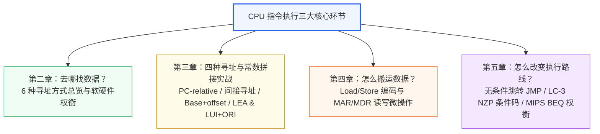

---

## 二、6 种常见寻址方式总览与硬件权衡

### 2.1 一图看懂 6 种寻址方式：去哪找一本书？

我们可以把 CPU 寻找操作数的过程，类比成你在图书馆里“找一本书（或数据）”的六种方式：

1. **立即数 / 字面量（Immediate）**：数据直接硬编码在指令的二进制比特里，**不用去任何地方找**——就像书页空白处直接印着数字 `5`。常用于循环计数器加减常量、**位掩码**（Bitmask，用一串二进制 `0/1` 筛选或屏蔽特定比特位）以及变量初始化。
2. **寄存器寻址（Register）**：数据就在 CPU 手边的寄存器抽屉 `R[reg]` 里，速度最快，专门服务于 ALU 的“寄存器到寄存器”运算（例如 `R1 + R2`）。
3. **PC 相对寻址（PC-relative）**：以当前进度 `PC_next` 为起点，向前或向后数 `offset`（偏移量）步找到目标——就像“从我现在站的位置往前走 5 步”。常用于访问附近的全局变量、实现条件分支（`if/else`），以及**位置相关代码**（指令和数据的相对距离固定）。
4. **间接寻址（Indirect）**：先去 `PC_next + offset` 处拿到一张“写着真正地址的纸条”，再按纸条上的地址去找真正的数据——就像“先找线索，再找宝藏”。天生契合 C 语言里的**指针（Pointer）**、链表、树和图。
5. **基址加偏移寻址（Base + offset）**：先从通用寄存器 `R[base]` 里拿出“起点地址”，再加上一个偏移量 `offset`——就像“先找到某栋教学楼，再往里走 8 个房间”。极其适合访问**数组元素**、**结构体（Struct）成员**以及函数调用时的**栈帧**（Stack Frame，函数在内存栈上分配的专属临时工作区）。
6. **伪直接 / 跳转目标寻址（Pseudo-direct）**：把指令里自带的跳转编号和当前 `PC_next` 的最高几位直接“拼接”成一个完整地址，常见于 MIPS 的无条件跳转指令（**J-type** 指令，如 `j` 和 `jal`）。

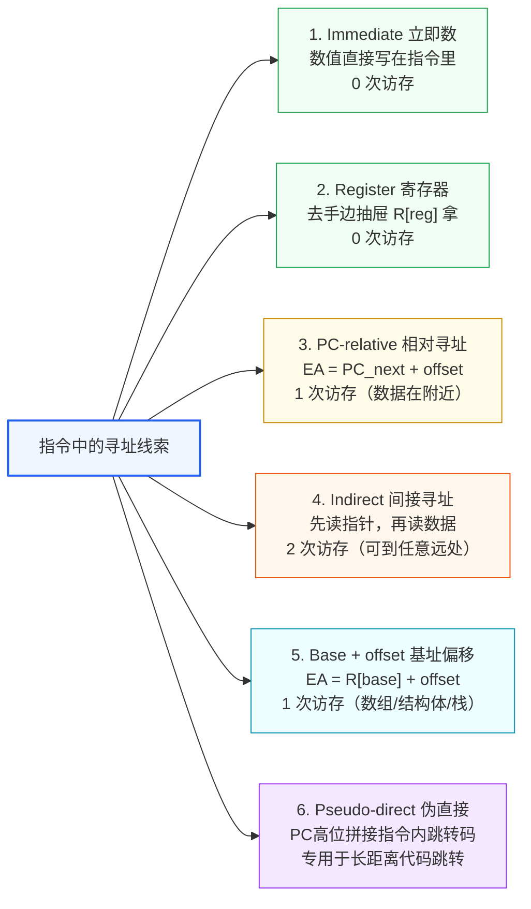

---

### 2.2 为什么不是寻址方式越多越好？

初学者经常会问：“既然每种寻址方式都有用，干脆给 CPU 设计几十种寻址方式不就好了吗？”

事实恰恰相反。早期**复杂指令集（CISC，如 VAX、x86）**曾支持非常丰富的寻址模式，可以把高级语言里的数组、指针、二维矩阵直接翻译成极少几条机器指令；但以 **MIPS、RISC-V、ARM** 为代表的现代**精简指令集（RISC）**却刻意砍掉了冗余的寻址方式。原因在于，寻址方式越多，代价会同时转移给**硬件电路**和**编译器软件**：

- **硬件变复杂**：
  - 每增加一种地址计算路线，数据通路里就必须塞入更多**多路选择器（MUX，Multiplexer，即在多路电信号中按控制信号选通其中一路的“电子道岔”）**和不同位宽的**符号扩展器**。
  - 地址计算逻辑复杂后，往往需要专用的**地址加法器**，并且**有限状态机（FSM，CPU 内部控制执行步骤的“流程总管”）**的状态数量会急剧膨胀（例如间接寻址要多出好几个等待访存的状态），拉低主频并增加功耗与验证成本。
- **编译器变难写**：
  - 同一个高级语言动作（比如读取全局变量或数组元素）可能有四五种等效的寻址写法。**编译器（Compiler）**在生成机器码时，必须在庞大的“指令选择搜索空间”里权衡哪种更省寄存器、哪种代码体积更小、哪种流水线停顿最少，显著增加后端优化器的复杂度。

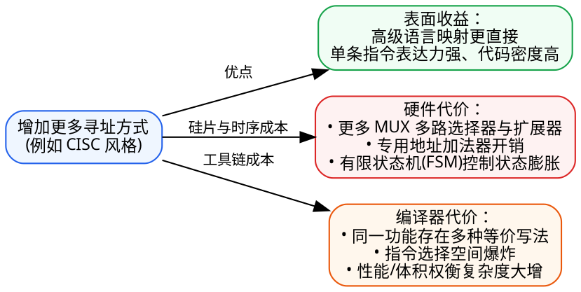

---

## 三、分节详解：四大寻址与常量构造实战

### 3.1 PC-relative 寻址（`LD` / `ST`）：为什么范围是 `-256` 到 `+255`？

在 LC-3 中，**PC 相对加载指令 `LD`（Load）** 用当前程序的位置作为基准去附近取数据，执行两步操作：

$$EA = PC_{next} + \text{sign\_extend}(\text{offset}_9)$$

$$R[DR] \leftarrow \text{Memory}[EA]$$

如果是 **PC 相对存储指令 `ST`（Store）**，方向正好相反，把源寄存器 `R[SR]` 的值写进 `Memory[EA]`。

#### 数值推演示例

假设一条 `LD R1, offset` 指令存放在内存地址 `0x3000`，指令里的 9 bit 有符号偏移量是 `+5`：

1. **取指与 PC 自增**：CPU 从 `0x3000` 取出这条指令后，`PC` 立即自动加 1，变成 $PC_{next} = \text{0x3001}$。
2. **计算有效地址**：$EA = \text{0x3001} + 5 = \text{0x3006}$。
3. **读写内存**：访问内存格子 `0x3006`，把里面存的数据放进寄存器 `R1`。

#### 为什么偏移范围总是不对称的 `-256` 到 `+255`？

很多初学者死记硬背“最多往前 256、最多往后 255”，其实只要看一眼指令比特宽度就彻底明白了：

LC-3 一条指令总共只有 **16 bit**，扣除 4 bit 的 `opcode` 和 3 bit 的寄存器编号 `DR`，留给偏移量的只剩下 **9 bit**（$16 - 4 - 3 = 9$）。

在计算机通用的**二进制补码（Two's Complement）**表示法中，$n$ 位有符号整数能表达的数值范围固定为：

$$\left[-2^{n-1},\ +2^{n-1} - 1\right]$$

把 $n = 9$ 代入公式：

- 最小值（最高位为 `1`，其余全 `0`）：$-2^8 = -256$
- 最大值（最高位为 `0`，其余全 `1`）：$+2^8 - 1 = +255$

这个“负多正少”的区间是补码编码的天然数学性质。同时必须牢记：**计算的起点是已经自增过的 `PC_next`（`0x3001`），而不是当前指令自己的地址（`0x3000`）**！

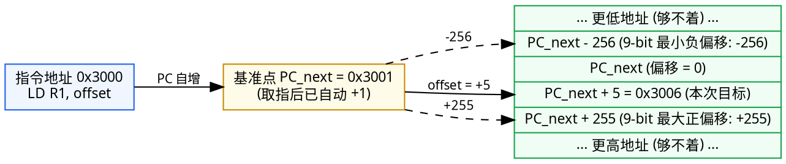

> [!WARNING] PC-relative 的天然局限
> 因为只能够到 `PC_next` 前后两百多格以内的内存，如果目标数据在很远的内存区域（比如 `0x8000`），`LD` / `ST` 就无能为力了，这时就需要请出下一节的**间接寻址**或 **Base + offset 寻址**。

---

### 3.2 间接寻址（`LDI` / `STI`）：两次访存实现“指针追踪”

如果目标数据离当前指令超过了 256 个单元，PC-relative 够不到怎么办？LC-3 提供了**间接加载指令 `LDI`（Load Indirect）**，思路非常巧妙——**“在附近放一张写着远方地址的纸条（指针）”**。它分三步完成：

$$\text{pointer\_addr} = PC_{next} + \text{sign\_extend}(\text{offset}_9)$$

$$EA = \text{Memory}[\text{pointer\_addr}]$$

$$R[DR] \leftarrow \text{Memory}[EA]$$

如果是 `STI`（Store Indirect），则是先通过前两步查出 `EA`，再把 `R[SR]` 写入 `Memory[EA]`。

#### 数值推演示例

假设你要拿一个远在地址 `0x8000` 的数据 `42`，指令位于 `0x3000`（所以 `PC_next = 0x3001`），偏移量为 `+5`：

1. **第一次读内存（拿到线索/指针）**：先算近处地址 $\text{pointer\_addr} = \text{0x3001} + 5 = \text{0x3006}$。打开 `Memory[0x3006]`，发现里面存的不是最终数字 `42`，而是一个完整的 16 bit 地址 `0x8000`。
2. **第二次读内存（拿到真正的数据）**：把这个 `0x8000` 当作真正的有效地址 `EA`，再次访问内存 `Memory[0x8000]`，最终把里面的 `42` 放进寄存器 `R[DR]`。

```graphviz
digraph IndirectAddressing {
  rankdir=LR;
  node [shape=box, style="filled,rounded", fontname="sans-serif", fontsize=11];
  edge [fontname="sans-serif", fontsize=10];

  PC [label="PC_next = 0x3001\noffset = +5", fillcolor="#eff6ff", color="#2563eb"];
  NearMem [label="近处内存 Memory[0x3006]\n存放指针: 0x8000", fillcolor="#fefce8", color="#ca8a04"];
  FarMem [label="远处内存 Memory[0x8000]\n存放真实数据: 42", fillcolor="#fff7ed", color="#ea580c"];
  Reg [label="目的寄存器 R[DR]\n最终写入: 42", fillcolor="#f0fdf4", color="#16a34a"];

  PC -> NearMem [label="第 1 次读内存\n(取地址纸条)"];
  NearMem -> FarMem [label="把 0x8000 当作 EA\n第 2 次读内存"];
  FarMem -> Reg [label="装入结果"];
}
```

#### 间接寻址的收益、代价与 MIPS 对比

- **核心收益**：既突破了 9 bit 偏移量的距离限制（近处放一个 16 bit 指针，就能指向 64K 地址空间的任意角落），又天然匹配**指针追踪（Pointer Chasing）**——比如在链表里从当前节点顺着 `next` 指针跳向下一个节点。
- **硬件与性能代价**：**单条指令要访问两次内存**！主存访问是 CPU 里最慢的操作之一，两次串行读内存不仅让延迟翻倍，还迫使控制器（FSM）多设计好几个中间状态来暂存第一次读出的地址、再发起第二次访存。
- **MIPS 的极简哲学**：经典 MIPS 遵循精简指令集（RISC）原则——每条指令只做一件简单的事（最多访存一次），因此干脆**不提供**单条间接加载指令，而是让编译器拆成两条普通的 `lw`（Base + offset）指令依次执行，效果完全等价：

```asm
lw $t0, 0($s0)    # 第 1 次读内存：把 $s0 指向格子里的“地址指针”读到 $t0
lw $t1, 0($t0)    # 第 2 次读内存：把 $t0 当作新基址，读出真正的目标数据到 $t1
```

---

### 3.3 Base + offset 寻址（`LDR`/`STR` 与 `LW`/`SW`）与字节对齐陷阱

LC-3 的 `LDR`/`STR` 和 MIPS 的 `LW`/`SW` 都遵循同一个简洁公式：

$$EA = R[\text{base}] + \text{sign\_extend}(\text{offset})$$

它和 PC-relative 最大的区别在于：**基准点不再是跟着代码位置跑的 `PC_next`，而是程序员可以自由装填任意地址的通用寄存器 `R[base]`**。这意味着，只要把数组首地址、结构体指针或函数栈顶放进 `R[base]`，无论目标在内存天涯海角，都能靠一个很小的 `offset` 精准读写。

#### 初学者最高频踩坑点：为什么 `A[2]` 的偏移量是 `8` 而不是 `2`？

这背后涉及计算机组成原理里最关键的一个概念对比：**按字编址（Word-addressable）** vs **按字节编址（Byte-addressable）**。

- **Byte（字节）** = 8 bit。在现代主流架构（MIPS、RISC-V、x86、ARM）中，内存是**按字节编址**的——也就是说，**每 1 个字节（8 bit）占一个门牌号**。
- **Word（字）** = MIPS 里一个标准整数（`int`）或一条指令的宽度是 32 bit，换算成字节就是 $32 \div 8 = 4\text{ Bytes}$。

因此，如果有一个 32 bit 整型数组 `int A[3]` 放在基址 `$s0 = 0x1000` 处，它在内存里会像下面这样连续占据 12 个门牌号：

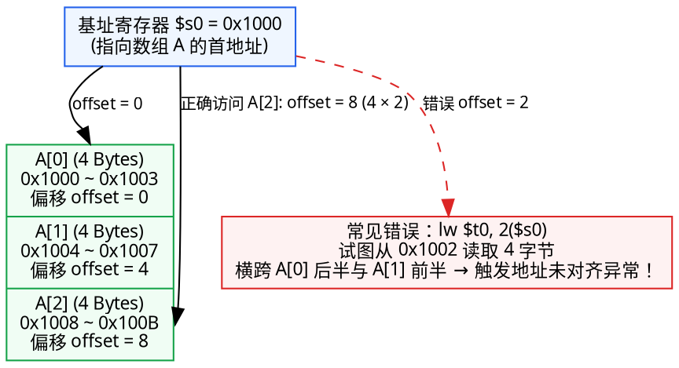

| 数组元素 | 占用的字节地址（假设 `$s0 = 0x1000`）  | 相对基址的字节偏移量    | 对应的 MIPS 汇编写法 |
| :------- | :------------------------------------- | :---------------------- | :------------------- |
| `A[0]`   | `0x1000`、`0x1001`、`0x1002`、`0x1003` | `0`（$4 \times 0$）     | `lw $t0, 0($s0)`     |
| `A[1]`   | `0x1004`、`0x1005`、`0x1006`、`0x1007` | `4`（$4 \times 1$）     | `lw $t0, 4($s0)`     |
| `A[2]`   | `0x1008`、`0x1009`、`0x100A`、`0x100B` | **`8`**（$4 \times 2$） | `lw $t0, 8($s0)`     |

如果初学者把偏移量误写成 `2`，CPU 就会试图从 `0x1002` 开始连续读取 4 个字节（`0x1002~0x1005`），直接把 `A[0]` 的后半截和 `A[1]` 的前半截拼在一起！在严格要求**字对齐（Word Alignment，即 4 字节访问的地址必须是 4 的倍数）**的 MIPS 硬件上，这不仅会读出垃圾数据，还会当场触发**地址未对齐异常（Address Error Exception）**。

> [!TIP] 记忆口诀：按字节编址的下标换算
> 在 MIPS/RISC-V/x86/ARM 上访问第 `i` 个元素时，地址偏移永远是 `i * sizeof(element)`。对于 32 位整型数组，公式就是 **`base + 4 * i`**。而在教学机 **LC-3** 上，内存本身是按 16 bit 字编址（每个门牌号就是 2 字节一格），所以 LC-3 访问数组第 `i` 个字元素的偏移就是 `i`。

---

### 3.4 立即数、LC-3 `LEA` 与 MIPS `LUI + ORI` 常数拼装

#### 1. 立即数（Immediate）的双刃剑

程序里充斥着 `i = i + 1`、`ptr += 4` 这样的常数操作。如果没有立即数，CPU 就必须把 `1` 和 `4` 先存进内存，每次使用时还要先发一次 Load 读进一个宝贵的通用寄存器。**立即数直接把常数嵌在指令的二进制比特中，既不需要访问内存，也不额外占用寄存器**。

但缺点同样明显：**定长指令的容量有限**（LC-3 指令总长只有 16 bit，MIPS 只有 32 bit）。一条指令里扣除操作码和寄存器编号后，剩下的比特位不可能塞得下一个完整的 16 bit 或 32 bit 大常数。

#### 2. 高频对比：`LEA` 与 `LD` 的本质区别

LC-3 的 **`LEA`（Load Effective Address，加载有效地址）** 指令长得很像 `LD`，公式甚至前半截一模一样：

$$R[DR] \leftarrow PC_{next} + \text{sign\_extend}(\text{offset}_9)$$

注意看：**公式里没有 `Memory[...]`！** 一句话就能永久记住两者的区别：**`LD` 是去屋里搬东西，`LEA` 只把门牌号抄在纸上**。

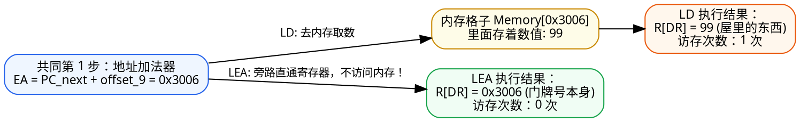

| 指令      | 执行动作                            | 是否访问内存   | 执行后 `R[DR]` 的值  | 典型编程用途                           |
| :-------- | :---------------------------------- | :------------- | :------------------- | :------------------------------------- |
| **`LD`**  | 先算地址 `0x3006`，再去内存取数     | **是**（1 次） | `99`（格子里的内容） | 读取某全局变量的数值                   |
| **`LEA`** | 只算出地址 `0x3006`，直接存入寄存器 | **否**（0 次） | `0x3006`（地址本身） | 获取数组或字符串的首地址（初始化指针） |

#### 3. MIPS 如何用 `LUI` + `ORI` 无中生有拼出 32 位大常数？

MIPS 一条指令固定 32 bit，不可能把“6 bit 操作码 + 5 bit 源寄存器 + 5 bit 目的寄存器 + 完整 32 bit 常数”全塞进一条指令里。那么，假如我们要把 32 bit 大常数 **`0x65e00f3c`**（或任意 32 bit 内存基地址）放进寄存器 `$s0`，且不想访问慢速内存，MIPS 该怎么办？

答案是**“上下两半，分两步拼装”**（回忆十六进制换算：每 1 位十六进制对应 4 bit 二进制，因此 **4 位十六进制刚好等于 16 bit**）：

```asm
lui  $s0, 0x65e0       # 步骤 1：加载高 16 位，低 16 位自动清零 -> $s0 = 0x65e00000
ori  $s0, $s0, 0x0f3c  # 步骤 2：按位或填入低 16 位          -> $s0 = 0x65e00f3c
```

下面用 Graphviz 拆解这两步操作中 32 个比特位的真实变化：

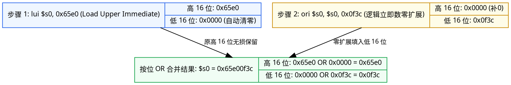

> [!IMPORTANT] 经典考点：为什么第二步必须用 `ori`，而绝对不能用 `addi`？
> 初学者常疑惑：“高 16 位已经是 `0x65e00000` 了，加上 `0x0f3c` 不也等于 `0x65e00f3c` 吗？”
> 这在低 16 位较小的时候碰巧成立，但**一旦低 16 位的最高位（bit 15）是 `1`**（也就是低 16 位大于等于 `0x8000`），`addi` 就会出大事！
>
> - **`addi`（算术加立即数）** 会对 16 bit 立即数做**符号扩展**。假如你想拼 `0x65e08000`，`addi` 会把 `0x8000` 视作负数（`-32768`），扩展成 `0xffff8000`！相加后变成 `0x65e00000 + 0xffff8000 = 0x65df8000`，**高 16 位被错误地减去了 1**！
> - **`ori`（按位或立即数）** 属于逻辑指令，对 16 bit 立即数做**零扩展**（变成 `0x00008000`），高 16 位永远全为 `0`，做按位或后绝对不会污染已经放好的高 16 位。

---

### 3.5 补充闭环：伪直接寻址（Pseudo-direct）是怎么拼出跳转地址的？

前面总览里还提到第 6 种寻址方式——**伪直接寻址（Pseudo-direct）**，常见于 MIPS 的无条件长跳转指令 `j target` 或函数调用指令 `jal target`（J-type 格式）。

MIPS 一条指令长 32 bit，J-type 扣除 6 bit 操作码后，还剩下 **26 bit** 的 `target` 字段。如何用 26 bit 拼出一个 32 bit 的指令地址？MIPS 做了两件事：

1. **尾部自动补两个 `0`（左移 2 位）**：因为所有 MIPS 指令都必须按 **4 字节对齐**，指令地址的最低 2 位永远是 `00`，根本不用浪费宝贵的编码位数去存！这样 26 bit 立刻变成 **28 bit**。
2. **头部借用当前 `PC_next` 的最高 4 位**：把已经递增的 `PC_next` 的最高 4 bit（`PC_next[31:28]`）直接拼到最前面。

$$PC \leftarrow PC_{next}[31:28] \ \|\ \text{target}_{26} \ \|\ 00_2$$

（符号 `||` 表示二进制位串的直接拼接）

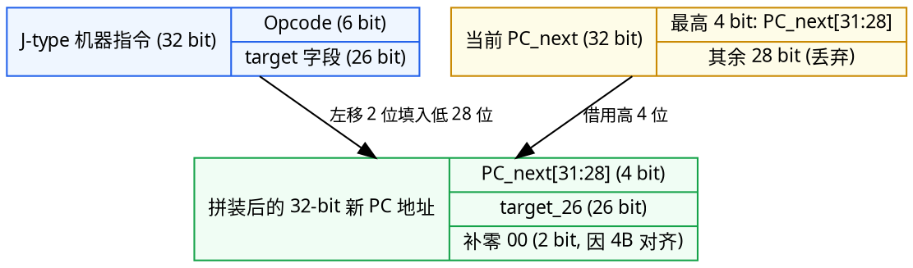

因为高 4 位借自当前的 `PC_next`，这种跳转可以在当前所处的 256 MB 内存大区（$2^{28}\text{ Bytes} = 256\text{ MB}$）内任意长距离直达，所以叫**“伪直接”**（既像直接给出目标地址，又借了一点当前 PC 的高位）。

---

## 四、数据移动指令的底层编码与 MAR/MDR 微操作

算出了目标内存的**有效地址 `EA`** 之后，数据到底是怎么穿过 CPU 与内存之间的边界完成搬运的？这一章我们来看指令的二进制编码结构，以及硬件底层著名的 **MAR / MDR** 抽象模型。

### 4.1 LC-3 Load/Store 指令的二进制编码规律

虽然 LC-3 有多种寻址模式（PC-relative 的 `LD/ST`、间接的 `LDI/STI`、基址偏移的 `LDR/STR`），但它们的 16-bit 二进制编码都遵循统一的规整结构：

1. **Opcode（4 bit，位 `[15:12]`）**：决定是读还是写、用哪种寻址规则。
2. **寄存器字段（3 bit，位 `[11:9]`）**：
   - 执行 **Load（读内存）** 时，它是**目的寄存器 `DR`**（数据读回来往哪放）；
   - 执行 **Store（写内存）** 时，它是**源寄存器 `SR`**（要把哪个抽屉的数据写出去）。
3. **剩余字段（9 bit，位 `[8:0]`）**：根据 `opcode` 的不同，由译码器分别解释成 **9-bit `PCoffset9`**，或者拆分成 **3-bit `BaseR` + 6-bit `offset6`**。

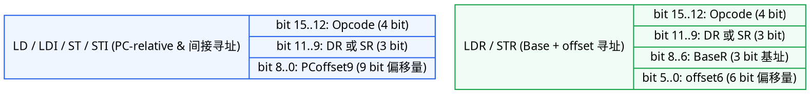

### 4.2 读内存与写内存的 MAR / MDR 微操作时序

在硬件层面，CPU 和主内存之间并不是一拍脑门瞬间连通的。主内存比 CPU 慢得多，需要通过**地址寄存器 MAR（Memory Address Register）**和**数据寄存器 MDR（Memory Data Register）**充当“收发室中转站”。

#### 1. 读内存（Load）的四步抽象过程

```text
1. MAR <- effective_address   ; 把算好的门牌号放进 MAR，并向内存发出读请求
2. 等待 MemoryReady            ; 内存速度慢，CPU 原地等待内存把数据准备好
3. MDR <- Memory[MAR]         ; 内存就绪，数据进入收发室货箱 MDR
4. DR  <- MDR                 ; CPU 把 MDR 里的数据搬进目的寄存器 DR
```

#### 2. 写内存（Store）的三步抽象过程

```text
1. MAR <- effective_address   ; 把目标门牌号放进 MAR
2. MDR <- SR                  ; 同时/随后把要写入的数据从源寄存器 SR 装进 MDR
3. Memory[MAR] <- MDR         ; 发出写使能信号，把 MDR 的货物写入指定内存格子
```

下面这张 **Mermaid 时序图**直观展示了 Load 与 Store 期间，CPU 核心、MAR/MDR 与主内存之间的协作节拍：

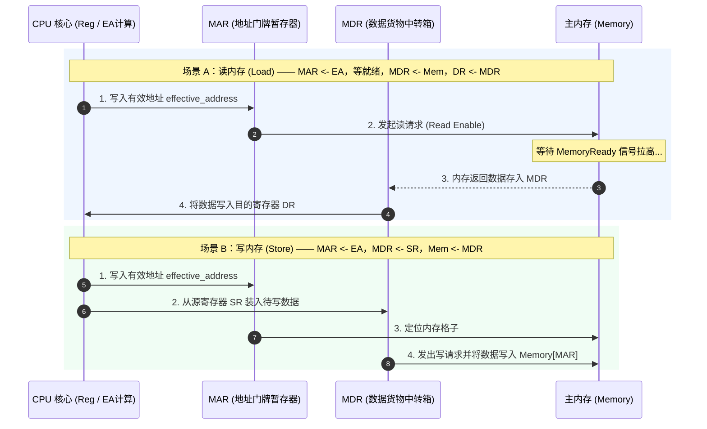

> [!NOTE] 架构抽象边界：真实 CPU 里真有叫 MAR/MDR 的独立寄存器吗？
> **未必！** **MAR 和 MDR 是微体系结构（Microarchitecture）教学中的高价值抽象模型**，用来清晰描述“地址锁存 + 异步等待 + 数据锁存”的接口语义。它们**不是程序员可见的架构寄存器**（ISA 里没有指令能直接写 `ADD MAR, R1, R2`），也不要求所有真实处理器都用同名、独立的物理寄存器来实现——现代高性能 CPU 内部往往使用**加载/存储队列（Load/Store Queue, LSQ）**、**写缓冲（Store Buffer）**、**多级高速缓存（L1/L2/L3 Cache）**以及**内存控制器总线队列**来承担同样的底层职责。

---

## 五、控制流：无条件跳转、条件码与分支权衡

前面几章解决了“数据从哪来、往哪存”的问题，程序已经能做各种算术和内存搬运了。但如果代码只能从头到尾一条条顺序往下走，我们就写不出任何 `if` 判断、`while` 循环或函数调用。**控制流（Control Flow）指令的本质，就是用新目标地址覆盖程序计数器 `PC`**。

### 5.1 无条件跳转：`PC <- R[base]`

在基于寄存器的无条件跳转（例如 LC-3 的 `JMP BaseR` 或 MIPS 的 `jr $ra`）中，核心语义只有一行：

$$PC \leftarrow R[\text{base}]$$

千万注意它与普通运算指令的本质区别：**跳转指令改变的不是通用寄存器里的普通数据，而是下一条指令的取指地址 `PC`**。一旦 `PC` 被改写，下一个时钟周期取指阶段就会直接从新位置抓取指令，实现代码执行流的大跨度转移。

为什么把目标地址放在寄存器 `R[base]` 里如此强大？因为这意味着目标地址可以在**运行时动态计算**，从而轻松支撑四大核心软件结构：

1. **循环跳转**：无条件跳回循环头部重新检查条件。
2. **函数调用与返回**：调用函数前先把返回地址 `PC_next` 存进连接寄存器（如 LC-3 的 `R7`、MIPS 的 `$ra`），函数结束时执行 `JMP R7`（即 `RET`）或 `jr $ra`，就能精准回到当初调用它的下一行代码。
3. **间接分派（Indirect Dispatch）**：C 语言的 **`switch-case` 跳转表（Jump Table）**、**函数指针调用**以及 C++/Java 的**面向对象虚函数表（vtable）多态分发**，底层全部依靠把查表得到的函数地址放进寄存器，再执行一次寄存器间接跳转！

---

### 5.2 LC-3 的 NZP 条件码与硬件实现电路

光有无条件跳转还不够，做 `if (a == b)` 或 `while (i > 0)` 时，CPU 必须能**根据计算结果来决定“跳还是不跳”**。不同指令集对“条件分支”有两种截然不同的经典设计路线——先看 **LC-3 的条件码（Condition Codes）路线**（ARM 和 x86 的 Flags 标志位也是类似思路）。

#### 1. 三个小信号灯：`N`、`Z`、`P`

在 LC-3 中，每当有任何一条指令向通用寄存器（`R0~R7`）写入新结果时（比如执行完 `ADD`、`AND`、`NOT`、`LD`、`LDR`、`LDI`、`LEA`），硬件都会**顺便**根据刚刚写入的那个 16 位结果，同步更新三个 1-bit 条件码寄存器：

- **`N = 1`（Negative）**：结果按二进制补码解释为**负数**（最高位 MSB 为 `1`）。
- **`Z = 1`（Zero）**：结果**全为零**（16 个比特全为 `0`）。
- **`P = 1`（Positive）**：结果按二进制补码解释为**正数**（严格大于 `0`）。

对于任意一个写入寄存器的结果，它要么是负数、要么是零、要么是正数，**三者恰好有且只有一个为 `1`**（硬件上称为 **One-hot 独热编码**，比如结果是 `0` 时，`(N, Z, P) = (0, 1, 0)`）。

#### 2. 条件分支指令 `BR` 的执行逻辑

LC-3 的条件分支指令 `BR`（Branch）在 16 bit 编码里包含 3 个选择位 **`n`、`z`、`p`**（告诉硬件我想关心哪几种情况）以及一个 9 bit PC 相对偏移量 `offset_9`：

$$\text{if } ((n \land N) \lor (z \land Z) \lor (p \land P)): \quad PC \leftarrow PC_{next} + \text{sign\_extend}(\text{offset}_9)$$

- **条件满足时**：`PC` 被新目标地址覆盖，跳转到分支目的地。
- **条件不满足时**：什么都不覆盖，`PC` 保持已经递增后的 `PC_next`，继续顺序执行下一条指令。
- **两个有趣的特例**：
  - **`BRnzp`（`n=1, z=1, p=1`）**：因为 `N、Z、P` 必有一个为 `1`，所以条件永远成立，等价于**PC 相对的无条件分支**！
  - **`BR` 全为 0（`n=0, z=0, p=0`）**：条件永远不成立，PC 永远不跳转也不修改任何寄存器，等价于一条 **NOP（No Operation，空操作占位指令）**。

#### 3. 硬件电路是如何算出 `N、Z、P` 并控制 `PC` 的？

初学者往往觉得“判断正负零”很神秘，其实在门级数字电路里，它极其简单：

1. **符号检测（产生 `N`）**：补码的最高位（bit 15，即 **MSB, Most Significant Bit**）本身就是符号位！所以**根本不需要逻辑门**，直接把数据总线的第 15 位连到 `N` 触发器就行！
2. **零检测（产生 `Z`）**：怎么判断 16 个比特全为 `0`？只要把这 16 个比特全部送进一个 **16 输入或非门（NOR，即先做归约 OR 再取反）**：只有 16 位全为 `0` 时，OR 的结果才是 `0`，取反后 `Z = 1`。
3. **正数检测（产生 `P`）**：既不是负数、也不是零，就一定是正数！即 $P = \overline{N} \land \overline{Z}$。


> [!NOTE] ISA 语义 vs 微体系结构边界
> **什么时候更新条件码**（例如“每次写入通用寄存器时都要更新 NZP”）属于 **ISA 契约语义**，软件和编译器必须依赖它；至于底层究竟是用“16 输入 NOR 门还是树状多级门电路”、以及在哪个时钟沿锁存，则属于 **微体系结构（Microarchitecture）** 的内部设计自由。

---

### 5.3 MIPS 的寄存器直接比较分支与 ISA 权衡

与 LC-3、ARM、x86 的“先写结果改标志位、再查标志位分支”不同，**MIPS**（以及后来的 **RISC-V**）干脆**取消了全局 NZP 条件码寄存器**！取而代之的是在分支指令里**直接比较两个寄存器**。

#### 1. MIPS `BEQ` 指令与神秘的 `<< 2`

MIPS 的 **`BEQ rs, rt, offset`**（Branch on Equal，相等则分支）直接把两个寄存器送进比较器：

$$\text{if } R[rs] = R[rt]: \quad PC \leftarrow PC_{next} + (\text{sign\_extend}(\text{offset}_{16}) \ll 2)$$

除了 `BEQ`，MIPS 还直接提供了 `BNE`（不等则跳）、`BLEZ`（小于等于零则跳）、`BGTZ`（大于零则跳）等变体。

**为什么偏移量在加法之前要先左移 2 位（`<< 2`，即乘以 4）？**
原因和前面的伪直接寻址完全一样：**经典 MIPS 的每条指令固定占 4 个字节，且必须按 4 字节对齐**。既然跳转目的地一定是某条指令的开头（地址必然是 4 的倍数，最低两位永远是 `00`），那么指令编码里的 16 bit `offset` 存的其实是**“相差多少条指令（字偏移）”**，而不是“相差多少字节”。硬件在计算目标字节地址时自动左移 2 位（`<< 2`），既对齐了字节地址，又白白把跳转范围扩大了 **4 倍**（从 $\pm 32\text{ KB}$ 扩大到 $\pm 128\text{ KB}$）！

#### 2. 没有 `BEQ` 的 LC-3 怎么比较两个数是否相等？

LC-3 指令集里没有 `BEQ`，也没有直接的减法指令 `SUB`。如果要判断 `R0 == R1`，程序员或编译器必须借助**补码减法**（$A - B = A + (-B) = A + (\overline{B} + 1)$）算出差值来更新 `NZP`，再用 `BRz` 观察结果是否为零：

```asm
; 在 LC-3 中实现等价于 MIPS "BEQ R0, R1, equal" 的逻辑：
NOT R2, R1      ; 第一步：对 R1 按位取反（需要额外占用临时寄存器 R2）
ADD R2, R2, #1  ; 第二步：加 1，得到补码负数 R2 = -R1
ADD R2, R0, R2  ; 第三步：计算 R2 = R0 - R1，同时自动更新 N, Z, P 条件码
BRz equal       ; 第四步：若 Z == 1（差值为零），跳转到 equal 标签
```

#### 3. 经典的指令集架构（ISA）权衡对比

对比上面一段代码，就能体会计算机体系结构中最经典的一组 **ISA 设计权衡（Trade-off）**：

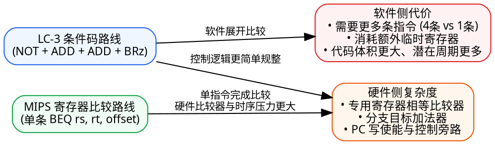

- **MIPS / RISC-V 路线**：把复杂度放进单条指令的硬件比较器里，但消灭了全局条件码（NZP）这个容易引发流水线“数据冒险/隐式依赖”的瓶颈，且**用 1 条指令完成比较加跳转**，执行周期更短、代码更紧凑。
- **LC-3 路线**：让每条指令的数据通路保持极致规整简单（所有比较都复用了现成的 ALU 加法器），代价则是软件需要生成**更多条指令、占用更多内存空间，并耗费更多潜在执行周期**。

---

## 六、全篇知识串联与高频易错点自查

### 6.1 从“找地址”到“改写 PC”的全景闭环

我们用一张综合流程图，把本文讲过的三大板块——**寻址方式（算地址）**、**MAR/MDR（搬数据）**与**控制流（改 PC）**——完整串联进 CPU 的一个执行闭环里：

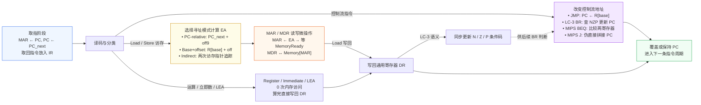

### 6.2 初学者高频易错点自查清单

| 易混淆概念                             | 正确认知（避坑要点）                                                                                                      |
| :------------------------------------- | :------------------------------------------------------------------------------------------------------------------------ |
| **算 `PC-relative` 偏移的起点**        | 永远是以**已经递增后的 `PC_next`** 为基准，而不是当前指令自己的地址。                                                     |
| **LC-3 `LD` vs `LEA` vs `LDI`**        | `LEA` **0 次访存**（只算门牌号）；`LD` **1 次访存**（拿门牌号里的数）；`LDI` **2 次访存**（先拿指针地址，再拿远方数据）。 |
| **MIPS 数组 `A[2]` 的偏移量**          | MIPS 按字节编址，1 个字占 4 字节，因此 `A[2]` 的偏移是 **`8`**（$4 \times 2$），写 `2` 会触发未对齐异常。                 |
| **MIPS 拼 32 位常数：`ori` vs `addi`** | 必须用 `lui` + **`ori`**。`ori` 做零扩展不污染高 16 位；`addi` 会对 `0x8000` 及以上常数做符号扩展，导致高 16 位误减 1。   |
| **MIPS `BEQ` 为什么偏移要 `<< 2`**     | 因为 MIPS 指令按 4 字节对齐，最低 2 位恒为 `00`，指令里存的是“字偏移”，左移 2 位还原成字节地址并扩大 4 倍跳转范围。       |
| **MAR / MDR 是否真实存在**             | 它们是微体系结构的抽象概念，帮助理解“地址锁存 + 异步等待 + 数据中转”，真实 CPU 不一定有同名的程序员可见寄存器。           |
| **LC-3 `BR` vs MIPS `BEQ` 权衡**       | LC-3 硬件控制逻辑简单，但比较需 `NOT+ADD+ADD+BRz` 多条指令；MIPS 单条 `BEQ` 省代码与周期，但硬件需额外比较器与旁路。      |
