# AI 加速器运行时（Runtime）与通用操作系统深度对比指南：从第一性原理到裸机与 Host 架构全景实践

> **“系统软件的本质，是在物理硬件的有限约束与应用算法的无限需求之间，建立一套严密、自洽且高效的状态转移与资源分配契约。”**

在现代人工智能系统工程中，无论是高性能通用计算 GPU、面向云端大规模推理的脉动阵列加速芯片（TPU 类架构），还是深植于边缘与芯片内部的专用神经网络加速器（NPU），都离不开一个核心软件组件——**运行时（Runtime）**。

初涉异构计算系统与底层芯片研发的同学，往往容易产生一个直观的疑问：
*“Runtime 是不是一个简化的微型操作系统？它里面有调度器、有内存管理、有任务同步、有异常处理，这和 Linux 内核到底有什么区别？既然 Linux 已经具备极其成熟的进程调度与虚拟内存，为什么在控制加速卡时不能直接由操作系统搞定，而必须在中间再横亘一套复杂的 Runtime 体系？”*

如果进一步下沉到加速芯片内部——当我们在片上控制器（如嵌入式 RISC-V 核）上编写**裸机（Bare-metal）**固件或运行时，既没有 Linux 内核，也没有系统调用，甚至没有动态内存分配器，这时的 Runtime 又该如何生长出来？它需要从通用操作系统中借鉴哪些经过数十年工业界检验的经典智慧？又必须果断丢弃哪些臃肿而不合时宜的机制？

本文将抛开晦涩的行话堆砌与特定厂商的私有接口，**完全从物理硬件的第一性原理出发**，层层推导演绎 AI 加速器运行时与通用操作系统的同宗同源与本质分野。全文结合 **Host 端操作系统托管** 与 **Device 端片上裸机执行** 两种核心部署架构，给出端到端的工业级架构剖析与工程落地指南。

---

## 零、初学者核心概念速查表与硬件认知对齐

为了让初学者能够无障碍阅读全文，下表将本文首次出现的核心专业术语进行统一定义，并辅以通俗的物理类比与核心职责说明：

| 领域术语 | 英文全称 / 缩写 | 通俗物理类比 | 系统软件中的核心职责 |
| :--- | :--- | :--- | :--- |
| **运行时** | **Runtime** | 施工工地的现场调度指挥部 | 负责特定加速芯片上算子任务的依赖跟踪、硬件资源分配、流水线推进、事件同步与生命周期管理。 |
| **通用操作系统** | **OS (Operating System)** | 管理整座现代化大都市的市政厅 | 抽象并统一管理整台计算机的通用硬件（CPU、RAM、磁盘、网卡），提供多用户隔离、文件系统、网络协议栈与通用进程抢占式调度。 |
| **内核驱动** | **Kernel Driver** | 持有物理机房钥匙的特许安保员 | 运行在 OS 特权模式（Ring 0），掌管物理设备的发现、MMIO 映射、DMA 地址建立、物理中断响应与硬件安全复位。 |
| **裸机程序** | **Bare-metal** | 荒无人烟孤岛上的纯体力拓荒者 | 不依赖任何通用操作系统内核，直接在物理 CPU（如片上控制核）上从上电复位处执行，自建异常表、栈帧与硬件交互循环。 |
| **板级支持包 / 硬件抽象层** | **BSP / HAL** | 机械设备的物理操纵杆与仪表盘 | 将芯片具体的物理寄存器读写、特定自定义指令（如协处理器指令）、中断使能封装为类型安全的底层 C/C++ 接口。 |
| **加速器 / 计算单元** | **Accelerator (GPU/NPU/TPU)** | 专门负责大型土方开挖的重型特种工程车 | 牺牲通用分支预测与乱序执行能力，堆叠海量 MAC（乘加）单元与高吞吐数据流流水线，专精矩阵乘（MatMul）与向量运算。 |
| **算子与计算图** | **Operator (Kernel) & Graph** | 工程蓝图中的单道工序与整体施工流程图 | 神经网络算法被编译后的表达形式：算子是执行基本数学变换的物理核函数（如卷积、全连接、Softmax）；计算图是有向无环图（DAG），规定算子间的数据依赖。 |
| **直接内存访问** | **DMA (Direct Memory Access)** | 连通各施工场地的自动传送带 | 无需主 CPU 逐字逐句搬运数据，专用的硬件搬运引擎可在系统内存（DDR）与片上缓存（SRAM）之间全自动大批量搬运张量。 |
| **片上共享存储** | **SRAM / Scratchpad / SMEM** | 施工工人体旁的超高速操作台 | 位于芯片内部与计算单元紧邻的物理静态 RAM，带宽极大、延迟极低，但容量昂贵有限，需精打细算防止溢出与端口冲突。 |
| **内存映射 I/O** | **MMIO (Memory-Mapped I/O)** | 挂在固定墙上的专用控制电闸盒 | 将硬件控制寄存器的物理地址映射到 CPU 的统一内存寻址空间中，CPU 读取或写入特定地址即可实现对硬件电平与状态的控制。 |
| **邮箱与门铃** | **Mailbox & Doorbell** | 跨部门联络的专用信箱与呼叫电铃 | 异构双核或 Host 与设备间通信的标准硬件机制：写命令至共享区域后按压“门铃（中断触发寄存器）”，唤醒对端处理器处理新任务。 |
| **内存屏障与缓存一致性** | **Memory Barrier & Cache Coherence** | 施工指令的签字确认与确保图纸全员统一 | 内存屏障（Fence）确保 CPU 指令执行顺序；缓存一致性（Coherence）确保当 CPU 写完数据后，依赖该数据的 DMA 或另一核心能读取到最新物理真值而非过期的局部 Cache。 |
| **异步事件与围栏** | **Event & Fence** | 施工完成通知单与进度检查哨卡 | 任务提交给硬件后 CPU 立即返回，通过 Event 记录硬件真实执行进度，供后续算子排队等待或通知上层框架取回数据。 |
| **调用实例与微操作** | **Invocation & Operation** | 一整趟列车发车与各节车厢内的分步操作 | Invocation 代表一次完整的模型推理调用（输入张量到输出张量）；Operation 代表由编译器拆解后的单个物理硬件作业（单次 DMA 传输、单次向量核计算）。 |
| **设备虚拟地址与 IOMMU** | **IOVA & IOMMU** | 仓库内部的防越权编号与安检门禁系统 | 现代操作系统为硬件设备建立的虚拟地址转换机制，确保恶意或出错的加速卡 DMA 无法肆意践踏操作系统内核所在的物理内存。 |

为了在接下来的讨论中建立具象的物理参照，我们以一款经典的**片上集成 RISC-V 控制核的专用数据流/向量加速芯片（NPU/TPU 混合架构）** 作为物理模型：

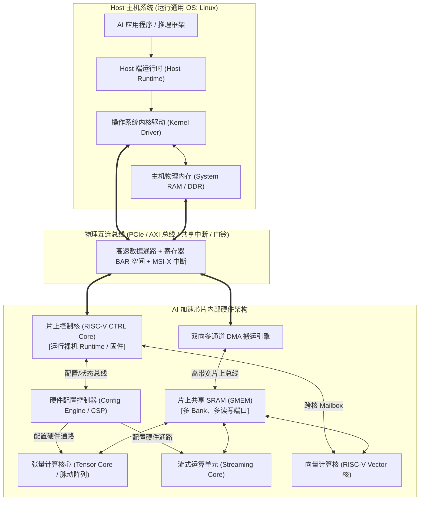

---

## 一、从第一性原理推导：Runtime 为何因物理限制而必然诞生？

我们不从“操作系统教材怎么说”开始，而是采用**第一性原理（First Principles）**推导：
> **假设我们拥有一块全新的 AI 加速芯片，我们试图不用任何已有的 OS 或 Runtime 概念，只靠最质朴的代码让芯片跑起来。软件栈的各种抽象是如何一步步被“物理规律”逼出来的？**

### 1. 假设从零开始：最简单的单一算子调用

假设片上仅有一个矩阵计算单元（Score），我们要执行最简单的运算：$C = A + B$。

最原始的裸硬件控制代码长这样：

```cpp
int main() {
    // 1. 配置片上 SRAM 地址与计算引擎
    write_reg(SMEM_BASE_ADDR_A, 0x1000);
    write_reg(SMEM_BASE_ADDR_B, 0x2000);
    write_reg(SMEM_BASE_ADDR_C, 0x3000);
    write_reg(SCORE_OPCODE, OP_ADD);

    // 2. 拨动电闸：启动计算
    write_reg(SCORE_START, 0x1);

    // 3. 阻塞等待：死循环轮询完成标志
    while ((read_reg(SCORE_STATUS) & 0x1) == 0) {
        // CPU 空转 (Busy Wait)
    }

    return 0;
}
```

这段程序能工作吗？**能。**
它需要复杂的 Runtime 吗？**不需要。** 如果世界上所有的 AI 模型都只有一个算子，且数据早就安安静静躺在芯片算力单元的寄存器里，软件工程甚至不需要 Runtime。

### 2. 物理限制一：片上放不下，必须从外部搬运数据

现实世界的物理约束是残酷的：片上超高速 SRAM 极其昂贵且面积巨大，容量往往只有几十兆字节（MB），而现代深度学习模型的参数量动辄数亿至数千亿，必须存放于外部大容量 DDR 内存中。

因此，计算之前必须先通过 DMA 把数据搬入片上，算完后再搬回去：

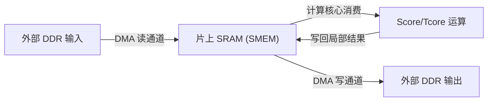

此时代码变成了：

```cpp
start_dma_read(ddr_in, smem_in, size);
wait_dma_read_done();     // 物理约束：输入数据未就绪前，算力单元不能读取！

start_score_compute();
wait_score_compute_done();// 物理约束：计算未完成前，写回 DMA 不能启动！

start_dma_write(smem_out, ddr_out, size);
wait_dma_write_done();
```

**推导结果 1：诞生了“依赖关系（Dependency）”的抽象。**
为什么必须等待？因为物理世界中存在**因果律与数据一致性约束**：

$$\operatorname{Complete}(\text{DMA}_{\text{in}}) \prec \operatorname{Start}(\text{Compute}) \prec \operatorname{Start}(\text{DMA}_{\text{out}})$$

如果一个软件要编排成百上千个算子，就必须维护一张有向无环图（DAG），记录“谁依赖谁”。

### 3. 物理限制二：串行等待导致算力严重浪费，硬件必须流水并发

在上面的串行代码中，计算引擎在 DMA 搬运时处于完全停转状态（利用率为 0%），DMA 在计算时也处于闲置状态。以乘加阵列极高的能耗比来看，这是巨大的硬件浪费。

为了榨干芯片算力，硬件工程师为我们提供了独立的数据搬运通道与计算引擎，支持**重叠流水线（Pipelining）**：在计算当前瓦片（Tile $N$）的同时，DMA 并行搬运下一个瓦片（Tile $N+1$）的输入，同时另一路 DMA 并行写回上一个瓦片（Tile $N-1$）的输出。

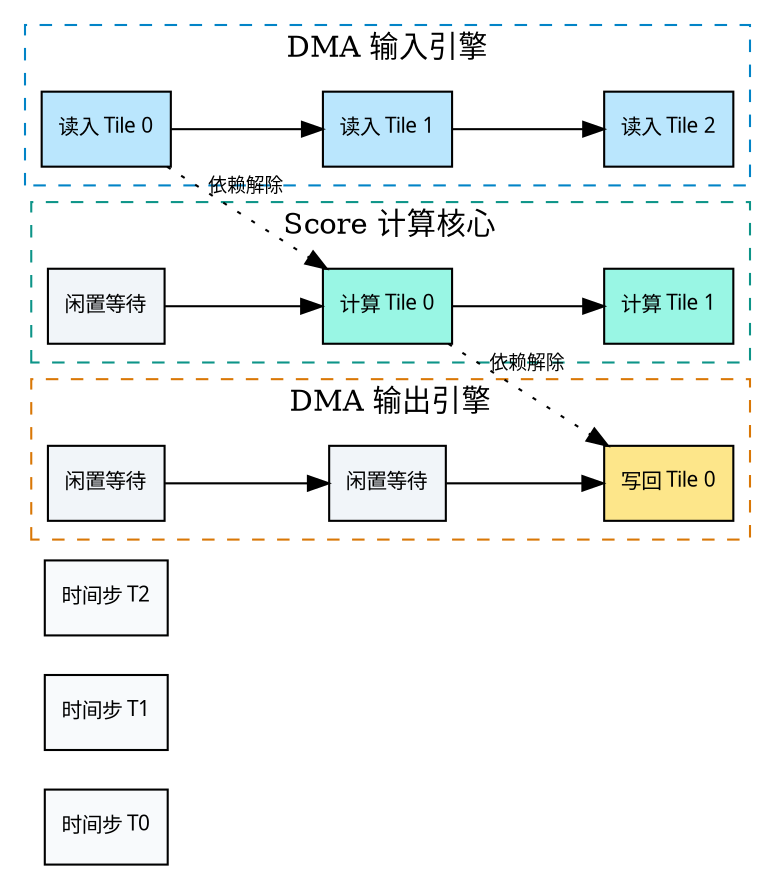

一旦开始并发，纯顺序的阻塞代码立刻破产了！CPU 不能停在 `wait()` 里面发呆，必须能同时监控三个硬件引擎的实时状态。

**推导结果 2：诞生了“资源互斥（Resource）”与“调度器（Scheduler）”的抽象。**
- DMA 通道有几条？SMEM 读写端口是否冲突？当前硬件是否允许并发启动？
- 当依赖满足且硬件资源空闲时，应该由谁来决定启动哪一个任务？——**这就是调度机制的起源。**

### 4. 物理限制三：CPU 发出指令与硬件完成之间存在时间鸿沟

CPU 往启动寄存器写入 `0x1`，从指令总线完成交付仅需几个纳秒，但专用算力核心执行完一个复杂卷积或大尺寸矩阵乘法可能需要数百微秒甚至数毫秒。

$$\operatorname{Submit}(Task) \neq \operatorname{Complete}(Task)$$

并且，“硬件引擎内部计算结束”与“结果数据真正刷入消费者可见的存储空间”之间，由于总线缓冲器（Store Buffer）与 Cache 的存在，并不天然等价：

$$\operatorname{EngineDone}(Task) \neq \operatorname{DataVisible}(Task)$$

**推导结果 3：诞生了“异步事件与完成证据（Event / Completion）”的抽象。**
软件必须有一种可靠机制，在异步的世界中持有凭据。后续任务挂起在凭据上，直到物理完成证据（如完成中断或状态位反转）到来并完成内存可见性同步后，才被激活。

### 5. 物理限制四：片上缓冲有限，必须建立所有权回收机制

如果一个双缓冲（Ping-Pong Buffer）在计算瓦片 0 时，瓦片 1 的 DMA 企图复用该区域，那么瓦片 0 尚未被计算核心读完的数据就会被瞬间覆写破坏。

**推导结果 4：诞生了“内存所有权与生命周期（Ownership & Lifetime）”的抽象。**
一块 Buffer 什么时候能分配？什么时候必须加读锁保护？什么时候所有异步硬件使用者都已离场、允许被重新利用？

### 6. 物理限制五：硬件执行可能因物理故障或参数错误而卡死

在工业实际部署中，DMA 总线争用可能超时、硬件地址不对齐会引发总线错误（Bus Error）、算子数值异常可能引发硬件死锁。

如果软件只是傻傻地死等 `while(!done)`，整台机器将被永久挂起。但如果直接强行退出，后台还在疯狂写入内存的 DMA 可能会把后续进程的物理内存彻底碾碎。

**推导结果 5：诞生了“故障隔离域与安全恢复（Fault Domain & Reset）”的抽象。**

---

### 第一性原理推导总结：Runtime 的六大支柱

通过上述物理演进，我们直接推导出了 Runtime 的核心骨架：

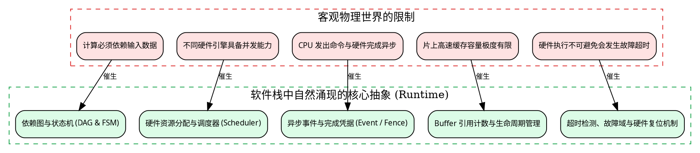

**看！这就是第一性原理的魅力：我们完全没有去抄袭操作系统的书本，但最终推导出来的软件机制，竟然与操作系统的任务调度、等待队列、内存管理与异常处理高度共鸣。**

现在，我们终于可以科学地回答那个根本问题：
> **通用操作系统（OS）管理整台计算机的通用资源（多进程公平竞争、虚拟地址空间、文件网络外设）；**
> **AI 加速器运行时（Runtime）管理特定加速器的执行资源（算子依赖、片上 SRAM、硬件流水线、微秒级任务同步）。**
> **两者的本质目的，都是在有限的物理资源与相互依赖的任务之间，实现无冲突、高吞吐、低延迟的执行调度。**

---

## 二、两大核心部署架构剖析：Host OS 托管 vs Device 片上裸机

在深入代码实现之前，必须明确一点：**Runtime 究竟运行在哪颗 CPU 上？**
按执行 Runtime 的主控处理器是否运行操作系统，业界存在两种截然不同但又频繁协同的部署架构：

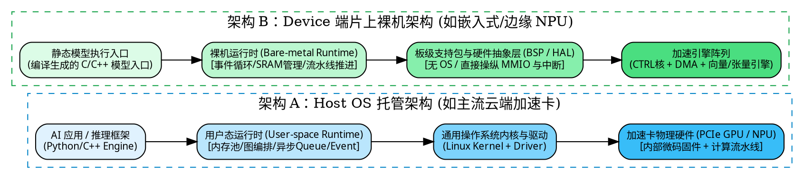

### 1. 架构 A：Runtime 运行在 Linux 等通用操作系统中（Host 侧）

这是最常见的形态（例如插入主板 PCIe 插槽的高性能加速卡）：
- **运行环境**：运行在主板的通用 CPU（x86-64 或 ARM64）上，依托 Linux 用户态。
- **职责**：
  1. 为上层提供标准 C/C++ API（如类似创建流、分配显存、发射核函数、等待同步）。
  2. 在用户空间维护内存池（Buffer Pool），避免每次算子执行都陷入操作系统内核调用。
  3. 将复杂的上层计算图解析为驱动能够理解的命令描述符（Command Descriptor）。
  4. 遇到需要硬件特权的操作（如物理地址映射、门铃触发、休眠等待），通过系统调用（如 Linux 的 `ioctl`）穿透到内核驱动层。

### 2. 架构 B：Runtime 作为纯裸机程序运行（Device 侧）

这是边缘嵌入式芯片、或大型芯片片上控制微核（Controller）的典型形态：
- **运行环境**：运行在芯片内部的微控制器上（如片上 RISC-V CTRL 核），**底层没有任何操作系统**。
- **职责**：
  1. 芯片上电复位后，从 `crt0.S` 汇编入口直接启动，自行建立栈指针、清零 `.bss` 段。
  2. 不存在虚拟内存，直接操作物理地址与 MMIO 寄存器。
  3. 通过极为紧凑的事件循环（Event Loop）轮询硬件状态，或者挂载专用的硬件完成中断服务函数（ISR）。
  4. 手工编排片上有限的 SRAM 读写，直接向内部 DMA 与矩阵单元分发任务。

### 3. 架构 C：现代高端芯片的现实常态——“Host OS + Device 裸机”双端协同

千万不要把架构 A 与架构 B 割裂来看！在目前工业界主流的大算力 AI 加速芯片中，**两者往往同时存在于同一块电路板上**：

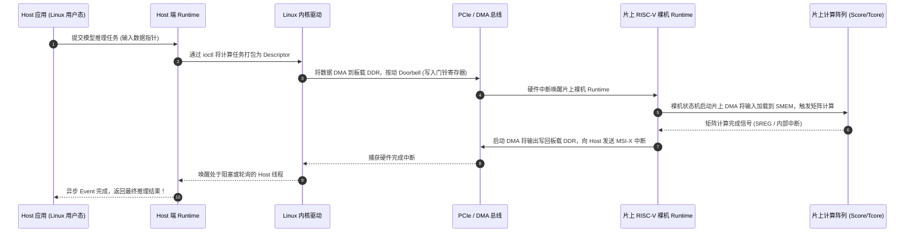

在这个宏大的分布式系统中：
- **Host 端 Runtime 是“业务组织者”**：负责模型载入、用户参数绑定、主机内存钉住（Pinning）、发起大块 PCIe 传输。
- **Device 端裸机 Runtime 是“物理执行官”**：负责微秒级片上 SRAM 抢占与复用、算子切分调度、DMA 与多计算单元硬件流水编排。

---

## 三、击碎迷思：运行在 OS 中的 Runtime 难道不就是驱动（Driver）吗？

在许多初学者的认知中，常常会产生一个经典误解：
*“既然我的加速卡在 Linux 下有一个 `.ko` 内核驱动文件，我直接通过驱动写寄存器不就能跑了？Runtime 是不是只是对驱动函数做了一层毫无意义的 API 换名封装？”*

**答案是否定的。Driver 解决的是“如何安全访问硬件”，而 Runtime 解决的是“如何组织计算任务”。**

### 1. 核心职责边界全景对比

| 对比维度 | Linux 内核驱动（Kernel Driver） | 加速器运行时（User-space Runtime） |
| :--- | :--- | :--- |
| **运行级别** | 特权模式（Kernel Space / Ring 0） | 用户空间（User Space / Ring 3） |
| **硬件权限** | 拥有最高权限，直控物理 MMIO、IOMMU、物理中断、时钟复位 | 无特权，只能通过映射后的虚拟地址或受控系统调用访问特定队列 |
| **对模型的理解** | **完全盲目**。只认得命令包大小、物理内存页链表、PCIe 通道号 | **深度理解**。懂得张量 Shape、计算图依赖、算子融合、执行阶段 |
| **调度抽象** | 调度的是硬件队列（Ring Buffer、Doorbell 槽位） | 调度的是计算图（DAG、算子流水、Ping-Pong Buffer、Stream） |
| **内存管理** | 锁定物理内存页（Pin）、配置 IOMMU 建立设备可访问的 IOVA | 维护高级张量内存池（Buffer Pool），管理不同算子间的显存复用 |
| **安全与隔离** | 防止恶意用户态程序践踏其他进程内存，处理设备硬死机复位 | 无法提供系统级强制隔离，依赖驱动提供的安全沙箱通道 |

### 2. 为什么工业界不把 Runtime 的工作全塞进驱动？

如果把计算图解析、算子依赖分析、显存池全塞进内核驱动，会引发灾难性的工程后果：
1. **陷入内核的巨大开销**：每一次算子提交都必须通过 `ioctl` 陷入内核，产生数百纳秒的上下文切换开销，而一次小算子在 GPU/NPU 上的执行时间可能只有微秒级，系统将完全卡在用户态与内核态的频繁往返中。
2. **内核崩溃风险**：深度学习编译器的优化策略瞬息万变，复杂的计算图分析代码若放在内核，稍有指针越界就会导致整台 Linux 服务器内核崩溃（Kernel Panic / BSOD）。
3. **版本演进困难**：内核驱动必须极度保守稳定，而算法与算子模型每周都在迭代。用户态 Runtime 随应用程序直接打包发布（如动态链接库 `.so`），无需重启系统或重新编译内核模块。

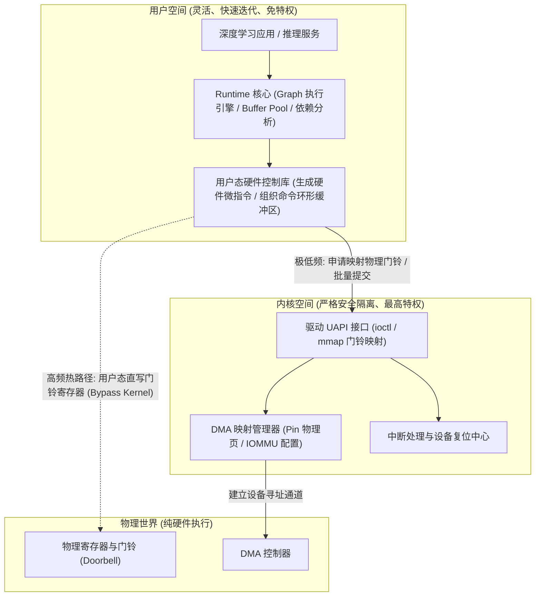

> **架构黄金定律**：
> - **慢路径（Slow Path，低频）**：初始化、申请大块显存、建立映射、注销设备 $\to$ **走内核驱动**。
> - **快路径（Fast Path，高频）**：提交计算指令、写入片上队列、查询完成状态 $\to$ **在用户态 Runtime 闭环，直写映射后的硬件门铃，绕过内核！**

---

## 四、深入情况 A：运行在 OS 中的 Runtime 架构（Host 视角）

现在，让我们聚焦于运行在 Linux 环境下的 Host 端 Runtime，看它是如何与操作系统及其内核驱动协同工作的。

### 1. 为什么 Linux 无法代替 Runtime 管理计算任务？

Linux 内核拥有全球最顶尖的通用 CPU 调度器（从经典的 CFS 完全公平调度器到现代的 EEVDF 早期截止时间优先调度器）。为什么它对加速芯片的内部调度彻底束手无策？

因为 Linux CPU 调度器的设计假设是：
- 调度实体是独立的 CPU 线程或进程。
- 任务受抢占机制制约，通过保存和恢复通用寄存器（RIP, RSP 等）实现上下文切换。
- 目标是在成百上千个通用任务间实现时间片公平与极短的交互响应。

而加速芯片内部的计算语义是截然不同的：
- 它根本没有通用的程序计数器与通用线程栈，执行的是**固化了数学拓扑的执行块（Kernel）**。
- 它不具备轻量级任意抢占的物理能力——你很难在矩阵乘法执行到一半时强行打断它，并瞬间保存数万个计算单元的内部流水线状态。
- 它要求精确知晓数据在片上 SRAM 中的空间布局，并在纳秒级时钟周期内判定瓦片之间的 Ping-Pong 依赖。

**因此，Linux 调度的是宿主机的 CPU 线程，而 Runtime 编排的是加速芯片内部的数据流与硬件执行队列表。**

### 2. 现代通用异构计算 API 的分层抽象

为了避免受特定专有生态接口的误导，我们提炼出现代工业界最通用、最正统的抽象层 API 设计范式：

```cpp
// 1. 初始化加速设备与执行上下文
AcceleratorDevice device;
device.Open(0); // 打开 0 号加速卡

AcceleratorContext context;
context.Create(device);

// 2. 分配设备可见的高速显存 (底层向驱动申请 DMA 一致性物理页)
DeviceBuffer d_input  = context.AllocateMemory(1024 * 1024 * sizeof(float));
DeviceBuffer d_output = context.AllocateMemory(1024 * 1024 * sizeof(float));

// 3. 将宿主机 CPU 内存中的数据搬运到加速设备
context.MemcpyAsync(d_input, h_input_data, 1024 * 1024 * sizeof(float), CopyDirection::HostToDevice);

// 4. 创建异步命令执行流 (Stream / Command Queue)
ExecutionStream stream = context.CreateStream();

// 5. 将计算任务 (Kernel) 压入队列 (非阻塞调用，瞬间返回！)
ExecutionConfig config(/* 维度网格参数 */ {64, 64}, /* 局部工作组 */ {16, 16});
stream.LaunchKernel(matrix_multiply_kernel, config, d_input, d_output);

// 6. 压入完成事件并同步
ExecutionEvent event = stream.RecordEvent();
event.Wait(); // 阻塞等待当前队列所有任务物理执行完毕

// 7. 回收结果
context.Memcpy(h_output_result, d_output, 1024 * 1024 * sizeof(float), CopyDirection::DeviceToHost);
```

#### 关键技术内幕剖析：
- **`LaunchKernel` 是非阻塞的**：该函数被调用时，CPU 绝不会在原地等待硬件把矩阵算完。它仅仅是将一个携带参数的“命令描述符”写入了一个用户态与硬件共享的环形队列（Ring Buffer），然后直接返回。
- **异步错误 vs 启动错误**：如果你的核函数参数传错了，`LaunchKernel` 可能会立即抛出错误（启动错误）；但如果是在硬件内部执行时发生了除零异常或非法显存访问，该错误只会在未来的 `Wait()` 或下一次同步点时延迟抛出（异步错误）！

### 3. OS Runtime 最容易踩的八大工程陷阱

在编写 Host 端异构运行时时，以下陷阱是工业界研发中最为高频的致命 Bug：

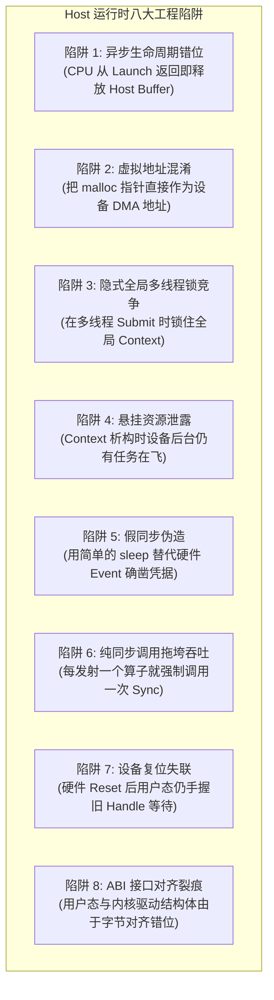

以**陷阱 1** 为例展开：
```cpp
void RunInference(AcceleratorContext& ctx, const std::vector<float>& data) {
    DeviceBuffer d_buf = ctx.AllocateMemory(data.size() * sizeof(float));
    ctx.MemcpyAsync(d_buf, data.data(), data.size() * sizeof(float), CopyDirection::HostToDevice);
    ctx.LaunchKernel(my_kernel, d_buf);
    // 函数结束，栈上的局部变量 data 瞬间被销毁！
    // 灾难发生：DMA 传输可能此时才刚刚启动，正在访问已经被回收的内存区域！
}
```
**防范法则**：所有异步提交的资源，其宿主机内存生命周期必须与对应的硬件 `Event` 强行绑定，只有收到确凿的完成回调后，才允许解引用或回收内存！

---

## 五、深入情况 B：作为裸机（Bare-metal）程序运行的 Device Runtime

现在，我们将视线切换到最硬核、最贴近物理电路的战场——**片上裸机运行时**。这里没有 Linux，没有 glibc，没有 `pthread`，也没有虚拟地址映射。芯片上电那一刻，只有一行汇编指令等待执行。

### 1. 裸机不等于“简陋”：它是一个微型的无竞争执行内核

很多人的误区在于：裸机 = 只能在一个 `main()` 函数里写死循环顺序执行。
**完全错误！** 优秀的裸机运行时是一套**高确定性、超低延迟的硬实时状态机系统**。它抛弃了通用操作系统中复杂的特权级切换、进程调度与页表漫步开销，换来的是纳秒级的精准硬件控制。

### 2. 裸机启动全流程与内存布局（LMA 与 VMA）

片上控制核上电复位后的执行流程如下：

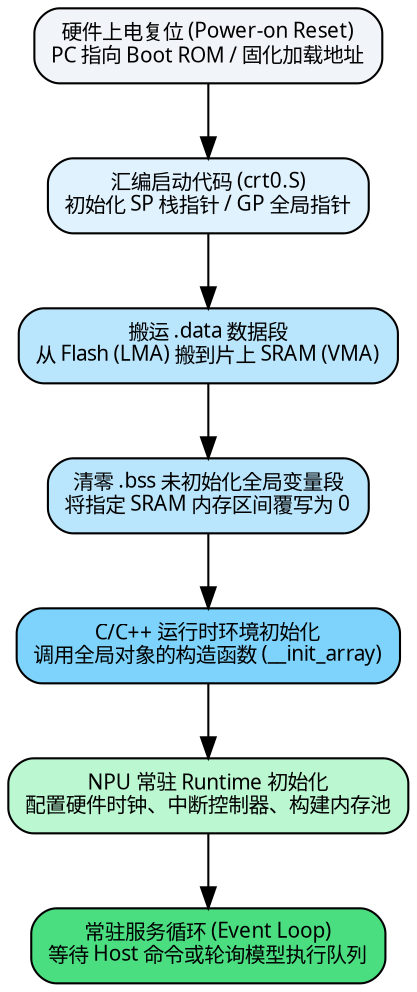

#### 链接脚本（Linker Script）中的隐形暗礁：
在裸机系统开发中，必须严格区分：
- **LMA（Load Memory Address，加载物理地址）**：程序存储在 ROM 或固态介质中的静态烧录地址。
- **VMA（Virtual/Runtime Memory Address，运行物理地址）**：程序实际在片上 SRAM 中运行时的地址。

如果链接脚本写错，全局变量就会被访问到只读的 ROM 中，导致系统瞬间死锁！

### 3. 三重境界：裸机调度的演化与单线程事件循环

在裸机环境下，我们如何把多个硬件引擎（DMA、Score、Tcore、RVV）并发驱动起来？

#### 第一重：纯静态顺序执行器（编译期全定）
如果编译器已经把所有算子切分和依赖排得严丝合缝，裸机 Runtime 甚至可以退化为一个极度简易的顺序分发器：
```cpp
void RunStaticModel(const CompiledModelPlan& plan) {
    for (size_t i = 0; i < plan.instruction_count; ++i) {
        hal::execute_instruction(plan.instructions[i]);
        hal::wait_instruction_completed(plan.instructions[i]);
    }
}
```
**适用场景**：执行固定算子、模型简单、硬件并发度有限。

#### 第二重：单线程非阻塞事件循环（Event Loop）——主力工业架构！
这是大多数专业 NPU 固件的核心设计：**绝不创建开销巨大的抢占式多线程，而是使用一个高效的主事件循环驱动状态机推进**。

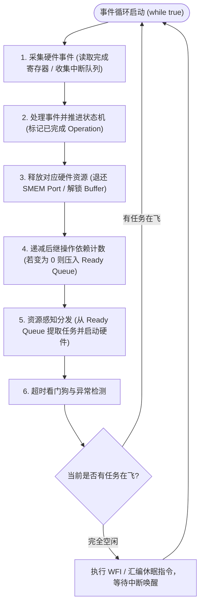

通过这一套循环，虽然 CPU 是单核且单线程运行，但它充当了极其灵敏的“交警”，让底层的多个 DMA 通道与多个硬件计算阵列实现最大程度的并行重叠！

### 4. 裸机片上内存（SMEM）与 Cache 一致性硬核实战

在裸机编程中，最隐蔽、最致命的 Bug 几乎全都与**内存属性和缓存（Cache）**有关。

#### 区分容量冲突与端口冲突
在通用 OS 中，分配内存只要两个区间不重叠，就可以被不同线程同时访问。
**但在片上 SRAM（SMEM）中，即使地址完全不重叠，也可能无法并发！**

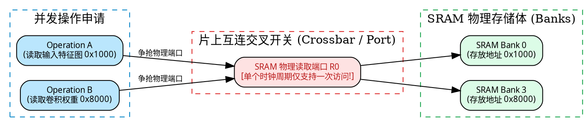

看上图：Operation A 与 Operation B 分别访问 Bank 0 与 Bank 3，地址毫无交叉。但因为硬件设计限制，这两个 Bank 的数据引脚共用了物理端口 `R0`。如果 Runtime 不懂硬件端口拓扑，盲目并发启动这两个算子，就会引发硬件总线仲裁死锁或读取到垃圾数据！

#### 缓存一致性灾难：为什么 Memory Barrier 不等于 Cache Invalidate？
假设 CTRL 核将指令参数写入了 DDR，然后按动 Doorbell 通知向量核（RVV）：

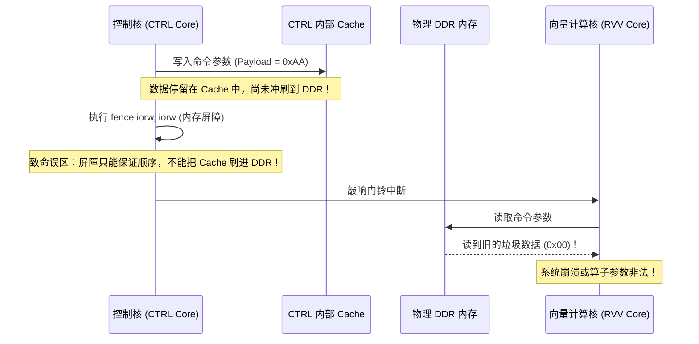

**铁血法则**：
- **`fence`（内存屏障）**：管的是**指令与访存的发射先后顺序**。
- **`cache clean / flush`（缓存冲刷）**：管的是**把本地 Cache 脏数据强制推入全局可见的物理存储介质**。
- **`cache invalidate`（缓存失效）**：管的是**强行作废本地 Cache，强制下一次读取必须重新从物理总线上拉取最新真值**。

在非一致性（Non-Coherent）片上系统中，控制核与专用计算核通信时，必须严格配对执行缓存冲刷与失效操作！

### 5. 跨核通信协议设计（CTRL ↔ RVV）

在异构多核系统中，片上控制核（CTRL）通常负责“发号施令”，而向量核（RVV）负责“执行密集算法”。它们之间如何通过共享 Mailbox 可靠通信？

一个经过工业验证的轻量级无锁信箱协议设计如下：

```cpp
// 保持 64 字节对齐，严格匹配片上 Cache Line 大小，防止伪共享 (False Sharing)
struct alignas(64) MailboxCommand {
    uint64_t sequence;        // 单调递增的任务序列号
    uint32_t opcode;          // 算子操作码 (如向量归一化、激活函数)
    uint32_t payload_size;    // 参数结构体字节大小
    uint64_t payload_address; // 共享参数指针 (必须已经过 Cache Flush)
    uint32_t reserved[10];    // 填充至 Cache Line 边界
};

struct alignas(64) MailboxCompletion {
    uint64_t sequence;        // 对应的任务序列号 (必须与 Command 一致)
    uint32_t status_code;     // 执行状态 (0: 成功, 非 0: 硬件错误码)
    uint32_t error_detail;    // 详细调试信息
    uint32_t reserved[12];    // 填充至 Cache Line 边界
};
```

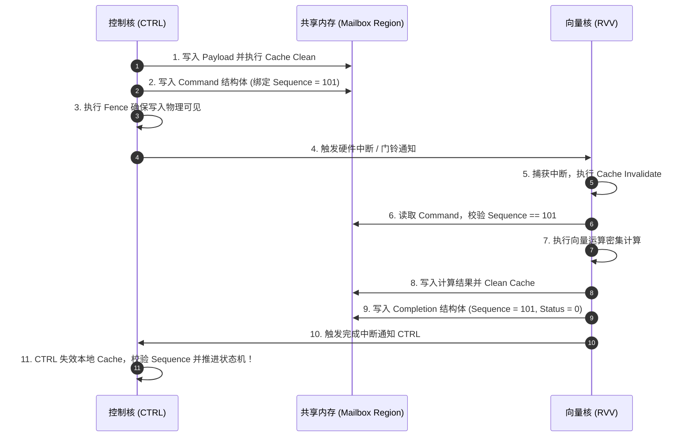

通过引入**严格的单调序列号（Sequence Number）**，我们彻底消除了由于旧中断残留、重复触发导致的“误认历史任务已完成”的致命时序 Bug！

---

## 六、如何运用操作系统知识设计真正卓越的 Runtime？

当我们跳出具体硬件的泥潭，从系统架构设计的高度俯瞰，会发现操作系统的设计精髓能够全方位滋养 AI 运行时的架构演进。以下是 10 类最值得深度吸收的操作系统核心思想及其在 Runtime 中的精准映射：

### 1. 经典 OS 核心思想在 Runtime 中的 10 类精准映射

| 序号 | 操作系统核心机制（OS） | Runtime 演进落地（AI Accelerator） | 解决的本质工程痛点 |
| :---: | :--- | :--- | :--- |
| **1** | **进程/线程生命周期状态机** | **Operation 状态转移系统** | 区分提交、就绪、硬件发射、真实完成与数据可见，避免假死与状态混乱。 |
| **2** | **就绪队列与等待队列** | **DAG 依赖计数与 Ready Queue** | 消除每轮扫描全图的高昂开销，仅当依赖降至 0 时精准激活任务。 |
| **3** | **内存模型与 Acquire-Release** | **跨核 Mailbox 与门铃可见性协议** | 解决编译器指令重排、CPU 乱序执行与多核 Cache 不一致带来的时序竞态。 |
| **4** | **虚拟内存保护与引用计数** | **Buffer 借用语义与所有权生命周期** | 确保硬件仍在异步读取的显存绝对不会被上层提前复用或释放。 |
| **5** | **中断上半部与下半部（Top/Bottom Half）** | **微秒级 ISR + 统一事件驱动循环** | 中断处理函数只做标记与收集，复杂依赖更新移至普通上下文执行，杜绝中断嵌套崩溃。 |
| **6** | **死锁预防理论（破坏持有并等待）** | **硬件资源一次性原子租赁协议** | 避免 Operation A 占着 DMA 等 SRAM，而 Operation B 占着 SRAM 等 DMA 造成的死锁。 |
| **7** | **异常隔离与故障域划分** | **Fault Domain、Epoch 代际隔离** | 单个算子超时或死机时，精准隔离该通道，防止整张卡必须粗暴断电重启。 |
| **8** | **文件描述符与句柄表（Handle Table）** | **安全不透明句柄（Opaque Handle）** | 禁止上层直摸裸露的物理寄存器与 DMA 物理地址，提供代际检查与悬挂引用保护。 |
| **9** | **快路径与慢路径解耦（Fast/Slow Path）** | **编译期/加载期静态化，执行期直通流水** | 慢路径完成拓扑分析、地址预绑定；高频快路径零解析、零 malloc 极速发射。 |
| **10**| **机制与策略分离（Mechanism vs Policy）** | **核心执行引擎与调度算法解耦** | 底层硬件发射机制固定，上层调度策略（FIFO、关键路径优先、时延敏感优先）可热插拔。 |

---

### 2. Operation 完整生命周期状态机设计

借鉴 OS 线程状态机的设计思想，在 Runtime 内部为每一个原子计算或搬运任务（Operation）建立严格单向流转的状态机：

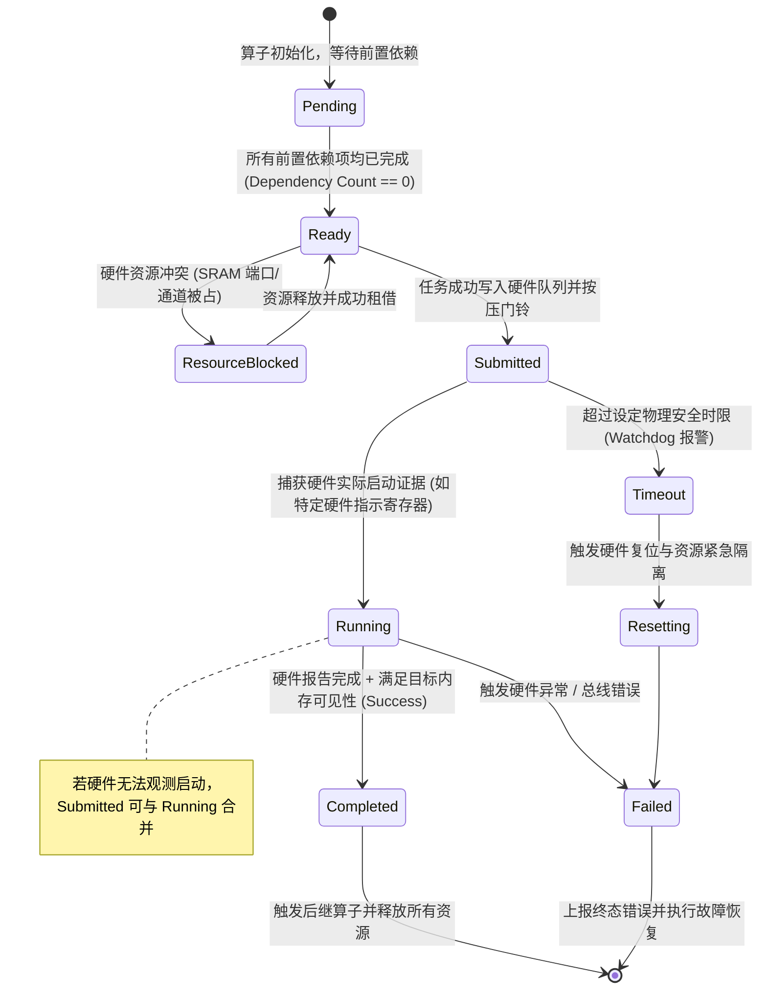

#### 状态转移的“铁律”：
- **状态转移只能由权威事实驱动**：绝不能因为代码调用了 `hal_start()` 就臆测进入了 `Completed` 状态！
- **终态不可逆与幂等性**：一旦进入 `Completed` 或 `Failed`，该任务的生命周期即告终结，绝不允许被二次推进或重复释放资源。

---

### 3. 编译器与 Runtime 的黄金权责边界

一个架构优良的系统，必须对**编译器（Compiler）**与**运行时（Runtime）**划分极其清晰的职责边界：

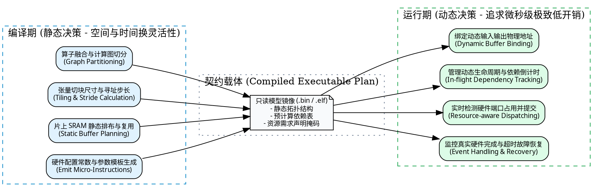

> **核心戒律：千万不要让 Runtime 去做编译器已经算好的事情！**
> 如果编译器已经能静态确定两个算子可以绝对并行且片上地址毫无冲突，Runtime 就应当直接执行该确定性计划，绝不应在运行时重新做复杂的图搜索与内存着色分析！

---

### 4. 软件伪硬件后端（Fake Hardware Backend）测试方法学

在真实的工业研发中，如果 Runtime 团队完全依赖底层芯片 EDA 硬件仿真（如 RTL 级仿真或 Verilog 仿真器），研发效率将极其低下——因为 EDA 仿真往往比真实时间慢上千倍，且极难稳定复现诸如“DMA 延迟 30 微秒”、“中断恰好在睡眠瞬间发生”等极端并发边界情况。

**借鉴操作系统内核测试的优秀实践，必须在第一天就建立软件抽象层与伪硬件测试后端（Fake Hardware Backend）！**

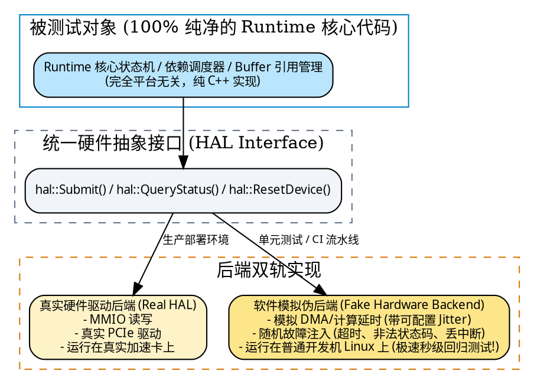

#### 在 Fake Backend 上必须必过的六大极限注入测试：
1. **乱序完成测试**：强制让后发射的大尺寸计算，比先发射的微小 DMA 更早完成，验证状态机是否乱序安全。
2. **丢失中断测试**：模拟硬件完成了但中断信号丢失，验证 Runtime 能否通过超时轮询兜底安全前进。
3. **重复完成测试**：同一个任务的完成中断连续到来两次，验证状态机是否具备幂等防护，绝不双重释放资源。
4. **资源争抢死锁测试**：随机生成具有复杂 SRAM 端口争抢的 DAG，连续跑 100,000 次，验证是否出现死锁环。
5. **硬件瞬态卡死测试**：模拟 DMA 永久卡死在 50% 进度，验证 Runtime 是否能在超时后执行安全的物理隔离与状态作废，不污染后续 Invocation。
6. **万次连续无泄露测试**：连续执行 10,000 次模型调用，检查是否有任何一个内部 Handle、Event Slot 或 Buffer 发生代际泄露。

---

## 七、工业级代码架构与渐进式演进路线

基于上述完整的理论与工程推导，我们为一套能够同时兼顾 **Linux Host 端** 与 **片上裸机 Device 端** 的高内聚、低耦合 Runtime，设计如下工业级代码组织拓扑：

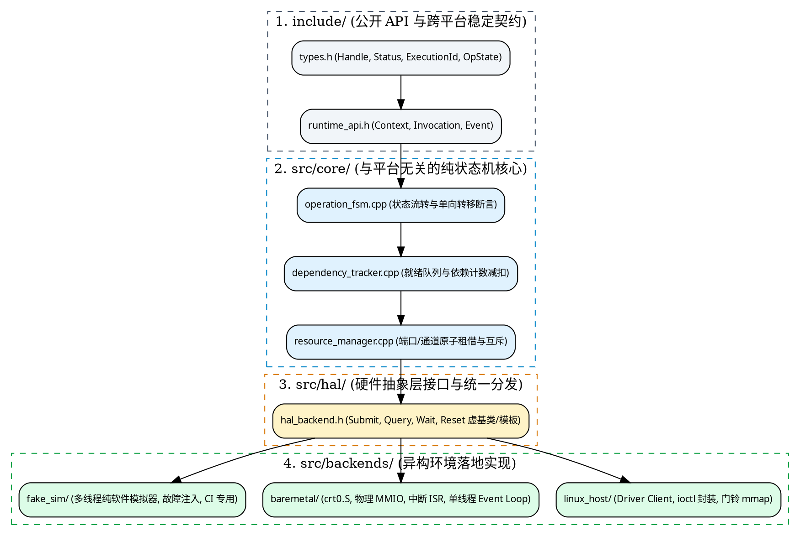

### 推荐的六步演进路线图

不要试图在第一天就写出一个堪比成熟工业级框架的庞大架构，那必然陷入泥潭。请按照以下由易到难的节律渐进演化：


---

## 八、总结与终极设计心法

回顾整个探索历程，我们从最底层的物理定律出发，一步步构建起了整个异构计算软件栈的宏伟大厦。我们最终可以提炼出四句指导工业级 Runtime 研发的核心心法：

1. **管理客体的分离，是架构纯粹的前提**：
   操作系统掌管计算机的通用资源，Runtime 掌管加速芯片的专用计算语义。Runtime 决不是要重写一个 Linux，而是要成为芯片流水线不可或缺的超轻量调度引擎。
2. **以状态转移为骨，以物理证据为凭**：
   异步并发的世界里没有直觉。每一次状态转移都必须有且仅有一次确凿的物理事实作为证据；每一个资源分配都必须有清晰的所有权契约与注销凭证。
3. **静态归于编译，动态归于运行**：
   算子切块、内存排布、配置参数尽可能在编译期静态定死；运行期保持极度纯粹，只专注于动态参数绑定、资源占用互斥与高频指令直通发射。
4. **安全先于活性，活性先于性能（Safety $\prec$ Liveness $\prec$ Performance）**：
   宁可在提交前多做一次原子资源校验（确保绝对不出错），也不要为了追求微秒级虚荣指标而提前释放尚未飞完的 Buffer；在确定系统永远不会死锁与崩溃之后，再去榨干硬件的每一丝流水线重叠潜力！

唯有站在第一性原理的基石之上，我们才能在日新月异、纷繁复杂的 AI 硬件大潮中，洞悉软件架构的恒定演化规律，打造出真正坚如磐石、吞吐如飞的下一代异构计算系统软件！
