> **导读**：当我们在 PyTorch 里写下一行 `y = torch.nn.functional.linear(x, w)` 或调用大模型推理引擎时，真正把矩阵乘法、激活函数跑在 GPU（图形处理器）或 NPU（神经网络处理器）硅片上的幕后英雄，正是**算子（Operator / Kernel）**。
>
> 对于刚接触底层开发的同学来说，算子开发常常显得高深莫测：一会儿是 **CUDA / Triton / Ascend C** 等五花八门的语言，一会儿又是 **TP / EP / DP / CP / PP** 等分布式缩写，再往深处还有 **Bank Conflict、Double Buffering、Split-K、Swizzle** 等晦涩名词。
>
> 本教程将从**零基础初学者视角**出发，遵循两个原则带你一次打通 AI 芯片算子开发的完整知识体系：
> 1. **术语首次出现即解释**：绝不假设读者事先知道某个缩写或硬件黑话，遇到新概念立刻给出直观类比与白话解释；
> 2. **图解优先**：在关键架构、数据流、通信拓扑与分块机制处配备 **Graphviz** 与 **Mermaid** 可视化图表，把抽象的硬件行为“画出来”。

---

## 零、初学者核心名词破冰速查表

在正式进入正题前，你可以把下表当作“随身词典”。正文首次提及这些概念时，我们还会结合具体场景详细展开。

| 术语 / 缩写 | 英文全称 | 一句话通俗解释 |
| :--- | :--- | :--- |
| **算子 / Kernel（核函数）** | Operator / Kernel | 运行在 AI 芯片（如 GPU/NPU）上的最小计算程序单元，负责把某步数学公式（如矩阵乘、Softmax）变成硬件指令并执行。 |
| **Host 与 Device** | 主机端与设备端 | **Host** 通常指管理全局的 CPU 与内存条；**Device** 指真正扛起密集计算的 AI 加速卡（GPU/NPU）及其板载显存。 |
| **Tensor（张量）** | Tensor | 多维数组的统称：0 维是标量（单个数），1 维是向量，2 维是矩阵，3 维及以上统称张量。 |
| **GEMM** | General Matrix Multiply | 通用矩阵乘法（如 $C = A \times B + C$），大模型中 80% 以上的算力都消耗在它身上。 |
| **HBM / DDR（片外主存）** | High Bandwidth Memory / DDR | 芯片外部的大容量显存/内存（动辄几十 GB），容量大但离计算核心远、访问延迟高。 |
| **SRAM / Shared Memory** | 静态随机存储器 / 共享内存 | 紧贴计算核心的片上高速小仓库（几十 KB 到几 MB），速度极快但寸土寸金。 |
| **Register（寄存器）** | Register File | 计算单元手边最快的“工作台”，存放当前指令立刻要算的数据，延迟几乎为 0，但数量极少。 |
| **Tiling（切分 / 分块）** | Tiling / Partitioning | 把装不进片上小仓库的巨大张量，切成一块块大小正好的小数据块（Tile），分批搬进来进行计算。 |
| **Roofline 模型** | Roofline Model | 一张像“屋顶”一样的性能上限图，用来判断算子是被“算力（Compute-bound）”卡住，还是被“内存搬运速度（Memory-bound）”卡住。 |
| **Collective Communication** | 集合通信 | 多张 AI 加速卡之间协同交换数据的标准通信原语，如 `All-Reduce`（全局汇总求和）、`All-Gather`（全局拼凑完整数据）、`All-to-All`（全局互相洗牌分发）。 |

下面这张全景学习路线图展示了本文的四大核心模块：

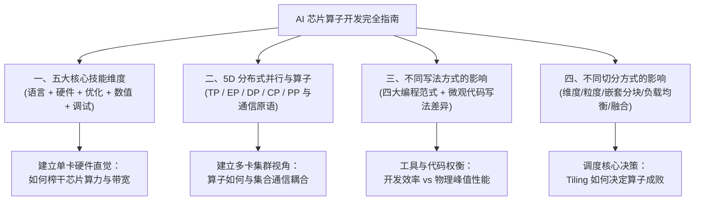

---

## 一、算子开发需要哪些技能？（五大维度全解析）

**算子开发（Kernel Development）** 的本质，是一场“翻译与压榨”的艺术：把神经网络或科学计算中的数学公式，高效映射到特定 AI 芯片（**GPU** 图形处理器、**NPU** 神经网络处理器、**TPU** 张量处理器等）的物理硬件电路上。

一套完整的算子开发技术栈，涵盖**编程语言、硬件微架构、并行计算模型、数学优化以及性能分析与工程集成**五个维度。

### 1.1 编程语言与底层表达

写算子就像用不同精密度的工具雕刻芯片指令，通常需要掌握以下四层语言能力：

1. **C / C++（核心基础）**
   几乎所有高性能算子库的 Host 端调度代码与 Device 端核函数实现，都建立在现代 C++ 之上。必须重点掌握：
   - **模板元编程（Template Metaprogramming）**：在代码**编译期**（而非运行时）就确定分块大小、数据类型和分支路径，消除运行时的额外开销。
   - **内存对齐（Memory Alignment）**：硬件搬运数据喜欢“整存整取”（例如按 16 字节或 128 字节对齐的地址读取），地址不对齐会导致性能暴跌甚至硬件报错。
   - **指针操作与 RAII**：**RAII（Resource Acquisition Is Initialization，资源获取即初始化）** 是 C++ 管理显存、锁和流资源的经典模式——对象创建时申请资源，离开作用域自动释放，防止显存泄漏。

2. **特定硬件扩展语言**
   不同芯片厂商在 C/C++ 基础上扩展了控制自己硬件的专属语法：
   - **GPU 生态**：NVIDIA 的 **CUDA C/C++**、AMD 的 **HIP**。
   - **自研 NPU / DSA 生态**：**DSA（Domain-Specific Architecture，领域专用架构）** 指专为 AI 矩阵计算定制的芯片。例如华为昇腾的 **Ascend C**，或者各家芯片提供的 **Intrinsics（内建指令函数）**——它们看起来像 C 函数调用，编译时直接一对一翻译成特定的芯片硬件指令。

3. **现代 DSL（Domain-Specific Language，领域特定语言）**
   手写 C++/CUDA 太繁琐且容易出错，于是诞生了 **Triton**、**TileLang**、**Mojo** 或 **TVM TensorIR** 等现代 DSL。它们大多采用 Python 前端，开发者只需要思考“怎么分块”，编译器会自动接管繁琐的线程分配与部分内存排布，极大提升了开发效率。

4. **汇编与中间表示（IR）**
   当高级语言生成的代码跑不快时，高手需要直接看底层指令找原因：
   - **PTX（Parallel Thread Execution）**：NVIDIA GPU 的虚拟汇编语言（类似跨代通用的“中间说明书”）。
   - **SASS（Streaming Assembly）**：特定型号 GPU 芯片真正执行的一条条原生机器汇编指令。
   - 能够读懂甚至局部手写 PTX/SASS 或特定 NPU 汇编，是定位编译器“偷懒”或生成低效指令的终极武器。

---

### 1.2 硬件微架构认知

不理解硬件物理结构，就不可能写出接近理论峰值性能的算子。衡量算子距离物理天花板还有多远，业界最常用的是 **Roofline 模型（屋顶线模型）**：它以算子的“计算访存比（每搬运 1 字节数据能做多少次运算）”为横轴，性能为纵轴，画出两条上限——斜线代表**内存带宽上限**，水平线代表**芯片峰值算力上限**。

要摸到 Roofline 的“屋顶”，必须吃透芯片内部的三块拼图：

#### （1）多级存储层次（Memory Hierarchy）
你可以把芯片的存储体系想象成做菜时的“冰箱 $\rightarrow$ 备菜桌 $\rightarrow$ 案板 $\rightarrow$ 锅铲”：

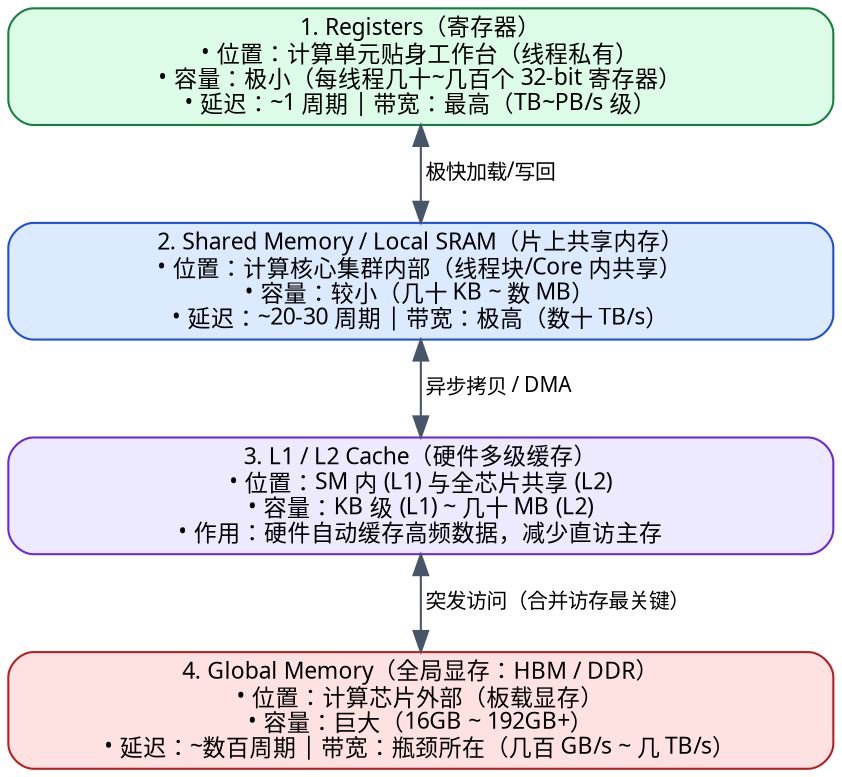

#### （2）计算单元特性
现代 AI 芯片内部往往塞进了三种分工明确的计算引擎：
- **标量单元（Scalar Unit）**：一次算 1 个数，擅长循环控制、地址偏移计算、分支判断。
- **向量单元（Vector Unit）**：一次算一排数。常见模式有两种：
  - **SIMD（Single Instruction, Multiple Data，单指令多数据）**：一条指令直接打包计算一组向量（如 CPU AVX 或 NPU Vector 指令同时算 64 个数）。
  - **SIMT（Single Instruction, Multiple Threads，单指令多线程）**：GPU 的核心模型，一条指令同时驱动 32 个线程（一个 **Warp / 线程束**），每个线程各算自己的数据，且允许各自走不同分支。
- **矩阵乘加专用单元（Matrix Unit）**：如 NVIDIA 的 **Tensor Core**、华为昇腾的 **Cube 单元**。它们一拍能完成整个小矩阵块（如 $16\times 16$）的乘法累加 $D = A \times B + C$，吞吐量比向量单元高出一个数量级。
- **多数据精度支持**：需要清楚芯片对 **FP32**（单精度浮点，32位）、**FP16 / BF16**（半精度/脑浮点，16位，大模型训练主力）、**FP8**（8位浮点）以及 **INT8 / INT4**（8位/4位整型，推理量化常用）的算力倍率和硬件指令支持情况。

#### （3）数据搬运机制
计算核心如果一边算矩阵一边亲自去内存拿数，就会浪费宝贵的算力。因此芯片配备了专职“快递员”：
- **DMA（Direct Memory Access，直接内存访问）引擎**：专门负责在片外 HBM 与片上 SRAM 之间大块搬运数据，无需计算核心插手。
- **异步拷贝（如 NVIDIA 的 `cp.async` 与 Hopper 架构的 TMA 张量内存加速器）**：计算核心只要发一句“把下一块矩阵搬到 SRAM”，就可以立刻回头继续计算当前数据，不必原地干等。
- **NoC（Network-on-Chip，片上网络）**：芯片内部连接几十上百个计算核心和缓存的“片内高速公路网”，决定了核心之间传递数据时是否会拥堵。

---

### 1.3 并行计算模型与经典优化范式

算子开发的核心矛盾，永远是在有限的片上 SRAM 与寄存器资源下，做好 **计算（Compute）与访存（Memory）的平衡**。

| 优化维度 | 核心技能与常见手段（附初学者通俗解释） |
| :--- | :--- |
| **任务切分（Tiling）** | 将大张量切分为适配 L1/SRAM 和寄存器大小的块（**Tile**，就像把大披萨切成适合嘴大小的方块），兼顾“多核一起干（并行度）”和“数据拿一次多用几遍（局部性）”。 |
| **访存优化** | 1. **合并访存（Coalesced Access）**：让相邻线程去读物理地址相邻的数据，硬件就能合并成一次大批量读取；<br/>2. **消除 Bank Conflict（存储体冲突）**：片上 SRAM 被切成多个独立通道（Bank，常见 32 个），如果多个线程同时找同一个通道要不同地址的数据，就必须排队串行等待。必须通过填充或错位排布来避免；<br/>3. **向量化读写**：比如用 `float4` 一次读取 4 个连续的 `float`（128 bit），减少指令数量。 |
| **流水线与掩盖延迟** | **Double Buffering（双缓冲） / 多级软件流水线（Software Pipelining）**：在 SRAM 里准备两块区域（Buffer A 和 Buffer B），当计算单元正在疯狂计算 Buffer A 里的数据时，异步 DMA 引擎同时悄悄把下一批数据搬进 Buffer B。算完 A 立刻无缝切换算 B，把漫长的搬运等待时间彻底“藏”在计算时间背后。 |
| **算子融合（Kernel Fusion）** | 把原本要跑两三次独立 Kernel 的连续操作（例如 `MatMul + Bias + GeLU` 或 `FlashAttention` 中的乘积与 Softmax）合并成单个 Kernel。**中间结果留在高速寄存器或 SRAM 里直接往下算，避免写回龟速的片外 HBM 再重新读回来**。 |
| **低精度与量化（Quantization）** | 用更少比特（如把 FP16 压缩成 INT4/FP8）存放权重以节省显存和带宽。算子开发需要掌握如 **AWQ、GPTQ、SmoothQuant** 等量化方案对应的**反量化融合算子**编写——在数据刚搬进寄存器时顺手乘上缩放因子（**Scale**）和零点偏移（**Zero-point**）还原成高精度立刻计算，不让高精度完整权重落地到 HBM。 |

下面这张 **Graphviz** 图解直观展示了“未融合、无双缓冲”与“算子融合 + Double Buffering 流水线”在硬件执行时间线上的巨大差距：

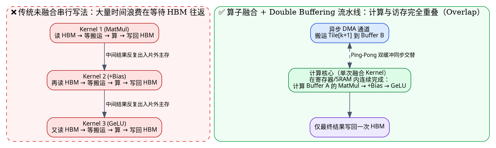

---

### 1.4 数值计算与算法变形能力

写算子不能只会“照抄数学公式”，很多时候必须把数学公式改写成硬件喜欢的等价形式：

1. **硬件友好型算法重构（最经典案例：FlashAttention）**
   标准 Attention 公式需要先把所有 Query 和 Key 相乘算出一个巨大的 $N \times N$ 注意力分数矩阵（当序列长度 $N=100K$ 时，这个矩阵会瞬间撑爆显存，带来 $O(N^2)$ 显存占用），然后再对每一行做 Softmax。
   **FlashAttention** 的核心突破在于利用**分块归约与 Online Softmax（在线软最大）**：不需要算出完整的 $N \times N$ 矩阵，而是每次只拿一小块 Key/Value 到片上 SRAM 里，边算局部 Softmax，边用数学修正系数动态更新历史累加和，从而把 $O(N^2)$ 显存占用彻底消除，变成流式计算！

2. **数值稳定性（Numerical Stability）**
   - **低精度溢出风险**：FP16 能表示的最大数只有 $65504$，稍微大一点的指数运算（如 $e^{12}$）就会直接变成 `Inf`（无穷大）进而产生 `NaN`。
   - **防溢出技巧（Safe Softmax）**：在算 $\exp(x_i)$ 之前，先减去这一行里的最大值 $\max(x)$，保证所有指数的输入都 $\le 0$，结果永远安全落在 $(0, 1]$ 之间。
   - **高精度累加（FP32 Accumulate）与 Kahan 求和**：用 FP16/BF16 做乘法时，累加和必须放在 FP32 寄存器中累计；在极高精度要求场景，还会用到 **Kahan 求和算法**（额外维护一个误差补偿变量，把“大数吃小数”丢掉的尾数找回来）。

---

### 1.5 性能分析（Profiling）与工程集成

算子写完能跑通只是第一步，能跑快且能接入真实框架才算交付：

1. **性能分析工具链（Profiling）**
   - 工具：NVIDIA 的 **Nsight Compute (NCU)**（看单个 Kernel 内部指令级细节）、**Nsight Systems (NSYS)**（看整个程序跨核/CPU/GPU 时间线），或华为/寒武纪等 NPU 厂商对应的 Profiler。
   - 诊断指标：判断算子是 **Memory-bound（访存瓶颈，搬运太慢）** 还是 **Compute-bound（计算瓶颈，核心算力吃满）**；排查 **Warp Stall（线程束停顿原因，比如等内存还是等依赖）**、Bank Conflict 次数、以及 Tensor Core / 显存带宽的真实硬件利用率。

2. **框架接入与 AI 编译器对接**
   - **推理/训练框架注册**：如何用 PyTorch 的 Custom Ops（`torch.library`）把 C++/CUDA/Triton 算子封装成 Python 可调用的函数，或接入 ONNX Runtime，以及大模型高并发推理引擎（如 **vLLM**、**SGLang**）。
   - **AI 编译器后端衔接**：理解算子与 **MLIR**（Multi-Level Intermediate Representation，多层中间表示）或 **TVM** 编译器的对接逻辑——例如高层的线性代数描述（**Linalg**）、仿射循环变换（**Affine** 变换，用于自动推导切分与并行），以及 **Bufferization（缓冲区化，把抽象的“不可变张量”变成具体可读写内存指针的过程）**。

---

### 1.6 给初学者的三步进阶学习路线

如果从零开始系统切入算子开发，建议严格按以下顺序循序渐进，切忌一上来就啃最复杂的融合大算子：

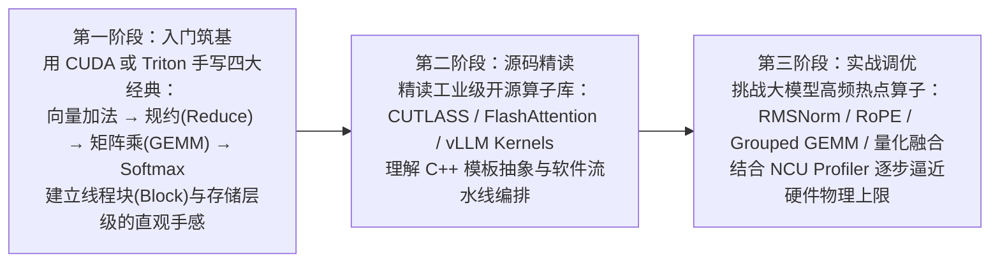

---

## 二、分布式算子开发中的 TP、EP、DP、CP、PP（5D 并行策略）

随着大模型参数规模动辄达到千亿、万亿级，单张加速卡的显存和算力早已捉襟见肘，必须由成百上千张卡协同工作。在分布式训练与推理的语境中，**TP、EP、DP、CP、PP** 统称为 **5D 并行策略**。

为什么算子开发工程师必须懂 5D 并行？因为**它们不仅决定了单卡算子收到的张量形状（Input/Output Shape）会怎么变形，还决定了单卡算子内部的计算逻辑要不要重写、算子前后要插入哪种集合通信（Collective Communication）原语，以及会出现哪些意想不到的性能陷阱**。

### 2.0 先建立直觉：四大集合通信原语与基准张量设定

在拆解 5D 并行前，我们先用最简单的**数字例子**看懂多卡之间最常打交道的四种“群聊传话规则”（集合通信原语）：

```dot
digraph CollectiveOps {
    rankdir=TB;
    node [shape=box, style="rounded,filled", fontname="sans-serif", fontsize=10];
    edge [color="#475569", fontname="sans-serif", fontsize=9];

    subgraph cluster_ar {
        label="1. All-Reduce（全局归约求和）\n场景：TP 行切分汇总部分和 / DP 同步梯度";
        style="rounded"; color="#2563eb"; bgcolor="#eff6ff";
        ar_in [label="通信前：GPU0=[1, 2]  |  GPU1=[3, 4]", fillcolor="#ffffff", color="#1d4ed8"];
        ar_out [label="通信后：GPU0=[4, 6]  |  GPU1=[4, 6]\n（每张卡都拿到完全相同的总和）", fillcolor="#dbeafe", color="#1d4ed8"];
        ar_in -> ar_out;
    }

    subgraph cluster_ag {
        label="2. All-Gather（全局收集拼接）\n场景：ZeRO-3 拉取完整权重 / TP 列切分拼出完整输出";
        style="rounded"; color="#16a34a"; bgcolor="#f0fdf4";
        ag_in [label="通信前：GPU0=[A]  |  GPU1=[B]", fillcolor="#ffffff", color="#15803d"];
        ag_out [label="通信后：GPU0=[A, B]  |  GPU1=[A, B]\n（每张卡都凑齐了完整拼图）", fillcolor="#dcfce7", color="#15803d"];
        ag_in -> ag_out;
    }

    subgraph cluster_rs {
        label="3. Reduce-Scatter（先求和、再一人分一段）\n场景：ZeRO-2/3 分片梯度（All-Reduce = RS + AG）";
        style="rounded"; color="#7c3aed"; bgcolor="#f5f3ff";
        rs_in [label="通信前：GPU0=[1, 2]  |  GPU1=[3, 4]", fillcolor="#ffffff", color="#6d28d9"];
        rs_out [label="通信后：GPU0=[4] (只拿第0段和) | GPU1=[6] (只拿第1段和)", fillcolor="#ede9fe", color="#6d28d9"];
        rs_in -> rs_out;
    }

    subgraph cluster_a2a {
        label="4. All-to-All（全局洗牌重分发）\n场景：EP 混合专家路由 / Ulysses 上下文并行";
        style="rounded"; color="#d97706"; bgcolor="#fffbeb";
        a2a_in [label="通信前：GPU0=[给0的x, 给1的y] | GPU1=[给0的m, 给1的n]", fillcolor="#ffffff", color="#b45309"];
        a2a_out [label="通信后：GPU0=[给0的x, 给0的m] | GPU1=[给1的y, 给1的n]\n（按目的地重新发牌洗牌）", fillcolor="#fef3c7", color="#b45309"];
        a2a_in -> a2a_out;
    }
}
```

为了让你看清每一种并行方式到底“切了哪里”，下面我们统一设定一个**基准场景**：
- 输入激活张量 $X$ 的形状为 `[Batch=4, Seq=8192, Hidden=4096]`（即 4 条样本、每条 8192 个 Token、每个 Token 用 4096 维向量表示）；
- 线性层权重矩阵 $W$ 的形状为 `[4096, 16384]`；
- 我们手里一共有 **4 张加速卡（GPU 0 ~ GPU 3）**。

| 缩写 | 全称 | 把什么切分给 4 张卡？ | 单卡看到的输入/权重 Shape | 单卡算子内部逻辑是否要大改？ |
| :--- | :--- | :--- | :--- | :--- |
| **TP** | **Tensor Parallelism**<br/>张量并行 | 同一层里的**权重矩阵**（按列或按行劈开） | 输入 `[4, 8192, 4096]`<br/>权重按列劈成 `[4096, 4096]` | 单个 GEMM 算法不变，但矩阵变窄需重调 Tiling；高阶做法会与通信做融合重叠。 |
| **EP** | **Expert Parallelism**<br/>专家并行 | **MoE 模型**中的不同专家网络（每卡管几个专家） | 收到动态条数的 Token：`[M_dynamic, 4096]` | **大改！** 必须实现 **`Permute / Unpermute`** 与 **`Grouped GEMM`** 应对动态不均形状。 |
| **DP** | **Data Parallelism**<br/>数据并行 | 输入数据的 **Batch（样本批次）** 维度 | 输入 `[1, 8192, 4096]`<br/>权重完整 `[4096, 16384]` | 前向算子完全不改（但小心小 Batch 退化）；若开 ZeRO-3 需在算子前插 `All-Gather`。 |
| **CP** | **Context Parallelism**<br/>上下文并行 | 输入序列的 **Sequence（序列长度）** 维度 | 输入 `[4, 2048, 4096]`<br/>权重完整 `[4096, 16384]` | 逐 Token 算子不改；**Attention 算子大改**（需 Ring-Attention 传 KV + Online Softmax 重缩放）。 |
| **PP** | **Pipeline Parallelism**<br/>流水线并行 | 模型的**网络层数（Layer）**（每卡管几层） | 输入 `[4, 8192, 4096]`<br/>权重完整 `[4096, 16384]` | **层内算子零改动！** 仅在层交界处做点对点 `Send / Recv`，重点在微批次调度防气泡。 |

---

### 2.1 TP（Tensor Parallelism，张量并行）——“多张卡合算同一道乘法题”

> **通俗类比**：一张超大的乘法试卷一个人算太慢且草稿纸不够写，于是把试卷**从左到右撕成两半**（列切分），两个人拿着同一道题目各自算一半；或者把求和步骤拆开，每人算一部分和再加起来（行切分）。

#### 1. 具体 Shape 演变与“列+行”配对巧思
最经典的是 **Megatron-LM** 为大模型 MLP（两层全连接层中间夹一个激活函数 GeLU/SiLU）设计的**“先列切分、后行切分”**搭档（以 2 张卡为例）：

1. **第一层（列切分 Column Parallel）**：
   - 完整权重 `W1 [4096, 16384]` 按**输出列维度**竖着劈成两半：GPU 0 拿 `W1_0 [4096, 8192]`，GPU 1 拿 `W1_1 [4096, 8192]`。
   - 两张卡拿着**完全相同**的输入 `X [M, 4096]`（注：工程中常把 `[B, S, H]` 压扁成二维 `[M, H]` 送入 GEMM）各自做矩阵乘，算出各自的半成品输出 `Y_0 [M, 8192]` 和 `Y_1 [M, 8192]`。
   - **关键思考细节：为什么后面直接算 `GeLU` 不需要通信，算 `LayerNorm` 却不行？**
     因为 `GeLU(y)` 是**逐元素独立计算（Elementwise）**的——第 10 号元素只取决于它自己，不需要看第 9000 号元素，所以 GPU 0 和 GPU 1 各自在本地直接算完 `GeLU` 即可，**零通信**！但如果中间夹的是 `LayerNorm / RMSNorm`，因为它必须在整个 `16384` 维上求均值和方差，只有半截向量算不出全局均值，就必须先 `All-Gather` 凑齐完整向量。
2. **第二层（行切分 Row Parallel）**：
   - 第二层权重 `W2 [16384, 4096]` 按**输入行维度**横着劈成两半：GPU 0 拿 `W2_0 [8192, 4096]`，GPU 1 拿 `W2_1 [8192, 4096]`。
   - 此时神奇的事情发生了：GPU 0 手里的 `Y_0 [M, 8192]` 正好和 `W2_0 [8192, 4096]` 维度对齐！两张卡各自算出形状为 `[M, 4096]` 的**部分和（Partial Sum）** `Z_0` 和 `Z_1`（因为矩阵乘法按 $K$ 维拆开后，最终结果等于两边部分和相加）。
   - 最后执行一次 **`All-Reduce`**（`Z = Z_0 + Z_1`），两张卡同时得到正确的完整输出 `[M, 4096]`。整个双层 MLP 块只用了一次通信！

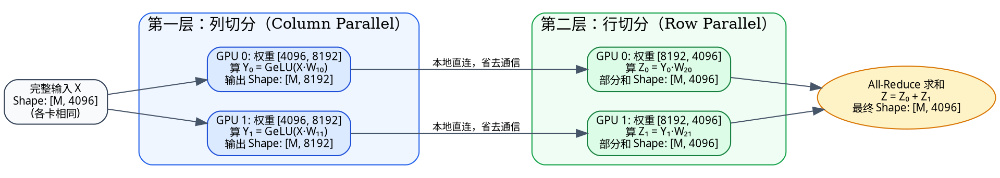

#### 2. 对单卡算子开发的具体影响
- **矩阵变“瘦/矮”，Tiling 参数必须重调**：对于单个 GEMM 算子，核心乘加逻辑没有变，但矩阵的 $N$ 维（列切分）或 $K$ 维（行切分）被缩小为原来的 $1/\text{TP}$。当 `TP=8` 时，原本 `N=4096` 缩成 `512`，如果还用为大矩阵调优的 `BLOCK_N=256`，可能整块矩阵只切出 2 列，导致 GPU 上百个计算核心吃不饱，必须改用更小的 `BLOCK_N` 或启用 Split-K。
- **通信-计算融合（Comm-Compute Overlap）**：Transformer 每层（Attention + MLP）都要做两次 `All-Reduce`。传统做法“算完整个 GEMM $\rightarrow$ 停下来等通信 $\rightarrow$ 算下一层”会造成严重的算力空转。现代算子（如 **Flux**、**FlashOverlap**）会在 GEMM 内部按 Tile 粒度刚算完一部分输出时，立刻在后台通过 NVLink 触发传输或对端累加，把通信时间藏在矩阵计算背后。

#### 3. 初学者必看细节与注意事项
- **Attention 按 Head（注意力头）切分与 GQA 陷阱**：在 Attention 层做 TP 时，是把不同的注意力头分给不同卡（例如 32 个头开 `TP=4`，每张卡算 8 个头，彼此独立无需通信，最后输出投影层用行切分做一次 `All-Reduce`）。**注意踩坑**：现在主流大模型多用 **GQA（分组查询注意力）**，可能 Q 有 32 个头，但 K/V 只有 8 个头甚至 4 个头！如果你开了 `TP=8` 而 KV 只有 4 个头，就会出现“头不够分”，必须在部分卡上复制 KV 头并修改算子的索引步长（Stride）。
- **通信与计算抢占 SM 资源**：很多人以为做异步通信（Overlap）完全免费，其实像 NCCL 这样的集合通信 Kernel 在运行时**也要占用 GPU 的 SM（计算核心）**！如果通信 Kernel 抢占了太多 SM，反而会把旁边正在跑的 GEMM 拖慢。高阶算子常使用硬件 DMA/拷贝引擎（Copy Engine）或限制通信占用的 SM 数量来缓解争抢。
- **物理拓扑要求极高**：TP 通信极其频繁，绝对不能跨慢速网卡跑，**通常严格限制在单台服务器内部的 NVLink / HCCS 高速互联域内（一般 $\text{TP} \le 8$）**。
- **Sequence Parallelism（序列并行）搭档**：虽然 TP 把 MLP 和 Attention 的大头切分了，但残差连接和 `LayerNorm` 之前往往需要保存完整序列长度的激活值显存。Megatron 后续引入了 **SP（序列并行）**，在 `LayerNorm` 这一段把序列维度临时切分（对应通信原语从 `All-Reduce` 拆成 `Reduce-Scatter` + `All-Gather`，总通信量不变，但激活值显存再降为 $1/\text{TP}$）。

---

### 2.2 EP（Expert Parallelism，专家并行）——“按专长把词元分流给不同卡上的专家”

> **通俗类比**：一家大型三甲医院（MoE 模型）把“内科、外科、眼科、牙科”四个专科专家分散放在两栋分院（GPU 0 和 GPU 1）里。病人（Token）先经过导诊台（Router）判断该看哪个科，然后坐班车（`Dispatch All-to-All`）去对应的分院看病，看完后再坐班车（`Combine All-to-All`）回到总院汇总病历。

#### 1. 具体 Shape 与数据流全过程（以 2 张卡、4 个专家、Top-1 路由为例）
假设 GPU 0 存放**专家 E0、E1**，GPU 1 存放**专家 E2、E3**。每张卡本地本来有 `4` 个 Token（Shape `[4, 4096]`）：

1. **门控路由（Router / TopK）**：本地小线性层 + Softmax 算子给每个 Token 打分选出最合适的专家。比如 GPU 0 上的 4 个 Token 分别想去 `[E2, E0, E3, E0]`；GPU 1 上的 4 个 Token 分别想去 `[E0, E1, E0, E2]`。
2. **元数据通信 + `Dispatch All-to-All`（洗牌发往专家所在卡）**：
   - **关键细节**：在搬运真正的向量数据之前，各卡必须先走一次极轻量的整数数组通信，互相通知“我要给你发几个 Token”，因为 GPU Kernel 里**严禁动态申请显存（不能调用 `cudaMalloc`）**，必须提前算出偏移量从预分配缓冲区划空间！
   - 发牌后，GPU 0 最终收到 **5 个 Token**（4 个给 E0，1 个给 E1），Shape 变成 `[5, 4096]`；GPU 1 只收到 **3 个 Token**（2 个给 E3，1 个给 E2），Shape 变成 `[3, 4096]`。
3. **`Permute`（显存聚拢重排）+ `Grouped GEMM`（分组矩阵乘）**：
   - 网络收进来的 Token 往往是混杂交错的（如 `[E0, E1, E0, E0, E0]`）。但矩阵乘法算子要求同一个专家的输入在内存里必须**连续紧挨着排好**！因此必须先跑一个 **`Permute` 算子**，把属于 E0 的 4 行搬到一起形成 `[4, 4096]`，属于 E1 的 1 行放到后面形成 `[1, 4096]`。
   - 随后进入整个 EP 最核心的计算算子：**`Grouped GEMM`**——在一个 Kernel 内同时并发算出 `([4, 4096] × W_E0)` 和 `([1, 4096] × W_E1)`，得到结果后再紧接激活函数和下投影的第二次 `Grouped GEMM`。
4. **`Combine All-to-All` + `Unpermute` 加权汇总**：每张卡把专家算完的结果发回原本的来源卡，**`Unpermute` 算子**把它们放回原本的 Token 位置；如果是 Top-2 路由（每个 Token 找了 2 个专家），还要把两个专家的结果按 Router 概率权重（例如 `0.7 * 结果A + 0.3 * 结果B`）加权求和。

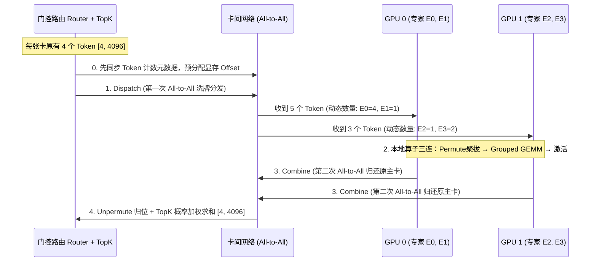

#### 2. 对单卡算子开发的具体影响
- **普通 GEMM 完全失效，必须上 `Grouped GEMM`**：普通 GEMM 要求输入 $M$ 维度编译期或启动前固定且单一；如果用 Python `for` 循环给每个专家单独发射一次 GEMM Kernel，当专家多（如 64~256 个专家）、每个专家只分到几个 Token 时，**CPU 发射 Kernel 的调度开销比 GPU 算矩阵的时间还要长**！因此必须把所有本地专家打包进**单个 `Grouped GEMM` Kernel**，内部通过偏移指针表（Pointer Array / Offset Table）动态切换当前处理的专家权重和分块。
- **访存密集的辅助算子成为新热点**：`Permute`、`Unpermute` 以及带路由权重的融合算子（Fused Router + TopK + Softmax）全都是纯数据搬运与重排算子，极易吃满 HBM 带宽，需要精细的向量化读写（`float4`）与算子融合来消除多余拷贝。

#### 3. 初学者必看细节与注意事项
- **空专家边界条件（`M_i == 0` 崩溃陷阱）**：某个 Batch 里某个冷门专家可能分到 **0 个 Token**！编写 `Grouped GEMM` 时，循环遍历每个专家的 Tile 映射逻辑必须显式跳过 `M_i == 0` 的专家，否则极易出现零长度循环死锁或非法指针解引用导致 GPU `Illegal Memory Access`。
- **热门专家导致的负载长尾（Straggler Problem）**：如果 80% 的 Token 都涌向 GPU 0 上的某一个“网红专家”，GPU 1 早就算完了还在原地干等 GPU 0，整体速度就被最慢的那张卡拖死。工程上通常在训练时加入负载均衡损失（Load Balancing Loss），并在算子侧通过**动态 Tile 调度**和**容量因子（Capacity Factor）**限制单个专家的 Token 上限，或像 DeepSeek-V3 那样将 Micro-batch 拆成两半让 `All-to-All` 通信与本地计算交错重叠。

---

### 2.3 DP（Data Parallelism，数据并行）——“人多力量大，每人领一份考卷”

> **通俗类比**：有 400 道练习题，4 个水平一模一样的同学每人领 100 道回家独立写（前向+反向），写完后聚在一起对一下各自总结的错题经验（梯度 `All-Reduce` 求平均），保证大家脑子里学到的模型知识完全同步。

#### 1. 具体 Shape 演变与 ZeRO 分片演变
假设全局输入为 `[Batch=4, Seq=8192, Hidden=4096]`，开 `DP=4`：
- **标准 DP（DDP）**：每张卡各自拿 1 条样本，单卡输入 Shape 缩小为 **`[1, 8192, 4096]`**，但**每张卡都完整保存一模一样的权重 `W [4096, 16384]`**。前向传播各算各的完全不通信；反向传播算出权重梯度后，所有卡做一次 **`All-Reduce`** 取平均。
- **显存优化版 DP（ZeRO-1 / ZeRO-2 / ZeRO-3(FSDP)）**：当模型太大、每张卡放不下完整参数、梯度和优化器状态时，DP 演化出把状态也切碎的 ZeRO 家族：

| ZeRO 级别 | 哪些数据被切分到各卡？ | 对算子执行流与通信原语的改变 |
| :--- | :--- | :--- |
| **传统 DDP** | 只切输入数据（Batch） | 前向无通信；反向传播后做一次 **`All-Reduce`** 同步全部梯度。 |
| **ZeRO-1** | 切输入 + **优化器状态**（如 Adam 的 m/v） | 算子执行不变，反向同步梯度后，各卡只更新自己负责的那 $1/N$ 权重切片，再用 `All-Gather` 广播新权重。 |
| **ZeRO-2** | 再切 **梯度（Gradients）** | 反向通信从 `All-Reduce` 变成 **`Reduce-Scatter`**（每张卡只保留属于自己那段的归约梯度，立刻释放其余梯度显存！）。 |
| **ZeRO-3 / FSDP** | 连 **模型权重（Weights）** 也彻底切分！ | **直接改变算子调度流**：每次执行 Linear 等带权重算子**前**，必须先做 **`All-Gather`** 凑齐完整权重，算完立刻释放；反向传播先 `All-Gather` 权重算梯度，算完立刻 **`Reduce-Scatter`** 散播梯度。 |

#### 2. 对单卡算子开发的具体影响（一个容易被忽略的隐藏陷阱！）
表面上看，DP 下单卡算子代码一行也不用改，**但很多初学者会在这里踩中性能暴跌的坑**：
- **隐藏陷阱：推理 Decode 阶段小 Batch 导致算子退化！**
  在 Linear 层做矩阵乘法时，三维张量 `[B, S, H]` 会被压扁成二维 `[B × S, H]` 作为矩阵乘法的 $M$ 维度：
  - **训练 / 预填充（Prefill）阶段**：因为序列很长（如 $S=8192$），哪怕 `DP` 把 $B$ 切到 `1`，$M = 1 \times 8192 = 8192$ 依然是个大矩阵，Tensor Core 照样吃满！
  - **推理逐字生成（Decode）阶段**：每次只吐出 1 个新词，即 **$S = 1$**！如果原本单卡 `Batch=32`，开了 `DP=8` 后单卡只分到 `B=4`，矩阵乘法的维度瞬间变成 `[4, 4096] × [4096, 16384]`（$M=4$）！为了算这区区 4 行数据，GPU 却要把几百 MB 的权重矩阵完整从 HBM 搬进芯片一次——**算子瞬间从 Compute-bound（算力受限）雪崩退化为 Memory-bound（访存受限）**，算力利用率甚至不到 1%！此时必须换用专为小 $M$ 设计的 **Split-K GEMM / GEMV 专用算子**。

#### 3. 初学者必看细节与注意事项
- **ZeRO-3 必须做权重预取（Prefetch）**：如果第 $i$ 层的算子死等 `All-Gather` 拉完权重才开始算，GPU 算力会大段闲置。工程上必须在第 $i$ 层计算的同时，在另一个独立异步流（Stream）上提前发起第 $i+1$ 层的 `All-Gather`，掩盖通信延迟。
- **`BatchNorm` vs `LayerNorm` 陷阱**：视觉模型常用的 `BatchNorm` 需要在 Batch 维度求统计量，开 DP 后每卡只有部分样本，必须改用跨卡同步的 `SyncBatchNorm`；而大模型用的 `LayerNorm / RMSNorm` 是在 `Hidden` 维度对每个 Token 单独求均值，在 DP 下完全不受影响。
- **梯度累积（Gradient Accumulation）摊薄通信**：当单卡显存只能塞下极小 Batch（比如 `B=1`）时，连续跑 4 次本地前向+反向但不立刻触发 `All-Reduce`（框架中称 `no_sync`），把本地梯度累加起来，第 4 次再统一发一次 `All-Reduce`，可以把通信次数直接砍掉 $75\%$。

---

### 2.4 CP（Context Parallelism，上下文并行）——“几个人接力读一本超长小说”

> **通俗类比**：一本 12.8 万字的超长小说，单张卡的记事本（显存）记不下全部角色的关联笔记（激活值与 **KV Cache**）。于是把书撕成 4 段分给 4 张卡，每人只负责理解自己手里的 3.2 万字（持有本地 $Q_i$）。但回答后面章节的问题时，必须回头看前面所有章节的笔记——于是大家排成一个圆圈，**一边看手头现有的笔记算题，一边把自己的笔记传给下一位同学**。

#### 1. 具体 Shape 演变与 Ring-Attention 核心机制
假设处理超长文本 `[B=1, S=128K, H=4096]`，开启 `CP=4`：
- 序列沿 `S` 维度被切分成 4 段，每张卡的输入激活 Shape 变成 **`[1, 32K, 4096]`**。
- **普通逐 Token 算子（Linear、RMSNorm、SwiGLU）**：完全不依赖序列上其他位置的词，直接按本地长度 `32K` 原地跑，**零通信、逻辑零改动**。
- **Attention 算子（核心重难点！）**：每张卡本地只有自己的查询向量 $Q_i$（32K）和本地键值 $KV_i$（32K），但数学上 $Q_i$ 需要和**全部 128K 个 Token 的 $K, V$** 计算注意力分数！

目前最经典的解决算子是 **Ring-Attention（环形注意力）**，它的单步执行逻辑如下：
1. **边算边传（通信掩盖计算）**：共跑 $CP$ 轮（这里为 4 轮）。第 0 轮中，GPU 0 用本地 $Q_0$ 和本地 $KV_0$ 计算局部 FlashAttention，**同时在后台通过 P2P 的 `Send / Recv` 把 $KV_0$ 发给 GPU 1，并接收 GPU 3 传来的 $KV_3$**。
2. **Online Softmax 动态重缩放（核心数学魔法）**：为什么不能把 4 轮算完的 Softmax 结果直接相加？因为 Softmax 分母里的指数和 $\sum e^{x_j}$ 和最大值 $\max(x_j)$ 是基于**全局 128K** 的，只看局部 32K 算出来的分母偏小！因此单卡 Attention 算子必须像 FlashAttention 一样，**在输出张量之外额外吐出两个统计量向量**：当前见过的局部最大值 $m_{\text{curr}}$ 和局部指数和 $l_{\text{curr}}$。下一轮收到新的 $KV$ 块算出新最大值 $m_{\text{new}}$ 时，用数学修正因子 $e^{m_{\text{old}} - m_{\text{new}}}$ 把上一轮的输出结果实时缩放纠正并融合！

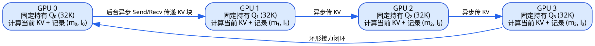

#### 2. 初学者必看细节与三大踩坑点
- **大坑 1：Causal Mask（因果掩码）导致的极端算力不均！**
  自回归大模型中，第 $t$ 个词只能看前 $t$ 个词（下三角有效计算）。如果你老老实实把 `[0..32K]` 给 GPU 0，把 `[96K..128K]` 给 GPU 3：GPU 0 的词只需要看最前面一小段，算完直接跳过其余块；而 GPU 3 的每个词都要看前面整整 128K 的所有历史词——**GPU 3 的实际计算量是 GPU 0 的 7 倍**！GPU 0 算完只能干等，并行加速直接失效！
  **标准解法：Zig-Zag / Striped 交错切分**（比如把 128K 切成 8 段，GPU 0 拿最轻的段 0 + 最重的段 7，GPU 1 拿段 1 + 段 6……），这样每张卡承担的三角面积完全相等，实现完美负载均衡！

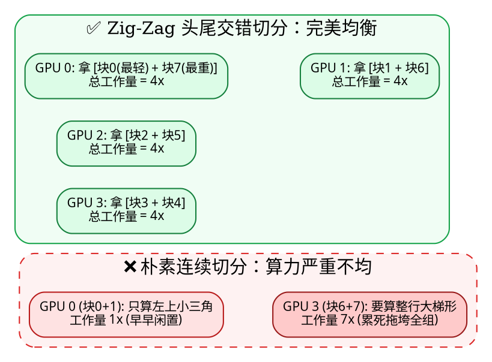

- **大坑 2：RoPE（旋转位置编码）索引偏移错误**：序列被劈开后，GPU 1 本地索引的第 `0` 个词，在整篇文章里其实是第 `32768` 号词！调用 RoPE 算子时，必须传入**全局 Position ID**（或对应的全局 $\sin/\cos$ 偏移表），如果误用本地索引 `0..32K-1`，位置信息就会彻底乱套。
- **大坑 3：Ring-Attention vs DeepSpeed-Ulysses 的选择**：除了 Ring-Attention 这种用 P2P 环传 KV 的写法，业界还有一种 **Ulysses CP** 方案——在进入 Attention 之前，用两次 **`All-to-All`** 瞬间把张量从“按序列长度 `S` 切分”重排成“按注意力头 `Head` 切分”（每张卡拿到完整 128K 序列，但只算一部分头），本地直接跑标准 FlashAttention，算完再用 `All-to-All` 换回来。Ulysses 通信延迟更低、算子复用标准 FlashAttention 不用重写 Online Softmax 合并逻辑，但硬性限制是 **CP 并发度不能超过 KV Head 的数量**；而 Ring-Attention 不受头数限制，因此超长序列常把两者混用。

---

### 2.5 PP（Pipeline Parallelism，流水线并行）——“汽车组装流水线”

> **通俗类比**：造一台汽车有 4 道工序（装底盘、装发动机、喷漆、质检），4 个车间（GPU 0 ~ GPU 3）各自负责其中几层网络。如果一次只造 1 辆车，前 1 个车间干完后 3 个车间才能依次开工，75% 的时间都在空等；必须把大订单拆成多个小批次（**Micro-batch，微批次**）像流水线一样连续投料！

#### 1. 具体 Shape 演变与微批次调度
假设模型共 64 层，输入 `[Batch=8, Seq=8192, Hidden=4096]`，开 `PP=4`：
- GPU 0 负责第 `0~15` 层，GPU 1 负责 `16~31` 层，GPU 2 负责 `32~47` 层，GPU 3 负责 `48~63` 层。
- **层内单卡算子 100% 零改动**：每一层的全部权重和整个激活张量都在同一张卡上，算子内部逻辑完全不用碰，只在层与层跨卡的边界处插一对点对点通信 **`Send / Recv`**。
- **微批次（Micro-batch）与 1F1B 调度**：如果直接把 `B=8` 整批送入流水线，任意时刻只有 1 张卡在干活，其余 3 张卡全部空闲——这些浪费掉的空档时间就叫 **Pipeline Bubble（流水线气泡）**。因此，工程上把 `B=8` 拆成 4 个 `[B_micro=2, 8192, 4096]` 依次推进，并采用 **1F1B（One Forward One Backward，一前向一反向）** 调度策略，让最早算完前向的微批次尽快进入反向释放显存：

```mermaid
gantt
    title PP=4 四卡流水线调度时序对比（F=前向，B=反向，空白处=Bubble 气泡）
    dateFormat X
    axisFormat %s

    section 1F1B 稳态阶段 (GPU 0)
    F1 :a1, 0, 1
    F2 :a2, 1, 2
    F3 :a3, 2, 3
    F4 :a4, 3, 4
    B1 (等后端传回) :active, a5, 6, 7
    B2 :active, a6, 7, 8
    B3 :active, a7, 8, 9
    B4 :active, a8, 9, 10

    section GPU 1
    F1 :b1, 1, 2
    F2 :b2, 2, 3
    F3 :b3, 3, 4
    B1 :active, b4, 5, 6
    F4 :b5, 6, 7
    B2 :active, b6, 7, 8
    B3 :active, b7, 8, 9
    B4 :active, b8, 9, 10

    section GPU 3 (最末尾阶段)
    等待前级 (Bubble) :crit, d0, 0, 3
    F1 :d1, 3, 4
    B1 (立刻反向!) :active, d2, 4, 5
    F2 :d3, 5, 6
    B2 :active, d4, 6, 7
    F3 :d5, 7, 8
    B3 :active, d6, 8, 9
    F4 :d7, 9, 10
    B4 :active, d8, 10, 11
```

#### 2. 初学者必看细节与注意事项
- **Micro-batch 拆太小也会伤算子性能**：为了减少气泡，大家往往喜欢把 Micro-batch 拆得很小（比如 `B_micro=1`）。和 DP 一样，如果推理 Decode 时 $S=1$ 且 Micro-batch 太小，单卡矩阵乘同样会变成极窄矩阵，从 Compute-bound 掉进 Memory-bound。
- **Stage 0 显存反而最大（非对称显存陷阱）**：仔细看上面的 1F1B 时序图！GPU 3 刚算完 `F1` 立刻就跑 `B1` 并释放 `F1` 的中间激活值，自始至终最多只存 **1 份**激活值；而 GPU 0 必须一口气连算 `F1, F2, F3, F4` 之后才能等到 `B1` 回来，必须同时在显存里囤积 **4 份**激活值！所以越靠前的卡越容易 OOM（爆显存），实战中常常故意给 Stage 0 少放 1~2 层网络（或者把输入 Embedding 单独算账）来均衡显存。
- **词表权重绑定（Tied Embeddings）问题**：很多模型要求第一层的词嵌入矩阵（Embedding，住在 GPU 0）和最后一层的输出分类头（LM Head，住在末尾卡）共享同一份权重。PP 把它们拆到天各一方后，每步反向传播完必须额外增加一次头尾两卡之间的梯度 `All-Reduce`，否则两头权重就分道扬镳了。
- **P2P `Send / Recv` 死锁与异步流陷阱**：跨卡传递激活值时，张量的 Shape、Dtype（如 BF16 vs FP32）和通信流顺序必须严丝合缝，哪怕一端多发了一个张量或顺序写反，两张卡就会互相永远等对方收发，导致训练任务无声死锁（Hang）。

---

### 2.6 实战决策：5D 并行在真实集群中如何协同组合？

在真实的多机多卡训练/推理集群里，5 种并行不是单选，而是**按照物理网络带宽从高到低嵌套组合**的：

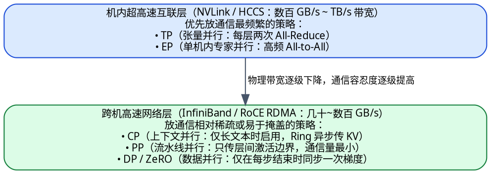

**给初学者的 5D 并行排查速查口诀**：
1. **单卡放不下模型权重？** $\rightarrow$ 先在机内开 **TP**（或训练开 **ZeRO-3 / FSDP**），跨机再加 **PP**；
2. **MoE 模型专家太多放不下？** $\rightarrow$ 对专家层单独开 **EP**（把 TP 留给非专家层或按需混用）；
3. **长文本（128K+）激活值 / KV Cache 爆显存？** $\rightarrow$ 开 **CP**（优先用 Zig-Zag Ring-Attention 或 Ulysses）；
4. **模型放得下，想多加机器加速吞吐？** $\rightarrow$ 无脑扩 **DP**（注意保持单卡 Micro-batch 别太小）。

---

## 三、不同的写法方式对于算子实现有什么影响？

在算子开发里，“不同的写法方式”包含两个层面的含义：
1. **宏观层面**：选择哪种**编程范式与抽象层级**（是手写硬核 CUDA C++，还是写 Python 版的 Triton DSL，或是靠 AI 编译器自动生成）？
2. **微观层面**：在同一种语言内部，**访存布局、索引方式、循环控制与指令顺序**怎么写？

这些选择直接决定了算子的**硬件控制粒度、性能天花板、开发维护周期以及跨芯片可移植性**。

### 3.1 宏观层面：四大编程范式的光谱与权衡

目前业界编写算子主要有四种路线，它们在“极限控制力”与“开发效率”之间排成了一条清晰的光谱：

```dot
digraph CodingParadigms {
    rankdir=LR;
    node [shape=box, style="rounded,filled", fontname="sans-serif", fontsize=11];
    edge [color="#475569", fontname="sans-serif", fontsize=10];

    L1 [label="1. 原生扩展 + 汇编/内联指令\n(CUDA C++ / PTX / SASS / Ascend C)\n• 控制粒度：指令级 / 寄存器级\n• 性能上限：100% 物理峰值\n• 开发成本：极高（数周~数月）", fillcolor="#fee2e2", color="#b91c1c"];
    L2 [label="2. 高性能 C++ 模板元编程库\n(CUTLASS / AMD CK)\n• 控制粒度：Tile / Warp / MMA 指令级\n• 性能上限：95% ~ 100%\n• 开发成本：较高（编译慢、报错晦涩）", fillcolor="#ffedd5", color="#c2410c"];
    L3 [label="3. 块级 (Tile-based) 现代 DSL\n(Triton / TileLang / Mojo)\n• 控制粒度：Block / Tile 块级\n• 性能上限：85% ~ 95%\n• 开发成本：低（数小时~数天）", fillcolor="#dcfce7", color="#15803d"];
    L4 [label="4. 编译器调度原语 / IR 自动生成\n(TVM TensorIR / MLIR Linalg+Affine)\n• 控制粒度：计算与调度解耦\n• 性能上限：80% ~ 95%\n• 开发成本：前端快，后端 Pass 调优难", fillcolor="#dbeafe", color="#1d4ed8"];

    L1 -> L2 -> L3 -> L4 [label=" 抽象变高：开发越快，跨芯片越好\n (反方向：控制越细，性能越逼近极限)"];
}
```

| 编写方式 | 代表工具 / 语言 | 底层硬件控制能力 | 适用场景 |
| :--- | :--- | :--- | :--- |
| **1. 原生扩展 + 汇编** | CUDA C++、PTX/SASS、Ascend C | 可精确控制单条指令发射顺序、SRAM Bank 偏移、异步搬运与寄存器分配。 | 最核心的重度算子（如 FlashAttention-3、极限优化的 GEMM、通信计算融合）。 |
| **2. 模板元编程库** | CUTLASS、Composable Kernel (CK) | 通过 C++ 模板在编译期静态展开循环、配置多级流水线深度与分块大小。 | 需要高度定制化融合的 GEMM / Conv 变体（如量化反量化融合、Grouped GEMM）。 |
| **3. 块级现代 DSL** | Triton、TileLang、Mojo | 只需写明“切多大的 Tile、怎么算”，编译器自动搞定线程映射、SRAM 分配与合并访存。 | **访存密集型算子**（RMSNorm、RoPE、Softmax）、快速验证新算法原型。 |
| **4. 编译器 IR 生成** | TVM TensorIR、MLIR | 把“算什么（计算逻辑）”和“怎么切（Tiling/Vectorize/Bufferize 调度）”彻底分离。 | 需要一套代码部署到多种异构芯片（自研 NPU、CPU、多代 GPU）的统一编译栈。 |

#### 两个关键的工程权衡点：
1. **控制权与编译器黑盒的博弈**：用 Triton 或编译器自动生成时，遇到性能瓶颈（例如编译器自动分配的 Shared Memory 触发了严重的 Bank Conflict，或者寄存器用超了导致 **Register Spilling 寄存器溢出**——被迫把临时变量暂存到极慢的显存中），开发者往往没有直接的指令开关去修它，只能通过修改 Tile 尺寸或改写 Python 表达式去“诱导”编译器换一种生成策略；而手写原生 C++/Intrinsics 则可以指哪打哪。
2. **编译耗时与二进制膨胀**：重度 C++ 模板写法（如 CUTLASS）虽然零运行时开销，但把各种数据类型和分块组合全静态展开，会导致编译时间动辄十几分钟，编译出来的 `.so` 动态库体积暴增；而基于 **JIT（Just-In-Time，即时编译）** 的 Triton 写法虽然提前不用编译，但在服务第一次收到某种新形状的张量时，会产生几十毫秒到几秒的冷启动编译卡顿。

---

### 3.2 微观层面：同一语言下的四种代码写法差异

哪怕同样是用 CUDA C++ 写同一个算子，不同写法在底层会编译出截然不同的机器指令，性能差距甚至可达数倍：

#### 1. 访存写法：标量逐元素读取 vs 向量化宽加载（Vectorized Load）
```cpp
// ❌ 普通标量写法：每个线程每次只拿 1 个 float (32-bit)，生成大量 LDG.E.32 指令
out[idx] = in[idx] * 2.0f;

// ✅ 向量化宽加载写法：指针强转为 float4，单条指令一次打包搬运 128-bit (4个float)
float4 vec = reinterpret_cast<const float4*>(in)[idx];
vec.x *= 2.0f; vec.y *= 2.0f; vec.z *= 2.0f; vec.w *= 2.0f;
reinterpret_cast<float4*>(out)[idx] = vec;
```
**底层影响**：向量化写法让编译器直接发射宽加载指令（如 `LDG.E.128`），访存指令总数直接降为原来的 $1/4$（若处理 FP16 则是 $1/8$），极大缓解指令发射队列的拥堵，更容易打满显存带宽。

#### 2. 数据排布与索引写法：隐式冲突 vs 显式 Swizzle（异或重排）
```cpp
// ❌ 普通二维索引：按列读取时，同一 Warp 的 32 个线程全挤进第 0 号 Bank 排队！
val = smem[threadIdx.x][col];

// ✅ Swizzle 异或重排索引：用几乎零开销的位运算，把数据斜着错开存进 32 个不同 Bank
int swizzled_col = col ^ (threadIdx.x & 0x7);
val = smem[threadIdx.x][swizzled_col];
```
**底层影响**：片上共享内存由多个并行通道（Bank）组成。普通二维数组在按列访问或矩阵转置时极易触发严重的 **Bank Conflict**，吞吐瞬间暴跌十几倍；引入 **Swizzle（异或地址扰动）** 写法，在不额外增加显存浪费（Padding）的前提下，从数学上保证同一拍访问的线程全部落到不同 Bank 上。

#### 3. 循环与分支写法：动态控制流 vs 编译期静态展开
```cpp
// ❌ 动态参数写法：BLOCK_K 是运行时变量，编译器无法确定局部数组 acc[i] 对应哪个寄存器
void kernel(int BLOCK_K, bool has_bias) {
    float acc[16];
    for (int k = 0; k < BLOCK_K; ++k) {
        if (has_bias) { /* 运行时分支可能导致 Warp Divergence */ }
    }
}

// ✅ 编译期常量 + 模板特化 + 循环展开：静态确定一切，变量稳稳留在高速寄存器
template <int BLOCK_K, bool HAS_BIAS>
void kernel() {
    float acc[16];
    #pragma unroll
    for (int k = 0; k < BLOCK_K; ++k) {
        if constexpr (HAS_BIAS) { /* 编译期直接裁剪掉无效分支 */ }
    }
}
```
**底层影响**：GPU/NPU 的寄存器通常**不支持动态下标寻址**。如果循环边界是动态的，编译器被迫把本该放在极速寄存器里的 `acc[16]` 降级放进极慢的 Local Memory（本质在 HBM 上），造成灾难性的 Register Spill；同时动态 `if-else` 还可能引发 SIMT 架构下的 **Warp Divergence（线程束分化，部分线程走 if、部分走 else，硬件被迫串行跑完两条路，算力折半）**。模板常量配合 `#pragma unroll` 彻底根除了这两个隐患。

#### 4. 指令依赖与调度写法：串行依赖链 vs 软件流水线交错
- **串行直白写法**：在 `for` 循环里严格按照“发起数据加载 $\rightarrow$ `syncthreads()` 等待全部到齐 $\rightarrow$ 算矩阵乘法 $\rightarrow$ 再等算完”的顺序书写。搬运数据时算力在睡觉，计算时搬运通道在睡觉。
- **多级流水线写法**：在循环开始前先预取第 0 块（甚至第 1 块）数据；进入主循环后，把“异步发起第 $k+1$ 块数据加载”的代码写在前面，把“等待第 $k$ 块就绪并计算”的代码交错排在后面（配合 **Asynchronous Barrier / `mbarrier`** 异步屏障指令），引导硬件流水线把访存和计算严丝合缝地叠在一起。

---

### 3.3 工业界“80/20 法则”工程选型建议

真实的大模型算子团队不会死磕某一种写法，而是遵循务实的分层策略：
1. **80% 的长尾融合算子（Elementwise 逐元素、Norm 归一化、激活函数、路由重排）**：果断用 **Triton / TileLang 或编译器自动生成**。这类算子大多受限于内存读写速度（Memory-bound），只要保证合并访存和算子融合，DSL 写出的代码就能吃到硬件带宽的 90% 以上，几天就能上线且极易维护。
2. **20% 的核心重算子（GEMM、FlashAttention、MoE Grouped GEMM、通信计算融合）**：必须投入资深工程师用 **C++ 模板库（CUTLASS）或手写底层扩展 + 内联指令**。它们占据了系统 80% 以上的算力耗时，只有精细压榨寄存器配额、手工编排多级流水线和异步屏障，才能把 Tensor Core / Cube 单元喂饱到 95%~100%。

---

## 四、不同的切分方式（Tiling / Partitioning）对算子实现有什么影响？

如果说编程范式决定了“用什么工具施工”，那么**切分方式（Tiling / Partitioning）** 就是施工的总图纸：如何把动辄几百万个元素的巨大张量，拆解并塞进硬件多级存储（多核、片上 SRAM、寄存器）中？

切分方式由三个关键决策组成：**切哪个维度**、**切多大一块（Tile Size）**、以及**按什么顺序把块派发给物理核心**。它们对算子实现产生着牵一发而动全身的影响。

### 4.1 切分维度的选择：并行维度 vs 规约维度

以最核心的矩阵乘 $C[M, N] = A[M, K] \times B[K, N]$ 为例（其中 $M$ 是行数，$N$ 是列数，$K$ 是需要乘加求和的公共维）：$M$ 和 $N$ 被称为**并行维度**（不同输出位置互不干扰），而 $K$ 被称为**规约维度（Reduction Dimension，需要累加求和）**。

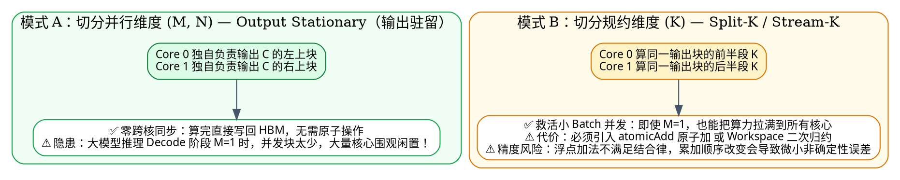

| 切分维度类型 | 典型代表 | 对算子代码实现与性能的深远影响 |
| :--- | :--- | :--- |
| **只切并行维度**（如 $M, N$ 或 Batch、Head） | **Output Stationary**（输出驻留） | 1. **无跨核同步开销**：各核心算自己的输出块，算完直接写回 HBM，代码干净。<br/>2. **并发不足痛点**：遇到“瘦高/矮胖”矩阵（比如大模型推理吐字阶段 $M=1$）时，切不出足够多的 Tile 喂给上百个核心，算力严重浪费。 |
| **切分规约维度**（如 GEMM 的 $K$，或 Attention 的 KV 序列长度） | **Split-K** / **Stream-K** | 1. **必须加同步与归约代码**：多个核心协同算同一块输出的部分和，最后必须用 **`atomicAdd`（原子加）** 直接累加到显存，或者申请一块临时 **Workspace 显存**写完再启动二次归约。<br/>2. **非确定性精度波动**：浮点数加法 $(a+b)+c \neq a+(b+c)$。Split-K 改变了累加顺序，可能导致每次运行结果在最后几位小数上有微小差异。 |

---

### 4.2 切分粒度（Tile Size）对资源与带宽的博弈

一块 Tile 的长宽尺寸（例如 `BLOCK_M × BLOCK_N × BLOCK_K`），直接决定了算子能否吃满算力：

1. **计算访存比与数据复用（偏爱大 Tile）**
   为了算出一个 $M \times N$ 大小的输出块（沿 $K$ 方向走完一轮），需要从 HBM 加载 $A$ 块（$M \times K$）和 $B$ 块（$K \times N$），总访存元素为 $(M+N)K$，而总乘加计算量为 $2MNK$。于是核心指标**算术强度（Arithmetic Intensity）**约为：
   $$\text{算术强度} \approx \frac{2MN}{M+N}$$
   可以看出：**Tile 越大，每个搬进来的数被重复利用的次数就越多，对片外 HBM 带宽的压榨就越小**。如果切得太小（比如 $16 \times 16$），算子会瞬间退化为 Memory-bound，算力核心大部分时间都在等内存。

2. **片上资源容量上限与占用率（限制了大 Tile）**
   Tile 不可能无限大，因为片上 SRAM 和寄存器总量是死的。Tile 过大不仅会直接超出 SRAM 容量导致编译报错或触发 **Register Spilling（寄存器溢出）**，还会让单个核心只能同时塞下 1 个线程块，降低 **Occupancy（硬件占用率，即单个核心同时驻留的线程块/Warp 数量）**。Occupancy 太低时，一旦这个线程块在等数据，硬件找不到别的线程块顶上去干活，延迟就掩盖不住了。

3. **非对齐边界处理（Tail / Padding 开销）**
   现实中的矩阵尺寸很少正好是 `128` 的整数倍（比如 $M=1000$，但 `BLOCK_M=128`），最后一块必然会出现越界尾巴（Tail）。算子代码里必须二选一：
   - 在内层循环里加入**边界掩码判断（Predication / Masking）**，只读写合法下标，但这会增加分支指令并破坏对齐；
   - 或者在算子外部预先 **Padding（补零对齐）**。若切分策略不匹配，边缘 Tile 的有效算力利用率会大幅下滑。

---

### 4.3 多级存储层次的嵌套切分（Multi-level Tiling）

因为 AI 芯片拥有“全芯片多核 $\rightarrow$ 片上 SRAM $\rightarrow$ 寄存器指令”三层结构，算子实现必须做对应的**三层嵌套切分**：

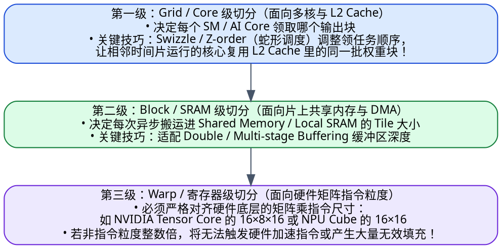

---

### 4.4 动态形状与负载均衡（Load Balancing）

面对不规则计算任务（如 MoE 的 `Grouped GEMM`、每个请求长度不一的变长序列 Attention、稀疏矩阵计算）时，切分策略决定了算子是否会陷入“一核有难、多核围观”的**长尾效应**：

- **静态均匀切分（Fixed Grid Tiling）**：直接按最长序列或固定块大小分配线程块网格（Grid）。代码最简单，但短序列或空专家对应的核心早早干完下班了，整个算子必须死等那个分到超长序列的核心跑完，总体耗时被最慢的一块拖垮。
- **持久化内核 + 动态任务队列（Persistent Kernel & Work-stealing）**：不再按数据量启动成千上万个线程块，而是**只启动刚好等于硬件物理核心数的持久化线程块**。每个核心算完手头一块，就通过原子计数器（Atomic Counter）或动态任务映射表去队列里“抢（Steal）”下一块待算的 Tile（**Stream-K** 和持久化 **Grouped GEMM** 均采用此思路）。虽然控制流代码变复杂了，却能实现接近完美的跨核心负载均衡。

---

### 4.5 算子融合（Fusion）场景下的切分耦合

把多个连续算子融合成一个 Kernel 时，上下游算子的切分方法必须强行对齐，否则无法在片上直接交接数据：

1. **兼容型切分（例如 `GEMM + Bias + GeLU`）**
   加偏置（Bias）和激活函数（GeLU）都是“逐元素计算”，只依赖当前位置自己的数值，不看邻居。因此完全不需要修改 GEMM 的切分方式，直接沿用 GEMM 算出的输出 Tile，趁数据还热乎着留在寄存器里顺手算完即可。
2. **跨维度强依赖型切分（例如 `Attention` 或 `LayerNorm`）**
   Softmax 和 LayerNorm 都需要在**整条序列或整条特征维度**上求最大值、平均值或指数和（全局归约）。如果沿这个依赖维度强行切分成块，就不能傻傻等全部块算完再写回内存求平均——必须重构为**在线分块归约（Online Softmax / Welford 在线方差算法）**：每算完当前这一个局部 Tile，就用递推公式动态修正历史上保存的局部最大值、局部方差和累加和，彻底消除中间大矩阵落地片外主存的开销。

---

## 五、全篇总结：串联 AI 芯片算子开发的完整心智模型

读到这里，我们已经把 AI 芯片算子开发的四个核心切面彻底打通。作为总结，你可以用下面这张关联图记住它们之间如何协同工作：

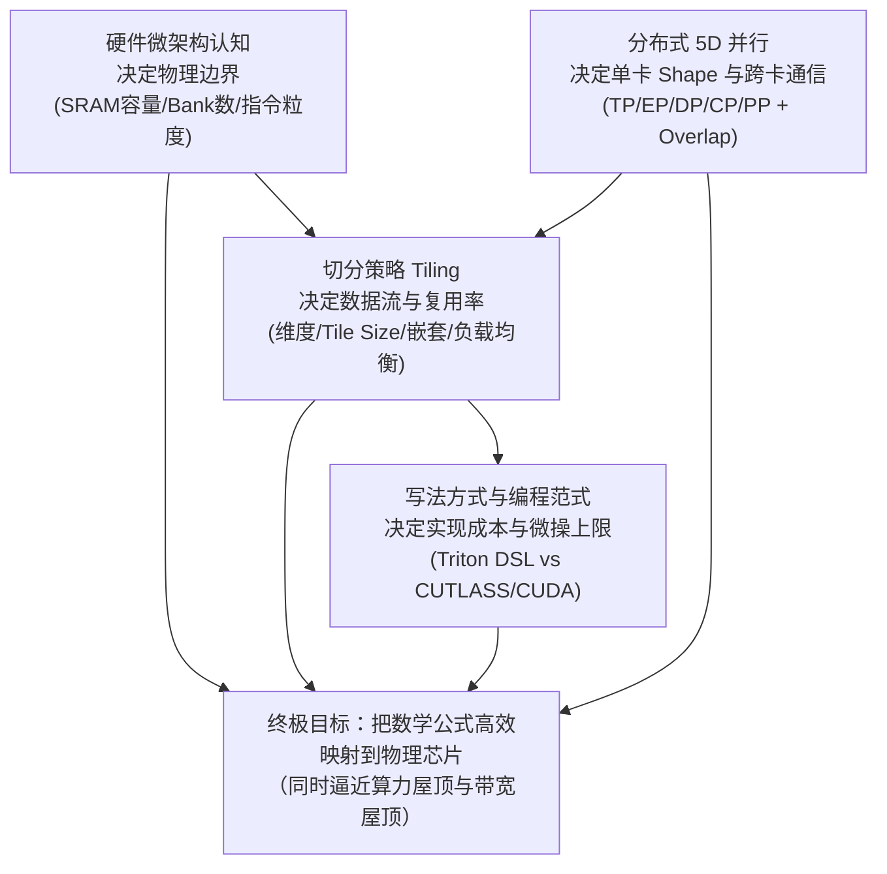

1. **硬件决定了天花板与底线**：存储金字塔延迟差异、Bank 冲突规律、矩阵指令粒度与异步 DMA 机制，划定了所有优化的物理规则。
2. **切分（Tiling）是算子设计的灵魂**：它向上承接分布式 5D 并行拆下来的张量 Shape，向下适配 L2/SRAM/寄存器三层容量，并决定算子融合能否闭环。
3. **写法方式是工程落地的杠杆**：用 **Triton / TileLang** 快速攻克 80% 的访存密集长尾算子，用 **CUTLASS / CUDA / Ascend C + 向量化 + Swizzle + 双缓冲流水线** 压榨 20% 的核心重算子。
4. **Profiler 是检验真理的唯一标准**：不要靠猜想做优化，用 NCU / NPU Profiler 看清瓶颈到底卡在 Memory-bound 还是 Compute-bound，每一次重构都用数据说话。
