> **导读**：在为自定义专用加速器（如 AI NPU、DSP、张量处理器）设计编译器时，许多工程团队都会面临一系列经典的架构拷问：
>
> 1. 我们自定义的硬件描述属性（如分块尺寸、网格维度、地址发生器步长）究竟应该作为一个大包揽的属性（Attribute），还是拆解为不同层次？
> 2. 业界顶尖的工业级开源编译器 IREE（基于 MLIR 孵化）原版是如何组织其代码生成管线的？它的 `translation_info` 与 `lowering_config` 为何要大费周章地分离？
> 3. 既然 MLIR 官方早已提供了结构化控制流（`scf.for` / `scf.forall`），为什么大家不直接用原生循环操作表达分块与硬件映射，偏偏要在 IR 节点上附加五花八门的编译配置？
> 4. 真实芯片厂商（**华为昇腾 CANN/AKG、算能 TPU-MLIR、AMD rocMLIR/MIGraphX**）在面对其异构硬件时，分别做出了怎样的架构取舍？它们有哪些值得自研编译器借鉴的“绝技”？
> 5. 为什么 TVM、Triton、Tenstorrent、Arm Vela 等厂商各走各的路，甚至自研多层方言（Dialect）？统一的开源 IR 为什么在底层硬件世界屡屡碰壁？
> 6. “在前端连续运行多个分析 Pass 仅生成 Attribute，最后由一个统一的大 Pass 一次性生成所有底层指令”，这种直觉上干净好调试的架构，在真实工程落地中到底会踩到哪些致命暗坑？
>
> 本文将从**编译第一性原理**与**工程维护生命周期**的双重视角出发，抽丝剥茧拆解上述疑问，并结合全球与国产顶尖异构编译器的真实开源实现，为芯片与 AI 编译器研发团队提供一套兼具理论高度与实战可操作性的架构设计演进指南。

---

## 零、初学者名词形象速查表 (Primer)

为了确保零基础读者或刚刚切入 AI 编译领域的软硬件开发者能够无障碍阅读，下表对本文首次出现的核心概念做出一对一的直观定义与通俗比喻：

| 术语名称                    | 英文全称 / 原型             | 核心本质与通俗比喻                                                                                                                                                     |
| :-------------------------- | :-------------------------- | :--------------------------------------------------------------------------------------------------------------------------------------------------------------------- |
| **IR**                      | Intermediate Representation | **编译器中间表示**。介于高级框架（如 PyTorch、ONNX）与底层芯片机器码之间的程序表示形式，相当于编译器的内部世界语。                                                     |
| **MLIR**                    | Multi-Level IR              | **多级中间表示框架**。由 LLVM 社区孵化的模块化编译器基础设施，允许开发者在同一个程序中定义和混合使用不同抽象级别的领域语言。                                           |
| **Dialect**                 | 方言                        | **MLIR 的模块化词表与命名空间**。一组相互关联的 Operation、Type 和 Attribute 的集合。例如 `arith`（标量算术）、`scf`（结构化控制流）、`linalg`（线性代数）。           |
| **Operation (Op)**          | 操作 / 指令                 | **MLIR 程序的基本执行单元**。拥有输入操作数（Operands）、输出结果（Results）、属性（Attributes）和代码块区域（Regions）。                                              |
| **Attribute (Attr)**        | 属性                        | **附着在 Operation 或类型上的编译期常量元数据**。例如矩阵分块尺寸、字典配置、字符串标识等，在编译期已知且不可变。                                                      |
| **Inherent vs Discardable** | 固有属性 vs 可丢弃属性      | **Inherent** 是 Op 定义中不可分割的语义（如 `arith.cmpi` 的谓词 `eq`）；**Discardable** 是外部附加的编译提示（如优化建议、流水线配置），丢失不会改变 Op 原始语义定义。 |
| **Tiling**                  | 循环分块 / 切片             | **高性能计算的经典空间变换技术**。将巨大的张量计算切分成适合片上 SRAM/Cache 容量的小数据块（Tile），以提升数据局部性并降低 DRAM 访问开销。                             |
| **Lowering**                | 降级 / 逐级转换             | **编译器从高抽象向低抽象翻译的过程**。例如将数学公式级别的 `linalg.matmul` 转换为循环级的 `scf.for`，再降级为汇编或机器配置。                                          |
| **Pass**                    | 编译器通道 / 变换遍         | **作用于 IR 上的独立处理单元**。一个 Pass 可以是只读的静态分析（Analysis），也可以是对 IR 进行模式匹配与重写的转换（Transformation）。                                 |
| **Pipeline**                | 流水线 / 通道链             | **一系列按序执行的 Pass 集合**。负责驱动程序从顶层模型一直编译为最终硬件可执行镜像。                                                                                   |
| **AG**                      | Address Generator           | **硬件地址生成器**。专用芯片（如 NPU）内部独立于计算核心的专用寻址硬件单元，能通过硬件循环计数器与步长寄存器，按固定模式自动吐出物理存储地址。                         |
| **SMEM / SRAM**             | Shared/Scratchpad Memory    | **芯片内部的高速片上暂存器**。读写延迟极低、带宽高，但容量有限，需由编译器或硬件精确规划管理。                                                                         |
| **DMA**                     | Direct Memory Access        | **直接内存访问控制器**。独立于 CPU/计算核心的硬件搬运工，负责在片外 DRAM 与片上 SRAM 之间批量搬运数据块。                                                              |
| **Ping-Pong Buffer**        | 双缓冲机制                  | **隐藏访存延迟的高性能并发设计**。当计算核心正在消费 Buffer A 中的数据时，DMA 控制器同时将下一轮数据搬入 Buffer B，二者交替流水作业。                                  |
| **SCF**                     | Structured Control Flow     | **MLIR 原生的结构化控制流方言**。包含 `scf.for`（有界循环）、`scf.forall`（并行分布循环）、`scf.if`（条件分支）等。                                                    |
| **Linalg**                  | Linear Algebra              | **MLIR 针对线性代数计算的核心方言**。通过结构化索引映射（Indexing Maps）与迭代器类型（Iterator Types）显式表达张量与缓冲区上的代数计算语义。                           |
| **Affine Map**              | 仿射映射                    | **MLIR 中用于表达多维坐标线性变换的代数形式**。例如 `(i, j, k) -> (i, k)` 表示从 3 维循环空间投影到 2 维张量切片空间。                                                 |
| **Root Op**                 | 根操作 / 主导操作           | **算子融合或计算分发中处于主导地位的算子**。例如在 `MatMul + Bias + ReLU` 融合块中，计算量最大且决定整体分块方案的 `MatMul` 通常被视为主导操作。                       |
| **Auto-tuning**             | 自动调优                    | **基于搜索与性能反馈的代码生成优化机制**。在合法的候选参数空间中枚举 Tile 尺寸、管线策略并测量硬件周期，从而挑出最优配置。                                             |
| **Global vs Local Layer**   | 全局层 vs 片上局部层        | **算能 TPU-MLIR 的核心抽象**。区分算子是在外部 DRAM 全局大张量上执行，还是已被分块切片并常驻在片上 SRAM（L2M）中以流水线模式执行。                                     |
| **Cube / Vector 异构单元**  | 矩阵乘单元 vs 向量单元      | **华为昇腾 DaVinci 架构的非对称核心**。Cube 专门以硬件脉动阵列进行 $16 \times 16 \times 16$ 矩阵乘累加；Vector 专门负责通用向量、激活、Norm 与归约计算。               |
| **TPIPE / 硬件队列**        | 管道化流水编程模型          | **华为 Ascend C 暴露的异步流控模型**。通过硬件同步队列（Queues）与事件令牌控制数据搬运、Vector 计算与 Cube 计算的生产者-消费者时序，消除全局同步锁。                   |
| **rock.transform**          | 坐标仿射变换代数            | **AMD rocMLIR 的核心算子**。通过纯数学坐标映射链记录张量的转置、填充、分块与重排，在真正 Codegen 时一次性折叠进地址计算，实现**零内存开销的虚拟重排**。                |
| **MFMA**                    | Matrix Fused Multiply-Add   | **AMD CDNA 架构 GPU 的硬件矩阵核心指令**。类似于 NVIDIA Tensor Core，单指令完成微小矩阵块（如 $32 \times 32 \times 8$）的硬件乘加。                                    |

---

## 一、背景与问题：自研 NPU 描述属性与 IREE 的前世今生

### 1.1 典型自研 NPU 的分块属性建模

在为各类自定义硬件加速器（NPU）构建 MLIR 编译流程时，许多团队会借鉴开源先进经验，尝试设计一个高度紧凑的 Attribute 来描述矩阵分块及硬件寻址参数。以通用的 `#npu.spec` 为例：

```mlir
#input_spec = #npu.spec<
  grid = [128, 2, 1],
  index_maps = [
    affine_map<(i, j, k) -> (i, k)>,
    affine_map<(i, j, k) -> (j, k)>
  ],
  block_shapes = [
    #npu.block_shape<
      kinds = [block, block],
      extents = [16, 8],
      steps = [16, 8],
      paddings = [#npu.padding<>, #npu.padding<>]
    >,
    #npu.block_shape<
      kinds = [block, block],
      extents = [16, 8],
      steps = [16, 8],
      paddings = [#npu.padding<>, #npu.padding<>]
    >
  ]
>
```

这段结构看似简洁，实则包含了三个层面的交织意图：

1. **`grid`**：定义了逻辑计算空间的迭代范围（包含多少个逻辑 Tile 计算单元）。
2. **`index_maps`**：定义了每个逻辑计算位置应该从哪个输入张量块中提取数据。
3. **`block_shapes`**：定义了每个输入块的物理张量切片大小（`extents`）、相邻逻辑块起点的坐标跨度（`steps`）以及边界越界时的填充策略（`paddings`）。

假设这段代码服务于经典矩阵乘法：

$$C_{M \times N} = A_{M \times K} \times B^T_{K \times N}$$

其中 $M$ 方向划分为 128 个逻辑块，$N$ 方向划分为 2 个逻辑块，$K$ 方向为 1 个逻辑块（暂时不切分归约轴）。

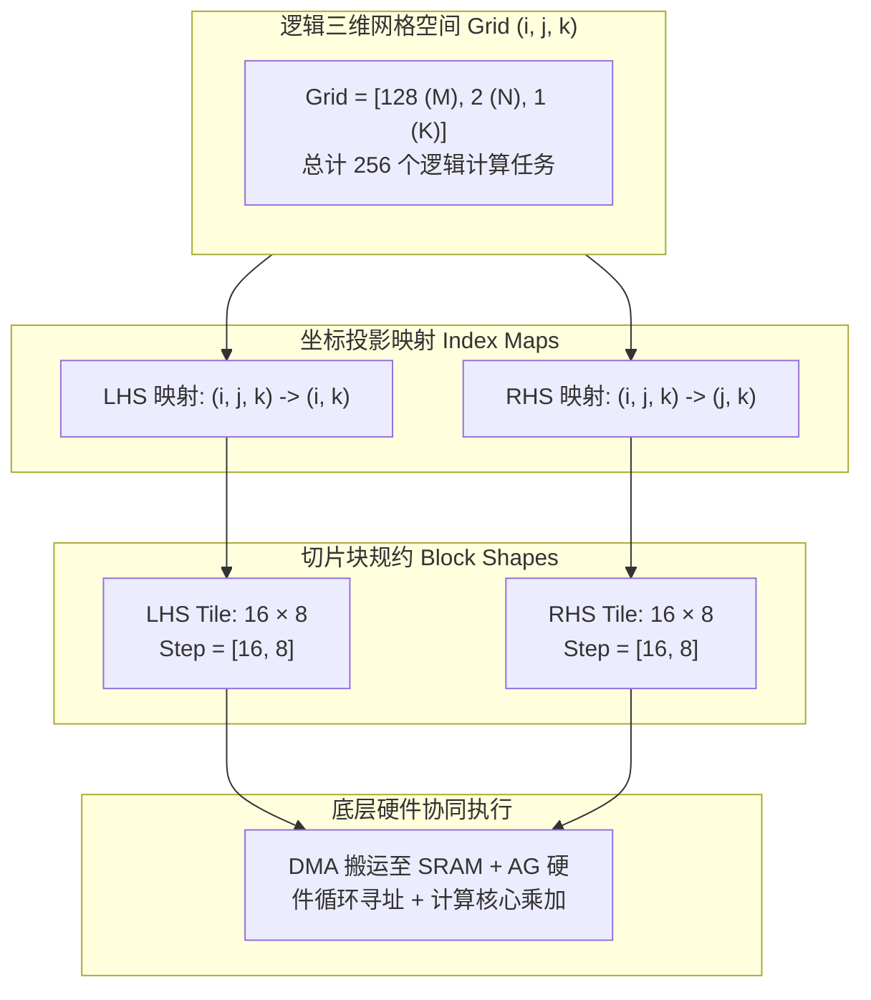

下表梳理了该属性中的字段与底层实际物理硬件之间的映射界限：

| 属性字段     | 它直接决定的逻辑内容               | 它**不直接决定**的硬件物理事实               |
| :----------- | :--------------------------------- | :------------------------------------------- |
| `grid`       | 逻辑索引空间的广度与迭代次数       | 物理核心并发数、硬件多核流水排布             |
| `index_maps` | 逻辑迭代索引到输入张量块的代数投影 | 物理内存绝对地址、SRAM 缓存与对齐策略        |
| `extents`    | 单个逻辑数据块覆盖的行列跨度       | 硬件一次 DMA 搬运的物理字节包大小            |
| `steps`      | 相邻逻辑块起点的元素距离偏移       | SRAM 存储 Bank 跨度（Bank Stride）与物理冲突 |
| `paddings`   | 越界边界元素的数学填充规则         | DMA 硬件是否具备自动零填充能力               |

### 1.2 “大包揽”属性建模的六大隐性代价

将上述多维度信息揉合进同一个不可分割的 Attribute，对于硬件驱动开发或单算子代码生成（Codegen）可能非常直观，因为后端 Pass 能在一个地方查到所有参数。但在端到端编译器全生命周期中，这种设计将付出极其昂贵的代价：

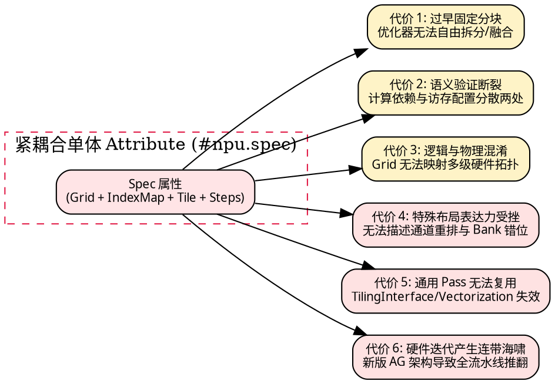

1. **过早固定分块（Premature Lowering），抹杀后续优化空间**：
   一旦在图层级固化了 `grid=[128, 2, 1]` 与 `extents=[16, 8]`，后续优化 Pass 若想将两个相邻的小块融合成一个大块以减少 DMA 启动开销，或者将其拆分为更小的切片以适应紧俏的 SRAM，就必须同步推导并修改 Grid、IndexMap、Step 和 Padding。属性一旦形成整体不可分割的元数据，重写逻辑将异常痛苦。
2. **语义分离导致正确性验证断裂**：
   `#npu.spec` 描述了“如何寻址数据”，但真正的计算逻辑（如加减乘除与规约累加）却写在随后的函数体或微内核（Microkernel）中。如果微内核里的循环将维度 $k$ 标记为归约（Reduction），而 `#npu.spec` 却将该维度误配为并行发射，编译器原生的类型系统根本无法察觉，最终在硬件上产生致命的数据覆写冲突。
3. **逻辑 Block 与物理 Hardware Block 边界混淆**：
   这里的 `grid` 到底是逻辑数学切片的空间、硬件多核并行的任务划分，还是片上 AG（地址生成器）的硬件循环计数值？在简单无冲突矩阵乘法中三者可能在数值上碰巧一致，但在引入 Ping-Pong 双缓冲、DMA 异步流水以及多核动态负载均衡时，逻辑切片绝不可能与硬件计数器一一等同。
4. **面对复杂存储布局（Layout）时抽象失控**：
   `extents + steps + affine_map` 仅适用于规则的高维矩形步进。当遇到硬件强制要求的 Channel 对齐填充、Bank 交叉存储（Interleaving）、权重离线重排（Reordering）乃至非规则稀疏寻址时，单纯的步长模型将无法承载，迫使开发者不断向属性中塞入硬件专用的补丁字段。
5. **丧失 MLIR 通用优化 Pass 复用能力**：
   上游 LLVM/MLIR 提供了极其成熟的通用基础设施，如 `TilingInterface`、`DestinationStyleOpInterface`、`VectorUnrollOpInterface`。若编译器仅依赖专有的自定义属性，通用的向量化、循环融合、跨算子切片等能力统统无法直接生效，团队不得不从零造轮子。
6. **硬件升级引发编译器代码的连带修改**：
   当代次芯片迭代导致 AG 硬件循环层数限制变化或 SRAM 访问粒度调整时，原本写在高层 IR 中的 `#npu.spec` 构造逻辑将被全部击穿，本应局限在后端 Codegen 的硬件适配工作污染了高层流水线。

---

## 二、解密 IREE 原版设计：计算语义与编译策略的彻底解耦

既然单体属性有诸多代价，开源业界最成熟的 MLIR 编译器之一 **IREE（Intermediate Representation Execution Environment）** 是如何解决这一难题的？

### 2.1 IREE 的四层架构设计模型

IREE 明确将编译系统划分为四个职责分明的层次，绝不把硬件调度策略与数学计算混合：

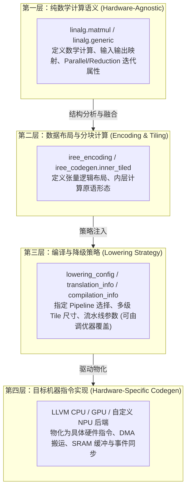

这种分层保证了核心收益：**无论目标硬件如何变化，第一层数学定义永恒不变；无论针对同一硬件采取何种分块策略，第二层计算语义不被破坏；策略仅仅是指导编译器如何进行 Lowering 的外置决策，随时可以替换或调优。**

### 2.2 剖析 `iree_codegen.inner_tiled`：计算操作与属性的本质分野

在 IREE 原版中，与自研硬件 Spec 最接近的操作是 `iree_codegen.inner_tiled`。但请注意其本质差异：**IREE 的 `inner_tiled` 是一个具有操作数与结果的 Operation，而不是附着在其他算子上的单体 Attribute！**

```mlir
%result = iree_codegen.inner_tiled
    ins(%lhs, %rhs : tensor<128x64xf16>, tensor<64x128xf16>)
    outs(%acc : tensor<128x128xf32>) <
  indexing_maps = [
    affine_map<(m, n, k) -> (m, k)>,
    affine_map<(m, n, k) -> (k, n)>,
    affine_map<(m, n, k) -> (m, n)>
  ],
  iterator_types = [
    #linalg.iterator_type<parallel>,
    #linalg.iterator_type<parallel>,
    #linalg.iterator_type<reduction>
  ],
  kind = #iree_gpu.mma_layout<MFMA_F32_16x16x16_F16>,
  semantics = #iree_gpu.mma_semantics<distributed = false>
> -> tensor<128x128xf32>
```

#### 为什么必须拥有 `iterator_types`？

这是很多自研方言容易遗漏的关键点。考虑矩阵乘法：

$$C[m, n] = \sum_k A[m, k] \times B[k, n]$$

在这个计算空间中，$m$、$n$ 和 $k$ 的物理与逻辑属性截然不同：

- 坐标 $m$：遍历不同取值时计算不同的输出行，**天然并行，互不干扰**。
- 坐标 $n$：遍历不同取值时计算不同的输出列，**天然并行，互不干扰**。
- 坐标 $k$：遍历不同取值时，所有计算结果全部累加至同一个输出位置 $C[m, n]$，**属于规约轴（Reduction），存在读-改-写（RaW）时序依赖**。

如果仅有 `indexing_maps`，编译器只知道“每个位置读哪个坐标”，但**无法推断不同任务之间是否能无锁并发**。若缺少 `iterator_types`，优化 Pass 极易将归约轴误当作并行轴发射到多个硬件核，引发多核同时覆写同一片内存的灾难。

下表将 IREE `inner_tiled` 与单体硬件 Spec 作了严格对照：

| 对比维度         | IREE 原版 `inner_tiled`                        | 紧耦合单体硬件 Spec (`#npu.spec`)      |
| :--------------- | :--------------------------------------------- | :------------------------------------- |
| **存在形态**     | 独立的计算 Operation，具备严格 SSA 依赖        | 静态属性（Attribute），依赖外部宿主 Op |
| **迭代属性**     | 显式内建 `iterator_types` (parallel/reduction) | 隐式推导或由后续执行函数分散提供       |
| **分块尺寸来源** | 结合张量 Shape 与硬件原语动态推导              | 显式固定在静态 `grid` 与 `extents` 中  |
| **硬件原语绑定** | 显式关联计算原语属性（如 MMA 布局）            | 缺失或由底层驱动隐藏解释               |
| **接口生态**     | 实现 `TilingInterface` 等全套 MLIR 标准接口    | 专有结构，脱离通用编译器 Pass 生态     |

### 2.3 策略三剑客：`translation_info`、`lowering_config` 与 `compilation_info`

IREE 将控制代码生成的策略高度抽象为三大元数据：

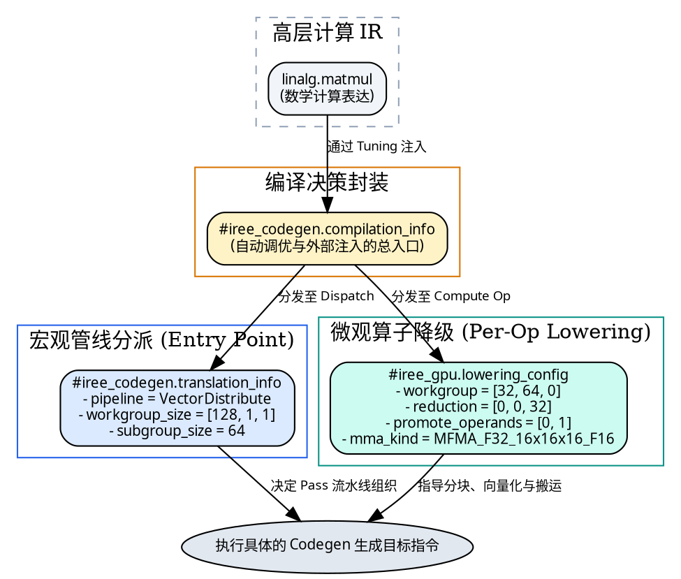

#### 1. `translation_info`：管线指挥官

`translation_info` 附着在分发入口（Dispatch Entry Point），负责回答：**这个计算核心要用哪条 Pass 流水线来编译？以及宏观计算拓扑如何划分？**

- `pipeline`：选择特定的后端 Pass 流水线（例如针对 GPU 的 `VectorDistribute` 或针对自定义加速器的专用流水线）。
- `workgroup_size`：每个执行工作组内的并发硬件线程/车道规模（例如 `[128, 1, 1]`）。
- `subgroup_size`：协同执行的子群/波前（Warp/Wavefront）规模。

#### 2. `lowering_config`：微观战术师

`lowering_config` 附着在具体的计算 Op 上，负责回答：**当前操作在进入该流水线后，各维度如何细粒度分块？是否需要搬运加速？**

- `workgroup` 分块：决定每个计算单元处理多大范围的输出（如 `[32, 64, 0]`）。
- `reduction` 分块：规约维度单次处理多大片段（如 `[0, 0, 32]`）。
- `promote_operands`：决定哪些输入张量需要从高延迟存储（DRAM）搬运提升到低延迟片上 SRAM。
- `mma_kind`：指定底层对应的硬件向量或矩阵计算指令原语（如 AMD MFMA、NVIDIA Tensor Core、RISC-V Vector 内核）。

#### 3. `compilation_info`：策略打包与自动调优（Auto-tuning）

如果想要探索 100 种不同的 Tile 组合与管线参数，开发者无需修改一行 C++ 代码。只需将 `translation_info` 与 `lowering_config` 组合为 `compilation_info`，通过 MLIR 的 Transform Dialect 或文本配置动态注入。编译器会自动将宏观参数分发至 Dispatch，将微观参数附着至算子，从而实现全自动化的搜索与基准测试（Benchmark）。

### 2.4 为什么多层 Tiling 不能用一个 `block_shape` 概括？

以 CPU/GPU/NPU 的通用存储层次为例，一次计算从外部内存到最终寄存器，天然存在多级切片需求：

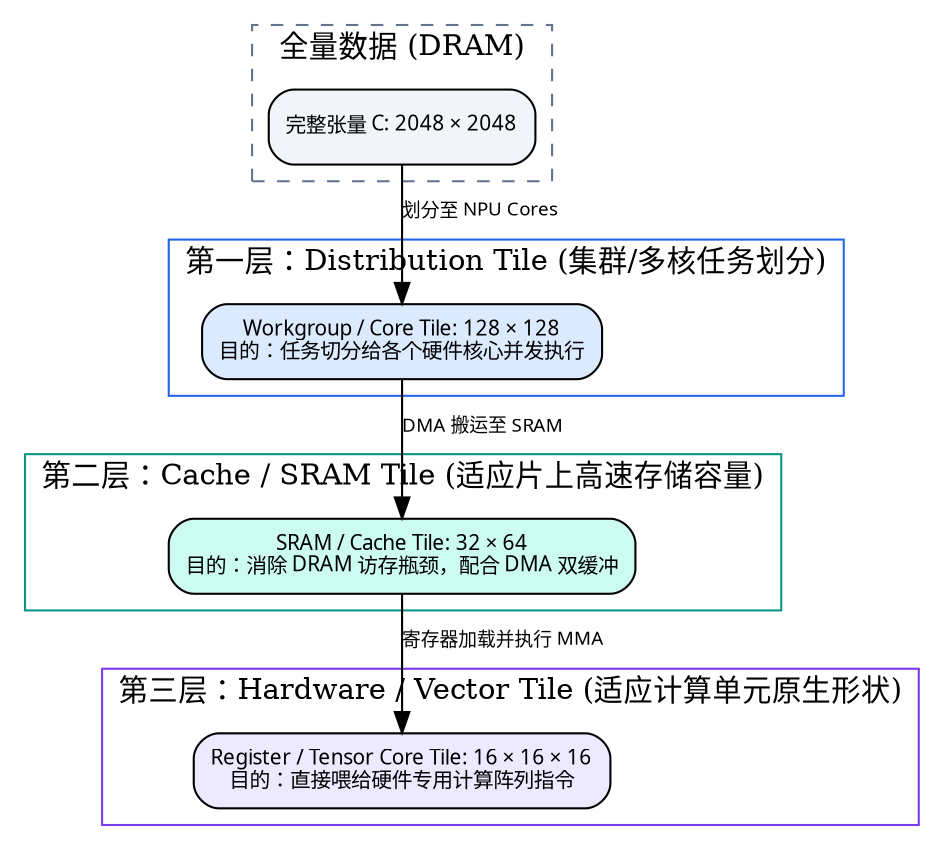

在芯片硬件中，**片上 SRAM 容量、地址生成器（AG）的步长边界、以及计算单元（Tensor Core）的原生矩阵形状根本不是同一个数量级！**
如果像自研 Spec 那样只提供一个孤零零的 `block_shape=[16, 8]`，编译器后续 Pass 就必须硬编码大量隐晦的规则去猜测：这个 16 到底是指 SRAM 块大小，还是指令块大小？这正是架构劣化的典型根源。

---

## 三、终极质疑：为什么不直接用 MLIR 原生 `scf.for` / `scf.forall` 表示一切？

很多初涉 MLIR 的工程师会产生一个极具杀伤力的疑问：

> “既然属性会丢失、会过期，MLIR 又原生自带表达控制流的 `scf.for` 和 `scf.forall`，为什么我们不一开始就直接把代码降级成原生循环？循环结构清晰透明，难道不比那些玄学属性更好吗？”

这是一个极其深刻的问题。答案在于：**循环（SCF）描述的是已经确定的控制流结果；而配置属性（`lowering_config`）描述的是如何决策这个结果。**

### 3.1 相同计算的多种控制流形态

考虑同一个矩阵乘法 $C_{128 \times 128} = A_{128 \times 64} \times B_{64 \times 128}$，在不同策略下会生成完全不同的控制流：

#### 方案 A：朴素逐元素循环（适合最简单的标量 CPU 执行）

```mlir
scf.for %m = %c0 to %c128 step %c1 {
  scf.for %n = %c0 to %c128 step %c1 {
    scf.for %k = %c0 to %c64 step %c1 {
      // 逐点加载、乘加、写回
    }
  }
}
```

#### 方案 B：分块并行与规约循环（适合多核或 SIMD 处理器）

```mlir
scf.forall (%m, %n) in (%c4, %c2) {
  scf.for %k = %c0 to %c64 step %c32 {
    // 处理 32x64 的输出 Tile，K 轴步长 32 规约
  }
} {
  mapping = [#gpu.block<y>, #gpu.block<x>]
}
```

#### 方案 C：硬件地址发生器（AG）触发模式（适合具备硬件循环的 NPU）

```mlir
// CPU 不执行内部计算循环，仅写入少量配置寄存器
"npu.ag.configure"(%base, %step_16, %count_128) : () -> ()
"npu.dma.start"() : () -> ()
"npu.compute.trigger"() : () -> ()
"npu.sync.wait"() : () -> ()
```

如果一开始就在高层 IR 中强行物化为“方案 A”的循环，后续 Pass 若想改为“方案 B”，就必须经历痛苦且极其脆弱的**循环重构（Loop Interchange、Tiling、Distribution）**；若想转换为“方案 C”，更需要从茫茫循环中去逆向推断原本的张量算子意图。

### 3.2 致命差异：CPU 软件循环 vs 专用 AG 硬件自驱动循环

对于带有专用硬件地址生成器（AG）的 NPU，使用原生 SCF 循环存在一道难以逾越的鸿沟：

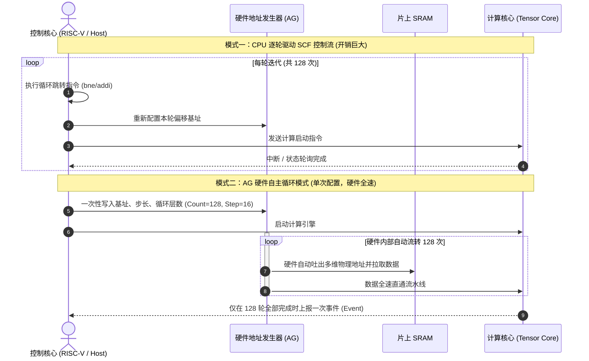

在**模式二**中，CPU 执行完几条配置指令后便可直接休眠或处理其他任务，由 AG 硬件在芯片内部根据寄存器配置全速吐出地址。

如果编译器全程只使用 `scf.for`，后端就必须写一个极其复杂的模式匹配器（Pattern Matcher）：

1. 深入分析 SCF 循环的起始点、步长、上界（Trip Count）；
2. 追踪循环内部复杂的地址仿射表达式（如 `base + i * 16 + j * 256`）；
3. 证明该访存序列能够完全被 AG 硬件的有限寄存器完全表达；
4. 删除这一大堆 CPU 循环，替换为 AG 配置指令。

**这种模式识别极其脆弱！** 在实际工程中，只要上游任意一个通用的 Canonicalization 或 CSE（公共子表达式消除）Pass 将 `base + i * 16` 改写成了代数等价但结构不同的另一种表达式，你的 AG 模式匹配就会当场暴毙，导致硬件加速器退化为龟速的软件模拟。

下表总结了原生控制流与专用硬件描述的工程取舍：

| 评价维度             | 原生 SCF 优先路线                          | 专用硬件描述 / 配置优先路线                   |
| :------------------- | :----------------------------------------- | :-------------------------------------------- |
| **通用优化生态**     | 极佳，无缝接入 MLIR 原生循环变换 Pass      | 取决于是否自行实现了标准 Interface            |
| **硬件模式识别成本** | **极高**，需从复杂表达式中逆向恢复硬件意图 | **极低**，硬件参数在编译期显式直达            |
| **代码生成可靠性**   | 脆弱，易受通用代数化简 Pass 破坏           | 稳固，硬件指令与寄存器参数确定性映射          |
| **异构回退能力**     | 天然支持（直接下沉为标量/向量 CPU 循环）   | 较差，需要额外编写专门的 Fallback 降级通路    |
| **适用场景**         | 通用 CPU、通用 GPU、简单可展开循环         | 具备独立 AG、专用 DMA、异步流水机制的专用 NPU |

---

## 四、百家争鸣：全球顶尖 AI 编译器各显神通的本质原因

既然 MLIR 原生有 SCF，业界又开源了 IREE，为什么主流芯片与加速器厂商没有统一采用同一套开源 IR？

> **核心第一性原理**：越靠近数学计算，不同硬件加速器的共同点越多（都是矩阵乘、卷积、激活）；但越靠近数据移动、片上内存组织、异步同步与机器指令，硬件之间的物理差异越大！

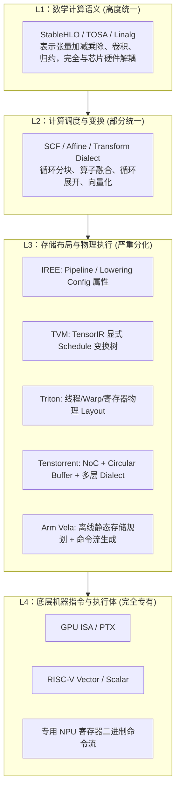

### 4.1 各大代表性开源编译器的工程取向剖析

#### 1. Apache TVM：将优化表达为可执行的变换流（Schedule API）

TVM（尤其是 TensorIR）并不倾向于在算子头上挂满最终静态配置属性，而是**将优化过程本身建模为一段可执行、可记录、可重放的变换动作**：

```python
# TVM TensorIR Schedule 典型范式
sch = tir.Schedule(mod)
block = sch.get_block("C")
i, j, k = sch.get_loops(block)

# 显式执行循环拆分与重排
io, ii = sch.split(i, factors=[None, 32])
jo, ji = sch.split(j, factors=[None, 64])
sch.reorder(io, jo, ii, ji, k)
```

- **工程收益**：TVM 的这种设计天然适配其 MetaSchedule 自动调优框架。调优系统可以随意组合变换动作，记录调优轨迹（Trace），并在真实设备上执行搜索与性能回归。

#### 2. Triton：围绕 GPU 线程体系建立极致的物理 Layout 抽象

Triton 面向现代 GPU Kernel 编程，它关注的核心不是普通的循环，而是：**张量的某一个元素到底位于哪一个 Warp、哪一个 Lane、哪一个物理寄存器？**

```python
# Triton BlockedLayout 示意
gl.BlockedLayout(
    size_per_thread=[2, 4],     # 每个线程持有的元素数量
    threads_per_warp=[16, 2],    # Warp 内部 32 个线程的排布形状
    warps_per_cta=[2, 2],        # 线程块内部 Warp 的二维网格
    order=[1, 0]                # 内存维度的物理排布顺序
)
```

- **工程收益**：在 GPU 上，共享内存 Bank 冲突与寄存器跨线程通信是性能生死的关键。Triton 将 Layout 提升为一等公民（First-Class Entity），使得编译器能够在高级 IR 层面精确推理跨 Warp 数据重排的开销。

#### 3. Tenstorrent (TT-MLIR)：基于片上网络（NoC）的系统级多层方言

Tenstorrent 的硬件架构由数十甚至数百个 Tensix 核心组成，核心之间通过 NoC（片上网络）连接，拥有本地 L1 SRAM 与环形缓冲区（Circular Buffer）。它直接定义了四个阶梯式 Dialect：


- **工程收益**：`ttkernel.noc_async_read` 具有明确的异步硬件副作用，普通 MLIR `memref.load` 根本无法表达这种带有事务语义的硬件行为。多层 Dialect 明确划分了前端框架、驱动库与硬件微码的团队职责边界。

#### 4. Arm Vela：轻量级嵌入式 NPU 的离线 AOT 调度器

Arm Ethos-U NPU 属于典型的命令流驱动设备。Vela 并不试图构建复杂的通用 JIT 编译器，而是直接将 TFLite/TOSA 模型转换为专用的 NPU Command Stream：

- 离线全静态内存规划（SRAM Scratchpad Allocation）；
- 将卷积与激活算子融合为 NPU 硬件可执行的原子 Block 命令；
- 编译器与底层驱动（Driver）、链接脚本（Linker Script）严格对齐内存基址契约。

### 4.2 工业级异构加速器实战深潜：华为、算能与 AMD 的开源编译器架构抉择

除了前述偏向通用探索或特定细分领域的编译器之外，**华为昇腾（CANN / AKG / Ascend C）、算能（TPU-MLIR）与 AMD（rocMLIR / MIGraphX）** 在其真实生产环境与开源生态中，针对自身异构芯片架构的物理特性，演进出了极其鲜明且极具启发性的技术路线。

深入研读这些“真正量产驱动”的工业级编译器，能为自定义 NPU 团队提供弥足珍贵的反思视角与设计养分。

---

#### 4.2.1 算能 (SOPHON) TPU-MLIR：全局张量与片上 Local Group 的二元切片哲学

算能针对其自研的算丰系列 TPU 处理器（如 BM1684X、BM1688、CV18XX 等，采用多核专用 ASIC 架构，内部配备向量阵列与片上大容量 L2M / Local Memory），推出了完全基于 MLIR 框架构建的开源编译器 **`tpu-mlir`**。

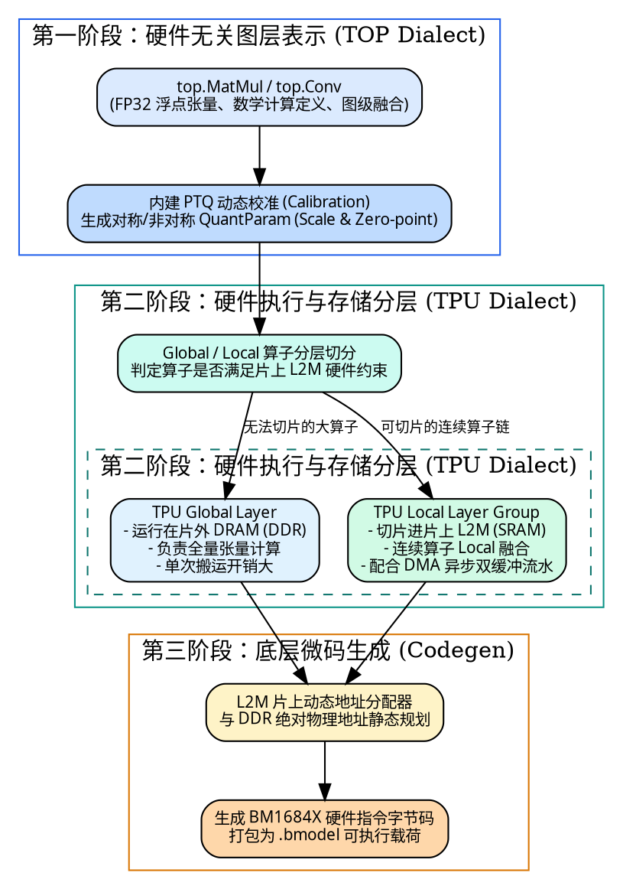

##### 1. 核心设计：Global 与 Local 的显式二元化建模

在 `tpu-mlir` 中，算子被严格划分为两套平行的执行语义：

- **Global Layer（全局层）**：算子的输入与输出均常驻于片外 DRAM 中，处理全量张量。每次计算均涉及巨大的内存搬运开销。
- **Local Layer（片上局部层）**：通过 `TpuLayerGroup` 分析 Pass，将支持硬件切片的算子切分为微小的 Tile，使其输入、输出与中间结果完全被限制在芯片专有的片上 SRAM（Local Memory / L2M）内部。

连续的多个 Local Layer 可以组合成一个 **Local Layer Group**，在一个硬件工作周期内完成“DMA 搬入 -> 连续 Local 算子计算 -> DMA 搬出”的流水线作业，彻底消除中间张量回写 DDR 的延迟。

##### 2. 全链路量化与校准深度集成

与很多编译器在外部单独做量化不同，`tpu-mlir` 将量化校准（PTQ / Calibration）与张量数据类型转换（`top.Cast`）直接作为 MLIR Pass 流水线的一部分。它可以在同一套 Dialect 树中无缝地将 FP32/FP16 模型逐级降级为混合精度的 INT8 / BF16 / FP16 TPU 指令，使得量化裁剪与分块调度能够协同决策。

##### 3. 优缺点客观分析

- **核心优势**：
  - **架构边界极其清爽直观**：`TOP`（图层）与 `TPU`（芯片层）职责明确，Global 与 Local 的二元分立精准击中了定制 ASIC 片上存储管理的核心命脉。
  - **工程闭环度极高**：从 ONNX/PyTorch 解析、模型量化校准、图切分、SRAM 内存规划到最终 `.bmodel` 二进制生成，整套工具链一气呵成，对应用开发者极度友好。
- **主要代价与局限**：
  - **硬件耦合度偏高**：Local Layer 的切分规则（如 64 个硬件 Lane 的步长与通道排布）深度硬编码了特定的芯片存储拓扑，若迁移到非 TPU 架构，重构成本极大。
  - **搜索能力较弱**：切块与融合策略严重依赖手工编写的启发式规则，缺乏基于代价模型（Cost Model）的全局最优解搜索能力。

> **💡 对自研 NPU 编译器的核心借鉴**：
> 自研芯片如果同样依赖片上 SRAM（Local Memory）来抵御访存墙，**千万不要在底层低级指针处才去猜测一块数据是否在片上**！像 `tpu-mlir` 那样，在 Dialect 中显式建立“全局计算（Global）”与“片上局部切片（Local）”的语义标签，能让中端的分块调度 Pass 与后端的 DMA 插入算法变得格外干净简洁。

---

#### 4.2.2 华为 (Huawei) 昇腾 CANN / MindSpore AKG / Ascend C：Cube-Vector 异构调度与 TPIPE 队列流水线

华为昇腾（Ascend）系列芯片（基于达芬奇 DaVinci AI Core 架构）是业界在异构多核与极端软硬件协同设计上的典型代表。其开源编译生态涵盖了面向图级优化的 **MindSpore AKG（Auto Kernel Generator）** 以及面向 Kernel 级编程的 **Ascend C** 体系。

##### 1. 硬件核心拓扑：非对称单元与私有存储体系

一个昇腾 AI Core 内部并非均质多核，而是由功能截然不同的非对称执行单元高度耦合而成：

- **Cube 单元**：专门负责超高吞吐的矩阵乘累加，具备专用的硬件脉动阵列，原生处理 $16 \times 16 \times 16$ 的微矩阵运算；
- **Vector 单元**：专门负责高灵活度的通用向量计算、算术激活、Softmax、Norm 与归约；
- **Scalar 单元**：负责基础标量指令、循环控制与地址指针运算；
- **MTE 引擎（Memory Transfer Engine）**：独立的片上搬运单元（如 MTE1/MTE2/MTE3），专职处理片外 DDR 与内部私有缓存之间的高速搬运。

在存储层级上，AI Core 配备了极为严苛的物理结构：外部内存（DDR/HBM）到 Cube 之间隔着 **L1 Buffer** 与专有 **L0 矩阵缓存（L0A/L0B/L0C）**，而 Vector 与 Cube 之间的交互则必须经过物理受限的统一缓冲区 **UB（Unified Buffer）**。

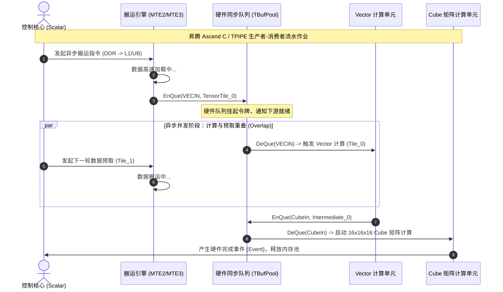

##### 2. CANN / Ascend C 的核心王牌：TPIPE 异步流水线模型

在昇腾的软件体系中，最引人入胜的创新是其 **TPIPE（Pipelining）并发模型**：

- **放弃全局同步锁**：因为 Cube、Vector 与 MTE 在物理上可以同时奔跑，若采用常规的阻塞等待（Barrier），性能将瞬间折损过半。
- **硬件队列驱动的生产者-消费者模型**：开发者通过 `Queue<TPosition>`（例如 `TPosition::VECIN`、`TPosition::VECOUT`、`TPosition::A1`）建立数据通信管道。MTE 生产完数据执行 `EnQue`，计算单元消费数据执行 `DeQue`，硬件自动负责空满状态的阻塞与唤醒。
- **多阶段 Ping-Pong 深度交织**：在 Vector 正在处理前一个 Tile 时，MTE 早已将后一个 Tile 搬入另一个物理 Buffer，形成完美的延迟隐藏。

##### 3. MindSpore AKG：基于多面体模型（Polyhedral）的深水区优化

在自动算子生成器 AKG 中，华为引入了编译领域学术皇冠上的明珠——**多面体模型（Polyhedral Model）**。
针对具有复杂循环依赖的融合算子，AKG 将循环嵌套映射为高维仿射多面体，利用整数线性规划（ISL）自动求解：

- 循环的合法倾斜（Skewing）、交换（Interchange）与分块（Tiling）；
- 自动分析将张量提升到片上 UB 统一缓冲区的生命周期（Memory Promotion）；
- 自动生成跨越 Cube 与 Vector 异构边界的代码。

##### 4. 优缺点客观分析

- **核心优势**：
  - **极致榨干硬件算力**：TPIPE 队列模型将异构单元（Cube/Vector/DMA）的并发利用率推到了极致，几乎消除了指令发射的空泡。
  - **形式化多面体调度极具深度**：在非规则仿射循环中，AKG 展现了惊人的自动化融合分块求解能力。
- **主要代价与局限**：
  - **认知与维护成本极其高昂**：硬件约束过于严苛（Cube 严格要求 16 字节对齐、UB 容量紧张不可越界）。在编译器生成 Ascend C 或底层指令时，只要硬件队列的 `EnQue`/`DeQue` 计数器漏写一次，就会引发芯片级的**硬件死锁（Hang）**，且几乎无法利用常规断点工具调试。
  - **多面体编译时间极长**：多面体整数规划算法在处理大规模网络结构时编译耗时巨大，对动态 Shape 的支持尤为吃力。

> **💡 对自研 NPU 编译器的核心借鉴**：
> 如果你的自研芯片内部同样拆分了“矩阵乘大核”、“标量/向量小核”以及“独立 DMA”，**绝对不要使用简单的全局串行控制流！** 昇腾的 TPIPE 模型证明了：**利用硬件队列（Queues）与事件令牌（Events: V-to-Cube, Cube-to-V）在 IR 层面显式建模生产者-消费者依赖**，是实现高效异构并发、隐藏访存延迟的最稳健范式。

---

#### 4.2.3 AMD ROCm / rocMLIR：rock.transform 坐标仿射代数与分层 GEMM 映射

AMD 在其 ROCm 开放异构计算生态中，为了抗衡 NVIDIA 在矩阵乘法与深度学习算子上的垄断，在 MLIR 社区深度孵化了用于 CDNA / RDNA 架构 GPU 的开源矩阵与卷积编译器 **`rocMLIR`**（配合高层图优化器 `MIGraphX`）。

`rocMLIR` 最具工程美感与颠覆性的创新，当属其自定义的 **`rock` 方言（原 `miir`）及其核心原语 `rock.transform`**。

```graphviz
digraph rock_transform_chain {
    rankdir=LR;
    node [shape=box, style="rounded,filled", fontname="sans-serif", fontsize=10];
    edge [fontname="sans-serif", fontsize=9];

    subgraph cluster_phys {
        label = "真实物理张量 (Physical)";
        color = "#64748b";
        t_raw [label="原始物理内存 Buffer\n(Non-contiguous, 带有 Padding)", fillcolor="#f1f5f9"];
    }

    subgraph cluster_transforms {
        label = "零拷贝坐标映射链 (rock.transform Chain)";
        color = "#7c3aed";
        tf1 [label="rock.transform\n[Pad]: 虚拟扩展边缘边界", fillcolor="#ede9fe"];
        tf2 [label="rock.transform\n[Embed]: 展开卷积窗口坐标", fillcolor="#ede9fe"];
        tf3 [label="rock.transform\n[Unfold / Permute]:\n维度扁平化与转置", fillcolor="#ede9fe"];

        t_raw -> tf1;
        tf1 -> tf2;
        tf2 -> tf3;
    }

    subgraph cluster_virt {
        label = "虚拟逻辑矩阵 (Virtual MatMul)";
        color = "#0d9488";
        t_virt [label="标准的 2D 逻辑张量\nMatrix A [M, K] & Matrix B [K, N]\n(逻辑上连续且无填充)", fillcolor="#ccfbf1"];
        tf3 -> t_virt;
    }

    subgraph cluster_codegen {
        label = "代码生成时的仿射折叠 (Affine Folding)";
        color = "#d97706";
        fold [label="将三级 Transform 复合为一个代数公式\nIndex_phys = f3(f2(f1(Index_virt)))", fillcolor="#fef3c7"];
        vec_load [label="最终物化为单条 GPU 向量加载指令\n直接携带计算后的复杂 Offset 访存！", fillcolor="#fed7aa"];

        t_virt -> fold;
        fold -> vec_load;
    }
}
```

##### 1. 核心绝技：`rock.transform` 坐标仿射代数体系

在卷积与复杂矩阵计算中，我们经常需要对张量执行转置（Transpose）、边界填充（Pad）、维度展开（Unfold）与通道切片（Slice）。传统编译器通常不得不插入临时的内存拷贝（Copy Op），在物理显存中重新排布出一块新的张量。

AMD `rocMLIR` 彻底颠覆了这一做法：

- **引入纯数学坐标映射链**：`rock.transform` 不分配任何物理内存，它仅仅记录一段从“上一级坐标”到“下一级坐标”的映射规则（例如通过 `Embed` 表达多维解开，通过 `Pad` 表达虚假填充，通过 `PassThrough` 表达直通）；
- **虚拟张量无限串联**：一个复杂的 4D 卷积可以经过连续五六次 `rock.transform`，在数学上变换为一个极其工整的 2D 矩阵乘；
- **Codegen 时的代数折叠**：在最终生成底层 GPU 指令时，编译器利用仿射代数复合规则（Composition），将所有的映射函数压缩合并为**一个最终的坐标计算公式**！GPU 线程在执行 `vector.load` 时，直接计算出带偏置的物理地址进行单步加载，**实现了真正零内存开销的虚拟重排**。

##### 2. 分层阶梯式 GEMM 降级模型

针对 AMD CDNA 架构的硬件特性，`rocMLIR` 建立了层层递进的 GEMM 方言抽象：

- **`GridwiseGemm`**：站在整个 GPU Grid 视角，将巨型张量切分并分配给各个 Workgroup（线程块）；
- **`BlockwiseGemm`**：在单个 Workgroup 内部，规划共享内存（LDS - Local Data Share）的暂存与 Wavefront（子群）之间的分块；
- **`ThreadwiseGemm`**：在单个硬件线程内部，管理私有寄存器与向量寄存器切片；
- **底层硬件指令直连**：直接降级为 AMD 硬件的专用矩阵乘加汇编内建——**`amdgpu.mfma`**（Matrix Fused Multiply-Add，对应于 CDNA 的硬件脉动矩阵阵列）。

##### 3. 优缺点客观分析

- **核心优势**：
  - **坐标代数极度惊艳**：`rock.transform` 完美消除了卷积展开（Im2Col）与数据转置带来的额外内存带宽消耗与内存碎片，理论优雅且收益显著。
  - **算子内核性能极高**：生成的 GEMM/Conv 内核在 MI200/MI300 上能够直接叫板乃至超越官方手写汇编算子库（MIOpen / rocBLAS）。
- **主要代价与局限**：
  - **强力绑定 SIMT/GPU 体系**：整套模型建立在 GPU 的 Grid/Block/Wave 线程模型与 LDS 缓存模型之上，无法直接平移到非 GPU 类型的 NPU。
  - **学习曲线陡峭**：坐标映射链一旦长达数级，中间 IR 的人类可读性显著下降，调试地址越界需要极高深的仿射代数推导功底。

> **💡 对自研 NPU 编译器的核心借鉴**：
> 自研 NPU 在处理卷积或张量重排时，往往受困于 DMA 搬运次数过多。**AMD `rock.transform` 的坐标代数是解决重排内存开销的最佳教科书！** 如果你们拥有硬件地址发生器（AG），完全可以借鉴这种思路：**高层只记录虚拟坐标变换，最后在生成 AG 配置时，将转置与 Padding 的数学公式一次性折叠进 AG 的 Step 步长与 Base 偏置寄存器中**，从而彻底省去物理搬运！

---

#### 4.2.4 工业级异构编译器天梯横评：八大体系全景对比矩阵

为了给自研芯片与编译器团队提供全维度的选型与架构决策参考，下表将全球及国内最具代表性的八套开源 AI 编译器架构置于同一透镜下进行全面横评：

| 编译器体系                 | 核心服务硬件形态                | 核心方言 / IR 载体                              | 分块调度表示机制                                  | 片上暂存 (SRAM/LDS/UB) 管理机制               | 并发与事件同步模型                              | 最大核心工程优势                                              | 最大工程维护代价                                     | 对自研 NPU 的核心借鉴启示                             |
| :------------------------- | :------------------------------ | :---------------------------------------------- | :------------------------------------------------ | :-------------------------------------------- | :---------------------------------------------- | :------------------------------------------------------------ | :--------------------------------------------------- | :---------------------------------------------------- |
| **IREE** (Google)          | 通用多目标 (CPU/GPU/NPU)        | Linalg + 专用 Codegen 方言                      | 属性解耦 (`translation_info` + `lowering_config`) | 依赖 Pipeline Promotion 抽象                  | 基于 HAL 的 Buffer 显式提交与栅栏 (Fences)      | 多后端通用性强，策略与算子解耦，天然适配 Auto-tuning          | 多层配置同步复杂，易出现属性丢失与透传失效           | **策略解耦三剑客**与自适应调优注入机制                |
| **TVM** (Apache)           | 通用多目标 (CPU/GPU/DSP)        | Relax + TensorIR (TIR)                          | 可重放动作流 (Schedule API: split, reorder)       | 显式 `cache_read` / `cache_write` 申请        | 线程绑定 (`bind("threadIdx.x")`) 与运行时调度   | 将优化显式建模为重放轨迹，MetaSchedule 搜索生态强大           | Schedule 语法与规则库沉重，真实测例搜索开销巨大      | **将优化建模为动作流**，便于记录与探索候选解          |
| **Triton** (OpenAI)        | GPU (NVIDIA/AMD)                | Triton IR + GPU 扩展                            | 块级张量操作 + GPU Layout 属性                    | 隐式通过 Shared Layout 降级管理               | 隐式 SIMT 多线程与编译器自动插入 Barrier        | Layout 提升为一等公民，极致聚焦张量-寄存器物理映射            | 跨 Warp Layout 转换开销高昂，体系专属于 GPU          | **显式物理 Layout 抽象**，统一分析硬件 Bank 冲突      |
| **Tenstorrent** (TT-MLIR)  | 专用多核 NPU (Tensix)           | TTIR $\to$ TTNN $\to$ TTKernel $\to$ TTMetal    | 环形缓冲区 (CB) 与数据流图分发                    | 显式 L1 内存空间 (`#ttcore.memory_space<l1>`) | NoC 异步搬运指令 (`noc_async_read`) 与硬件握手  | 紧扣硬件 NoC 架构，多层 Dialect 职责边界极其严密              | 新增算子改动面巨大（涉及 Schema/Runtime/Driver）     | **多层专用 Dialect 分工**与 NoC 事务语义显式建模      |
| **Arm Vela** (Arm)         | 嵌入式端侧 NPU (Ethos-U)        | TFLite / TOSA $\to$ Command Stream              | 离线图级 Striping 与 Cascading                    | 全静态离线规划 (SRAM 缓冲区空间复用分析)      | 严格依赖单发射 NPU 命令流与中断应答             | 极端轻量，生成即执行，内存占用极小                            | 策略高度硬编码在编译器内部，缺乏灵活性               | **离线全静态内存规划算法**与精简命令流直出            |
| **TPU-MLIR** (算能 SOPHON) | 专用 ASIC TPU (算丰系列)        | TOP (图层) $\to$ TPU (片上层) $\to$ BModel      | **Global Layer vs Local Layer Group**             | 显式切分片上 L2M，配合专用动态地址分配器      | 依赖硬件多 Lane 自动分发与同步状态机            | 架构极其清爽，Global/Local 划分直击片上内存痛点，量化深度内建 | 切块规则强绑定自研 TPU 硬件，缺乏自动搜索            | **Global / Local 的二元分立抽象**，极简构建 SRAM 切片 |
| **CANN / AKG** (华为昇腾)  | 异构非对称 NPU (达芬奇 AI Core) | MindSpore IR / CCEC / Ascend C                  | 多面体仿射空间变换 (ISL) 或 Ascend C 手工切片     | 显式划分 UB (统一缓冲) 与 L1/L0 私有缓存      | **TPIPE 硬件队列 (`EnQue`/`DeQue`) 与事件令牌** | 异构多单元（Cube/Vector/MTE）并发性能榨取到极致               | 硬件约束苛刻，极易引发队列死锁，多面体编译极慢       | **基于硬件队列与事件标记的异步流控模型**，消除阻塞    |
| **rocMLIR** (AMD ROCm)     | GPU (CDNA / RDNA 架构)          | `rock` Dialect $\to$ Vector $\to$ `amdgpu.mfma` | 分层 GEMM 展开 (Grid $\to$ Block $\to$ Thread)    | 显式管理 GPU LDS 共享内存与数据加载           | GPU Wavefront 协作与向量指令级同步              | **`rock.transform` 坐标仿射代数**，实现零拷贝虚拟重排         | 方言栈极深，强依赖 SIMT 硬件，代码可读性与调试门槛高 | **坐标代数折叠技术**，将转置与 Padding 折叠进 AG 寻址 |

---

## 五、工程维护成本的灵魂拷问：Attribute、原生循环与专用 Dialect 的稳定性与陷阱

在实际编译器研发中，很多架构师会敏锐地指出：**“过度依赖 Attribute 会面临严峻的透传（Propagation）失效问题，后续 Pass 只要改动了 IR，属性就会丢失或过期！”**

### 5.1 真实案例复盘：IREE 官方 Issue #25190

这绝不是纸上谈兵的理论担忧，而是工业界真实踩过的雷。2026 年 11 月，IREE 社区报告了一个典型 Bug：

> **IREE Issue #25190**：在编译 Batchless 卷积（Batch 维度未显式展开）时，前端 Transform Dialect 为卷积算子成功注入了包含 Tile 参数的 `compilation_info`。然而，后续的 `InsertBatchDimForBatchlessConv` Pass 在执行模式重写时，通过 `replaceOpWithNewOp` 创建了新的卷积算子，**但并未将原算子上的 `lowering_config` 复制过去！**
>
> 结果是：后端策略选择器由于找不到配置，退化到了异常默认分支，最终因生成了超出硬件限制的巨型向量而导致编译彻底崩溃。

### 5.2 Attribute 的三大致命软肋

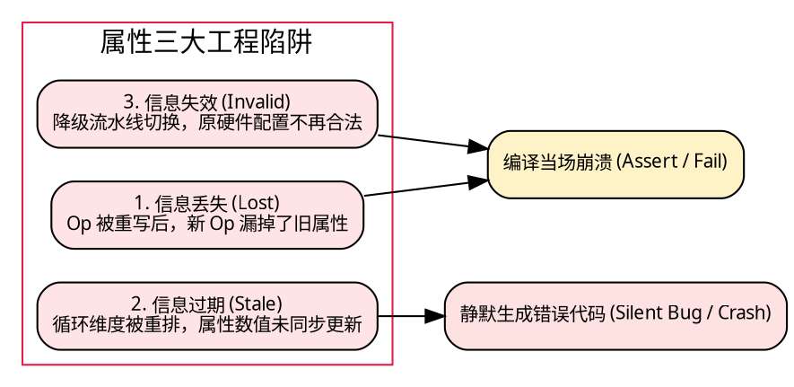

1. **信息丢失（Lost）**：
   在 MLIR 中，`PatternRewriter::replaceOpWithNewOp<NewOp>(oldOp, ...)` 的底层实现机制是创建新节点、重连 SSA 依赖、并彻底销毁旧节点。**通用框架绝不会主动帮你把旧 Op 上所有的杂项 Attribute 全部拷贝到新 Op 上！** 拷贝哪些、如何重构必须由具体 Pattern 显式指定。
2. **信息过期（Stale，最隐蔽、最致命！）**：
   假设一个 MatMul 算子原有属性 `tile_sizes = [32, 64, 16]`，对应维度为 `[M, N, K]`。此时某个优化 Pass 对计算进行了转置或循环交换（Loop Interchange），将计算维度变更为 `[N, M, K]`。
   如果 Pass 开发者自作聪明地执行了“盲目复制属性”，那么新算子上的 `tile_sizes = [32, 64, 16]` 就会把原本属于 $M$ 的 32 错配给 $N$，导致原本属于 $N$ 的 64 错配给 $M$！这种错误不会触发任何断言报错，而是在硬件上产生性能暴跌甚至错误的访存越界。
3. **信息失效（Invalid）**：
   原有属性配置在专用的 DMA 流水线中是合法的；但当编译遇到特殊边缘分支被迫回退（Fallback）到通用标量流水线时，标量流水线无法识别或无法满足该配置的硬件对齐要求，最终导致编译失败。

### 5.3 MLIR 底层机制：Inherent vs Discardable Attribute

为了从根本上理解属性生命周期，必须弄清 MLIR 官方对属性的严格分类：

| 属性分类                                          | 官方规范定义                                                                                                                            | 在代码中的物理载体                                         | Pass 遇到未知属性时的默认行为                                  |
| :------------------------------------------------ | :-------------------------------------------------------------------------------------------------------------------------------------- | :--------------------------------------------------------- | :------------------------------------------------------------- |
| **Inherent Attribute** (固有属性 / Op Properties) | **属于该 Operation 核心语义不可分割的一部分**。例如算术比较的谓词、卷积的 Padding 边界。缺少它，Op 本身连语法校验（Verify）都无法通过。 | C++ 类成员变量或专有 Property 结构体                       | 任何重写该 Op 的 Pass 必须显式处理，否则编译期类型检查报错。   |
| **Discardable Attribute** (可丢弃 / 附加属性)     | **由外部方言附加在宿主 Op 上的编译元数据**。例如 `#npu.lowering_config`。它不属于宿主 Op（如 `linalg.matmul`）自身定义的一部分。        | 存储于通用 Attribute Dictionary 中（带有方言命名空间前缀） | 通用 Pass 在重写宿主 Op 时，**默认直接丢弃**，不负有维护责任。 |

这深刻揭示了一个铁律：**除非你自己编写的 Pass 显式识别并重新映射了某个 Discardable Attribute，否则指望外部通用 Pass 替你维持其正确性是不切实际的！**

### 5.4 科学的属性生命周期防御契约

要根治属性失效，团队必须在编译管线中确立四种严格的转换契约：

```cpp
// 架构级伪代码：安全的属性重映射与失效决策树
auto oldConfig = getLoweringConfig(oldOp);
auto newOp = rewriter.create<NewOp>(...);

if (oldConfig) {
    if (isDimensionPreserved(oldOp, newOp)) {
        // 契约 1: 语义不变，安全继承 (Preserve)
        setLoweringConfig(newOp, oldConfig);
    } else if (canRemapPermutation(oldOp, newOp)) {
        // 契约 2: 维度发生置换，严格数学重映射 (Remap)
        auto remappedConfig = remapConfig(oldConfig, oldOp, newOp);
        setLoweringConfig(newOp, remappedConfig);
    } else if (isHeuristicTuningHint(oldConfig)) {
        // 契约 3: 仅为调优提示，重写后主动废弃，触发重新推导 (Invalidate)
        discardConfig(oldConfig);
    } else {
        // 契约 4: 属于强制物理约束，无法安全继承时立即熔断报错 (Reject)
        return rewriter.notifyMatchFailure(oldOp, "Cannot safely preserve lowering config!");
    }
}
```

---

## 六、架构抉择之争：连续多个 Pass 只产生 Attribute，最后单 Pass 一次性 Lowering 究竟好不好？

在芯片编译器的实际开发中，经常会有年轻工程师提出一种看似极其优雅的架构设想：

> “既然 Pass 之间频繁修改 IR 容易丢失属性且极其难调试，我们为什么不让前面的 10 个 Pass 统统只做纯静态分析，每一步只往算子上写 Attribute；直到流水线最后一步，才由一个唯一的 Materialization Pass 读取所有属性，一口气生成所有底层硬件指令？这样前面的 IR 结构完全不动，调优和排错难道不轻松得多吗？”

然而，当向经验丰富的编译器主管汇报时，主管往往会当头浇下一盆冷水：

> **“不行！把所有复杂性全堆在最后一个 Pass，是一个极其糟糕、沉重且不可持续的‘巨石（Monolithic）’设计！”**

究竟谁是对的？

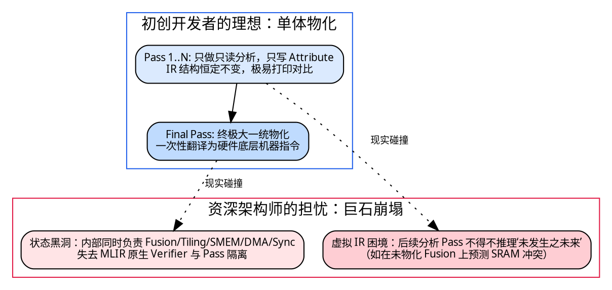

### 6.1 剖析最后一个巨型 Pass 的三大致命陷阱

表面上看，“只生属性、最后统一物化”确实避免了属性丢失，但它并没有消灭编译复杂性，而是将本应由编译器基础设施分摊的复杂度，全部暴力转移到了最后一个 Pass 内部：

1. **职责无限蔓延，变成无法维护的“第二编译器”**：
   最后一个 Pass 绝不是做简单的文本翻译，它必须同时在一个函数体里解决：
   - 算子融合（Fusion）的 SSA 结果重连；
   - 多级循环分块（Tiling）的边界条件与余数块处理；
   - 内存分配与张量别名分析（Bufferization）；
   - 片上 SRAM 的物理地址分配与生命周期冲突解决；
   - DMA 异步搬运的插入时机与大小计算；
   - AG 硬件循环步长与计数值寄存器写入；
   - 计算核心启动与跨硬件模块事件（Event）同步机制。

   一旦硬件架构新增了一种特殊的内存搬运模式，开发者必须通读并小心翼翼地修改这几千行纠缠在一起的代码，团队协作将演变为灾难。

2. **丧失 MLIR 最核心的“中间状态可观测性与验证力”**：
   MLIR 基础设施最强大的优势，在于每个 Pass 执行完毕后都可以自动运行 `verify()`，且可以通过 `--mlir-print-ir-after-all` 将中间 IR 完整 Dump 出来进行逐行比对（FileCheck）。
   一旦所有转换全部塞进一个巨型 Pass，PassManager 只能看到“输入是高层 MatMul，输出是一堆十六进制寄存器”，所有的中间变换状态全变成了 C++ 内部的临时私有数据结构，调试排错的难度呈指数级跃升。
3. **“虚拟 IR”的恶性膨胀与预测难题**：
   **这是理论上最致命的反驳**！很多决策必须基于前面变换后的**真实物理 IR** 才能做出。
   例如：只有当算子融合（Fusion）真实发生后，中间临时张量才会被消除；只有中间张量被消除了，才能准确知道 SRAM 还剩下多少字节；只有知道 SRAM 确切剩余空间，才能决定当前的 Tile 是否装得下！
   如果你坚决不在中间 Pass 中修改 IR，那么负责规划 SRAM 的分析 Pass 就必须在自己的脑海中“虚拟模拟”算子融合后的各种假想情况。你实际上是在属性系统之上，不得不又徒手编写了一套极其别扭的“虚拟编译器解释器”！

### 6.2 唯一例外：为什么 MLIR 官方的 One-Shot Bufferize 可以作为 Monolithic Pass？

有人会反问：“MLIR 官方核心的 `One-Shot Bufferize` 不就是一个典型的巨型 Pass 吗？它就是全模块静态分析后一次性原地重写的啊！”

没错，但请注意它的成功前提：

- **职责极端单一聚焦**：One-Shot Bufferize **仅仅负责且只负责**张量值语义（Tensor）向内存指针（MemRef）的原地复用映射。
- 它绝不同时负责循环分块、不同时负责算子融合、不同时负责底层硬件指令生成。它的输入与输出接口有极其严格的理论数学模型定义（RaW 别名分析）。

### 6.3 破局之道：推荐架构——“阶段性规划与阶段性物化”（Phased Plan-then-Lower）

真正的编译系统工程艺术，不是在“每个 Pass 都改 IR”与“所有 Pass 都不改 IR”之间走极端，而是确立**按抽象领域分阶段的闭环流转机制**：

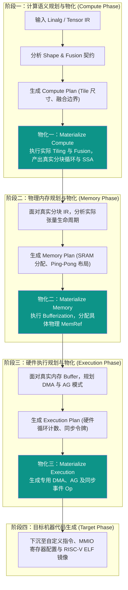

下表对比了三种架构方案在真实工程中的各项指标：

| 评价维度           | 方案 A：每步都改 IR          | 方案 B：纯单体巨石 Pass             | **方案 C：阶段性规划与物化（推荐）**             |
| :----------------- | :--------------------------- | :---------------------------------- | :----------------------------------------------- |
| **属性透传风险**   | 极高（每次重写都可能丢属性） | 无（前面根本不改 IR）               | **受控**（属性生命周期严格限制在阶段内）         |
| **调试与排错难度** | 困难（状态变化过于频繁碎裂） | **极难**（巨石函数内部无检查点）    | **最优**（每个大阶段均可验证和 Dump IR）         |
| **中间依赖准确性** | 准确（基于真实 IR）          | **极差**（靠脑补模拟未发生的变换）  | **高度准确**（下一阶段永远基于上阶段的真实产物） |
| **模块解耦与协作** | 较好                         | 极差（多人同时修改同一个巨石 Pass） | **极佳**（计算、存储、执行模块职责清晰分离）     |

---

## 七、自研 NPU 编译器的工程落地指南与审查清单

结合前文所有第一性原理与架构辨析，在规划或重构自研硬件编译器时，我们建议团队设立以下落地方针：

### 7.1 自定义 Op / Attribute 的架构准入五问审查表

任何工程师在向方言中提交新的 Operation 或 Attribute 时，必须通过以下五项硬核指标的审查：

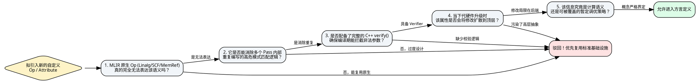

### 7.2 必须优先投入建设的三大测试与调试基础设施

在没有芯片实物、仅依赖 EDA 硬件仿真（Simulation）的早期攻坚阶段，建设以下三套基础设施能够为团队节省数以月计的排错时间：

1. **AG 地址序列硬件等价性验证工具（Address Equivalence Checker）**：
   无需启动耗时漫长的整网仿真。在 CPU 端通过数学模型计算出该算子在逻辑上期望访问的绝对地址序列：
   $$Addr_{\text{expected}} = [0, 16, 32, 48, \dots]$$
   再编写一个轻量测试 Pass，读取编译器生成的 AG 寄存器配置，执行硬件寻址状态机并吐出硬件地址序列：
   $$Addr_{\text{hardware}} = [0, 16, 32, 48, \dots]$$
   两相对比，若有偏差当场在编译期截杀，绝不把地址步进错误留到 EDA 仿真期去抓波形。
2. **IR 指令来源追踪机制（IR-to-ASM Provenance）**：
   在最终生成的机器码或汇编中，利用 LLVM 的 `Location` 机制保留每条底层配置指令对应的顶层高层算子名称与 Pass 变换源头：
   ```text
   // 汇编调试注记示例
   SET_AG_STEP r1, 16     ; [Source: linalg.matmul @ line 42] -> [Pass: ExecutionMaterialize]
   SET_AG_COUNT r2, 128   ; [Derived from: TilePlanningStrategy v2]
   ```
3. **策略属性差异比对器（Plan Diff Tool）**：
   在自动调优或性能回归测试中，将前后两次编译生成的 Execution Plan 属性直接做文本 Diff，精准定位性能涨跌究竟是由于 Tile 尺寸缩减、双缓冲退化，还是因为 AG 步长模式未命中。

---

## 八、总结与终极思考

在 AI 编译器波澜壮阔的发展长河中，从来不存在所谓的“银弹设计”。

- **IREE** 的伟大之处，在于其展现了多目标、大规模体系下**计算语义与编译策略高度解耦**的架构范式，以及面向自动调优的顶层包容力；
- **TVM** 教会了我们如何将调度与变换本身抽象为严谨、可重放的动作流；
- **Triton** 启示了我们对底层硬件寄存器与物理布局（Layout）保持敬畏；
- **Tenstorrent 与 Arm** 则展现了面向非 GPU 式定制芯片时，如何坚定地围绕硬件执行机制构筑专用防线。

对于正在自研专用硬件加速器（NPU）编译器的团队，最明智的演进路线既不是全盘盲目抄袭 IREE 的每一套复杂接口，也不是固步自封地死守一个不可分割的单体属性，更不是将所有转换压在最后一个庞大 Pass 内部。

**在能通用的地方最大化复用开源基础设施，在必须专有的边界清晰隔离硬件异构事实；先规划后分阶段物化，让错误尽可能在最早的静态分析阶段被检验和拦截。** 这才是构筑一款高可靠、高性能、生命力跨越芯片代际周期的工业级 AI 编译器的坚实基石。
