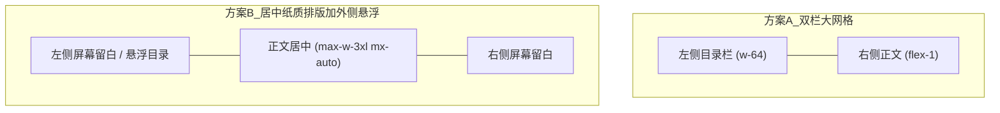
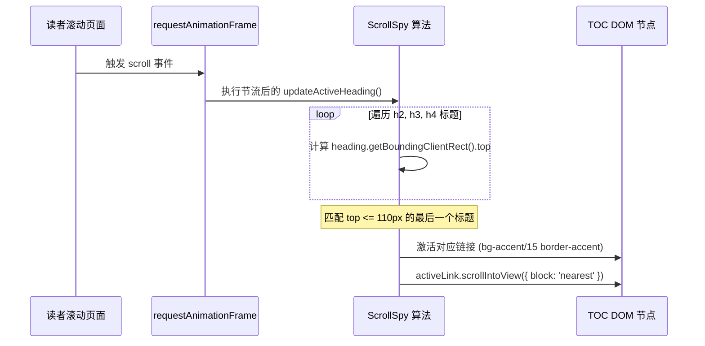

在上一篇教程《从零搭建现代化博客》中，我们完成了 Astro 博客的架构选型、Material Design 3 (M3) 美学重塑、图表集成与 Cloudflare Pages 的全自动化部署。

然而，当网站真正上线并开始阅读长文时，一些微妙却深刻影响沉浸感的问题逐渐暴露出来：

1. **迷失感与空旷感**：在 2K / 4K 大屏幕下阅读两三千字以上的深度技术长文时，两侧留白较多，且无法随时查看文章脉络与全局进度。
2. **返回成本过高**：当读者沉浸阅读到文章中后段时，若想回到上一页或切换分类，必须费力拉回最顶部，缺乏随手可得的常驻导航。
3. **版式拉锯战（美学与功能的博弈）**：为了增加目录，我们一度尝试将整篇文章重构成双栏大网格，但立即发现破坏了 AstroPaper 原生最令人着迷的「居中纸质排版」。
4. **CSS 布局陷阱**：在尝试将目录悬浮在左侧空白处时，遭遇了 `position: sticky` 遭遇 `position: absolute` 时的经典高度塌陷问题，导致目录无法跟随上下滑动。

本文将这趟围绕「沉浸式阅读体验」所做的后续调整与架构演进完整记录下来。

---

## 一、常驻顶栏与无感「返回上一页」

### 1. 全局常驻磨砂玻璃顶栏（Sticky Header）

原版的 Header 随页面滚动而滚出屏幕。当文章很长时，读者需要滚回最顶端才能使用搜索、归档或导航。

我们将其升级为支持物理模糊的常驻悬浮顶栏：

```html
<header class="sticky top-0 z-40 w-full border-b border-border/60 bg-background/90 backdrop-blur-md transition-colors">
  <div class="app-layout flex flex-col items-center justify-between py-3 sm:flex-row sm:items-center sm:py-3.5">
    <!-- 站点 Logo、返回按钮与导航链接 -->
  </div>
</header>
```

- **`sticky top-0 z-40`**：牢牢吸附在视口最上方，层级低于模态弹窗但高于普通内容。
- **`bg-background/90 backdrop-blur-md`**：保持 90% 不透明度的表面底色，叠加毛玻璃模糊滤镜，使正文向上滚动穿过顶栏时若隐若现，既保证内容清晰可辨，又带来现代 OS 级别的通透质感。

### 2. 详情页专属「返回上一页」药丸按钮

当用户从首页、归档或搜索进入某篇具体文章时，最自然的操作是「看完后返回上一页」。我们直接在文章详情页的常驻顶栏左侧注入了高优先级的返回入口：

```html
<a
  id="header-back-button"
  href="/"
  class="group inline-flex items-center gap-1 rounded-full border border-border/80 bg-surface/90 dark:bg-surface/50 px-2.5 py-1 text-xs sm:text-sm font-medium text-foreground shadow-xs hover:border-accent/40 hover:bg-accent/15 hover:text-accent transition-all duration-200"
  title="返回上一页"
>
  <svg class="size-4 rtl:rotate-180" viewBox="0 0 24 24">
    <path stroke="none" d="M0 0h24v24H0z" />
    <path d="m15 6-6 6 6 6" />
  </svg>
  <span>返回上一页</span>
</a>
```

配合客户端路由的无感返回逻辑：

```javascript
document.getElementById("header-back-button")?.addEventListener("click", (e) => {
  // 如果浏览器历史有上一页且来源属于本站，执行平滑回退
  if (window.history.length > 1 && document.referrer.includes(window.location.host)) {
    e.preventDefault();
    window.history.back();
  }
});
```

无论读者滑到文章哪一个段落，都可以随时轻点左上角返回，彻底消除阅读路径上的摩擦。

---

## 二、版式拉锯战：为何绝不妥协「居中纸质美学」？

在技术博客中增加目录（Table of Contents, TOC）通常有两种主流做法：



### 1. 方案 A 的缺陷与回滚

为了解决大屏「显得空旷」的问题，我们曾尝试方案 A：把整页容器扩大到 `max-w-6xl`，拆分成左目录、右正文的双栏网格。

但实际效果非常糟糕：
- **丧失视觉中心**：正文被强行向右挤压，读者视线偏离屏幕中轴线，违背人类阅读中心聚焦的习惯。
- **排版失去纸质质感**：AstroPaper 最大的魅力在于单列、克制、像翻阅实体书一般的神圣感。一旦做成类似后台管理系统或开发文档的双栏网格，这种克制感荡然无存。

**决策定调**：
> 「解决“过于空旷”的整体版式优化感觉不如之前好看，还是回到之前的吧。目录仍然贴在左侧而且浮动跟随，但不要影响 AstroPaper 最舒适、最纯粹的居中纸质阅读体验。」

正文容器必须始终严格锁定为 `max-w-3xl mx-auto`（居中黄金阅读宽度 768px）。目录只能作为轻盈的辅助图层，坐落在正文外侧的自然留白中。

---

## 三、CSS 探秘：为什么 Sticky 遭遇 Absolute 会失效？

在决定「正文居中、目录放在左侧留白处」后，我们面临一个典型的 CSS 定位难题。

### 1. 故障还原：看似合理的嵌套

正文容器具有相对定位：
```html
<main id="main-content" class="app-layout pt-8 pb-12 relative">
  <!-- 目录放置在 main 的左侧外边距 -->
  <aside class="absolute right-[calc(100%+2rem)] top-8 w-60">
    <div class="sticky top-20">
      <TableOfContents />
    </div>
  </aside>

  <article id="article">...</article>
</main>
```

在测试时立即发现了严重 Bug：**向下滚动页面时，左侧目录并没有停留在屏幕上跟随滑动，而是像普通静态元素一样直接随页面滑到了视口上方，消失不见！**

### 2. 深度剖析 CSS 规范

为什么 `sticky` 在这里完全没有起作用？

根据 **W3C CSS Positioned Layout** 规范：
1. **Containing Block（包含块限制）**：
   - 一个声明了 `position: sticky` 的元素，其滑动粘滞范围**完全受制于其直接包含块（即直接父元素）**。
   - 它只能在其父容器的边界矩形内部“滑动”。
2. **绝对定位的尺寸塌陷**：
   - 这里的 `<aside>` 拥有 `position: absolute`，它脱离了正常文档流，并且没有设置 `height: 100%` 或 `bottom: 0`。
   - 因此，`<aside>` 的高度由其子元素决定——即正好等于 `<div class="sticky">` 的自身高度（约 200px）！
3. **0px 滑动距离**：
   - 既然父容器 `<aside>` 的高度等于子元素自身的高度，子元素可供粘滞滑动的有效距离为 `200px - 200px = 0px`。
   - 当页面滚动超过 200px 时，父容器 `<aside>` 整个滚出了视口，粘滞效果根本无法发生。

---

## 四、终极解法：纯 CSS 几何投影定位与高精度 ScrollSpy

要让目录既**完全脱离文档流、不挤压居中文章**，又能**在上下滑动时始终吸附在视口左侧**，最佳手段是采用 `position: fixed` 结合精确的几何比例运算。

### 1. 几何投影公式（Geometry Calculation）

文章容器 `app-layout` 采用 `max-w-3xl`（宽 48rem = 768px）且居中对齐（`mx-auto`）。

我们以此推导屏幕坐标系：
- 屏幕宽度为 $100\%$，屏幕中央水平垂线位于 $50\%$。
- 居中文章的主体跨度为：从左边界 $50\% - 24\text{rem}$ 到右边界 $50\% + 24\text{rem}$。
- 如果我们希望左侧目录右边缘距离文章左边缘保持 $1.25\text{rem}$（20px）的呼吸空隙：
  - 目录右边缘在屏幕上的位置即为：$50\% - 24\text{rem} - 1.25\text{rem}$。
  - 换算为相对于视口右侧边缘的距离（CSS `right` 属性）：
    $$\text{right} = 100\% - (50\% - 24\text{rem} - 1.25\text{rem}) = 50\% + 24\text{rem} + 1.25\text{rem}$$

我们在 `src/styles/global.css` 中沉淀为纯净的规则：

```css
/* 桌面端浮动目录：精确定位于居中文档的左侧外留白 */
.toc-desktop-sidebar {
  position: fixed;
  top: 5.5rem; /* 位于常驻顶栏正下方，留出充裕呼吸间距 */
  right: calc(50% + 24rem + 1.25rem);
  width: 14rem;
  z-index: 30;
}

/* 超宽屏（2xl >= 1536px）适当拓宽留白与目录宽度 */
@media (min-width: 1536px) {
  .toc-desktop-sidebar {
    right: calc(50% + 24rem + 2rem);
    width: 16rem;
  }
}
```

### 2. 响应式优雅降级

- **大屏（≥ 1280px / xl）**：
  使用 `.toc-desktop-sidebar`，`position: fixed` 确保**上拉下滑始终保持在左侧**，内部 `max-h-[calc(100vh-11rem)] overflow-y-auto` 保障极长目录具有独立的内部滚动能力。
- **中小屏（< 1280px）**：
  桌面端侧边栏通过 `hidden xl:block` 自动隐藏，正文顶部无缝渲染一个符合 M3 审美的可折叠 `<details>` 卡片，点击即可在手机/平板上查阅目录，不占据宝贵的视口空间。

```html
<!-- 移动端可折叠目录 -->
<details
  data-pagefind-ignore
  class="xl:hidden my-6 rounded-2xl border border-border/70 bg-surface/60 dark:bg-surface/30 p-4 transition-all duration-200"
>
  <summary class="cursor-pointer font-medium text-sm text-foreground flex items-center justify-between select-none">
    <span class="inline-flex items-center gap-2">
      <svg class="size-4 text-accent" viewBox="0 0 24 24" fill="none" stroke="currentColor" stroke-width="2">
        <path d="M4 6h16M4 12h10M4 18h14" />
      </svg>
      <span>本文目录 ({tocHeadings.length})</span>
    </span>
    <span class="text-xs text-muted-foreground">展开 / 收起</span>
  </summary>
  <div class="mt-3 pt-3 border-t border-border/50">
    <TableOfContents headings={tocHeadings} isMobile={true} />
  </div>
</details>
```

---

## 五、现代 ScrollSpy：高精度视口感知与自动跟随

目录不仅要能点击跳转，还必须根据当前的阅读进度**实时高亮对应章节**。

传统的 `element.offsetTop` 极易受到包含块、外边距塌陷或 `position: relative` 的层叠影响。我们改用现代的视口几何检测 API：`getBoundingClientRect()`。



核心算法实现（`TableOfContents.astro`）：

```typescript
function updateActiveHeading() {
  const threshold = 110; // 考虑 60px 的常驻顶栏与充裕缓冲区
  let currentSlug = "";

  const atBottom =
    window.innerHeight + window.scrollY >=
    document.documentElement.scrollHeight - 50;

  // 1. 触底优先高亮文末最后一节
  if (atBottom && headings.length > 0) {
    currentSlug = headings[headings.length - 1].id;
  } else if (window.scrollY < 80) {
    // 2. 位于文章头部（标题/摘要）时，不预选任何章节
    currentSlug = "";
  } else {
    // 3. 寻找当前正好滚过阈值线的目标标题
    for (let i = 0; i < headings.length; i++) {
      const rect = headings[i].getBoundingClientRect();
      if (rect.top <= threshold) {
        currentSlug = headings[i].id;
      } else {
        break;
      }
    }
  }

  // 4. 更新样式并让目录容器自动平滑对齐当前项
  let activeLink: HTMLAnchorElement | null = null;
  links.forEach(link => {
    const isActive = link.dataset.slug === currentSlug;
    if (isActive) {
      activeLink = link;
      link.classList.add("bg-accent/15", "text-accent", "font-semibold", "border-accent");
      link.classList.remove("border-transparent");
    } else {
      link.classList.remove("bg-accent/15", "text-accent", "font-semibold", "border-accent");
      link.classList.add("border-transparent");
    }
  });

  // 章节较多时，自动让当前激活项在目录窗口中居中呈现
  if (activeLink) {
    (activeLink as HTMLElement).scrollIntoView({
      block: "nearest",
      inline: "nearest",
    });
  }
}
```

同时，我们通过 `removeEventListener` 防范了 Astro 在 `ClientRouter` 页面无刷新跳转时的事件监听泄漏，保证每次切页都如丝般顺滑。

---

## 六、总结与设计思考

在这一次的交互升级中，我们探索并落地了一套极简技术博客的最佳实践：

| 体验维度 | 调整前 | 调整后 |
| :--- | :--- | :--- |
| **顶部导航** | 随页面滚走，深读时长文返回成本高 | **常驻玻璃拟态顶栏**，随时一键「返回上一页」 |
| **阅读版式** | 曾尝试双栏网格，正文偏移且失去纸质感 | **坚守居中纸质美学**（768px 单列沉浸布局） |
| **目录定位** | 绝对定位下 Sticky 塌陷，滚动脱靶 | **几何投影 Fixed 定位**，大屏上拉下滑始终保持在左侧 |
| **移动端适配** | 侧栏截断或遮挡正文 | 自动隐去侧栏，降级为 **M3 可折叠药丸手风琴** |
| **阅读进度感知** | 无高亮或位置计算偏差 | **高精度 `getBoundingClientRect()` 视口侦听** + 目录自适应平滑内滚 |

**做设计时，最大的诱惑往往是「做加法」**——觉得屏幕空就加栏，觉得功能多就拼命塞进视图。然而，真正经得起时间考验的阅读体验，永远建立在**克制**之上。

让目录存在于余光所及的角落，需要时一眼看清全貌，不需要时绝不打扰文字流淌。这正是我们对这间个人博客最满意的模样。
