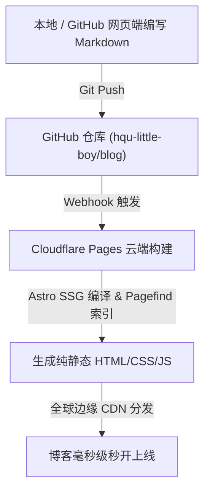

在搭建个人博客时，我希望满足几个明确的核心诉求：

1. **纯粹的 Markdown 驱动（GitOps）**：所有文章在公开的 GitHub 仓库中维护，增删改查 Markdown 文件时，博客自动感知、重新归类索引并实时发布。
2. **零成本与高可用**：托管在 Cloudflare 全球 CDN 上，无需服务器运维，秒级加载。
3. **审美可控与高颜值**：具备 **AstroPaper 的文字极简主义骨架**，同时注入 **Google Material Design 3 (M3) 的柔和色调、大圆角与物理缓动**——追求「极简克制中的灵动」。
4. **强大的技术排版与图表能力**：原生渲染 Mermaid 流程图、Graphviz 架构图，并拥有清晰的代码高亮、语言标签与一键复制。

本文将这趟从零搭建、深度定制与排坑部署的全流程完整记录下来，供参考与复盘。

---

## 一、架构选型与工作流设计

### 1. 为什么选择 Astro？

对比常见静态博客框架：
- **Hugo**：速度极快，但 Go 模板语法晦涩，想按自己的现代审美（如 Tailwind CSS、微动效）深度调整样式极其痛苦。
- **Hexo / Jekyll**：架构相对老旧，生态包袱重。
- **VitePress / Docusaurus**：偏向软件文档与 Wiki，较难打造出高质感的个人杂志/随笔排版。
- **Astro**：组件语法即「增强版 HTML + Scoped CSS / Tailwind」，内容层（`src/content/posts`）与展现层（`src/layouts`）彻底解耦，打包产物默认 0 JavaScript，在定制灵活性与加载速度上做到了极致。

### 2. 全自动化发文闭环

整个站点的运作流程如下：



无论是新增、修改还是删除某篇 Markdown 文件，提交后 1 分钟内，全站的文章列表、分类标签、归档与全文搜索索引均会自动重算同步。

---

## 二、Material Design 3 (M3) 极简灵动美学改造

AstroPaper 原版是黑白极简风格，对比度极高，但偏严肃刻板。为了实现「极简克制中的灵动」，我们从以下四个维度进行了重塑：

### 1. 色彩重构：从生硬纯黑白到调和表面色（Tonal Surfaces）

在 `src/styles/theme.css` 中重设了符合 M3 规范的色值：

- **浅色模式**：采用骨白/米纸底色（`#faf8f5`）与清透深海青强调色（`#006878`），既温润护眼，又具有高级纸质质感。
- **深色模式**：采用 M3 标志性的暗碳底色（`#131314`）搭配高辨识度的荧光水青（`#55d6ec`），通透不压抑。

### 2. 形状语言（Shape）：大圆角与药丸芯片（Pills）

- **文章标签（Tag.astro）**：
  原版为带有虚线下划线的文字。我们将其改造成标准的 **M3 过滤芯片（Filter Chips）**：
  - `rounded-full` 胶囊药丸外形。
  - 带 `#` 图标，浅灰色容器底色，悬浮时带有微光晕变色效果。
- **文章卡片（Card.astro）**：
  将原本平铺的文字列表升级为 **`rounded-2xl`（16px）柔和容器**，全卡片可点击，悬浮时平滑上浮（`-translate-y-1`）并产生柔和弥散阴影。

### 3. 物理缓动与交互动效（Motion）

在 `src/styles/global.css` 中注入了 Google M3 官方的 Emphasized 缓动曲线：
```css
:root {
  --m3-easing-emphasized: cubic-bezier(0.2, 0.0, 0, 1.0);
  --m3-duration-short: 150ms;
  --m3-duration-medium: 300ms;
}
```
结合 Astro 内置的 `ClientRouter`（View Transitions），跨页面跳转时页面平滑淡入淡出，带来如原生 App 般的丝滑触感。

---

## 三、图表与代码排版升级

写技术与思考类文章，图表与代码是不可或缺的表达工具。

### 1. Mermaid 图表：按需加载 + 主题自动同步

- **痛点**：Mermaid 库体积较大，若全站打包会导致纯文本页面变慢；且很多实现无法跟随暗黑模式切换。
- **解法**：
  1. 编写 Remark 插件（`src/utils/plugins/remark-diagrams.ts`），在编译期拦截 ```` ```mermaid ```` 代码块，转为 `<div class="mermaid">` 容器。
  2. 客户端脚本（`src/scripts/mermaid.ts`）通过 `querySelectorAll(".mermaid")` 判断，**仅当页面出现图表时才动态 `import("mermaid")`**。
  3. 通过 `MutationObserver` 监听 `data-theme`，当读者在日间/夜间模式切换时，Mermaid 图表自动以对应配色实时重绘。

### 2. Graphviz (DOT 语言) 图表：编译期 0 运行时极速渲染

- **痛点**：传统 Graphviz 依赖服务器安装 C 语言底层二进制包，在 Serverless/Cloudflare CI 环境极易报错。
- **解法**：
  - 引入 `@hpcc-js/wasm-graphviz`，在 Node 构建期通过 WebAssembly 直接将 DOT 语言编译为纯 SVG。
  - 客户端无需加载任何 JS 脚本，SVG 的边框、文字颜色通过 CSS 变量自动继承全局主题。


### 3. 代码高亮与交互

- 语法高亮引擎选用 **Shiki**，配置 `github-light` 与 `github-dark` 双主题。
- 增强 `fileName.js` 插件：支持 `file="filename"` 显示文件名状态栏；未指定文件名时，右上角自动展示语言胶囊（如 `TS`、`PYTHON`）。
- 制作了圆角胶囊形态的「一键复制代码」按钮，带复制成功打勾反馈，且自动避开图表容器。

---

## 四、踩坑与填坑实录（避坑指南）

在实际部署到 Cloudflare Pages 时，我们遇到并解决了几个关键暗坑：

### 坑 1：Cloudflare 强行注入 Worker 导致 `sharp` 崩溃

- **现象**：
  在 Cloudflare 后台日志中，明明 `npm run build` 已经提示 `Success: Build command completed`，后续却执行了 `Executing user deploy command: npx wrangler deploy`，紧接着抛出：
  ```
  🛠️ Configuring project for Astro with "astro add cloudflare"
  Error: No such module "chunks/sharp".
  ```
- **排查**：
  Cloudflare 新版控制台在通过 Git 连接项目时，默认带入了 `npx wrangler deploy` 命令。当根目录没有 Wrangler 配置文件时，Wrangler 会误以为这是一个需要部署为动态后端 Worker 的项目，自动执行 `astro add cloudflare`。而 Worker 运行时（Workerd）不支持 Node 原生 C++ 模块 `sharp`（Astro 生成 OG 分享图所用）。
- **解决**：
  在仓库根目录添加 **`wrangler.jsonc`**：
  ```jsonc
  {
    "$schema": "node_modules/wrangler/config-schema.json",
    "name": "blog",
    "compatibility_date": "2024-09-23",
    "assets": {
      "directory": "./dist",
      "not_found_handling": "404-page"
    }
  }
  ```
  安装 `wrangler` 开发依赖。此时无论是纯 Pages 还是 Wrangler 命令，都会直接识别 `./dist` 为静态资产包，不会去乱碰 Astro 配置文件。

### 坑 2：Tailwind CSS v4 中 `@apply not-prose` 报错

- **现象**：在 `typography.css` 中写 `@apply not-prose` 时，Vite 报错 `Cannot apply unknown utility class not-prose`。
- **排查**：Tailwind CSS v4 对 `@tailwindcss/typography` 的处理机制发生变化，`not-prose` 只能作为 HTML Class 使用，不能在 CSS 内部通过 `@apply` 提取。
- **解决**：移除 `@apply` 中的 `not-prose`，将防样式污染类名直接保留在 Remark 生成的 HTML 外层包裹容器上。

---

## 五、日常发文备忘速查

后续日常写作，只需在 `src/content/posts/` 下新建 `.md` 文件：

```markdown
---
author: hqu-little-boy
pubDatetime: 2026-10-26T21:00:00Z
title: 你的文章标题
featured: false # 是否首页推荐 (true/false)
draft: false    # 是否草稿 (true 不上线)
tags:
  - 随笔
  - 技术
description: 文章简要描述或摘要。
---

这里书写正文...
```

提交并 `git push` 后，Cloudflare Pages 将在 1 分钟左右完成构建，静待文字在全球边缘节点绽放。
