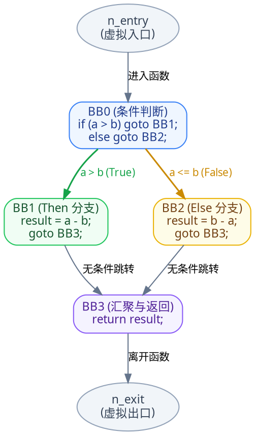
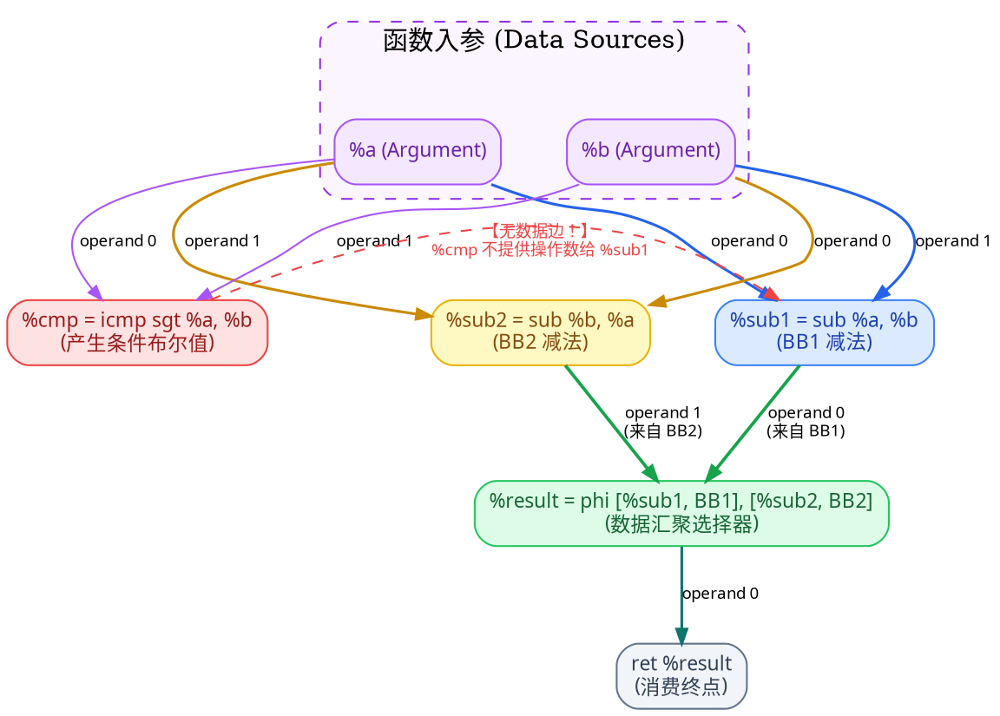
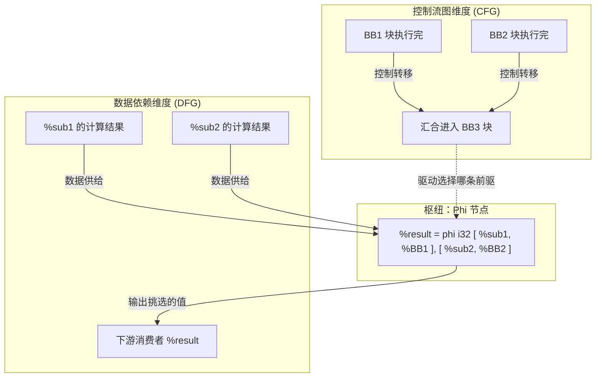
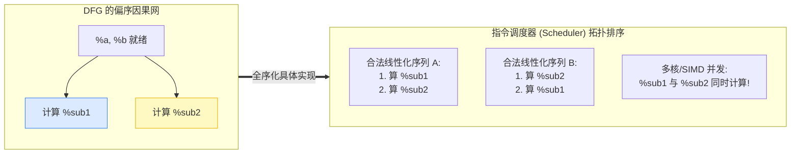
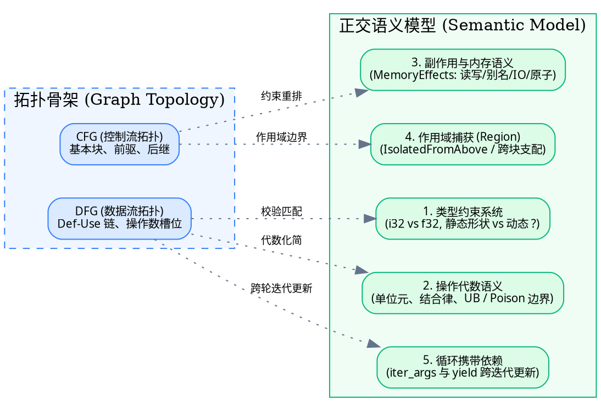
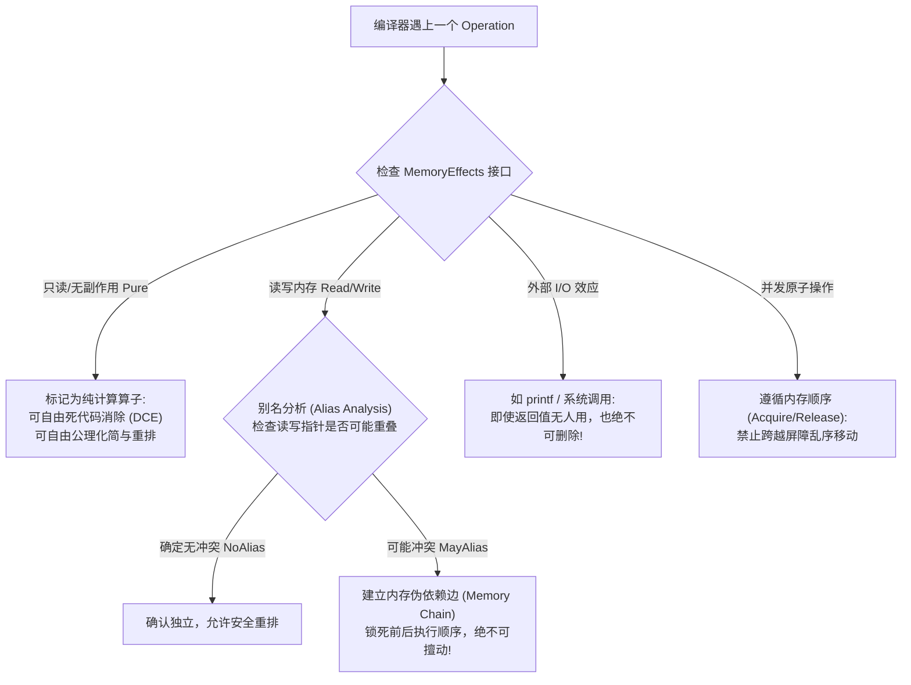
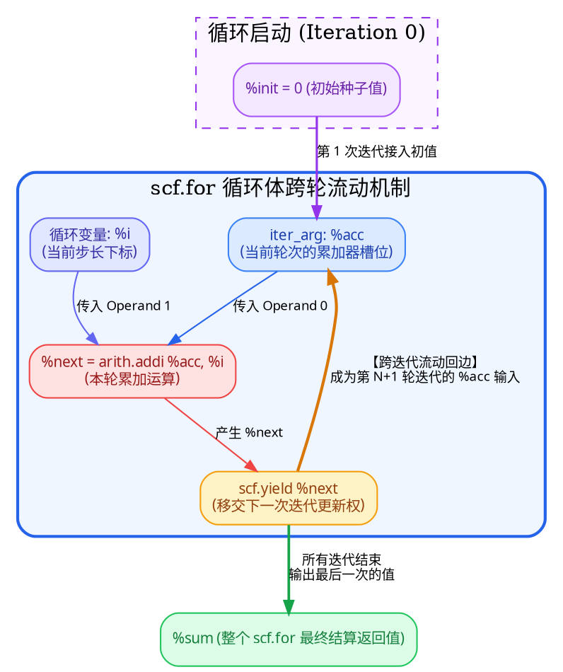
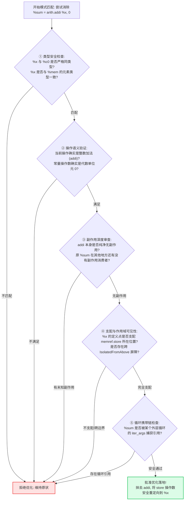
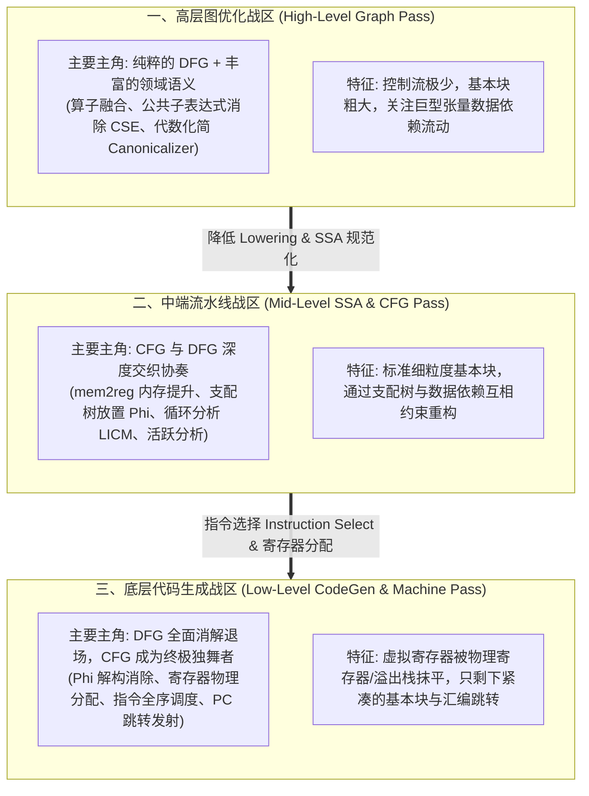

> **写在最前**：笔者从事编译器开发已经六七个年头了。犹记得最初接触编译器的时候，被 CFG（Control Flow Graph）和 DFG（Data Flow Graph）这两个概念困扰了很久。以至于最初的两三年里，对它们的理解还停留在公司某次内部技术分享上，某位资深同事那句没头没脑的断言——“很多高级分析都是基于 DFG 完成的”。
>
> 这句话让我一度陷入了一个经典的认知误区：**我始终以为 DFG 比 CFG 更高级，要成为硬核编译器工程师，必须得掌握 DFG，CFG 只不过是教科书里应付考试的小儿科（笑）！**
>
> 直到后来随着工业界实战代码的积累与理论知识的融会贯通，在某一刻我才真正顿悟到这两个概念的本质：**它们从来没有高低贵贱之分，只是看待程序时切入的“观察维度”不同。** CFG 掌管程序的“执行时空”（何时去哪），DFG 掌管程序的“因果血脉”（计算需要谁）。而更为关键的是，无论 CFG 还是 DFG，它们都只是程序的“骨架拓扑”，若没有**语义模型（Semantic Model）**的血肉填充，编译器优化就寸步难行。
>
> 这篇文章我将系统性地探讨自己对它们的理解：从图论数学形式化定义、SSA 下的显式/隐式数据流，到偏序与冯·诺依曼 PC 全序的哲学碰撞，再到 MLIR 中正交的五大语义模型与端到端编译流水线的战术演进。一方面留作个人技术生涯的印记，另一方面也期望能为正在编译器门槛外徘徊的同学彻底扫清迷雾。能力有限，难免疏漏，若有不同见解，欢迎留言切磋讨论！

---

## 目录（Table of contents）

---

## 零、初学者必读：编译器核心术语速查词典

在深入正式内容之前，我们先把贯穿本文的“专业术语”做一次彻底的通俗化扫盲。很多编译器概念初听起来高深莫测，其实背后的工程直觉非常质朴：

> [!NOTE] 核心术语通俗速查卡片
>
> 1. **IR（Intermediate Representation，中间表示）**：
>    编译器内部用来表示代码的“工程设计图”。编译器不直接从 C++/Python 翻译到机器码，而是先翻译成 IR。IR 既保留了代码的逻辑结构，又屏蔽了具体 CPU 的硬件细节，方便做通用优化。
> 2. **Basic Block（基本块，简称 BB）**：
>    一段**直线执行、绝不拐弯**的指令序列。其黄金法则只有两条：**只能从第一条指令进入，只能从最后一条指令离开**。只要代码里出现了跳转（如 `goto`、`if-else` 分支、函数调用返回），就会被斩断成不同的基本块。
> 3. **SSA（Static Single Assignment，静态单赋值）**：
>    一种规范化的 IR 编写规范。要求**每个变量名字在静态代码中只能被赋值一次**。如果你想修改变量的值，必须新起一个名字（例如从 `%x = 1` 变成 `%x_1 = %x + 1`）。这彻底消除了传统命令式语言中“变量在不同时间被反复篡改”导致的时序混乱。
> 4. **$\phi$ 节点（Phi Node / Phi 函数）**：
>    在 SSA 形式中，如果两个不同的分支代码（比如 `if` 和 `else`）各自给同一个逻辑变量赋予了新值，当这两条分支汇合到同一个下游基本块时，下游该用谁？编译器发明了一个虚拟选择器——$\phi$ 节点：“若来自左分支则选 A，若来自右分支则选 B”。
> 5. **Def-Use Chain 与 Use-Def Chain（定义-使用链）**：
>    编译器内部一张庞大的“寻人启事网”。**Def-Use** 记录了“某个指令定义的值，都被下游哪些指令拿去用了”；**Use-Def** 记录了“某个指令正在使用的操作数，到底是由上游哪条指令计算出来的”。
> 6. **PC（Program Counter，程序计数器）**：
>    CPU 硬件里的一个特殊寄存器，存放着“CPU 下一步即将抓取并执行的指令内存地址”。在经典冯·诺依曼计算机架构中，PC 只能一条一条单向或者跳转推进。
> 7. **偏序（Partial Order）与 全序（Total Order）**：
>    **全序**意味着集合中任何两个元素都可以比出绝对的前后顺序（就像排队买奶茶，谁先谁后一清二楚）；**偏序**则只规定了部分元素必须有先后（比如“先穿袜子再穿鞋”），而互不影响的元素先后随意（比如“先穿左袖还是先穿右袖无所谓”）。
> 8. **编译器 Pass（优化遍/通道）**：
>    编译器对 IR 进行的一次独立巡检与改造过程。就像汽车生产流水线上的工位：有的 Pass 专门查死代码并拆掉，有的 Pass 专门做代数化简。
> 9. **CSE（Common Subexpression Elimination，公共子表达式消除）**：
>    一种经典优化技术：如果编译器发现你重复计算了完全相同的表达式（例如前面算了 `a * b`，后面又算了 `a * b`，且期间 `a` 和 `b` 没变），它会把第二次计算删掉，直接复用第一次的结果。
> 10. **Canonicalizer / Canonicalization（规范化/典范化）**：
>     将五花八门但语义相同的写法统一收敛为一种“标准姿态”。比如把 `0 + x`、`x + 0` 全部统一改写为单变量 `x`，减少后续优化的模式匹配复杂度。
> 11. **Dominance / Dominator Tree（支配关系与支配树）**：
>     控制流图中的一种霸道关系。如果在 CFG 中，从程序入口出发**想要到达基本块 B，必须且绝对绕不开基本块 A**，我们就说 **A 支配 B**（A dominates B）。支配树是放置 $\phi$ 节点和做循环分析的数学基石。
> 12. **mem2reg（Memory to Register，内存提升为寄存器）**：
>     前端编译器初生成的 IR 往往把所有局部变量全放在内存栈上（用 `alloca`、`load`、`store` 交互）。`mem2reg` 是 LLVM 的招牌优化 Pass，它利用支配边界算法把栈内存访问提升为直接使用 SSA 寄存器值，大幅提速代码。

---

## 一、CFG 和 DFG 是什么？

最开始，我们不妨把这两个东西放在一起对比它们的定义。

毫无疑问，**CFG** 和 **DFG** 不是随意的英文缩写，它们分别代表：

- **CFG**：Control Flow Graph（控制流图）
- **DFG**：Data Flow Graph（数据流图）

它们的核心落脚点都在 **Graph（图）** 上，也就是说，本质上它们都是**图数据结构**（包含节点集合与有向边集合）。只是在构建这张图时，它们所抽取的现实维度和关注重点截然不同。

为了彻底摆脱含糊的直觉，我们先对它们给出严格的形式化数学定义。

---

### 1. CFG（控制流图）的严格定义

CFG 基本是所有编译原理课程中最早出现的内容。在引出 CFG 之前，教科书毫无疑问都会先介绍**基本块（Basic Block）**。这是因为：**基本块是 CFG 的原子构成单元**。

#### 基本块的回顾与边界识别

> **基本块（Basic Block）**：一段连续的、线性的指令序列，满足：
>
> 1. 只能从第一条指令进入；
> 2. 只能从最后一条指令离开；
> 3. 内部绝不允许出现任何跳入点（Target of Jump）和跳出点（Branch/Jump/Return）。

因此，很多语句天然会成为基本块的“边界分水岭”：

- **入口边界**：函数入口、跳转指令的目标标签（Label）；
- **出口边界**：无条件跳转（`jmp`）、条件跳转（`br` / `conditional jmp`）、函数返回（`return`）、异常抛出点。

#### CFG 的形式化四元组

有了基本块的定义，CFG 本质上就是一个有向图，可以形式化地表示为一个四元组：

$$CFG = (N, E, n_{entry}, n_{exit})$$

其中：

- $N$ 是**基本块（Basic Block）的集合**。一段程序根据基本块规则切分出来的所有块，构成了 $N$。
- $E$ 是**控制流转移边的集合**，且 $E$ 是所有基本块笛卡尔积的子集（$E \subseteq N \times N$）。它定义了程序在**何时、以何种顺序**执行。对于任何有向边 $(n_i, n_j) \in E$，其物理含义是：**“当基本块 $n_i$ 执行完毕后，程序的控制权有可能立即转移到基本块 $n_j$”**。
- $n_{entry}$ 是唯一的**虚拟程序入口节点**。
- $n_{exit}$ 是唯一的**虚拟程序出口节点**。

#### 实例剖析：经典分支程序

我们拿一个极其简单的 C 语言绝对值差函数作为剖析案例：

```c
int abs_diff(int a, int b) {
  int result;
  if (a > b)
    result = a - b;
  else
    result = b - a;
  return result;
}
```

将其按照分支与跳转规则拆解为基本块后，可以清晰地得到 4 个基本块：

```text
BB0:
  if (a > b) goto BB1;
  else goto BB2;

BB1:
  result = a - b;
  goto BB3;

BB2:
  result = b - a;
  goto BB3;

BB3:
  return result;
```

补上虚拟入口节点 $n_{entry}$ 与虚拟出口节点 $n_{exit}$，该函数的 CFG 集合描述如下：

$$N = \{ n_{entry}, BB0, BB1, BB2, BB3, n_{exit} \}$$

$$E = \{ (n_{entry}, BB0), (BB0, BB1), (BB0, BB2), (BB1, BB3), (BB2, BB3), (BB3, n_{exit}) \}$$

我们使用 Graphviz 将这张控制流图精确可视化：



#### 细品 CFG 的设计要点与控制本质

观察上面的图与定义，几个极其核心的编译器特性浮出水面：

1. **后继边（Successor）**：BB0 的最后一条语句是条件跳转，因此它有两条后继边分别指向 BB1 和 BB2。在运行时，控制流根据条件测试的真假，**只会二选一地走其中一条**。这就是为什么边的定义是“控制*可能*转移到下一个块”。
2. **前驱边（Predecessor）与汇合点**：BB1 与 BB2 最终都跳转到 BB3，所以 BB3 有两个前驱块。**BB3 这种多条控制流重新汇聚在一起的位置，是编译器分析（特别是 SSA 构造、$\phi$ 节点放置、支配边界计算）中最关键的枢纽。**
3. **虚拟节点的工程价值**：$n_{entry}$ 和 $n_{exit}$ 未必对应机器指令，但有了它们，图论算法可以非常优雅地处理“单入口单出口”问题，避免因为函数有多个 `return` 指令导致算法边界复杂化。
4. **CFG 是所有可能路径的静态全集**：
   - 当运行时 $a > b$ 为真，实际走的动态路径是：$n_{entry} \to BB0 \to BB1 \to BB3 \to n_{exit}$
   - 当运行时 $a > b$ 为假，实际走的动态路径是：$n_{entry} \to BB0 \to BB2 \to BB3 \to n_{exit}$

> [!IMPORTANT] CFG 的本质抽象
> **CFG 根本不关心 `result = a - b` 算出的具体数值是多少，也完全不在乎运算耗费了多少时钟周期；它唯一专注的事情就是：执行完当前基本块后，程序的控制流（PC）下一步可能跳去哪里。**
>
> 它是对程序所有可能执行路径的超集描述。后续几乎所有的结构分析——不可达死代码消除（DCE）、自然循环识别、支配树构建——都是建立在 CFG 的拓扑之上的。

---

### 2. DFG（数据流图）的严格定义

与 CFG 专注于“控制权往哪跳”完全不同，**DFG（Data Flow Graph）表达的是“值与值之间的因果依赖关系”**。

在 DFG 的世界里，没有 `if`、没有 `goto`、没有代码行号，更没有谁先执行、谁后执行的概念。只要一个计算所需的原材料（操作数）齐备了，这个计算在理论上就可以随时爆发。

#### DFG 的形式化二元组

DFG 本质上也是一张有向图，可以形式化地表示为一个二元组：

$$DFG = (V, D)$$

其中：

- $V$ 是**运算节点（Operation / Value Producer）的集合**。每个节点产生零个或多个值（Values）。
  > _注：在经典 LLVM IR 中，每个指令节点最多产生一个结果值（遵循“万物皆 Value”哲学）；而在现代 MLIR 中，一个 Operation 可以产生多个返回值（Multi-Result），更加贴合现代 AI 张量算子的需求。_
- $D$ 是**数据依赖边的集合**。每条有向边表示为一个三元组 $(v_i \xrightarrow{k} v_j)$，表示：**“节点 $v_i$ 产生的值，被作为节点 $v_j$ 的第 $k$ 个操作数（Operand）所消费使用”**。

这也就是编译器中最著名的 **Def $\to$ Use（定义 $\to$ 使用）** 关系，并且这个边是**操作数槽位敏感（Operand-Position Sensitive）**的！

#### 实例重构：转换为 SSA 形式的伪 IR

依然用上面的 `abs_diff` 例子，为了清晰展示纯粹的数据流动，我们把它改写为标准 SSA（静态单赋值）风格的伪 LLVM IR：

```llvm
; 入口基本块 BB0
BB0:
  %cmp = icmp sgt i32 %a, %b
  br i1 %cmp, label %BB1, label %BB2

; 分支基本块 BB1
BB1:
  %sub1 = sub i32 %a, %b
  br label %BB3

; 分支基本块 BB2
BB2:
  %sub2 = sub i32 %b, %a
  br label %BB3

; 汇聚基本块 BB3
BB3:
  %result = phi i32 [ %sub1, %BB1 ], [ %sub2, %BB2 ]
  ret i32 %result
```

我们来逐行剖析其中的数据流动：

1. `%a`、`%b` 是函数的输入实参（在 LLVM 中属于 `llvm::Argument`，它们在进入函数瞬间就已被定义，充当数据流图的源头根节点）。
2. `%cmp` 是整数比较（`icmp sgt`）产生的一个布尔值（`i1`）。
3. `%sub1` 是分支 BB1 中 `%a - %b` 的结果；`%sub2` 是分支 BB2 中 `%b - %a` 的结果。
4. `%result` 是通过 $\phi$ 节点生成的：若控制流来自 BB1 则取 `%sub1`，来自 BB2 则取 `%sub2`。
5. `%ret` 是返回指令，它消费了 `%result`。

将 `%a`、`%b` 作为图的初始输入节点，该程序的 DFG 节点集合如下：

$$V = \{ \%a, \%b, \%cmp, \%sub1, \%sub2, \%result, \%ret \}$$

其对应的数据依赖边集合 $D$ 包含带编号的槽位信息：

$$ D = \begin{Bmatrix}
(\%a \xrightarrow{0} \%cmp), & (\%b \xrightarrow{1} \%cmp), \\
(\%a \xrightarrow{0} \%sub1), & (\%b \xrightarrow{1} \%sub1), \\
(\%b \xrightarrow{0} \%sub2), & (\%a \xrightarrow{1} \%sub2), \\
(\%sub1 \xrightarrow{0} \%result), & (\%sub2 \xrightarrow{1} \%result), \\
(\%result \xrightarrow{0} \%ret)
\end{Bmatrix}$$

我们使用 Graphviz 将纯 SSA 的 DFG 完整画出，**并重点高亮初学者最容易踩雷的盲区**：



#### 初学者必破的误区：关于 `%cmp` 与 `%sub1` 的思维陷阱
请大家死死盯住上面那条红色的虚线！这是无数编译器初学者最容易产生认知混乱的地方：

> [!CAUTION] 极易混淆的认知陷阱
> 直觉上，初学者会想：“难道不是 `%cmp` 判断成功之后，才去算 `%sub1` 吗？那 `%sub1` 难道不应该依赖 `%cmp` 吗？”
>
> **答案是：在 DFG（数据流图）中，它们之间没有任何数据依赖边！**
> - `%cmp` 产生的结果值是一个 `i1` 类型的布尔标记。这个标记被谁拿去用了？被分支跳转指令 `br i1 %cmp, ...` 拿去用了。`%cmp` 影响的是**控制流（下一步跳去哪）**！
> - `%sub1` 的计算原材料只有 `%a` 和 `%b`。它在做减法时，根本不需要读取 `%cmp` 的布尔值作为操作数。
> - 因此，**在纯粹的 DFG 中，`%cmp` 与 `%sub1`、`%sub2` 是完全互不连通的孤立节点！**

那么，`%result` 最终拿到的到底是 `%sub1` 还是 `%sub2`？
**DFG 自身根本回答不了这个问题！** DFG 只知道 `%result` 可能会用到这两个值，但具体哪次用哪个，必须结合控制流图（CFG）以及分支跳转指令的执行结果才能裁定。

#### 纯 SSA 数据流 vs 隐式内存数据流
上面的 DFG 属于“纯 SSA 的数据流图”，它仅仅覆盖了**虚拟寄存器（SSA Value）之间的显式流动**。
如果代码中存在内存读写：
```llvm
store i32 42, ptr %ptr
%val = load i32, ptr %ptr
```
在底层 IR 中，`store` 指令通常不返回任何 SSA 值，`load` 指令看似只依赖 `%ptr` 这个指针地址。但实际上，第二条指令读出的数据完全依赖于第一条指令写入内存的内容！这种依赖被称为**隐式内存依赖（Memory Dependence）**。

因此在严谨的工业级编译器中：

$$\mathbf{完整数据流网络} = \mathbf{SSA 显式数据流} + \mathbf{内存别名依赖 (Memory Dependence)}$$

---

### 3. CFG 与 DFG 的深度辨析与连接纽带

聊到这里，我们已经可以非常精准地把 CFG 和 DFG 的核心差异整理成一张全景对比表：

| 比较维度 | 控制流图 (CFG) | 数据流图 (DFG) |
| :--- | :--- | :--- |
| **图节点 (Nodes)** | 基本块 (BasicBlock) | 操作/值 (Operation / Value / Argument) |
| **图有向边 (Edges)** | 控制流转移路径 (PC 可能的跳转) | Def $\to$ Use 数据消费关系 (带 Operand 槽位编号) |
| **回答的核心问题** | “程序当前块执行完了，**下一步可能跳去执行哪**？” | “当前算子要想执行，**必须输入哪些上游计算好的值**？” |
| **对计算语义的感知** | 完全漠视计算内容，只在乎块的跳转终结指令 | 深度依赖值生产者的计算关系，完全脱离分支代码块 |
| **是否包含环路** | **常态包含**（循环结构 `for/while` 在 CFG 中体现为有向环） | 在纯 SSA 形式下**绝对无环（DAG）**；在非 SSA/循环携带依赖下需特殊表达 |
| **物理对应物** | 映射冯·诺依曼架构的 **PC（程序计数器）** 跳转 | 映射纯数学函数的**函数嵌套复合**与数据因果链 |

#### $\phi$ 节点：连通两张图的“跨界立交桥”
现在我们回过头来重新审视那个神奇的指令：
```llvm
%result = phi i32 [ %sub1, %BB1 ], [ %sub2, %BB2 ]
```

$\phi$ 节点是编译原理中最具智慧的发明之一。**它恰恰是 CFG 与 DFG 两大平行宇宙发生交汇的“跨界传送门”**：
- **在 DFG 的视角里**：$\phi$ 节点是一个普通的操作节点，它声明自己依赖输入操作数 `%sub1` 和 `%sub2`；
- **在 CFG 的视角里**：$\phi$ 节点内部携带了前驱基本块的标签 `[..., %BB1]` 和 `[..., %BB2]`。当 PC 实际上是从 `%BB1` 跳入当前块时，$\phi$ 节点瞬间激活 `%sub1` 并将其送出；若来自 `%BB2`，则送出 `%sub2`。



> [!TIP] 协同优化定律
> 单独看 DFG，我们只知道因果链路，却无法断定运行时的分支选择；单独看 CFG，我们只知道控制跳转，却不知道数据如何跨越分支流动。
>
> **一般情况下，纯粹的数据流变换不一定会引起控制流的改变；但在某些特殊场景下，数据流分析（例如常量传播发现某个条件分支永远为 True）会直接把冗余的控制流分支消除！反之，控制流变换（如循环展开 Loop Unrolling、循环分块 Loop Tiling）则必然伴随着数据流网络的大规模重构与复制。**

---

### 4. 换个哲学视角：偏序（Partial Order）与全序（Total Order）

如果我们将自己代入 CPU 硬件中那颗孤独跳动的 **PC（程序计数器）** 的视角，我们会发现：计算机硬件是极其刻板的——它只能一条接一条地串行吞吐指令。这种硬件行为是绝对的**全序（Total Order）**。

然而，**无论是 CFG 还是 DFG，它们在数学本质上都不是全序，而是一组必须被严格满足的“偏序约束（Partial Order Constraints）”！**

#### 什么是偏序？
以我们的示例代码为例：
- **在控制流（CFG）约束下**：BB0 必然先于 BB1 或 BB2 执行，BB1 或 BB2 又必然先于 BB3 执行。但是，**BB1 和 BB2 之间谁先谁后？CFG 给出的是“无先后顺序”！** 它们是互斥的两条路径，在任何一次运行中，只会有一个存在，你根本无法对 BB1 和 BB2 排出先后顺序。
- **在数据依赖（DFG）约束下**：根据 `%sub1` 的 def-use 关系，指令 `sub i32 %a, %b` 必然先于任何读取 `%sub1` 的指令执行。但是，**`%sub1` 和 `%sub2` 谁先算？DFG 告诉你：它们互相独立，先算谁都完全合法，甚至把它们扔到两个不同的硬件 ALU 上并发同时执行也绝对正确！**



> [!NOTE] 编译优化的自由度之源
> **CFG 和 DFG 并没有把程序的每一步定死成一条直线，而是分别从“控制安全”和“数据因果”的角度画下红线。**
>
> 任何一次具体的动态执行，或者编译器后端所做的一次合法的指令调度（Instruction Scheduling），本质上都是在**完全满足这两套偏序约束的前提下，挑选出的某一种具体的线性全序序列！** 偏序所留下的松动与空白，正是编译器做指令重排、双发射、超标量执行与并行编译优化的最大自由度空间。

---

### 5. 阶段小结：为什么只知道拓扑是做不好编译优化的？

总结到这里，我们破除了最初的误区：CFG 与 DFG 本质上就是两种互补的有向图，忠实刻画着程序的拓扑轮廓。

但是，请大家思考一个致命的现实问题：
**光掌握了这两张图的拓扑节点与箭头连接，你就能写出一个工业级的高性能优化器吗？**

答案是：**绝无可能！**
除非是极少数抽象层次极高、只关心连通性（Reachability）的 Pass（例如最粗糙的“从入口出发找不可达节点，找不到就当死代码删掉”），绝大多数编译器优化 Pass 都遵循这样一个经典的工程范式：

> **“对于输入的 IR，我需要在图中模式匹配（Pattern Match）某种特定形态的子结构，然后将其安全地替换为另一种运行时更快、占用资源更少的等价表达。”**

问题来了：你怎么知道两个节点能不能合并？你怎么知道把这行代码删掉会不会让程序崩溃？你怎么知道把一段计算提前会不会引发除零错误？

这单靠有向图的拓扑边完全回答不了！这就必须请出编译器体系中最博大精深的核心实体——**语义模型（Semantic Model）**。

---

## 二、语义模型（Semantic Model）：注入灵魂的血肉

如果说 CFG 和 DFG 构成了程序的**骨架**，那么**语义模型就是附着在骨架之上的血肉与灵魂**。

在现代编译器框架（以 MLIR 为最典型代表）中，IR 的节点绝非仅仅带着几根输入输出连线，而是携带着海量、细致、正交的语义信息。这些信息在 MLIR 中以 **类型约束（Types）**、**操作契约（Interfaces）**、**代数特征（Traits）** 以及 **属性（Attributes）** 的形式挂载在节点上。



下面我们通过一个极简的优化案例出发，层层解剖这五大正交的语义支柱。

假设我们想编写一个极其初级的**代数化简 Pass**：目标是将所有加零操作（$x + 0$）直接消除，用 $x$ 本身替换掉加法指令。

```mlir
// 优化前：
%result = arith.addi %x, %c0 : i32

// 期望优化后：
// 直接消灭 addi 指令，让下游所有原本读取 %result 的地方直接读取 %x
```

这个改写在数学上看似天然成立，但放在编译器工程中，编译器敢直接闭着眼睛改写吗？不敢！它必须依次通过以下五重语义严审：

---

### 1. 语义维度一：类型约束系统（Type Constraint System）

优化器首先必须向**类型系统**发起询问：`%c0` 的类型是否与 `%x` 完全匹配？

```mlir
%result = arith.addi %x, %c0 : i32
```

在 MLIR 或 LLVM 的类型规则中，`arith.addi` 要求两个输入操作数以及返回值必须拥有完全一致的整型类型。
- 如果由于前面的转换疏漏，出现了 `%x : i32` 而 `%c0 : i64`，直接做消除替换将立刻导致下游引用破坏类型一致性，引发编译断言溃退。
- 更深邃的挑战出现在 AI 编译器的高维张量运算中：
  比如 `%A : tensor<4x4xf32>` 与 `%B : tensor<?x?xf32>` 做逐元素加法。前者维度在编译期已知（静态形状），后者维度带有问号 `?`（动态形状，只有运行时才知道尺寸）。如果某个算子融合模式的先决条件是“必须确定张量对齐到了 16 字节边界”，那么一旦遇到含有动态符号 `?` 的类型，优化器就必须**保守认怂放弃优化**，或者生成附带动态运行时检查的保护分支。

---

### 2. 语义维度二：操作语义（Op Semantics）与异常边界

`arith.addi %x, %c0` 之所以能被直接改写为 `%x`，是因为编译器内嵌了加法的代数操作语义：**0 是整数加法的单位元（Identity Element）**。

但如果换成其他操作符呢？
- **乘法算子**：
  ```mlir
  %r1 = arith.muli %x, %c1 : i32  // 乘以 1 可以安全化简为 %x
  %r2 = arith.muli %x, %c0 : i32  // 乘以 0 必须化简为 %c0 (即 0)，而绝不能化简为 %x！
  ```
- **除法算子与未定义行为（Undefined Behavior / Poison）**：
  ```mlir
  %r3 = arith.divsi %x, %c1 : i32  // 除以 1 可以化简为 %x
  %r4 = arith.divsi %x, %c0 : i32  // 除以 0！这是硬件异常与 UB 灾区！
  ```
  如果开发者在源代码中写下了除以 0，优化器绝对不能想当然地把它删掉或者替换为 0。在 LLVM/MLIR 规范中，除以 0 属于未定义行为或者产生 `poison` 值，某些体系结构上它会直接触发硬件 Trap 信号（SIGFPE）。**编译器在代数重写时，必须严格遵守 Op 的异常边界语义，不能将一个原本可能触发异常的代码静默“优化”成一个正常值！**

---

### 3. 语义维度三：副作用（Side Effects）与内存别名

这是令所有初级编译器开发者最容易摔跟头的深水区。

考察以下两行连续的内存写入伪代码：
```mlir
memref.store %val1, %mem[%i] : memref<10xi32>
memref.store %val2, %mem[%i] : memref<10xi32>
```

我们把它们放进纯 SSA 的 DFG 里看看：
- 第一条 `store` 没有产生任何 SSA 结果值；
- 第二条 `store` 也没有产生任何 SSA 结果值；
- 从纯粹的 Def-Use 边来看，这两条指令之间**完全没有任何连线，它们互相独立！**

按照图调度的逻辑，既然它们在 DFG 上没有依赖，我们是不是可以随意把第二条 `store` 提到第一条之前？
**如果这么做，整个程序将彻底崩溃！** 因为它们都在向内存索引 `%i` 处写入数据。后写的数据会覆盖先写的数据。如果调换顺序，最终残留在内存里的值将从 `%val2` 变成 `%val1`！

为此，现代编译器构建了强大的**副作用语义模型**（如 MLIR 的 `MemoryEffectsOpInterface`）：


> [!IMPORTANT] 副作用的本质影响
> **副作用语义在纯净的 SSA DFG 偏序之外，强行追加了一层隐式的“保序约束边”。** 哪怕两条指令之间没有传递任何 SSA 变量，只要它们触碰了相同的外部状态（内存、文件、全局寄存器），编译器就必须按下暂停键，严格守护时序。

---

### 4. 语义维度四：Region 作用域捕获与 `IsolatedFromAbove`

现代编译器（如 MLIR）颠覆了传统 LLVM IR 平坦指令流的设计，引入了强大的分层嵌套结构——**Region（代码区域）**。

在 MLIR 中，一个算子（如 `scf.if` 条件语句或 `scf.for` 循环语句）内部可以直接嵌套一个或多个完整的子图（Region）。这就带来了一个关于**作用域变量可见性**的严肃语义问题——**捕获（Capture）**。

```mlir
// 示例：合法的作用域捕获
%x = arith.constant 10 : i32

scf.if %cond {
  // 合法：scf.if 的子 Region 自动捕获了上层外围定义的 %x
  %y = arith.addi %x, %x : i32
  scf.yield
}
```

在上面的代码中，嵌套在内部的加法指令直接读取了外层的 `%x`。如果优化器此时想做一个**指令移动优化（Code Hoisting / Sinking）**，把包含这条加法指令的逻辑搬移到外层或另一个函数中，它必须严格检查：**在目标新位置上，`%x` 的定义是否依然能够“支配（Dominate）”当前算子？**

不仅如此，为了支持跨模块并发编译，MLIR 还设计了特殊的特性标签：`IsolatedFromAbove`。
最典型的代表就是函数定义 `func.func`：
```mlir
func.func @foo() {
  %x = arith.constant 10 : i32
  return
}

func.func @bar() {
  // 致命错误！func.func 具备 IsolatedFromAbove 特性！
  // 它绝不允许偷偷引用外层或兄弟函数作用域里的 %x！
  %y = arith.addi %x, %x : i32
  return
}
```

如果优化器试图在不通过函数传参（`Argument`）的前提下跨函数拉取值，`IsolatedFromAbove` 这一语义契约就会立刻亮起红灯，直接拦截这一非法的图重写操作。

---

### 5. 语义维度五：循环携带依赖（Loop-Carried Dependencies）

初学者在接触 SSA 形式时，常常会陷入一个逻辑死循环：
> “既然 SSA 要求每个变量只能赋值一次，那循环累加怎么写？我们写 C 语言的 `sum = sum + i`，变量 `sum` 每一轮都在变，在静态单赋值里岂不是无法表达自身？”

在传统 LLVM IR 中，这个问题是通过在循环头（Loop Header）放置 `phi` 节点，把前驱块的初值与来自循环体回边（Backedge）的增量值汇合来解决的。
而在 MLIR 的高层方言（如 `scf.for`）中，引入了一套极其优雅高级的语义载体——**`iter_args`（迭代参数）与 `yield`（交出更新值）**。

```mlir
// 从 0 累加到 10 的循环携带变量示例
%c0  = arith.constant 0 : i32
%c1  = arith.constant 1 : i32
%c10 = arith.constant 10 : i32
%init = arith.constant 0 : i32

%sum = scf.for %i = %c0 to %c10 step %c1
       iter_args(%acc = %init) -> (i32) {
  // 循环体内：使用当前迭代轮次的累加值 %acc
  %next = arith.addi %acc, %i : i32
  // 必须通过 scf.yield 将更新后的值交还给下一次迭代！
  scf.yield %next : i32
}
```

我们使用 Graphviz 将这个精妙的循环闭环流动图绘制出来：



> [!CAUTION] 循环优化的雷区
> 观察上面那条橙色的粗线：从 DFG 角度看，`%acc` 既是本轮计算的输入者，又是上一轮计算通过 `yield` 送出的产物。
>
> 当优化器试图执行**循环不变量外提（LICM，把在循环内部算、但算出的值每轮都相同的指令提到循环外）**时，必须仔细追踪这种循环携带依赖链。如果你误以为 `%acc` 只是个静态变量，贸然把更新指令提到了循环外面，整个循环的累加语义就彻底烟消云散了！

---

### 6. 综合穿透实战：一个看似简单的优化，需要经受的 5 重严审

现在，让我们把上面的所有理论融会贯通，回到一个极其逼真的工业级改写场景：

优化器在 IR 中检索到了如下三行代码序列，目标是将加零指令删掉：

```mlir
// 待优化的原始代码片段：
%c0 = arith.constant 0 : i32
%sum = arith.addi %x, %c0 : i32
memref.store %sum, %mem[%i] : memref<10xi32>
```

编译器准备执行改写：**直接把 `%sum` 删掉，让 `memref.store` 直接存储 `%x`**：

```mlir
// 期望优化后的目标代码：
%c0 = arith.constant 0 : i32
// %sum 被安全消除！
memref.store %x, %mem[%i] : memref<10xi32>
```

为了让这个改写在工业级编译器中安全落地，重写引擎必须自动并行跑完一张**“安全检查清单”**：



看完这个流程，你就能明白为什么资深编译器工程师常说：**“写一个 Pattern Rewrite 只需 10 分钟，但为了确保它在千万行复杂代码下不发生非法崩溃，背后需要整套正交的语义系统在暗中默默护航。”**

---

## 三、CFG 与 DFG 的主要战场与端到端编译器演进

在明白了 CFG、DFG 以及语义模型的本质后，我们终于可以登高望远，从全局俯瞰它们在现代工业级编译器（如 LLVM、MLIR、GCC）整条流水线上的**战术分工与兴衰演变**。

一个现代编译器的生命周期大致可以划分为三大战区：**高层图优化（High-level Graph Optimization）**、**中端传统优化（Mid-level Optimization）** 以及 **底层代码生成（Low-level CodeGen）**。



---

### 1. 高层战区：DFG 的黄金主场

现代 AI 编译器（如 XLA、IREE、MLIR Torch/Linalg 方言）以及传统编译器的高级前端，是 **DFG 的黄金主场**。

在这一阶段，代码通常以粗粒度的计算图（Computational Graph）形式存在，控制流往往被弱化或内化在算子内部。编译器的核心任务都在逼问一件事：
> **“这个数值是怎么计算出来的？能不能少算几步？能不能把几个算子揉成一个算子（融合）一起算？”**

这本质上就是在 **DFG（Def-Use + 语义模型）** 上大显身手：
- **常量折叠（Constant Folding）**：如果在 DFG 上发现某个算子的所有输入全是已知的静态常量，直接在编译期把结果算出来，砍掉原节点。
- **CSE（公共子表达式消除）**：在 DFG 中检索拓扑同构且输入相同的兄弟子图，把下游引用直接合流，消除冗余计算。
- **Canonicalize（规范化）与代数化简**：基于 $x + 0 = x$、$x \times 1 = x$、$A \cdot B^T$ 矩阵恒等变形，不断收敛图的形态。在 MLIR 中，这通常由强大的 `GreedyPatternRewriteDriver` 驱动，不知疲倦地在 DFG 上做模式消除。
- **算子融合（Operator Fusion）**：在深度学习领域，把 `Conv + Bias + ReLU` 三个相邻的 DFG 节点融合成一个大 Kernel。这种变换的前提是保证数据因果不被破坏，同时借助**代价模型（Cost Model）**评估访存带宽收益。

---

### 2. 中端战区：CFG 与 DFG 的深度协奏

一旦代码进入传统编译器中端（如 LLVM Opt 中经典的 `-O2` / `-O3` 阶段），控制流开始全面介入，此时迎来了 **CFG 与 DFG 密切配合的协奏高潮**：

#### 支配树（Dominator Tree）与 $\phi$ 节点放置
在将前端生成的平坦栈分配代码转换为 SSA 形式时，最关键的招牌 Pass 就是 **`mem2reg`**。
- `mem2reg` 必须先扫描控制流图（CFG），计算出所有基本块之间的**支配边界（Dominance Frontier）**；
- 只有知道了哪几个互斥分支最终在哪一个基本块汇合，编译器才能精准无误地在汇合点插上 $\phi$ 节点；
- 随后沿着 CFG 的前驱边递归重命名，将原本读写内存的 `load` / `store` 彻底提升为纯粹的 SSA 寄存器值。

#### 循环变换与控制流重构
- **循环识别（Loop Identification）**：通过在 CFG 中寻找**回边（Backedge，即从后继块跳回前驱支配块的边）**，识别出整个自然循环（Natural Loop）、循环头（Header）与前导块（Preheader）。
- **LICM（循环不变量外提）**：利用 CFG 确认某条计算所在的块会被稳定执行，同时利用 DFG 确认该计算所依赖的所有操作数在循环体内没有被篡改，然后果断将计算“拎出”循环体。
- **循环展开（Loop Unrolling）**：直接在 CFG 上克隆多个基本块副本，伴随而来的则是内部 DFG 依赖链成倍展开与展开后的新一轮常量折叠。

---

### 3. 底层战区：DFG 的退场与 CFG 的独舞

当编译器完成所有平台无关的优化，开始进入面向特定 CPU / GPU / NPU 硬件的**后端代码生成（Backend CodeGen）**阶段时，奇妙的演化发生了：

> [!IMPORTANT] 终局的消解
> **曾经光芒四射的 DFG 开始一步一步退出历史舞台，而 CFG 则成为支配全场的终极王者！**

为什么会出现这种现象？
根本原因在于我们前面提到的**冯·诺依曼计算机架构的核心约束**：
**真正的物理硬件只有一个 PC（程序计数器）和一组数量有限的物理寄存器。**

1. **Phi 节点的解构（Phi Elimination）**：
   真实的 CPU 根本没有一条叫做 `phi` 的硬件机器指令！因此，在进入寄存器分配之前，编译器首先通过 **SSA 解构 Pass**，把所有 $\phi$ 节点打散，在其各个前驱块的末尾强行插入真实的寄存器数据拷贝（`mov` / `copy`）指令。
2. **寄存器分配（Register Allocation）**：
   在 SSA 中，我们可以无节制地定义一万个各不相同的虚拟变量 `%v1, %v2, ...`。但物理 CPU 只有 16 个或 32 个通用寄存器（如 RISC-V 的 `x0-x31`）。寄存器分配算法（如染色算法 Graph Coloring）根据变量的生命周期，将成百上千个 SSA 虚拟变量压入极少数物理寄存器中，放不下的只能溢出（Spill）到内存栈上。**曾经清晰透明的 Def-Use 依赖网络，在此刻被物理寄存器的复用与栈内存指针彻底打乱消解。**
3. **指令调度与全序发射**：
   编译器调度器根据指令延迟，把基本块内部的指令排成严格的一维线性序列。
4. **终局形态**：
   当最终的汇编机器码吐出来时，你所能看到的只有：一段段顺序执行的代码块，以及末尾的 `jmp`、`bne`、`call`、`ret` 指令。**整张程序彻底退化为了以硬件 PC 顺序驱动的纯粹 CFG 骨架！**

---

## 结语：干将与莫邪

行文至此，回看我数年前刚入行时被那句“很多高级分析都是基于 DFG 完成的”所引发的迷茫，不禁哑然失笑。

在编译器的大千世界里：
- **CFG** 是程序的**时空版图**，它以基本块为据点，精准描摹着 CPU 执行流可能涉足的每一条山川路径；
- **DFG** 是程序的**因果血脉**，它抽离了时序的羁绊，纯粹以数学之美串联起每一个数据值的生命轨迹；
- **语义模型** 则是注入其中的**灵魂契约**，它以严密的类型、代数定律、副作用约束与作用域边界，守护着代码变换时语义等价的至高红线。

CFG 与 DFG 从不是非此即彼的竞争对手，更没有谁比谁更高级的偏见。它们就像现代编译器铸剑炉里的**“干将”与“莫邪”**——缺了任何一把，都斩不断代码冗余的乱麻，也铸就不出极致性能的神兵。

愿每一位正在探索编译深水区的同行者，都能跳出单一视角的桎梏，在控制与数据、拓扑与语义的交响乐中，体会到底层系统设计那份浑然天成的工程之美！
$$
