> **导读**：在现代高性能计算与 AI 编译器开发的深水区，系统级工程师与芯片架构师几乎都会遭遇两组看似对立、又极易混淆的核心疑问：
>
> 1. **“编译器到底会不会直接对汇编做计算指令重排？它凭什么保证重排后的程序逻辑不崩塌？”**
> 2. **“重排浮点或定点计算指令，究竟会不会导致精度发生误差，甚至造成静默的数值溃败？”**
>
> 在传统通用 CPU 上，指令调度（Instruction Scheduling）主要用于掩盖 Cache 缺失与功能单元延迟；而在现代丰富多元的**异构加速芯片（Heterogeneous Accelerators）**世界中，编译器的角色已经发生了天翻地覆的变化：
> - **在固定数据流 ASIC / NPU 上**：指令表面上毫无普通数据依赖，却牢牢受制于底层有限状态机的配置与启动协议；
> - **在 SIMT GPU 上**：编译器激进提升指令级并行（ILP）的重排动作，会直接挤爆寄存器文件，引发活跃线程束（Occupancy）骤降，反而拖垮整体吞吐；
> - **在 VLIW / DSP 上**：芯片没有任何硬件互锁（Interlock-Free），编译器必须以精准的时钟周期为步长，将独立指令严丝合缝地填满发射槽与延迟槽，稍有差池便会引发未定义行为；
> - **在脉动阵列（Systolic Array）上**：指令重排与时空波前推进（Wavefront Skewing）深度耦合，必须确保数据在精确的纳秒抵达目标处理单元；
> - **在可重构架构（CGRA）上**：指令调度演化为高维时空循环模调度（Modulo Scheduling）与路由冲突消解；
> - **在向量扩展（RVV / SVE）上**：跨 Lane 树形归约与严格顺序归约甚至被硬化为两条截然不同的物理指令！
>
> 编译器到底在哪个阶段决定指令的重组与去留？指令重排的“语义等价”、“数值等价”与“逐位等价”该如何严格区分？面对多元异构计算芯片，我们如何避免编译器自作主张、设计出一套贯穿 **Python DSL → MLIR → 异构硬件后端** 的通用**数值语义契约（Numerical Semantics Contract）**？
>
> 本文从微架构与编译原理的第一性原理出发，全景拆解指令调度的底层物理动力、LLVM 调度双阶段、浮点精度破产真相；系统性横跨**六大异构微架构流派**，剖析各自特有的调度哲学与精度陷阱；最后给出工程级“数值语义契约”系统的端到端设计与落地方案。全篇配备初学者术语速查词典、高清 Mermaid/Graphviz 架构图与硬核决策树，帮助读者建立贯穿软硬件全栈的底层洞察。

---

## 目录导览

- [零、初学者核心名词形象速查词典 (Primer)](#零初学者核心名词形象速查词典-primer)
- [一、第一性原理：编译器为什么要对计算指令做重排？](#一第一性原理编译器为什么要对计算指令做重排)
  - [1.1 微架构痛点：流水线停顿与延迟隐藏](#11-微架构痛点流水线停顿与延迟隐藏)
  - [1.2 明确三种不同层次的重排优化](#12-明确三种不同层次的重排优化)
  - [1.3 顺序执行核 vs 乱序执行核的本质差异](#13-顺序执行核-vs-乱序执行核的本质差异)
- [二、现代编译器全景：指令重排发生在什么阶段？](#二现代编译器全景指令重排发生在什么阶段)
  - [2.1 LLVM 代码生成管线中的调度分期](#21-llvm-代码生成管线中的调度分期)
  - [2.2 寄存器分配前调度 (Pre-RA) vs 寄存器分配后调度 (Post-RA)](#22-寄存器分配前调度-pre-ra-vs-寄存器分配后调度-post-ra)
  - [2.3 GCC 的对应调度机制与编译选项对照](#23-gcc-的对应调度机制与编译选项对照)
- [三、重排判定基石：指令依赖图 (DAG) 与冒险分析](#三重排判定基石指令依赖图-dag-与冒险分析)
  - [3.1 真数据依赖 (RAW) 与计算依赖图的构建](#31-真数据依赖-raw-与计算依赖图的构建)
  - [3.2 伪依赖与隐式危险：WAR、WAW 与内存别名分析](#32-伪依赖与隐式危险warwaw-与内存别名分析)
- [四、重排会导致精度误差吗？浮点陷阱与等价性分级](#四重排会导致精度误差吗浮点陷阱与等价性分级)
  - [4.1 独立指令重排：逐位一致性的物理保证](#41-独立指令重排逐位一致性的物理保证)
  - [4.2 浮点数结合律失效：大数吃小数与舍入灾难](#42-浮点数结合律失效大数吃小数与舍入灾难)
  - [4.3 认知的跃迁：三种等价性分级 (Equivalence Classes)](#43-认知的跃迁三种等价性分级-equivalence-classes)
  - [4.4 LLVM Fast-Math Flags (FMF) 的精确控制粒度](#44-llvm-fast-math-flags-fmf-的精确控制粒度)
- [五、异构加速芯片全景：六大微架构流派的指令调度与重排困境](#五异构加速芯片全景六大微架构流派的指令调度与重排困境)
  - [5.1 异构计算谱系全景对比矩阵](#51-异构计算谱系全景对比矩阵)
  - [5.2 流派一：固定数据流 ASIC / NPU —— 状态机协议与隐式硬件屏障](#52-流派一固定数据流-asic--npu--状态机协议与隐式硬件屏障)
  - [5.3 流派二：SIMT GPU —— 寄存器压力 vs 活跃占用率 (Occupancy) 的极限拉锯](#53-流派二simt-gpu--寄存器压力-vs-活跃占用率-occupancy-的极限拉锯)
  - [5.4 流派三：VLIW / DSP —— 零硬件互锁 (Interlock-Free) 与周期级指令打包](#54-流派三vliw--dsp--零硬件互锁-interlock-free-与周期级指令打包)
  - [5.5 流派四：脉动阵列 (Systolic Array) —— 时空波前对齐 (Wavefront Skewing) 与几何时钟匹配](#55-流派四脉动阵列-systolic-array--时空波前对齐-wavefront-skewing-与几何时钟匹配)
  - [5.6 流派五：粗粒度可重构计算 (CGRA) —— 模调度 (Modulo Scheduling) 与空间布线冲突](#56-流派五粗粒度可重构计算-cgra--模调度-modulo-scheduling-与空间布线冲突)
  - [5.7 流派六：通用向量扩展 (RVV / SVE) —— 向量链化与顺序/树形归约双轨指令](#57-流派六通用向量扩展-rvv--sve--向量链化与顺序树形归约双轨指令)
- [六、不同异构架构下的数值精度演化与溢出机制](#六不同异构架构下的数值精度演化与溢出机制)
  - [6.1 定点饱和运算 (Saturating Math) 与保护位：DSP 的重排溢出陷阱](#61-定点饱和运算-saturating-math-与保护位dsp-的重排溢出陷阱)
  - [6.2 GPU Tensor Core 混合精度累加与非确定性漂移](#62-gpu-tensor-core-混合精度累加与非确定性漂移)
  - [6.3 树形加法网络与向量指令双轨设计](#63-树形加法网络与向量指令双轨设计)
- [七、通用解法：构建贯穿 Python DSL 到 MLIR 的“数值语义契约”](#七通用解法构建贯穿-python-dsl-到-mlir-的数值语义契约)
  - [7.1 为什么一个全局 `fast_math=True` 在异构开发中行不通？](#71-为什么一个全局-fast_mathtrue-在异构开发中行不通)
  - [7.2 通用 Python DSL 层的精细数值契约建模](#72-通用-python-dsl-层的精细数值契约建模)
  - [7.3 MLIR 中间表示层的两级契约沉降](#73-mlir-中间表示层的两级契约沉降)
  - [7.4 统一分析基础设施：`NumericSemanticsAnalysis`](#74-统一分析基础设施numericsemanticsanalysis)
  - [7.5 跨六大异构架构的硬件映射决策树 (Hardware Mapping Tree)](#75-跨六大异构架构的硬件映射决策树-hardware-mapping-tree)
  - [7.6 工程落地实施路线图：P0 与 P1 矩阵](#76-工程落地实施路线图p0-与-p1-矩阵)
- [八、总结与架构全景心智模型](#八总结与架构全景心智模型)

---

## 零、初学者核心名词形象速查词典 (Primer)

为了确保零基础、刚从通用软件转向异构编译器的开发者无障碍阅读，下表对全文关键概念做出精炼通俗的定义与生活化比喻：

| 专业术语 | 英文全称 / 原型 | 核心本质与通俗直观比喻 |
| :--- | :--- | :--- |
| **汇编语言 (Assembly)** | Assembly Language | **芯片硬件可直接理解的文本助记符号**。如 `load`（读内存）、`fadd`（浮点加法）。 |
| **指令重排 (Scheduling)** | Instruction Scheduling (指令调度) | **在保持逻辑不变的前提下，调整指令执行先后顺序**。类似厨师备菜：在水烧开前先切菜，消除闲置时间。 |
| **流水线停顿 (Stall)** | Pipeline Stall / Bubble (气泡) | **处理器因等待数据或计算单元空闲而被迫“空转发呆”的时钟周期**。 |
| **指令级并行 (ILP)** | Instruction-Level Parallelism | **处理器在同一周期内并行执行多条互不干扰指令的能力**。 |
| **中间表示 (IR)** | Intermediate Representation | **编译器的内部数据结构**。介于高级语言与汇编之间，便于跨硬件进行通用分析与优化。 |
| **Machine IR (MIR)** | Machine Intermediate Representation | **贴近硬件指令集的底层 IR**。指令已与机器码一一对应，但寄存器大多仍为无限的虚拟编号。 |
| **寄存器分配 (RA)** | Register Allocation | **将成百上千个虚拟变量，塞入硬件芯片仅有的几十个物理寄存器中**。好比给大会嘉宾安排有限的座位。 |
| **DAG** | Directed Acyclic Graph (有向无环图) | **无闭环方向的指令依赖网**。箭头代表执行顺序，是所有编译器指令调度器的灵魂。 |
| **数据冒险 (Hazards)** | RAW / WAR / WAW | **硬件流水线访问冲突**：<br>• **RAW（真依赖）**：B 要读 A 刚算出的值；<br>• **WAR（反依赖）**：B 要写寄存器，不能提前覆盖 A 还没读走的旧值；<br>• **WAW（输出依赖）**：A、B 写同一寄存器，必须保证最终留下的结果正确。 |
| **SIMT** | Single Instruction, Multiple Threads | **单指令多线程架构（GPU 核心模式）**。多个线程执行同一段程序，但处理不同的数据通道。 |
| **Warp / Wavefront** | 线程束 / 波前 | **GPU 硬件调度和发射的最小执行单元**（通常由 32 或 64 个线程锁定步调并发执行）。 |
| **Occupancy (占用率)** | GPU Warp Occupancy | **GPU 每个计算单元（SM）上驻留的活跃线程束占最大理论容量的比例**。占用率太低会导致延迟无法隐藏。 |
| **VLIW** | Very Long Instruction Word (超长指令字) | **将多条独立指令硬性打包为一个长指令包（Bundle）的硬件设计**。芯片本身无硬件调度，完全靠编译器排兵布阵。 |
| **无互锁架构 (Interlock-Free)**| Hardware Interlock-Free | **硬件内部没有任何硬件冲突检测电路**。若编译器排错指令，硬件直接读写错误数据，不会自动停顿等待！ |
| **延迟槽 (Delay Slot)** | Branch / Load Delay Slot | **跳转或访存指令发出后、真正生效前必须紧随执行的固定时钟周期槽位**。编译器必须找指令填满它。 |
| **脉动阵列 (Systolic)** | Systolic Array (如 TPU 矩阵核) | **数据如同心脏血液般在二维处理单元网格中节奏性同步流动的计算架构**。 |
| **波前对齐 (Wavefront Skewing)**| Temporal/Spatial Skewing | **为了配合脉动阵列的斜向数据推进，编译器对输入矩阵在时间轴上进行的错位延迟补齐技术**。 |
| **CGRA** | Coarse-Grained Reconfigurable Architecture | **由算术逻辑单元（ALU）和可重构互连网络构成的网格芯片**，兼具专用芯片的高能效与通用处理器的可编程性。 |
| **模调度 (Modulo Scheduling)** | Modulo Variable Expansion / Software Pipelining | **循环迭代交叉重叠执行的调度算法**。让下一次循环的读操作与本次循环的算操作在空间网格中并发。 |
| **向量链化 (Vector Chaining)** | Vector Chaining | **向量计算流水线的“直通接力”**。上一条向量指令刚算出一小段数据，下一条向量指令无需等待整组算完，立即接手计算。 |
| **定点饱和算术 (Saturating)** | Saturating Arithmetic | **数值溢出时不再发生环绕回卷（Wrap-around），而是直接锁死在最大值或最小值**。常用于音频与图像 DSP。 |
| **大数吃小数 (Cancellation)**| Catastrophic Loss of Precision | **极大浮点数与极小浮点数相加时，极小数因阶码对齐被完全移位截断丢弃的现象**。如 $10^{20} + 1.0 = 10^{20}$。 |
| **Fast-Math Flags (FMF)** | 快速数学优化标志 | **LLVM/MLIR 中指示优化器可放宽 IEEE 754 严格标准的控制开关集合**（如允许重结合、忽略 NaN 等）。 |
| **数值语义契约** | Numerical Semantics Contract | **上层算法与底层异构硬件之间白纸黑字的精度承诺**：严格划定允许的数学变形、误差容限与舍入边界。 |

---

## 一、第一性原理：编译器为什么要对计算指令做重排？

从计算机体系结构的第一性原理来看，处理器的运算速度与访存/复杂算子的高延迟之间存在巨大鸿沟。

### 1.1 微架构痛点：流水线停顿与延迟隐藏

考虑一段最朴素的汇编代码：计算 $B = A + C$ 并写入内存，同时计算完全无关的 $D = E \times F$：

```asm
# 原始书写顺序
load  r1, [addr1]    # 指令 1: 从内存读取 A 到 r1 (高延迟访存，假设需要 3 个周期)
add   r2, r1, r3     # 指令 2: 计算 B = A + C (依赖 r1，必须等待 load 完毕)
mul   r4, r5, r6     # 指令 3: 计算 D = E * F (独立计算，无依赖)
store [addr2], r2    # 指令 4: 写回 B (依赖 r2)
```

在顺序执行（In-Order）处理器中：
- `load` 发射后，数据需要 3 个周期才能抵达寄存器 `r1`；
- 指令 2 `add` 必须使用 `r1`，硬件流水线被迫插入 **2 个周期的空转等待（Pipeline Stall，流水线气泡）**；
- 随后才能发射 `add` 和 `mul`。


编译器后端分析发现：**指令 3 `mul` 与 `load`、`add` 无任何寄存器与内存冲突**。因此，编译器在生成汇编前将其调换至 `load` 之后：

```asm
# 编译器重排（指令调度）后
load  r1, [addr1]    # 周期 0: 发射 load，需要 3 周期
mul   r4, r5, r6     # 周期 1: 完美利用访存等待空隙，发射独立乘法！(延迟被隐藏)
# 周期 2: 此时 load 数据正好归来
add   r2, r1, r3     # 周期 3: r1 已就绪，无停顿发射！
store [addr2], r2    # 周期 4: 写回
```


> **微架构本质**：重排指令并没有改变加减乘除的数学定义，也没有打破数据依赖，但它将原本发呆的周期转化为有效产出，这就是**指令级并行（ILP）**与**延迟隐藏（Latency Hiding）**。

---

### 1.2 明确三种不同层次的重排优化

在编译器体系中，“重排”一词涵盖三个截然不同的层次：

| 优化层次 | 会改变什么？ | 核心优化目标 | 典型案例 | 负责的编译阶段 |
| :--- | :--- | :--- | :--- | :--- |
| **1. 机器指令调度 (Instruction Scheduling)** | **改变物理机器指令的排列顺序** | 隐藏访存与功能单元延迟，消除流水线停顿 | 将无关乘法挪到访存等待槽位 | LLVM CodeGen 后端 (Machine IR 阶段) |
| **2. 指令组合与代数变换 (Algebraic Opts)** | **改变计算指令本身的种类或结合方式** | 用低成本指令代替高成本指令，减少总周期 | `x * 2` 改为移位 `x << 1`；乘法加法融合成 FMA | 中端优化器 (LLVM IR / DAGCombine) |
| **3. 计算图宏观调度 (Graph / Loop Scheduling)** | **改变粗粒度算子、数据切片 (Tile) 和搬运时序** | 实现计算与 DMA 数据搬运的双缓冲重叠 (Double Buffering) | 提前触发异步 DMA 预取下一块张量 | AI 编译器高层 Pass (MLIR / 高级图) |

---

### 1.3 顺序执行核 vs 乱序执行核的本质差异

- **乱序执行 CPU (Out-of-Order, OoO)**：配备了庞大的重排序缓冲区（ROB）与保留站，硬件会在运行时动态重排指令。但硬件窗口容量有限，**若编译器静态排好序，能大幅缓解硬件压力，带来额外提速**。
- **顺序执行核 (In-Order)**：如嵌入式 RISC-V 核心、DSP、多数 AI 协处理器。这类硬件为了极致能效省去了复杂的动态调度电路，**指令怎么写硬件就怎么执行。对它们而言，编译器的静态指令调度就是性能命脉**！

---

## 二、现代编译器全景：指令重排发生在什么阶段？

以工业界事实标准的 **LLVM** 基础设施为例，指令重排发生在代码生成（CodeGen）阶段的 Machine IR 之上：

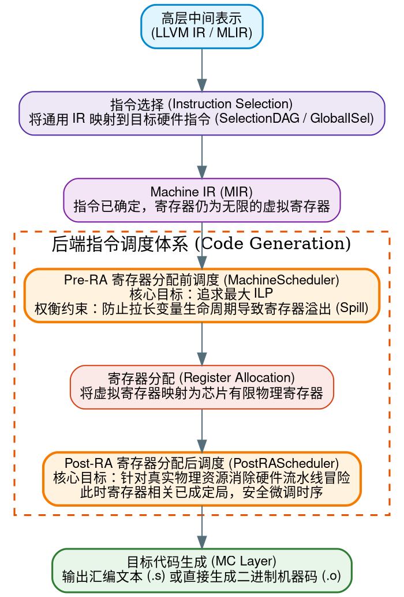

### 2.1 LLVM 代码生成管线中的调度分期

LLVM 将机器级调度分为 Pre-RA 和 Post-RA 两个阶段，以解决著名的**寄存器分配与调度的相序问题（Phase Ordering Problem）**。

### 2.2 寄存器分配前调度 (Pre-RA) vs 寄存器分配后调度 (Post-RA)

| 对比维度 | 寄存器分配前调度 (Pre-RA) | 寄存器分配后调度 (Post-RA) |
| :--- | :--- | :--- |
| **操作数对象** | **无限的虚拟寄存器**（如 `%vreg0, %vreg1`） | **真实的物理寄存器**（如 `a0, t0, s1`） |
| **主要优化目标** | **最大化指令级并行（ILP）**，尽一切可能提前长延迟操作（访存、浮点除法） | **消除流水线物理冒险**，针对特定的硬件执行槽位微调 |
| **关键制约危险** | **寄存器压力（Register Pressure）膨胀**！提前太多计算会拉长变量存活期，导致物理寄存器不够用，引发灾难性的内存栈溢出（Spill） | **假相关（WAR/WAW）锁死**！物理寄存器已被复用，人为引入了虚假依赖，调度自由度显著受限 |
| **LLVM 核心实现** | `llvm::MachineScheduler` / `ScheduleDAGMILive` | `llvm::PostRASchedulerList` |

### 2.3 GCC 的对应调度机制与编译选项对照

- **`-fschedule-insns`**：在寄存器分配**之前**重排。在通用寄存器丰富的架构上显著提速，但在寄存器紧缺的架构上易加剧溢出。
- **`-fschedule-insns2`**：在寄存器分配**之后**重排。不引入任何额外栈溢出风险，在 `-O2` 及以上优化级别中通常默认开启。

---

## 三、重排判定基石：指令依赖图 (DAG) 与冒险分析

编译器到底凭什么判断两行代码可以调换位置？
答案是：**编译器从不依赖代码文本书写次序，它只依据数据依赖图（DAG）**。

### 3.1 真数据依赖 (RAW) 与计算依赖图的构建

考虑以下代码段：

```cpp
a = x + y;   // 指令 1
b = a * 2;   // 指令 2: 依赖 a
c = p * q;   // 指令 3: 完全独立
d = b + c;   // 指令 4: 依赖 b 和 c
```

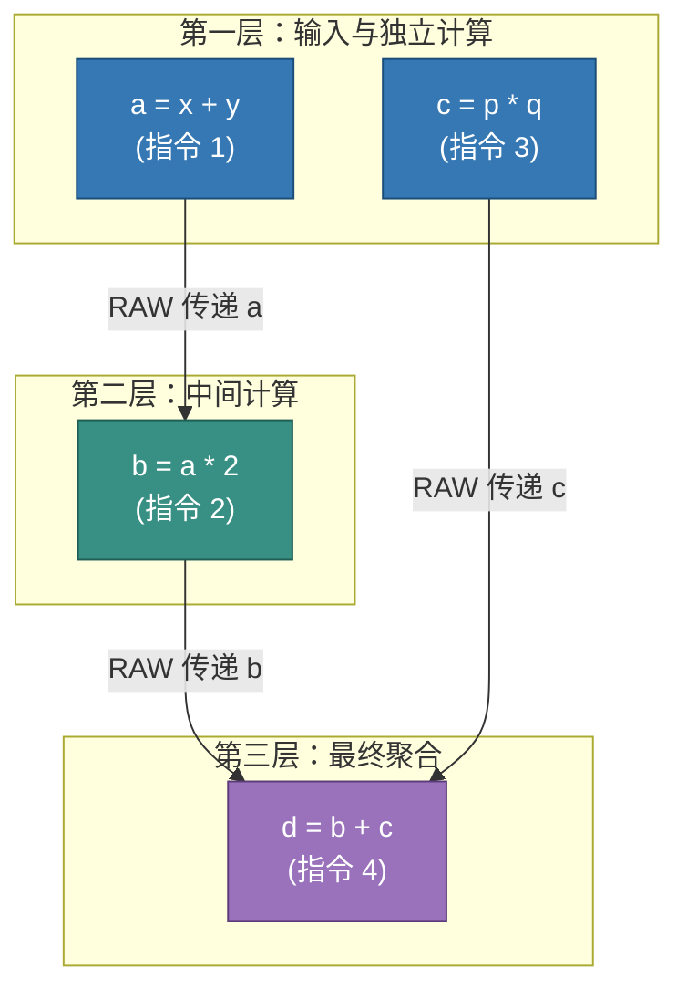

依据拓扑排序：
- `指令 1` 必须先于 `指令 2`（**真数据依赖，RAW**）；
- `指令 2` 与 `指令 3` 必须先于 `指令 4`；
- **但 `指令 1` 与 `指令 3` 之间无任何连线！`指令 2` 与 `指令 3` 之间也无连线！**
- 因此，`[1, 3, 2, 4]`、`[3, 1, 2, 4]`、`[1, 2, 3, 4]` 均为 100% 合法且等价的发射序列。

---

### 3.2 伪依赖与隐式危险：WAR、WAW 与内存别名分析

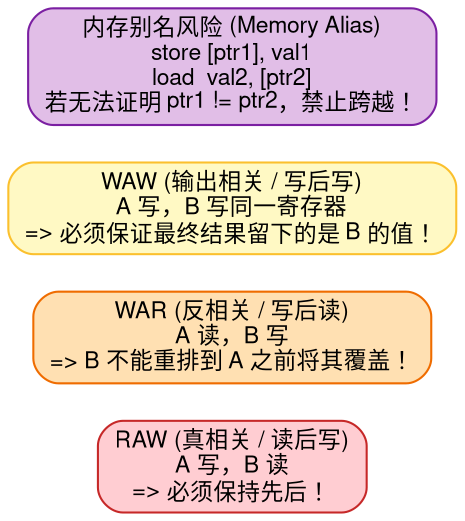

- **别名分析（Alias Analysis）**：若编译器无法在编译期证明两个指针 `ptr1 != ptr2`，就必须保守假设存在重叠风险，严格禁止将 `load` 跨越 `store` 调度，否则会读取脏数据。

---

## 四、重排会导致精度误差吗？浮点陷阱与等价性分级

> **核心分界线**：
> **如果只是调度相互独立的计算指令，绝不会引入任何精度误差，结果是逐位一致的；**
> **但如果改变了浮点数的代数结合顺序（如加法重结合、FMA 融合、树形归约），就必然可能引入精度误差！**

---

### 4.1 独立指令重排：逐位一致性的物理保证

考虑以下浮点运算：

```cpp
float a = x + y;  // 指令 1
float b = p * q;  // 指令 2
float c = a + b;  // 指令 3
```

原始汇编：
```asm
fadd.s f1, f2, f3    # a = x + y
fmul.s f4, f5, f6    # b = p * q
fadd.s f7, f1, f4    # c = a + b
```

重排后：
```asm
fmul.s f4, f5, f6    # 先算乘法 b
fadd.s f1, f2, f3    # 再算加法 a
fadd.s f7, f1, f4    # 最后聚合 c
```

在此过程中：
1. 乘法输入操作数依然是精确的 `f5` 和 `f6`；
2. 加法输入操作数依然是精确的 `f2` 和 `f3`；
3. 中间舍入点与操作数丝毫未动。

在相同的 IEEE 754 环境下，最终寄存器 `f7` 里的每一个二进制 Bit 完全相同，达到**逐位一致（Bitwise Identical）**。

---

### 4.2 浮点数结合律失效：大数吃小数与舍入灾难

很多开发者容易将“指令调度”与“浮点代数重排（Reassociation）”混淆。
在实数数学中加法满足结合律：$(a + b) + c = a + (b + c)$。但在计算机有限精度浮点数中，**结合律彻底失效！**

#### 经典案例：大数吃小数

设三个单精度浮点数（FP32）：
$$a = 10^{20},\quad b = -10^{20},\quad c = 1.0$$

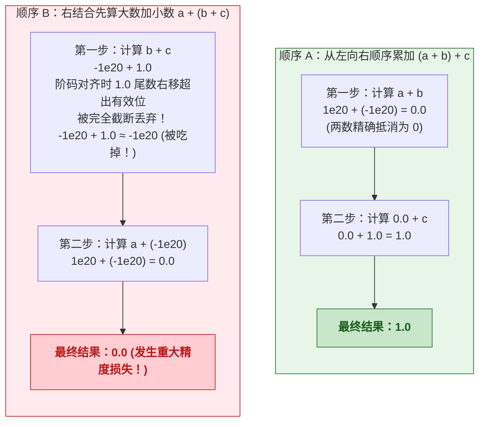

同样三个数，仅仅调换结合次序，一个得到 `1.0`，另一个得到 `0.0`。若编译器自作主张重排，后果不堪设想。

---

### 4.3 认知的跃迁：三种等价性分级 (Equivalence Classes)

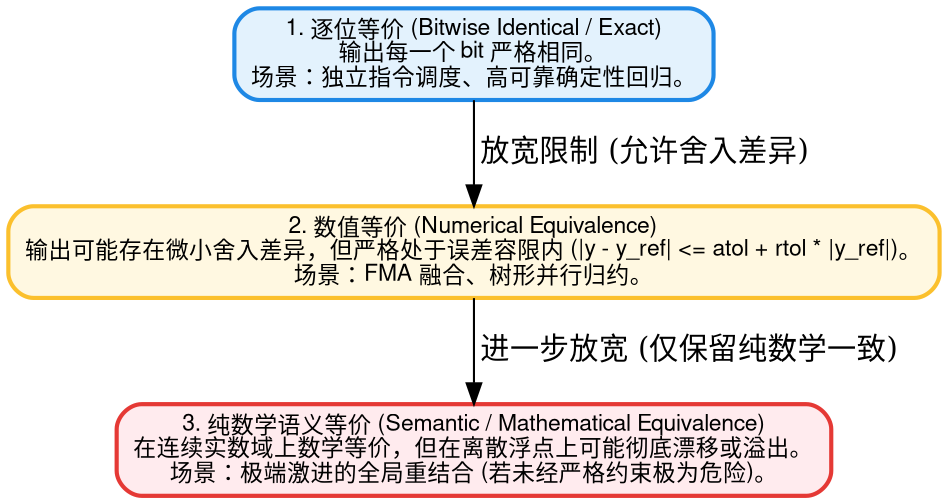

---

### 4.4 LLVM Fast-Math Flags (FMF) 的精确控制粒度

LLVM 默认严禁进行任何破坏位模式的代数变形，只有显式指定了标志位时才开启特定优化：

| 标志位 (FMF) | 英文全称 | 允许编译器执行的优化动作 | 潜在精度风险 |
| :--- | :--- | :--- | :--- |
| **`reassoc`** | Reassociation | **允许重新结合浮点运算**（如加法树重排） | 可能引发“大数吃小数”，打破逐位一致 |
| **`contract`** | Contraction | **允许融合乘加（FMA）** | **通常提升精度**（少一次中间舍入），但位模式改变 |
| **`nnan`** | No NaNs | 假定入参和出参永不出现 `NaN`，省去检查分支 | 若遇到真正的 `NaN`，产生未定义行为 |
| **`ninf`** | No Infs | 假定永不出现正负无穷（`+Inf / -Inf`） | 溢出时无法正确捕获 |
| **`nsz`** | No Signed Zeros | 忽略 `+0.0` 与 `-0.0` 的符号区别 | 复数或极限计算可能丢失象限信息 |
| **`afn`** | Approx Functions | 允许使用硬件近似估算指令（如近似倒数平方根） | 计算结果仅有低位精度保证 |

---

## 五、异构加速芯片全景：六大微架构流派的指令调度与重排困境

现代异构加速计算绝非仅有“流水线固定的 NPU”。在工业界落地中，根据**硬件互锁机制、控制流粒度与时空计算模式**的不同，主要分为六大微架构流派：

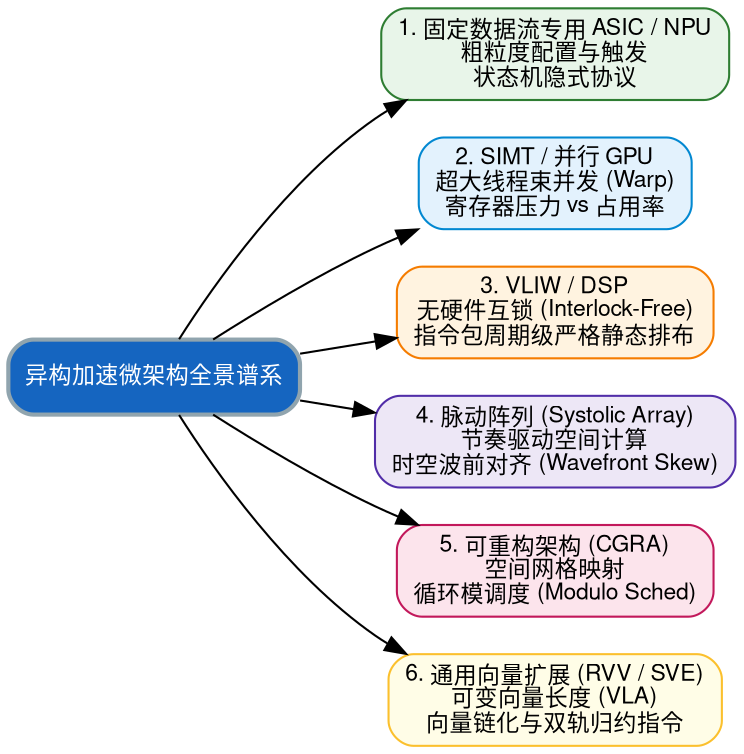

### 5.1 异构计算谱系全景对比矩阵

| 架构流派 | 硬件互锁能力 | 控制与发射方式 | 指令调度核心目标与最大冲突 | 典型代表硬件 |
| :--- | :--- | :--- | :--- | :--- |
| **1. 固定数据流 ASIC / NPU** | 粗粒度状态机互锁 | 主控核发出 MMIO / 自定义指令 | **维护硬件状态机时序协议**；配置与启动不可乱序 | 各类专用张量处理器、AI 协处理器 |
| **2. SIMT GPU** | 细粒度硬件记分板 (Scoreboard) | 硬件 Warp 调度器动态分发 | **平衡 ILP 与寄存器压力**；激进重排会导致 Occupancy 暴跌 | NVIDIA GPU、AMD CDNA、各类通用 GPU |
| **3. VLIW / DSP** | **完全无互锁 (Interlock-Free)** | 静态超长指令包（Bundle）并行发射 | **周期级静态绝对调度**；编译器负责填满每个 Slot 与延迟槽 | 高通 Hexagon DSP、TI DSP、边缘 AI VLIW |
| **4. 脉动阵列** | 硬件刚性节拍时钟推进 | 流水线推进，数据流自同步 | **时空波前对齐 (Wavefront Skewing)**；指令时序与空间拓扑强耦合 | Google TPU (Matrix Multiply Unit) |
| **5. 可重构架构 CGRA** | 动态数据流反压或静态节拍 | 空间网格配置字 (Configuration Bitstream) | **空间放置与布线 (P&R) + 模调度**；消除内部 Crossbar 冲突 | 各类空间计算芯片、学术界/工业级 CGRA |
| **6. 向量扩展 (RVV/SVE)** | 向量级记分板与重命名 | 标量核流水线解码发射 | **向量链化 (Chaining) 与寄存器分组 (LMUL)** 压力平衡 | RISC-V RVV 核心、ARM Neoverse V 系列 |

---

### 5.2 流派一：固定数据流 ASIC / NPU —— 状态机协议与隐式硬件屏障

固定数据流芯片通常由主控核（如 RISC-V）通过配置寄存器与触发启动来执行任务：

```asm
# 阶段 1: 配置张量加速核心物理寄存器
cfg  ACCEL_INPUT_ADDR,  r1    # 设置输入地址
cfg  ACCEL_OUTPUT_ADDR, r2    # 设置输出地址

# 阶段 2: 触发硬件状态机
cfg  ACCEL_START_TRIGGER, 1   # 启动！专用核心流水线开始运转

# 阶段 3: 启动异步 DMA
dma_start r3

# 阶段 4: 轮询完成状态
poll ACCEL_STATUS_DONE        # 轮询直到完成
```

从普通寄存器数据流看，`cfg ACCEL_START_TRIGGER, 1` 使用的是立即数 `1`，与前两行在通用寄存器分析中**没有任何 RAW 依赖**！

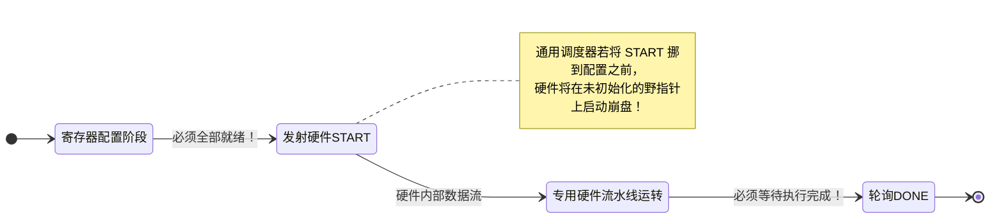

- **编译器调度挑战**：必须在机器指令调度器中对自定义控制指令建模**隐式硬件资源屏障（Side-effect Barriers）**与状态转移链，严防通用调度器“自作聪明”打乱启动协议。

---

### 5.3 流派二：SIMT GPU —— 寄存器压力 vs 活跃占用率 (Occupancy) 的极限拉锯

在 GPU 上，编译器指令调度的最大挑战不是“能不能重排”，而是**“过度重排导致的寄存器膨胀（Register Pressure）与 Occupancy 暴跌”**。

GPU 依靠成千上万个线程同时运行来隐藏访存延迟。当某个线程束（Warp）等待内存读取时，硬件 Warp 调度器会在 1 个时钟周期内零开销切换到就绪的 Warp 执行。

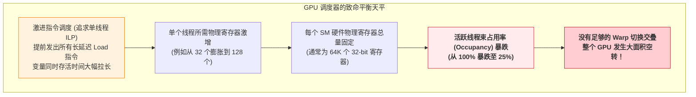

- **异步拷贝指令（Async Copy / TMA）与分级屏障（`mbarrier`）**：
  现代 GPU 引入了硬件级异步内存拷贝。编译器不能简单地把访存指令当成标量 load，而必须将**“发射异步拷贝 $\to$ 到达局部共享内存 $\to$ 抵达同步屏障 $\to$ 消费数据”**建模为严格的阶段令牌，确保调度时指令不越过异步事务的生命边界。

---

### 5.4 流派三：VLIW / DSP —— 零硬件互锁 (Interlock-Free) 与周期级指令打包

VLIW 和高性能信号处理器（DSP）是静态编译调度的极致代表。
在这类芯片上，**硬件为了极致能效与确定性，完全移除了硬件冒险检测电路（Interlock-Free）！**

指令被固定打包为由多个槽位（Slots）构成的超长指令包（Bundle / Packet）。例如一个 4-issue DSP 的单个时钟周期执行包：

```asm
{
  add   r1, r2, r3      ; // 槽位 0: 算术 ALU 单元
  fmul  r4, r5, r6      ; // 槽位 1: 浮点乘法单元
  load  r7, [r8++#4]    ; // 槽位 2: 访存单元 0
  load  r9, [r10++#4]   ; // 槽位 3: 访存单元 1
}
```

```mermaid
gantt
    title VLIW 严格周期级指令包 (Bundle) 与延迟槽调度
    dateFormat X
    axisFormat 周期 %s
    section 指令包 0
    ALU加法 + 乘法 + 双通道Load :done, 0, 1
    section 指令包 1 (延迟槽 1)
    必须插入独立计算 (不能读 Load 结果) :active, 1, 2
    section 指令包 2 (延迟槽 2)
    继续插入独立操作或NOP :active, 2, 3
    section 指令包 3 (结果就绪)
    终于可以读取 Load 的目标寄存器 :crit, 3, 4
```

- **编译器调度挑战**：
  1. **延迟槽（Delay Slots）填补**：Load 指令发出后需要 2 个周期的延迟。编译器必须在这两个周期的指令包中强行塞入不相关的计算指令；如果找不到，就必须显式插入 `nop`！
  2. **硬件静默未定义行为**：若编译器排错指令、提前在第 1 周期读取了 Load 的目标寄存器，**硬件不会报错也不会等待，而是直接用未刷新的旧垃圾数据计算**！

---

### 5.5 流派四：脉动阵列 (Systolic Array) —— 时空波前对齐 (Wavefront Skewing) 与几何时钟匹配

脉动阵列（如 Google TPU 矩阵乘法单元）将成百上千个处理单元（PE）连接成二维网格，数据像波浪一样在相邻单元间传递。

为了让矩阵 $A$ 的第 $i$ 行与矩阵 $B$ 的第 $j$ 列在空间物理交汇点以相同的时钟周期相遇，输入数据必须在时间轴上做**阶梯式斜向延迟（Wavefront Skewing）**：

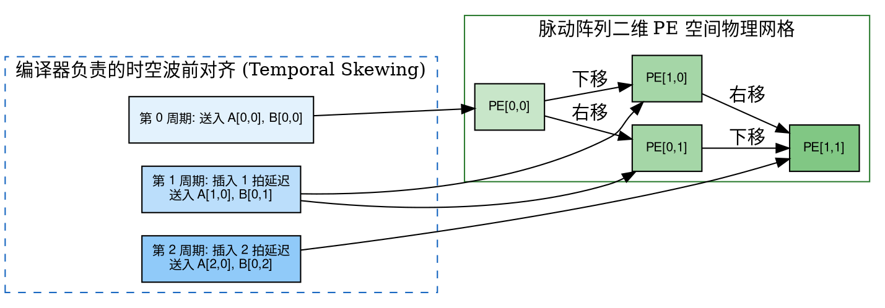

- **编译器调度挑战**：指令调度已经脱离了单一的时间线性排布，升级为**“时间-空间联合投影”**。指令顺序的变动直接反映为输入 FIFO 上的延迟拍数配置。

---

### 5.6 流派五：粗粒度可重构计算 (CGRA) —— 模调度 (Modulo Scheduling) 与空间布线冲突

CGRA 由算术单元阵列与可编程互连开关构成。程序的核心循环被编译为数据流图（DFG），直接“印制”在物理网格上运行。


- **编译器调度挑战**：编译器执行的是**模调度（Modulo Scheduling）**与**空间布局布线（Place & Route）**。指令不能随意挪动，挪动一条指令可能导致内部 Crossbar 互连线发生拥塞或路由冲突，导致编译失败。

---

### 5.7 流派六：通用向量扩展 (RVV / SVE) —— 向量链化与顺序/树形归约双轨指令

现代通用向量扩展（如 RISC-V RVV、ARM SVE）具备长度自适应（VLA）与宽寄存器（LMUL）：

- **向量链化（Vector Chaining）**：
  若指令 A 是 `vadd.vv v1, v2, v3`（长 512 位），指令 B 是 `vmul.vv v4, v1, v5`。指令 B 不需要等指令 A 将 512 位全部算完，只要前 64 位元素计算完毕，指令 B 就可以直接接手流向乘法器！编译器调度器必须敏锐感知微架构支持链化的具体周期，以保持流水线最佳吞吐。
- **RISC-V 标准的双轨归约指令设计**：
  RISC-V 体系结构委员会极为严谨，**直接在指令集硬件层面对“严格顺序”与“乱序树形”进行了硬性区分**：
  - **`vfredosum.vs` (Ordered Sum)**：硬件保证严格按照从左到右元素顺序累加，哪怕牺牲并行度也要确保浮点精度逐位一致！
  - **`vfredusum.vs` (Unordered Sum)**：允许硬件采用任意树形并行加法器累加，追求最大吞吐，不保证位级一致！

这生动证明：**指令重排与数值精度的权衡，是全行业公认的底层核心命题**。

---

## 六、不同异构架构下的数值精度演化与溢出机制

在不同异构加速芯片上，指令重排对精度的影响远不止 IEEE 754 浮点加法那么简单。

### 6.1 定点饱和运算 (Saturating Math) 与保护位：DSP 的重排溢出陷阱

在 DSP 和音视频加速器中，大量采用定点数（Fixed-point）与**饱和算术（Saturating Arithmetic）**：当计算结果超过最大值时，硬件自动截断在最大值（如 INT16 最大值 `32767`），防止发生绕回（Wrap-around）。

同时，为了在长累加过程中不溢出，DSP 累加器通常配备了 **8 个保护位（Guard Bits，如 40-bit 累加器）**。

#### 顺序调换引发的饱和截断灾难

假设某 DSP 没有足够保护位，采用饱和加法：
$$A = 20000,\quad B = 20000,\quad C = -25000$$

- **顺序 1：先加后减 $(A + B) + C$**：
  1. $A + B = 20000 + 20000 = 40000$ $\to$ 触发 16 位有符号饱和截断，被硬件强制削平为 **`32767`**！
  2. 再加 $C$：$32767 - 25000 = \mathbf{7767}$。
- **顺序 2：先减后加 $(A + C) + B$**：
  1. $A + C = 20000 - 25000 = -5000$（未饱和）；
  2. 再加 $B$：$-5000 + 20000 = \mathbf{15000}$。

编译器若擅自重排指令顺序，**计算结果将从 15000 暴跌为 7767！** 这在定点神经网络量化与雷达信号处理中是致命的静默破坏。

---

### 6.2 GPU Tensor Core 混合精度累加与非确定性漂移

在 GPU 上，矩阵乘法（GEMM）通常使用混合精度：输入为 FP16 或 BF16，中间累加为 FP32。
- **TF32（TensorFloat-32）模式**：直接将输入的 FP32 截断保留 10 位尾数（精度等同于 FP16），只保留 8 位阶码。这属于硬性精度降阶。
- **原子操作累加（Atomic Add）的非确定性（Non-deterministic Drift）**：
  多线程在 Global Memory 上通过 `atomicAdd` 累加梯度时，线程到达的先后物理时序每次运行都随机变动，导致不同 Run 之间出现微小浮点漂移。编译器若随意合并或重排原子操作，将直接打破客户模型的可复现性基线。

---

### 6.3 树形加法网络与向量指令双轨设计

对于专用张量核心（Tensor Core / NPU 矩阵单元），硬件内部通常硬化了固定深度的加法树（Adder Tree）。
一旦算法需要严格可复现，编译器必须有能力感知底层硬件究竟是树形电路还是链式流水线，以便在不匹配时果断决策。

---

## 七、通用解法：构建贯穿 Python DSL 到 MLIR 的“数值语义契约”

面对上述错综复杂的异构微架构现实，我们决不能指望通过一个全局粗暴的 `--fast-math` 搞定一切。
**正确的架构之道是：构建从高级 DSL 到底层异构后端的统一“数值语义契约（Numerical Semantics Contract）”体系。**

### 7.1 为什么一个全局 `fast_math=True` 在异构开发中行不通？

在通用 CPU 上，`fast_math=True` 顶多牺牲一点精度来换取向量化；但在异构计算中，这可能直接导致硬件配置崩溃或严重的溢出截断！
我们必须将**“优化变换权限”**与**“数值精度保证”**严格解耦。

---

### 7.2 通用 Python DSL 层的精细数值契约建模

我们在 Python DSL 层提供面向全异构平台的通用契约配置类：

```python
from dataclasses import dataclass
from typing import Literal

@dataclass(frozen=True)
class NumericsContract:
    """跨异构平台的统一数值语义契约"""
    # 1. 浮点代数变换权限
    allow_reassoc: bool = False             # 是否允许代数结合重排 (如修改归约树)
    allow_contract: bool = True             # 是否允许 FMA / 乘加融合
    allow_approx: bool = False              # 是否允许硬件近似函数 (如近似 rsqrt)

    # 2. 精度与数据类型约束
    accumulator_type: str = "f32"           # 内部累加器精度 (如 bf16 乘法配 f32 累加)
    allow_reduced_precision: bool = False   # 是否允许在保证容限时降阶 (如启用 TF32)

    # 3. 规约拓扑显式约束
    reduction_order: Literal[
        "ordered",                          # 严格顺序 (从左向右, 保证逐位一致)
        "tree_allowed",                     # 允许并行树 (追求吞吐)
        "fixed_tree"                        # 确定性固定树 (硬件一致性可复现)
    ] = "ordered"

    # 4. 定点与特殊边界
    saturating_overflow: bool = True        # 定点是否允许饱和截断
    rounding_mode: Literal["rne", "rtz"] = "rne"  # 舍入模式 (RNE: 偶数舍入; RTZ: 向零截断)
    subnormals: Literal["preserve", "ftz"] = "preserve"  # 非正规数是否冲零 (FTZ)
    preserve_nan: bool = True               # 是否必须保持 NaN 传播
```

用户使用 DSL 编写 Kernel 时：

```python
# 声明严格科学计算 Kernel
@accel.kernel(
    numerics=NumericsContract(
        allow_reassoc=False,
        reduction_order="ordered",
        rounding_mode="rne"
    )
)
def high_precision_norm(x):
    return accel.reduce_sum(x)
```

---

### 7.3 MLIR 中间表示层的两级契约沉降

前端将 DSL 降级（Lowering）到 MLIR 时，契约信息分别沉降为**模块级全局属性**与**算子级精准属性**：

```mlir
module attributes {
  accel.default_rounding = "rne",
  accel.allow_subnormals = false
} {
  func.func @compute_reduction(%arg0: tensor<1024xf32>) -> f32 {
    // Op 级别精准携带语义约束
    %sum = accel.reduce_sum %arg0 {
      order = "ordered",
      fastmath = #arith.fastmath<none>
    } : (tensor<1024xf32>) -> f32

    return %sum : f32
  }
}
```

---

### 7.4 统一分析基础设施：`NumericSemanticsAnalysis`

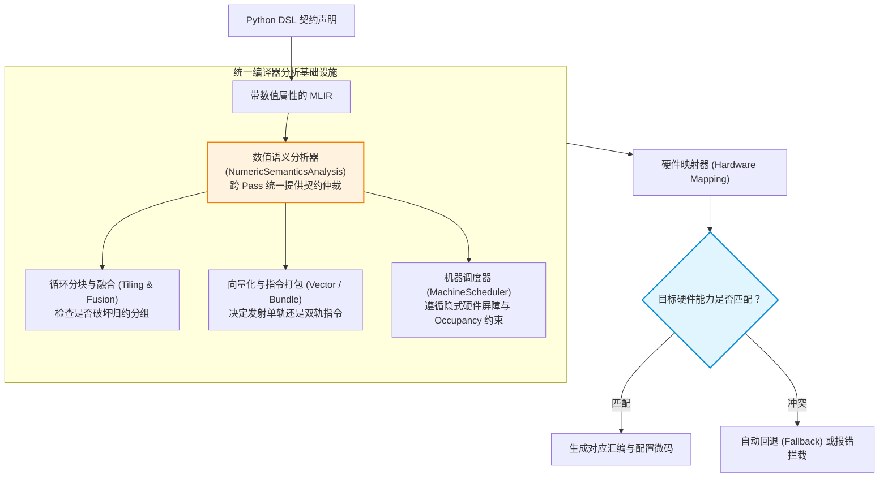

---

### 7.5 跨六大异构架构的硬件映射决策树 (Hardware Mapping Tree)

当 IR 经过优化进入后端、面临具体的异构硬件单元时，编译器遵循以下**严密的硬件映射决策树**：

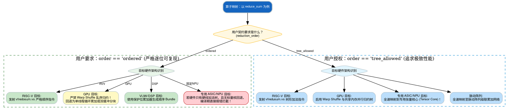

---

### 7.6 工程落地实施路线图：P0 与 P1 矩阵

对于异构芯片编译器团队，建议遵循分期迭代策略：

| 实施阶段 | 核心实现模块 | 落地目标与收益 |
| :---: | :--- | :--- |
| **P0 阶段<br>(立即可用)** | **1. 归约顺序三级显式建模** | 在 DSL 与 MLIR 中确立 `ordered`、`tree_allowed`、`fixed_tree`，堵死跨卡/跨设备精度漂移。 |
| **P0 阶段** | **2. 累加精度显式强制绑定** | 严格禁止隐式低精度累加，如 BF16 矩阵乘强制要求显式指定 FP32 累加器。 |
| **P0 阶段** | **3. 硬件状态机协议屏障** | 为 NPU/协处理器的配置、启动、DMA 指令建立严密的依赖副作用模型，杜绝死锁与野指针启动。 |
| **P0 阶段** | **4. GPU 寄存器压力感知调度** | 机器调度器中加入 Occupancy 预算启发式算法，防止盲目追求 ILP 导致吞吐暴跌。 |
| **P1 阶段<br>(进阶完善)** | **5. VLIW 周期级延迟槽与 NOP 优化** | 完善 Interlock-free 架构的静态冲突检测与无死角延迟槽填充。 |
| **P1 阶段** | **6. 定点饱和溢出检查与保护位分析** | 针对 DSP 架构分析有符号数的极值范围，自动证明是否会触发饱和截断。 |
| **P1 阶段** | **7. 自动化数值差分回归测试管线** | 搭建跨 CPU 仿真器与异构真机的随机边界值测试套件。 |

---

## 八、总结与架构全景心智模型

回顾全文，现代编译器中的指令调度与数值精度控制，可凝练为下述贯穿软硬件全栈的核心心智金字塔：

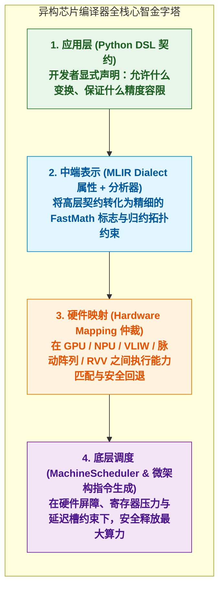

1. **指令重排绝非仅是通用 CPU 的专属优化**，而是所有芯片架构隐藏延迟、提升吞吐的共同核心。
2. **纯粹的独立指令调度不牺牲任何精度**，具备绝对的**逐位一致性**；只有改变结合顺序的代数重结合，才会因浮点不满足结合律而引发精度漂移。
3. **异构芯片微架构的多样性决定了调度哲学的巨大分歧**：
   - 固定数据流 NPU 要防状态机崩塌；
   - SIMT GPU 要在 ILP 与 Occupancy 之间走钢丝；
   - VLIW/DSP 必须在无硬件互锁的绝境中做周期级精准排布；
   - 脉动阵列必须对齐时空波前；
   - 通用向量必须在双轨归约指令间做清晰抉择。
4. **异构计算编译器的最高境界是“全栈契约化”**：
   上层以白纸黑字的**数值语义契约（Numerical Semantics Contract）**定边界，中端以形式化属性传语义，后端在硬件约束与安全许可下狂飙性能——这正是异构计算编译器最深沉、最严谨、也最迷人的工程艺术。
