> **导读**：在系统级开发与编译器优化的深水区，开发者和芯片架构师经常会遭遇两组看似矛盾、又极易令人困惑的核心问题：
>
> 1. **“编译器会直接对汇编做计算指令重排吗？它凭什么保证重排后的程序逻辑不崩塌？”**
> 2. **“重排浮点计算指令，到底会不会导致数值计算出现精度误差甚至静默计算错误？”**
>
> 对于通用 CPU 而言，指令调度（Instruction Scheduling）是榨干硬件算力、隐藏流水线停顿的基石手段；而在现代 AI 专用加速器（NPU/张量处理器/协处理器）的软硬件协同设计中，问题变得更加错综复杂：
> 某些自定义机器指令表面上没有任何普通的数据依赖，却牢牢受制于底层硬件状态机的隐式时序协议（如 DMA 搬运、加速核心配置与启动）；而在将高层算法编译下沉时，为了利用并行计算单元而进行的“树形归约重排”，又会悄悄打破浮点数的数学结合律，引发灾难性的精度漂移。
>
> 编译器到底在哪个阶段决定指令的去留与先后？指令重排的“语义等价”、“数值等价”与“逐位等价”该如何严格区分？面对专用加速器硬件，我们如何避免编译器自作主张、设计出一套贯穿 **Python DSL → MLIR → 硬件物理流水线** 的**数值语义契约（Numerical Semantics Contract）**？
>
> 本文将从底层微架构与编译原理的第一性原理出发，全景拆解指令重排的底层动力、LLVM 调度管线、浮点精度陷阱、加速器隐式时序依赖建模，以及工程级数值契约系统的设计实现。全篇配备初学者术语速查词典、高清 Mermaid/Graphviz 架构图与完整规范设计，帮助读者建立从微架构时序到编译器 IR 验证的完整心智模型。

---

## 目录导览

- [零、初学者核心名词形象速查词典 (Primer)](#零初学者核心名词形象速查词典-primer)
- [一、第一性原理：编译器为什么要对计算指令做重排？](#一第一性原理编译器为什么要对计算指令做重排)
  - [1.1 微架构痛点：流水线停顿与延迟隐藏](#11-微架构痛点流水线停顿与延迟隐藏)
  - [1.2 明确三种不同层次的重排优化](#12-明确三种不同层次的重排优化)
  - [1.3 顺序执行核 vs 乱序执行核的本质差异](#13-顺序执行核-vs-乱序执行核的本质差异)
- [二、现代编译器全景：指令重排发生在什么阶段？](#二现代编译器全景指令重排发生在什么阶段)
  - [2.1 LLVM 代码生成管线中的调度分期](#21-llvm-代码生成管线中的调度分期)
  - [2.2 寄存器分配前调度 (Pre-RA) vs 寄存器分配后调度 (Post-RA)](#22-寄存器分配前调度-pre-ra-vs-寄存器分配后调度-post-ra)
  - [2.3 GCC 的对应调度机制与编译选项对照](#23-gcc-的对应调度机制与编译选项对照)
- [三、重排判定基石：指令依赖图 (DAG) 与冒险分析](#三重排判定基石指令依赖图-dag-与冒险分析)
  - [3.1 真数据依赖 (RAW) 与计算依赖图的构建](#31-真数据依赖-raw-与计算依赖图的构建)
  - [3.2 伪依赖与隐式危险：WAR、WAW 与内存别名分析](#32-伪依赖与隐式危险warwaw-与内存别名分析)
- [四、重排会导致精度误差吗？浮点陷阱与等价性分级](#四重排会导致精度误差吗浮点陷阱与等价性分级)
  - [4.1 独立指令重排：逐位一致性的物理保证](#41-独立指令重排逐位一致性的物理保证)
  - [4.2 浮点数结合律失效：大数吃小数与舍入灾难](#42-浮点数结合律失效大数吃小数与舍入灾难)
  - [4.3 认知的跃迁：三种等价性分级 (Equivalence Classes)](#43-认知的跃迁三种等价性分级-equivalence-classes)
  - [4.4 LLVM Fast-Math Flags (FMF) 的精确控制粒度](#44-llvm-fast-math-flags-fmf-的精确控制粒度)
- [五、专用加速器 (NPU/协处理器) 的特殊挑战：硬件隐式依赖与归约漂移](#五专用加速器-npu协处理器的特殊挑战硬件隐式依赖与归约漂移)
  - [5.1 表面无依赖、实则致命的硬件状态机协议](#51-表面无依赖实则致命的硬件状态机协议)
  - [5.2 加速器自定义指令重排合规矩阵](#52-加速器自定义指令重排合规矩阵)
  - [5.3 树形并行归约与精度漂移](#53-树形并行归约与精度漂移)
- [六、终极方案：构建从 Python DSL 到 MLIR 的“数值语义契约”](#六终极方案构建从-python-dsl-到-mlir-的数值语义契约)
  - [6.1 为什么一个全局 `fast_math=True` 是危险的设计？](#61-为什么一个全局-fast_mathtrue-是危险的设计)
  - [6.2 Python DSL 层的精细契约表达模型](#62-python-dsl-层的精细契约表达模型)
  - [6.3 MLIR 中间表示层的两级契约沉降](#63-mlir-中间表示层的两级契约沉降)
  - [6.4 编译流水线中的分析基础设施：`NumericSemanticsAnalysis`](#64-编译流水线中的分析基础设施numericsemanticsanalysis)
  - [6.5 硬件映射验证 (Hardware Mapping Verification) 与 Verifier 边界](#65-硬件映射验证-hardware-mapping-verification-与-verifier-边界)
  - [6.6 工程落地演进路线：P0 与 P1 实施矩阵](#66-工程落地演进路线p0-与-p1-实施矩阵)
- [七、总结与全景心智模型](#七总结与全景心智模型)

---

## 零、初学者核心名词形象速查词典 (Primer)

为了帮助初学者或非编译器方向的工程师快速扫清阅读障碍，下表对本文首次登场的关键专业概念给出了精准的直观解释与生动比喻：

| 专业术语 | 英文全称 / 原型 | 核心本质与通俗直观比喻 |
| :--- | :--- | :--- |
| **汇编语言 (Assembly)** | Assembly Language | **人类可读的机器指令符号表示**。直接映射到底层 CPU/加速器能够执行的二进制操作，如 `load`（读内存）、`add`（加法）。 |
| **指令重排 (Instruction Scheduling)** | Instruction Scheduling (指令调度) | **在不改变程序语义的前提下，重新调整指令的先后排列次序**。就像厨师备菜：在等水烧开的间隙先切肉，而不是站在灶台前干等。 |
| **流水线停顿 (Pipeline Stall)** | Pipeline Stall / Bubble (气泡) | **处理器流水线因等待数据或资源就绪而被迫“发呆”空转的周期**。 |
| **指令级并行 (ILP)** | Instruction-Level Parallelism | **微处理器在同一个时钟周期内重叠执行多条互不干扰的机器指令的能力**。 |
| **中间表示 (IR)** | Intermediate Representation | **编译器内部消化代码的统一数据结构**。介于高级源码（如 C/Python）与底层汇编之间，便于进行通用代码分析与变换。 |
| **Machine IR (MIR)** | Machine Intermediate Representation | **贴近具体硬件特性的底层中间表示**。此时每条指令已与硬件物理指令一一对应，但寄存器可能仍采用虚拟编号。 |
| **寄存器分配 (RA)** | Register Allocation | **将数量无限的虚拟变量，巧妙安置到硬件芯片上数量有限的真实物理寄存器中的过程**。类似于排座次。 |
| **DAG** | Directed Acyclic Graph (有向无环图) | **无闭环方向的数据流动图谱**。节点是指令，箭头代表“谁必须在谁之后执行”，是编译器调度算法的核心大脑。 |
| **数据冒险 (Hazards)** | RAW / WAR / WAW | **硬件流水线中的访问冲突**。<br>• **RAW（真相关/读后写）**：指令 B 必须读指令 A 刚算出的值；<br>• **WAR（反相关/写后读）**：指令 B 要写某个寄存器，不能覆盖指令 A 还没读走的旧值；<br>• **WAW（输出相关/写后写）**：两条指令写同一个目标，必须保证最终留下的结果顺序正确。 |
| **内存别名分析** | Alias Analysis | **编译器推断两个不同的指针对、内存地址是否可能指向同一块物理内存的分析技术**。 |
| **MMIO** | Memory-Mapped I/O (内存映射I/O) | **把外部外设、加速核心的寄存器映射到普通内存地址空间的交互机制**。对其读写会触发硬件物理动作，绝不能随意重排。 |
| **浮点数结合律** | Associativity of Floating-Point | **纯数学成立、但计算机浮点计算中不成立的性质**：$(a + b) + c$ 在有限精度的浮点世界中并不总是等于 $a + (b + c)$。 |
| **大数吃小数** | Swallowing / Catastrophic Cancellation | **当极大浮点数与极小浮点数相加时，极小数的有效位因阶码对齐被完全移出丢弃的现象**。如 $10^{20} + 1.0 = 10^{20}$。 |
| **FMA** | Fused Multiply-Add (融合乘加) | **硬件单周期完成 $a \times b + c$ 的特殊指令**。只在最后做一次浮点舍入，比先乘后加不仅速度快，而且精度更高。 |
| **Fast-Math Flags (FMF)** | 快速数学优化标志 | **LLVM 编译器中指示优化器是否可以放宽 IEEE 754 浮点严格标准的控制位集合**（如允许重结合、忽略 NaN 等）。 |
| **Dialect** | 方言 (MLIR 核心概念) | **MLIR 体系中的自包含模块化命名空间**。如 `arith` 负责算术，`vector` 负责向量，`accel` 负责自定义加速器。 |
| **归约 (Reduction)** | Reduction Operation | **将高维向量或张量沿着指定轴压缩为更小维度的计算**（如 `sum` 求和、`max` 求极大值）。 |
| **RNE** | Round to Nearest, ties to Even | **IEEE 754 默认的舍入模式**：向最接近的偶数舍入（俗称“四舍六入五成双”），用于统计学消除长期累加偏差。 |
| **非正规数 (Subnormal)** | Subnormal / Denormal Numbers | **绝对值极度接近 0、阶码为全 0 但尾数不为 0 的极小浮点数**。硬件处理通常极其缓慢，很多加速器会将其直接“冲零”（Flush-to-Zero）。 |
| **数值语义契约** | Numerical Semantics Contract | **上层算法与底层硬件之间白纸黑字的精度约定**：明确规定哪些数学变形是合法的、哪些误差是可以容忍的。 |

---

## 一、第一性原理：编译器为什么要对计算指令做重排？

从计算机体系结构的第一性原理来看，处理器的运算速度与访存/复杂计算的延迟之间存在巨大的鸿沟。

### 1.1 微架构痛点：流水线停顿与延迟隐藏

假设我们有一段最基础的汇编指令序列，逻辑是计算 $B = A + C$ 并写入内存，同时计算完全无关的 $D = E \times F$：

```asm
# 原始顺序
load  r1, [addr1]    # 指令1: 从内存加载 A 到寄存器 r1 (高延迟访存，假设需要 3 个时钟周期)
add   r2, r1, r3     # 指令2: 计算 B = A + C (依赖 r1，必须等待 load 完成)
mul   r4, r5, r6     # 指令3: 计算 D = E * F (完全独立计算，不依赖 r1 或 r2)
store [addr2], r2    # 指令4: 将 B 写回内存 (依赖 r2)
```

在典型的顺序执行（In-Order）处理器微架构中：
- `load` 指令发出后，需要等待 3 个时钟周期数据才能从 L1 Cache 到达通用寄存器 `r1`；
- 由于指令 2 `add` 必须使用 `r1`，它无法发射执行，硬件流水线被迫插入 **2 个周期的空等待（Pipeline Stall，流水线气泡）**；
- 随后才能执行 `add` 和 `mul`。

下图直观地展示了这种停顿：

```mermaid
gantt
    title 原始指令发射时序 (遭遇流水线气泡停顿)
    dateFormat X
    axisFormat %s 周期
    section Load 指令
    load r1, [addr1] :active, 0, 3
    section 气泡 (发呆)
    Pipeline Stall (等待数据) :crit, 1, 3
    section Add 计算
    add r2, r1, r3 : 3, 4
    section Mul 计算
    mul r4, r5, r6 : 4, 5
    section Store 写回
    store [addr2], r2 : 5, 6
```

编译器后端观察到：**指令 3 `mul` 与前面的 `load` 和 `add` 没有任何寄存器和内存冲突**。因此，编译器完全可以在生成最终汇编时，将 `mul` 提到 `load` 之后、`add` 之前：

```asm
# 编译器重排（指令调度）后
load  r1, [addr1]    # 周期 0 发射: 需要 3 个周期准备好 r1
mul   r4, r5, r6     # 周期 1 发射: 利用 load 等待的时间，插入独立计算！(延迟被隐藏)
# 周期 2: 此时 load 刚好返回，流水线无缝衔接
add   r2, r1, r3     # 周期 3 发射: r1 已就绪，直接执行！
store [addr2], r2    # 周期 4 发射
```

时序对比呈现出惊人的效率提升：

```mermaid
gantt
    title 编译器指令重排后的紧凑时序 (无缝填充停顿)
    dateFormat X
    axisFormat %s 周期
    section Load 访存
    load r1, [addr1] :active, 0, 3
    section 调度填充
    mul r4, r5, r6 (提前计算) :done, 1, 2
    section 流水线衔接
    add r2, r1, r3 (无停顿发射) : 3, 4
    section Store 写回
    store [addr2], r2 : 4, 5
```

> **核心结论**：重排指令并没有改变加法或乘法的数学定义，也没有改变依赖关系，但它成功将处理器的闲置时钟周期利用了起来，这就是**指令级并行（ILP）**与**延迟隐藏（Latency Hiding）**的本质。

---

### 1.2 明确三种不同层次的重排优化

在讨论“编译器做不做重排”时，必须严格区分以下三个层次，它们作用于编译器不同的生命周期：

| 优化层次 | 会改变什么？ | 核心优化目标 | 典型案例 | 负责的编译阶段 |
| :--- | :--- | :--- | :--- | :--- |
| **1. 机器指令调度 (Instruction Scheduling)** | **改变物理机器指令的排列顺序** | 隐藏访存与算术单元延迟，消除流水线停顿，平衡执行槽位 | 将无关的乘法挪到访存等待间隙执行 | LLVM CodeGen 后端 (Machine IR 阶段) |
| **2. 指令组合与代数变换 (Algebraic Opts)** | **改变计算指令本身的种类或结合方式** | 用更廉价的运算代替昂贵运算，减少总指令数 | 将 `x * 2` 变为移位 `x << 1`；将乘法和加法融合成一条 FMA 指令 | 中端优化器 (LLVM IR / DAGCombine) |
| **3. 计算图宏观调度 (Graph / Loop Scheduling)** | **改变粗粒度算子、数据切片 (Tile) 和搬运的时序** | 实现片上计算与 DMA 数据搬运的双缓冲重叠 (Double Buffering) | 提前触发异步 DMA 预取下一块张量数据 | AI 编译器高层 Pass (MLIR / 高级计算图) |

> [!IMPORTANT]
> 很多初学者误以为编译器是在最终生成的文本字符串（`.s` 文件）上去做重排的。这是错误的。
> 编译器所有的机器指令调度，都是在**底层的结构化图表示（Machine DAG 或 Machine IR）**上完成的。

---

### 1.3 顺序执行核 vs 乱序执行核的本质差异

为什么现代通用 CPU 还要依赖编译器指令调度？

- **乱序执行 CPU (Out-of-Order, OoO)**：如高端桌面或服务器 x86/ARM CPU，内部硬件配备了复杂的重排序缓冲区（ROB, Reorder Buffer）与保留站（Reservation Stations），硬件在运行时会动态寻找独立指令并发执行。但硬件 ROB 的窗口大小是有限的（通常为数百条指令）。**如果编译器静态就排好序，能大幅减轻硬件重排压力，进一步释放性能**。
- **顺序执行核 (In-Order)**：如嵌入式 RISC-V 核心、DSP、AI 加速器的控制核（Control Core）。这类硬件为了省电、节省芯片面积，**完全没有动态重排硬件！指令怎么写，硬件就傻傻地怎么执行**。一旦遇到数据未就绪，流水线就必须硬生生停顿。**对于这些架构，编译器的静态指令调度就是性能的生死线！**

---

## 二、现代编译器全景：指令重排发生在什么阶段？

以工业界事实标准的 **LLVM** 基础设施为例，指令从高级表示到最终变成汇编，其生命周期可抽象为一条严密的管线：

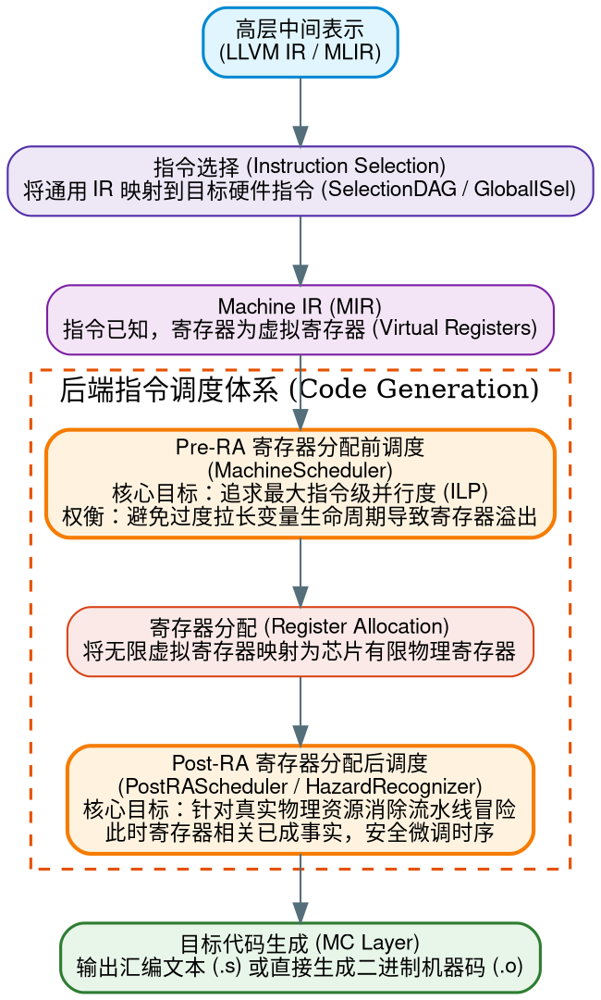

---

### 2.1 LLVM 代码生成管线中的调度分期

LLVM 的指令调度不是一锤子买卖，而是通常分为两个关键阶段：

1. **SelectionDAG 调度 / MachineScheduler (Pre-RA)**
2. **Post-RA 调度 (PostRAScheduler)**

为什么要把调度拆成“寄存器分配前”和“寄存器分配后”？因为**指令调度与寄存器分配之间存在着经典的“编译器拉锯战（Phase Ordering Problem）”**。

---

### 2.2 寄存器分配前调度 (Pre-RA) vs 寄存器分配后调度 (Post-RA)

让我们通过下表看透二者的哲学冲突与职责分工：

| 对比维度 | 寄存器分配前调度 (Pre-RA) | 寄存器分配后调度 (Post-RA) |
| :--- | :--- | :--- |
| **指令所处的 IR 状态** | 指令已确定，但操作数是**无限的虚拟寄存器**（如 `%vreg0, %vreg1`） | 操作数已经是**真实的硬件物理寄存器**（如 `a0, t0, s1`） |
| **主要优化目标** | **最大化指令级并行（ILP）**，尽一切可能把长延迟指令（如 Memory Load、浮点除法）提前 | **填补最终物理流水线气泡**，针对特定硬件执行单元消除延迟冒险 |
| **最大的制约与危险** | **寄存器压力（Register Pressure）膨胀**！如果把太多独立计算提前，这些变量同时存活的时间被拉长，物理寄存器不够用，导致被迫将变量 Spilling（溢出）到内存栈中，得不偿失 | **假相关（WAR/WAW）锁死！** 物理寄存器已经复用，产生了由于共用物理寄存器带来的伪相关，调度自由度变小 |
| **LLVM 核心实现类** | `llvm::MachineScheduler` / `ScheduleDAGMILive` | `llvm::PostRASchedulerList` / `ScheduleDAGPostRATDList` |

---

### 2.3 GCC 的对应调度机制与编译选项对照

GCC 也拥有极其相似的双阶段调度设计，开发者可以直接通过命令行参数观察它们的影响：

- **`-fschedule-insns`**：尝试在寄存器分配**之前**进行指令重新排列。对于寄存器较多（如 32 个通用寄存器）的架构往往有利，但对于寄存器贫乏的架构（如 x86-32），开启它可能加剧栈溢出开销，因此默认策略根据 target 而定。
- **`-fschedule-insns2`**：在寄存器分配**之后**进行指令调度。由于此时物理寄存器已经锁定，调度不会增加任何额外的栈溢出负担，因此在 GCC 的 `-O2` 及以上优化级别中，通常默认开启。

---

## 三、重排判定基石：指令依赖图 (DAG) 与冒险分析

编译器到底凭什么判断两行代码可以调换位置？
答案是：**编译器从不看代码的文本书写顺序，它只看数据依赖图（DAG）**。

### 3.1 真数据依赖 (RAW) 与计算依赖图的构建

考虑一段计算表达式：

```cpp
a = x + y;   // 指令 1
b = a * 2;   // 指令 2: 依赖 a
c = p * q;   // 指令 3: 完全独立
d = b + c;   // 指令 4: 依赖 b 和 c
```

编译器为这段计算构建的有向无环图（DAG）如下所示：

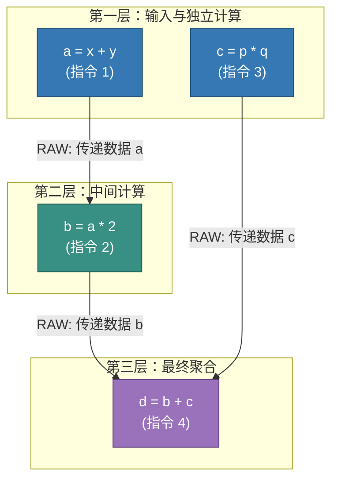

根据拓扑排序原理：
- `指令 1` 必须在 `指令 2` 之前执行（**真数据依赖，RAW**）；
- `指令 2` 和 `指令 3` 必须在 `指令 4` 之前执行；
- **但 `指令 1` 与 `指令 3` 之间没有任何连线！`指令 2` 与 `指令 3` 之间也没有任何连线！**
- 因此，`[1, 3, 2, 4]`、`[3, 1, 2, 4]`、`[1, 2, 3, 4]` 都是**100% 严格合法**的执行序列！

---

### 3.2 伪依赖与隐式危险：WAR、WAW 与内存别名分析

除了上述真依赖，调度器还必须严格遵循以下硬性约束：

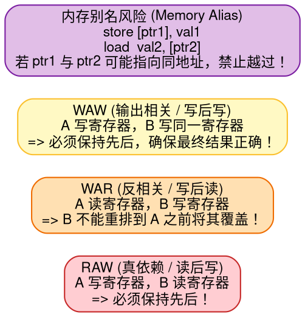

- **别名分析（Alias Analysis）**：如果两条指令通过指针操作内存，编译器若无法证明 `ptr1 != ptr2`，就必须保守假设它们存在内存别名，严格禁止将 `load` 跨越 `store` 重排，否则会导致读取脏数据。

---

## 四、重排会导致精度误差吗？浮点陷阱与等价性分级

现在进入最核心的技术拷问：**指令重排会导致计算精度发生误差吗？**

> **斩钉截铁的答案**：
> **如果只是调度相互独立的指令顺序，绝不会引入任何精度误差，结果是逐位一致的；**
> **但如果优化改变了浮点数的结合顺序或运算形态（如代数重结合、FMA 融合、树形归约），就必然可能引入精度误差！**

---

### 4.1 独立指令重排：逐位一致性的物理保证

考虑下面三条浮点计算指令：

```cpp
float a = x + y;  // 指令 1
float b = p * q;  // 指令 2
float c = a + b;  // 指令 3
```

原始汇编可能为：
```asm
fadd.s f1, f2, f3    # a = x + y
fmul.s f4, f5, f6    # b = p * q
fadd.s f7, f1, f4    # c = a + b
```

重排后变为：
```asm
fmul.s f4, f5, f6    # 先算 b (提前执行独立乘法)
fadd.s f1, f2, f3    # 再算 a
fadd.s f7, f1, f4    # 最后算 c
```

在这个转换中：
1. 乘法 `fmul.s` 的输入操作数依然是精确的 `f5` 和 `f6`；
2. 加法 `fadd.s` 的输入操作数依然是精确的 `f2` 和 `f3`；
3. 最终加法没有任何输入变化，舍入点完完全全没有被动过。

在相同的 IEEE 754 运行环境下，最终寄存器 `f7` 里的二进制比特位完全分毫不差。这就是所谓的**逐位一致（Bitwise Identical）**。

---

### 4.2 浮点数结合律失效：大数吃小数与舍入灾难

然而，很多初学者常常把“独立的指令调度”与“浮点代数重排（Reassociation）”混为一谈。

在实数数学中，加法拥有结合律：
$$(a + b) + c = a + (b + c)$$

但在计算机有限精度的 **IEEE 754 浮点数体系中，结合律是彻底破产的！**

#### 经典“大数吃小数”案发现场

设输入三个单精度浮点数（FP32）：
$$a = 10^{20},\quad b = -10^{20},\quad c = 1.0$$

我们来看两种不同结合顺序的实际计算过程：

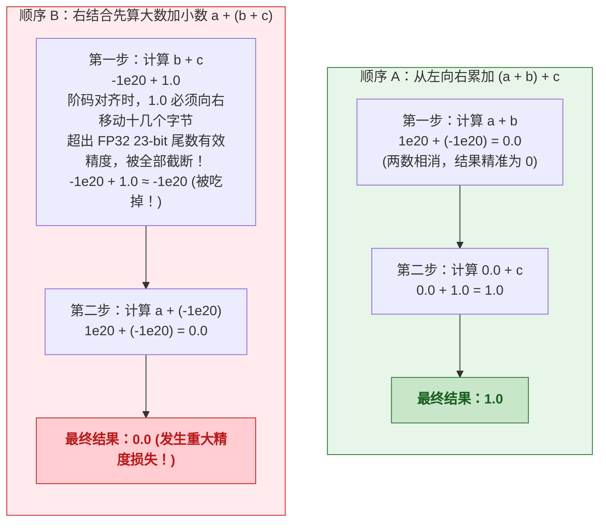

同样三个数，仅仅调换了一下括号结合顺序，结果一个算出了 `1.0`，另一个算出了 `0.0`！
如果编译器在用户不知情的情况下做了这种重排，对于金融、物理仿真或高灵敏度神经网络，可能会带来灾难性的逻辑偏差。

---

### 4.3 认知的跃迁：三种等价性分级 (Equivalence Classes)

在编译器与高性能计算领域，必须建立清晰的“等价性”阶梯：

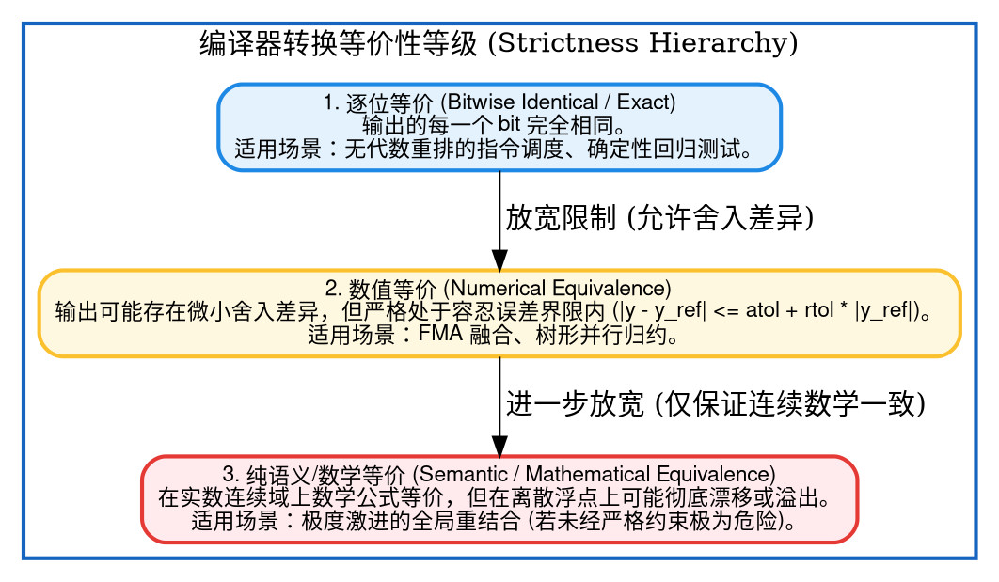

---

### 4.4 LLVM Fast-Math Flags (FMF) 的精确控制粒度

LLVM 深知破坏结合律的危险性，因此在默认情况下，**LLVM 严禁对浮点运算做任何可能改变结果位模式的代数变形**！
只有当上层显式传递了快速数学标志（Fast-Math Flags）时，相关 Pass 才被授权进行特定变换：

| 标志位 (FMF) | 英文全称 | 允许编译器执行的优化动作 | 潜在精度风险 |
| :--- | :--- | :--- | :--- |
| **`reassoc`** | Reassociation | **允许重新结合浮点运算**（如将 `(a+b)+c` 优化为 `a+(b+c)`，将顺序求和优化为并行树） | 可能引发“大数吃小数”，导致数值与顺序累加不一致 |
| **`contract`** | Contraction | **允许融合乘加（FMA）**，将独立的 `mul` + `add` 融合成一条 `llvm.fma` | **通常提高精度**（减少了一次中间舍入），但位模式不再与旧代码相同 |
| **`nnan`** | No NaNs | 假定入参和出参永不出现 `NaN`（Not a Number），可直接消去 `isnan` 检查分支 | 若遇到真正的 `NaN`，可能引发未定义行为 |
| **`ninf`** | No Infs | 假定永不出现正负无穷（`+Inf / -Inf`） | 遇到溢出时无法正确捕获 |
| **`nsz`** | No Signed Zeros | 忽略 `+0.0` 与 `-0.0` 的符号区别 | 在某些极坐标转换或复数计算中可能丢失象限信息 |
| **`afn`** | Approx Functions | 允许使用硬件近似指令替代高精度数学函数（如用倒数平方根估算指令替代精确 `sqrt`） | 计算结果通常只有低位精度保证 |

在 LLVM IR 中，开发者可以精确地看到这些标志：

```llvm
; 默认严格 IEEE-754 模式：禁止重结合，保持顺序
%a = fadd float %x, %y
%b = fadd float %a, %z

; 显式授权 reassoc：编译器可以自由调整结合顺序以生成高效向量化指令
%c = fadd reassoc float %x, %y
%d = fadd reassoc float %c, %z
```

---

## 五、专用加速器 (NPU/协处理器) 的特殊挑战：硬件隐式依赖与归约漂移

通用 CPU 只需要考虑普通的寄存器和内存依赖，但当我们为**专用 AI 加速器（NPU/张量处理器/协处理器）**设计编译器时，指令重排面临着全新的物理约束深水区。

### 5.1 表面无依赖、实则致命的硬件状态机协议

专用加速器通常由一个主控核（如 RISC-V 核）通过**自定义指令**或 **MMIO 寄存器配置**来驱动专用的硬件执行单元（如张量加速核心 Tensor Core、向量处理核心 Vector Core、DMA 引擎）。

观察下面一段由编译器生成的微码指令伪汇编：

```asm
# 阶段 1: 配置张量加速核心 (Tensor Core) 的物理输入输出端口
cfg  ACCEL_INPUT_ADDR,  r1    # 设置输入张量地址
cfg  ACCEL_OUTPUT_ADDR, r2    # 设置输出张量地址

# 阶段 2: 发射硬件计算
cfg  ACCEL_START_TRIGGER, 1   # 写入控制寄存器，硬件状态机拉起流水线开始计算！

# 阶段 3: 启动异步 DMA 搬运其他数据
dma_start r3

# 阶段 4: 轮询等待张量核心执行完毕
poll ACCEL_STATUS_DONE        # 轮询状态寄存器直到返回 1
```

请初学者仔细观察：
从通用寄存器的数据流来看，`cfg ACCEL_START_TRIGGER, 1` 使用的是常量 `1`，它与前面的 `cfg ACCEL_INPUT_ADDR, r1` **在普通寄存器依赖分析上没有任何 RAW 冲突！**

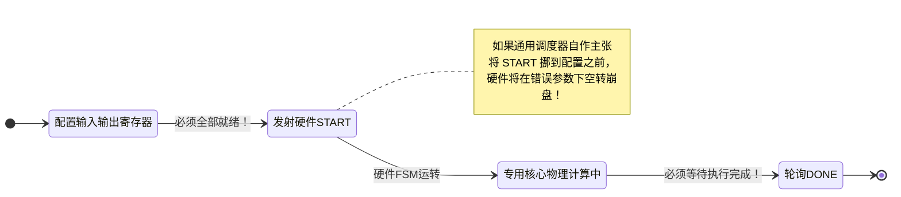

如果一个未经特殊建模的通用 LLVM 指令调度器介入，发现 `START` 指令与配置指令之间没有虚拟寄存器依赖，为了“尽早发射任务”，**误将 `START_TRIGGER` 重排到了配置输入地址之前**，芯片硬件将会直接在未初始化的物理端口上启动，导致系统崩溃或死锁！

---

### 5.2 加速器自定义指令重排合规矩阵

因此，在专用芯片编译器后端中，必须建立针对自定义指令的**副作用与硬件协议合规矩阵**：

| 指令类别 | 典型语义操作 | 是否允许编译器自由调度？ | 依赖与屏障建模手段 |
| :--- | :--- | :---: | :--- |
| **纯算术标量计算** | 通用整数加减、地址偏移累加 | **允许** | 依赖普通的寄存器 RAW/WAR 即可 |
| **硬件参数配置 (CFG)** | 配置计算核心的宽、高、步长、基地址 | **极其受限** | 必须在对应的 `START` 之前；相同配置寄存器的写操作存在 WAW 硬件依赖 |
| **硬件启动 (START)** | 触发状态机，拉起张量计算流水线 | **禁止任意重排** | 必须对所有配置指令建立隐式内存/事件屏障（Barrier） |
| **异步 DMA 传输** | 将片外 DDR/HBM 数据搬运到片上 SRAM | **条件允许** | 只要缓冲区无冲突，可与加速核心的计算并发交叠（Double Buffering） |
| **完成状态查询 (DONE/POLL)** | 查询中断状态、等待计算结束 | **禁止提前** | 必须通过隐式依赖强制排在 `START` 之后，排在后续读取输出之前 |

---

### 5.3 树形并行归约与精度漂移

在 AI 计算中，归约（Reduction，如全连接层求和、LayerNorm 均值）是硬件开销最大的算子之一。

假设我们要对 4 个浮点数求和：$s = x_0 + x_1 + x_2 + x_3$。

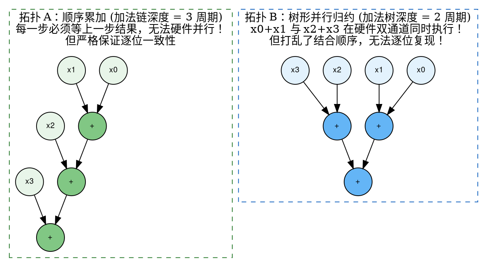

专用加速器的硬件计算单元（如张量加速核心）在硅片上通常是**硬线连接成树形加法网络**的。
如果上层软件代码严格要求“从左向右顺序累加”，编译器就**绝对不能**直接调用张量核心的树形归约电路，否则就会破坏数值契约！

---

## 六、终极方案：构建从 Python DSL 到 MLIR 的“数值语义契约”

为了完美解决“优化想要性能”与“用户要求精度”之间的冲突，我们绝不能只在命令行给一个粗暴的 `-ffast-math` 或 `fast_math=True`。
**正确且优雅的现代化架构方案是：在编译器中构建正式的“数值语义契约（Numerical Semantics Contract）”体系。**

### 6.1 为什么一个全局 `fast_math=True` 是危险的设计？

必须在哲学层面理清两个完全独立的概念：

1. **变换权限（Transformation Permission）**：编译器被授予了执行某些代码转换的资格（例如允许重结合 `reassoc`、允许融合 `contract`）。
2. **数值精度保证（Numerical Guarantee）**：用户期望计算结果必须落入什么样的绝对/相对误差范围之内（例如 $|y - y_{\text{ref}}| \le 10^{-5}$）。

> **核心原则**：
> **底层硬件支持某种超高速计算模式（如硬线树形加法），不代表当前程序默认授权使用该模式！**
> 优化 Pass 必须在获得用户显式语义契约授权的前提下，才能改变计算拓扑。

---

### 6.2 Python DSL 层的精细契约表达模型

在面向专用硬件的 Python 领域特定语言（DSL）层，我们应当为开发者提供精确、模块化的数值控制结构：

```python
from dataclasses import dataclass
from typing import Literal

@dataclass(frozen=True)
class NumericsContract:
    """定义算子级的数值语义契约"""
    # 1. 浮点代数变换权限
    allow_reassoc: bool = False             # 是否允许改变结合顺序 (如重排归约树)
    allow_contract: bool = True             # 是否允许融合乘加 (FMA)
    allow_approx: bool = False              # 是否允许近似数学函数 (如近似 rsqrt)

    # 2. 精度与数据类型
    accumulator_type: str = "f32"           # 内部累加器精度 (如 bf16 输入用 f32 累加)
    allow_reduced_precision: bool = False   # 是否允许在精度满足时下潜到低位宽

    # 3. 特殊边界与舍入行为
    rounding_mode: Literal["rne", "rtz"] = "rne"  # 舍入方式 (RNE: 最近偶数; RTZ: 向零截断)
    subnormals: Literal["preserve", "ftz"] = "preserve"  # 非正规数是否冲零 (FTZ)
    preserve_nan: bool = True               # 是否必须保持 NaN 传播语义

# 在用户编写 DSL Kernel 时挂载契约
@accel.kernel(
    numerics=NumericsContract(
        allow_reassoc=False,      # 严格要求：不准乱改加法顺序！
        allow_contract=True,     # 允许：可以用 FMA 加速
        rounding_mode="rne"
    )
)
def layer_norm_kernel(x):
    # 开发者显式声明归约拓扑要求：
    # - "ordered": 严格从左到右 (保持 bit 级可复现)
    # - "tree_allowed": 允许任意并行树 (追求极致性能)
    # - "fixed_tree": 允许树形，但必须按照硬件固定的 Pairwise 树进行 (兼顾性能与跨卡一致)
    mean = accel.reduce_sum(x, order="ordered", accumulator="f32")
    return mean
```

---

### 6.3 MLIR 中间表示层的两级契约沉降

当 Python DSL 通过前端生成 MLIR 时，契约信息不应停留在注释里，而必须精确转化为 MLIR Dialect 属性。

我们采用**两级表示架构**：
1. **容器层（`func.func` 或 `accel.kernel`）**：保存默认的环境契约；
2. **算子层（具体 Op）**：精确保存当前操作的运算语义。

```mlir
// 示例：从 Python DSL 降级生成的带有数值契约的 MLIR
module {
  func.func @compute_sum(%arg0: tensor<1024xf32>) -> f32
    attributes {
      accel.default_rounding = "rne",
      accel.allow_subnormals = false
    }
  {
    // Op 层面：显式打上 fastmath 标志与自定义硬件属性
    // 如果允许重结合，标注 fastmath<reassoc>
    %sum_parallel = vector.reduction <add>, %arg0 : tensor<1024xf32> into f32
      attributes {
        fastmath = #arith.fastmath<reassoc | contract>,
        accel.reduction_topology = "tree_allowed"
      }

    return %sum_parallel : f32
  }
}
```

#### FMA 融合的真实判定逻辑

MLIR 官方的 `MathUpliftToFMA` 优化 Pass 就是这种设计的教科书典范：
它在试图将 `arith.mulf` 和 `arith.addf` 融合成一个单一的 `math.fma` 之前，会通过 C++ 代码严格检查：

```cpp
// MLIR 核心源码逻辑示意 (MathUpliftToFMA.cpp)
LogicalResult matchAndRewrite(arith::AddFOp addOp, PatternRewriter &rewriter) {
    // 1. 严格检查是否获得了 contract 权限！
    if (!addOp.getFastMathFlags().hasAllowContract()) {
        return failure(); // 用户未授权融合，坚决不能私自改成 FMA！
    }

    // 2. 检查加法的一个输入是否来源于乘法
    auto mulOp = addOp.getLhs().getDefiningOp<arith::MulFOp>();
    if (!mulOp || !mulOp.getFastMathFlags().hasAllowContract()) {
        return failure();
    }

    // 3. 满足契约，安全替换为单周期 FMA 操作
    rewriter.replaceOpWithNewOp<math::FmaOp>(
        addOp, mulOp.getLhs(), mulOp.getRhs(), addOp.getRhs());
    return success();
}
```

---

### 6.4 编译流水线中的分析基础设施：`NumericSemanticsAnalysis`

为了避免每个 Pass 都要去解析一堆杂乱的字符串属性，现代芯片编译栈通常引入一个常驻的**数值语义分析器（NumericSemanticsAnalysis）**：

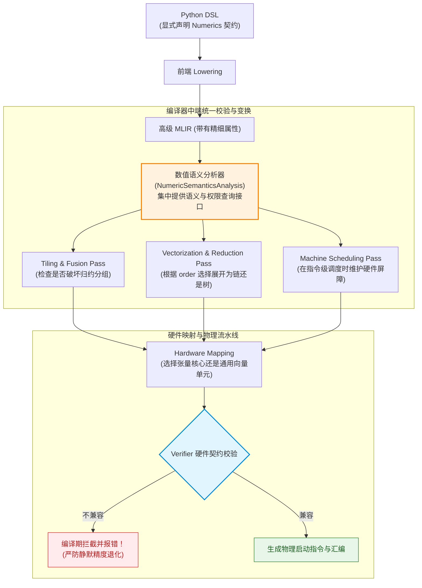

#### 各个 Pass 必须坚守的数值不变量

在编写编译器 Pass 时，架构师必须为团队立下军规：

| 编译器 Pass | 必须遵守的数值契约检查 | 违规后果 |
| :--- | :--- | :--- |
| **循环分块 (Tiling)** | 分块是否改变了跨 Tile 的累加依赖链？ | 可能引发跨块累加误差 |
| **算子融合 (Fusion)** | 算子融合后是否隐式提高了中间精度（如寄存器保留 FP64）？ | 改变了预期舍入行为 |
| **向量化 (Vectorization)** | 是否将顺序累加变成了 SIMD 向量 Lane 之间的交错重排？ | 破坏严格一致性 |
| **低精度下潜 (Quantization)** | `allow_reduced_precision` 是否为 `True`？ | 擅自降低精度导致模型发散 |
| **机器调度 (MachineScheduler)**| 调度时是否完整保留了自定义指令的硬件屏障与 MMIO 副作用？ | 芯片状态机死锁或总线越界 |

---

### 6.5 硬件映射验证 (Hardware Mapping Verification) 与 Verifier 边界

在编译流程的最后阶段，IR 必须映射到具体的硬件物理单元（如专用张量加速核心 Tensor Core 或通用 RISC-V 向量扩展 RVV）。

假设目标张量加速核心的硬件能力模型如下：
```yaml
# 硬件计算单元描述符
hardware_tensor_core:
  supported_types: [fp16, bf16, fp32]
  reduction_circuit: "fixed_pairwise_tree"   # 硬件电路固定为两两成对的并行加法树
  supports_sequential_order: false          # 物理上无法执行从左到右的顺序累加！
```

此时，如果用户代码声明了：
```python
accel.reduce_sum(x, order="ordered", accumulator="f32")
```

编译器在 `HardwareMapping` 阶段将触发严密推演：
1. 张量核心电路是 `fixed_pairwise_tree`，与用户要求的 `ordered` 存在不可调和的矛盾；
2. 编译器**绝不允许**未经用户授权自动降格，假装可以放到张量核心上跑；
3. **合法决策分流**：
   - **方案 1**：查询协处理器上是否具有支持顺序执行的通用向量指令集（如 RISC-V 向量扩展 RVV 的 `vfredosum` 严格顺序加法指令）。如果有，将该 Op 路由到 RVV 执行！
   - **方案 2**：若无可用替代硬件，立即中止编译并输出详尽的错误诊断（Diagnostic Error），告知用户硬件无法满足严格顺序，请显式将 `order` 放宽为 `tree_allowed`。

```text
[Compile-Time Error] cannot lower 'accel.reduce_sum' to Hardware Tensor Core
  --> user_code.py:28:10
   |
28 |   mean = accel.reduce_sum(x, order="ordered")
   |          ^^^^^^^^^^^^^^^^^^^^^^^^^^^^^^^^^^^^
Details:
  - User Numerical Contract requires: order="ordered" (Bitwise Sequential)
  - Target Tensor Core only provides: hardware hardwired 'fixed_pairwise_tree'
Resolution:
  1. Route to In-Order RVV Vector Core via compiler flag '--fallback-rvv'
  2. Or explicitly authorize tree reassociation by setting order="tree_allowed"
```

> [!WARNING] Verifier 的能力边界
> MLIR 的 `Verifier` 只能静态检查**离散的结构性约束**（如：“硬件是否支持该数据类型”、“是否满足拓扑声明”）。
> 编译器**无法**在静态编译期通过数学证明任意复杂网络对所有输入的数值误差都在 $\le 10^{-4}$。
> 因此，数值误差界限的最终守门员，必须是配合自动化测试框架进行严格的**数值差分测试（Differential Testing）**。

---

### 6.6 工程落地演进路线：P0 与 P1 实施矩阵

如果你正在从零构建一套专用硬件编译器，切忌试图在一夜之间实现一个庞大的浮点数静态证明系统。
工业界成熟团队的最佳实践是**小步快跑、阶梯演进**：

| 优先级 | 核心特性模块 | 落地目标与工程收益 |
| :---: | :--- | :--- |
| **P0<br>(立即可用)** | **1. 归约顺序三级抽象** | 实现 `ordered`（顺序）、`tree_allowed`（自由树）、`fixed_tree`（确定性固定树）的显式属性，堵死归约精度暗坑。 |
| **P0** | **2. 累加器精度显式声明** | 强制要求标注 `accumulator_type`（如 BF16 乘法必须配 FP32 累加）。 |
| **P0** | **3. FMA 融合受控化** | 实现基于 `allow_contract` 标志的融合控制，未经许可不得私自融合。 |
| **P0** | **4. 硬件指令副作用建模** | 为自定义配置指令建模内存效应与屏障，彻底杜绝机器调度器引发的状态机时序错误。 |
| **P1<br>(进阶完善)** | **5. 特殊浮点语义控制** | 实现细粒度的 `rounding_mode`（RNE/RTZ）、`subnormals`（FTZ 冲零控制）与 NaN 传播检查。 |
| **P1** | **6. 自动化差分测试管线** | 构建覆盖大数/小数相消、边界非正规数、极端阶码对齐的自动化测试套件。 |

---

## 七、总结与全景心智模型

回顾全文，我们可以将现代编译器中的指令调度与数值精度关系凝练为下述核心认知金字塔：

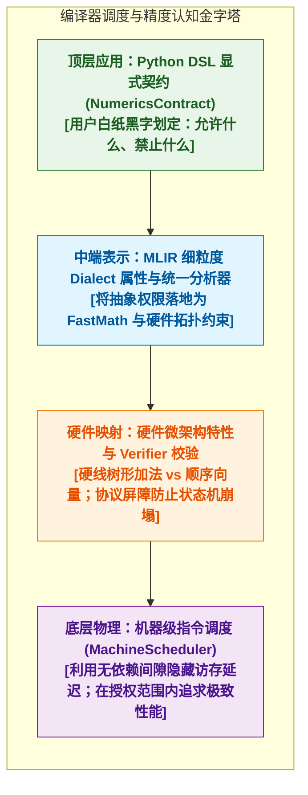

1. **编译器不仅会做指令重排，而且这是后端榨干硬件流水线算力的核心武器**。通过在访存或高延迟计算的空隙插入独立指令，编译器成功消除了流水线气泡停顿。
2. **纯粹的机器指令调度绝不改变数学结果**。只要保持依赖关系和操作数不变，指令重排具有**逐位一致（Bitwise Identical）**的绝对安全度。
3. **改变浮点数结合顺序的代数重排必然伴随精度权衡**。由于计算机浮点数的有限精度与阶码对齐截断，加法不具备结合律，大数吃小数会导致严重漂移。
4. **专用加速器不能套用通用 CPU 的假定**。自定义硬件指令受底层状态机和硬件拓扑（如硬线加法树）强约束，必须通过显式依赖建模与状态屏障来约束调度器。
5. **现代 AI 编译器的最高境界是“契约化编译”**。通过构建端到端的**数值语义契约（Numerical Semantics Contract）**，让上层决定精度边界，让中端根据契约合法变换，让底层硬件在安全授权下狂飙性能——这正是现代编译器架构最迷人、最硬核的工程艺术。
