# 计算机体系结构设计四大基石：平衡性、局部性、并行性与虚拟化的工程哲学

> **“在日新月异的技术浪潮中，工艺制程与架构流派虽屡次更迭，但指引计算机体系结构前进的根本原则却历久弥新——这便是平衡性、局部性、并行性与虚拟化。”**

现代计算机系统是人类工程史上最为精密的构件之一。在指甲盖大小的硅晶圆上，数百亿只晶体管以吉赫兹（GHz）的高频不知疲倦地协同振荡。然而，当我们审视一台计算机的性能与演进史时，往往会发现许多看似矛盾的反直觉现象：
* 为什么一台配备了极高主频 CPU 的电脑，在日常使用或大型数据处理中依然可能感到明显的卡顿？
* 为什么仅仅将处理器的浮点计算单元提速一倍，整个程序的实际运行时间却可能仅仅缩短了微不足道的几个百分点？
* 为什么即便拥有上千个处理器核心，单任务的计算耗时却存在一条无法逾越的物理极限天花板？
* 为什么程序员能够在一个平坦、简单且连续的虚拟世界里编写代码，而无需关心物理内存被撕裂得多么琐碎、指令在流水线深处执行得多凌乱？

所有这些疑问的解答，都深深植根于计算机体系结构设计的**四大基本原则（Fundamental Principles of Computer Architecture）**。本文将从第一性原理出发，以由浅入深的技术教程视角，全景解构这四大基石背后的物理本质、数学模型与硬件工程实现。

---

## 零、初学者核心概念速查表

为了帮助首次接触计算机体系结构与处理器硬件微结构的读者无障碍阅读，下表对本文首次出现的核心专业术语提供了严格的工程定义与通俗的生活物理直觉类比：

| 专业术语 | 英文全称 / 缩写 | 本质定义 | 通俗直觉与生活比喻 |
| :--- | :--- | :--- | :--- |
| **体系结构** | Computer Architecture | 软硬件之间的功能边界与界面规范（包括指令集、寻址模式等程序员可见的属性）。 | 建筑物的蓝图与房屋功能布局规范（如承重墙、门窗接口标准）。 |
| **微体系结构 / 微结构** | Microarchitecture | 在特定物理芯片上实现指令集架构的具体硬件组织（如流水级、缓冲器、发射队列等）。 | 依据蓝图实际施工时采用的钢筋、砖块绑扎手法与管道排布工程。 |
| **木桶效应 / 短板** | Wooden Barrel Principle | 系统的整体性能上限由整个链路中吞吐能力最弱、延迟最高的瓶颈组件所决定。 | 盛水木桶的容量完全取决于最短的那块木板。 |
| **访存带宽** | Memory Bandwidth | 内存子系统（或片外总线）在单位时间内能够向处理器传输的最大数据吞吐量（单位通常为 GB/s）。 | 高速公路单位时间内能够通过的最大车流断面流量。 |
| **MFLOPS / GFLOPS** | Million / Giga Floating-point Operations Per Second | 处理器每秒执行的百万次（$10^6$）或十亿次（$10^9$）浮点运算次数。 | 算盘师傅每秒钟拨动高精度珠算的小数运算极速。 |
| **SIMD** | Single Instruction Multiple Data (单指令流多数据流) | 一条指令同时对一组并行数据向量执行相同操作的硬件计算模式。 | 广播体操领操员喊一声口令“抬左臂”，全操场上百名同学同时抬起左臂。 |
| **阿姆达尔定律** | Amdahl's Law | 系统优化所能获得的整体性能加速比，严格受限于无法应用该优化手段的固有时间占比。 | 做一顿饭无论炒菜多快，熬高汤的 40 分钟无法省去，总做饭时间极限受限于这 40 分钟。 |
| **重排序缓冲** | ROB (Reorder Buffer) | 乱序执行处理器中用于记录指令推测执行状态、并严格按程序原有顺序提交写回的环形缓冲队列。 | 餐厅的出餐取号系统：后厨可随意哪道菜先熟先炒，但向顾客端菜上桌时必须按点单先后顺序。 |
| **发射队列 / 保留站** | Issue Queue / Reservation Station | 乱序处理器中暂存已译码但操作数尚未就绪的指令池，待操作数就绪后立刻发射给算力单元。 | 考场候考室：考生只要相关准考材料（操作数）齐全，空闲考场一旦开放立刻入场应试。 |
| **寄存器重命名** | Register Renaming | 通过硬件将有限的指令逻辑寄存器映射到更丰富的物理寄存器池，消除假数据相关性（写后写、读后写）。 | 图书馆为同名不同版的书籍分配互不冲突的独立物理储物柜，避免借还混乱。 |
| **访存队列** | LSQ (Load/Store Queue) | 处理器内部用于追踪管理加载（Load）与写入（Store）指令依赖关系并防止乱序内存冲突的硬件队列。 | 快递代收点的出入库检查台，确保同一地址的包裹派送先来后到绝不出现错漏覆盖。 |
| **失效队列 / 状态保持器** | MSHR (Miss Status Holding Register) | 当发生 Cache 缺失（Miss）时，记录等待外部内存返回数据的未决请求状态寄存器。 | 缺货登记簿：商品售罄时登记顾客需求，避免同一个缺货商品向总仓发起多次重复采购。 |
| **分支预测 / 转移猜测** | Branch Prediction | 处理器在条件跳转指令执行前，基于历史经验提前猜测程序分支走向以避免流水线挂起等待。 | 经验丰富的老司机在十字路口提前向常去路线变道，无需每次都刹停看清路标再起步。 |
| **局部性原理** | Principle of Locality | 程序在执行时表现出对某部分代码或数据的密集重复访问特征，包含时间与空间局部性。 | 人类日常生活中天天打交道的只有少数几位密友（局部性极高）。 |
| **时间局部性** | Temporal Locality | 最近刚刚被访问过的数据或指令，在不久的将来极大概率会被再次访问。 | 刚刚翻阅并放在书桌角的一份常用参考手册，等会儿还要继续查阅。 |
| **空间局部性** | Spatial Locality | 某个物理地址被访问后，与其物理相邻的其他数据极大概率会在近期被顺次访问。 | 翻开一本书读完第 10 页，下一步极大概率接着读第 11 页。 |
| **高速缓存** | Cache | 位于 CPU 核心与主存之间、容量小但极快的高速静态随机存储器（SRAM）。 | 厨师灶台手边的微型调料架；无需每次需要一撮盐都跑去地窖大仓库搬运。 |
| **转换后援缓冲器** | TLB (Translation Lookaside Buffer) | 专用于加速虚拟内存地址到物理内存地址转换的片上高速缓存。 | 办公楼前台的熟客快速通行免登簿，无需每次都查阅几千页的厚重访客登记总册。 |
| **预取技术** | Prefetching | 硬件或编译器根据访存规律，在处理器真正需要数据之前提前将其从主存调入 Cache 的技术。 | 物流仓库的智能调度：根据历年双十一规律，提前将热销商品下沉到各城市前置仓。 |
| **指令级并行** | ILP (Instruction-Level Parallelism) | 通过流水线重叠与多发射硬件，在单线程指令流中同时执行多条相互独立的机器指令。 | 工厂流水线：冲压、焊接、喷漆工序在同一时刻分别针对不同批次的汽车同时加工。 |
| **超标量 / 多发射** | Superscalar / Multi-issue | 处理器微结构在一个时钟节拍内能够同时抓取、译码并下发多条指令至多个执行单元。 | 餐厅厨房设置了 4 口炒锅与 4 名掌勺大厨，一个节拍内可以同时炒 4 道菜。 |
| **乱序执行** | Out-of-Order Execution (OoO) | 允许后面的无依赖指令越过前面正在等待长延迟事件（如内存访问）的指令提前执行。 | 允许后桌点凉菜的顾客先拿到菜品用餐，而不必干等前桌耗时 40 分钟的炭烤羊排烤熟。 |
| **数据级并行** | DLP (Data-Level Parallelism) | 将数据打包成向量，用单一控制流驱动多套算术单元对海量独立数据同时做相同计算。 | 农场的高压喷灌机：一道阀门打开，数十个喷头同时对整排田垄进行灌溉。 |
| **任务级并行** | TLP (Task-Level Parallelism) | 将应用拆分为多个粗粒度的线程或进程，在多个物理核心或逻辑线程上同时推进。 | 建筑工地上木工组、泥瓦工组、电工组分头独立推进各自模块的施工工程。 |
| **同时多线程** | SMT (Simultaneous Multi-Threading) | 在单个物理核心内复制多套架构寄存器状态，使两个或多个硬件线程共享执行流水线。 | 一个考场内安排两套不同试卷的考生轮流使用同一台听力播音设备与草稿纸。 |
| **虚拟化** | Virtualization | 将物理硬件的真实复杂实现隐藏在底层，向软件层抽象出平坦、连续、友好的逻辑运行环境。 | “逻辑上是这样的，物理上是那样的”——软硬件之间最优雅的减熵桥梁。 |
| **Cache 一致性协议** | Cache Coherence Protocol (如 MESI) | 多核/分布式系统中用于维护各核心私有 Cache 中相同内存地址数据副本同步一致的通信协议。 | 多个合伙人各自持有一本小账本，只要有人涂改支出，必须立刻通过广播通知所有人同步标记。 |

---

## 一、体系结构四大基石总览

在深入探讨每一个设计原则之前，我们需要建立一幅全景认知图景。计算机体系结构绝不是零散部件的简单堆砌，而是一个高度动态、充满权衡（Trade-offs）的复杂有机体。

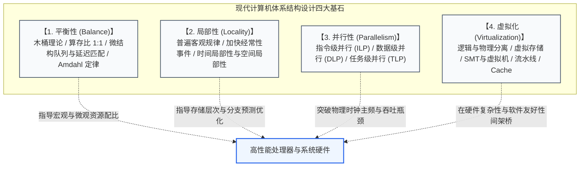

这四大原则在计算机系统设计中各司其职，又紧密交织：
1. **平衡性（Balance）**：是全局系统调优的“标尺”，告诫设计者抓主要矛盾的同时防范次要瓶颈升级，保证晶体管资源的高效利用；
2. **局部性（Locality）**：是优化性能的“抓手”，揭示了现实世界中绝大多数计算行为的集中分布特征，为分层存储架构提供了坚不可摧的理论依据；
3. **并行性（Parallelism）**：是打破物理单点极限的“动力”，从指令、数据到任务三层递进，开辟了算力持续扩展的主通道；
4. **虚拟化（Virtualization）**：是软硬件协同演进的“黏合剂”，让底层复杂甚至残酷的硬件实现转化为软件开发者眼中有序友好的编程抽象。

接下来，我们将逐一展开这四大原则的深层奥秘。

---

## 二、原则之一：平衡性（Balance）——木桶理论与系统瓶颈艺术

### 2.1 木桶理论：决定系统性能的是最短的那块板

> **“一只木桶所能容纳的水量，并不取决于最高的那根木板，而是取决于最短的那块。”**

在计算机工程实践中，木桶原理是理解系统性能不可动摇的黄金法则。一台通用计算机由 CPU、GPU、内存控制器、主存（DRAM）、非易失存储（NVMe SSD/HDD）、网络接口卡（NIC）以及互连总线（PCIe、内部交叉开关 Crossbar）共同组成。

当普通用户感觉电脑卡顿时，最直接的直觉往往是：“是不是这颗 CPU 的主频不够高、核心不够多？”
然而在真实的系统剖析中，引发性能断崖式下跌的真实元凶往往潜伏在其他链路上：
1. **内存带宽短板**：CPU 的浮点单元算力极其充沛，但片外内存总线通道太窄，导致算力单元常年处于“饥饿等数据”的挂起状态；
2. **存储/网络 I/O 短板**：磁盘或网络延迟高达微秒甚至毫秒级，CPU 在执行几条指令后便陷入冗长等待；
3. **总线互连短板**：CPU 协同 GPU 进行图形或异构张量运算时，PCIe 总线的传输拥堵使得协同计算的收益被跨设备通信开销彻底吞噬。

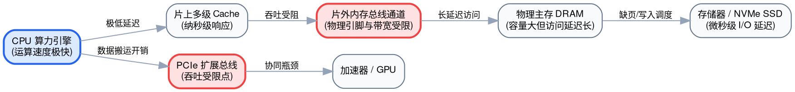

### 2.2 内部微结构的精细队列平衡

平衡性不仅体现在宏观板卡系统之间，更微观且深刻地支配着 **CPU 芯片内部微结构（Microarchitecture）** 的每一个逻辑模块。

在经典的超标量乱序执行处理器内部，指令处理就像一条高速水流：
前端取指（Fetch）与译码（Decode）将指令分解为微操作（$\mu\text{ops}$），随后经历**寄存器重命名（Register Renaming）**消除名字相关，压入**发射队列（Issue Queue）**，等待操作数就绪后乱序分派到各算术执行单元执行，最后由**重排序缓冲（ROB, Reorder Buffer）**保证按程序原始顺序退出提交；期间所有的内存读写则由**访存队列（LSQ, Load/Store Queue）**严密监控。

如果微结构设计者只盲目拉大某一个参数（例如把分支猜测命中率从 95% 提升到 98%），但没有平衡其他内部队列，性能将毫无改善：
* **各级 Cache 失效延迟与队列容量的匹配**：一级缓存（L1 Cache）访问只需 3~4 个周期，而二级缓存（L2 Cache）需要 12~14 个周期，三级缓存（L3 Cache）需要 40 个周期，若未命中直接访问外部 DRAM 则需要长达 150~200 个时钟周期！
* **流水线堵塞雪崩效应**：假设一条加载（Load）指令在 L1 和 L2 中连续失效，必须去 L3 甚至片外主存提取数据。这需要等待上百拍。在这上百拍内，所有依赖该加载结果的后续指令都无法发射，只能堆积在发射队列（Issue Queue）中。如果发射队列容量只有 32 项、重排序缓冲（ROB）只有 64 项，短短十几个节拍内，发射队列和 ROB 就会被全部填满！
* 一旦队列满溢，处理器的前端取指与译码单元必须被强制踩下“刹车”（Stall），整个复杂的流水线瞬间陷入堵塞。

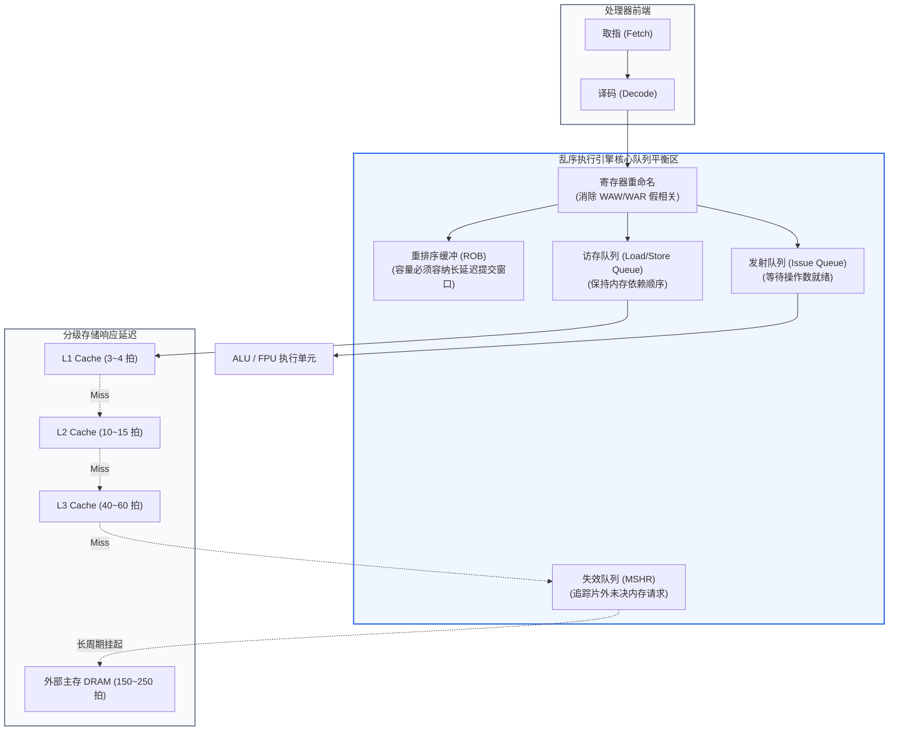

> **设计准则**：重排序缓冲项数、发射队列项数、重命名寄存器个数、访存队列项数、失效队列（MSHR）项数与一级/二级/三级 Cache 的失效延迟必须呈现精确的数学比例匹配，**保证一、二级 Cache 的偶发失效不会瞬间反噬引发上游流水线的彻底停摆**。

### 2.3 浮点性能与访存带宽的 1:1 平衡法则

在通用处理器的宏观体系设计中，存在一条久经考验的经验法则：
> **通用 CPU 的峰值浮点运算速度（MFLOPS）与峰值访存带宽（MB/s）的合理比值通常在 1:1 左右。**

也就是说，处理器每具备执行 1 次单精度浮点运算（4 字节）或双精度浮点运算（8 字节）的算力潜能，系统通常需要提供大约 1 Byte/s 的内存总线数据搬运吞吐能力作为物资保障。如果打破这一比例，计算硬件就会遭遇严重的“营养不良”。

为了验证这一规律在历史长河中的演变，下表梳理了过去数十年来十二款具有代表性的典型历史通用微架构参数（为剥离具体厂商商业特征，已对芯片代号进行通用学术化脱敏）：

| 微架构演进代号 | 年代 | 主频 | SIMD 向量支持 | 峰值浮点 (GFLOPS) | 峰值访存 (GB/s) | 含 SIMD 浮存比 | 无 SIMD (标量) 浮存比 |
| :--- | :---: | :---: | :---: | :---: | :---: | :---: | :---: |
| **Arch-Scalar-96** (经典 64 位超标量) | 1996 | 600 MHz | 无 (标量) | 1.2 | 2.0 | **0.60** | **0.60** |
| **Arch-Desktop-99A** (第七代乱序架构) | 1999 | 700 MHz | 无 (标量) | 1.4 | 1.6 | **0.88** | **0.88** |
| **Arch-Desktop-99B** (早期超标量通用芯片) | 1999 | 600 MHz | 无 (标量) | 0.6 | 0.8 | **0.75** | **0.75** |
| **Arch-DeepPipe-01** (超长高频深流水芯片) | 2001 | 1.5 GHz | 无 (标量) | 3.0 | 3.2 | **0.94** | **0.94** |
| **Arch-DualCore-07** (首代高效能双核芯片) | 2007 | 2.8 GHz | 128 位向量 | 22.4 | 8.5 | **2.64** | **1.32** |
| **Arch-QuadCore-09A** (主流四核心桌面芯片) | 2009 | 3.2 GHz | 128 位向量 | 51.2 | 21.3 | **2.40** | **1.20** |
| **Arch-QuadCore-09B** (企业级集成四核芯片) | 2009 | 2.8 GHz | 128 位向量 | 44.8 | 32.0 | **1.40** | **0.70** |
| **Arch-Enterprise-14** (高通量企业级多核处理器) | 2014 | 5.0 GHz | 128 位向量 | 480.0 | 230.4 | **2.08** | **1.04** |
| **Arch-Modular-14** (模块化八核心处理器) | 2014 | 4.0 GHz | 256 位向量 | 128.0 | 29.9 | **4.29** | **1.07** |
| **Arch-Modern-15** (先进工艺四核心处理器) | 2015 | 3.4 GHz | 256 位向量 | 217.6 | 34.1 | **6.38** | **1.60** |
| **Arch-CustomGen1-15** (高能效自主标量微架构) | 2015 | 1.0 GHz | 无 (标量) | 16.0 | 16.0 | **1.00** | **1.00** |
| **Arch-CustomGen2-20** (高能效自主向量微架构) | 2020 | 2.5 GHz | 256 位向量 | 160.0 | 51.2 | **3.13** | **0.78** |

#### 深度现象剖析：
1. **“访存墙（Memory Wall）”的显露**：
   从表中可以看出，随着时间推移，处理器的“含 SIMD 浮点访存比”从 20 世纪末的 0.6 ~ 0.9 左右，一路飙升至 2015 年后的 3.0 ~ 6.38！这充分证明处理器的算力增长速度远快于片外引脚与内存物理带宽的增长速度，**访存带宽已无可挽回地成为现代通用 CPU 的最核心瓶颈**。片上多核数量的盲目膨胀在物理上受到了极大的制约。
2. **标量运算下 1:1 法则的持久韧性**：
   如果我们扣除 SIMD 带来的倍增效应（128 位 SIMD 使 64 位双精度浮点峰值增加 2 倍，256 位 SIMD 增加 4 倍），就会惊奇地发现：**无 SIMD 的标量浮点峰值与访存带宽比依然在 0.7 ~ 1.6 之间紧密震荡，牢牢锚定在 1:1 的黄金基线附近！**
   这是因为绝大多数日常通用计算、企业事务处理（OLTP）、操作系统调度等软件逻辑并不依赖宽向量 SIMD 指令，其核心逻辑的指令吞吐与访存流动依然受制于传统的冯·诺依曼访存平衡约束。

### 2.4 阿姆达尔定律（Amdahl's Law）的数学实质

谈及体系结构的平衡性，就必须提到计算机领域人尽皆知的**阿姆达尔定律（Amdahl's Law）**。

#### 定律表述
通过使用某种更快速的执行方式（例如引入多核并行加速、专用硬件加速部件）所获得的系统整体性能提高，**严格受限于该优化方式无法生效的执行时间所占总执行时间的百分比**。

#### 数学推导
设某任务在原系统上的总执行耗时为 $ExTime_{\text{old}}$。
其中：
* 可被加速模块所占据的时间比例为 $Fraction_{\text{enhanced}}$（$0 \le Fraction_{\text{enhanced}} \le 1$）；
* 无法被该手段加速的固定时间比例为 $1 - Fraction_{\text{enhanced}}$；
* 该加速模块自身的独立加速比为 $Speedup_{\text{enhanced}}$。

则引入优化后的新执行时间 $ExTime_{\text{new}}$ 为：

$$ExTime_{\text{new}} = ExTime_{\text{old}} \times \left( (1 - Fraction_{\text{enhanced}}) + \frac{Fraction_{\text{enhanced}}}{Speedup_{\text{enhanced}}} \right)$$

系统整体获得的最终端到端加速比 $Speedup_{\text{overall}}$ 为：

$$Speedup_{\text{overall}} = \frac{ExTime_{\text{old}}}{ExTime_{\text{new}}} = \frac{1}{(1 - Fraction_{\text{enhanced}}) + \frac{Fraction_{\text{enhanced}}}{Speedup_{\text{enhanced}}}}$$

#### 极限推论
当加速单元的能力趋近于无穷大（例如投入无限多的并行核心，使加速部分的耗时被压缩至趋近于 0，即 $Speedup_{\text{enhanced}} \to \infty$）时：

$$\lim_{Speedup_{\text{enhanced}} \to \infty} Speedup_{\text{overall}} = \frac{1}{1 - Fraction_{\text{enhanced}}}$$

> **生活直觉**：
> 一个人花 1 个小时可以做好一顿四菜一汤的晚餐。即使我们招募来 60 位米其林大厨协同烹饪，也绝不可能在 1 分钟之内把这顿饭做好。因为洗菜、炖汤入味、食材受热化学反应等物理环节具有强烈的先后时间顺序（串行不可并行化部分）。这些不可并行的部分构成了做饭耗时无法逾越的绝对底线。

#### 体系结构启示：修马路与高架桥效应
体系结构设计必须统筹兼顾，**抓主要矛盾的同时切忌漠视次要矛盾**。
这就好比城市道路治理：在某一个经常严重拥堵的十字路口修建了一座立体双向高架立交桥。这座立交桥确实彻底解决了这一个路口的拥堵，但原先被这个路口阻滞的大量车流瞬间涌向下游，导致原本通行顺畅的相邻路口迅速大排长龙、全线瘫痪。
在芯片设计中亦是如此：一旦花费巨大晶体管代价攻克了主要性能瓶颈，原先不起眼的次要因素就会立刻升格为新的系统瓶颈。**唯有动态、全局的平衡设计，才能真正带来性能红利。**

---

## 三、原则之二：局部性（Locality）——性能优化的第一基石

### 3.1 局部性的哲学本质与普遍性

**局部性（Locality）** 是自然界与人类社会中普遍存在的客观物理性质：
* 受限于宇宙光速（约 30 万公里/秒）与人类有限的寿命，任何人一生所能涉足与感知的物理宇宙范围都极其微小，这是一种时空局部性；
* 一个人一生中可能遇到上万人，但能够频繁保持联系、天天打交道的至交好友往往只有少数几个人，这也是一种社交局部性。

在计算机科学中，局部性原理同样无处不在。程序的运行绝不是在整个内存空间中随机无序地跳转，而是表现出强烈的集中偏好。**计算机软硬件性能优化的绝大部分成就，本质上都是对局部性规律的巧妙挖掘与兑现。**

### 3.2 事件局部性与“加快经常性事件（Make the Common Case Fast）”

当芯片设计在全局结构上实现基本平衡之后，进一步挖掘性能的核心准则便是：**牢牢抓住主要矛盾，重点改善最频繁发生事件的执行效率（Make the Common Case Fast）**。

#### 定量反思案例：盲目优化的代价
假设体系结构设计团队倾注半年精力，研发出一种极其复杂的浮点运算单元，将处理器的浮点执行速度整整提升了 1 倍（加速比为 2.0）。
然而，如果目标应用软件中**只有 10% 的指令是浮点计算**，其余 90% 都是基础整数逻辑与分支转移，那么根据阿姆达尔定律：

$$Speedup_{\text{overall}} = \frac{1}{(1 - 0.10) + \frac{0.10}{2.0}} = \frac{1}{0.90 + 0.05} = \frac{1}{0.95} \approx 1.053$$

这意味设计团队付出了芯片面积暴增、功耗飙升的代价，换来的**整机实际性能提升竟然只有区区 5.3%**！

因此，架构师必须时刻保持清醒：
1. 什么是目标软件中占比最高、发生最频繁的“经常性事件”？
2. 优化该事件的技术收益，在全局中能沉淀为多大的实质贡献？

#### 经典工程范式
* **精简指令集（RISC）架构的崛起**：20 世纪 80 年代的研究者统计了海量真实程序的机器码执行轨迹，发现计算机中 80% 以上的执行时间都被仅占指令集 20% 的简单基础指令（如加减法、寄存器移动、简单加载等）所占据；而那些为了特定高级语法精心设计的复杂指令极少被编译器调用。RISC 架构果断剥离冷门复杂指令，把芯片资源全部倾注在优化那 20% 的高频基础指令上，从而实现了性能的爆发式跨越。
* **硬件分支预测（转移猜测）**：程序中的条件转移指令（如 `if` 判断、`for` 循环边界）在执行时具有极高的时间偏向性。例如一个循环 1000 次的代码块，其末尾的跳转指令在 99.9% 的情况下都是向后跳转回循环起点。硬件分支预测器正是捕捉到了转移事件的强烈局部性，提前装载后续指令，消除了流水线停顿。

### 3.3 访存局部性：时间局部性 vs 空间局部性

在计算机存储体系中，访存局部性是构建整个分层存储金字塔（Register $\to$ L1/L2/L3 Cache $\to$ DRAM $\to$ SSD）的绝对基石。它细分为两种经典形态：

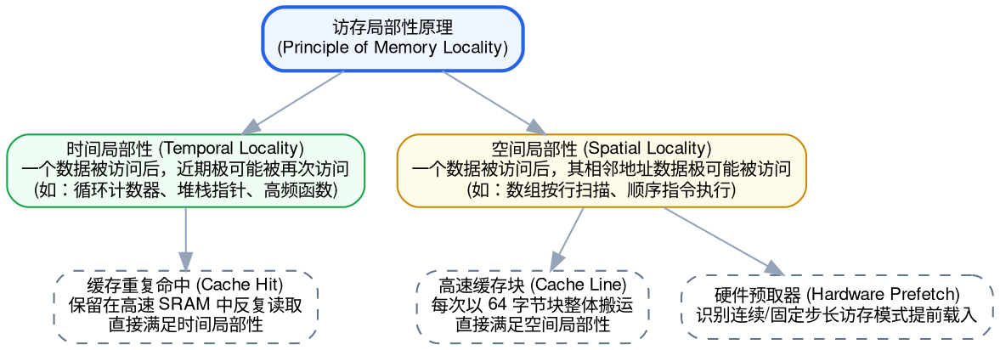

1. **时间局部性（Temporal Locality）**：
   * **定义**：如果程序访问了某个内存地址的数据，在较短的未来时间间隔内，该地址的数据非常有可能被再次访问。
   * **典型代表**：在 `for (int i = 0; i < N; i++)` 循环中，变量 `i` 和累加器在短时间内被频繁读写；递归调用时函数的局部调用栈帧被高频复用。
   * **硬件应对**：将刚刚访问过的数据留在速度极快的小容量 **高速缓存（L1/L2 Cache）** 中，后续访问无需重新读取漫长延迟的主存。
2. **空间局部性（Spatial Locality）**：
   * **定义**：如果程序访问了某个内存地址的数据，那么与该地址在物理上邻近的其他存储单元，在不久的将来很大概率会被顺次访问。
   * **典型代表**：二维数组在 C 语言中是按行优先连续存放的，按行顺序读取数组元素；指令执行绝大多数时刻都是按计数器（PC）顺序单调递增向前推进。
   * **硬件应对**：Cache 与内存交互时，绝不按单个字节或单个字搬运，而是以标准的 **缓存行（Cache Line，通常为 64 字节）** 为最小颗粒度进行整块拉取。只要第一次访问发生了未命中，邻近的后续十几个数据便在这一拍内被一网打尽全部预载入 Cache 中。
3. **拓展：步长局部性（Stride Locality）与硬件预取（Prefetching）**：
   * 某些程序按列访问数组，虽然物理上不连续，但每次跳转的地址偏移量是固定的（例如固定递增 1024 字节）。
   * 现代处理器内部配备了高度智能的**流式预取器（Stream/Stride Prefetcher）**，能够自学习检测这种固定步长规律，在 CPU 尚未执行后续访存指令前，提前数十拍把下游数据从内存悄悄拉入 Cache，将访存延迟隐匿于无形。

---

## 四、原则之三：并行性（Parallelism）——三层算力扩展引擎

单纯依靠提高晶体管开关速度（提高主频）在 2005 年左右遭遇了不可逾越的**功耗墙（Power Wall，芯片发热量随频率呈立方级激增）**。计算机体系结构继续提升性能的根本出路，全面转向了**开发并行性（Exploiting Parallelism）**。

在现代计算机体系中，并行性由低到高划分为三个层次：

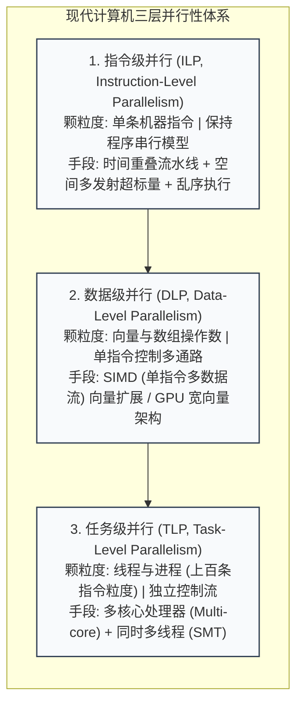

### 4.1 第一个层次：指令级并行（ILP）

指令级并行是 20 世纪 80 年代至 21 世纪初体系结构发展的黄金引擎。**它的最大魅力在于：能够在保持应用程序传统顺序串行编程模型（二进制兼容）的前提下，由底层硬件自动实现指令并行加速，程序员不需要对源代码做任何并发修改！**

指令级并行在微结构中分化为两套精妙机制：

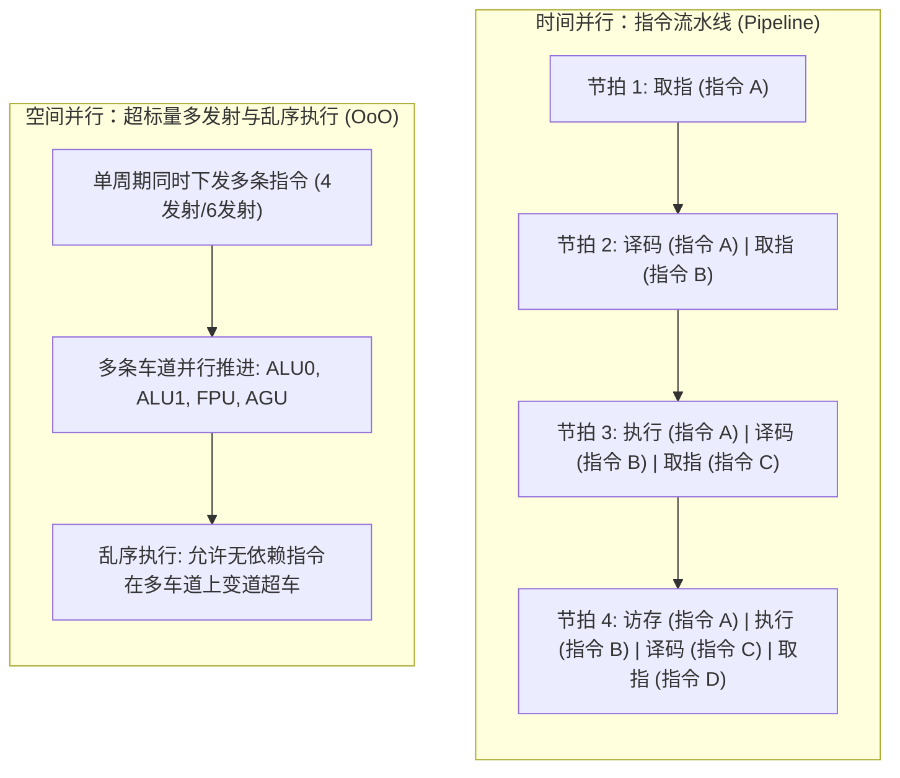

1. **时间并行（Time-domain Parallelism）：指令流水线（Pipeline）**
   * **类比**：汽车制造工厂不会等待第一辆车全部组装喷漆出厂后再组装第二辆车，而是设立冲压、焊接、涂装、总装等串行工位，多辆汽车在不同工位上重叠作业。
   * **原理**：将单条指令的生命周期划分为取指（IF）、译码（ID）、执行（EX）、访存（MEM）、写回（WB）等子阶段。尽管单条指令的耗时未变，但每个时钟节拍都能有一条新指令完成下线，吞吐率倍增。
2. **空间并行（Space-domain Parallelism）：超标量（Superscalar）与乱序执行（Out-of-Order）**
   * **类比**：多车道高速公路。单发射流水线就像单行道，前车抛锚后车全堵；而超标量多发射则将车道扩展为 4 车道甚至 8 车道，每个周期可同时分派 4~8 条指令同时出发。
   * **超车机制（乱序执行）**：如果一车道上的指令需要漫长等待主存数据，乱序调度器允许后面车道上互不依赖的运算指令率先超车执行完毕，极大地压榨了空闲计算部件的利用率。

> **历史拐点**：2010 年之后，随着流水线加深带来的分支惩罚呈指数级上升，以及乱序控制逻辑电路面积功耗的平方级暴增，指令级并行的边际收益已极其微弱，体系结构设计全面转向数据级与任务级并行。

### 4.2 第二个层次：数据级并行（DLP）

数据级并行以**单指令流多数据流（SIMD, Single Instruction Multiple Data）**以及经典的**向量体系结构（Vector Architecture）**为核心代表。

* **工作机理**：在传统的标量指令中，执行一条 `ADD` 指令只能完成两个单精度浮点数的相加（$C = A + B$）；而在 256 位宽的 SIMD 向量通路中，一条向量加法指令可以控制 8 套并行的 32 位浮点加法器，在一个节拍内同时把 8 对浮点数加完（$C[0..7] = A[0..7] + B[0..7]$）。
* **历史演变**：
  * 早在 20 世纪六七十年代，以科研巨型机为代表的专用超级向量计算机（Vector Supercomputers）大放异彩，成为大规模天气演化、空气动力学和核能模拟的核心支柱；
  * 此后，通用微处理器由于主要处理标量文本和关系数据库逻辑，向量体系经历了一段时期的沉寂；
  * 随着图形图像、多媒体影音渲染、机器视觉以及近年来深度学习张量计算的爆炸式普及，SIMD 向量结构强势回归通用 CPU，从最初的 64 位、128 位向量扩展，一路跃升为当代通用芯片标配的 256 位乃至 512 位宽向量通路。

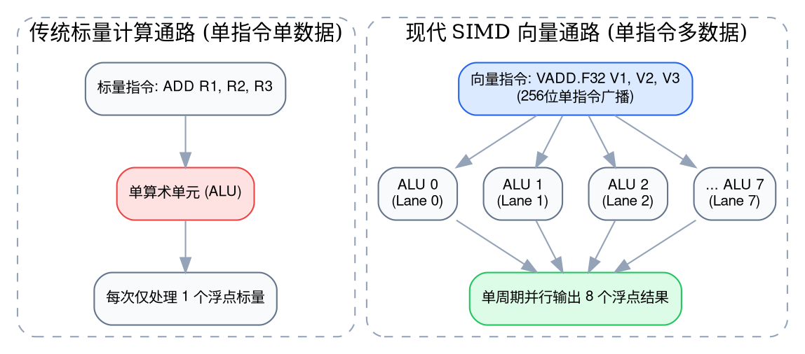

### 4.3 第三个层次：任务级并行（TLP）

任务级并行是当前乃至未来大规模计算基础设施中最重要的加速途径。在现代操作系统、云原生服务与分布式互联网应用中，高并发的任务天然独立存在。

* **多核心处理器（Multi-core Processor）**：在单片硅片上集成 4 个、16 个甚至 128 个完整的物理处理器核心。每个核心都具备独立的取指、译码和流水线，通过片上高速环形网络（Ring Bus）或网格网络（Mesh Network）共享大容量三级 Cache；
* **同时多线程（SMT, Simultaneous Multi-Threading）**：物理核心只有一个，但复制了多套架构寄存器状态（Program Counter、通用寄存器等），在硬件层面向操作系统暴露 2 个或更多的“逻辑核心”。当线程 A 遇到长延迟 Cache Miss 挂起等待时，线程 B 立刻接管空闲的 ALU 算力部件，使流水线几乎无停滞。

### 4.4 现代处理器的“三位一体”融合形态

在当代顶尖计算机体系中，这三层并行性绝非割裂存在，而是高度嵌套、浑然一体：
> **现代服务器芯片在宏观上是数十个核心的任务级并行（TLP）；每个核心在微观上采用 4~8 发射的乱序深流水线（ILP）；而在这条流水线的执行单元内部，则嵌有能够吞吐 256 位宽数据的 SIMD 向量运算阵列（DLP）。**

---

## 五、原则之四：虚拟化（Virtualization）——软硬件之间的桥梁艺术

### 5.1 虚拟化的哲学本质：“用起来如此，实际上如彼”

体系结构设计领域有一句充满哲学意味的名言：
> **“所谓虚拟化，就是‘用起来是这样的，实际上是那样的’，或者‘逻辑上是这样的，物理上是那样的’。”**

计算机系统为什么好用、为什么能在半个世纪内深刻改变人类社会？
**因为一代又一代体系结构设计者甘愿把最复杂、最棘手、最繁琐的工作扛在自己肩上，通过巧妙的硬件微结构创新，在粗糙冰冷、碎片化的物理硬件与优雅友好的软件编程接口之间，架设起了一座又一座坚固宏伟的“桥梁”。**

虚拟化的核心本质，就是**在“不好用的物理硬件”与“友好的用户接口”之间充当最顶级的减熵桥梁**。

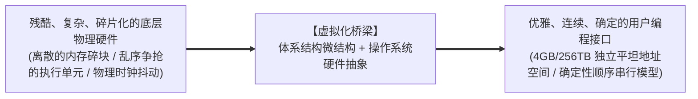

体系结构历史上架设过多座里程碑式的桥梁。如果我们以**“对程序员生产力的解放程度”**与**“实现的硬件代价/效率比”**为评判准绳，可以对这些经典桥梁进行深刻的综合评级：

---

### 5.2 经典虚拟化桥梁评级与工程全景剖析

#### 桥梁一：虚拟存储技术（Virtual Memory）—— 评级：特优（A+）
* **物理现实**：真实的物理内存容量有限，被不同进程撕扯得四分五裂，而且存在速度极其缓慢但容量巨大的外部磁盘（外存）；早期的程序员必须手工规划“覆盖（Overlay）”算法，计算每一段代码何时进内存、何时退回磁盘，稍有不慎程序直接崩溃。
* **桥梁架构**：20 世纪 60 年代引入的 **页表（Page Table）** 与硬件 **TLB（转换后援缓冲器）**，由操作系统与微结构共同托管物理地址翻译。
* **用户体验**：每个运行中的进程都狂妄地以为自己独霸了一个从地址 `0x00000000` 开始的、极其平坦宽阔且连续的完整地址空间。物理内存分配与外存调入调出（Page Fault）完全自动化。
* **评级理由**：这一座桥梁彻底解放了全人类程序员的生产力，让通用操作系统的大规模多任务并发成为可能。**当之无愧评为“特优”**！

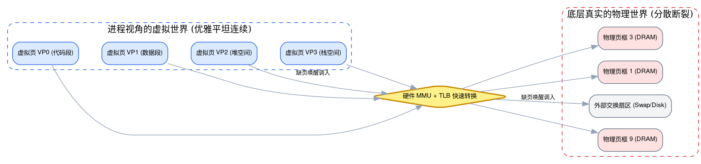

---

#### 桥梁二：同时多线程（SMT）与虚拟机技术 —— 评级：优（A）
* **物理现实**：一颗物理 CPU 芯片在制造完成后其核心数是固定死的；
* **桥梁架构**：
  * **SMT 技术**：通过在核内复制架构寄存器堆与独立控制上下文，让底层一套乱序流水线同时为两个线程卖力干活；
  * **硬件辅助虚拟机技术**：通过设立多组控制寄存器与根操作模式，使硬件能够在纳秒级实现客户机操作系统（Guest OS）与宿主机操作系统（Host OS）的无缝上下文瞬切；
* **用户体验**：操作系统看到的核心数量瞬间翻倍；数据中心管理员可以在单台物理母机上瞬时切分出几十台互相绝对隔离的云主机；
* **评级理由**：虽然微结构存在共享缓存争抢（Cache Thrashing）与侧信道攻击风险，但它极大提高了云计算服务器的资源利用率与经济效益，**评为“优”**。

---

#### 桥梁三：流水线与超标量多发射 —— 评级：优（A）
* **物理现实**：硬件底层电路实际是在不同阶段交错重叠、乱序超车、多发射抢占算力单元；
* **桥梁架构**：硬件重排序缓冲（ROB）与精确异常机制（Precise Exception）；
* **用户体验**：向程序员完美维持了数十年前建立的**“指令一条接一条、严格按顺序串行执行”**的标准冯·诺依曼心理模型。即使某条指令引发了空指针异常，硬件也能精准回滚，宛如乱序从未发生；
* **评级理由**：在维持串行语义兼容的前提下大幅拉升了执行速度。然而，由于代码内部固有数据相关与控制相关的掣肘，实际流水线无法达到理想 IPC（单发射实际 IPC 往往只有 0.5 左右，四发射实际 IPC 达到 1.5 便属优秀），效率存在先天损耗，故**评为“优”**。

---

#### 桥梁四：高速缓存技术（Cache Hierarchy）—— 评级：良好（B+）
* **物理现实**：静态存储器（SRAM）速度快但容量极小、造价极其昂贵；动态主存（DRAM）容量大且便宜，但访问延迟高达上百周期；
* **桥梁架构**：L1/L2/L3 硬件 Cache 体系，对访存地址进行自动哈希映射与块替换；
* **用户体验**：程序员几乎感觉不到分级物理存储的存在，仿佛自己拥有了一块**“像 Cache 那么快、又像主存那么大”**的理想存储器；
* **为什么只能评为“良好”？**
  1. **代价极其惨烈**：在当今高性能通用芯片上，**超过 80% 的物理晶体管与硅片核心面积都被各级 Cache SRAM 所吞噬**！留给真正算术运算逻辑的面积反倒沦为了少数；
  2. **抽象并非无缝透明**：虽然软硬件契约不需要改写代码，但由于 Cache Miss 带来的数百倍性能鸿沟，追求极致性能的软件工程师必须绞尽脑汁根据 Cache 块大小手动编写分块（Tiling）、对齐代码，否则性能将剧烈崩塌。故**评为“良好”**。

---

#### 桥梁五：分布式共享存储中的 Cache 一致性协议 —— 评级：及格（C）
* **物理现实**：在现代多核心甚至多插槽服务器中，各个核心的私有 Cache 物理上分散在芯片的不同角落；
* **桥梁架构**：设计极其复杂的硬件监听总线或目录式协议（如 MESI/MOESI），核心之间通过漫天飞舞的一致性探测报文（Snoop Request）维护相同变量的数据统一；
* **用户体验**：为程序员提供了一个统一编址的全局共享内存世界，无需显式调用网络 API 发送数据包；
* **为什么只能评为“及格”？**
  1. **未能解决并行编程本质难题**：一致性协议虽然屏蔽了物理存储分散的硬件细节，但它**丝毫未能减轻程序员需要编写多线程锁、无锁队列、内存屏障（Memory Barrier）的痛苦负担**。原本的串行代码绝对不可能借助一致性协议自动获得并行能力；
  2. **硬件复杂度与通信风暴**：随着核心数增加，一致性通信开销呈几何级数膨胀，极易引发总线拥塞。
* **未来展望**：
  > **如果未来的编译与体系结构技术能突破到这一步：软件工程师只需信手拈来写纯粹的串行代码，编译器与智能硬件便能自动将其拆解并毫无死锁风险地分发到成千上万个分布式核心上澎湃运行——那么这座终极桥梁，将被毫无争议地授予“特优”勋章！**

---

### 5.3 体系结构五座虚拟化桥梁评级矩阵

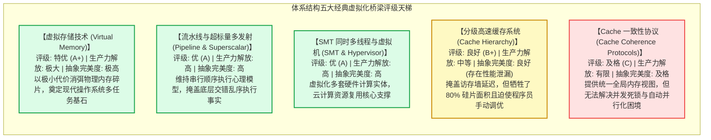

---

## 六、四大原则的交织共振与系统权衡（Architecture Trade-offs）

体系结构设计的绝妙与艰难之处，在于四大原则从来不是孤立割裂的教条，而是随时都在发生激烈的权衡博弈：

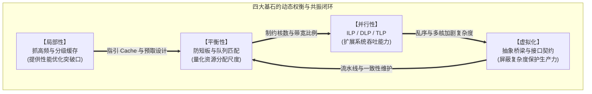

1. **局部性与平衡性的融合**：
   正因为软件存在极强的时间与空间局部性，才使得体积小但速度快的 Cache 能够以 90% 以上的命中率挡住绝大部分访存流量，从而在芯片面积与主存带宽的严苛物理约束下，奇迹般地维系了计算吞吐与访存带宽之间的“宏观平衡”；
2. **并行性对平衡性的拷问**：
   当我们为了追求任务级并行（TLP）而在单个芯片上狂热堆叠 64 个甚至 128 个处理器核心时，片外引脚与内存通道的物理吞吐无法同步翻倍，阿姆达尔定律和访存墙会立刻施加无情的报复——此时若不遵循平衡性原则限制核数或升级高带宽内存架构，新增核心的大部分时间都将在等待总线仲裁中空转磨损；
3. **虚拟化对物理代价的索取**：
   为了维持“虚存连续”、“串行精确异常”、“全局数据一致”的美好虚拟抽象，微结构付出了庞大的晶体管与功耗代价（重命名表、ROB、MSHR、多级监听总线）。优秀的架构师必须时刻权衡：**这一层抽象为软件开发者带来的生产力解放，是否足以抵消底层硬件微结构所付出的功耗与时延代价？**

---

## 七、总结与课后深度思考

### 核心要点回顾
1. **平衡性原则**：性能受制于系统木桶中最短的板。通用处理器追求浮点峰值（MFLOPS）与访存带宽（MB/s）保持 1:1 的健康比例；微结构内部发射队列、ROB 与 Cache 失效延迟必须精密配比；阿姆达尔定律证明串行瓶颈决定了整体加速的绝对天花板。
2. **局部性原则**：计算机性能优化的第一基石。事件局部性要求架构师“加快经常性事件”；访存局部性包含时间局部性（常驻 Cache）与空间局部性（以 64B Cache Line 块加载及预取），支撑了整个分层存储系统。
3. **并行性原则**：突破物理单核时钟极限的战略通道。指令级并行（流水线时间并行、超标量乱序空间并行）、数据级并行（SIMD 向量通道）与任务级并行（多核心与 SMT）三位一体，构成了现代处理器的立体算力引擎。
4. **虚拟化原则**：体系结构设计者“宁可自己多费事，也要给用户提供友好界面”的工程奉献精神。虚拟内存、SMT、流水线乱序、Cache 体系和一致性协议架设了五座跨越硬件残酷现实与软件友好抽象的宏伟桥梁。

---

### 💡 深度课后思考题

1. **思考题一（平衡性与现代加速器设计）**：
   在当今人工智能大模型训练与推理领域，专用的 AI 张量加速芯片（如搭载海量计算阵列的处理器）其峰值计算能力动辄达到数百 TFLOPS 甚至 PFLOPS，而搭载的高带宽内存（HBM）带宽即便达到数 TB/s，其“计算访存比”也早已远远偏离了通用 CPU 的 1:1 原则（往往达到数十甚至上百 FLOPs/Byte）。请结合本文关于平衡性与 Amdahl 定律的讨论，分析为什么现代 AI 编译器必须极力进行“算子融合（Kernel Fusion）”与片上数据重用？
2. **思考题二（局部性与软件工程）**：
   假设有两个维度为 $4096 \times 4096$ 的单精度浮点矩阵 $A$ 和 $B$。算法 A 采用标准的三重循环进行矩阵相乘（$C[i][j] += A[i][k] \times B[k][j]$）；算法 B 先将矩阵 $B$ 进行转置得到 $B^T$，然后再计算（$C[i][j] += A[i][k] \times B^T[j][k]$）。在同一台现代多级 Cache 处理器上，哪种算法的运行时间会明显更短？请从时间局部性、空间局部性与 Cache Line 命中率的角度给出严密的机理解释。
3. **思考题三（虚拟化桥梁的演进）**：
   在分布式系统和异构计算中，为什么硬件厂商与学者都在极力探索“统一内存访问（Unified Virtual Memory）”与支持硬件一致性的通用互联协议？如果要将这座“跨芯片分布式虚拟内存一致性桥梁”的评级从“及格”提升到“优”，编译器、运行时与底层硬件还需要攻克哪些核心技术壁垒？
