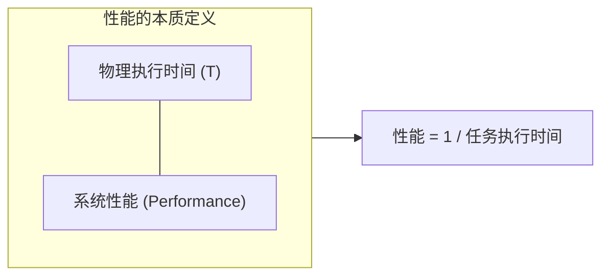
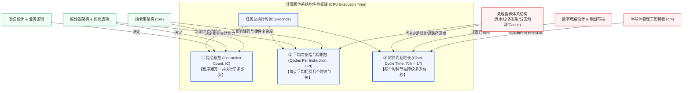
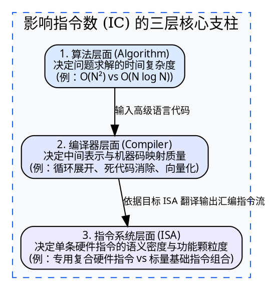
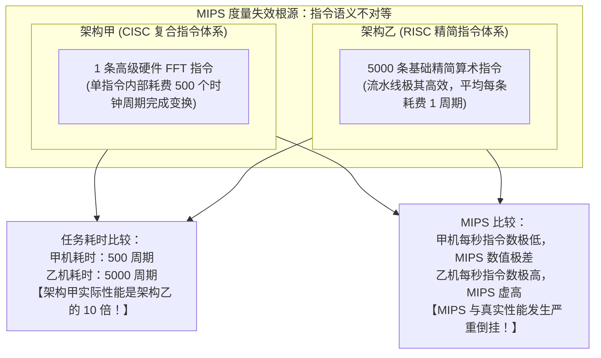
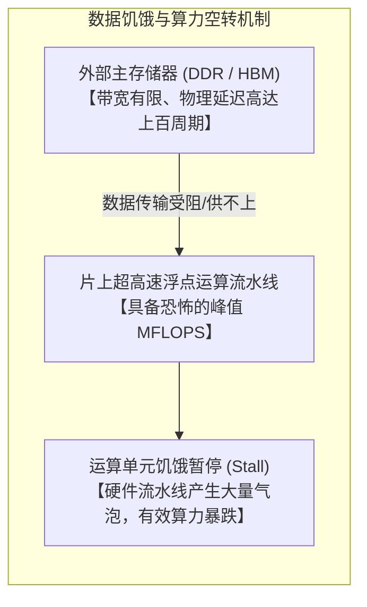
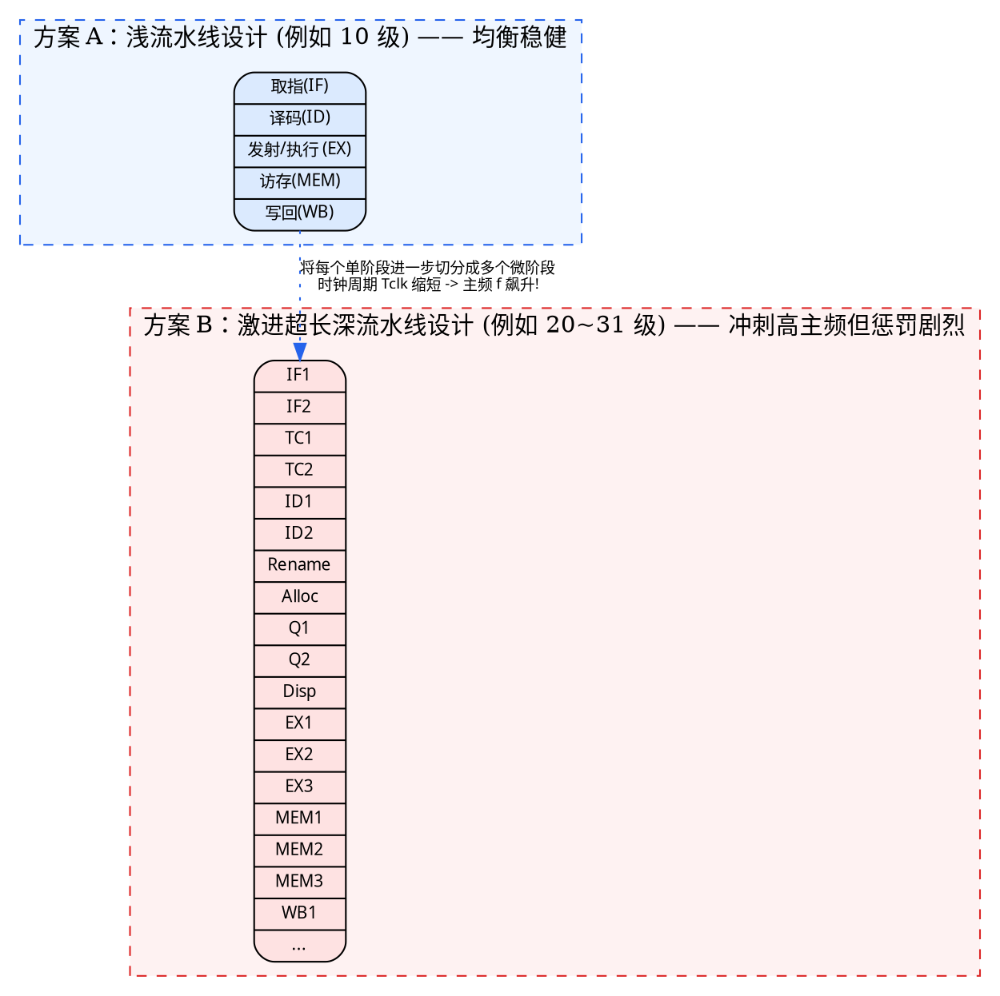
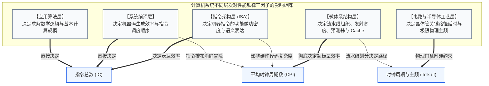

# 计算机体系结构性能全景指南：性能铁律、CPI/IPC 微结构解构与度量陷阱

> **“在计算机的世界里，没有抽象的‘快’；性能的最本质定义，永远是完成一个具体任务所需要的时间。”**

在现代科技与战略计算领域，计算机的性能往往具有决定性意义。从高能物理的大规模数值模拟，到前沿科学探索，计算速度直接关乎科研周期的长短；在气象科学领域，国家气象数值预报中心每天都需要根据卫星云图与雷达监测的海量气象观测数据，实时求解极其复杂的非线性偏微分方程组。如果计算机性能不够强劲，原本需要提前预测的 24 小时气象演变，直到后天才能完成计算，那么原本用于防灾减灾的“天气预报”就沦为了毫无工程与民生价值的“天气后报”。

因此，**性能（Performance）** 是评价与设计计算机系统的首要基石指标。

然而，究竟什么是计算机性能？主频 4.0 GHz 的处理器一定比 2.5 GHz 的处理器快吗？每秒能执行多少百万条指令（MIPS）或每秒浮点运算次数（MFLOPS）能够作为评判计算机优劣的唯一定量尺度吗？

本文将从体系结构的第一性原理出发，系统拆解计算机性能的本质定义与经典的**性能铁律（The Iron Law of Processor Performance）**，并结合算法复杂度、编译器优化技术、指令集体系结构（ISA）、处理器微结构（单发射/多发射、动态分支预测、高速缓存）以及半导体物理电路工艺，全景透视影响计算机运行速度的核心机制与历史工程案例。

---

## 零、初学者核心概念速查表

为了帮助首次接触计算机体系结构与处理器微结构的读者无障碍阅读，下表对本文首次出现的核心专业术语提供了严格定义、通俗物理直觉与生活类比：

| 专业术语 | 英文全称 / 缩写 | 概念本质定义 | 通俗直觉与生活比喻 |
| :--- | :--- | :--- | :--- |
| **执行时间** | Wall-clock Execution Time | 从任务启动到任务完全终止所消耗的真实物理时间（通常以秒为单位）。 | 跑完 100 米秒表走过的真实秒数；这是衡量性能的唯一绝对标准。 |
| **指令** | Machine Instruction | 计算机硬件能直接识别并执行的最基础控制命令（如加法、加载、跳转等）。 | 菜谱里的单步操作动作，如“切葱花”、“加一勺盐”。 |
| **指令集架构** | ISA (Instruction Set Architecture) | 软件与硬件之间的规范契约，定义了处理器支持的指令集、寄存器组织与寻址方式。 | 通用语言词典与语法规则，规定了程序员能向硬件下达的所有基本词汇。 |
| **时钟周期 / 拍** | Clock Cycle / Tick ($T_{\text{clk}}$) | 处理器内部主时钟脉冲震荡一次所经历的最小时间间隔，是硬件推进状态的离散节拍。 | 乐团指挥棒挥动一次的固定拍子；计算机中所有逻辑门翻转都在拍子驱动下有序推进。 |
| **主频 / 时钟频率** | Clock Frequency ($f$) | 处理器每秒内产生的时钟周期数，通常以 MHz 或 GHz 为计量单位 ($f = 1/T_{\text{clk}}$)。 | 指挥棒每秒钟挥动的总次数。2 GHz 意味着每秒挥动 20 亿次，每拍耗时 0.5 纳秒。 |
| **指令数** | IC (Instruction Count) | 计算机完成某一特定软件程序运行全程所执行的动态机器指令总条数。 | 完成一道宫保鸡丁在菜谱上累计记录的全部动作总步数。 |
| **每条指令平均周期数**| CPI (Cycles Per Instruction) | 执行一个程序所花费的时钟周期总数除以动态执行的指令总数 ($\text{Cycles} / \text{IC}$)。 | 做完一道菜平均每个动作需要耗费多少个节拍。 |
| **每周期平均指令数** | IPC (Instructions Per Cycle) | 处理器在单个时钟周期内平均能够完成并提交的指令条数 ($\text{IPC} = 1/\text{CPI}$)。 | 工厂装配线在每一个节拍里能够同时下线几件半成品。 |
| **微结构 / 微体系结构**| Microarchitecture | 实现特定指令集架构的具体物理硬件组织，包括流水线深度、发射宽度、执行单元与缓存等。 | 依据统一汽车图纸规范（ISA），实际装配制造出具体发动机与齿轮箱传动机械结构。 |
| **编译器** | Compiler | 将人类编写的高级语言（如 C/C++）源代码翻译为底层机器二进制指令代码的系统软件。 | 同声传译专家，把高阶构思翻译为厨师能照本宣科执行的机械动作清单。 |
| **快速傅里叶变换** | FFT (Fast Fourier Transform) | 一种高效将离散时域/空域信号分解转换为频域光谱信号的经典快速算法。 | 将混合果汁中的各类水果原料成分（各种频率的正弦波）精准分离的计算方法。 |
| **流水线** | Instruction Pipeline | 将指令处理拆解为取指、译码、执行、访存、写回等多个串行子阶段，实现多指令重叠执行。 | 现代汽车装配流水线：冲压、焊接、喷涂、总装同时对不同车辆流水作业。 |
| **超标量 / 多发射** | Superscalar / Multi-issue | 处理器微结构内包含多个平行的执行单元，同一时钟周期内能够同时发射并执行多条指令。 | 厨房里安排了多位炒菜师傅，一个节拍里可以同时起锅翻炒 4 道菜。 |
| **分支预测 / 转移猜测**| Branch Prediction | 处理器在条件跳转指令（如 `if-else`）执行前，提前预测下一跳代码路径以避免流水线停顿。 | 高速公路上老司机提前预判前方路口是否拥堵，无需每次都停车探路再决定转向。 |
| **高速缓存** | Cache (L1/L2/L3) | 位于 CPU 核心与主存之间的小容量、超高读写速度的片上静态随机存储器（SRAM）。 | 厨师身手可及的调料小托盘；不必每次放盐都跑回几百米外的地下大仓库（DRAM）。 |
| **MIPS** | Million Instructions Per Second | 处理器每秒执行的百万条指令数。常因未考虑每条指令所含实质做功大小而存在度量局限。 | “每秒写了多少个字”。如果不分文体，写小学生流水账与写学术专著比字数毫无意义。 |
| **MFLOPS** | Million FLoating-point Operations Per Second | 处理器每秒执行的百万次浮点运算次数（包含加法、乘法等）。 | “每秒能算多少次高精度小数乘除”。若数据供应断流，纸面峰值便无法兑现。 |
| **基准测试程序** | Benchmark (如 SPEC CPU) | 工业界与学术界用于公平量化评测计算机系统综合运行性能的标准化真实程序集合。 | 汽车性能统一拉力赛；用包含越野、山地、直线加速等各种真实路况的赛道综合打分。 |

---

## 一、性能的本质：从第一性原理出发

### 1.1 什么是计算机性能？

在日常生活中，非专业人士谈及计算机性能时，往往倾向于列举硬件参数：“这颗芯片是 8 核心的”、“它的主频能加速到 5.0 GHz”、“它的内存带宽有几百 GB/s”。

然而，在计算机体系结构理论中，所有这些静态硬件规格都只是**潜在的物理资源**，并不等同于计算机的实际性能。

> **性能的最本质物理定义，是“完成一个特定任务所需要的实际时间（Execution Time / Latency）”。**



对于大型国家气象计算中心的业务负责人来说，系统的性能就是：**“运行 24 小时全球中尺度天气预报物理模拟模型，究竟需要花费多少小时？”**

假设针对同一套 24 小时天气预报数值模型与相同输入数据集：
* **计算机甲**：需要消耗 **2 个小时** 的实际物理时间完成全部计算；
* **计算机乙**：需要消耗 **1 个小时** 的实际物理时间即可全部算完。

根据第一性原理：

$$\text{Performance}(A) = \frac{1}{\text{Execution Time}(A)}$$

显然，计算机乙完成任务所需的耗时更短，在“天气预报数值计算”这一具体业务场景下，**计算机乙的性能是计算机甲的 2 倍**。

### 1.2 响应时间（Latency）与吞吐率（Throughput）的辨析

在分布式系统、数据中心或服务器场景中，评价性能往往会引入另一个维度——**吞吐率（Throughput）**：

* **响应时间（Execution Time / Latency）**：指单个计算任务从提交到彻底完成所耗费的绝对物理时间。
* **吞吐率（Throughput / Bandwidth）**：指系统在单位时间窗口内能够处理并交付的任务总量（例如：每秒完成的 Web 请求数、每小时完成的气象模拟区域批次数）。

两者存在紧密联系但并不等价：
* 采用更快的单个处理器核心、优化核心算法能够缩短响应时间，自然也会提升吞吐率；
* 但是，简单地通过堆叠成千上万个处理器核心构建大规模集群，虽然可以大幅提高单位时间处理的批量任务总数（极大提高吞吐率），却**不一定能够缩短某单个串行强依赖任务的响应时间**。

---

## 二、计算机性能铁律（The Iron Law of Performance）

既然完成一个任务所需要的物理时间是性能的唯一定量尺度，那么这个时间究竟由哪些微观硬件与软件要素决定？

在计算机体系结构中，任何程序的物理执行时间都可以精确分解为三个核心维度的连乘积。这一著名公式由计算机体系结构奠基人提出，被称为 **计算机性能铁律（Iron Law of Processor Performance）**：

$$\text{CPU Execution Time} = \text{IC} \times \text{CPI} \times T_{\text{clk}}$$

或者，以处理器的时钟频率 $f$（主频，其中 $f = \frac{1}{T_{\text{clk}}}$）表示为：

$$\text{CPU Execution Time} = \frac{\text{IC} \times \text{CPI}}{f}$$



这三个量不是孤立的数字，而是贯穿了从上层算法、中间编译器、底层体系结构到底层半导体物理制造的完整系统工程：

1. **指令数（Instruction Count, IC）**：受**算法复杂度**、**编译器代码生成质量**以及**指令集架构（ISA）**的功能丰富度共同决定；
2. **每条指令平均周期数（Cycles Per Instruction, CPI）**：受**编译器指令调度**、**指令语义复杂度**以及**处理器微体系结构（超标量发射、分支猜测、多级 Cache 设计）**共同决定；
3. **时钟周期（Clock Cycle Time, $T_{\text{clk}}$）**：受**微结构流水线级数划分**、**逻辑电路路径延时**与**半导体制造工艺制程**共同决定。

下面我们逐层深入剖析这三大要素背后的权衡与工程规律。

---

## 三、要素一：完成任务所需的指令数（IC）

在主频和微结构固定时，执行的指令数越少，耗时越短。然而，指令数绝非单凭“写代码”就能随意减少，它在系统各层受到层层约束。



### 3.1 算法层面的决定性作用：经典历史案例启示

完成一个任务所需要的指令数，首要且最根本的决定因素在于**算法（Algorithm）**。

在通用微处理器自研攻关的历史长河中，一位资深体系结构科研专家曾分享过一个经典的工程对比案例：
> 在 20 世纪六七十年代的超级计算竞争初期，某一技术流派的计算机主频与物理运算能力极高，标称硬件速度可达每秒计算一亿次；而另一技术流派受限于当时的半导体电子元器件工艺，单机运算能力仅为每秒一百万次。
> 
> 然而，在联合运行同一个大型科学数值计算题目时，硬件单机速度慢了近百倍的计算机反而**更早完成了任务**。
> 
> 究其根本原因，就在于后者的数学家与软件算法团队设计了极其精妙的高效算法，使得求解同一数学物理问题时所需要执行的总逻辑运算步数（指令数）呈现出数量级级别的暴跌！

以软件工程中极其常见的数据排序任务为例：
* **冒泡排序算法（Bubble Sort）**：算法时间复杂度为 $\mathcal{O}(N^2)$；
* **快速排序算法（Quick Sort）**：算法时间复杂度为 $\mathcal{O}(N \log_2 N)$。

假设需要对 $N = 1024$ 个数据元素进行升序排序：
* 冒泡排序执行的基本比较与数据交换操作量大致正比于：
  $$1024 \times 1024 \approx 1{,}048{,}576 \text{ 次}$$
* 快速排序执行的基本操作量大致正比于：
  $$1024 \times \log_2(1024) = 1024 \times 10 \approx 10{,}240 \text{ 次}$$

两者在计算指令规模上**直接相差了将近 100 倍**！即使你在硬件微结构上通过极其昂贵的晶体管预算将 CPU 主频提高 5 倍、将流水线优化到极致，也远远无法弥补算法落后带来的百倍指令数膨胀。

### 3.2 编译器的代码生成与优化能力

现代开发者通常使用高级程序设计语言（如 C、C++、Rust 等）编写程序。计算机硬件是无法直接感知高级语言语法的，必须依赖**编译器（Compiler）**将高级语言代码解析为底层硬件所能识别的、由二进制 $0$ 和 $1$ 组成的机器指令。

编译器代码生成策略的优劣，直接决定了高级代码被翻译成机器指令后的总条数：
* **未开启优化（如 `-O0`）**：为了方便代码单步调试，编译器通常采用机械的直译策略。几乎每一次局部变量读写都会生成一对内存访存指令（`load` 从内存加载到寄存器，计算完后立刻 `store` 存回栈内存），这会产生极其庞大且冗余的指令序列；
* **高阶全局优化（如 `-O2` 或 `-O3`）**：编译器会触发极其复杂的控制流图（CFG）与数据流图（DFG）分析，执行包括**常量折叠（Constant Folding）**、**死代码消除（Dead Code Elimination）**、**寄存器重命名分配（Register Allocation）**、**循环展开（Loop Unrolling）**以及**自动向量化（SIMD Auto-Vectorization）**在内的一系列 Pass。

在同一台物理计算机上运行完全相同的 C 语言业务代码，仅仅调整编译器的优化选项（或更换更先进的编译器后端技术），程序生成的动态指令数往往能减少数倍，最终测得的真实端到端运行时间相差两到五倍并不罕见。

### 3.3 指令系统（ISA）的设计取舍：专用指令 vs 软件实现

指令集架构（ISA）的设计对指令数具有结构性的影响。

在硬件架构探索阶段，架构师经常面临关键的抉择：
* **选择方案 A（富语义复合指令）**：在硬件内部设计一条专用的复杂指令（例如，设计一条硬件专用的 1024 点快速傅里叶变换 `FFT1024` 指令，或者专用矩阵相乘指令）。这样一来，软件只需要执行**一条指令**就能完成极其庞大的数学变换；
* **选择方案 B（精简正交指令集）**：硬件只提供基础的标量运算指令（如普通的加、减、乘、移位与分支指令），让上层软件与数学库通过编写软件循环调用数十万条基础指令来实现同样的 FFT 功能。

这就引发了一个长期困扰计算机性能评估的核心问题：**“一条指令到底干了多少事？”**

---

## 四、度量陷阱辨析：为什么不能盲信 MIPS 与 MFLOPS？

在计算机发展的历史早期，人们极度渴望找到一个简单直观的单一定量数字来量化处理器的快慢。在这个背景下，**MIPS** 与 **MFLOPS** 应运而生，但也迅速沦为了著名的“性能度量陷阱”。

### 4.1 MIPS 及其本质缺陷

**MIPS** 全称为 **Million Instructions Per Second**，即**每秒钟执行多少百万条指令**：

$$\text{MIPS} = \frac{\text{Instruction Count}}{\text{Execution Time} \times 10^6} = \frac{f}{\text{CPI} \times 10^6}$$

表面上看，MIPS 是一个非常合理的度量尺标——每秒跑的指令越多，速度当然越快。

然而，MIPS 忽略了一个致命事实：**不同体系结构、不同编译器环境下，一条指令的做功密度存在云泥之别！**



**实证推演**：
假设同样需要计算一个 1024 点的傅里叶变换：
* **计算机甲** 拥有专用指令，只需发射 **1 条指令**，硬件耗费 500 个时钟周期执行完毕；
* **计算机乙** 采用精简指令集，软件库展开后共需要执行 **5000 条加法/乘法指令**，流水线调度优秀，平均每条指令只要 1 个周期，总共耗费 5000 个时钟周期。

在主频相同的条件下，**计算机甲的实际完成时间是计算机乙的十分之一，性能高出 10 倍**！然而：
* 计算机乙每秒钟疯狂吞吐了 5000 条指令，计算出的 MIPS 数值极其耀眼；
* 计算机甲每秒钟只执行了少量复合指令，计算出的 MIPS 数值远落后于乙。

因此，在跨架构或跨编译器的比较中，MIPS 彻底失去了衡量真实性能的意义。计算机学术界甚至幽默地将 MIPS 重新释义为：
> **MIPS = Meaningless Indication of Processor Speed（对处理器速度毫无意义的指标）**

### 4.2 MFLOPS 与“存储墙（Memory Wall）”瓶颈

既然每秒指令数靠不住，那么专门度量数学运算能力的 **MFLOPS（Million FLoating-point Operations Per Second，每秒百万次浮点运算）** 呢？

$$\text{MFLOPS} = \frac{\text{程序中的浮点运算总次数}}{\text{Execution Time} \times 10^6}$$

MFLOPS 虽然排除了非运算类管理指令的干扰，但在实际复杂工程应用中，同样不能单独作为系统性能的代表。

**核心矛盾：如果片上与片外的数据供给能力跟不上，处理器的理论运算能力再强也毫无用处！**

现代高性能处理器（包括通用 CPU 与专用加速核心）的算力密度以极高斜率增长，但受限于芯片引脚引出物理极限、高频总线功耗与 DRAM 动态电容充放电物理延迟，**内存访存带宽与访问延迟的演进速度远远滞后于算力增长**。这一现象在体系结构中被称为**存储墙（Memory Wall）**。



根据经典的 **Roofline 性能上限模型**：

$$\text{实际可达算力} = \min\left(\text{硬件峰值算力}, \text{计算强度 (FLOPs/Byte)} \times \text{内存可用带宽}\right)$$

如果一个科学计算程序的数据重用率（Data Reuse）很低，计算流水线每执行一次浮点加乘运算，都需要从外部内存长距离搬运一次数据。那么处理器大部分时间都处于等待内存数据的挂起状态（Memory Stall），此时纸面宣称的几万 MFLOPS 峰值浮点能力全部在空转，实际性能仅取决于内存总线的吞吐带宽。

---

## 五、要素二：每指令时钟周期（CPI）与微结构解构

在指令集（ISA）确定之后，完成一个任务的指令数下限在很大程度上被规范约束住了。此时，硬件芯片架构师的主战场便转移到了微体系结构设计上：**如何降低每条指令的平均执行周期（Cycles Per Instruction, CPI），或者提高每个时钟周期的平均执行指令数（Instructions Per Cycle, IPC）？**

两者互为倒数：

$$\text{CPI} = \frac{\text{程序执行耗费的总时钟周期数}}{\text{程序执行的总指令数}} = \frac{1}{\text{IPC}}$$

如果一个处理器的 IPC 能够从 $0.5$（平均每 2 个周期才能完成 1 条指令）提升到 $2.0$（平均每个周期能完成 2 条指令），在主频与软件指令数不变的情况下，**程序的执行时间将直接缩短为原来的四分之一**！

### 5.1 影响 IPC 的三大微结构支柱

微结构设计对 IPC 的影响是决定性的，核心支柱包括：

```graphviz
digraph MicroArch_IPC {
    rankdir=LR;
    node [shape=record, style="filled,rounded", fontname="sans-serif", fontsize=10];
    edge [fontname="sans-serif", fontsize=9];

    subgraph cluster_ipc {
        label = "提升 IPC 的三大微结构技术支柱";
        style = dashed;
        color = "#16a34a";
        bgcolor = "#f0fdf4";

        Issue [label="{ ① 指令发射宽度 (Issue Width) | 标量单发射 (1-Issue) \n vs 超标量多发射 (4-Issue, 8-Issue) }", fillcolor="#dcfce7"];
        Branch [label="{ ② 分支转移猜测 (Branch Prediction) | 静态分支预测 \n vs 动态两级自适应分支预测器 }", fillcolor="#bbf7d0"];
        MemHier [label="{ ③ 存储层次架构 (Memory Hierarchy) | 寄存器文件 -> L1 Cache -> L2 Cache \n 乱序访存执行 (Out-of-Order Memory) }", fillcolor="#86efac"];
    }

    Issue -> Branch [style=invis];
    Branch -> MemHier [style=invis];
}
```

#### 1. 标量单发射 vs 超标量多发射（Superscalar / Multi-issue）
传统的标量流水线在一个时钟周期内只能从内存取指队列中发射一条指令到 ALU 执行，其理论 IPC 上限严格受限于 $\text{IPC} \le 1.0$（即 $\text{CPI} \ge 1.0$）。

现代高性能处理器普遍采用**超标量多发射结构**（例如 4 发射、6 发射乃至 8 发射）：
* 硬件内部并行部署多个译码器、多个整数与浮点运算执行部件（ALU、FPU）；
* 硬件调度逻辑通过动态依赖检查或乱序执行（Out-of-Order Execution），在一个时钟周期内将多条互不干扰的独立指令同时分发给不同的运算核心并发执行；
* 理论上使处理器的 IPC 上限突破至 $4.0$ 甚至更高。

#### 2. 分支预测与投机执行（Branch Prediction & Speculative Execution）
在任何真实业务代码中，平均每 5 到 7 条指令就会包含一条条件分支跳转指令（如 `if`, `while`, `switch`）。

在深流水线处理器中，当一条分支指令刚进入取指和译码阶段时，其判断条件往往依赖前面还未执行完毕的运算结果。如果处理器停下来死等结果计算出来，流水线就会陷入严重的空转停顿（Pipeline Stall）。

先进的微结构采用**动态自适应分支预测器**：
* 记录历史跳转路径与模式，在条件计算出来之前，提前以 95% 以上的高准确率“猜测”下一跳程序计数器（PC）的方向，并投机执行后续指令流；
* **预测成功**：流水线平滑无缝衔接，IPC 保持在高位；
* **预测失败（Branch Misprediction）**：硬件必须彻底清空投机阶段装载的所有错误指令，冲刷流水线并回滚寄存器状态，付出长达十几个甚至几十个时钟周期的严惩代价。

#### 3. 存储层次设计与缓存未命中惩罚
现代 CPU 访问片上 L1 高速缓存仅需 3~4 个时钟周期；而一旦发生 L1/L2 Cache Miss，被迫穿透到片外主内存读取数据，耗时将高达 100~200 个时钟周期。

优秀的微结构会设计更大的多级缓存、更激进的硬件数据预取引擎（Hardware Data Prefetcher）以及非阻塞缓存系统（Non-blocking Cache），允许在等待内存数据的长延迟期间，处理器继续调度后续不相干的独立指令执行（Hit-under-Miss），从而极大地挽救 CPI。

---

### 5.2 真实工业级微结构演进实证：同主频下 IPC 跃升 2~3 倍的秘密

为了定量说明“微结构设计对 IPC 的巨大影响”，我们参考一组在通用高性能处理器代际演进中的真实 SPEC CPU2000 基准程序实测数据。

#### 实验对照条件（控制变量法）：
1. **指令系统（ISA）完全一致**：两个芯片均完全支持相同的 64 位通用指令集；
2. **测试二进制程序完全相同**：同一套 SPEC CPU2000 编译出的纯二进制目标码，在两台机器上直接原盘运行；
3. **发射宽度与主频完全一致**：两款处理器均为 **64 位四发射（4-Issue）超标量微结构**，且主频均严格锁定在 **1.0 GHz**（时钟周期均为 1.0 纳秒）；
4. **唯一的核心变量**：**处理器内部微体系结构实现不同**（一代架构命名为 **CPU-Gen1**，第二代深度升级架构命名为 **CPU-Gen2**）。

下表列出了两款处理器在 26 个经典的工业级基准测试程序下的真实物理运行时间（秒）与换算后的分值对比：

| 测试程序类别 | SPEC 基准程序编号与名称 | CPU-Gen1 运行时间 (秒) | CPU-Gen1 基准分值 | CPU-Gen2 运行时间 (秒) | CPU-Gen2 基准分值 | 性能提升倍数 (分值比) |
| :--- | :--- | :---: | :---: | :---: | :---: | :---: |
| **SPEC_INT (整型计算)** | 164.gzip (通用无损压缩) | 503 | 279 | 323 | 433 | **1.55x** |
| | 175.vpr (集成电路FPGA布局布线) | 389 | 360 | 222 | 632 | **1.76x** |
| | 176.gcc (C 语言编译器基准) | 206 | 533 | 110 | 1,003 | **1.88x** |
| | 181.mcf (大规模车辆调度网络流网络) | 480 | 375 | 195 | 925 | **2.47x** |
| | 186.crafty (国际象棋博弈树搜索) | 166 | 604 | 122 | 822 | **1.36x** |
| | 197.parser (自然语言句法语法分析) | 707 | 254 | 266 | 676 | **2.66x** |
| | 252.eon (概率光线追踪渲染) | 159 | 815 | 141 | 924 | **1.13x** |
| | 253.perlbmk (Perl 脚本解释器执行) | 418 | 431 | 279 | 644 | **1.49x** |
| | 254.gap (计算群论与离散代数) | 338 | 325 | 155 | 711 | **2.19x** |
| | 255.vortex (面向对象数据库事务) | 291 | 652 | 125 | 1,520 | **2.33x** |
| | 256.bzip2 (块排序无损压缩) | 383 | 391 | 285 | 527 | **1.35x** |
| | 300.twolf (集成电路模拟退火布线) | 421 | 712 | 364 | 824 | **1.16x** |
| **SPEC_INT2000 几何平均** | **整型综合分值** | — | **447** | — | **764** | **1.71x** |
| **SPEC_FP (浮点计算)** | 168.wupwise (格点规范量子色动力学) | 338 | 473 | 123 | 1,296 | **2.74x** |
| | 171.swim (浅水波天气浅水波动方程) | 1,299 | 239 | 324 | 957 | **4.00x** |
| | 172.mgrid (3D 泊松势场多重网格法) | 1,045 | 172 | 169 | 1,062 | **6.17x** |
| | 173.applu (三维偏微分抛物双曲方程) | 900 | 233 | 197 | 1,067 | **4.58x** |
| | 177.mesa (3D 图形渲染库 OpenGL) | 244 | 574 | 156 | 896 | **1.56x** |
| | 178.galgel (流体力学纳维-斯托克斯) | 507 | 572 | 143 | 2,022 | **3.53x** |
| | 179.art (自适应共振神经网络图像识别)| 173 | 1,504 | 97 | 2,686 | **1.79x** |
| | 183.equake (有限元地震波传播模拟) | 457 | 285 | 96 | 1,353 | **4.75x** |
| | 187.facerec (计算机视觉人脸特征识别)| 288 | 659 | 146 | 1,306 | **1.98x** |
| | 188.ammp (计算化学与蛋白质分子动力学)| 538 | 409 | 274 | 803 | **1.96x** |
| | 189.lucas (大质数卢卡斯-莱默检验) | 716 | 279 | 181 | 1,104 | **3.96x** |
| | 191.fma3d (三维有限元非线性瞬态撞击)| 550 | 382 | 203 | 1,034 | **2.71x** |
| | 200.sixtrack (高能核物理粒子加速器径迹)| 553 | 199 | 276 | 399 | **2.00x** |
| | 301.apsi (空气污染中尺度扩散分布模型)| 1,159 | 224 | 235 | 1,108 | **4.95x** |
| **SPEC_FP2000 几何平均** | **浮点综合分值** | — | **367** | — | **1,120** | **3.05x** |

#### 深度工程透视：数据背后的微结构本质

回顾我们的性能铁律公式：

$$\text{Execution Time} = \frac{\text{IC} \times \text{CPI}}{f} = \frac{\text{IC}}{\text{IPC} \times f}$$

在上述对比中：
* 二进制码一致 $\implies \text{IC}$ 保持完全一致；
* 主频一致（$1.0\text{ GHz}$） $\implies f$ 保持完全一致。

因此，**最终程序运行时间缩短的倍数，百分之百直接等价于 IPC 提高的倍数！**

1. **整型程序提升 1.71 倍**：
   * 在 `181.mcf`（大量指针跳跃寻址、Cache 极度不友好）和 `197.parser` 等控制密集型程序中，提升达到了 **2.47 倍 ~ 2.66 倍**。这证明 CPU-Gen2 拥有极其强悍的非阻塞 Cache 架构、更大的动态调度重排序缓冲（ROB）与命中率更高的分支预测算法；
2. **浮点程序实现平均 3.05 倍的跨越式暴涨**：
   * 在 `171.swim`、`172.mgrid`、`173.applu`、`183.equake`、`301.apsi` 等纯数学网格与偏微分方程求解程序中，运行速度提升了 **4 倍到 6 倍之多**！
   * 为什么同样是四发射结构，浮点性能能拉开如此巨大的鸿沟？因为 CPU-Gen2 重新设计了浮点融合乘加部件（FMA）、拓宽了数据访存通道的内存带宽加载队列（Load/Store Queue），并引入了极其强劲的流水线级矩阵连续预取。

这个极具说服力的工业级实测案例强有力地证明：**离开微结构谈核心数与发射宽度没有任何意义。优秀的微结构设计，能够在执行相同指令、主频完全相同的硬性约束下，榨取出 2 到 3 倍以上的强悍性能！**

---

## 六、要素三：时钟周期与主频的权衡与极限

性能铁律的第三个要素是时钟周期 $T_{\text{clk}}$（或其倒数主频 $f$）。主频越快，每拍耗时越短。

然而，**主频宏观上取决于微结构流水线的切分设计，微观上则受制于数字电路设计与物理半导体工艺。**

### 6.1 电路级与工艺级制约

在微观硬件层面，时钟周期的长度受限于**芯片上最长逻辑关键路径（Critical Path）的电信号传输与门翻转延时**：

$$T_{\text{clk}} \ge t_{\text{logic\_delay}} + t_{\text{setup}} + t_{\text{clock\_skew}}$$

* **电路设计差异**：如果团队甲设计的 64 位超前进位加法器电路只需耗费 $1.0\text{ ns}$ 就能完成信号稳定输出，而团队乙的电路实现存在冗余门级联，需要耗费 $2.0\text{ ns}$。那么即便在完全相同的代工厂制造，甲设计的理论极限主频也将是乙设计的 2 倍；
* **物理半导体工艺**：随着半导体晶体管物理制程从早期的大微米演进到纳米级鳍式场效应晶体管（FinFET）与环绕式栅极（GAA），晶体管尺寸越小，寄生电容越小，电荷充放电翻转速度越快，电路的关键路径延迟自然缩短，能够支撑的主频也就越高。

### 6.2 流水线深度与主频的博弈：历史上的“超长流水线教训”

既然缩小关键路径延时能直接拉高主频，微结构架构师很自然地产生了一个想法：
> **“如果我们把一条原本需要 5 级流水完成的指令，进一步拆碎、切分成 20 级乃至 40 级微流水线，每一级里只保留极少量的逻辑门（例如只做几级与非门），关键路径延迟不就大幅压缩了吗？主频不就可以飙升上去了吗？”**

在业界历史上，曾有著名的桌面通用处理器架构（以 NetBurst 架构为代表）为了激进地冲刺超高主频，上演了一场极具戏剧性的体系结构博弈：
* **第一代经典微结构**：采用 **10 级** 流水线设计，主频稳扎稳打；
* **第二代换代架构**：为了从宣传上在主频数字上击溃竞争对手，一发猛把整数流水线直接加深到了 **20 级**，后续迭代甚至恨不得将其拉长到 **31 级至 40 级**！



这种盲目拉长流水线的做法迅速撞上了体系结构的物理铁壁：

#### 恶果一：分支预测失败代价呈指数级倍增
在 10 级流水线中，分支预测失败只需冲刷 10 拍的管线指令；而在 31 级超长流水线中，一旦分支预测失手，**整整 30 多拍的时钟周期全部彻底打水漂**！流水线瞬间被充满大量毫无产出的气泡（Pipeline Bubbles），导致实际测算出的 **CPI 急剧恶化（IPC 严重暴跌）**。

当时先驱先锋研究团队的大量硅片模拟表明：
> **流水线深度每增加一倍，微结构由流水线停顿引起的效率损失极为剧烈。必须将片上高速缓存（Cache）容量和分支预测历史表（Branch Prediction Table）的硬件容量整整增加一倍，才能勉强抵消因流水线拉长带来的整体执行效率雪崩！**

#### 恶果二：功耗墙（Power Wall）全面爆发
动态功耗正比于主频与电压的平方（$P_{\text{dynamic}} \propto C \cdot V^2 \cdot f$）。流水线深度的增加带来了极其庞大的中间流水线锁存器（Pipeline Latches），芯片发热量呈失控式爆炸，主频最终死死受限于物理散热能力的极限（通常在风冷/常规水冷下卡在 4GHz~5GHz 瓶颈），超长流水线不仅没有带来预想中的算力突破，反倒被业界称为“高频低能”的典型代名词。

现代处理器架构设计最终重回理性：**放弃对流水线深度的无限制盲目追求，将核心流水线稳定在 12~18 级的物理甜点区间，转向更深度的乱序执行重排、更宽的超标量发射、更庞大智能的缓存分支系统与多核协同。**

---

## 七、全系统视角的统一权衡与综合审视

通过对性能铁律三个乘数因子的全方位解构，我们可以建立起一张贯穿软硬件全栈的综合权衡全景矩阵：



### 7.1 为什么单一指标永远无法定义计算机性能？

回顾前文的分析，我们能够得出明确的科学结论：**在计算机体系结构中，没有任何单一的孤立硬件指标（无论是核心主频、核心数量、MIPS、还是纸面 MFLOPS）能够独立完整地刻画一台计算机性能的高低。**

| 孤立指标 | 为什么它无法作为性能的唯一定量尺度？ | 典型失效场景 |
| :--- | :--- | :--- |
| **时钟频率 (主频)** | 主频高并不代表计算快。如果微结构 IPC 极差，或者流水线充满气泡，高频处理器的任务执行耗时反而会被低频但 IPC 极高的高效微结构彻底超越。 | 超长深流水线处理器（主频虽高但单核实际性能拉胯） |
| **指令吞吐 (MIPS)** | 未能考虑单条机器指令所代表的物理实质工作量。CISC 架构的一条专用指令可能抵得上 RISC 的数百条基础算术指令。 | CISC 与 RISC 体系结构的跨架构测试横向对比 |
| **浮点理论峰值 (MFLOPS)** | 脱离了内存总线带宽与片上存储缓存系统的配合。一旦遇到受访存瓶颈制约的程序，算力单元将全面饥饿挂起。 | 图计算、大规模稀疏张量运算、流体力学网格离散化 |
| **核心数量 (Cores)** | 受制于阿姆达尔定律（Amdahl's Law）。如果程序中存在无法高度并行化的串行瓶颈部分，无限制堆砌计算核心所带来的性能边际增益将迅速递减归零。 | 传统关系型数据库单事务更新、强依赖控制流逻辑 |

### 7.2 性能的相对性：没有“放之四海皆准”的最快计算机

在文章的开头，我们曾提到一个直觉判断：
> “如果让计算机甲和计算机乙同时计算明天的天气预报，计算机乙用了 1 小时，计算机甲用了 2 小时，那么在‘天气预报’这个应用上，计算机乙的表现确实优于计算机甲。但这是否意味着：**计算机乙在所有场景下都绝对比计算机甲更好？**”

答案是：**完全不能！**

计算机体系结构的设计永远充斥着基于目标领域的取舍（Domain-Specific Trade-offs）：
* **计算机乙** 可能配备了极其庞大宽阔的高速浮点向量流水线与高吞吐的流式访存通道，在处理结构化网格偏微分方程（天气预报的核心模型）时如鱼得水、效率拉满；
* 但是，如果我们将测试程序更换为大型分布式编译系统、关系型数据库高频事务处理，或者是复杂的符号逻辑定理证明（这些程序充斥着极深的多层指针跳转、频繁不可预测的条件分支与短小随机的数据存取）；
* **计算机甲** 凭借其更大的单核乱序发射窗口、容量更为激进的片上 L3 Cache 以及更精准的分支猜测系统，在此类控制敏感型应用中，运行速度很可能反过来**反超计算机乙数倍**！

这正是现代计算机体系结构演进的核心魅力所在：**性能永远是算法、系统软件、指令集与硬件微结构在特定业务应用场景下的协同共振。离开具体的应用负载与物理执行时间，任何关于“谁比谁更快”的争论都将沦为空谈。**

---

## 八、总结与课后思考

### 核心知识要点回顾
1. **性能的第一性原理**：性能的最本质衡量标准永远是**完成一个任务所花费的实际物理时间（Wall-clock Time）**。
2. **性能铁律公式**：
   $$\text{Execution Time} = \text{IC} \times \text{CPI} \times T_{\text{clk}} = \frac{\text{IC} \times \text{CPI}}{f}$$
   性能是由指令数（IC）、平均每指令时钟周期（CPI）与主频（$f$）共同构成的稳固三脚架。
3. **分层决定机制**：
   * 算法复杂度是缩减指令数的头号引擎（如快排相比冒泡排序可直接减少两个数量级指令）；
   * 编译器优化能够成倍精简生成的机器指令，改善流水线排布；
   * 指令系统（ISA）决定了指令表达的颗粒度与做功密度；
   * 微结构设计（多发射、分支猜测、多级 Cache）直接主导了 IPC 的高低，同主频、同指令下优秀的微结构能让性能提升数倍；
   * 电路与制造工艺制程则划定了极限主频的物理边界。
4. **度量陷阱警示**：MIPS 忽视了指令做功密度的不对等，MFLOPS 忽视了存储墙带来的数据饥饿；评估计算机系统必须采用包含多元真实工况的标准化基准测试集（如 SPEC CPU）。

---

### 💡 深度课后思考题

1. **思考题一**：在阿姆达尔定律（Amdahl's Law）的制约下，假设一个程序中有 $20\%$ 的执行时间是完全无法被并行化的纯串行逻辑。如果我们为了追求极高的浮点吞吐率，将处理器的计算核心数量从 1 个扩充到 1000 个，该程序理论上最大的加速比上限是多少？为什么？
2. **思考题二**：在当今智能计算与大模型时代，处理器的算力演进速度（每年数十倍）已大幅超越了片外高带宽内存（HBM）的物理带宽演进速度。结合本文所学的性能铁律与 Roofline 模型，解释为什么算法工程师必须极力追求“算子融合（Operator Fusion）”与“FlashAttention”等内存局部性优化技术？
3. **思考题三**：如果在某个嵌入式实时安全关键系统中，需要严格保证代码在最坏情况下的执行时间（WCET, Worst-Case Execution Time）绝对确定可预测。此时，乱序多发射、动态分支预测器和动态 Cache 机制会带来什么负面挑战？硬件架构师会作何取舍？
