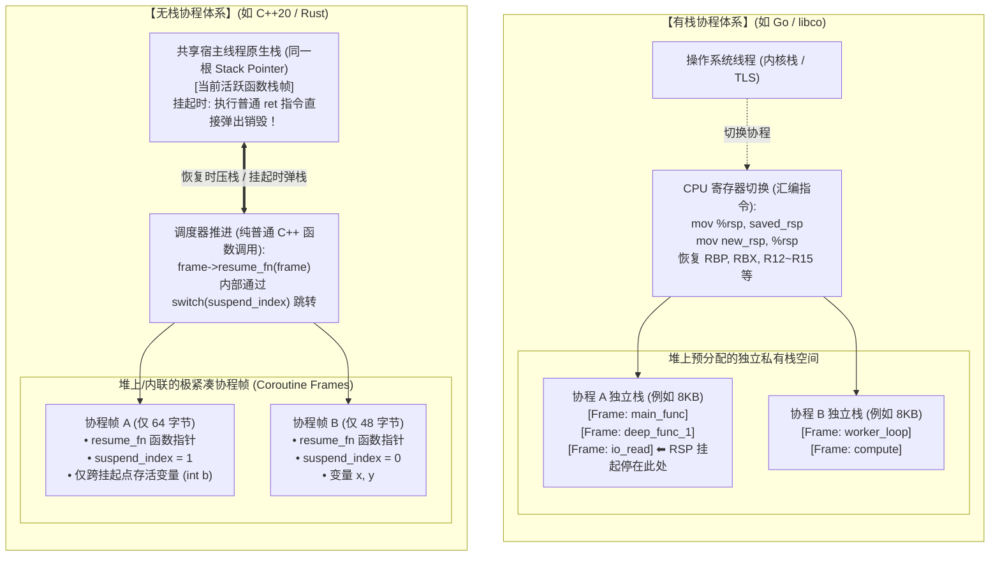
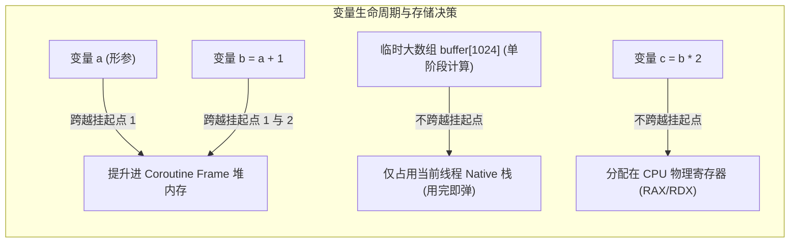
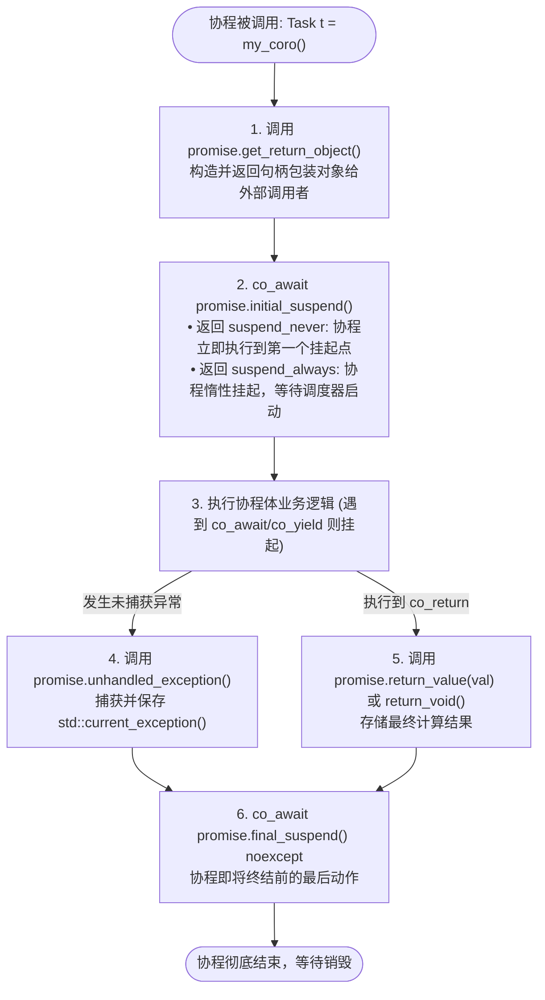
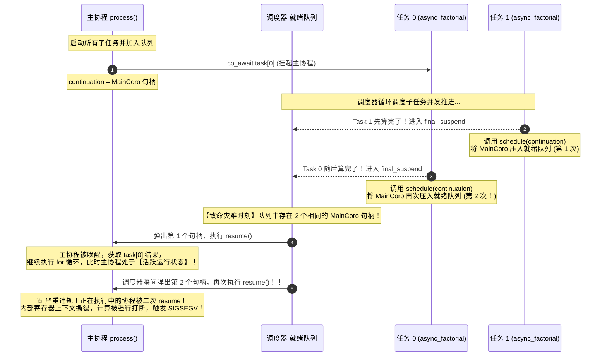
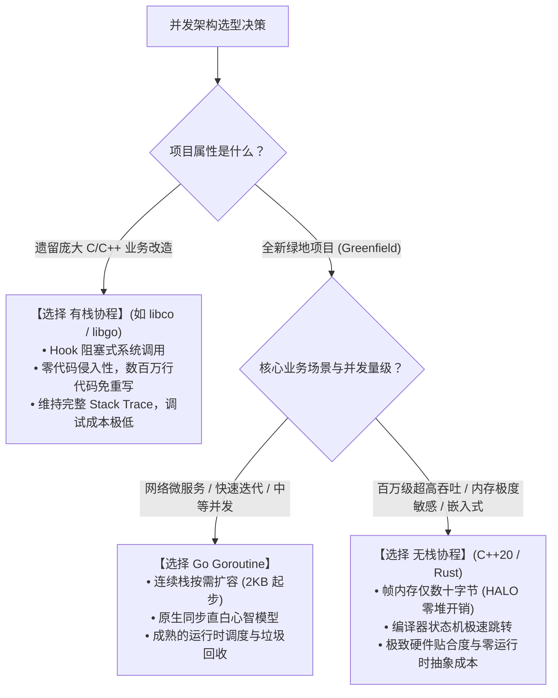

在当今高并发与海量 I/O 驱动的高性能系统架构中，**协程（Coroutine）** 早已成为现代编程语言的标配。从 Go 语言引以为傲的百万级 Goroutine，到 Python/JavaScript 的 `async/await`，再到 C++20 终于引入的标准协程支持，并发编程的心智模型正在经历一场深刻的范式演进。

然而，对于许多刚接触协程或习惯了传统多线程编程的开发者来说，协程的世界充满了令人困惑的迷雾：
- **“既然都叫协程，有栈协程（Stackful）和无栈协程（Stackless）到底差在哪？为什么无栈协程的内存开销能小千倍？”**
- **“如果无栈协程在吞吐量与内存上如此领先，为什么 Go 和腾讯的 libco 依然坚持使用有栈协程？”**
- **“都说无栈协程是‘编译器自动生成的有限状态机’，编译器到底在幕后做了什么戏法把普通函数大卸八块？”**
- **“为什么一旦写了异步，整条调用链都会被‘传染’？如果一路传染，操作系统启动的 `main` 函数也必须是协程吗？”**
- **“在 C++20/C++23 中手写一个多任务并发协作调度器到底有多难？为什么看似天衣无缝的代码会在运行时莫名跑出错误数值甚至惨烈触发 `SIGSEGV` 段错误？”**

本文将以系统级程序员的视角，从计算机体系结构、操作系统栈内存管理、编译器中间表示（IR）降级，一路贯穿到工业级 C++ 代码实操与真实 Debug 现场，带你彻底穿透协程的迷雾。

---

## 序章：初学者必读——核心术语通俗词典

在深入剖析底层之前，我们先通过通俗生动的比喻，统一技术语言。如果你是第一次接触这些名词，无需畏惧，它们本质上是计算机为了**“在单核或多核 CPU 上以极小代价交替处理多个任务”**而发明的基础设施。

> [!NOTE] 核心并发与协程术语白话解析
> - **进程（Process）与线程（Thread）**：
>   - **进程**是操作系统的“独立工厂”，拥有独立的虚拟内存地址空间；
>   - **线程**是工厂里的“流水线工人”，多个工人共享同一个工厂的厂房与物料（内存）。操作系统内核负责安排哪个工人何时上岗（内核态抢占式调度），工人换班时，CPU 必须保存整套硬件寄存器并切换页表或特权级，上下文切换成本高昂（通常为微秒级）。
> - **协程（Coroutine，协作式例程）**：
>   - **“工人脑内的小任务清单”**。它完全运行在用户态，完全由程序员或语言运行时调度。一个线程可以管理成千上万个协程；协程之间的切换不需要惊动操作系统内核，开销极低（纳秒级）。
> - **调用栈（Call Stack）与栈帧（Stack Frame）**：
>   - 线程执行函数调用时的“记忆抽屉”。每当函数 `A()` 调用 `B()`，系统就会在内存高地址向下压入一个栈帧，用来存放 `B()` 的形参、局部变量和返回地址；`B()` 执行完返回时，栈帧弹出。
> - **有栈协程（Stackful Coroutine）**：
>   - **“自带便携行囊的背包客”**。每个协程在创建时，都在堆上预分配了一块独立的虚拟连续栈空间。协程挂起时，连同它的整个背包（调用链栈帧）一起原地冻结，CPU 栈指针（`RSP`）直接切到别的协程栈上。典型代表：**Go Goroutine、Lua 协程、腾讯 libco**。
> - **无栈协程（Stackless Coroutine）**：
>   - **“轻装上阵的固定工位工人”**。协程本身没有独立的私有栈空间，执行时直接借用宿主线程的原生栈。挂起时，编译器把“下次醒来还要用的关键变量”打包进一个小盒子里（协程帧），然后直接执行普通的 `return` 语句退栈，将整个线程栈完整让出。典型代表：**C++20/C++23、Rust async/await、JavaScript、Python**。
> - **编译器降级（Lowering / 脱糖 Desugaring）**：
>   - 编译器前端在处理高级语法（如 `co_await`、`async`）时，在编译中间阶段将其拆解、改写为底层的基础控制流（如结构体、`switch-case` 跳转、函数指针调用）。
> - **协程帧（Coroutine Frame）**：
>   - 无栈协程的核心实体。由编译器在堆上或内联分配的一块紧凑结构体，用于存放协程当前的状态编号、恢复函数指针、以及跨越挂起点存活的局部变量。
> - **存活分析（Liveness Analysis）**：
>   - 编译期的数据流分析技术。编译器通过构建控制流图，计算每个局部变量在哪些代码区间存活。只有在挂起点前后都需要被读取的变量，才会被塞进协程帧；局部临时变量随用随抛，绝不占用协程帧空间。
> - **异步传染性（Function Coloring / 函数染色）**：
>   - 无栈协程的经典工程特性。因为协程挂起依赖逐层 `return` 状态机对象，如果底层函数是协程，上层调用者也必须通过 `await` 接收并声明为协程，导致 `async` 关键字像颜料一样顺着调用链向上染色扩散。
> - **双重恢复（Double Resume）**：
>   - 协程生命周期中最隐蔽的致命 Bug 之一。当同一个协程句柄在其尚未挂起（正处于运行态）或者已经被恢复后，被外部并发事件或调度器再次调用 `resume()`，导致同一个状态机在两个执行流中交错推进，引发未定义行为、内存踩踏与 `SIGSEGV`。

---

## 第一章：架构哲学对决——有栈协程 vs 无栈协程

为什么同样是为了解决“高并发 I/O 阻塞”问题，技术世界会分裂出“有栈”和“无栈”两条截然不同的演进路线？它们在底层物理世界里究竟如何运作？

### 1.1 核心差异速览矩阵

| 评估维度 | 有栈协程 (Stackful Coroutine) | 无栈协程 (Stackless Coroutine) |
| :--- | :--- | :--- |
| **底层硬件本质** | **私有虚拟栈内存 + CPU 寄存器上下文切换** | **编译器合成的状态机结构体 (`switch-case`) + 闭包** |
| **单协程内存基准** | **较重**：通常 KB 级起步（如 Go 初始 2KB，传统 libco 预分配 128KB~1MB） | **极致轻量**：通常仅数十到数百字节（仅保存跨挂起点变量） |
| **万级并发内存开销** | 10,000 个任务约消耗 **几十 MB ~ 数 GB** | 10,000 个任务仅消耗 **几百 KB ~ 数 MB**（相差数十到上千倍） |
| **切换开销与开销源** | 相对较高：需保存/恢复 10+ 个 CPU 通用寄存器，易引发 CPU L1/L2 Cache 局部性破坏 | 极低：本质为一次普通间接函数指针调用 + 整数 `switch` 分支，编译器可极致内联 |
| **嵌套函数挂起能力** | **完全支持**：可在任意深度的普通函数内部随时调用 `yield` 挂起 | **不支持**：只能在协程体顶层挂起，调用链必须层层声明为协程 |
| **代码侵入性 / 传染性** | **零侵入**：函数签名保持不变，同步老旧代码直接复用 | **强传染性**：`async/await` 向上扩散，调用链路全盘染色 |
| **调试与调用栈回溯** | **极度友好**：GDB/LLDB 崩溃时呈现完整清晰的函数调用树 | **相对碎裂**：调用栈在挂起时已退掉，看到的常是编译器内部状态机符号 |
| **工业界典型代表** | **Go (Goroutine)、Lua Coroutine、腾讯 libco、Boost.Coroutine** | **C++20/C++23、Rust (async/await)、Python、C#、JavaScript** |

---

### 1.2 物理内存与执行模型的可视化对比

为了直观理解两者的微架构差异，我们通过下面的架构图观察它们在内存空间与 CPU 寄存器层面的物理行为：



从物理视图可以看出：
1. **有栈协程**的挂起，是**“换栈（Stack Swap）”**：CPU 的栈指针寄存器（如 x86-64 的 `RSP`）从协程 A 的私有栈跳到了协程 B 的私有栈。深度调用链上的局部变量都老老实实呆在各自的栈里。
2. **无栈协程**的挂起，是**“退栈（Stack Unwind via Return）”**：正在执行的线程栈原路返回，把现场全部弹掉，唯独把跨挂起点的几个关键变量写进堆上的 `Coroutine Frame` 中。

---

### 1.3 既然无栈协程性能如此领先，为什么有栈协程依然活跃？

面对无栈协程几乎碾压性的内存与切换速度优势，一个显而易见的疑问是：**为什么有栈协程没有被历史淘汰？为什么 Go 语言依然选择有栈设计？**

答案非常现实：**有栈协程在“人类心智负担”与“遗留工业生态兼容”这两个维度上取得了压倒性的胜利**。

#### 1. “随挂随走” vs 痛苦的“异步传染性（Function Coloring）”
在无栈协程中，如果一个函数内部需要挂起，它必须被声明为异步函数（如 C++ 的返回 `Task`，Rust 的 `async fn`）。
这带来了一个灾难性的链式反应：
- 如果底层深处的一个文件读取需要挂起，调用它的函数必须加上 `co_await`；
- 调用该函数的上层函数也必须加上 `co_await`……
- 最终，**成百上千个中间函数被迫全部修改签名与调用方式**。

假设你正在编写一个用于搜索游戏地图的**深度递归函数**：
- **有栈协程**：无论递归了 10 层还是 100 层，只要在最深层的叶子节点写一行 `yield()`，整个协程立刻挂起，让出 CPU；下次恢复时直接回到第 100 层现场。
- **无栈协程**：你必须把整个递归函数的每一层都改造成协程，每一层递归调用前都必须写上 `co_await`，编译器会为你生成 100 个嵌套的协程帧状态机，开发心智模型极度扭曲。

#### 2. 存量遗留生态的复用成本
假设一家公司维护着一个长达 15 年的传统 C++ 同步网络库，内部成千上万个函数都调用了底层的 `read()` 和 `write()`：
- **采用无栈协程改造**：意味着必须重写整个库，把所有 API 改造成 `co_await` 风格，所有业务线跟着全盘推倒重来。
- **采用有栈协程改造（如腾讯开源的 `libco`）**：借助 Linux 的 `dlsym` 或 Hook 机制，直接把底层的 `read()` 替换成非阻塞轮询加 `co_yield`。上层数百万行业务代码**一行不用改**，直接无缝跑在协程池上，开发迁移成本几乎为零！

#### 3. 生产环境的调试体验（Debuggability）
- 在有栈协程中发生 Core Dump 或打印日志时，调用栈是完整连续的，从 `main` 到发生异常的深层函数一目了然；
- 在无栈协程中，由于栈帧在挂起时已经 `return` 弹出了，崩溃栈往往被打平，调用链断层，GDB 只能看到调度器与编译器生成的内部辅助函数（如 `_coro_resume_helper`），极难排查业务上下文。

#### 4. 现代有栈协程的自我进化
很多人对有栈协程的印象还停留在“每个协程占用 1MB 虚拟内存”的传统 C 语言阶段。现代有栈协程（最典型的就是 Go 运行时）早已引入了**连续栈（Contiguous Stack）拷贝与分段栈技术**：
- Goroutine 启动时初始栈仅分配 **2KB**；
- 只有当调用深入、栈空间不足时，Go 运行时才会动态分配一块更大的新内存，并将旧栈拷贝过去。
- 这使得 Go 同样能够轻松拉起数十万并发，而上下文切换耗时仅需数十纳秒，对于高网络延迟的微服务场景，这点开销早已不再是系统瓶颈。

---

## 第二章：底层内幕——无栈协程的编译器状态机降级（Lowering）

无栈协程之所以能做到极致轻量，秘密全在**编译器**的鬼斧神工之中。
在这一章，我们将撕开语法糖的外衣，看看编译器前端和中端（如 LLVM 的 `CoroSplit` Pass）是如何把一段带有 `co_await` 的顺序代码，重构为高效的状态机的。

### 2.1 编译器降级全景还原

假设我们写下这样一段看似平常的 C++20 协程代码：

```cpp
Task foo(int a) {
    int b = a + 1;
    co_await some_io();  // 挂起点 1
    int c = b * 2;
    co_await other_io(); // 挂起点 2
    co_return c;
}
```

编译器在前端（Clang/GCC）与中端（LLVM）处理这段代码时，会执行一次彻底的“脱糖降级（Lowering）”，将其拆分成两大部分：
1. 一个紧凑的结构体：**协程帧（Coroutine Frame）**；
2. 一个包含 `switch-case` 状态分支的**恢复函数（Resume Function）**。

其等效的底层 C++ 代码结构如下：

```cpp
// 1. 编译器自动合成的协程帧结构体
struct FooFrame {
    // 函数指针：指向如何恢复当前协程
    void (*resume_fn)(FooFrame*);
    // 函数指针：指向如何销毁当前协程帧
    void (*destroy_fn)(FooFrame*);
    
    // 状态机编号：记录当前执行停在哪个挂起点 (替代 CPU 的 PC 程序计数器)
    int suspend_index = 0;

    // 用户定义的 Promise 对象
    Task::promise_type promise;

    // 跨挂起点存活的参数与局部变量提升 (Hoist) 到这里
    int a;
    int b;
    // 【关键观察点】：变量 c 并没有出现在这里！
    
    // 异步等待器对象
    SomeIoAwaiter awaiter_1;
    OtherIoAwaiter awaiter_2;
};

// 2. 编译器自动合成的状态机驱动恢复函数
void foo_resume(FooFrame* frame) {
    switch (frame->suspend_index) {
        case 0: goto state_0;
        case 1: goto state_1;
        case 2: goto state_2;
    }

state_0:
    frame->b = frame->a + 1;
    frame->suspend_index = 1; // 记录下一次唤醒应跳往 state_1
    // 挂起点 1: 尝试启动异步 I/O 并挂起
    if (frame->awaiter_1.await_suspend(coroutine_handle::from_address(frame))) {
        // 【核心内幕】：直接 return！普通的 CPU 栈帧瞬间弹出销毁！
        return; 
    }

state_1:
    {
        // 变量 c 只在 state_1 到 state_2 之间存活，不跨越任何挂起点！
        // 因此直接使用普通 CPU 寄存器或当前栈帧空间，完全不需要进堆上 Frame！
        int c = frame->b * 2; 
        frame->suspend_index = 2; // 记录下一次唤醒跳往 state_2
        if (frame->awaiter_2.await_suspend(coroutine_handle::from_address(frame))) {
            return; // 再次直接 return 退栈
        }
    }

state_2:
    frame->promise.return_value(...);
    return;
}
```

通过这段降级伪代码，我们可以透视出无栈协程的三个终极物理真相：

1. **完全没有底层寄存器上下文切换**：
   它没有执行诸如 `pushfq`, `mov %rsp, ...` 等任何汇编级别的栈切换指令；
2. **挂起就是普通的 `return`**：
   遇到 `co_await` 且条件未就绪时，协程把状态号赋给 `suspend_index`，接着执行一条普通的 `return` 指令。宿主线程的调用栈瞬间退回到调用方或事件循环手中，线程立刻可以去干别的事。
3. **恢复就是普通的函数调用**：
   当后台 I/O 就绪后，调度器拿到 `FooFrame*` 指针，直接调用 `frame->resume_fn(frame)`。进入函数后，一条 `switch` 语句直接 `goto` 到上次暂停的代码块继续向下执行。

---

### 2.2 存活分析（Liveness Analysis）与内存优化

为什么无栈协程帧能做到只有数十字节？

秘密在于编译器的**存活分析（Liveness Analysis）**：
编译器在构建控制流图（CFG）时，会精准计算每一个变量的生命周期。
- **跨越挂起点的变量（如上面的 `b`）**：在 `co_await` 前被赋值，在恢复后被使用。必须常驻内存，因此被**提升（Hoist）**到堆上的 `FooFrame` 中；
- **不跨越挂起点的临时变量（如上面的 `c`）**：在两次挂起之间随算随用，出作用域即作废。编译器将其分配在 CPU 通用寄存器或宿主线程临时栈中，**绝不占用协程帧半个字节**！



> [!TIP] C++20 的 HALO 堆分配消除优化
> 在默认情况下，C++20 的协程入口函数会在堆上调用 `operator new` 分配 `Coroutine Frame`。
> 但现代编译器（LLVM）具备强大的 **HALO (Heap Allocation eLide Optimization，堆分配消除优化)**：如果编译器通过内联能够证明协程帧的生命周期完全严格受限于调用者（即协程不会逃逸到外部后台线程），编译器会直接将整个 `Coroutine Frame` 优化分配到调用者的栈上，实现真正的**零堆分配（Zero-heap overhead）**！

---

### 2.3 经典拷问：整条调用链都在传染，`main` 函数也必须是协程吗？

既然无栈协程具有“强传染性”，只要底层有一个 I/O 挂起，调用链上的函数都必须声明为协程并一路 `co_await`，那么很多初学者都会冒出一个直觉问题：

> **“如果一路向上挂起、一路传染，那 C/C++ 程序的入口 `main()` 函数岂不是最终也必须写成协程？”**

答案是：**`main` 函数绝对不能、也完全不需要是协程——它是整条传染链的物理终点！**

#### 为什么操作系统决不允许 `main` 是协程？
操作系统的进程加载器（C Runtime 的 `_start` / `__libc_start_main`）只认普通的同步函数返回。
一旦 `main()` 执行了汇编级的 `ret` 指令，操作系统就认定整个进程已经终结，直接回收全部内存并退出进程。操作系统内核绝对不可能帮你去调度一个半途挂起未完成的协程状态机！

因此，**C++20 标准明确在语言层面明文规定（`[basic.start.main]`）：严禁将 `main` 函数声明为协程！**（即 `main` 函数体内绝对不准出现 `co_await`、`co_yield` 或 `co_return`）。

#### 传染链在 `main` 处是如何被“截断”的？
答案是：**在 `main` 函数内部建立一个“事件循环（Event Loop / Executor）”**。
`main` 函数本身是一个纯粹的同步函数，它像一台强大的**“电动机”**，死循环驱动着整个协程状态机齿轮组的运转：

```mermaid
flowchart TD
    subgraph CHAIN ["协程状态机传染链 (齿轮组)"]
        A["叶子协程: async_socket_read()<br/>(状态机，无自带动力源)"]
        B["中间业务: handle_request()<br/>(co_await 叶子，被传染为状态机)"]
        C["顶层入口: app_run()<br/>(co_await 业务，被传染为状态机)"]
        A -->|状态传递| B
        B -->|状态传递| C
    end

    subgraph ENGINE ["main 函数 (终结传染的电动机)"]
        M1["int main() { 同步入口 }"]
        M2["创建协程帧根节点:<br/>Task root = app_run();<br/>(普通同步函数调用，立即返回 handle)"]
        M3["启动事件循环 Event Loop:<br/>while(!root.is_done()) {<br/>  int n = epoll_wait(...);<br/>  ready_handle.resume(); // 驱动齿轮转动一步！<br/>}"]
        M4["return 0; // 所有任务彻底完成，进程退出"]
        M1 --> M2 --> M3 --> M4
    end

    C -.->|返回句柄 handle| M2
    M3 ==>|不断调用 .resume() 注入动力| C
```

> [!NOTE] 为什么 Rust / Python 中能看到 `async fn main()`？
> 你在 Rust 中看到的 `#[tokio::main] async fn main()` 或 Python 的 `asyncio.run(main())`，本质上是一层**宏展开的语法糖**。
> Rust 编译器在展开 `#[tokio::main]` 后，生成的依然是一个纯正的同步 `fn main()`，其内部把你的异步逻辑包成了一个匿名 Block，并调用了 `tokio::runtime::Runtime::block_on(body)` 强行在当前线程阻塞等待。其底层思想与 C++ 完全一致！

---

## 第三章：C++20 协程基础规范与生命周期解剖

C++20 的协程设计非常独特，它没有像 Python/Go 那样直接提供开箱即用的运行时或标准事件循环，而是提供了**一套极其精巧但高度晦涩的“底层定制钩子（Hooks）”**。这使得开发者可以为不同的硬件与业务场景打造极致定制的协程库。

### 3.1 核心三要素与禁区

在 C++20 中，只要一个函数体内包含了以下三个关键字之一，它就自动被编译器判定为协程：
1. **`co_await <expr>`**：暂停当前协程，等待异步操作完成；
2. **`co_yield <expr>`**：暂停当前协程，并向调用者传回一个中间值（常用于实现数据生成器 Generator）；
3. **`co_return <expr>`**：结束协程执行，并返回最终结果。

> [!CAUTION] 协程的使用禁区
> 以下函数绝对不能定义为协程，否则编译器直接报错：
> 1. `main` 函数；
> 2. 任何包含普通 `return` 语句的函数（协程必须用 `co_return`）；
> 3. 类的构造函数与析构函数；
> 4. 带有 C 风格变长参数的函数（`...`）；
> 5. `constexpr` 或 `consteval` 编译期求值函数。

---

### 3.2 协程契约：Return Object 与 `promise_type`

要让编译器理解你的协程，你必须定义一个**返回对象（Return Object）**，并在其内部定义一个约定俗成的嵌套结构体 **`promise_type`**。

`promise_type` 是协程与外部世界的通信中枢，它必须提供以下 5 个核心生命周期函数：



1. **`get_return_object()`**：
   在协程帧分配完成后第一时间被调用，通过 `std::coroutine_handle<promise_type>::from_promise(*this)` 拿到当前协程的句柄，并包装进自定义的返回对象（如 `Task`）交还给调用方。
2. **`initial_suspend()`**：
   决定协程刚创建时的初速度。如果返回 `std::suspend_never`，协程会直接冲进函数体执行到第一个挂起点（Eager 模式）；如果返回 `std::suspend_always`，协程创建后立刻原地挂起，等待外部显式调用 `.resume()` 驱动（Lazy 模式）。
3. **`final_suspend() noexcept`**：
   **核心安全防线**。协程执行完 `co_return` 后的最后一步动作。**工业级实践中绝大多数情况下必须返回 `std::suspend_always`**！如果返回 `suspend_never`，协程帧会在执行完毕后自动立即销毁，导致外部调用者在后续访问 `promise` 里的返回值时遭遇野指针崩溃，或者引发 Double Free。
4. **`unhandled_exception()`**：
   当协程体内抛出未被 `try-catch` 捕获的异常时被触发。通常在此处调用 `std::current_exception()` 保存异常指针，以便后续在 `co_await` 恢复点处重新抛出。
5. **`return_value(T val)` / `return_void()`**：
   对应 `co_return val` 或 `co_return;` 的逻辑，两者在一个 `promise_type` 中互斥存在。

---

## 第四章：工业级进阶实战——手写单线程协作式并发调度器与 Task/Generator

为了让大家彻底看透真实系统中的无栈协程调度全貌，我们将不再使用标准库未定案的半成品组件，而是**从零手写一个自包含的单线程协作式并发系统**：
- 支持生成斐波那契数列的自定义生成器 **`Generator<T>`**；
- 支持异步结果传递与等待的通用任务 **`Task<T>`**；
- 支持主动让出 CPU 的等待器 **`yield_awaiter`**；
- 管理协程就绪队列的核心调度器 **`Scheduler`**。

### 4.1 业务场景设定
我们让主协程先通过生成器惰性产出 10 个斐波那契数，然后针对这 10 个数字**同时启动 10 个异步阶乘计算任务**；每个阶乘任务在计算循环中都会主动调用 `co_await yield_awaiter{}` 让出 CPU，模拟多任务交替推进的协作式并发效果，最后由主协程依次收集打印结果。

---

## 第五章：实战排错与踩坑全纪录——程序员的“破案”现场

在将上述设计落地的过程中，我们完整遭遇了当代 C++ 协程开发者在 Linux 环境下最容易踩中、也最为隐蔽的四大巨坑。这是一份真实而宝贵的排坑档案：

### 5.1 踩坑 1：编译报错 `fatal error: generator: No such file or directory`

#### 故障现场
当我们在 Linux 系统中使用 GCC 13 或较新的 Clang 尝试引入 C++23 的标准生成器头文件时：

```cpp
#include <generator> // C++23 标准生成器
```

终端无情喷出错误：
```bash
$ g++ test.cpp -std=c++2b -o test
test.cpp:3:10: fatal error: generator: No such file or directory
    3 | #include <generator>
      |          ^~~~~~~~~~~
compilation terminated.
```

#### 根因剖析
虽然 C++23 标准在 P2502R2 中正式确立了 `std::generator`，但在现实世界中，**GCC 13.3** 尚未完全实现该头文件（直到 GCC 14+ 才正式合入）；而对应版本的 Clang 若使用系统的 GNU `libstdc++` 同样无法找到该文件。

#### 破案解法
与其被动等待编译器升级，不如利用 C++20 基础协程机制**手动实现一个工业级 `Generator<T>`**！
它通过定义嵌套的 `iterator`，在每次 `operator++` 时调用 `coro.resume()` 唤醒协程，在 `co_yield` 时挂起并暂存当前值：

```cpp
template<typename T>
struct Generator {
    struct promise_type {
        T current_value;
        Generator get_return_object() {
            return Generator{std::coroutine_handle<promise_type>::from_promise(*this)};
        }
        std::suspend_always initial_suspend() { return {}; } // 惰性：调用 begin() 时才真正启动
        std::suspend_always final_suspend() noexcept { return {}; }
        void unhandled_exception() { std::terminate(); }
        std::suspend_always yield_value(T value) {
            current_value = value;
            return {}; // 传出值后暂停，交出控制权
        }
        void return_void() {}
    };

    using handle_type = std::coroutine_handle<promise_type>;
    handle_type coro;

    Generator(handle_type h) : coro(h) {}
    Generator(Generator&& other) noexcept : coro(std::exchange(other.coro, nullptr)) {}
    ~Generator() { if (coro) coro.destroy(); }

    // 禁用拷贝
    Generator(const Generator&) = delete;
    Generator& operator=(const Generator&) = delete;

    // 提供标准 STL 迭代器支持
    struct iterator {
        handle_type coro;
        iterator(handle_type h = nullptr) : coro(h) {}

        iterator& operator++() {
            coro.resume(); // 推进到下一个 co_yield
            return *this;
        }
        T operator*() const { return coro.promise().current_value; }
        bool operator==(const iterator& other) const {
            return coro == other.coro || (coro && coro.done());
        }
        bool operator!=(const iterator& other) const { return !(*this == other); }
    };

    iterator begin() {
        if (coro) {
            coro.resume(); // 首次启动
            if (coro.done()) return end();
        }
        return iterator(coro);
    }
    iterator end() { return iterator(nullptr); }
};
```

---

### 5.2 踩坑 2：阶乘输出值错乱与遭遇 `SIGSEGV` 段错误崩溃！

#### 故障现场
当我们写好调度器与 `Task` 并满怀信心地编译运行时，诡异的一幕发生了：

```bash
$ clang++-21 test.cpp -std=c++23 -o test
$ ./test
Factorial of 0 is 1
Factorial of 1 is 1
Factorial of 1 is 1
Factorial of 2 is 2
Factorial of 3 is 3   <-- 错误！3! 应该是 6，为什么变成了 3？
Factorial of 5 is 5   <-- 错误！5! 应该是 120，为什么变成了 5？
Factorial of 8 is 8   <-- 错误！直接输出了输入值本身！
Factorial of 13 is 13
Factorial of 21 is 21
Factorial of 34 is 34
fish: Job 1, './test' terminated by signal SIGSEGV (Address boundary error)
```

**程序不仅算出的阶乘全变成了原数字本身，而且在最后惨烈暴毙于内存越界段错误（SIGSEGV）！**

这是怎么回事？我们的阶乘算法明明是经典的 `result *= i`，为什么执行逻辑会彻底崩塌？

#### 致命根因透视：多任务并发完成时的“双重恢复（Double Resume）”灾难

让我们顺着代码执行轨迹，还原这个在异步并发调度中最具杀伤力的深坑：



这就是问题的核心真相：
1. 主协程 `process()` 顺序 `co_await` 每一个任务，每个任务在挂起主协程时，都把主协程的句柄保存在了自己的 `promise.continuation` 中；
2. 由于所有任务是协作式并发交替推进的，**多个任务可能会相继或几乎同时完成**；
3. 当任务 1 先算完时，其 `final_suspend` 积极地把主协程句柄塞进就绪队列；
4. 任务 0 紧接着也算完了，它的 `final_suspend` **再次把同一个主协程句柄塞进了就绪队列**；
5. 此时就绪队列中排了两个一模一样的主协程句柄！
6. 调度器取出第一个句柄调用 `resume()`，主协程醒来开始执行下一轮循环，**此时主协程正处于活跃运行态，尚未通过下一次 `co_await` 挂起**；
7. 紧接着，调度器没有丝毫犹豫，从队列中弹出了第二个主协程句柄，并立即调用了 `resume()`！
8. **根据 C++ 协程核心标准规范：绝对禁止在一个尚未挂起（尚未处于 suspended 状态）的协程上调用 `resume()`！**
   这种非法双重恢复直接撕裂了状态机执行流，局部变量计算被跳过，最终导致 CPU 指针跑飞，引发 `SIGSEGV`。

---

### 5.3 踩坑 3：优雅修复——调度器引入 Pending Set 队列去重机制

找到了病灶，解法便水到渠成：
调度器必须具备**幂等入队保证（Idempotent Scheduling）**。同一个协程句柄在同一时刻，无论被多少个外部事件或子任务唤醒，**在就绪队列中只能存在一份**！

我们在 `Scheduler` 中引入一个 `std::unordered_set<std::coroutine_handle<>>` 作为在途监控集合（Pending Set）：
- 当调用 `schedule(h)` 时：如果 `h` 已经在集合中，直接忽略本次重复入队；
- 当从队列头部取出 `h` 时：从集合中抹去该句柄，随后安全调用 `resume()`。

#### 修复后的完整生产级代码（兼容 GCC 13 / Clang 21）

```cpp
#include <iostream>
#include <coroutine>
#include <deque>
#include <vector>
#include <exception>
#include <utility>
#include <memory>
#include <unordered_set> // 核心：用于就绪队列防重入去重

// ==========================================
// 1. 协作式调度器 (带队列去重机制)
// ==========================================
class Scheduler {
public:
    void schedule(std::coroutine_handle<> h) {
        if (!h || h.done()) return;
        
        // 关键防线：如果句柄已在就绪队列中排队，绝不重复插入！
        if (pending_set_.find(h) == pending_set_.end()) {
            pending_set_.insert(h);
            ready_queue_.push_back(h);
        }
    }

    void run() {
        while (!ready_queue_.empty()) {
            auto h = ready_queue_.front();
            ready_queue_.pop_front();
            pending_set_.erase(h); // 出队后方可允许下一次合法入队
            
            if (!h.done()) {
                h.resume(); // 推进协程执行一步
            }
        }
    }

    static Scheduler& instance() {
        static Scheduler s;
        return s;
    }

private:
    std::deque<std::coroutine_handle<>> ready_queue_;
    std::unordered_set<std::coroutine_handle<>> pending_set_;
};

// ==========================================
// 2. 主动让出 CPU 的等待器 (yield_awaiter)
// ==========================================
struct yield_awaiter {
    bool await_ready() const noexcept { return false; } // 总是挂起
    void await_suspend(std::coroutine_handle<> h) const noexcept {
        // 挂起当前协程，并将其重新排入调度队列尾部，让出 CPU
        Scheduler::instance().schedule(h);
    }
    void await_resume() const noexcept {}
};

// ==========================================
// 3. 通用协程生成器 Generator<T>
// ==========================================
template<typename T>
struct Generator {
    struct promise_type {
        T current_value;

        Generator get_return_object() {
            return Generator{std::coroutine_handle<promise_type>::from_promise(*this)};
        }

        std::suspend_always initial_suspend() { return {}; }
        std::suspend_always final_suspend() noexcept { return {}; }
        void unhandled_exception() { std::terminate(); }

        std::suspend_always yield_value(T value) {
            current_value = value;
            return {};
        }

        void return_void() {}
    };

    using handle_type = std::coroutine_handle<promise_type>;
    handle_type coro;

    Generator(handle_type h) : coro(h) {}
    Generator(Generator&& other) noexcept : coro(std::exchange(other.coro, nullptr)) {}
    ~Generator() { if (coro) coro.destroy(); }

    Generator(const Generator&) = delete;
    Generator& operator=(const Generator&) = delete;

    struct iterator {
        handle_type coro;
        iterator(handle_type h = nullptr) : coro(h) {}

        iterator& operator++() {
            coro.resume();
            return *this;
        }

        T operator*() const {
            return coro.promise().current_value;
        }

        bool operator==(const iterator& other) const {
            return coro == other.coro || (coro && coro.done());
        }
        bool operator!=(const iterator& other) const {
            return !(*this == other);
        }
    };

    iterator begin() {
        if (coro) {
            coro.resume();
            if (coro.done()) return end();
        }
        return iterator(coro);
    }

    iterator end() {
        return iterator(nullptr);
    }
};

// ==========================================
// 4. 异步任务 Task<T>
// ==========================================
template<typename T>
struct Task {
    struct promise_type;
    using handle_type = std::coroutine_handle<promise_type>;

    struct promise_type {
        T result;
        std::exception_ptr exception;
        std::coroutine_handle<> continuation; // 等待此任务的父协程句柄

        Task get_return_object() {
            return Task{handle_type::from_promise(*this)};
        }

        // 立即执行到第一个挂起点
        std::suspend_never initial_suspend() { return {}; }

        // 任务完成时，通知并调度等待它的父协程
        std::suspend_always final_suspend() noexcept {
            if (continuation) {
                Scheduler::instance().schedule(continuation);
            }
            return {};
        }

        void unhandled_exception() {
            exception = std::current_exception();
        }

        template<typename U>
        void return_value(U&& value) {
            result = std::forward<U>(value);
        }
    };

    handle_type coro;

    Task(handle_type h) : coro(h) {}
    Task(Task&& other) noexcept : coro(std::exchange(other.coro, nullptr)) {}
    ~Task() { if (coro) coro.destroy(); }

    Task(const Task&) = delete;
    Task& operator=(const Task&) = delete;

    // 实现 C++ awaitable 契约
    auto operator co_await() {
        struct awaiter {
            handle_type coro;

            bool await_ready() const noexcept {
                return coro.done();
            }

            void await_suspend(std::coroutine_handle<> awaiting) noexcept {
                // 将父协程记录为等待者
                coro.promise().continuation = awaiting;
            }

            T await_resume() {
                // 若子任务发生异常，向上重新抛出
                if (coro.promise().exception) {
                    std::rethrow_exception(coro.promise().exception);
                }
                return std::move(coro.promise().result);
            }
        };
        return awaiter{coro};
    }
};

// ==========================================
// 5. 业务协程实现
// ==========================================

// 使用生成器惰性生成斐波那契数列
Generator<int> fib_sequence(int n) {
    int a = 0, b = 1;
    for (int i = 0; i < n; ++i) {
        co_yield a;
        int c = a + b;
        a = b;
        b = c;
    }
}

// 模拟耗时异步阶乘计算：每轮循环主动让出 CPU
Task<int> async_factorial(int n) {
    if (n < 0) {
        throw std::invalid_argument("n must be non-negative");
    }

    int result = 1;
    for (int i = 2; i <= n; ++i) {
        result *= i;
        co_await yield_awaiter{}; // 协作让出控制权
    }
    co_return result;
}

// 主编排协程
Task<int> process() {
    // 1. 通过生成器获取前 10 个斐波那契数
    std::vector<int> fibs;
    for (int val : fib_sequence(10)) {
        fibs.push_back(val);
    }

    // 2. 批量并发启动 10 个阶乘计算任务
    std::vector<Task<int>> tasks;
    for (int val : fibs) {
        tasks.push_back(async_factorial(val));
    }

    // 3. 顺序收集并打印结果
    for (std::size_t i = 0; i < tasks.size(); ++i) {
        try {
            int result = co_await tasks[i];
            std::cout << "Factorial of " << fibs[i] << " is " << result << '\n';
        } catch (const std::exception& e) {
            std::cerr << "Error: " << e.what() << '\n';
        }
    }

    co_return 0;
}

// ==========================================
// 6. main 入口 (截断传染的驱动电动机)
// ==========================================
int main() {
    // 启动主协程
    auto main_task = process();
    Scheduler::instance().schedule(main_task.coro);

    // 运转事件循环，直到所有协程执行完毕
    Scheduler::instance().run();

    return 0;
}
```

---

### 5.4 踩坑 4：为什么 34! 输出是 0？13! 变成 1932053504？

编译并执行去重修复后的代码，程序瞬间畅通无阻，再也没有崩溃，输出如下：

```bash
$ clang++-21 test.cpp -std=c++23 -o test
$ ./test
Factorial of 0 is 1
Factorial of 1 is 1
Factorial of 1 is 1
Factorial of 2 is 2
Factorial of 3 is 6
Factorial of 5 is 120
Factorial of 8 is 40320
Factorial of 13 is 1932053504
Factorial of 21 is -1195114496
Factorial of 34 is 0
```

有细心的读者可能会问：
> “阶乘逻辑虽然恢复了，为什么 13!、21!、34! 的计算结果看起来如此奇怪？”

这涉及 C/C++ 初学者极易忽视的基础知识：**有符号整型溢出回绕（Integer Overflow Wrap-around）**。
- 在主流 64 位操作系统（x86-64 / AArch64）中，C++ 标准规定的 `int` 是 **32 位有符号整数**；
- 其最大能够表达的正整数为 $2^{31} - 1 = 2,147,483,647$（约 21.4 亿）；
- 而 $13! = 6,227,020,800$（约 62 亿），已经远远超出了 32 位整型的承载极限，在二进制低 32 位截断后便呈现为 `1932053504`；
- $21!$ 溢出到了最高位符号位，变成了负数；
- 到了 $34!$，因子中包含的 2 的幂次已经超过了 32 次方（即乘积中包含因子 $2^{32}$），低 32 位全部被 0 填充，最终结果自然精准截断为 `0`！

若需要支持更大位数的精确计算，仅需将返回类型升级为 `long long`（可支持到 20!）、GCC/Clang 原生扩展 `__int128`（支持到 34!），或者引入 `boost::multiprecision::cpp_int` 任意精度大数库即可。协程框架本身已经坚若磐石！

---

## 第六章：工程总结与现代并发心智模型

经历这场从底层硬件到编译器状态机、再到调度器踩坑排错的全景之旅，我们可以提炼出在现代工程架构中做并发选型的终极决策准则：



### 核心心法速查表

1. **看本质**：有栈协程比的是**私有栈与寄存器保存**，无栈协程比的是**编译器状态机与紧凑协程帧**。
2. **看代价**：无栈协程虽然省了内存与切换开销，但付出了**异步传染性（Function Coloring）**与更复杂的调试代价。
3. **看驱动**：无栈协程没有自带引擎，`main` 函数绝不是协程，它是终结传染链、驱动状态机旋转的“电动机”。
4. **守规矩**：设计协程调度器时，**永远保证同一个协程句柄在就绪队列中唯一存在**，严禁在正在运行的协程上发起二次恢复（Double Resume），这永远是系统稳定运行的第一道铁律！
