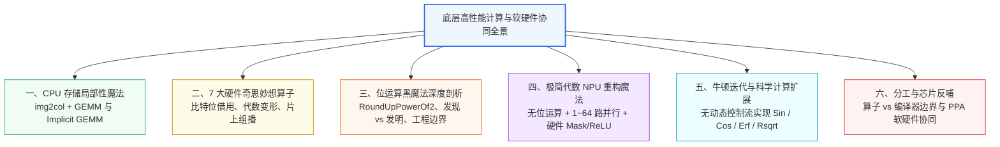
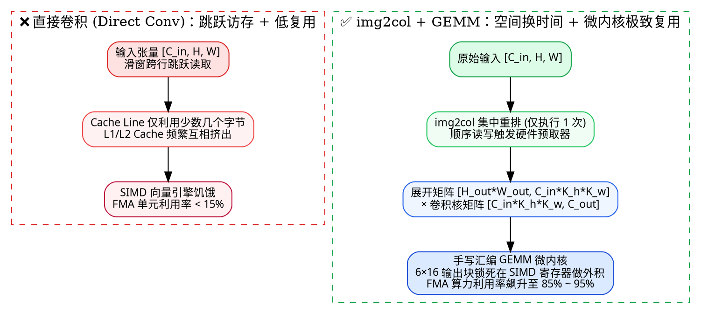
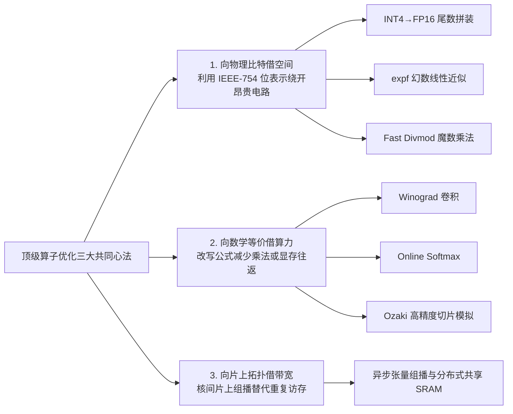
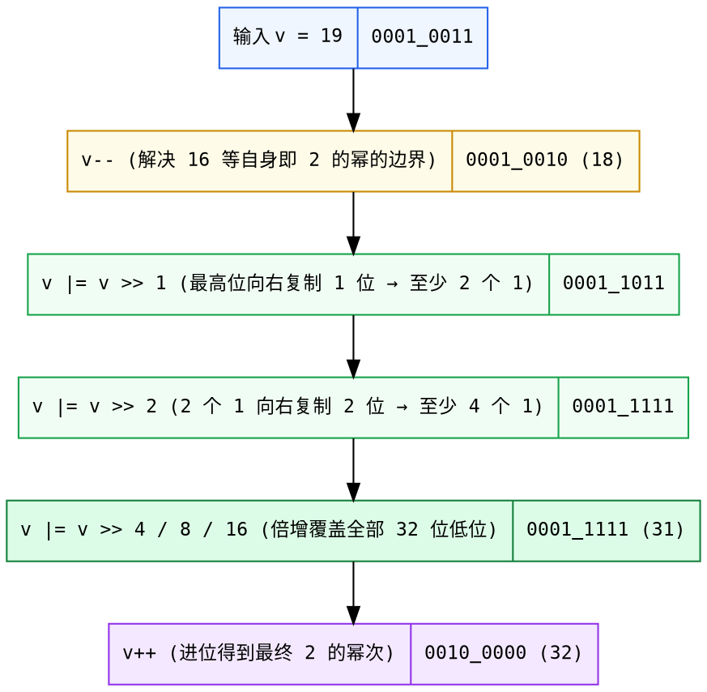
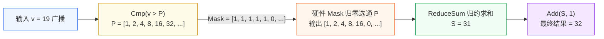
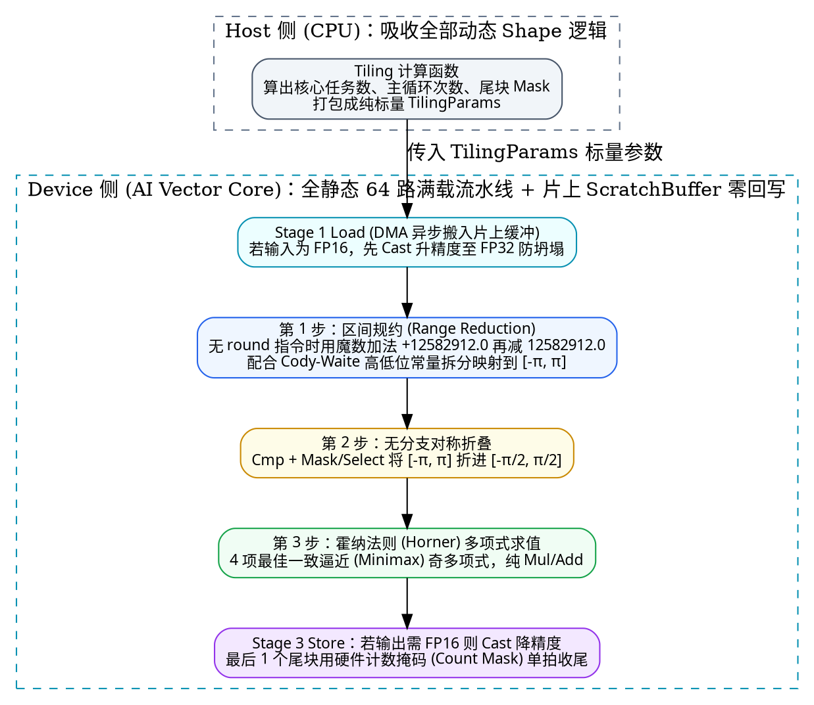

> **导读**：学习底层高性能计算（HPC）与 AI **算子（Operator / Kernel，直接跑在处理器上的核心计算程序）** 开发时，人们常常会遇到许多看似“违背直觉”的工程现象：
>
> - 明明把输入数据复制展开成更大的矩阵、增加了数据搬运量，为什么 CPU 上 `img2col + 矩阵乘（GEMM）` 反而比直接算卷积快得多？
> - 明明只是几行看似怪异的整数位运算或浮点魔数（如 `0x6400`、`0x5f3759df`），为什么能把原本需要几十个时钟周期的类型转换、开方或除法压缩到一两条指令？
> - 如果换到一颗**连按位与/移位都没有、只保留了加乘倒数指数对数和 1~64 路硬件 Mask 并行**的极简专用 NPU（神经网络处理器）上，这些黑魔法还能用吗？`sin`、`cos`、`erf` 等科学计算函数又该如何不依赖动态控制流落地？
> - 这些技术到底该由**算子工程师**写死在库里，还是由**编译器工程师**自动生成？它们又是如何反哺**芯片硬件架构师**设计下一代硅片的？
>
> 为了让**零基础初学者**也能顺畅读懂全篇，本教程坚持两条原则：
>
> 1. **名词首次出现即破冰**：任何硬件术语、缩写或数学专有名词在第一次出现时，都会立刻给出白话解释；
> 2. **图解可视化优先**：穿插 **8 张 Graphviz 与 Mermaid 流程图/结构图**，把内存布局、二进制位扩散、并行归约、静态流水线与软硬件协同闭环直观“画出来”。

---

## 零、初学者核心名词破冰速查表

在正式进入技术深水区之前，我们先为后文首次出现的专业术语准备一张“破冰地图”。正文初次遇到它们时，也会结合上下文再次拆解。

| 术语 / 缩写                 | 英文全称                                           | 一句话通俗解释                                                                                                                                      |
| :-------------------------- | :------------------------------------------------- | :-------------------------------------------------------------------------------------------------------------------------------------------------- |
| **Cache Line（缓存行）**    | Cache Line                                         | CPU 从主内存读取数据的**最小搬运单位**（通常固定为 **64 字节**）。就算程序只想要其中 4 个字节，硬件也必须把整整 64 字节一起拉进缓存。                 |
| **SIMD / SIMT**             | Single Instruction, Multiple Data / Threads        | **单指令多数据 / 单指令多线程**：一条指令发出去，让 8 个、16 个甚至 64 个通道同时对各自的数据做相同的加减乘除。                                     |
| **FMA**                     | Fused Multiply-Add                                 | **乘加融合指令**：在同一个时钟周期里一次性算完 $a \times b + c$，吞吐翻倍且中间结果不舍入、精度更高。                                             |
| **GEMM**                    | General Matrix Multiplication                      | **通用矩阵乘法**，即计算 $C = \alpha A \times B + \beta C$。它是 AI 与科学计算最核心的算力底座。                                                   |
| **img2col**                 | Image-to-Column                                    | 把二维图像中一个个重叠的卷积滑动窗口“摊平”拉成矩阵列向量的内存重排技巧，目的是把卷积转成规整的 GEMM。                                               |
| **IEEE-754**                | IEEE Standard for Floating-Point Arithmetic        | 全球通用的浮点数二进制编码标准，把一个浮点数拆成 **符号位（Sign）+ 指数位（Exponent）+ 尾数位（Mantissa）** 三段存储。                            |
| **SFU**                     | Special Function Unit                              | **特殊函数单元**：芯片上专门用来算 $e^x$、$\ln x$、$\sin x$ 等复杂函数的电路。面积小、数量少，高并发时极易成为排队瓶颈。                             |
| **Bit Twiddling Hacks**     | Bit Twiddling Hacks                                | **位运算黑魔法**：不走常规加减乘除和 `if-else` 分支，直接利用二进制比特位规律和布尔恒等式完成运算的极简技巧。                                       |
| **CLZ / POPC**              | Count Leading Zeros / Population Count             | **前导零计数 / 位计数**：硬件指令直接数出一个二进制数左边有几个连续的 `0`（`CLZ`），或者总共有几个 `1`（`POPC`）。                                   |
| **UB / 严格别名（UB）**     | Undefined Behavior / Strict Aliasing               | **未定义行为**：编程语言标准禁止的危险写法（如强行用 `int*` 指针去读 `float` 的地址），开启编译器优化后可能出现逻辑被删掉或算错的灵异 Bug。         |
| **Memory-Bound vs Compute** | Memory-Bound / Compute-Bound                       | **访存受限 vs 计算受限**：算子跑得慢，究竟是因为“等数据从显存搬过来太慢”（前者），还是因为“计算单元算不过来”（后者）。                              |
| **Roofline 模型**           | Roofline Model                                     | 一张用“计算访存比”横轴和“算力天花板”纵轴画出的性能分析图，用来精准判断算子到底卡在带宽还是算力。                                                    |
| **牛顿迭代**                | Newton-Raphson Method                              | 一种用切线快速逼近方程根的数学方法：先蒙一个粗糙初值，再套用纯乘加公式迭代 1~2 次，每迭代一次有效数字精度大约**翻倍**。                             |
| **PPA**                     | Performance, Power, Area                           | 芯片硬件设计的三大黄金权衡指标：**性能（Performance）、功耗（Power）、硅片面积（Area）**。                                                          |

下面这张全景路线图展示了本文的知识脉络：



---

## 一、为什么 CPU 上 `img2col + GEMM` 比直接算卷积更快？

很多初学者第一次听说 **`img2col`（Image-to-Column，图像转列矩阵）** 时，会产生两个直觉上的疑问：

1. “是不是把一个矩阵乘拆分之后再算反而变快了？”
2. “把图像窗口展开成矩阵后，数据体积明明膨胀了好几倍，数据搬运量不是变大了吗？为什么总耗时反而变短了？”

这里必须先做一个核心澄清：

- **前置纠正**：`img2col` 并不是“把通用矩阵乘法（MatMul）拆开”，而是**把多维滑动窗口卷积（Conv2D）转化成规则的二维矩阵乘法（GEMM）**。
- **核心真相**：现代 CPU 的性能瓶颈往往不是“总字节数”，而是**内存访问的连续性（Cache Line 命中率）**、**SIMD 向量寄存器对齐**以及 **GEMM 微内核（Micro-kernel）的极致寄存器复用**。

### 1.1 直接卷积（Direct Conv）在 CPU 上的三大微架构灾难

如果不做重排，直接按照卷积公式在 CPU 上写 $6 \sim 7$ 层嵌套循环（`N, C_out, H_out, W_out, C_in, K_h, K_w`），CPU 会同时遭遇三重打击：

1. **严重的跨步跳跃访存与缓存抖动（Cache Thrashing）**：
   - 卷积核在二维图像上取一个 $3 \times 3$ 窗口时，同一窗口的三行像素在内存地址上并不是挨在一起的，而是隔着整整一行的步长（**Strided Access，跨步访存**）。
   - CPU 从主存加载数据是以 **Cache Line（64 字节）** 为最小单位的。跨步读取会导致拉进来的 64 字节里只有几个字节真正有用，其余带宽全被白白浪费；更糟的是，不同通道和不同行的数据在高速缓存里频繁互相挤出，导致 **L1/L2 Cache（一级/二级高速缓存）** 命中率极低。
2. **SIMD 向量化指令施展不开**：
   - CPU 算得快的秘诀在于 **SIMD（单指令多数据）**：一条宽向量指令（例如 256-bit 或 512-bit）配合 **FMA（乘加融合）** 单元，一拍同时算 8 个甚至 16 个单精度浮点数。
   - 直接卷积的内层循环边界碎、步长不规则，编译器很难生成满载的向量加载与向量乘加指令，大量时钟周期浪费在标量计算和地址偏移计算上。
3. **分支预测与循环控制开销大**：
   - 嵌套循环层数太多，最内层 $3 \times 3$ 循环只有 9 次，CPU **流水线（Pipeline，指令分段并行执行的装配线）** 频繁遭遇循环结束的分支跳转检查，**指令级并行度（ILP, Instruction-Level Parallelism）** 极其低下。

### 1.2 `img2col + GEMM` 为什么“多搬了数据反而更快”？

`img2col` 的本质是**在计算开始前，先做一次集中式的内存重排（Data Packing / Layout Transformation）**，把原本支离破碎的滑窗读取，强行整理成两块**内存物理地址完全连续**的大矩阵 $A$ 和 $B$。



多付出的那一次“重排拷贝”，换来了两项压倒性的收益：

1. **唤醒纯汇编调优的 GEMM 微内核（Micro-kernel）**：
   - 矩阵乘法标准化后，可以直接调用成熟线性代数库（BLAS 库）中纯汇编手写的 GEMM 微内核。
   - 微内核会把输出矩阵的一个小分块（例如 $6 \times 16$ 个元素）**死死锁在 CPU 的十几个向量寄存器里**。沿着归约维度 $K$（长度为 $C_{in} \times K_h \times K_w$）累加时，每从 L1 Cache 读入 1 个向量，就能和寄存器里的多个向量做**外积（Outer Product）**，计算访存比呈几何级数飙升，彻底摆脱主存带宽束缚。
   - 配合汇编级指令重排与软件预取（`prefetch`），下一块数据在计算当前块时就被提前拉进 L1 Cache，计算单元利用率可以从不到 $15\%$ 一举拉升到 **$85\% \sim 95\%$**。
2. **“顺序搬运 1 次 + 高速复用几百次”远胜“跳跃访存几百次”**：
   - 虽然 $3 \times 3$ 卷积用 `img2col` 展开后数据量膨胀约 9 倍，但 `img2col` 过程本身是规律的顺序读写，**硬件预取器（Hardware Prefetcher，能自动猜出下一个连续地址并提前拉数据的硬件电路）** 可以满负荷工作，而且**只搬运这一次**。
   - 在随后的 GEMM 计算中，展开后的每一行数据都会被几百个输出通道（$C_{out}$ 常见为 $64, 128, 512$）反复复用。**“顺序整理 1 次 + 高速复用 256 次”** 的总耗时，远远低于 **“低效跨步随机读取 256 次”** 的耗时。

### 1.3 补充：为什么朴素 MatMul 也很慢？以及工业界的终极演进

如果你自己用 C++ 写一个三重循环 `for i, for j, for k` 来算纯矩阵乘，它在 CPU 上往往只能跑出理论峰值的 **5% 左右**。原因完全相同：**真正的高性能 GEMM 库内部，本身也自带了一步和 `img2col` 思想一模一样的“数据重排（Packing）”！**

- 在高性能 GEMM 内部执行 $C = A \times B$ 时，程序并不会按原地址直接算，而是先把 $A$ 和 $B$ 切分成适配 L1/L2 Cache 大小的面板（Panel），并**额外申请缓冲区把它们重排成连续的 Z 字形内存布局**，然后再喂给汇编微内核。
- **底层哲学高度统一**：在现代存储层次架构下，**宁可花时间做一次额外的顺序内存拷贝（把数据整理成硬件最喜欢的连续排布），也绝不让昂贵的计算单元在随机访存和寄存器饥饿中空转。**

为了连 `img2col` 那部分额外的内存膨胀也省掉，现代高性能推理引擎进一步演化出了两种更高级的方案：

- **Implicit GEMM（隐式矩阵乘）**：不在主内存里真正生成庞大的展开矩阵，而是在微内核将数据加载进寄存器/L1 Cache 的那一瞬间，通过预先算好的**指针偏移查表**实时算出滑窗地址（On-the-fly Packing）。既享受了 GEMM 微内核 $90\%$ 的算力利用率，又实现了**零额外内存开销**。
- **Blocked Layout（分块重排布局直接卷积）**：在模型加载阶段就把张量从传统的 `[N, C, H, W]` 预先重排成向量友好的分块格式（例如把通道维按向量宽度 8 或 16 切块放到最内层），让直接卷积也能天然连续读取一整条向量。

---

## 二、7 个堪称“魔法”的硬件奇思妙想型算子优化

当常规的**分块（Tiling，把大矩阵切成能塞进片上缓存的小块）**、**双缓冲（Double Buffer，一块算的同时另一块在后台搬运）**和向量化走到物理极限后，顶级算子工程师会开始利用**IEEE-754 二进制位布局、初等数论/代数等价变形、以及片上互联电路特性**，写出令人拍案叫绝的优化。

以下精选 7 个在工业界大放异彩的典型案例（均为通用软硬件技术思路，不绑定特定厂商私有接口）：



### 2.1 INT4 $\rightarrow$ FP16 寄存器原位极速反量化（向物理比特借空间）

- **痛点**：大模型低比特量化推理（如 4-bit 权重配 16-bit 激活，即 W4A16）中，一个 32-bit 寄存器里紧凑塞了 8 个 `INT4` 权重。如果老老实实先移位提取出整数，再调用整数转浮点指令（`I2F`），由于加速器上 `I2F` 指令的吞吐远远低于矩阵计算单元，类型转换会直接把整个推理流水线卡死。
- **奇思妙想**：**直接把整数塞进 IEEE-754 FP16 浮点数的尾数（Mantissa）位里！**
  - IEEE-754 半精度浮点数（FP16）的数值公式为：
    $$\text{Value} = (-1)^S \times 2^{E - 15} \times \left(1 + \frac{M}{1024}\right)$$
  - 当指数 $E - 15 = 10$（即 $E = 25$，对应浮点数值 **`1024.0`**，十六进制编码为 **`0x6400`**）时，神奇的事情发生了：尾数 $M$ 前面的缩放系数 $\frac{2^{10}}{1024}$ 恰好约分等于 **$1$**！
  - 这意味着在 `0x6400` 到 `0x67FF` 这段二进制区间里，**每增加 1 个最低有效比特，浮点数值就精确增加 `1.0`**。
  - 工程师不需要任何 `I2F` 指令：只要用硬件自带的**三输入逻辑查找表指令（3-Input Logic LUT，简称 `LUT3`，能单周期完成任意 3 个寄存器的按位逻辑拼接）**，把 4-bit 整数权重直接嵌入 `0x64006400` 的尾数低位，瞬间在寄存器里“捏”出合法的打包 FP16 浮点数 `1024 + w`；紧接着发射一条纯浮点减法减去 `1024.0`，就无损得到了精确的 FP16 权重 `w`！

```dot
digraph FP16Dequant {
    rankdir=LR;
    node [shape=record, style="filled", fontname="monospace", fontsize=10];

    INT4 [label="{32-bit 打包权重寄存器|w7|w6|...|w1|w0 (4-bit 整数)}", fillcolor="#fefce8", color="#ca8a04"];
    MAGIC [label="{FP16 常量 1024.0 (0x6400)|S:0 | E:11001 (10次幂) | M:0000000000}", fillcolor="#eff6ff", color="#2563eb"];
    LUT3 [label="单周期三元逻辑指令 (LUT3)\n零 I2F 指令，直接位拼接", shape=box, style="filled,rounded", fillcolor="#fff7ed", color="#ea580c"];
    PACKED [label="{合法 FP16 数值 (1024 + w)|S:0 | E:11001 | M:000000 + w0}", fillcolor="#f0fdf4", color="#16a34a"];
    SUB [label="纯浮点减法 (- 1024.0)\n高吞吐 FP16 流水线", shape=box, style="filled,rounded", fillcolor="#f3e8ff", color="#9333ea"];
    OUT [label="精确 FP16 权重 w0", shape=box, style="filled,rounded", fillcolor="#dcfce7", color="#15803d"];

    INT4 -> LUT3;
    MAGIC -> LUT3;
    LUT3 -> PACKED -> SUB -> OUT;
}
```



### 2.2 Winograd 卷积：用“加法”换“乘法”的代数降维打击

- **痛点**：$3 \times 3$ 卷积计算量极大，传统 GEMM 已经把乘加单元压榨到了 $90\%$ 以上，算力触顶。
- **奇思妙想**：**利用数论（中国剩余定理）做多项式变换，用廉价的加减法和移位替换昂贵的乘法。**
  - 在经典 $F(2 \times 2, 3 \times 3)$ Winograd 算法中，将输入特征图块和卷积核分别乘以固定的小型变换矩阵（矩阵元素全由 `0, 1, -1, 1/2` 组成，硬件上只需**加减和右移 1 位**，几乎零乘法开销）。
  - 变换到频域后，原本需要 $4 \times 9 = 36$ 次乘法，变成了只需 $4 \times 4 = 16$ 次**逐元素点乘（Hadamard Product）**，乘法次数直接削减了 **$2.25$ 倍（约 $55\%$）**！
  - 这一招直接让等效计算速度突破了物理芯片的标称峰值算力上限，至今仍是小卷积核推理的核心加速手段。

### 2.3 Online Softmax：片上寄存器里的单遍流式“悔棋”

- **痛点**：注意力机制里的标准 Softmax 公式 $\frac{e^{x_i - m}}{\sum e^{x_j - m}}$ 需要先扫描完整行才能找到全局最大值 $m$，再扫描第二遍算分母求和，最后扫描第三遍算输出。这迫使庞大的注意力分数矩阵 $S = QK^T$ 必须先写回高延迟的主显存（**HBM，高带宽主显存**），引发 $O(N^2)$ 级别的显存读写灾难。
- **奇思妙想**：**用指数修正因子在片上高速内存里动态“悔棋”。**
  - 分块（Tile）流式计算时，只管拿当前块的局部最大值 $m_{\text{local}}$ 算指数和。当下一块出现更大的最大值 $m_{\text{new}}$ 时，不必回头重算前面所有块，只需给历史累加和与输出乘上一个极简的修正系数 $e^{m_{\text{old}} - m_{\text{new}}}$ 即可在数学上完全等价！
  - 配合特殊函数单元的快速以 2 为底指数指令 `exp2`（用 $2^{x \cdot \log_2 e}$ 替代自然指数 $e^x$，能融入前一步乘法省掉一条指令），成功把整个注意力算子锁在片上 SRAM 内一气呵成，**硬生生把访存受限（Memory-Bound）算子改写成了计算受限（Compute-Bound）算子**。

### 2.4 非原生精度硬件“借壳”（高精度单元跑低精度 & Ozaki 切片）

- **痛点**：某些芯片只配备了 FP16 矩阵乘单元，没有原生的 FP8 或 FP64 双精度矩阵加速电路。
- **奇思妙想**：
  - **向下借壳**：把 FP8 的符号位、指数位和尾数位通过位移拆解填入 FP16 寄存器的对应比特位（尾数低位补零），直接送入 FP16 矩阵单元白嫖远超常规标量/向量核心的矩阵吞吐。
  - **向上拆片（Ozaki Scheme，尾崎分块法）**：在没有原生 FP64 矩阵单元的芯片上，把一个 FP64 双精度浮点数拆成 $3 \sim 4$ 个带不同缩放指数的低精度（FP16/INT8）切片，用高速低精度矩阵单元算完再错位累加，照样跑出极高的双精度科学计算速度。

### 2.5 `expf()` 指数函数的“幻数”近似（Schraudolph 算法）

- **痛点**：在 Softmax、GELU 等算子中，$e^x$ 默认走专用特殊函数单元（SFU），而 SFU 数量远少于常规计算核心，高并发下极易排队拥堵。
- **奇思妙想**：**利用 IEEE-754 单精度浮点数二进制整数值与对数函数的线性近似关系。**
  - 对于 IEEE-754 单精度浮点数 `float`，如果直接把它内存里的 32 个比特解释成有符号整数 $I_x$，那么 $I_x$ 与真实值 $x$ 之间近似满足：$I_x \approx 2^{23} \cdot (\log_2 x + 127)$。
  - 逆向利用这个公式计算 $e^x = 2^{x / \ln 2}$ 时，只需在普通整数单元算一次乘加 `bits = (int32_t)(12102203.0f * x + 1064866805.0f)`，再把这 32 个比特按 `float` 解释回去，**1 条乘加指令就完成了指数近似**（再接一段低阶多项式微调尾数即可满足神经网络精度），彻底绕开 SFU 拥堵。

### 2.6 消除除法与取模：Fast Divmod（魔数乘法 + 移位）

- **痛点**：多维张量广播（Broadcast）、转置（Transpose）和 Reshape 算子中需要海量计算 `idx / stride` 和 `idx % stride`。而在几乎所有加速芯片上，**整数除法（`IDIV`）都是全芯片最慢的指令之一**（往往没有专用整数除法器，需要几十条指令迭代模拟，延迟高达 $30 \sim 50$ 个周期）。
- **奇思妙想**：**把运行时除法变成编译期/主机端预计算的“定点数倒数乘法”。**
  - 在启动算子前，主机端预先根据除数 $d$ 算出一个 32-bit 魔数（Magic Multiplier）$M = \lceil 2^{32+s} / d \rceil$ 和右移量 $s$。
  - 在核函数内部执行时，用单周期硬件**高位整数乘法 `umulhi(idx, M) >> s`** 算出商 $q$，再用 `idx - q * d` 算出余数。原本几十个周期的除法瞬间压缩为 2 条单周期整数指令。

### 2.7 跨核片上组播与分布式共享存储（向片上拓扑借带宽）

- **痛点**：大矩阵乘法 $C = A \times B$ 中，同一行的一排计算核心都在重复从片外主显存（HBM）读取同一块 $A$ 矩阵分块，导致宝贵的片外带宽被反复浪费。
- **奇思妙想**：**把多个独立计算核心的片上高速内存“串联”成一张片上局域网。**
  - 在现代集群式架构中，相邻多个计算核心组成一个协作簇（Cluster）：只有 1 号核心真正向片外 HBM 发起读请求，**硬件异步张量搬运引擎（Async Tensor DMA）**在总线回包的那一瞬间，通过片上互联网络同时**组播（Multicast）**灌入同组其他 7 个核心的片上共享存储中。
  - 核心之间还可以通过片上互联直接跨核访问邻居的共享存储，**完全绕过全局缓存与片外 HBM**，直接将片外带宽需求砍掉数倍。

---

## 三、位运算黑魔法深度解读：`RoundUpPowerOf2`、发现与发明、以及工程边界

在系统软件、内存池分配（如伙伴分配器 Buddy Allocator）以及算子开发（如计算对齐的 Tile 尺寸、共享内存步长、蝶形归约边界）中，有一个高频基础操作：**把一个无符号整数 $v$ 向上取整到最近的 2 的幂次（Round up to the next highest power of 2）**。

经典位运算资料中收录了两种完全无分支（Branchless，不含 `if-else` 跳转）的写法，而在现代硬件上它又演化出了第三种指令级写法。

### 3.1 核心实现一：位扩散填充法（Bit Propagation）

这是最通用、不依赖浮点硬件的标准纯整数写法：

```c
unsigned int v; // 输入 32 位无符号整数，求 >= v 的最小 2 的幂次

v--;
v |= v >> 1;
v |= v >> 2;
v |= v >> 4;
v |= v >> 8;
v |= v >> 16;
v++;
```

*(注：如果是 64 位无符号整数 `uint64_t`，只需在 `v++` 前追加一行 `v |= v >> 32;` 即可。)*

它的核心思想极其巧妙：**先找到 `v` 二进制表示中最左边的那个 `1`（最高有效位 MSB），然后把该位右边的所有低位全部“涂”成 `1`，最后 `+ 1` 进位，就必然得到下一个 2 的幂次！**

以 `v = 19`（二进制 `0001_0011`）为例，下图直观展示了这 7 步如何用 $\log_2(32) = 5$ 步“倍增涂抹”取代 32 次循环：



- **为什么要先 `v--`？** 假设输入 `v = 16`（`0001_0000`），它自己已经是 2 的幂了。如果不减 1，涂满低位再加 1 会变成 `32`；先减 1 变成 `15`（`0000_1111`），涂满仍是 `15`，加 1 后恰好稳稳回到 `16`。
- **致命边界陷阱（`v == 0`）**：当输入 `v == 0` 时，无符号数 `0--` 会下溢变成全 1（`0xFFFFFFFF`），涂抹后仍是全 1，最后 `v++` 溢出归 **`0`**（而不是期望的 `1`）。如果业务允许传入 `0`，需要在最后追加一行无分支修正：`v += (v == 0);`。

### 3.2 核心实现二：IEEE-754 浮点数强转提取法（Float Casting）

第二种方法利用了浮点硬件的自动归一化（Normalization）电路：

```c
// 注意：要求 v < 2^24，且真实工程需使用 C++20 std::bit_cast 或 memcpy 避免严格别名 UB
unsigned int round_up_pow2_float(unsigned int v) {
    if (v <= 1) return 1;
    float f = (float)v;
    unsigned int f_bits;
    memcpy(&f_bits, &f, sizeof(f_bits)); // 安全的按位重解释
    // 右移 23 位取出 IEEE-754 的 8 位指数域，减去偏移量 127 (0x7f) 得到 floor(log2(v))
    unsigned int t = 1U << ((f_bits >> 23) - 0x7f);
    // 如果 t 严格小于 v（说明 v 不是恰好等于 2 的幂），则左移 1 位乘以 2
    return t << (t < v);
}
```

- **原理**：当你写下 `float f = (float)v` 时，硬件电路在把整数转成浮点数的那一瞬间，自动数出了最高位 `1` 的位置并编码进了第 $23 \sim 30$ 位的指数域里。我们相当于“白嫖”了浮点转换器顺手算好的对数结果。

### 3.3 核心实现三：现代硬件单指令演进（`CLZ`）

前面两段代码诞生于通用 CPU 尚未普及前导零计数指令的年代。而在现代 CPU 与 GPU 上，芯片架构师已经直接把这套逻辑固化成了单周期硬件电路 **`CLZ`（前导零计数指令）**：

```c
// 现代 CPU / 加速器上的极简写法（假设输入 v <= 2^31）
uint32_t next_pow2_hw(uint32_t v) {
    // __builtin_clz(x) 或硬件固有函数 clz(x) 计算 32 位整数高位连续 0 的个数
    return (v <= 1) ? 1 : (1U << (32 - __builtin_clz(v - 1)));
}
```

只需 **`减 1 -> CLZ -> 32 减 -> 左移`** 4 条单周期指令，彻底取代了 5 步串行移位。

### 3.4 哲学追问：这些技巧是被“发现”的，还是被“发明”的？

答案可以清晰地拆成两层：

1. **客观数学规律与硬件物理约束是“被发现”的**：
   - 二进制补码的对称性、`v & (v - 1)` 恰好消去最低位 `1` 的恒等式、以及 IEEE-754 浮点数比特串与对数曲线的天然同构（这就是著名的快速平方根倒数幻数 `0x5f3759df` 的数学源头）——只要采用二进制与科学计数法，这些关系就客观存在。
   - 乘法器面积大于加法器、除法延迟高、分支跳转会清空指令流水线，则是硅基晶体管的物理现实。
2. **对抗约束的工程技巧与指令级设计是“被发明”的**：
   - 为了绕开分支跳转代价，工程师**发明**了算术右移掩码；为了在没有 `CLZ` 指令的年代加速填充，**发明**了 $\log_2 N$ 步倍增移位。
   - 最精彩的是**从软件技巧向硬件电路的演化**：当某类“发明”实在太高频时，芯片厂商会直接把它做成专用硬件指令（例如把位扩散做成 `CLZ`，把多步逻辑组合做成 `LUT3`，把无分支掩码做成条件选择 `SEL`）。

### 3.5 当年研发人员到底是如何“挖”出这些技巧的？

看似神来之笔的底层代码，背后其实是 **5 种极其硬核的工程方法论**：

1. **纸面第一性原理推导**：把数据结构的比特位画在纸上，直接对物理比特做代数变换（例如算一算 IEEE-754 FP16 公式，立刻就能看出 $E = 25$ 时尾数步长恰好等于 $1$；用最小二乘法拟合对数线再接牛顿迭代得出 `0x5f3759df`）。
2. **精读指令集手册（ISA Manual）与反向微基准测试**：顶级工程师先读透硬件指令表，发现芯片提供了一个“单周期 3 输入真值表指令”或“32 个 Bank 的共享内存”，再反过来在离散数学（如有限域异或双射）里找工具去构造触发它的代码。
3. **与反汇编器和编译器“死磕博弈”**：写完高级语言代码后立刻看反汇编输出（`objdump`）。早期编译器开发者（如整理了著名位运算圣经的编译器科学家们）为了把 `if (x < 0) x = -x` 自动优化成无分支指令，系统性推导出了整套布尔代数重写规则并写进了编译器的**窥孔优化器（Peephole Optimizer）**。
4. **程序合成与超级优化（Superoptimization）**：有很多极其反直觉的常量序列（比如特定除数的 Fast Divmod 魔数），根本不是人脑推出来的，而是让计算机从长度为 1 条指令开始穷举搜索指令组合，并用 **SAT/SMT 形式化求解器** 在全 $2^{32}$ 输入空间内证明其等价性后“搜”出来的。
5. **跨代集体接力**：从上世纪 70 年代大型机实验室的备忘录，到 21 世纪初系统化的位运算教科书，再到今天大模型算子库里的量化微内核，每一代人都在前人的工具箱上结合新硬件重新组装。

### 3.6 醒醒！所有黑魔法都有严格的局限与适用边界

把位运算放回现代编译器和生产工程视角下，它们**绝非银弹**，用错场景反而会引发性能倒退甚至静默数据损坏：

| 技巧类别                       | 核心局限与潜在坑点                                                                                                                     | 真正适用的安全场景                                                           |
| :----------------------------- | :------------------------------------------------------------------------------------------------------------------------------------- | :--------------------------------------------------------------------------- |
| **位扩散法 (`v |= v >> k`)**   | 1. `v == 0` 下溢归零，`v > 2^31` 顶部溢出；<br/>2. 10 条指令存在严格前后读写依赖（`RAW` Hazard），乱序 CPU 无法并行，慢于单周期 `CLZ`。 | 编译期常量折叠（`constexpr`）、或缺乏 `CLZ` 指令的极简嵌入式微控制器（MCU）。 |
| **IEEE-754 强转魔术**          | 1. 裸指针强转触发**严格别名 UB**；<br/>2. `float` 仅 24 位有效精度，$v > 2^{24}$ 会舍入出错；<br/>3. `NaN`/`Inf` 失效，跨域搬运有延迟。   | 输入范围严格受控（无异常值、不超精度上限）且允许近似误差的场景。             |
| **寄存器原位反量化 (`0x6400`)** | 1. 强绑定特定逻辑指令与 FP16（换成 `BF16` 只有 7 位尾数直接失效）；<br/>2. 只能无损表示 10-bit 以内整数；<br/>3. 仅对算力受限有效。       | 大模型低比特推理的高负载矩阵乘内循环（且确认卡在反量化指令吞吐上）。         |
| **无分支算术掩码替换**         | 1. 强迫算完 `if` 和 `else` **两条完整路径**，路径重时功耗与耗时反超跳转；<br/>2. 复杂位运算会**遮蔽代码语义**，让编译器错失单周期 `MIN`/`MAX` 指令。 | 分支高度随机（50% 概率）且分支体仅 $1 \sim 3$ 条廉价指令；常规代码直接写三元表达式 `a < b ? a : b` 交给编译器生成条件传送指令即可。 |

**现代算子开发者的三条黄金法则**：① **优先查硬件原生指令**（`clz`/`popc`/`sel` 永远比软件拼装快）；② **先用 Roofline 定位瓶颈**（卡在显存带宽时省几条 ALU 指令毫无意义）；③ **写完必看反汇编**并用 `std::bit_cast` 和 `static_assert` 锁死平台假设。

---

## 四、如果 NPU 剥离了所有位运算，如何靠极简代数 + 64 路 Mask 重构一切？

现在设想一个非常真实的专用芯片（DSA / NPU）硬件约束：为了把宝贵的晶体管面积和功耗全部省下来喂给高密度计算阵列，芯片里的向量处理单元（Vector Engine）**彻底剥离了所有按位逻辑运算（没有 `AND`、`OR`、`XOR`、`Shift`），也不支持复杂的控制流跳转**，有且只支持以下 **7 个连续实数域代数原语**：

> **可用原语清单**：加法 `Add`、乘法 `Mul`、倒数 `Recip`、自然指数 `Exp`、自然对数 `Ln`、向量归约求和 `ReduceSum`、数值比较 `Cmp`。

同时，硬件还在数据通路层额外提供了三项能力：**原生 `ReLU` 硬件指令**、**基于硬件掩码（Mask）的条件选通输入**，以及**支持 1~64 动态并行度的 Tensor 向量计算**。

在这种极简硬件上，工程师的思维必须从“比特搬运（Bit Twiddling）”彻底切换到**“连续实数域解析构造 + 空间并行换时间串行”**。

### 4.1 哪些技巧直接失效？哪些完美替代？（纯 7 原语维度）

- **无法在向量核内直接做的事（物理边界）**：
  - 寄存器内按比特拆解 `INT4` 权重（无移位和掩码，必须交给前端 DMA 搬运单元在数据进片上缓存时硬件解包）；
  - 异或地址重排消除 Bank Conflict（实数域模拟异或代价极高，只能退回传统的内存 **Padding 填充错位法**）。
- **用 7 个原语完美重构的核心算子与技巧**：
  1. **无分支 `Where` 选择**：$m = \text{Cmp}(a > b) \in \{0.0, 1.0\}$，则 $\text{Where}(a > b, x, y) = m \cdot x + (1.0 - m) \cdot y$（没有减法时，预先存常量 `-1.0`，用 `Mul(-1.0, y)` 得到 `-y`）。
  2. **任意幂次与开方（RMSNorm / GELU 核心）**：利用 `Ln` + `Mul` + `Exp` 黄金组合：
     $$x^p = \exp(p \cdot \ln(x)), \qquad \frac{1}{\sqrt{x}} = \exp(-0.5 \cdot \ln(x))$$
  3. **硬件级 Softmax 与 Online Softmax**：`Cmp` 求最大值 $\rightarrow$ `Exp` $\rightarrow$ `ReduceSum` 求和 $\rightarrow$ `Recip(S)` 求倒数 $\rightarrow$ 广播 `Mul`（把逐元素除法全变成高吞吐乘法）。
  4. **常见激活函数极简拼装**：
     - `Sigmoid(x)` $= \text{Recip}(1.0 + \exp(-1.0 \cdot x))$（仅 3 条指令）
     - `SiLU(x)` $= x \cdot \text{Recip}(1.0 + \exp(-1.0 \cdot x))$（仅 4 条指令）
     - `ReLU(x)` $= x \cdot \text{Cmp}(x > 0.0)$（纯算术仅 2 条指令）
  5. **对数域防下溢连乘**：$\prod_{i=1}^N x_i = \exp(\text{ReduceSum}(\ln(x_i)))$，直接利用硬件高速归约累加单元。
  6. **数值防爆避坑**：凡是进 `Ln(x)` 或 `Recip(x)` 之前，必须先用 `Add(x, eps)` 或 `Cmp` 钳位（如 $\max(x, 10^{-6})$），防止 `0` 产生 `-Inf` 或 `NaN` 污染整个向量。

### 4.2 加上“硬件 ReLU + Mask 输入 + 1~64 路并行”，为何能做成高性能算子？

如果硬件进一步原生支持 **Mask 掩码条件选择/ReLU** 和 **1~64 路动态 Tensor 并行**，性能会比纯算术模拟再上一个台阶：

1. **彻底免疫 `0.0 * NaN = NaN` 污染**：用 `m * x + (1 - m) * y` 时，如果被屏蔽分支 `y` 里藏着脏数据 `NaN`，乘以 `0.0` 结果依然是 `NaN`！而硬件级 Mask 条件选择在电路层面通过**多路选择器（MUX）或写使能信号**直接切断无效通道，永远不会把 `NaN` 漏进结果里。
2. **1~64 动态并行度消灭标量尾循环**：当张量长度不是 64 的倍数时，主体循环跑 64 路满载，最后不足 64 个元素的尾块（$1 \sim 63$）只需改一下硬件 Mask 位数即可复用同一套 Tensor 指令单拍收尾。
3. **64 路刚好咬合片上带宽甜点**：以 FP32（4 字节）计，64 路恰好是 **256 Bytes/拍**，天然对齐典型的片上 SRAM 读写总线位宽。

不过，要让这套机制**真正高性能**（而不只是“能跑通”），必须卡死 4 条工程铁律：

- **维度展平吃满 64 路**：严禁在内层循环直接按长度为 4 或 8 的小维度发射（会浪费近 $90\%$ 通道），必须把连续维度合并展平，确保 $99\%$ 迭代跑在 64 路满载，1~63 路只出现在最后 1 个尾块。
- **使用紧凑比特掩码而非大张量掩码**：64 路开关只需 1 个 64-bit 寄存器（由前一条 `Cmp` 直接生成并片上消费），千万不要把 Mask 当作 FP16/INT8 张量去主显存反复读写。
- **带掩码访存（Predicated Load/Store）**：Mask 必须能穿透到 DMA / 加载存储单元，防止尾块越界读取非法地址。
- **片上融合 + 双缓冲（Double Buffer）**：这类算子大多是访存受限的，必须将计算驻留在片上 SRAM 内与上下游算子融合，并用 Ping-Pong 双缓冲隐藏数据搬运延迟。

### 4.3 跨界神技：在无位运算 NPU 上用 64 路 Mask 重构 Bit 算法！

回到前面的斯坦福位运算宝典，如果在这颗**完全没有移位和按位与**的 1~64 路 NPU 上，能不能把 `RoundUpPowerOf2`、`int_log2`、`abs`、`min/max`、`sign` 等“数值语义类” Bit 算法做成无分支的高性能算子？

**答案是肯定的——而且写法极其优雅：用 64 路空间并行，直接换掉 5 步时间串行！**

#### 1. `RoundUpPowerOf2(v)` —— 利用等比数列求和恒等式（4 步并行魔法）

对于任意正整数 $v$，所有严格小于 $v$ 的 2 的幂次加起来，恰好等于目标幂次减 1：

$$\sum_{2^i < v} 2^i = 2^{\lceil \log_2 v \rceil} - 1$$

预置一个常量向量 $P = [1, 2, 4, 8, 16, \dots, 2^{30}]$，把输入 $v$ 广播对齐：
1. **并行比较**：`Mask = Cmp(v > P)`（1 条并行指令找出所有比 $v$ 小的 2 的幂）
2. **硬件 Mask 归零过滤**：用 `Mask` 选通常量向量 $P$，未命中位置由硬件直接置 `0`（或乘以 `0/1` 掩码）
3. **硬件规约求和**：`S = ReduceSum(Masked_P)`
4. **加 1 出结果**：`Result = Add(S, 1)`

代入 $v = 19$ 验证：$19 > [1, 2, 4, 8, 16]$ 全部命中 $\rightarrow$ `ReduceSum` $= 1+2+4+8+16 = 31 \rightarrow +1 = \mathbf{32}$；代入 $v = 16$：命中 $[1,2,4,8] \rightarrow 15+1 = \mathbf{16}$；代入 $v = 0$：命中 0 个 $\rightarrow 0+1 = \mathbf{1}$（还顺手修掉了原版 `v = 0` 下溢 Bug！）。



#### 2. `int_log2(v)` 与 `isPowerOf2(v)` —— 2 步直出

- **`int_log2(v)`（求 $\lfloor \log_2 v \rfloor$）**：预置常量向量 $Q = [2, 4, 8, \dots, 2^{31}]$，直接算 `ReduceSum(Cmp(v >= Q))`！例如 $v=19$ 大于等于 $[2, 4, 8, 16]$ 共 4 个数，累加直接得 **`4`**。
- **`isPowerOf2(v)`**：预置 $P = [1, 2, 4, \dots, 2^{31}]$，直接算 `ReduceSum(Cmp(v == P))`！命中唯一一个返回 `1`，否则返回 `0`（连 `v == 0` 特判都省了）。

#### 3. `abs`、`min/max`、`sign` —— 硬件 ReLU 直接 64 路满载降维打击

| Bit Hack 原目标            | 传统 CPU 补码位运算写法  | 极简 NPU 硬件原生等价写法（64 路全满载，零分支）          |
| :------------------------- | :----------------------- | :-------------------------------------------------------- |
| 绝对值 `abs(x)`            | `(x + (x>>31)) ^ (x>>31)` | `Add(ReLU(x), ReLU(Mul(x, -1)))`                          |
| 最大值 `max(x, y)`         | `x ^ ((x^y) & -(x<y))`   | `Add(y, ReLU(Add(x, -y)))` 或硬件条件选择                 |
| 最小值 `min(x, y)`         | `y ^ ((x^y) & -(x<y))`   | `Add(x, Mul(-1, ReLU(Add(x, -y))))` 或硬件条件选择        |
| 符号函数 `sign(x)`         | `(x > 0) - (x < 0)`      | `Add(Cmp(x > 0), Mul(-1, Cmp(x < 0)))`                    |
| 判断异号 `(x ^ y) < 0`     | `((x ^ y) < 0)`          | `Cmp(Mul(x, y) < 0)`（防溢出时比较 `Cmp(x<0) != Cmp(y<0)`） |

#### 4. 无法做成高性能的 Bit 算法 & 3 个工程硬约束

- **做不成高性能的“纯比特平面类”算法**：如 `popcount`（统计 1 的个数）、奇偶校验（Parity）、位反转（Bit Reverse）、末尾零计数（CTZ）。因为没有右移和按位与，想拆出一个打包整数的 32 个独立比特只能从高位到低位做 32 次串行“比较-减法”，存在严格数据依赖，无法利用 64 路并行；如果预先展开成 1 bit 占 1 个 Tensor 元素，又会让内存带宽暴涨 16~32 倍。
- **落地数值类 Bit 算法的三条硬约束**：
  1. **多元素打包提升吞吐**：用 32 路算 1 个标量会浪费一半带宽，在 64 路宽度的向量指令里可以并排拼 2 个 32 位元素（或 4 个 $< 2^{16}$ 的元素）分段归约；
  2. **浮点尾数整数上限**：若算术单元是纯浮点，`FP32` 精确连续整数上限是 $2^{24}$（常量表 $P$ 最多建到 $2^{23}$），`FP16` 只有 $2^{11} = 2048$，`BF16` 只有 $2^8 = 256$；
  3. **Zeroing Mask（归零掩码）要求**：硬件 Mask 过滤常量表 $P$ 时，必须保证未命中通道被**清零**而不是保留旧值，否则脏数据会被加进 `ReduceSum`。

---

## 五、牛顿迭代与科学计算算子扩展：无动态控制流跑通 `Rsqrt`、`Sin`、`Cos`、`Erf`

很多工程师会进一步追问：像 **`0x5f3759df` 快速平方根倒数** 这种“位运算 + 牛顿迭代”的算法，以及大模型和科学计算急需的 **`sin`、`cos`、`erf`、`atan`、`cbrt`**，在没有位运算、也没有动态循环能力的极简 NPU 上能实现吗？

**答案不仅是可以，而且这正是现代工业界高能效 NPU 算子库的标准落地范式。**

### 5.1 拆解牛顿迭代算法：两条纯算术 NPU 落地路线

经典“牛顿迭代 Bit 算法”其实由**完全解耦的两半**组成：
1. **前半段（粗略初值猜测）**：如 `i = 0x5f3759df - (i >> 1)`，本质只是快速蒙一个误差在 $5\%$ 左右的粗糙初值 $y_0$；
2. **后半段（牛顿迭代精修）**：例如平方根倒数迭代 $y_{n+1} = y_n \cdot (1.5 - 0.5 \cdot x \cdot y_n^2)$，倒数迭代 $y_{n+1} = y_n \cdot (2.0 - x \cdot y_n)$ —— **100% 纯乘加运算，没有任何位运算和分支，且具备二次收敛特性（每迭代 1 步有效精度翻倍）！**

在许多真实 NPU 上，为了节省硅片面积，硬件自带的 `Recip`（倒数）和 `Rsqrt` 往往只是基于**小容量查表 + 分段线性插值**的低精度估算指令（有效精度只有 $10 \sim 12$ bit，跑 FP16 凑合，跑 FP32 的 LayerNorm 或训练反向传播就会掉精度）。于是，工业界演化出两条极其成熟的标准路线：

- **路线一（绝对主力）：硬件粗糙估算作初值 + 1~2 步 64 路满载牛顿迭代**
  - 求高精度倒数 $1/x$：$y_0 = \text{Recip}_{\text{hw}}(x)$ $\rightarrow$ 执行 1 步 `y1 = y0 * (2.0 - x * y0)`（仅 2 乘 1 加），精度瞬间从 11 bit 拉满至 **22~24 bit（FP32 满精度）**！
  - 求高精度平方根倒数 $1/\sqrt{x}$：$y_0 = \exp(-0.5 \cdot \ln(x))$（或硬件 `Rsqrt` 估算初值）$\rightarrow$ 执行 1 步 `y1 = y0 * (1.5 - 0.5 * x * y0 * y0)`。
- **路线二（绕开慢速 SFU）：Mask 并行分桶查初值 + 2~3 步牛顿迭代**
  - 如果目标芯片的 `Exp`/`Ln` 吞吐极慢，可以用上一章的 `Cmp + Mask` 技巧在实数域复现 `i >> 1`：预置指数边界表 $[4^{-8}, \dots, 4^7]$ 和对应中点初值 $\frac{1}{\sqrt{2}} \cdot 2^{-k}$，并行锁定 $x$ 所在区间拿到初值 $y_0$（最大初值误差约 $17\% \sim 29\%$），再连跑 2~3 步纯乘加牛顿迭代，误差会以 $17\% \to 4\% \to 0.2\% \to 6 \times 10^{-6}$ 的速度平方级坍缩！
- **数值避坑提示**：在 FP16 下计算 $x \cdot y_0^2$ 时，必须写成 **`(x * y0) * y0`**，绝不能写成 `x * (y0 * y0)`，否则当 $x$ 很大、$y_0$ 很小时，`y0 * y0` 会先下溢归零，导致整个牛顿迭代瞬间崩塌。

### 5.2 这些高级数学算子需要“动态能力”吗？

答案是：**不需要动态控制流，只需轻量的 Host/Device 分离静态流水线。**

我们把常被混淆的“动态能力”拆成三层来看：
1. **动态循环/跳转（如 `while (err > eps)`）**：**绝对不需要且严禁使用**。工业级算子全部采用**固定迭代次数**（固定 1 步或 2 步），让指令流 100% 静态确定，避免流水线冲刷。
2. **数据依赖的 Mask 选通**：属于静态指令流内的硬件多路选择器（MUX），指令发射顺序完全固定，不需要动态调度。
3. **动态张量形状（Dynamic Shape）**：通过 **Host 侧 Tiling 解耦** 解决——在算子启动前，由通用 CPU（Host）跑一次轻量标量函数算出分块数、主循环次数和尾块 Mask 长度，打包成纯标量结构体 `TilingParams` 传给 NPU；NPU（Device）拿到参数后只管盲跑静态的 **异步加载（Load）$\rightarrow$ 向量计算（Compute）$\rightarrow$ 异步写回（Store）双缓冲流水线**，遇到最后不足 64 路的尾块切换硬件计数掩码（Count Mask）单拍收尾。

### 5.3 从极简原语扩展出 `Sin`、`Cos`、`Erf` 等科学计算算子

在大模型旋转位置编码（RoPE）和激活函数（如精确 GELU）中，`sin`/`cos`/`erf` 极其高频。哪怕芯片里完全没有专用三角函数物理电路，现代工业界算子库也完全可以在**片上缓冲（On-chip Scratchpad / ScratchBuffer）**内，仅靠 `Add`、`Mul`、`Recip`、`Exp`、`Cmp`、`Mask` 六七条原语把它们高精度展开：



图中的三大工业级技巧非常值得初学者记住：

1. **没有 `round` 指令怎么取整？（魔数加法取整黑魔法）**
   利用 IEEE-754 FP32 尾数长度为 23 位的特点，构造魔数 $M = 1.5 \times 2^{23} = \mathbf{12582912.0}$：
   $$k = \text{Add}\Big(\text{Add}(x \cdot \tfrac{1}{2\pi},\ M),\ -M\Big)$$
   因为 $[2^{23}, 2^{24})$ 区间内浮点数的最低有效位权重恰好为 `1.0`，任何 $|t| < 2^{22}$ 的数加上它都会被浮点加法器自动向偶数舍入对齐到整数，再减去 $M$，**仅用 2 条纯加法指令就完成了无分支四舍五入**！再配合 **Cody-Waite 拆分**（把 $2\pi$ 拆成高位精确常量 $C_1$ 和低位余项 $C_2$ 分两步减），有效数字一点不丢。
2. **霍纳法则（Horner's Method）压缩临时缓冲与指令数**
   使用雷米兹算法（Remez）预拟合好区间 $[-\frac{\pi}{2}, \frac{\pi}{2}]$ 的 9 阶奇多项式后，改写成嵌套乘加形式：
   $$\sin(r) \approx r + r^3 \cdot \Big(c_3 + r^2 \cdot \big(c_5 + r^2 \cdot (c_7 + r^2 \cdot c_9)\big)\Big)$$
   全程仅需算一次 $r^2$ 后接 5 乘 4 加（4 条 FMA），无分支满载 64 路；而 $\cos(x) = \sin(x + \frac{\pi}{2})$ 直接复用同一套核。
3. **非周期函数（`Erf`、`Atan`）的对称折叠 + 饱和钳位（Clamp）**
   利用奇对称性写成 $x \cdot P(x^2)$ 让正负输入走同一条流水线；由于多项式超出拟合区间（例如 $|x| > 4$ 时误差函数已饱和趋近 $\pm 1$）会发散爆炸，最后必须接一条硬件 `Min`/`Max` 指令把输出死死锁在 $[-1, 1]$ 内。同时，处理 FP16 输入时要在片上临时缓冲（`ScratchBuffer`）里先升精度到 FP32 算完再降回 FP16，防止多项式累加失真。

#### 扩展到严谨超算（HPC）的两道物理上限
这套方案在 AI 计算和常规单精度仿真中近乎完美，但如果直接对标传统超算科学计算库，会碰到两堵墙：
1. **超大自变量灾难性相消**：当输入 $|x| > 10^4$（比如求 $\sin(10^{10})$）时，FP32 相邻浮点数的间隔已经大于 $2\pi$，Cody-Waite 会彻底失效，必须使用需要上百比特整数阵列的 **Payne-Hanek 算法**（在无位运算 NPU 上无法高效实现）；
2. **双精度（FP64）与严格 $0.5 \sim 1$ ULP（最后一位精度单位）约束**：AI NPU 通常缺少原生 FP64 电路，虽然可以用 **Double-Float（用两个 FP32 模拟约 48-bit 尾数，即 Dekker/Knuth 无误差变换）** 强行拉高精度，但算力吞吐会下降 $6 \sim 10$ 倍。

---

## 六、工业界全景：算子开发 vs 编译器分工与芯片架构协同

学到这里，一个最现实的工程问题浮出水面：**前面这一大堆优化，到底该由写算子库的人去写，还是该由写 AI 编译器的人去生成？芯片硬件架构师又如何看待它们？**

### 6.1 算子开发 vs 编译器开发的“黄金分割线”

工业界不是非此即彼的“二选一”，而是按 **“改变数学算法与硬件开荒（算子开发）”** vs **“机械等价替换与全局资源统筹（编译器开发）”** 分层协作：

| 技术维度             | 算子开发（手写库 / DSL）的职责                                                    | 编译器开发（图编译 / 多级 IR / 后端）的职责                                       |
| :------------------- | :-------------------------------------------------------------------------------- | :-------------------------------------------------------------------------------- |
| **数学展开与精度补偿** | 手写基础数学库高阶模板（如 `Sin`/`Erf` 系数拟合）、极限低比特量化微内核的位拼装。 | 通过自动改写 Pass（Lowering）把 `Div`/`Rsqrt` 展开为“估算指令 + 牛顿迭代”，或把 `Sin` 展开为多项式。 |
| **无分支与尾块处理** | 算法级消除分化（如拆分注意力对角块、稀疏重排后执行）。                            | 中端生成带掩码向量 IR；后端 `If-Conversion` Pass 自动把短分支转成谓词或 `SEL` 选择指令。 |
| **底层指令与位魔法** | 当编译器识别不到复杂逻辑时，直接用内联汇编或硬件固有函数（Intrinsic）锁死指令。   | 后端窥孔优化与指令选择，自动把 `(a & c) \| (b & ~c)` 模式匹配合并成单条三元逻辑指令。 |
| **算子融合**         | **跨维度数学重构型大融合**：如 FlashAttention（Online Softmax）、计算通信重叠融合。 | **自动扫平长尾组合爆炸**：自动融合海量逐元素与规约算子链（如 `Sub + ReLU + Cast`）。 |
| **切分与片上缓冲管理** | 为最核心的 20% 重算子（GEMM / Attention）精调手写 Tiling 策略与 Ping-Pong 双缓冲。 | 为 80% 长尾算子做全局图级内存生命周期规划、自动多级分块和异步 DMA 调度。           |

### 6.2 芯片硬件架构师知道这些吗？他们如何利用它设计下一代芯片？

答案是：**不仅知道，而且顶级芯片系统架构师（Architect / Microarchitect）必须对这些软件痛点了如指掌！** 现代加速芯片的每一次跨代演进，本质上都是软件算子团队与芯片架构师**软硬件协同设计（Hardware-Software Co-design）**的结晶。


*(注：数字前端与后端 RTL/版图工程师主要关注逻辑正确性、时序收敛、面积和功耗，通常不需要推导出这些算子算法；真正需要吃透算子开发的是定义指令集与片上拓扑的**芯片微架构师**。)*

软件算子开发的真实痛点，是如何一步步被“画”进下一代芯片物理电路里的？

| 软件算子开发的真实痛点                                           | 芯片架构师给出的硬件级解法（PPA 权衡产物）                                                     |
| :--------------------------------------------------------------- | :--------------------------------------------------------------------------------------------- |
| 手算多维 Tile 地址太耗寄存器；边界判断产生分支分化               | **硬件异步张量搬运引擎（Async Tensor DMA）**：独立电路接管多维地址步长解析，并支持硬件级越界自动补零。 |
| 共享内存按列读取触发 Bank 冲突，手写异或 Swizzle 既复杂又占指令槽 | **硬件自动 Swizzle 电路**：数据从外部主显存搬入片上共享内存的路上，由总线电路直接按无冲突拓扑交叉写入。 |
| 全局线程屏障强制所有线程停顿，打断软件多级流水线                 | **异步事务硬件屏障（Async Hardware Barrier）**：按字节搬运计数自动触发信号，实现细粒度生产者-消费者流水线。 |
| 矩阵累加结果霸占海量通用寄存器导致寄存器溢出（Spilling）         | **专用片上矩阵累加存储**：把庞大的累加中间结果请出通用寄存器池，放进专用矩阵缓存中。             |
| 位掩码选择和 4-bit 量化解包需要多条串行逻辑指令                  | **单周期三元逻辑查找表指令（`LUT3`）**：用极小硅片面积塞进通用门电路；乃至直接在矩阵单元内置低精度硬件解码。 |
| 从片上共享内存加载矩阵块到寄存器并做转置指令太多                 | **专用矩阵分片加载与硬件转置指令**：一条指令完成整个执行组的矩阵碎片分发与在线转置。           |

在硅前联合仿真（流片前 $2 \sim 3$ 年）中，芯片架构师正是拿着算子团队的真实工作负载，做最精准的 **PPA（性能、功耗、面积）剪裁**：比如发现 `Sin`/`Cos`/`Erf` 完全可以通过软件霍纳多项式 + `Exp`/`Mul` 高效拟合，就会果断砍掉专用三角函数电路，把省下来的珍贵晶体管预算全砸给矩阵乘单元和片上 SRAM 容量——**真正决定芯片代差竞争力的，往往就是架构师用算子视角去“剪裁”每一平方毫米硅片的能力。**

---

## 七、全篇知识串联速查

1. **存储层次是第一性原理**：无论 CPU 的 `img2col + GEMM` 还是 NPU 的片上驻留融合 + 双缓冲，核心都是用一次规整的顺序整理/搬运，换取计算核心寄存器级的数百次高复用。
2. **向物理比特和数学等价借性能**：当常规工程优化撞墙时，利用 IEEE-754 尾数与对数特性、Winograd 频域变换、Online Softmax 动态修正、Fast Divmod 魔数乘法，能把指令数或访存量降维削减。
3. **无位运算极简硬件也能优雅重构**：用 `Cmp + Mask + ReduceSum` 空间的并行替代时间上的移位扩散，用“低精度硬件估算 + 固定步数牛顿迭代”和“魔数加法取整 + Cody-Waite + 霍纳多项式”打通科学计算，且全程保持静态无分支流水线。
4. **工程闭环决定技术高度**：写算子必须懂边界（`0` 值、`NaN` 污染、尾数上限、编译未定义行为），懂编译器优化边界，最终站在软硬件协同的 PPA 全局视角思考问题。
