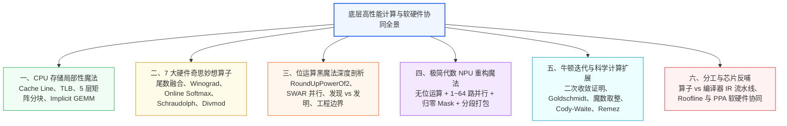
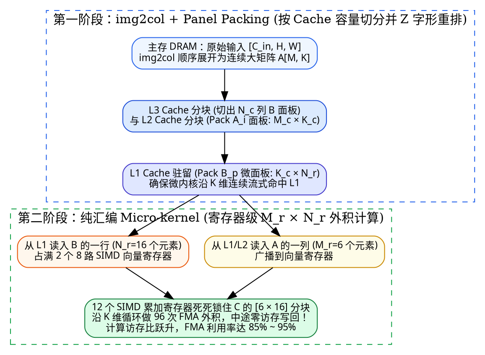
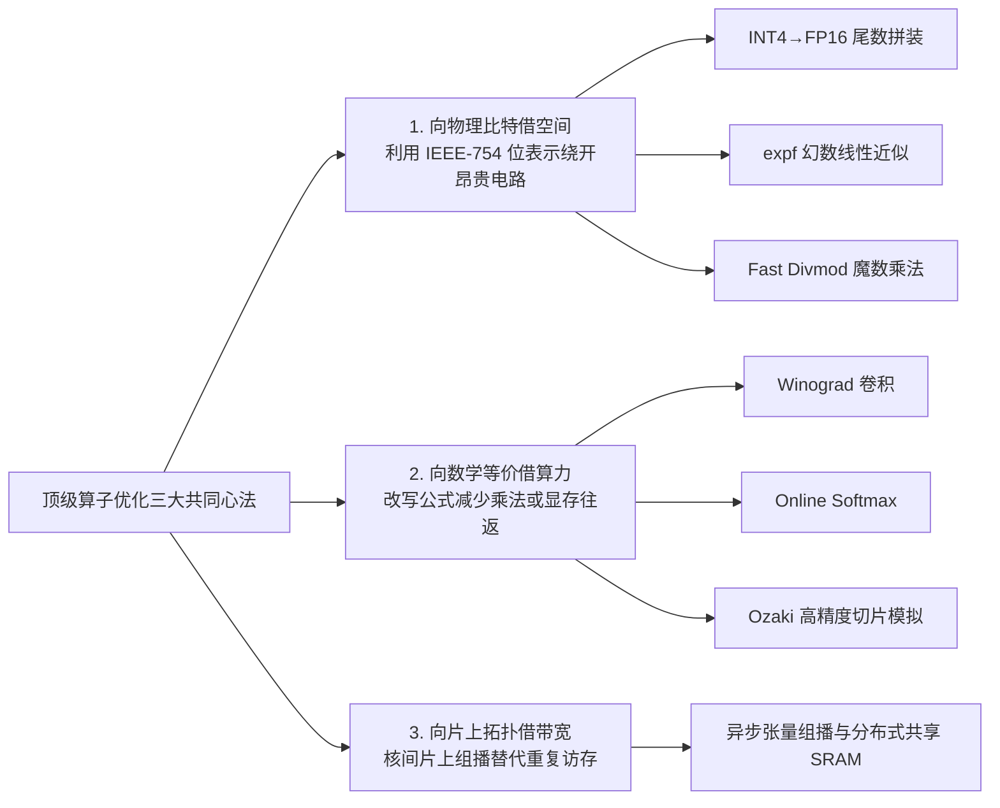
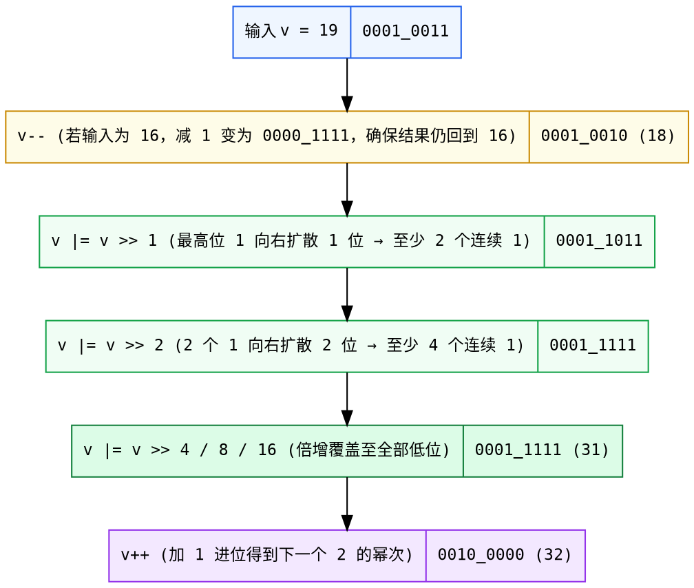
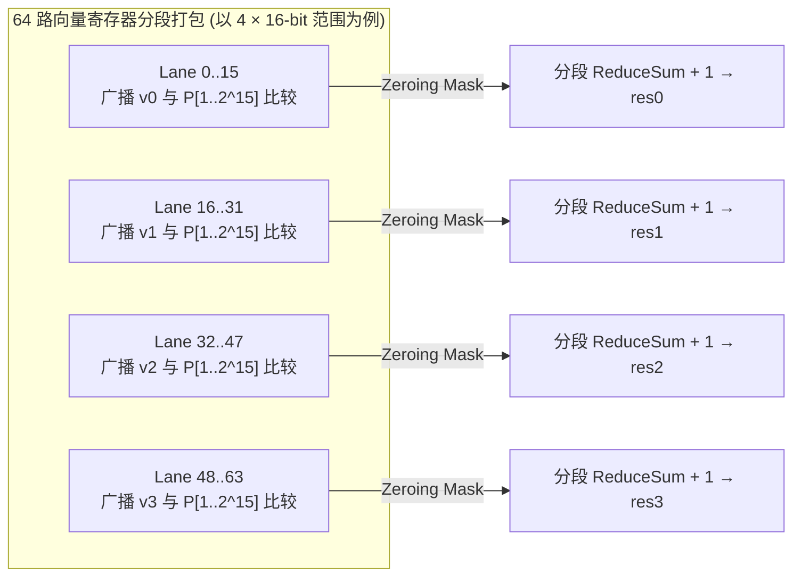
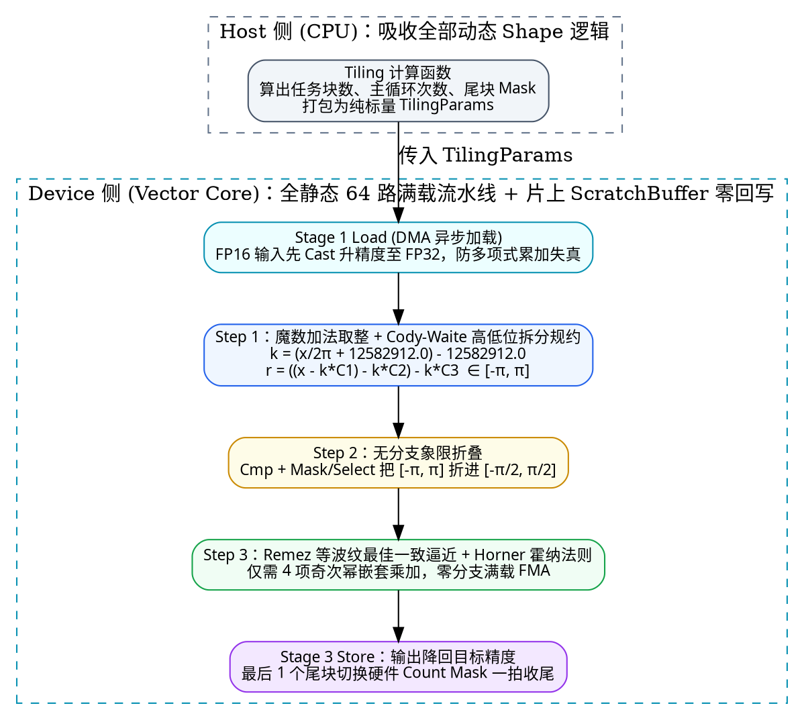
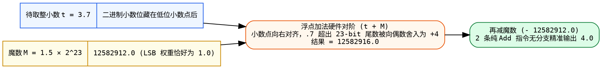
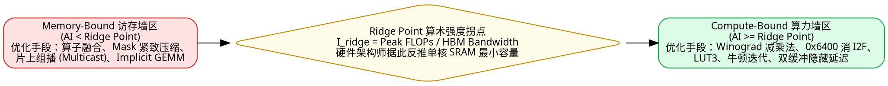

> **导读**：学习底层高性能计算（HPC）与 AI **算子（Operator / Kernel，直接跑在处理器上的核心计算程序）** 开发时，人们常常会遇到许多看似“违背直觉”的工程现象：
>
> - 明明把输入数据复制展开成更大的矩阵、增加了数据搬运量，为什么 CPU 上 `img2col + 矩阵乘（GEMM）` 反而比直接算卷积快得多？
> - 明明只是几行看似怪异的整数位运算或浮点魔数（如 `0x6400`、`0x5f3759df`、`12582912.0`），为什么能把原本需要几十个时钟周期的类型转换、开方、取整或除法压缩到一两条指令？
> - 如果换到一颗**连按位与/移位都没有、只保留了加乘倒数指数对数和 1~64 路硬件 Mask 并行**的极简专用 NPU（神经网络处理器）上，这些黑魔法还能用吗？`sin`、`cos`、`erf` 等科学计算函数又该如何不依赖动态控制流落地？
> - 这些技术到底该由**算子工程师**写死在库里，还是由**编译器工程师**自动生成？它们又是如何通过性能模型反哺**芯片硬件架构师**裁剪下一代硅片的？
>
> 为了让**零基础初学者**不仅“知其然”，还能“知其所以然”并做到**触类旁通**，本教程坚持三条原则：
>
> 1. **名词首次出现即破冰**：任何硬件术语、缩写或数值算法名词在第一次出现时，都会立刻给出英文全称与生活化的白话解释；
> 2. **公式推导与比特追踪并重**：不满足于“贴结论”，关键魔数（如 `0x6400`、`12102203.0f`、`12582912.0`）和收敛公式全部给出逐行推导与数值验证；
> 3. **图表可视化 + 触类旁通**：穿插 **10 张 Graphviz 与 Mermaid 图解**，并在每一章末尾提供“**触类旁通：还应该想到的关联知识**”，帮你把孤立的技巧串成完整的计算机系统知识网。

---

## 零、初学者核心名词破冰速查表

在正式进入技术深水区之前，我们先为后文首次出现的专业术语准备一张“破冰地图”。正文初次遇到它们时，也会结合上下文再次拆解。

| 术语 / 缩写                 | 英文全称                                           | 一句话通俗解释                                                                                                                                             |
| :-------------------------- | :------------------------------------------------- | :--------------------------------------------------------------------------------------------------------------------------------------------------------- |
| **Cache Line（缓存行）**    | Cache Line                                         | CPU 从主内存读取数据的**最小搬运单位**（通常固定为 **64 字节**）。就算程序只想要其中 4 个字节，硬件也必须把整整 64 字节一起拉进缓存。                        |
| **TLB（页表缓存）**         | Translation Lookaside Buffer                       | 专门缓存“虚拟地址 $\rightarrow$ 物理地址”映射关系的微型超高速硬件表。如果访问地址跳得太散，TLB 频频失效，每次访存都要额外查好几级内存页表。               |
| **SIMD / SIMT**             | Single Instruction, Multiple Data / Threads        | **单指令多数据 / 单指令多线程**：一条指令发出去，让 8 个、16 个甚至 64 个通道同时对各自的数据做相同的加减乘除。                                            |
| **SWAR**                    | SIMD Within A Register                             | **寄存器内 SIMD**：在没有宽向量指令的普通 CPU 上，把一个 64-bit 普通整数寄存器拆成 8 个 8-bit 字节同时做并行运算的位技巧。                                  |
| **FMA**                     | Fused Multiply-Add                                 | **乘加融合指令**：在同一个时钟周期里一次性算完 $a \times b + c$，吞吐翻倍且中间只做一次舍入，精度更高。                                                   |
| **GEMM**                    | General Matrix Multiplication                      | **通用矩阵乘法**，即计算 $C = \alpha A \times B + \beta C$。它是 AI 与科学计算最核心的算力底座。                                                          |
| **img2col**                 | Image-to-Column                                    | 把二维图像中一个个重叠的卷积滑动窗口“摊平”拉成矩阵列向量的内存重排技巧，目的是把卷积转成规整的 GEMM。                                                      |
| **算术强度（AI）**          | Arithmetic Intensity                               | 平均每从外部主存搬运 **1 字节** 数据，计算单元能执行多少次浮点运算（**FLOPs/Byte**）。它是决定算子受限于带宽还是算力的核心指标。                           |
| **IEEE-754**                | IEEE Standard for Floating-Point Arithmetic        | 全球通用的浮点数二进制编码标准，把一个浮点数拆成 **符号位（Sign）+ 指数位（Exponent）+ 尾数位（Mantissa）** 三段存储。                                   |
| **SFU**                     | Special Function Unit                              | **特殊函数单元**：芯片上专门用来算 $e^x$、$\ln x$、$\sin x$ 等超越函数的硬件电路。面积小、数量少，高并发时极易成为排队瓶颈。                                |
| **Bit Twiddling Hacks**     | Bit Twiddling Hacks                                | **位运算黑魔法**：不走常规加减乘除和 `if-else` 分支，直接利用二进制比特位规律和布尔恒等式完成运算的极简技巧。                                              |
| **CLZ / POPC**              | Count Leading Zeros / Population Count             | **前导零计数 / 位计数**：硬件指令直接数出一个二进制数左边有几个连续的 `0`（`CLZ`），或者总共有几个 `1`（`POPC`，又叫汉明权重 Hamming Weight）。              |
| **UB / 严格别名**           | Undefined Behavior / Strict Aliasing               | **未定义行为**：编程语言标准禁止的危险写法（如强行用 `int*` 指针去读 `float` 的地址），开启编译器优化后可能出现逻辑被删掉或算错的灵异 Bug。                |
| **Roofline 模型**           | Roofline Model                                     | 一张用“算术强度”横轴和“算力天花板”纵轴画出的屋顶形性能分析图，能一眼看出算子卡在 **访存受限（Memory-Bound）** 还是 **计算受限（Compute-Bound）**。       |
| **牛顿迭代**                | Newton-Raphson Method                              | 一种用切线快速逼近方程根的数学方法：先蒙一个粗糙初值，再套用纯乘加公式迭代 1~2 次，每迭代一次有效数字精度大约**翻倍**（二次收敛）。                        |
| **ULP**                     | Unit in the Last Place                             | **末位精度单位**：两个相邻浮点数之间的最小间距，是衡量数学库计算精度（例如要求误差 $< 0.5\text{ ULP}$）的国际通用标尺。                                    |
| **PPA**                     | Performance, Power, Area                           | 芯片硬件设计的三大黄金权衡指标：**性能（Performance）、功耗（Power）、硅片面积（Area）**。                                                                 |

下面这张全景路线图展示了本文的知识脉络：



---

## 一、深度剖析：为什么 CPU 上 `img2col + GEMM` 比直接算卷积更快？

很多初学者第一次听说 **`img2col`（Image-to-Column，图像转列矩阵）** 时，会产生两个直觉上的疑问：

1. “是不是把一个通用矩阵乘拆开之后再算反而变快了？”
2. “把图像窗口展开成矩阵后，数据体积明明膨胀了好几倍，数据搬运量不是变大了吗？为什么总耗时反而大幅缩短了？”

这里必须先做一个核心概念澄清：

- **前置纠正**：`img2col` 并不是“把通用矩阵乘法（MatMul）拆开”，而是**把多维滑动窗口卷积（Conv2D）转化成规则的二维矩阵乘法（GEMM）**。
- **核心真相**：现代 CPU 的性能瓶颈根本不是“总字节数”，而是**存储层次的访问效率（Cache Line 与 TLB 命中率）**、**SIMD 向量流水线满载度**以及 **微内核（Micro-kernel）在寄存器层级对数据的极高复用率**。

### 1.1 直接卷积（Direct Conv）在 CPU 上的四重微架构灾难（算一笔账就懂）

如果不做重排，直接按照卷积公式写 $6 \sim 7$ 层嵌套循环（`N, C_out, H_out, W_out, C_in, K_h, K_w`），我们来算一笔精确的微架构账：

1. **Cache Line 带宽浪费高达 $80\%$ 以上**：
   - 假设输入特征图按经典的 `[N, C_in, H, W]`（NCHW）排布，图像宽度 $W = 224$，每个浮点数（FP32）占 4 字节，那么相邻两行像素的内存地址相隔 $224 \times 4 = 896$ 字节。
   - 取一个 $3 \times 3$ 窗口时，第一行的 3 个元素只占 **12 字节**，但 CPU 每次从内存拉取数据至少搬运一整个 **Cache Line（64 字节）**。一次取 3 行窗口，硬件被迫从主存拉回 $3 \times 64 = 192$ 字节，真正参与计算的却只有 $9 \times 4 = 36$ 字节——**Cache Line 有效利用率仅 $\frac{36}{192} = 18.75\%$，超过 $81\%$ 的带宽被白白浪费！**
   - 更致命的是**缓存抖动（Cache Thrashing）**：当通道数 $C_{in} = 256$ 时，不同通道和不同行的数据不断争夺有限的 L1 Cache（通常仅 $32\text{ KB} \sim 48\text{ KB}$），前一个通道的数据还没复用几次就被后一个通道挤出了缓存。
2. **TLB 抖动与硬件预取器失明**：
   - **TLB（页表缓存）**负责把程序的虚拟地址瞬间翻译成物理内存地址（每页通常 $4\text{ KB}$）。直接卷积频繁在数百个通道之间跨大步长跳跃，极易超出 TLB 容量，引发昂贵的硬件页表遍历（Page Walk，延迟数十至上百周期）。
   - 同时，CPU 内部的**硬件预取器（Hardware Prefetcher，自动预测下一个连续地址并提前拉数据的电路）**只能识别规律的顺序步长，面对 6 层循环的复杂跳跃直接“失明”。
3. **SIMD 向量化与 FMA 流水线严重饥饿**：
   - 现代 CPU 算得快的秘诀是 **宽向量 SIMD（比如一次处理 8 个或 16 个 FP32）+ FMA（乘加融合）**。直接卷积内层循环行程只有 $K_w = 3$，不够凑满一条 8 路或 16 路向量，编译器很难生成满载的向量加载与乘加指令，大量时间浪费在标量算术和尾数收尾上。
4. **分支预测惩罚与低指令级并行（ILP）**：
   - $3 \times 3$ 极短内循环每 3 次就要触发一次循环条件判断和跳转，**分支预测器（Branch Predictor）**频繁被打断，流水线中的有效计算指令密度极低。

### 1.2 `img2col + GEMM` 的底层真相：经典五层循环分块与微内核寄存器复用

`img2col` 的本质是**空间换时间**：在开算之前，先做一次集中式的内存重排（Data Packing），把原本支离破碎的滑窗读取，强行铺平为两块**内存物理地址绝对连续**的大矩阵：
- 输入展开矩阵 $A$：尺寸为 $(H_{out} \cdot W_{out}) \times (C_{in} \cdot K_h \cdot K_w)$
- 卷积核矩阵 $B$：尺寸为 $(C_{in} \cdot K_h \cdot K_w) \times C_{out}$

一旦变成标准 GEMM $C = A \times B$（令 $M = H_{out}W_{out},\ K = C_{in}K_hK_w,\ N = C_{out}$），真正让算力起飞的，是经典高性能线性代数库里的**五层循环分块 + 汇编微内核（Micro-kernel）架构**！



我们来算一笔极其震撼的**算术强度（Arithmetic Intensity）**账，你就彻底明白为什么“多搬了 9 倍数据反而更快”：

1. **为什么朴素三重循环 `for i, j, k` 跑矩阵乘也很慢（仅峰值 $5\%$）？**
   - 朴素写法每算 1 次乘加 $c_{ij} += a_{ik} \cdot b_{kj}$，都要读取 2 个操作数（8 字节），算术强度只有 $0.25\text{ FLOPs/Byte}$，且 $B$ 矩阵按列跨步读取同样把 Cache 打爆。
   - 事实上，**专业 GEMM 库在算纯矩阵乘时，内部也必须先做一次与 `img2col` 如出一辙的内存拷贝重排（Panel Packing）**：把 $A$ 切成高 $M_c$、宽 $K_c$ 的块，在内部按 $M_r$（如 $6$）为条带连续排好；把 $B$ 切成高 $K_c$、宽 $N_r$（如 $16$）的微面板连续放进 L1 Cache。
2. **微内核的外积复用奇迹**：
   - 假设 CPU 有 16 个 8 路向量寄存器。汇编微内核拿出 **12 个寄存器**死死存住输出块 $C[6 \times 16]$（每行 16 个元素占 2 个 8 路向量寄存器，$6 \times 2 = 12$ 个），**全程沿 $K$ 维度累加都不写回内存**！
   - 在 $K$ 维度的每一步 $k$：只需加载 $A$ 的 $M_r = 6$ 个元素（依次广播）和 $B$ 的 $N_r = 16$ 个元素（2 条向量加载指令），就能和累加器做 **$6 \times 16 = 96$ 次独立 FMA 运算（192 次浮点操作）**！
   - 此时每读入 $6 + 16 = 22$ 个元素（88 字节），就完成 192 次浮点运算，**寄存器层级的算术强度瞬间达到 $\frac{192}{88} \approx 2.18\text{ FLOPs/Byte}$**（如果考虑每个 $A$ 面板块还会被多列 $B$ 重复使用，L2/DRAM 层面的算术强度直接突破几十 FLOPs/Byte）！
   - 而 `img2col` 展开阶段虽然多写了 $9\times$ 数据，但它是一次性的**完全顺序读写**，硬件预取器全速工作；随后计算阶段这批数据被 $C_{out} = 256$ 个输出通道反复复用。**“顺序整理 1 次 + 满速外积复用 256 次”的总耗时，远远碾压“低效跳跃访存 256 次”**。

### 1.3 工业界终极演进：Implicit GEMM（零额外内存膨胀）

`img2col` 唯一的缺点是展开矩阵需要占用 $K_h \times K_w$ 倍的额外内存。如果特征图特别大（例如高分辨率医学影像或自动驾驶感知输入），直接展开会直接把内存撑爆。

于是现代推理引擎演化出了 **Implicit GEMM（隐式矩阵乘）**：
- **核心思想**：**保留逻辑上的二维 GEMM 分块与微内核，但不在主存里真正生成展开矩阵！**
- **具体做法**：在微内核需要从主存/L2 把 $A$ 的一小块（Tile）加载进 L1 Cache 或片上共享存储的那一瞬间，通过主机端预先算好的**索引映射与 Fast Divmod** 把矩阵行号 `m` 还原成 `(n, oh, ow)`、把列号 `k` 还原成 `(c, kh, kw)`，并直接查预先算好的偏移表（On-the-fly Packing）把非连续像素凑进连续的 L1 缓冲面板里。
- **结果**：既享受到 GEMM 微内核 $90\%$ 的算力利用率，又实现**零额外内存拷贝空间**，并且天然兼容空洞卷积（Dilated Conv）、分组卷积（Group Conv）与任意 Padding。

### 1.4 触类旁通：由 `img2col` 延伸出的 3 个重要系统思维

1. **内存排布（Memory Layout）决定算子形态：`NCHW` vs `NHWC` vs `Blocked Layout`**
   - 如果张量采用 **`NHWC`**（通道维度 `C` 放在最内层连续地址），那么 $1 \times 1$ 卷积在物理内存上**天然就是一个完整的矩阵乘法**（`[N*H*W, C_in] × [C_in, C_out]`），根本不需要 `img2col`！
   - 更进一步，许多 CPU 推理引擎使用 **`NCWHc8` / `NC4HW4` 等分块布局（Blocked Layout）**：把通道维按硬件 SIMD 宽度（如 4 或 8）切成小块塞进最内层。这样直接卷积沿着最内层一次性就能加载一整条满载的 SIMD 向量，无需 `img2col` 也能打出极高效率。
2. **分块矩阵转置（Tiled Transpose）与 `img2col` 同源**
   - 为什么不能用两层循环直接写 `B[j][i] = A[i][j]`？因为要么读连续写跨步（毁掉写合并与 TLB），要么读跨步写连续（毁掉 Cache Line）。工业界做法是把矩阵切成 $8 \times 8$ 或 $32 \times 32$ 的小块读入寄存器/片上缓冲，在寄存器内用向量混洗指令做原位转置后再顺序写回——这和 `img2col` “用片上整理换主存连续”完全是同一个哲学。
3. **注意力机制的 `KV Cache` 内存排布（Paged / Blocked KV Layout）**
   - 在大模型推理中，长序列的 Key/Value 缓存如果离散存放，同样会导致访存碎裂；将其按固定 Page/Block 大小组织并对齐向量/矩阵加载位宽，本质上也是在用布局规范化消除缓存行与 TLB 抖动。

---

## 二、深挖 7 大“硬件奇思妙想”型算子优化（含公式推导与比特追踪）

当分块（Tiling）、双缓冲（Double Buffer）和常规向量化达到极限后，顶尖算子工程师会祭出“硬件奇思妙想”。下面我们把这 7 个经典案例拆透到**比特级、公式级与电路级**。



### 2.1 INT4 $\rightarrow$ FP16 寄存器原位极速反量化（含偏移与 Scale 融合绝招）

- **痛点**：大模型 W4A16 量化推理中，一个 32-bit 寄存器紧凑塞了 8 个 `INT4` 权重（`w7..w0`）。如果按常规写法先移位提取出整数，再调用整数转浮点指令（`I2F`），由于加速器上 `I2F` 吞吐远低于矩阵计算单元，反量化指令会把矩阵乘流水线彻底卡死。
- **奇思妙想**：利用 IEEE-754 半精度浮点数（FP16）精确公式：
  $$\text{Value} = (-1)^S \times 2^{E - 15} \times \left(1 + \frac{M}{1024}\right)$$
  当指数 $E = 25$（二进制 `11001`，对应的半精度浮点值恰好为 **$1024.0$**，十六进制 **`0x6400`**）时：
  $$\text{Value} = 1 \times 2^{25 - 15} \times \left(1 + \frac{M}{1024}\right) = 1024 + M$$
  **惊人的同构性**：在 `0x6400` 到 `0x67FF` 这段二进制区间里，尾数 $M$（低 10 位）的每 1 个整数增量，精确等于浮点数值增加 `1.0`！

```dot
digraph FP16DequantDetail {
    rankdir=LR;
    node [shape=record, style="filled", fontname="monospace", fontsize=10];

    INT4 [label="{32-bit 打包整数寄存器|w7|w6|w5|w4|w3|w2|w1|w0 (各 4-bit)}", fillcolor="#fefce8", color="#ca8a04"];
    MAGIC [label="{32-bit 双 FP16 魔数 0x64006400|高 16b: 1024.0 | 低 16b: 1024.0}", fillcolor="#eff6ff", color="#2563eb"];
    LUT3 [label="单周期 LUT3 指令\n(q & 0x000F000F) \| 0x64006400\n直接取出低 16b/高 16b 拼进尾数", shape=box, style="filled,rounded", fillcolor="#fff7ed", color="#ea580c"];
    PACKED [label="{合法双 FP16 寄存器 (half2)|1024.0 + w_hi | 1024.0 + w_lo}", fillcolor="#f0fdf4", color="#16a34a"];
    FMA [label="极客绝招：用 FMA 一次性融合减偏移与乘 Scale\nw_fp16 = (1024 + w) * scale + (-1024 - zp) * scale\n连单独的减法指令都省掉了！", shape=box, style="filled,rounded", fillcolor="#dcfce7", color="#15803d"];

    INT4 -> LUT3;
    MAGIC -> LUT3;
    LUT3 -> PACKED -> FMA;
}
```



- **进阶工程绝招（符号处理 + 零减法融合）**：
  1. **有符号 `INT4` 怎么处理（范围 $[-8, 7]$）？** 在量化打包阶段预先加上偏置 $+8$ 变成无符号 $[0, 15]$（或者存储时翻转最高符号位，在寄存器里拼接 `0x6408` 即 `1032.0` 来抵消符号位权重），避免昂贵的符号扩展（Sign-Extension）！
  2. **连 `HSUB2` 减法都可以省掉！** 反量化之后紧接着都要乘以量化尺度 `scale` 并减去零点 `zp`：$w_{\text{real}} = (w - zp) \cdot \text{scale}$。工程师只要把魔数减法直接代数合并进乘法里：
     $$w_{\text{real}} = (1024 + w) \cdot \text{scale} + \big(-(1024 + zp) \cdot \text{scale}\big)$$
     只需预计算常量 $C = -(1024 + zp) \cdot \text{scale}$，就能用**1 条双路 FP16 FMA 指令**同时完成“减魔数 + 减零点 + 乘缩放因子”三件事！
  3. **为什么只用交错排列（Interleaved Layout）才能跑最快？** 为了让 1 次移位（例如 `q >> 4`）同时对齐 2 个以上权重到各自对应的 16-bit 槽位，权重在加载进寄存器之前，往往会在离线重排阶段按 `[w0, w4, w1, w5, w2, w6, w3, w7]` 交错打包，从而把提取 8 个权重的逻辑掩码次数压到最低。

### 2.2 Winograd 卷积：完整矩阵推导与数值稳定性陷阱

- **痛点**：$3 \times 3$ 卷积计算密度太高，GEMM 已经触及物理芯片计算单元上限。
- **1D 核心推导（$F(2, 3)$，输出 2 个点、卷积核 3 个点）**：
  设输入向量为 $d = [d_0, d_1, d_2, d_3]^T$（长度 $2 + 3 - 1 = 4$），卷积核为 $g = [g_0, g_1, g_2]^T$。直接算输出 $Y = [y_0, y_1]^T$ 需要 $2 \times 3 = 6$ 次乘法：
  $$y_0 = d_0 g_0 + d_1 g_1 + d_2 g_2, \qquad y_1 = d_1 g_0 + d_2 g_1 + d_3 g_2$$
  利用多项式插值与**中国剩余定理（CRT）**，Winograd 构造出 4 个中间乘积 $m_1, m_2, m_3, m_4$：
  $$\begin{aligned}
  m_1 &= (d_0 - d_2) \cdot g_0, & m_2 &= (d_1 + d_2) \cdot \frac{g_0 + g_1 + g_2}{2}, \\
  m_3 &= (d_2 - d_1) \cdot \frac{g_0 - g_1 + g_2}{2}, & m_4 &= (d_1 - d_3) \cdot g_2
  \end{aligned}$$
  然后仅用加法组合出最终结果（可以自行代入展开验证完全相等！）：
  $$y_0 = m_1 + m_2 + m_3, \qquad y_1 = m_2 - m_3 - m_4$$
  注意看：**卷积核变换 $\frac{g_0 \pm g_1 + g_2}{2}$ 只依赖权重，在模型推理前离线算好一次即可！** 运行时输入变换只有 `d0-d2`、`d1+d2` 等纯加减法，输出变换也是纯加减法，**乘法次数从 6 次降为 4 次**。扩展到二维 $F(2 \times 2, 3 \times 3)$ 时，嵌套变换 $Y = A^T \big[(G g G^T) \odot (B^T d B)\big] A$ 将乘法从 $4 \times 9 = 36$ 次直接砍到 $4 \times 4 = \mathbf{16}$ 次（降低 $2.25\times$）。
- **必须知道的阿喀琉斯之踵（数值稳定性危机）**：
  如果试图用更大的块比如 $F(6 \times 6, 3 \times 3)$ 把乘法再砍 $4\times$，变换矩阵本质上是**范德蒙德矩阵（Vandermonde Matrix）的逆矩阵**，其条件数（Condition Number）随块尺寸呈**指数级恶化**——矩阵里会出现 $\frac{1}{24}, \frac{1}{120}$ 和正负巨大交替系数，一旦跑在 FP16 半精度下会立刻引发严重的舍入误差崩塌。因此工业界通常稳守 $F(2\times 2, 3\times 3)$ 或谨慎使用 $F(4\times 4, 3\times 3)$。

### 2.3 Online Softmax：完整数学归纳与“延迟归一化”优化

- **痛点**：标准 3-pass Softmax 需要把 $N \times N$ 注意力分数矩阵写回慢速的全局显存（HBM）再读回来，序列长度一长直接被显存带宽拖垮。
- **完整两块合并归纳证明**：
  假设一行数据分为两块 $x^{(1)}$ 和 $x^{(2)}$。我们分别算出了局部统计量：
  - 第 1 块：局部最大值 $m_1 = \max(x^{(1)})$，指数和 $d_1 = \sum_j e^{x_j^{(1)} - m_1}$，局部注意力加权和 $O_1 = \sum_j \frac{e^{x_j^{(1)} - m_1}}{d_1} V_j^{(1)}$
  - 第 2 块：局部最大值 $m_2 = \max(x^{(2)})$，指数和 $d_2 = \sum_k e^{x_k^{(2)} - m_2}$
  当新块到来时，全局新最大值为 $m_{\text{new}} = \max(m_1, m_2)$。利用指数加法法则 $e^{x - m_{\text{new}}} = e^{x - m_1} \cdot e^{m_1 - m_{\text{new}}}$，可以无误差更新分母与输出：
  $$d_{\text{new}} = d_1 \cdot e^{m_1 - m_{\text{new}}} + d_2 \cdot e^{m_2 - m_{\text{new}}}$$
  $$O_{\text{new}} = \frac{d_1 \cdot e^{m_1 - m_{\text{new}}}}{d_{\text{new}}} O_1 + \frac{1}{d_{\text{new}}} \sum_k e^{x_k^{(2)} - m_{\text{new}}} V_k^{(2)}$$
- **现代高性能核中的“延迟归一化（Lazy Rescaling）”技巧**：
  在循环内部每一块都做一次除法 `/ d_new` 太慢了！工程上在主循环里**干脆先不除以 $d$**，只维护未归一化的累加器 $\tilde{O}$：
  $$\tilde{O}_{\text{new}} = \tilde{O}_{\text{old}} \cdot e^{m_{\text{old}} - m_{\text{new}}} + \sum_k e^{x_k^{(2)} - m_{\text{new}}} V_k^{(2)}$$
  **直到一整行所有块全部算完准备写回 HBM 的最后那一刻，才统一乘一次 $\text{Recip}(d_{\text{final}})$！** 这把循环内的除法彻底清零，还能与快速 `exp2(x * log2(e))` 无缝融合。

### 2.4 非原生精度硬件“借壳”与 Ozaki 高精度切片法

- **向下借壳（低精度借高精度矩阵单元）**：将 8-bit 浮点（如 E4M3）拆开，把符号位放在 FP16 的 bit 15、指数偏置加上 `15 - 7 = 8` 放到 bit 14..10、3 位尾数放到 bit 9..7（低 7 位补 0），直接送进 FP16 矩阵乘单元运算——虽然损失了比特密度，但瞬间获得了远超标量核心数十倍的矩阵算力。
- **向上拆片（Ozaki Scheme，尾崎分块法）**：当需要用低精度矩阵单元（如 INT8 或 FP16）计算 **FP64 双精度矩阵乘** $C = A \times B$ 时：
  1. 先按行（对 $A$）和按列（对 $B$）找出最大指数作为基准；
  2. 利用高尾数切片算法，把每个 53 位尾数的 FP64 数字无误差拆成 $S$ 个（如 $4 \sim 8$ 个）带递减指数缩放的整数切片：$A = \sum_{p=1}^{S} 2^{e_p} A_p$（每个 $A_p$ 只有 7~8 个有效比特，绝对不会溢出 INT32 累加器！）；
  3. 原始双精度矩阵乘拆成 $\sum_{p+q \le S+1} 2^{e_p + f_q} (A_p \times B_q)$ —— 丢弃贡献小于 FP64 机器精度的交叉尾项后，只需几次高吞吐 INT8/FP16 矩阵乘再在寄存器里错位相加，就能精确还原双精度结果！

### 2.5 `expf()` 指数近似（Schraudolph 算法常数精确推导）

为什么 `bits = (int32_t)(12102203.0f * x + 1064866805.0f)` 就能算出 $e^x$？我们把它推出来看：

1. IEEE-754 单精度浮点数（1 位符号 $S=0$ + 8 位指数 $E$ + 23 位尾数 $M$）代表的正实数为 $y = 2^{E - 127} (1 + f)$（其中 $f = M / 2^{23} \in [0, 1)$）。
2. 把这个 32-bit 内存直接当成整数读出来，它的整数值是：
   $$I_y = E \cdot 2^{23} + M = 2^{23} (E + f)$$
3. 利用在 $[0, 1)$ 区间上 $\log_2(1 + f) \approx f + \sigma$（其中 $\sigma \approx 0.043677$ 是最小化最大相对误差的最优线性修正偏移），得到：
   $$\log_2(y) = (E - 127) + \log_2(1 + f) \approx (E + f) - 127 + \sigma = \frac{I_y}{2^{23}} - 127 + \sigma$$
4. 我们想算 $y = e^x$，两边取 $\log_2$ 得 $\log_2(y) = \frac{x}{\ln 2}$，代入上式反解 $I_y$：
   $$I_y \approx \underbrace{\left(\frac{2^{23}}{\ln 2}\right)}_{\mathbf{12102203.16}} \cdot x + \underbrace{2^{23}(127 - \sigma)}_{\mathbf{1064866805}}$$
   **这就是那两个神秘魔数的精确数学来源！** 只需一条乘加转整数再按位强转回 `float`，就绕过了拥堵的 SFU。该一级线性近似的最大相对误差约为 $3\%$（曲线呈周期性锯齿）；若想用于高精度训练，只需把尾数小数部分 $f$ 提取出来做一次二阶多项式修正 $1 + c_1 f + c_2 f^2$，误差可立即压低到 $10^{-4}$ 以下。

### 2.6 Fast Divmod 魔数乘法：数论证明与 33-bit 溢出处理

- **痛点**：Tensor Reshape/Broadcast 中海量计算 `idx / d` 和 `idx % d`，芯片上整数除法延迟高达 $30 \sim 50$ 周期。
- **数论原理**：给定已知正整数除数 $d \ge 1$，取移位量 $s = \lceil \log_2 d \rceil$（满足 $2^{s-1} < d \le 2^s$），令 32-bit 向上取整魔数为：
  $$M = \left\lceil \frac{2^{32+s}}{d} \right\rceil$$
  记余差 $\delta = M \cdot d - 2^{32+s}$，显然有 $0 \le \delta < d$。对于任意 32 位无符号被除数 $n \in [0, 2^{32}-1]$，写成 $n = q d + r$（$0 \le r < d$），两边乘以 $M$：
  $$\frac{n \cdot M}{2^{32+s}} = \frac{(qd + r)M}{2^{32+s}} = q \left(1 + \frac{\delta}{2^{32+s}}\right) + \frac{r M}{2^{32+s}} = q + \frac{q\delta + rM}{2^{32+s}}$$
  因为 $q\delta + rM < \frac{n}{d} \cdot d + (d-1)\frac{2^{32+s}+d}{d} < 2^{32} + 2^{32+s} - \dots < 2^{32+s}$（对所有 $n < 2^{32}$ 严格成立！），所以小数部分永远严格落在 $[0, 1)$ 内，向下取整直接精准等于商 $q$！
- **工程细节（33-bit $M$ 溢出怎么办？）**：当 $d$ 不是 2 的幂且满足 $\frac{2^{32+s}}{d} > 2^{32}$ 时，$M$ 刚好会多出第 33 个比特（$M = 2^{32} + M'$，其中 $M' = M - 2^{32}$ 是 32 位整数）。此时无需用 64 位乘法，只需算出 `t = umulhi(n, M')`，然后利用 `q = (t + ((n - t) >> 1)) >> (s - 1)` 即可避免 `n + t` 溢出 32 位，完美算出精确商！

### 2.7 跨核片上组播与分布式共享存储（带宽账算清楚）

假设一个计算簇包含 $4 \times 4 = 16$ 个计算核心共同计算输出矩阵 $C$ 的一块，各自需要一块 $A$（左矩阵分块）和一块 $B$（右矩阵分块）：
- **没有片上组播时**：同一行的 4 个核心各自向主显存（HBM）发请求读同一块 $A$；同一列的 4 个核心各自读同一块 $B$。16 个核心共向 HBM 发起 $16 + 16 = 32$ 份冗余读取！
- **有片上组播（Multicast）时**：第 1 列的核心负责发 $A$ 的读请求，硬件异步张量搬运引擎（Async Tensor DMA）收到 HBM 回包后，沿着片上高速交叉开关直接同时灌入同行的 4 个核心片上共享存储；同理第 1 行的核心广播 $B$。**HBM 实际读取总流量瞬间锐减到 $4 + 4 = 8$ 份（直接暴降 $4\times$）！**

### 2.8 触类旁通：由这 7 个案例应该联想到的同构优化

1. **量化零点（Zero-Point）与 Bias 合并**：就像 `0x6400` 减魔数能并进 FMA，任何仿射量化公式 $(x_q - z_x) \cdot (w_q - z_w)$ 展开后，$-z_w \sum x_q$ 和常数项 $z_x z_w$ 都可以拆分出来，避免在 GEMM 累加内循环里做任何减法！
2. **Strassen 矩阵乘 vs Winograd 卷积**：1969 年提出的 Strassen 算法把 $2 \times 2$ 矩阵乘法从 8 次砍到 7 次（同样用加减换乘法），但它为什么在大规模 AI 芯片上不如 Winograd 常见？因为 Strassen 破坏了存储连续性且增加片上临时缓冲压力，同时减法相消同样伤害数值精度——这印证了我们在第一章讲的**算力必须服从局部性与数值稳定性**。
3. **对数域计算（LNS）与指数乘法**：既然 `exp`/`ln` 可以把连乘变成加法累加，部分超低功耗硬件甚至直接全程存储 $\log_2 |x|$（乘法直接变加法器，功耗降低一个量级），只在最终输出时转回线性浮点。

---

## 三、位运算黑魔法深度剖析：`RoundUpPowerOf2`、SWAR、发现与发明及工程边界

### 3.1 `RoundUpPowerOf2` 的三种实现与精确边界剖析

在内存池分配（伙伴分配器 Buddy Allocator）、算子分块（Tile）对齐以及蝶形归约中，“将无符号整数 $v$ 向上取整到最近的 2 的幂次”是最高频的底层操作之一。

#### 实现一：位扩散填充法（Bit Propagation）

```c
unsigned int v; // 输入 32 位无符号整数，求 >= v 的最小 2 的幂次

v--;
v |= v >> 1;
v |= v >> 2;
v |= v >> 4;
v |= v >> 8;
v |= v >> 16;
v++;
```

*(注：64 位整数 `uint64_t` 在 `v++` 前追加 `v |= v >> 32;` 即可。)*



- **两个极端边界**：
  - `v == 0`：`0--` 下溢成 `0xFFFFFFFF`，涂抹后仍是全 1，`v++` 溢出回 **`0`**（而不是 `1`）。无分支修复法是在最后加 `v += (v == 0);`。
  - `v > 2^31`（例如 `0x80000001`）：真正的下一个 2 的幂是 $2^{32}$，超出 32 位无符号数上限，最终也会溢出回 `0`。

#### 实现二：IEEE-754 浮点数强转提取法（Float Casting）

利用硬件在 `(float)v` 时自动执行**规格化（Normalization）**——自动数出最高位 `1` 的位置并写入指数域：

```c
// 警告：标准中经典写法 f = (float)(v - 1); 在 v >= 2^25 时会因为尾数舍入出错！
unsigned int round_up_pow2_float(unsigned int v) {
    if (v <= 1) return 1;
    float f = (float)(v - 1);
    uint32_t f_bits;
    memcpy(&f_bits, &f, sizeof(f_bits)); // 用 memcpy 或 std::bit_cast 避开严格别名 UB
    // IEEE-754 float 偏置为 127；因为需要向上进 1 位幂次，减去 126 等价于 (exponent - 127) + 1
    return 1U << ((f_bits >> 23) - 126);
}
```

- **为什么经典手册写明它仅适用于 $v < 2^{24}$（严格来说在 $v = 2^{25}$ 必挂）？**
  `float` 只有 24 位有效精度（1 位隐含前导 `1` + 23 位显式尾数）。如果输入恰好是 $v = 2^{25} = 33,554,432$，那么 $v - 1 = 2^{25} - 1$ 需要 25 个二进制 `1` 才能精确表示。硬件把它强转为 `float` 时，遵循**向偶数舍入（Round-to-nearest-even）**原则向上进位变成 `2^25`（指数变成 `25 + 127`），最终移位 `25 + 127 - 126 = 26`，**错误地算出 $2^{26}$ 而非 $2^{25}$**！

#### 实现三：现代硬件单指令演进（`CLZ`）

现代处理器直接将前导零计数做成单周期硬件指令 **`CLZ`**：

```c
uint32_t next_pow2_hw(uint32_t v) {
    // 若 v <= 1 返回 1；否则 32 - 前导零个数 即为 ceil(log2(v))
    return (v <= 1) ? 1 : (1U << (32 - __builtin_clz(v - 1)));
}
```

### 3.2 触类旁通：不可不知的 SWAR（寄存器内 SIMD）位魔法

讲到经典位运算技巧，就一定要触类旁通到 **SWAR（SIMD Within A Register）**——把一个 64 位（或 32 位）整数寄存器当作 8 个（或 4 个）独立字节同时算：

1. **零分支单周期检测 8 字节中是否含 `\0` 或特定分隔符（高速字符串/解析器核心）**：
   $$\text{haszero}(v) = (v - \text{0x0101010101010101}) \ \& \ \sim v \ \& \ \text{0x8080808080808080}$$
   - **原理**：只有当某个字节等于 `0x00` 时，它的最高位原本是 `0`（所以 `~v` 该字节最高位为 `1`），且减去 `0x01` 会向高位借位使最高位变为 `1`；其他任意非零字节（如 `0x01..0xFF`）都不可能同时满足这两个条件！再配合 `v ^ (byte * 0x0101...)` 就能瞬间并行扫描任意分隔符（如 JSON 里的 `"`、`,`、`\n`）。
2. **分治树形 `popcount`（没有硬件 `POPC` 指令时的最优解）**：
   ```c
   uint32_t swar_popcount(uint32_t x) {
       x = x - ((x >> 1) & 0x55555555);               // 每 2-bit 统计 1 的个数
       x = (x & 0x33333333) + ((x >> 2) & 0x33333333);// 每 4-bit 归约相加
       x = (x + (x >> 4)) & 0x0F0F0F0F;               // 每 8-bit 归约相加（此时单字节最大为 8，不会溢出）
       return (x * 0x01010101) >> 24;                 // 用 1 次乘法把 4 个字节一次性累加到最高字节！
   }
   ```
   看最后一行 **`(x * 0x01010101) >> 24`**：乘法器在这里被当成了一个**多路并行加法树**，一步就把 4 个字节的局部和聚合成最终结果！
3. **Kernighan 算法与 `Lowbit` 树状数组（Fenwick Tree）**：
   - `x & (x - 1)` 精确消去最低位 `1`（用于判断是否是 2 的幂，或按 `1` 的个数稀疏循环）；
   - `x & (-x)` 利用补码 `-x = ~x + 1` 精确提取最低位的那个 `1`（即 `Lowbit`），用于调度器优先级位图查找、树状数组区间更新。

### 3.3 哲学追问：这些技巧是被“发现”的，还是被“发明”的？

把底层黑魔法剥成两层来看，答案无比清晰：
1. **数学结构与物理约束是“被发现”的**：二进制补码的逆元性质、IEEE-754 编码与对数函数的线性同构、分支清流水线与除法高延迟的电路代价，都是只要采用这套物理与数字体系就必然存在的客观规律。
2. **对抗约束的编码技巧与固化的硬件电路是“被发明”的**：为了躲避跳转惩罚而发明的算术掩码、为了省循环而发明的 $\log_2 N$ 位扩散，都是人类工程师在约束下发明的“捷径”；而当捷径足够高频时，芯片架构师又把它们**固化回物理电路**（如 `CLZ`、`POPC`、`LUT3`）。

### 3.4 历史考古：当年的研发人员到底是怎么“挖”出这些技巧的？

1. **纸面第一性原理推导**：把数据结构比特图画在纸上做代数化简（如看出 FP16 在 $E=25$ 时尾数步长为 `1`，以及通过最小二乘与牛顿法拟合出 `0x5f3759df`）。
2. **精读指令集手册（ISA）与反向构造**：先看到硬件给了 `LUT3` 或有限域特性，再去离散数学里寻找双射工具（例如用异或 `XOR` 作为有限域 $GF(2^n)$ 上的无冲突排列构建 Bank Swizzle）。
3. **与反汇编器和编译器“死磕博弈”**：写完代码立刻看反汇编输出（`objdump`）；早期编译器工程师为了自动把 `if (x < 0) x = -x` 变成无分支指令，系统总结出几十条布尔等价变换写进了编译器的**窥孔优化器（Peephole Optimizer）**。
4. **程序合成与超级优化（Superoptimization）**：很多反直觉的魔数和极短指令序列（如 4 条指令完成特定位操作）靠人脑很难硬凑，而是由程序合成器从长度 1 开始穷举指令组合，配合 **SAT/SMT 形式化求解器** 在全部 $2^{32}$ 输入空间上做数学等价性自动证明后“搜”出来的！
5. **跨代集体智慧接力**：从上世纪 70 年代大型机实验室内部备忘录，到 21 世纪初系统化的位运算定理教材，再到当代大模型低精度量化微内核的改造复用。

### 3.5 工程避坑：所有黑魔法的局限与现代开发三条黄金法则

| 技巧类别                       | 核心局限与潜在灾难                                                                                                                         | 安全适用场景                                                                     |
| :----------------------------- | :----------------------------------------------------------------------------------------------------------------------------------------- | :------------------------------------------------------------------------------- |
| **位扩散法 (`v |= v >> k`)**   | 1. `v == 0` 下溢归零，`v > 2^31` 顶部溢出；<br/>2. 10 条指令存在严格先后数据依赖（`RAW` Hazard），乱序执行 CPU 无法并行，总延迟慢于 `CLZ`。 | 编译期常量折叠（`constexpr`）、或缺乏 `CLZ` 硬件指令的极简嵌入式 MCU。           |
| **IEEE-754 强转魔术**          | 1. 裸指针强转触发**严格别名 UB**；<br/>2. `float` 仅 24 位精度，$v \ge 2^{25}$ 舍入出错；<br/>3. `NaN`/`Inf`/次正规数失效，跨域搬运有延迟。 | 已知数值绝对处于安全区间（无异常值、不超精度上限）且可接受近似误差的场景。       |
| **寄存器原位反量化 (`0x6400`)** | 1. 强依赖特定逻辑指令与 FP16（换成 `BF16` 只有 7 位尾数直接失效）；<br/>2. 只能无损表示 10-bit 以内整数；<br/>3. 仅在指令吞吐受限时生效。    | 高计算密度的 W4A16 矩阵乘内循环（且确认性能瓶颈不在显存带宽而在反量化指令吞吐）。 |
| **无分支算术掩码替换**         | 1. 强迫算完 `if` 和 `else` **两条完整路径**，分支体很重时功耗与耗时反超跳转；<br/>2. 复杂位操作**遮蔽语义**，阻碍编译器生成单周期 `MIN/MAX`。 | 分支高度随机（50% 概率）且分支体仅 $1 \sim 3$ 条廉价算术指令；常规代码写 `a < b ? a : b` 交给编译器生成条件传送指令即可。 |

> **现代算子开发三条黄金法则**：① **优先查硬件原生指令**（`clz`/`popc`/`sel` 永远更快更安全）；② **先用 Roofline 定位瓶颈**（卡在显存带宽时省几条 ALU 指令毫无意义）；③ **写完必查反汇编**并用 `std::bit_cast` 与 `static_assert` 锁死类型与架构假设。

---

## 四、极简代数 NPU 重构魔法：无位运算 + 1~64 路并行 + 硬件 Mask/ReLU

现在我们进入一个真实且极具挑战性的专用处理器（NPU）场景：为了把硅片面积和功耗全部省下来喂给高密度算术阵列，该 NPU 的向量计算核心**彻底剥离了按位逻辑运算（没有 `AND`、`OR`、`XOR`、`Shift`），也不支持复杂控制流跳转**。

它只提供 **7 个连续实数域代数原语**：`Add`（加）、`Mul`（乘）、`Recip`（倒数）、`Exp`（指数）、`Ln`（对数）、`ReduceSum`（规约求和）、`Cmp`（比较），外加 **硬件原生 `ReLU`**、**Mask 掩码条件输入**，以及 **1~64 动态并行度的 Tensor 向量计算**。

> **为什么芯片架构师敢砍掉移位和逻辑运算？** 在 64 路宽向量处理器上，为每一条通道配一套完整的 32-bit 桶形移位器（Barrel Shifter）与逻辑单元会吃掉可观的晶体管面积与布线功耗。对于主打连续浮点推理的向量后处理单元，砍掉位操作可以换来更高的算力密度与主频。

### 4.1 物理边界与纯 7 原语重构（含 Log-Sum-Exp 数值稳定解析）

- **做不到的事（物理边界）**：寄存器内按比特拆解 `INT4` 权重（必须前置交给 DMA 引擎在搬入片上存储时硬件解包）；用异或重排解决 Bank Conflict（必须退回 Padding 填充错位法）。
- **纯 7 原语能玩出的经典组合**：
  1. **无分支 `Where`**：$m = \text{Cmp}(a > b) \in \{0.0, 1.0\}$，利用预存常量 `-1.0` 做 `Mul(-1.0, y)` 充当负号，算 $m \cdot x + (1.0 - m) \cdot y$。
  2. **任意幂次与开方**：$x^p = \exp(p \cdot \ln(x))$，$\frac{1}{\sqrt{x}} = \exp(-0.5 \cdot \ln(x))$。
  3. **Log-Sum-Exp（LSE）与对数域防下溢连乘**：
     - 连续概率相乘极易下溢变成 `0`，可映射到对数域利用 `ReduceSum` 计算：$\prod x_i = \exp(\text{ReduceSum}(\ln(x_i)))$。
     - 计算 $\ln \sum e^{x_i}$ 时，**在 FP16 下只要 $x_i > \ln(65504) \approx 11.09$ 就会直接溢出成 `Inf`**！因此工程上必须先减去最大值 $m = \max(x)$：
       $$\text{LSE}(x) = m + \ln\left(\text{ReduceSum}\big(\exp(x_i - m)\big)\right)$$
       此时最大值项变成 $e^0 = 1$，彻底根治上溢，同时保证至少有一项为 `1` 而根治全下溢。
  4. **极小值数值护栏**：输入 `Ln` 或 `Recip` 前必须用 `Cmp` + `Add` 钳位（如 $\max(x, 10^{-6})$），防止 `0` 产生 `-Inf`/`NaN` 污染整个向量。

### 4.2 加上“硬件 ReLU + Mask + 1~64 路并行”，如何打造成高性能算子？

相比纯算术 `m * x + (1 - m) * y` 模拟，硬件原生 **Mask 选通 + ReLU + 1~64 路并行**带来了三项决定性优势：

1. **硬件多路选择器（MUX）彻底免疫 `0.0 * NaN = NaN`**：在 IEEE-754 标准中，`0.0 * NaN` 的结果依然是 `NaN`！纯乘法模拟一旦碰到隐藏在屏蔽区的 `NaN` 就会全盘污染；而硬件级 Mask 通过物理写使能/MUX 直接切断无效通道，彻底杜绝污染。
2. **1~64 动态并行消灭标量尾循环**：主循环满载 64 路，最后不足 64 个元素的尾块（$1 \sim 63$）只需修改 Mask 位数，复用完全相同的向量指令流一拍收尾。
3. **256 Bytes 对齐甜点**：64 路 FP32 恰好是 256 字节，完美契合典型片上 SRAM 的单拍读取位宽。

**决定性能能否跑满硬件带宽 $90\%$ 的 4 个工程铁律**：
- **维度展平吃满 64 路**：严禁按小内层维度（如长度 4 或 8）直接发射（算力浪费近 $90\%$），必须把连续维度合并为一维大向量。
- **使用 64-bit 紧凑比特掩码**：Mask 最好由上游 `Cmp` 指令在片上直接写入专用掩码寄存器（仅占 8 字节），绝不能当成 FP16 张量从主显存来回搬运。
- **支持带掩码访存（Predicated Load/Store）**：防止尾块加载/写回时触发越界内存异常。
- **片上融合 + Ping-Pong 双缓冲**：这类算子属于访存受限型，必须把结果留在片上 SRAM 内与前后算子融合，同时用双缓冲掩盖 DMA 搬运延迟。

### 4.3 跨界重构：在无位运算 NPU 上实现数值类 Bit 算法（含多元素分段打包！）

在这颗**完全没有移位和按位与**的 NPU 上，如何把 `RoundUpPowerOf2`、`int_log2`、`abs`、`min/max`、`sign` 做成无分支高性能算子？答案是：**用 64 路空间并行，直接换掉 5 步时间串行！**

#### 1. `RoundUpPowerOf2(v)` —— 等比数列求和恒等式

利用恒等式 $\sum_{2^i < v} 2^i = 2^{\lceil \log_2 v \rceil} - 1$，预置常量向量 $P = [1, 2, 4, 8, \dots, 2^{30}]$：
1. `Mask = Cmp(v > P)`
2. `Masked_P = Select(Mask, P, 0.0)`（**关键约束：必须使用归零掩码 Zeroing Mask，不能保留旧值 Merging Mask！**）
3. `S = ReduceSum(Masked_P)`
4. `Result = Add(S, 1)`

代入验证：$v=19$ 命中 $[1, 2, 4, 8, 16] \implies 31 + 1 = \mathbf{32}$；$v=16$ 命中 $[1, 2, 4, 8] \implies 15 + 1 = \mathbf{16}$；$v=0$ 命中空集 $\implies 0 + 1 = \mathbf{1}$（自动修复原版 `v=0` 下溢 Bug！）。

#### 2. 多元素分段打包提升吞吐（拒绝通道浪费！）

如果只用一个 32 路向量去算 1 个标量 $v$，64 路硬件直接浪费了一半以上算力！在工程上，我们可以利用**分段打包（Packed Segmented Reduction）**把多路通道塞满：
- 若输入范围 $< 2^{24}$（FP32 精确整数上限），每个数字只需 24 个幂次比较通道；如果输入范围是算子常见块大小（$< 2^{16} = 65536$），每个数字只需要 **16 个通道**！
- **一条 64 路向量指令就能同时并发计算 4 个互不干扰的 `RoundUpPowerOf2`**！



*(若硬件 `ReduceSum` 仅支持整条 64 路求和而不支持分段求和，在没有位运算的情况下也能先把 4 份各自乘以错位权值或做 4 次轻量 Masked ReduceSum，从而将 `Cmp` 与 `Select` 开销均摊 4 倍。)*

#### 3. 其他极简重构速查

- **`int_log2(v)`**：`ReduceSum(Cmp(v >= Q))`（$Q = [2, 4, \dots, 2^{31}]$），2 条指令直出。
- **`isPowerOf2(v)`**：`ReduceSum(Cmp(v == P))`，2 条指令直出，无需特判 `0`。
- **`abs / min / max / sign`**：直接用原生硬件 `ReLU` 满载 64 路输出：
  - `abs(x) = Add(ReLU(x), ReLU(Mul(x, -1)))`
  - `max(x, y) = Add(y, ReLU(Add(x, -y)))`
  - `min(x, y) = Add(x, Mul(-1, ReLU(Add(x, -y))))`
  - `sign(x) = Add(Cmp(x > 0), Mul(-1, Cmp(x < 0)))`

#### 4. 做不成高性能的 Bit 算法 & 浮点尾数整数上限

- **做不成高性能的“纯比特平面类”算法**：如 `popcount`、奇偶校验、位反转、CTZ。无右移和按位与时，从打包整数逐位提取只能串行做 32 次“比较-减法”（存在严格数据依赖）；而若预先展开成 1 bit 占 1 个 Tensor 元素（Bit-Sliced），又会导致带宽暴涨 $16 \sim 32$ 倍。
- **浮点尾数精确整数上限**：如果算术单元只算浮点数，常量表 $P$ 绝不能超过连续整数精确表达极限——**FP32 上限为 $2^{24}$（表最多建到 $2^{23}$）**，**FP16 仅 $2^{11}=2048$**，**BF16 仅 $2^8=256$**，越界就会发生奇数舍入丢失导致结果算错。

### 4.4 触类旁通：`Cmp + Mask + Reduce` 是所有“稀疏/变长算子”的万能公式

一旦掌握了“用并行比较掩码替代分支和位操作”，你会发现大模型里大批看似复杂的算子其实都同构于这套模板：
1. **无分支 `Argmax`（求最大值索引，大模型 Top-1/Greedy 采样核心）**：在没有硬件 `Argmax` 指令时，先 `m = ReduceMax(x)`，再算 `Mask = Cmp(x == m)`，然后用索引向量 $I = [0, 1, \dots, 63]$ 做掩码选通（若有多个并列最大值，未命中位置填 `64` 取 `ReduceMin` 即可精确拿到最小下标！）。
2. **变长序列 Masked Mean Pooling / CountIf**：统计有效 token 数量就是 `ReduceSum(Mask)`，带掩码求均值就是 `ReduceSum(Select(Mask, x, 0)) * Recip(ReduceSum(Mask))`——全都在同一套流水线里消化。

---

## 五、牛顿迭代收敛证明与无动态控制流扩展 `Sin`/`Cos`/`Erf`

### 5.1 牛顿迭代：为什么每迭代一次精度就能翻倍？（1 行证明 + Goldschmidt 并行兄弟）

经典的快速平方根倒数（`0x5f3759df`）由两部分构成：前半段（位运算猜初值 $y_0$）+ 后半段（纯乘加牛顿迭代）。在无位运算 NPU 上，后半段可以 **100% 满载 64 路运行**，而且工业界芯片的 `Recip` / `Rsqrt` 硬件指令往往本身就是精度只有 $10 \sim 12$ bit 的查表插值估算指令，必须靠后端补 1~2 步牛顿迭代拉满 FP32 精度。

- **1 行看穿倒数迭代为什么二次收敛**：
  令相对误差为 $\epsilon_n = 1 - x \cdot y_n$。倒数牛顿迭代公式为 $y_{n+1} = y_n (2 - x y_n)$，两边同乘 $x$ 再用 $1$ 去减：
  $$\epsilon_{n+1} = 1 - x y_{n+1} = 1 - x y_n (2 - x y_n) = (1 - x y_n)^2 = \mathbf{\epsilon_n^2}$$
  **这就是二次收敛的魔力！** 如果硬件估算初值误差是 $\epsilon_0 = 2^{-11} \approx 0.05\%$，迭代 1 次后误差直接变成 $\epsilon_1 = 2^{-22}$，迭代 2 次变成 $\epsilon_2 = 2^{-44}$（早已远超 FP32 24-bit 尾数上限）！
- **平方根倒数迭代的二次收敛**：
  公式为 $y_{n+1} = y_n (1.5 - 0.5 x y_n^2)$，令 $x y_n^2 = 1 + \delta_n$，代入展开得新误差 $\delta_{n+1} \approx -\frac{3}{4} \delta_n^2$：
  - **路线一（硬件初值 + 1 步精修）**：$y_0 = \text{Exp}(-0.5 \cdot \text{Ln}(x))$ 或硬件估算 `Rsqrt(x)`，接 1 步精修即达 FP32 满精度；
  - **路线二（Mask 分桶初值绕开慢速 SFU）**：预置 $[4^k, 4^{k+1})$ 边界表与中点初值 $\frac{1}{\sqrt{2}} \cdot 2^{-k}$，通过 `Cmp + Mask` 拿初值（误差约 $17\% \sim 29\%$），连跑 3 步纯乘加迭代，误差按 $17\% \to 4\% \to 0.2\% \to 6\times 10^{-6}$ 迅速归零！
- **数值顺序死穴**：在 FP16 下必须写成 **`(x * y0) * y0`**，绝不能写成 `x * (y0 * y0)`，否则大数输入时极小的 `y0 * y0` 会先下溢归零！

> **触类旁通：Goldschmidt 并行迭代算法**
> 如果算子对延迟极度敏感且处理器有多个并行 FMA 流水线，注意看传统牛顿迭代 $y_n (2 - x y_n)$ 有先后依赖（必须先算出 `2 - x*y_n` 才能乘 `y_n`）。而 **Goldschmidt 算法** 同时维护分子 $N_k$（初值 $1$ 或 $a$）和分母 $D_k$（初值 $x$），每步算出因子 $F_k = 2 - D_k$ 后，**$N_{k+1} = N_k \cdot F_k$ 与 $D_{k+1} = D_k \cdot F_k$ 两条乘法完全独立、可以同时发射**！当 $D_k \to 1$ 时，$N_k \to a / x$。许多现代处理器内部硬件除法器正是采用 Goldschmidt 而非牛顿迭代。

### 5.2 不需要动态控制流，如何把 `Sin`、`Cos`、`Erf` 做进静态流水线？

在 NPU 语境下，必须把“动态能力”拆开看：**动态循环次数/跳转（如 `while (err > eps)`）绝对不需要**（固定迭代次数 + 静态流水线）；**数据依赖 Mask 属于静态硬件 MUX**；而 **Dynamic Shape 则通过 Host 侧 Tiling 解耦解决**（Host 端标量核算出主循环次数和尾块 Mask 打包成结构体 `TilingParams` 传给 Device，AI 向量核盲跑纯静态的三段双缓冲流水线）。



让我们把这四项数学黑科技彻底讲透：

1. **魔数加法取整黑魔法（无 `round` 指令怎么办？）**
   利用 IEEE-754 FP32 23 位尾数特性，选魔数 **$M = 1.5 \times 2^{23} = 12582912.0$**（二进制指数为 $23$，尾数为 `0.5`，恰好落在区间 $[2^{23}, 2^{24})$ 的**正中间**）：
   $$k = \text{Add}\Big(\text{Add}(t,\ 12582912.0),\ -12582912.0\Big)$$
   - **为什么有效？** 在 $[2^{23}, 2^{24})$ 区间内，两个相邻浮点数的间隔恰好是 `1.0`。当你把任意小数 $t$（$|t| < 2^{22}$）加到 $1.5 \times 2^{23}$ 上时，硬件浮点加法器为了对阶，必须把 $t$ 的小数部分全部移出尾数区并按**向偶数舍入**对齐到最近的整数位！紧接着再减去 $1.5 \times 2^{23}$，**2 条纯加法指令就完成了全无分支四舍五入**！
   - **为什么用 `1.5 * 2^23` 而不是 `1.0 * 2^23`？** 如果用 `1.0 * 2^23`，负数 $t < 0$ 加上去会落进 $[2^{22}, 2^{23})$ 区间（间距变成了 `0.5` 而非 `1.0`），导致负数舍入保留 `.5` 小数而出错！用 `1.5 * 2^23` 留足了上下各 $2^{22}$ 的安全对称空间。


2. **Cody-Waite 高精度角度拆分（防灾难性相消）**
   假设 $x = 1000.0$，$k = 159$。如果直接写 `r = x - k * 6.2831855f`，由于 FP32 只有 24 位精度，$x$ 与 $k \cdot 2\pi$ 的前十几个高位有效数字几乎相同，相减后高位全部抵消（**灾难性相消 Catastrophic Cancellation**），结果只剩下约 12 位有效精度，后面算出来的 `sin(x)` 会严重跑偏！
   **解法**：把高精度 $2\pi$ 拆成 $C_1 + C_2 + C_3$ 三个 FP32 常量，其中 **$C_1$ 和 $C_2$ 的低 10+ 个尾数比特刻意设为全 `0`**！这样 `k * C1` 的乘法结果**尾数绝不溢出、100% 精确无舍入误差**！于是 `(x - k * C1)` 的相消不会引入任何新舍入误差，剩下的精细余量由 `- k * C2 - k * C3` 精准补回，重新拉满 24 位有效精度！
3. **为什么用 Remez Minimax 逼近而不是泰勒展开？**
   泰勒展开只追求在 $x = 0$ 处无限精确，离零点越远误差急剧膨胀（为了在 $\pm \pi/2$ 处达标往往需要十几项）。而 **Remez 算法（切比雪夫等波纹定理）** 刻意稍微放宽原点处的精度，把极大误差均匀摊平到整个 $[-\frac{\pi}{2}, \frac{\pi}{2}]$ 区间上形成来回震荡的等高波纹，从而**只需 4 项奇次幂（9 阶奇多项式）**就足以在全区间逼近 FP32 满精度！再用 **霍纳法则（Horner's Method）** 改写为：
   $$\sin(r) \approx r + r^3 \cdot \Big(c_3 + r^2 \cdot \big(c_5 + r^2 \cdot (c_7 + r^2 \cdot c_9)\big)\Big)$$
   全程仅靠 `Mul`/`Add` 或 4 条 FMA 指令一气呵成，$\cos(x) = \sin(x + \frac{\pi}{2})$ 直接复用同一套核。
4. **严谨超算（HPC）的两道物理上限 & Double-Float 无误差变换**
   - 当输入巨大（$|x| > 10^4$，如 $\sin(10^{10})$）时，FP32 相邻数字间距已超过 $2\pi$，必须采用多百位整数阵列的 **Payne-Hanek 算法**（无位运算 NPU 上无法高效实现）；
   - 若缺乏原生 FP64 却又要求近双精度（~48 bit 尾数），可用纯加减乘写出 **Dekker/Knuth 无误差变换 `TwoSum`** 把每个数表示为高位+低位误差两个 FP32（**Double-Float**）：
     ```c
     // 6 条纯加减法精确捕获浮点加法的舍入损失 e，满足 s + e == a + b (精确数学相等！)
     float s = a + b;
     float v = s - a;
     float e = (a - (s - v)) + (b - v);
     ```
     代价是算力吞吐下降 $6 \sim 10$ 倍，仅在极个别高精度科学仿真场景启用。

### 5.3 触类旁通：关于超越函数与位置编码的 3 个关联延伸

1. **CORDIC 算法 vs 霍纳多项式**：为什么早期 FPGA/单片机会用 **CORDIC**（只靠加减与移位旋转角度来算三角函数），而现代 AI 芯片全面转向多项式逼近？因为 CORDIC 需要串行迭代二三十次、无法发挥宽向量 FMA 流水线的吞吐优势，而多项式只需 $4 \sim 5$ 次独立通道并发的乘加。
2. **分段查找表 + 二阶插值（LUT + Taylor）**：在很多低精度推理加速器中，除了全局拟合多项式，另一种通用套路是把区间切成 $16 \sim 64$ 个桶存进片上小表，查出每段的 $(c_0, c_1, c_2)$ 做二阶多项式逼近，一套硬件指令就能通吃 `GELU`、`Swish`、`Mish`、`Tanh` 等所有曲线。
3. **RoPE（旋转位置编码）的极致算子融合**：在大模型工程落地中，算出来的 `cos` 和 `sin` 绝不先写回主存再读取，而是直接留在片上缓冲里，当场与 Query/Key 张量的前后半段切片完成复数旋转相乘，彻底消除中间写回带宽。

---

## 六、工业界全景：算子开发 vs 编译器分工与基于 Roofline 的芯片架构协同

### 6.1 算子开发 vs 编译器开发的“黄金分割线”与 IR 降维流水线

工业界不是非此即彼的“二选一”，而是按 **“改变数学本质与硬件开荒（算子开发）”** vs **“机械等价替换与全局资源统筹（编译器开发）”** 分层协作：

| 技术维度               | 算子开发（手写库 / DSL）的职责                                                      | 编译器开发（图编译 / 多级 IR / 后端）的职责                                           |
| :--------------------- | :---------------------------------------------------------------------------------- | :------------------------------------------------------------------------------------ |
| **数学展开与精度补偿** | 手写基础数学库高阶模板（如 `Sin`/`Erf` 系数拟合）、极限低比特量化微内核的位拼装。   | 通过自动改写 Pass（Lowering）把 `Div`/`Rsqrt` 展开为“估算指令 + 牛顿迭代”，或展开 `Sin`。 |
| **无分支与尾块处理**   | 算法级消除分化（如拆分注意力对角块、稀疏重排后执行）。                              | 中端生成带掩码向量 IR；后端 `If-Conversion` Pass 自动把短分支转成谓词或 `SEL` 选择指令。 |
| **底层指令与位魔法**   | 当编译器识别不到复杂逻辑时，直接用内联汇编或硬件固有函数（Intrinsic）锁死指令。     | 后端窥孔优化与指令选择，自动把 `(a & c) \| (b & ~c)` 模式匹配合并成单条三元逻辑指令。 |
| **算子融合**           | **跨维度数学重构型大融合**：如在线流式注意力（Online Softmax）、计算通信重叠融合。  | **自动扫平长尾组合爆炸**：自动融合海量逐元素与规约算子链（如 `Sub + ReLU + Cast`）。   |
| **切分与片上缓冲管理** | 为最核心的 20% 重算子（GEMM / Attention）精调手写 Tiling 策略与 Ping-Pong 双缓冲。  | 为 80% 长尾算子做全局图级内存生命周期规划、自动多级分块和异步 DMA 调度。              |

**以一条 RMSNorm 算子在现代多级 IR 编译器里的旅程为例**，就能看清自动化的极限与边界：
1. **图融合 Pass**：自动把 `Mul(x, x) -> ReduceSum -> Mul(1/N) -> Add(eps) -> Rsqrt -> Mul(x) -> Mul(gamma)` 合并成单个融合算子，消除 6 次主显存读写；
2. **数学 Lowering Pass**：自动把 `Rsqrt` 展开为 `硬件估算原语 + 1 步牛顿迭代`；
3. **Bufferization & 双缓冲调度 Pass**：计算 Tile 尺寸并分配片上 SRAM 缓冲，插入异步 DMA Ping-Pong 搬运与同步屏障；
4. **向量化与尾块掩码 Pass**：生成 64 路满载主循环及最后一次带 Count Mask 的单拍收尾。

而编译器至今仍很难自己凭空推导出 **Winograd CRT 变换**、**Online Softmax 在线重缩放** 或 **W4A16 交错 `0x6400` 尾数拼装**——这些改变了计算图数学结构的突破，必须由算子工程师先在前端探索出极限，再把成熟的微内核模板沉淀进编译器的后端库里。

### 6.2 芯片硬件架构师知道这些吗？用 Roofline 与 PPA 剪裁下一代硅片

答案是：**不仅知道，而且顶级芯片系统架构师（Architect / Microarchitect）必须对这些软件痛点了如指掌！** 现代加速芯片的每一次跨代演进，本质上都是软件算子团队与芯片架构师**软硬件协同设计（Hardware-Software Co-design）**的结晶。


*(注：数字前端与后端 RTL/版图工程师主要关注逻辑正确性、时序收敛、面积和功耗，通常不需要推导出这些算子算法；真正需要吃透算子开发的是定义指令集与片上拓扑的**芯片微架构师**。)*

#### 架构师如何用 Roofline 算力拐点定量设计片上 SRAM？

芯片架构师设计一代新芯片时，手里有一张核心的 **Roofline 模型图**。假设他们想设计一颗峰值矩阵算力为 $P_{\text{peak}} = 1000\text{ TFLOPS}$（每秒 $10^{15}$ 次运算）、主显存带宽为 $B_{\text{HBM}} = 2\text{ TB/s}$（每秒 $2 \times 10^{12}$ 字节）的芯片，那么芯片的**算术强度拐点（Ridge Point）**为：

$$I_{\text{ridge}} = \frac{P_{\text{peak}}}{B_{\text{HBM}}} = \frac{1000 \times 10^{12}}{2 \times 10^{12}} = \mathbf{500\text{ FLOPs/Byte}}$$

这个冰冷的 `500` 直接决定了微架构参数：如果一个计算核心执行 $T_M \times T_N \times T_K$ 分块矩阵乘，从 HBM 读入 $T_M T_K + T_K T_N$ 字节（以 FP16 计为 $2 T_K (T_M + T_N)$ 字节）来执行 $2 T_M T_N T_K$ 次计算，要让算术强度达到 $500$ 不饿死计算单元，必须满足：

$$\frac{2 T_M T_N T_K}{2 T_K (T_M + T_N)} = \frac{T_M T_N}{T_M + T_N} \ge 500$$

这就倒逼着分块至少要做到 $T_M = T_N \ge 1000$（或通过核心簇间**片上组播**把多个核心的局部块拼成等价大块！）。算出了所需的 $T_M, T_N$ 和双缓冲驻留份数，架构师就能精确拍板每个计算核心到底该配多少 KB 的片上共享存储（例如把单核 SRAM 从 $64\text{ KB}$ 扩到 $256\text{ KB}$），绝不瞎猜！



#### 软件算子痛点如何直接变成芯片物理电路？

| 软件算子开发的真实痛点                                           | 芯片架构师给出的硬件级解法（PPA 权衡产物）                                                     |
| :--------------------------------------------------------------- | :--------------------------------------------------------------------------------------------- |
| 手算多维 Tile 地址太耗寄存器；边界判断产生分支分化               | **硬件异步张量搬运引擎（Async Tensor DMA）**：独立电路接管多维地址步长解析，并支持硬件级越界自动补零。 |
| 共享内存按列读取触发 Bank 冲突，手写异或 Swizzle 既复杂又占指令槽 | **硬件自动 Swizzle 电路**：数据从外部主显存搬入片上共享内存的路上，由总线电路直接按无冲突拓扑交叉写入。 |
| 全局线程屏障强制所有线程停顿，打断软件多级流水线                 | **异步事务硬件屏障（Async Hardware Barrier）**：按字节搬运计数自动触发信号，实现细粒度生产者-消费者流水线。 |
| 矩阵累加结果霸占海量通用寄存器导致寄存器溢出（Spilling）         | **专用片上矩阵累加存储**：把庞大的累加中间结果请出通用寄存器池，放进专用矩阵缓存中。             |
| 位掩码选择和 4-bit 量化解包需要多条串行逻辑指令                  | **单周期三元逻辑查找表指令（`LUT3`）**：用极小硅片面积塞进通用门电路；乃至直接在矩阵单元内置低精度硬件解码。 |
| 从片上共享内存加载矩阵块到寄存器并做转置指令太多                 | **专用矩阵分片加载与硬件转置指令**：一条指令完成整个执行组的矩阵碎片分发与在线转置。           |

### 6.3 触类旁通：从存储墙能耗到自动调优

1. **为什么一切优化都在拼命逃离主存（DRAM / HBM）？** 从芯片物理能耗来看，读一次片外 DRAM 的功耗大约是做一次片上 FP16 乘加运算的 **数百倍**！这也是“存储墙（Memory Wall）”的物理根源，更是片上超大 SRAM、高带宽近存封装以及存内计算（CIM/PIM）架构兴起的底层驱动力。
2. **自动调优与搜索式代码生成（Auto-Tuning）**：面对无数种 $(M_c, N_c, K_c)$ 分块尺寸与流水线深度组合，现代编译器不再写死一组超参数，而是结合机器学习代价模型（Cost Model）在真实硬件或周期精确仿真器上自动搜索帕累托最优配置。

---

## 七、全篇知识串联与实战自检表

当你下次面对一个慢算子、一颗新架构芯片或一个精度异常的 Bug 时，不妨按下面这张自检表从头过一遍：

| 你遇到的问题现象                             | 第一反应应该想到的底层原理与工具                                                                  |
| :------------------------------------------- | :------------------------------------------------------------------------------------------------ |
| **算子算力利用率极低（`< 15%`）**            | 先查 Roofline！是否发生了跨步访存导致的 Cache Line 浪费与 TLB 抖动？能否用 Layout 重排 / `img2col` / 算子融合把算术强度推过拐点？ |
| **出现条件分支导致向量/线程束掉速**          | 分支体是否极短且随机？能否改用硬件 `Cmp + Mask + Select` 消除分支，并警惕 `0.0 * NaN` 污染？       |
| **超越函数（`Exp`/`Sin`/`Div`）卡住流水线** | 是否堵在 SFU 或 `IDIV` 上？能否用 `Fast Divmod` 魔数乘法、`Schraudolph` 近似、`硬件估算 + 1~2 步牛顿迭代` 或 `Cody-Waite + Horner` 多项式卸载？ |
| **低精度推理掉点或溢出 `NaN`/`Inf`**         | 检查是否忘了减 `max`（LSE 溢出）、`Ln/Recip` 前未加 `eps`、FP16 下误写了 `x*(y0*y0)`、Winograd 块过大、还是在用超过 $2^{24}$ 的整数做浮点强转？ |
| **没有位运算的极简 NPU 上想做离散位操作**    | 属于数值语义类（如 `RoundUpPowerOf2`、`int_log2`、`abs`）？用 `Cmp + 归零 Mask + ReduceSum` 与分段打包空间换时间！属于纯比特平面类？尽早交由前端或主控处理。 |
