# 特权指令系统与 CPU 微架构深度教程：从权限隔离、异常中断、MMU/TLB 到精确异常、向量化中断与直接映射原理

> **导读**：计算机体系结构中的“特权指令系统”讲解的是**硬件如何为操作系统提供必要的控制与保护能力**。虽然本文主要以 **LoongArch（龙架构）** 作为具体架构示例，但其中绝大部分设计思想同样适用于 **RISC-V**、**ARM** 与 **x86**，对于理解操作系统内核、编译器后端、裸机运行时（Bare-metal Runtime）以及异构计算控制核都有着直接的指导价值。

许多初学者在第一次阅读处理器特权架构手册时，常常觉得晦涩难懂，原因在于官方文档往往把**硬件电路结构、控制寄存器位域、特权指令集、操作系统调度行为、异常处理流程**混在一起平铺直叙。如果没有先理解“**物理上为什么要设计这些机制**”，就会不可避免地陷入“用陌生名词解释陌生名词”的困境。

本文将严格遵循**第一性原理（First Principles）**重新组织整套知识体系：

1. **上篇（架构与系统机制）**：先回答“为什么需要它”，再逐步深入权限分级、CSR、异常与中断、虚拟内存、MMU/TLB、多级页表，并通过一个完整的 `malloc` 访存全流程与异构加速器 Runtime 映射把所有环节串联起来。
2. **下篇（微架构与硬件实现深潜）**：直击三个最容易令人困惑的深水区问题——**乱序执行改变 Cache 后如何保证精确异常**、**向量化中断的硬件电路究竟如何算出入口地址**、**直接地址翻译与直接映射窗口（DMW）究竟有何区别**。

---

## 零、初学者核心名词速查表

在正式进入正文前，先对全篇高频出现的基础术语做一次“破冰对齐”。后文在每一个新概念首次出现时，也会结合上下文给出通俗解释。

| 术语 / 缩写 | 英文全称                                                  | 一句话通俗解释                                                                                   |
| :---------- | :-------------------------------------------------------- | :----------------------------------------------------------------------------------------------- |
| **ISA**     | Instruction Set Architecture（指令集架构）                | 软件与硬件之间的“契约书”，规定了 CPU 支持哪些指令、有哪些可见寄存器以及异常如何表现。            |
| **PC**      | Program Counter（程序计数器）                             | CPU 内部专门记录“下一条要执行哪条指令的内存地址”的指针寄存器。                                   |
| **GPR**     | General-Purpose Register（通用寄存器）                    | CPU 用来临时存放算术/逻辑运算操作数和中间结果的寄存器（如 RISC-V 的 `x1`~`x31`）。               |
| **CSR**     | Control and Status Register（控制状态寄存器）             | 不存普通计算数据，专门用来配置和查看 CPU 自身工作状态（如当前权限、异常原因）的特殊寄存器。      |
| **MMIO**    | Memory-Mapped I/O（内存映射 I/O）                         | 把外部硬件设备（如 DMA、网卡）的控制寄存器映射到普通内存地址空间中，CPU 像读写内存一样读写设备。 |
| **PLV**     | Privilege Level（特权级）                                 | CPU 当前所处的权限等级（如用户态低权限 vs 内核态高权限），决定哪些指令和资源允许访问。           |
| **MMU**     | Memory Management Unit（内存管理单元）                    | 位于 CPU 与物理内存之间的硬件翻译官与门卫，负责把程序看到的虚拟地址转成真实物理地址并检查权限。  |
| **TLB**     | Translation Lookaside Buffer（地址转换后援缓冲器 / 快表） | MMU 内部用于缓存“最近用过的虚拟页到物理页映射关系”的高速硬件小缓存，避免每次访存都去主存查页表。 |
| **ASID**    | Address Space Identifier（地址空间标识符）                | 给不同进程的地址空间贴上的“身份标签”，避免切换进程时必须清空整个 TLB。                           |
| **ROB**     | Reorder Buffer（重排序缓冲区）                            | 乱序执行 CPU 内部按原始程序顺序排队的队列，保证指令虽然乱序执行，但必须按程序顺序正式提交生效。  |
| **DMA**     | Direct Memory Access（直接内存访问）                      | 不经过 CPU 逐字节搬运、由专门硬件引擎直接在主存与片上缓存/外设之间批量传输数据的机制。           |

---

## 一、建立整篇知识的全局地图

在陷入具体的寄存器名称和二进制位域之前，先看清整个特权指令系统究竟在回答哪四个核心问题：

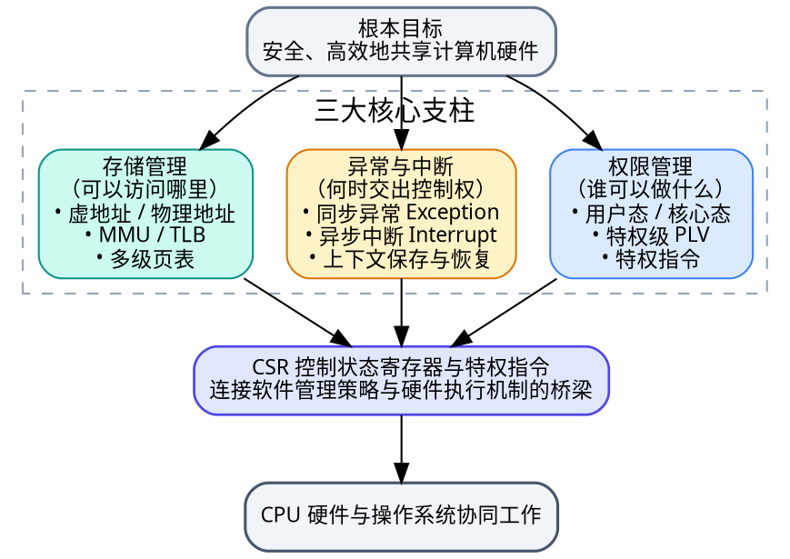

把这四个维度对应到传统处理器手册的章节中，逻辑就会瞬间清晰：

| 文档章节           | 要解决的根本问题                               | 核心硬件机制                    |
| :----------------- | :--------------------------------------------- | :------------------------------ |
| **运行模式**       | 如何防止普通应用程序随意篡改或控制底层硬件？   | 特权级（PLV / Ring / EL）       |
| **异常与中断**     | 如何让操作系统在突发事件或错误发生时接管 CPU？ | Exception、Interrupt、Trap 机制 |
| **存储管理**       | 如何让多个程序安全、独立地共享同一块物理内存？ | MMU、TLB、多级页表              |
| **控制状态寄存器** | 操作系统通过什么软件接口去配置和操控上述硬件？ | CSR、专用特权指令               |

这四大机制不是彼此孤立的零件，而是咬合在一起构成现代操作系统运行的硬件基石。

---

## 二、为什么需要特权指令系统？

### 2.1 从一个没有操作系统的裸奔 CPU 开始

假设我们拥有一颗最简单的 CPU，它只能执行基础运算和访存指令（`add`、`sub`、`load`、`store`、`jump`）。它每时每刻做的事情非常简单，就是不断循环“取指 → 译码 → 执行”：


如果整台计算机只运行**唯一一个**完全可信的程序，这套模型毫无问题。但现实中我们需要同时运行浏览器、编译器、数据库和音视频应用，立刻会撞上三个致命问题：

1. **死循环霸占 CPU**：如果程序 A 执行了 `while (true) {}`，程序 B 永远得不到执行机会。
2. **任意篡改内存**：如果程序 A 往绝对地址 `0x100000` 写数据，而那里恰好存放着操作系统内核或程序 B 的关键数据，整个系统瞬间崩溃。
3. **随意关中断或关闭地址翻译**：如果普通程序能直接操作硬件控制开关，它可以关闭所有定时器中断并独霸整台机器。

由此推导出了操作系统对硬件的三个刚性需求：

- 必须能够**限制**普通应用程序的能力；
- 必须能够在必要时**强制夺回** CPU 的控制权；
- 必须能够**隔离**不同程序各自使用的内存空间。

**特权指令系统，就是 CPU 为了满足这三大需求而提供的一套硬件级强制机制。**

### 2.2 什么是用户态（User Mode）与核心态（Kernel Mode）？

最直接的硬件设计，是在 CPU 内部增加一个表示“当前权限等级”的状态位。每当 CPU 译码一条需要权限的指令时，**由 CPU 硬件电路自身直接检查当前权限**，而不是靠软件自觉：

```cpp
// 用伪代码模拟 CPU 硬件内部的权限检查逻辑
enum PrivilegeMode { Kernel, User };
PrivilegeMode current_mode;

if (instruction.is_privileged() && current_mode == User) {
    // 非法越权！硬件直接触发异常并拦截指令执行
    raise_exception(INSTRUCTION_PRIVILEGE_ERROR);
}
```

> [!IMPORTANT] 破除常见误解
> **用户态和核心态并不是两颗不同的 CPU，也不是 CPU 芯片上的两块物理区域，而是同一颗 CPU 在不同时刻所处的不同权限状态。**
> 同一颗 CPU 可以在上一个时钟周期执行用户态的普通计算指令，在下一个时钟周期（通过系统调用或中断）切换进核心态执行操作系统代码。

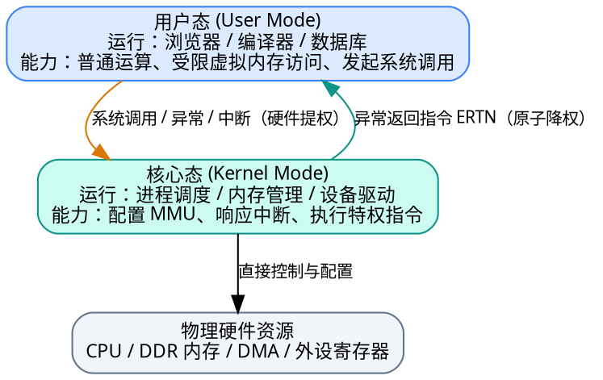

### 2.3 主流架构的特权级划分对比

不同芯片架构对权限等级的命名不同，但本质思想完全一致——将软件运行权限划分为若干层级，数字越小（或级别越高）权限越大：

| 处理器架构              | 特权级划分           | 典型使用方式                                             |
| :---------------------- | :------------------- | :------------------------------------------------------- |
| **LoongArch（龙架构）** | `PLV0` ~ `PLV3`      | `PLV0` 运行操作系统内核，`PLV3` 运行用户应用程序         |
| **x86**                 | `Ring 0` ~ `Ring 3`  | `Ring 0` 运行内核，`Ring 3` 运行应用程序                 |
| **RISC-V**              | `M` / `S` / `U` 模式 | `M`（机器态）固件，`S`（监管态）内核，`U`（用户态）应用  |
| **ARM AArch64**         | `EL0` ~ `EL3`        | `EL0` 应用，`EL1` 内核，`EL2` 虚拟机监控，`EL3` 安全监控 |

在 LoongArch 中，当前 CPU 的特权级保存在控制状态寄存器 `CSR.CRMD` 的 `PLV` 字段中。

---

## 三、什么是 CSR 控制状态寄存器？

### 3.1 为什么有了通用寄存器（GPR）还需要 CSR？

在编写 C/C++ 或汇编程序时，最常接触的是通用寄存器（`x1`、`$t0` 等），它们用来存放加法、乘法、指针运算的**业务数据**。但 CPU 这台机器本身要正常运转，还需要记录大量**自身控制状态信息**：

- 当前处于用户态还是核心态？
- 当前是否允许响应外部中断？
- 刚才发生异常时正在执行哪一条指令？
- 发生了什么类型的异常（非法指令还是缺页）？
- 当前进程的页表存放在内存的哪个物理地址？

这些元信息不是普通算术数据，必须存放在专用寄存器中，这就是 **CSR（Control and Status Register，控制状态寄存器）**。

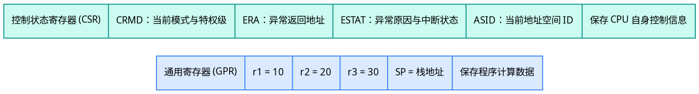

### 3.2 易混概念辨析：GPR、CSR、MMIO 与普通内存

初学者在接触底层系统或异构加速芯片（NPU/GPU）时，常把 CSR 和 MMIO（内存映射 I/O）搞混。下表清晰对比四者的访问路径与控制对象：

| 存储/寄存器类型             | 物理位置与用途                                | 典型访问方式                  | 示例代码/指令                                               |
| :-------------------------- | :-------------------------------------------- | :---------------------------- | :---------------------------------------------------------- |
| **GPR（通用寄存器）**       | CPU 内核计算单元旁，保存运算数据              | 普通算术/逻辑指令             | `add x1, x2, x3`                                            |
| **CSR（控制状态寄存器）**   | CPU 核内部独立控制空间，管理 CPU 自身状态     | 专用 CSR 读写指令             | `csrrd` / `csrwr`（LoongArch）<br>`csrr` / `csrw`（RISC-V） |
| **MMIO 寄存器**             | 外设/DMA/计算引擎内部，通过总线映射进物理地址 | 对映射地址执行 `load`/`store` | `*(volatile uint32_t*)0x10000000 = 1;`                      |
| **普通 Memory（DDR/SRAM）** | 主存或片上缓存，存放代码与数据                | 普通 `load`/`store`           | `ld x1, 0(sp)`                                              |

> [!NOTE] 关键区分
> RISC-V 的 `csrr t0, mstatus` 或 LoongArch 的 `csrrd $t0, CSR_CRMD` 访问的是 CPU 核内部独立的 **CSR 地址空间**，不会发到系统内存总线上；而通过指针读写 `0x10000000` 则是通过系统总线访问外设的 **MMIO 寄存器**。

### 3.3 LoongArch 核心 CSR 速览

学习时不需要死记硬背寄存器编号，先按“它解决了什么问题”来记忆：

| CSR 名称 | 英文全称                  | 它解决的核心问题                                                    |
| :------- | :------------------------ | :------------------------------------------------------------------ |
| `CRMD`   | Current Mode Information  | CPU **当前**处于什么特权级？是否开中断？采用什么地址翻译模式？      |
| `PRMD`   | Previous Mode Information | 异常发生**之前** CPU 处于什么特权级和中断使能状态？（用于后续恢复） |
| `ERA`    | Exception Return Address  | 异常处理完毕后，应该回到原来程序的**哪一条指令**继续执行？          |
| `ESTAT`  | Exception Status          | **为什么**发生异常？（异常编号 `Ecode` 与待处理中断 `IS`）          |
| `EENTRY` | Exception Entry           | 异常发生时，CPU 应该跳转到**哪里**去执行异常处理程序？              |
| `ECFG`   | Exception Configuration   | 允许响应哪些中断（`LIE`）？向量化入口间距（`VS`）是多少？           |
| `BADV`   | Bad Virtual Address       | 是**哪个虚拟地址**导致了地址异常或页故障？                          |
| `BADI`   | Bad Instruction           | 是**哪一条指令**触发了相关异常？                                    |
| `ASID`   | Address Space Identifier  | 当前运行的是**哪个地址空间**（进程）？                              |

---

## 四、异常与中断：操作系统如何夺回控制权？

### 4.1 为什么不能只靠普通函数调用？

普通函数调用（`call` / `jal`）有一个大前提：**当前正在执行的程序必须“主动愿意”去调用它**。
但如果当前程序正在埋头做循环计算，它根本不知道外部硬件发生了什么：

- DMA 引擎已经悄悄把 10MB 张量数据搬运完了；
- 定时器倒计时归零，该切换给另一个进程运行了；
- 当前指令解引用了一个非法空指针。

这些事件都不一定发生在程序主动检查的地方。因此，CPU 必须具备一种**由硬件主动强行改变程序执行流**的机制，这就是异常与中断。

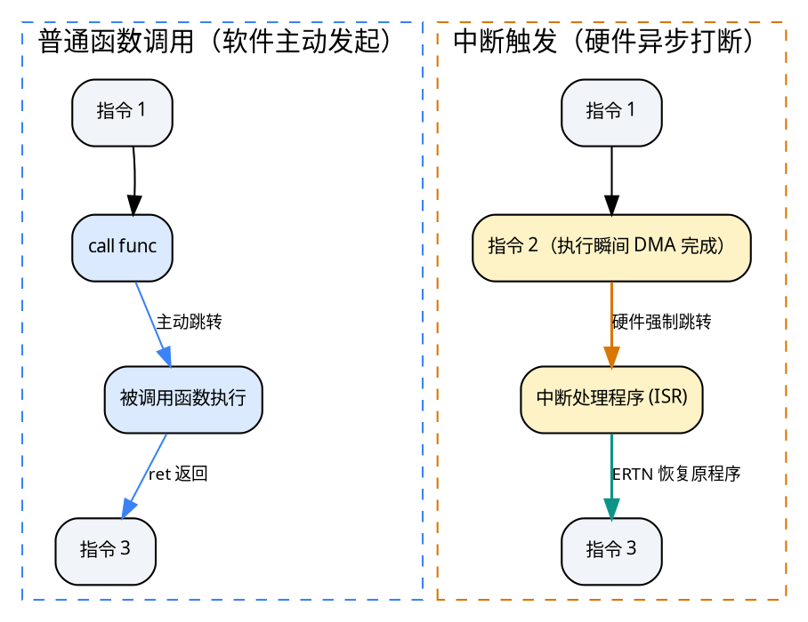

### 4.2 Exception、Interrupt、Trap、Fault 的概念区分

不同教材和架构手册对这些英文词的界定略有差异。在 LoongArch 文档体系中，“异常（Exception）”是一个广义总称，中断是其中的一种。工程上通常按“**同步 vs 异步**”来区分：

| 概念            | 中文译名     | 核心特征                                                                | 典型例子                                       |
| :-------------- | :----------- | :---------------------------------------------------------------------- | :--------------------------------------------- |
| **Exception**   | 异常（狭义） | **同步事件**：由当前正在执行的指令直接引发                              | 非法指令、访存页无效、除以零（视 ISA 而定）    |
| **Interrupt**   | 中断         | **异步事件**：来自 CPU 执行流之外的外部硬件信号，可在任意时刻到来       | 定时器到期、DMA 完成、网卡收包                 |
| **Trap**        | 陷入         | 广义概念，指 CPU 暂停当前流并转入特权处理程序的机制（有时特指主动陷入） | `syscall` / `ecall`、调试断点                  |
| **Fault**       | 故障         | 某些架构中指**可修复后重新执行原指令**的异常                            | 缺页异常（Page Fault）：分配物理页后重跑原指令 |
| **System Call** | 系统调用     | 用户态程序**主动**通过特定指令向操作系统请求服务                        | 读写文件、申请内存                             |

> [!TIP] 这里的“同步”与“异步”是什么意思？
> 这不是多线程或协程编程里的同步/异步，而是指**事件是否直接绑定于当前正在执行的那一条指令**。`*invalid_ptr = 100;` 引发的地址异常是同步的（每次执行到这条指令必发生）；而计算期间 DMA 引擎突然完成搬运发来通知，则与当前正在算哪条加法指令毫无关系，这就是异步的。

### 4.3 异常的六大典型来源

在现代处理器手册（如 LoongArch）中，异常机制通常覆盖六类来源：

1. **外部事件（中断）**：定时器到期、DMA 完成、核间通信中断（IPI）。
2. **指令执行错误**：CPU 遇到不认识的编码（非法指令）、用户态试图执行特权指令。
3. **数据完整性错误**：硬件检测到 ECC（Error-Correcting Code，纠错码）校验失败等可靠性问题。
4. **地址转换异常**：TLB 未命中、页表项无效或读写权限不足。
5. **系统调用与陷入**：软件主动执行 `syscall` / `ecall` / `break` 请求服务或触发调试。
6. **软件辅助运算**：部分不由纯硬件直接处理的特殊浮点情况（如非规格化数），交由软件异常 handler 兜底模拟。

---

## 五、一次完整的异常处理，究竟发生了什么？

假设 CPU 正在执行用户代码，突然在 `*ptr = c;` 处触发了地址转换异常：

```cpp
int a = 10;
int b = 20;
int c = a + b;
*ptr = c;      // 触发异常！
int d = c * 2;
```

此时必须暂停用户程序，跳去执行操作系统代码。但这里有一个致命问题：**操作系统自己也是代码，它运行时也要用到 CPU 的通用寄存器！如果不做保护直接跳过去，原程序算到一半的寄存器值就被全盘覆盖了。**

因此，一次完整的异常处理必须由**硬件和软件接力完成五个阶段**。

### 5.1 异常处理的五阶段全景图

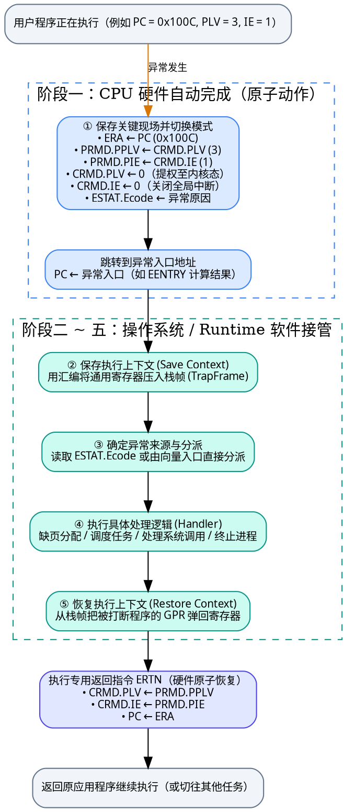

> [!NOTE] 关于步骤顺序的细节
> 在实际软件实现中，“确定异常来源”与“保存通用寄存器”的先后顺序取决于架构入口设计（例如向量化中断可以直接进入对应分支后再保存现场），但一条铁律是：**在保存好原来的通用寄存器之前，绝对不能随意修改它们。**

### 5.2 阶段一：硬件自动保存关键状态（为什么只存少量 CSR？）

你可能会问：为什么硬件不干脆把 32 个通用寄存器也全自动压到内存栈里？
因为通用寄存器数量多、且涉及内存访存（万一此时栈指针本身无效还会引发二次异常），如果全靠硬件压栈会导致硬件电路极度复杂且延迟不可控。因此，像 LoongArch、RISC-V 等现代精简指令集架构采取**极简硬件保存策略**——硬件只把最核心的 3 样东西存进 CSR：

```cpp
// 模拟 LoongArch 硬件进入普通异常时的瞬间动作
void CPU::enter_exception(ExceptionCode code) {
    ERA       = PC;        // 1. 记住被打断时的指令地址
    PRMD.PPLV = CRMD.PLV;  // 2. 备份之前的特权级
    PRMD.PIE  = CRMD.IE;   // 2. 备份之前的中断开关状态

    CRMD.PLV  = 0;         // 3. 强行提权到最高核心态 PLV0
    CRMD.IE   = 0;         // 3. 强行关中断，防止嵌套踩踏现场

    ESTAT.Ecode = code;    // 4. 记录异常类型
    PC = calculate_exception_entry(code); // 5. 跳去异常入口
}
```

### 5.3 阶段二至四：软件构建 TrapFrame 并决策策略

进入异常处理汇编入口后，软件做的第一件事就是开辟栈空间，把通用寄存器一个个存进内存结构体，这个保存着完整快照的内存结构通常被称为 **Context（上下文）** 或 **Trap Frame（陷入帧）**：

```cpp
struct TrapFrame {
    uint64_t gpr[32]; // 原程序的 32 个通用寄存器
    uint64_t pc;      // 对应的 ERA
    uint64_t status;  // 对应的 PRMD / 状态位
};

void exception_handler(TrapFrame* frame) {
    switch (read_exception_code()) {
        case TIMER_INTERRUPT:    schedule_task(); break;
        case TLB_MISS:           refill_tlb(); break;
        case PAGE_FAULT:         handle_page_fault(); break;
        case SYSTEM_CALL:        handle_syscall(frame); break;
        case ILLEGAL_INSTRUCTION:terminate_or_recover(); break;
    }
}
```

这里体现了一个核心的体系结构工程哲学：

> **硬件负责发现事件、保护关键状态并转移控制权（机制）；软件负责决定如何处置事件（策略）。**
> 同样是一次非法地址访问，到底是分配一页新物理内存后让程序继续（合法懒分配），还是直接杀掉进程（空指针越界），硬件无从知晓，必须交给软件策略层判断。

### 5.4 阶段五：为什么异常返回必须用专用的 `ERTN` 指令？

普通函数返回只需要跳转回返回地址（`ret`）。但异常返回必须**同时、原子地**恢复三件事：

1. 恢复 PC（回到原指令地址）；
2. 恢复特权级（从内核态 PLV0 降回用户态 PLV3）；
3. 恢复中断使能（重新打开中断开关）。

如果尝试用三条普通指令分步做，每一条顺序都会出致命漏洞：

- **先降回用户态**：下一条恢复指令属于特权操作，立刻触发越权异常！
- **先开中断**：此时现场尚未切回，如果立刻来一个新中断，旧现场被破坏！
- **先跳转到原 PC**：后面的降权和开中断指令根本没机会执行了！

因此，所有主流架构都提供了**单条原子异常返回指令**：

| 架构            | 异常返回指令               |
| :-------------- | :------------------------- |
| **LoongArch**   | `ERTN`（Exception Return） |
| **RISC-V**      | `MRET` / `SRET`            |
| **ARM AArch64** | `ERET`                     |
| **x86**         | `IRET` / `IRETQ`           |

在指令语义上，`ERTN` 在同一个架构状态转换点上瞬间完成 `CRMD.PLV = PRMD.PPLV`、`CRMD.IE = PRMD.PIE` 与 `PC = ERA`。

---

## 六、异常嵌套：为什么异常入口必须关闭中断？

想象一个惊险的场景：用户程序（`PC = 0x1000`）发生异常 A，硬件把 `0x1000` 写入了 `ERA` 并跳到异常 A 的入口（`0x8004`）。如果此时**没有关闭中断**，就在软件还没来得及把 `ERA` 备份到内存栈上的那一微秒，外部又打来一个中断 B：

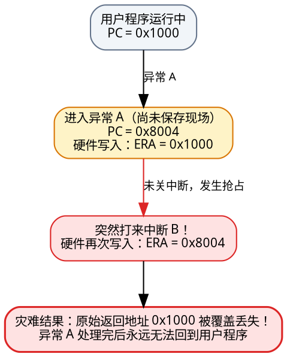

这就是为什么硬件在进入异常的瞬间，会自动将 `CRMD.IE` 清零（屏蔽可屏蔽中断）。如果操作系统希望支持**受控的中断嵌套**（高优先级中断打断低优先级中断），必须遵循严格的时序：

1. 入口处保持关中断，先把当前 `ERA`、`PRMD` 和通用寄存器**全部安全压栈**；
2. 现场保存妥当后，软件再手动打开中断允许高优先级抢占；
3. 处理完毕准备恢复现场前，再次关中断；
4. 弹出寄存器，最后执行 `ERTN` 原子返回。

### 为什么 LoongArch 为 TLB 重填专门设立独立的 CSR？

关闭中断只能屏蔽“异步中断”，却**无法阻止同步异常**。如果在普通异常处理程序的执行过程中（尚未保存好现场，或者正在访存时），它自身访问内存发生了 **TLB 重填异常**（找不到地址映射），怎么办？

如果 TLB 重填异常也共用 `ERA` 和 `PRMD`，依然会把外层异常的现场彻底覆盖！为此，LoongArch 为 TLB 重填异常（以及机器错误异常）设计了一套完全隔离的专用备份 CSR：

| 普通异常使用的 CSR   | TLB 重填异常专用 CSR |
| :------------------- | :------------------- |
| `ERA`（返回地址）    | `TLBRERA`            |
| `PRMD`（旧模式）     | `TLBRPRMD`           |
| `BADV`（出错虚地址） | `TLBRBADV`           |
| `EENTRY`（入口基址） | `TLBRENTRY`          |

这样，即使在普通异常处理过程中突然触发了 TLB 重填，两者的硬件保存寄存器也互不踩踏。

---

## 七、中断机制：硬件是怎样通知 CPU 的？

### 7.1 Polling（轮询）vs Interrupt（中断）

当 CPU 启动 DMA 引擎搬运数据时，CPU 怎么知道搬运结束了？有两种截然不同的哲学：

- **轮询（Polling）**：CPU 像急性子一样不断在 `while (!dma_done())` 循环里读取状态寄存器。实现简单、在任务极短（几十纳秒）时甚至比中断更快（省去保存现场开销）；但任务耗时较长时 CPU 会白白空转耗电。
- **中断（Interrupt）**：CPU 发出启动命令后转身去干别的活；DMA 干完活后主动拉高一根信号线通知 CPU 暂停手头工作去处理收尾（执行 ISR，Interrupt Service Routine，中断服务程序）。

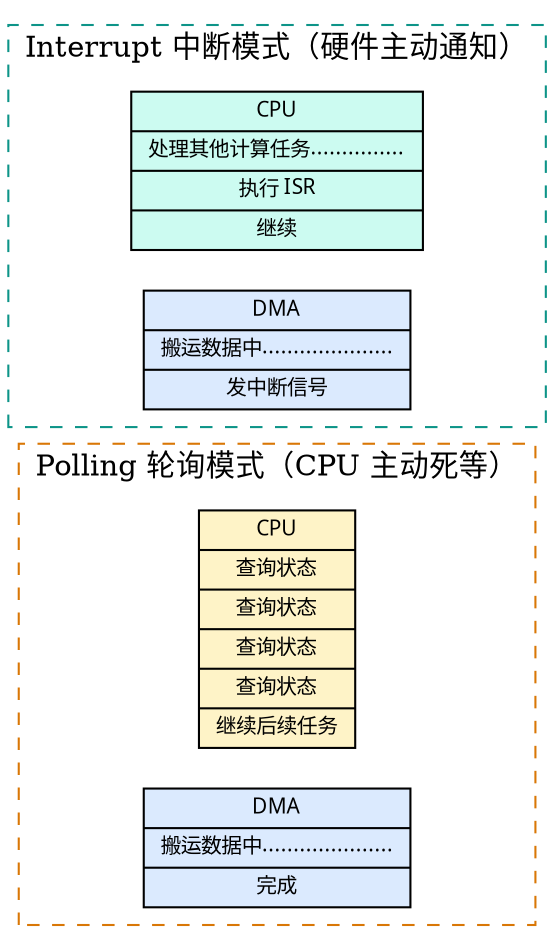

### 7.2 物理传递方式：中断线 vs 消息中断（MSI）

中断信号怎么从外部设备传到 CPU？主要分为两代技术：

1. **中断线（Line-based Interrupt）**：设备拉高专用物理电平线 → 经过中断控制器（Interrupt Controller）汇总仲裁 → 送入 CPU 引脚。缺点是设备一多，芯片引脚和走线会爆炸。
2. **消息中断（MSI，Message Signaled Interrupt）**：不再拉专门的物理线，而是由设备直接通过系统总线（或 PCIe）向**系统指定的特定内存地址写入特定数据**；总线的接收逻辑识别到这笔特殊写事务，直接将其解析为一个中断事件。这与异构计算中常用的 **Doorbell（门铃）** / **Mailbox（邮箱）** 通知思想如出一辙——利用一次特殊地址写操作唤醒另一端的硬件或固件。

### 7.3 中断的“三重门”：Pending、Enable 与 Global IE

外设发出了中断请求，CPU 就一定会立刻响应吗？未必。在 LoongArch 中，一个中断要真正打断 CPU，必须同时通过三个串联的硬件开关（`AND` 门逻辑）：

1. **`ESTAT.IS`（Pending 位）**：中断是否**已经发生**正在等待处理？（硬件或软件置 1）
2. **`ECFG.LIE`（局部中断使能位）**：软件是否允许响应**这一路**特定中断？
3. **`CRMD.IE`（全局中断使能位）**：CPU 当前整体上是否允许被任何可屏蔽中断打断？

$$\text{CPU 响应中断} = \text{Pending} \land \text{LocalEnable (LIE)} \land \text{GlobalEnable (IE)}$$

> [!IMPORTANT] 屏蔽中断 ≠ 硬件停止工作
> 把 `ECFG.LIE` 或 `CRMD.IE` 设为 `0` 屏蔽中断，只是让 CPU **暂时不响应**这个通知。DMA 照样会把数据搬完，并把 Pending 状态位立在那里等待（具体是否保持 Pending 取决于中断源类型与控制器设计），一旦日后开中断，CPU 仍能感知到它。

### 7.4 为什么文档强调 CSR 的原子修改（`CSRXCHG`）？

像 `CRMD` 这样的 CSR，一个 32 位/64 位寄存器里紧凑地塞了 `PLV`（特权级）、`IE`（中断开关）、`DA/PG`（地址翻译模式）等十几个互不相关的控制位。

如果我们只想把 `IE` 这一位改成 `1`，而采用传统的“读-改-写”三步走：

1. `T0`：主程序读取 `CRMD`（值 `1000`）；
2. `T1`：此时突然来了个异常或抢占，处理程序修改了 `CRMD` 的另一位（变为 `1100`）；
3. `T2`：主程序基于旧值 `1000` 把 `IE` 置 1 得到 `1010`；
4. `T3`：主程序把 `1010` 写回 `CRMD`——**刚才 `T1` 时刻的修改被悄无声息地覆盖丢失了！**

为此，LoongArch 专门提供了按位掩码原子修改指令 `CSRXCHG`（RISC-V 中则是 `csrrs` / `csrrc` 置位清零指令），让硬件在一个不可打断的原子操作内仅更新掩码对应的比特位：

```asm
li       $t0, IE_BITMASK      # 掩码指定只动 IE 位，新值也是 1
csrxchg  $t0, $t0, CSR_CRMD   # 硬件原子地只更新掩码选中的位
```

> [!WARNING] MMIO 操作中的同类陷阱
> 在给设备写 MMIO 控制寄存器时，C++ 里的 `volatile` 关键字**只能防止编译器优化，绝对不能保证读-改-写具备原子性**！多线程或多核并发配置同一 MMIO 寄存器位域时，必须依赖硬件提供的 Set/Clear 专用寄存器或软件互斥锁。

---

## 八、存储管理：虚拟地址、分页、MMU 与 TLB

解决了“权限”和“控制权”之后，最后一个问题是：**如何让多个程序安全地共享同一块物理 DDR 内存？**

### 8.1 如果直接用物理地址会发生什么？

如果程序 A 和程序 B 都向物理地址 `0x1000` 写入数据，它们就会互相踩碎对方的数据。为了彻底隔离，现代 CPU 在程序与物理内存之间插入了一层抽象——**虚拟地址（Virtual Address，VA）**，并由 **MMU（内存管理单元）** 硬件在每次访存时动态翻译成**物理地址（Physical Address，PA）**：

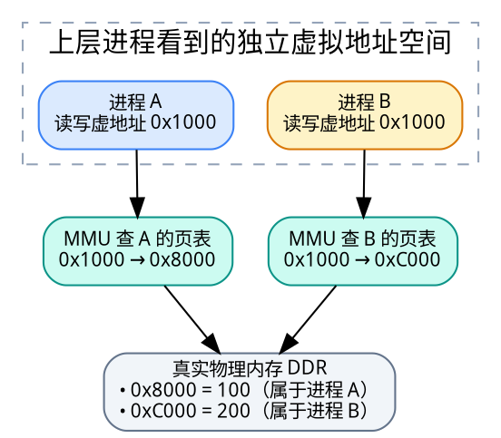

两个进程以为自己在操作同一个地址 `0x1000`，实际上 MMU 把它们悄无声息地导向了完全隔离的物理位置。此外，MMU 还顺带赋予了操作系统**只读保护、不可执行保护（防注入攻击）、共享内存、延迟物理分配**等强大能力。

### 8.2 分页机制：VPN、PPN 与 Offset

如果为内存的**每一个字节**都记录一条映射关系，映射表本身就会比物理内存还要大！因此，系统把连续的一块内存打包作为最小管理单位，称为 **Page（页）**，常见大小有 4KB（$2^{12}$ 字节）或 16KB（$2^{14}$ 字节）。

页内所有字节的相对顺序不需要改变，**地址翻译只替换高位的“页号”，原封不动保留低位的“页内偏移”**。以 32 位地址、4KB 页为例：

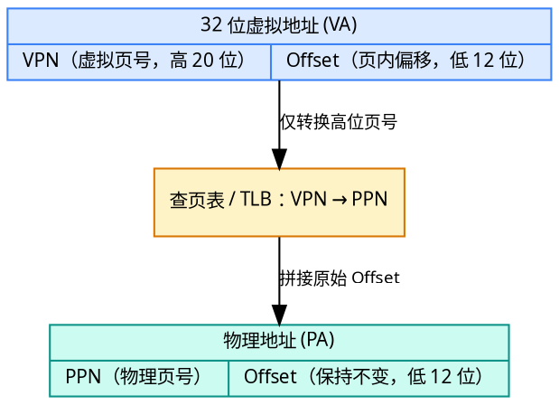

举个具体例子：假设页大小为 4KB（`0x1000`），虚拟地址 `VA = 0x12345`：

- **VPN（虚拟页号）**：$\lfloor \text{0x12345} / \text{0x1000} \rfloor = \text{0x12}$
- **Offset（页内偏移）**：$\text{0x12345} \bmod \text{0x1000} = \text{0x345}$
- 若查页表得知 `VPN 0x12 → PPN 0x8A`，则最终物理地址 $\text{PA} = \text{0x8A} \times \text{0x1000} + \text{0x345} = \text{0x8A345}$。

### 8.3 TLB（快表）与 ASID（地址空间标识符）

页表（Page Table）本身存放在较慢的主存（DDR）里。如果每次 CPU 执行 `load` 指令都先去主存读 1~3 次页表，再去读真正的数据，访存性能会瞬间雪崩。

为此，CPU 在 MMU 内部做了一块极小但极快的专用硬件缓存，叫做 **TLB（快表）**，专门缓存最近用过的 `VPN → PPN` 映射关系。

**为什么还需要 ASID？**
进程 A 的 `VPN 0x12` 映射到物理页 `0x8A`，进程 B 的 `VPN 0x12` 映射到物理页 `0x52`。如果 TLB 里只记 `VPN`，切换进程时就必须把整个 TLB 全部清空（Flush），导致刚切回进程 A 时发生大量 TLB Miss。因此每条 TLB 表项都带上一个 **ASID（地址空间标识符）** 标签，查找时同时比对 `entry.asid == current_asid && entry.vpn == va_vpn` 即可完美共存！（注：多线程共享同一地址空间时共用同一个 ASID，因此 ASID 不一定严格等于操作系统里的线程 TID）。

### 8.4 易混概念辨析：TLB Miss ≠ Page Fault

| 状态           | 真实含义                                         | 系统要做什么                                                     |
| :------------- | :----------------------------------------------- | :--------------------------------------------------------------- |
| **TLB Hit**    | 快表里有映射，且权限检查通过                     | 直接拼出 PA，立刻访问 Cache/DDR                                  |
| **TLB Miss**   | 快表里**暂时没有缓存**这条映射                   | 去主存的页表里查出来，填进 TLB（页表里可能早已映射好了！）       |
| **Page Fault** | 页表里压根没有有效映射，或权限违例（如写只读页） | 触发页故障异常，由操作系统分配物理页、加载磁盘数据或杀掉越界进程 |

### 8.5 硬件重填 vs 软件重填（LoongArch 特色）

当发生 TLB Miss 时，谁去主存里遍历页表并把映射填回 TLB？

- **硬件重填（x86、ARM 典型做法）**：CPU 内部自带一个专用的硬件状态机（Page Table Walker），硬件自己直接读内存里的页表并填入 TLB，软件完全无感。优点是快；缺点是页表格式被硬件死死锁住。
- **软件重填（LoongArch、部分 MIPS 模式）**：TLB Miss 直接触发一个轻量级的 **TLB 重填异常（TLBR）**，由操作系统内核的几行精简汇编去遍历页表，再通过 `TLBFILL` 指令填入 TLB。优点是软件对页表格式拥有极高的灵活性（代价是重填时多一次轻量化异常跳转）。

---

## 九、深入 LoongArch 的地址转换与 TLB 硬件设计

### 9.1 三种地址翻译模式全景

为什么 CPU 不能一上电就强制使用页表？因为刚上电复位时，内存里还没有任何页表，如果执行“初始化页表”的代码本身都要查页表，就会陷入死锁循环：


因此，LoongArch（通过 `CSR.CRMD` 中的 `DA` 和 `PG` 两位）提供了分层的地址转换体系：

1. **直接地址翻译模式（`DA=1, PG=0`）**：全局绕过页表，通常直接取虚地址低位作为物理地址。专用于系统上电启动和软件 TLB 重填过程。
2. **映射地址翻译模式（`DA=0, PG=1`）**：开启虚拟内存管理后的正常模式，内部又分两条路径：
   - **直接映射窗口（DMW）**：配置几个特殊的地址高位段，命中窗口就直接做简单线性映射，绕过 TLB；
   - **页表映射（TLB）**：未命中 DMW 的普通地址，走标准 TLB/页表查找。

_(关于“直接地址翻译”与“DMW”的底层硬件细节与区别，我们在下篇第十二节专门用整个章节深度解剖！)_

### 9.2 LoongArch 的双页 TLB（STLB + MTLB）与字段解析

为了同时兼顾海量小页的检索效率与大页（HugePage，减少表项占用）的灵活性，LoongArch 将 TLB 划分为两部分协同查找：

- **STLB（Singular-Page-Size TLB）**：所有表项固定使用相同页大小，采用硬件友好的**组相联**结构，容量大、按索引直查极快。
- **MTLB（Multiple-Page-Size TLB）**：采用**全相联**结构，每个表项可以独立指定不同的页大小（`PS` 字段），极其灵活。

此外，LoongArch 沿用了“**单表项描述一对连续虚拟页**”的巧妙设计——使用 **VPPN（Virtual Pair Page Number，虚双页号）**：一个 TLB 表项共享公共头部（`VPPN`、`ASID`、`PS`、`G`、`E`），内部挂着**偶数页**和**奇数页**两套独立的物理页号（`PPN`）及权限位，直接让相同 TLB 容量能覆盖的虚拟地址空间翻倍！

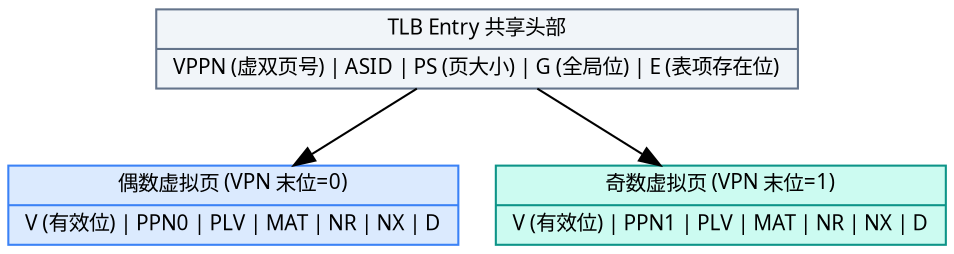

> [!WARNING] 极易踩坑的两个位域：`E` vs `V`，以及 `D` 位
>
> 1. **`E`（Entry Exist）与 `V`（Valid）的区别**：`E=1` 只代表这条双页 TLB 表项本身有效（能匹配上 `VPPN`），但里面可能只有偶数页有效（`V=1`），而奇数页尚未映射（`V=0`）！如果命中表项但对应奇偶页的 `V=0`，不会报 TLB 重填异常，而是直接报**页无效异常**。
> 2. **`D`（Dirty）位不只是统计标记**：在 LoongArch 中，执行 `store` 写入操作时硬件会严格检查该位。若 `D=0`，硬件直接触发**页修改异常（PME）**——操作系统借此可以高效实现写时复制（Copy-on-Write）或脏页跟踪。

完整的 TLB 硬件查找与异常判定流程如下：

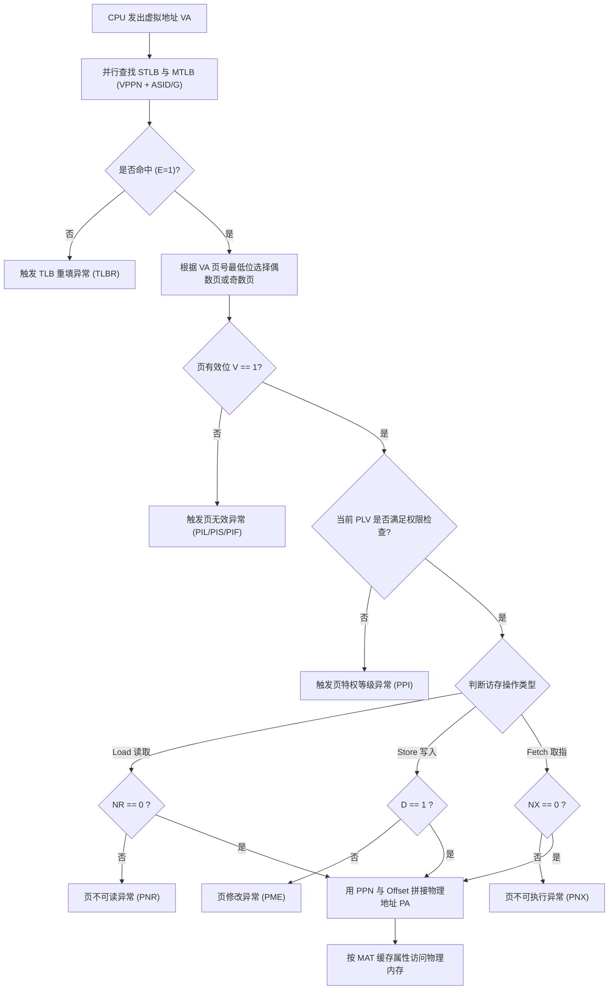

软件管理 TLB 依赖于五条核心特权指令：`TLBRD`（读表项）、`TLBWR`（按索引写表项）、`TLBFILL`（硬件随机/替换填入表项）、`TLBSRCH`（按虚地址搜索引）、`INVTLB`（使旧映射失效——修改页表后必须同步清理旧 TLB，防止 CPU 继续使用过期映射）。

---

## 十、多级页表与 TLB 重填汇编实战

### 10.1 为什么需要多级页表？

在 32 位 4KB 页系统中，一共有 $2^{32}/2^{12} = 2^{20}$（100 多万）个虚拟页，单级页表就要固定占用 4MB 连续内存；如果是 64 位系统（哪怕只用 48 位有效地址），单级页表将达到 TB 级别，完全无法实现。

解决办法是**用树替代平坦数组（稀疏树按需分配）**：把虚拟地址高位切分成多级索引（如 `PGD` 根页目录 → `PMD` 中间页目录 → `PTE` 末级页表）。绝大多数进程实际只用到极少部分地址空间，那些没用到的分支直接留空，省下几个数量级的内存！

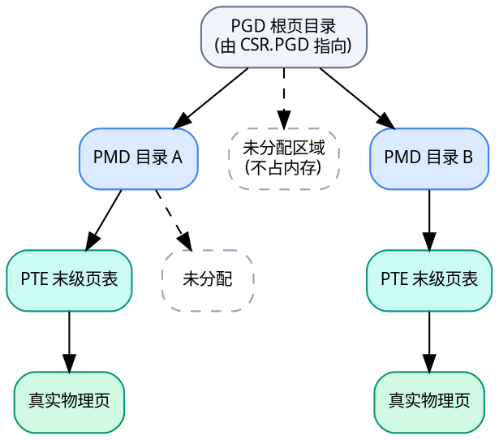

以常见的 **16KB 页 + 8 字节页表项（PTE）** 的三级页表为例：
$$16\text{KB} = 2^{14}\text{ Bytes}, \quad \text{单页可容纳表项数} = \frac{2^{14}}{8} = 2048 = 2^{11}$$
因此每一级索引刚好需要 **11 bit**，三级索引加上 14 bit 页内偏移（$11 + 11 + 11 + 14 = 47\text{ bit}$），即可覆盖区域内的庞大地址空间（对于 48 位规范地址，还需配合高位内核/用户空间选择位来区分不同根页表）。

### 10.2 逐行拆解 LoongArch TLB 重填汇编

有了前面的铺垫，再看 LoongArch 手册中经典的软件 TLB 重填异常处理代码，每一行都一目了然：

```asm
csrwr   $t0, CSR_TLBRSAVE   # 1. 把被中断程序正在用的 $t0 借存到专用 CSR_TLBRSAVE（同时腾出 $t0）
csrrd   $t0, CSR_PGD        # 2. 硬件已根据出错地址的高位自动选好用户/内核 PGD，直接读出根页表基址

lddir   $t0, $t0, 3         # 3. 硬件辅助寻址：用出错地址的对应索引位，从 PGD 查出下一级 PMD 基址
lddir   $t0, $t0, 1         # 4. 同理，从 PMD 查出末级 PTE 页表的基址

ldpte   $t0, 0              # 5. 从 PTE 表读取“偶数页”页表项并自动装入 TLB 填充 CSR
ldpte   $t0, 1              # 6. 从 PTE 表读取“奇数页”页表项并自动装入 TLB 填充 CSR

tlbfill                     # 7. 一键把准备好的双页映射写入空闲的 TLB 表项中

csrrd   $t0, CSR_TLBRSAVE   # 8. 归还刚才借用的 $t0 原值
ertn                        # 9. 从 TLBRERA 恢复现场并原子返回原指令重试
```

如果全靠普通移位、掩码、乘法指令去写软件页表遍历，重填例程需要几十条指令；LoongArch 通过 `LDDIR`、`LDPTE` 配合 `PWCL/PWCH`（页表遍历控制寄存器）把固定高频的位域拆解与访存交给硬件指令加速，而把页表组织策略留在软件手里——这是极其优雅的软硬件协同设计。

---

## 十一、终极串联：从 `malloc` 到真正写入物理 DDR 的全过程

假设在延迟分配（Lazy Allocation）策略下，用户程序写下这两行 C++ 代码（设页大小 4KB）：

```cpp
int* array = (int*)malloc(0x1000); // 假设内核仅批准了虚拟地址 0x450000，尚未真正分配物理页
array[0] = 0;                      // 首次执行 Store 写入！
```

一条简单的 `array[0] = 0` 在底层软硬件之间究竟触发了怎样惊心动魄的两次异常接力？

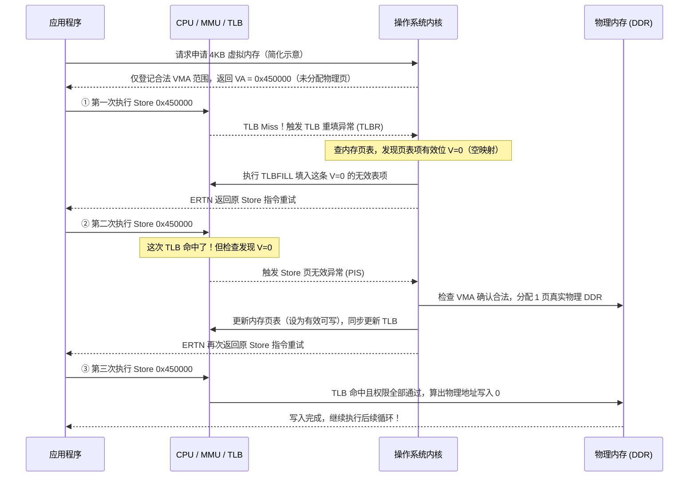

> [!TIP] 为什么不直接在第一次 TLB 重填时就把物理页分配好？
> 这正是高性能系统经典的**快路径与慢路径分离（Fast Path vs Slow Path）**设计！在系统运行过程中，绝大多数 TLB Miss 对应的页表项早就是有效的，只需要几纳秒级的超短汇编重填即可（快路径）；只有极少数首次触碰虚拟页的场景才需要动用重型 C 函数去扫描链表、分配物理页帧（慢路径）。把两者拆开，就能让日常高频的 TLB 重填保持极致轻快。
> _(注：真实 Linux 中的 `malloc` 小内存可能由 glibc 内存池缓存满足，不一定每次都向内核申请新虚拟页，此处为演示软硬件交互的典型教学场景。)_

### 延伸视角：这些知识对异构 AI 加速器 / 裸机 Runtime 的启发

即便我们在片上控制核（如嵌入式 RISC-V 控制核）上开发**不跑通用操作系统的裸机 Runtime**，通用 OS 的底层思想依然极具移植价值：

| 通用 CPU / OS 机制        | 异构加速器 / 裸机 Runtime 中的对应抽象                              |
| :------------------------ | :------------------------------------------------------------------ |
| 进程 / 线程               | 计算图任务（Task / Kernel Invocation）                              |
| 异常入口与 TrapFrame      | 运行时故障现场捕获与寄存器快照                                      |
| 中断控制器 & Pending/Mask | DMA / 计算引擎异步完成事件通知与屏蔽（Event Mask）                  |
| MMU / ASID / 地址隔离     | 片上 SRAM / DDR 缓冲区隔离与跨任务上下文 ID                         |
| **机制与策略分离**        | 硬件真实上报完成/报错状态，Runtime 负责决定调度顺序与重试策略       |
| **快慢路径分离**          | 正常任务下发与事件回收走极简无锁路径，异常超时/复位走单独故障恢复域 |

---

## 十二、微架构深潜（一）：乱序执行与精确异常——改变了 Cache 怎么“如同没发生”？

至此我们已经掌握了软件与架构层面的全部规则。但如果你继续往下问一个微架构级的问题，就会瞬间触及现代处理器设计的核心奥秘：

> **“现代高性能 CPU 都是乱序执行（Out-of-Order Execution）的。如果指令 I2 发生了异常，但它后面的指令 I3、I4 早就提前执行完了，甚至把某个数据读进了 L1 Cache 里——CPU 怎么可能做到‘I2 之后的指令如同没有执行’？”**

### 12.1 乱序执行带来的时间错位

假设有如下五条连续指令（以 RISC-V 风格为例），各条指令的执行耗时不同：

```asm
I0: add x1, x2, x3    # 耗时 1 cycle
I1: mul x4, x5, x6    # 耗时 5 cycles
I2: ld  x7, 0(x8)     # 耗时 6 cycles（第 6 周期才查出地址非法，触发异常！）
I3: add x9, x10, x11  # 耗时 1 cycle（不依赖 I1/I2，第 4 周期就算完了）
I4: sd  x12, 0(x13)   # 耗时 2 cycles（第 6 周期也算完了地址和数据）
```

为了让硬件算力不空转，乱序处理器会让不相关的 `I3` 和 `I4` 抢在 `I2` 报错之前提前算出结果。如果它们算完就直接改写了程序员可见的寄存器 `x9` 和内存，等 `I2` 报错时程序状态就已经乱套了。

### 12.2 最关键的区分：架构状态 vs 微架构状态

要彻底解开“Cache 被改变了怎么办”的困惑，必须先画一条死线，区分两种完全不同的状态：

| 对比维度       | 架构状态（Architectural State）                | 微架构状态（Microarchitectural State）                                     |
| :------------- | :--------------------------------------------- | :------------------------------------------------------------------------- |
| **本质定义**   | **ISA 对软件作出的正式承诺**（程序员可见）     | CPU 内部为了跑得更快而维护的**临时内部状态**（对功能透明）                 |
| **包含对象**   | 架构可见 GPR/CSR、PC、特权级、程序可见内存数据 | 物理寄存器堆、寄存器重命名表、**ROB**、**Cache Line**、**TLB**、分支预测器 |
| **异常时要求** | **必须精确回滚到异常边界**，绝对不容许丝毫错误 | **通常不需要全部回滚**（只要不影响程序最终功能正确性）                     |

> [!IMPORTANT] 答案的核心
> **精确异常（Precise Exception）承诺的是“架构状态”在异常边界上的精确性，而不是让整个 CPU 芯片里的所有内部电路状态时光倒流。**

### 12.3 乱序执行，顺序提交：ROB 与寄存器重命名

现代乱序 CPU 把一条指令的生命周期强行拆成两个阶段：

- **Execute（执行）**：可以乱序！操作数一凑齐就先算，算完的结果**不准直接写入正式的架构状态**，而是锁在暂存区里。
- **Commit / Retire（提交 / 退休）**：必须严格顺序！所有指令在 **ROB（Reorder Buffer，重排序缓冲区）** 里按原始程序顺序排队，只有排在队头、且确认前面所有指令都没有异常的指令，才被允许把暂存结果正式“提交”生效。

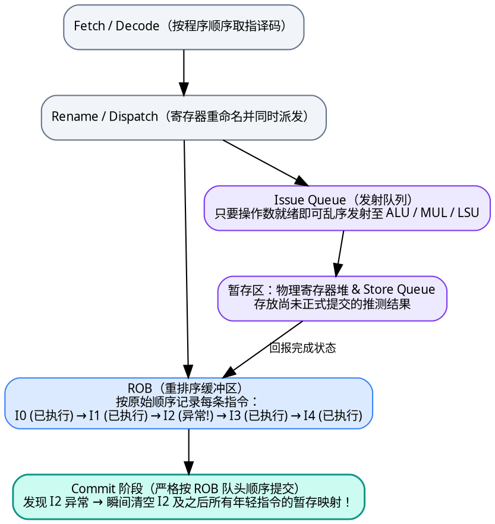

**寄存器怎么回滚？**
通过 **Register Renaming（寄存器重命名）**！虽然 `I0` 和 `I2` 在汇编里都写 `x1`，但在硬件内部，`I0` 写进了物理寄存器 `P20`，`I2` 写进了物理寄存器 `P35`（非常类似编译器中级表示里的 SSA 静态单赋值思想）。异常发生时，CPU 甚至不需要把 `P35` 清零，只需把“已提交映射表”里 `x1` 的指针改回 `P20`，直接废弃 `P35` 即可！

### 12.4 情况 A：乱序 Load 提前填充了 L1 Cache

假设 `I0` 发生缺页异常，而排在后面的 `I1: ld x3, 0(x4)` 已经抢先从 DDR 把地址 `0x8000` 的值 `42` 读进了 L1 Cache：

- **架构状态**：`x3` 尚未提交，被回滚丢弃，软件看到的 `x3` 依然是旧值；内存 `0x8000` 里的数字本身也没有被改变。
- **Cache 状态**：L1 Cache 里确实多了一条 `0x8000 -> 42` 的 Cache Line。但**不需要清除它**！因为 Cache 只是内存的一份只读副本，里面的 `42` 本来就是对的，唯一的影响只是将来再读 `0x8000` 时会变快（微架构时序差异）。

_(补充安全视野：正是因为被取消的推测执行会在 Cache 里留下可被测量访问快慢的“微架构痕迹”，才衍生出了著名的 **Spectre（幽灵）** 与 **Meltdown（熔断）** 等硬件时间侧信道安全漏洞——架构状态完全回滚了，但微架构侧信道并未完全抹除。)_

### 12.5 情况 B：如果是乱序 Store 想要修改内存数据呢？

Load 只读不写，留着 Cache Line 无伤大雅；但如果 `I1` 是一条 `sd x3, 0(x4)`（试图把内存改成 `999`），要是敢提前直接写进 L1 Cache，一旦被其他核心看到或者替换回 DDR，架构状态就彻底被破坏了！

因此，乱序 CPU 设计了 **Store Queue（存储队列）**：

1. **推测执行阶段**：`Store` 指令哪怕提前算好了目标地址和写入数据，也**绝对不准写入 Cache 或内存**，只能老老实实躺在 `Store Queue` 里标记为 `Uncommitted`；
2. **数据依赖转发（Store-to-Load Forwarding）**：如果紧接着有一条推测的 `Load` 要读同一个地址，直接从 `Store Queue` 里把 `999` 转发给 `Load` 即可，不用等它真进 Cache；
3. **异常发生时**：若前面的指令异常，硬件直接把 `Store Queue` 里所有未提交的表项一键丢弃，Cache 和 DDR 毫发无伤；
4. **正常提交后（Drain）**：只有当 `Store` 熬到 ROB 队头安全 `Commit` 之后，硬件才把它标记为已提交，随后由加载存储单元（LSU）异步排出（Drain）写进 Cache/内存系统。_(注意：这也意味着一条 Store 指令已经 Commit，不代表数据此刻已经落盘到了 DDR，它可能还在写缓冲里等待刷出。)_

### 12.6 对加速器自定义指令的警示：不可撤销的外部副作用

如果控制核支持乱序推测执行，而程序里混用了启动外部引擎的自定义指令：

```asm
I0: ld   t0, 0(t1)       # 可能发生缺页异常
I1: coproc_cfg ...       # 配置硬件寄存器
I2: dma_start ...        # 启动外部 DMA 搬运！
```

如果 CPU 在还不知道 `I0` 是否会异常之前，就把 `I2` 提前发出去启动了物理 DMA：哪怕下一周期 `I0` 报错、CPU 清空了全部流水线，**已经狂奔出去搬运内存的 DMA 引擎却收不回来了！**

因此，带有不可逆外部副作用（Side-effect）的指令（如 MMIO 写、DMA 发射、协处理器发射），微架构上必须严禁过早推测执行，通常要等到指令到达 **PNR（Point of No Return，无回退点，即确定前面再无异常分支）** 甚至到达 ROB 队头 `Commit` 时才真正向外部硬件发出请求（例如开源乱序处理器 BOOM 的协处理器接口设计就采用了这种保护边界）。

---

## 十三、微架构深潜（二）：向量化中断的硬件电路究竟怎么找到入口？

上篇提到“**向量化中断允许硬件根据中断编号，直接找到对应的异常处理入口**”。到底是谁在算这个入口地址？难道 CPU 里还藏着一个迷你程序去查表吗？

实际上，在 LoongArch 中这根本不需要查内存表，而是由一套纯粹、极简的**组合逻辑数字电路（Combinational Logic）**在单周期内直接硬算出来的！

### 13.1 中断编号是怎么从物理引脚变成数字的？

假设系统有 13 路中断源（如软件中断 `SWI0~1`、硬件中断 `HWI0~7`、性能计数 `PMI`、定时器 `TI`、核间中断 `IPI`）。

1. **筛选（按位与）**：硬件将“已发生寄存器 `ESTAT.IS`”与“局部使能寄存器 `ECFG.LIE`”直接按位做 `AND` 门运算，过滤掉被屏蔽的中断。
2. **仲裁编号（Priority Encoder，优先级编码器）**：当多个中断同时举手时，数字电路里的**优先级编码器**根据硬件连线规则（LoongArch 规定编号越大优先级越高），瞬间选出最高优先级的那一路，并输出它的二进制编号（例如定时器中断输出 `11`）。

### 13.2 无需乘法器的入口地址计算电路

拿到中断编号 `InterruptNumber` 后，硬件根据操作系统提前配好的两个 CSR——入口基址 `CSR.EENTRY` 和间隔参数 `CSR.ECFG.VS`，执行公式：

$$\text{ExceptionNumber} = \text{InterruptNumber} + 64$$
$$\text{Spacing} = 2^{\text{VS} + 2}$$
$$\text{EntryAddress} = \text{EENTRY} \ \big|\ (\text{ExceptionNumber} \times \text{Spacing})$$

_(注：当 `VS = 0` 时退化为统一跳往公共入口 `EENTRY`；`+ 64` 是因为 0~63 号留给了普通同步异常，线中断向量从 64 号起算；`|` 为按位或。)_

**硬件电路最妙的地方在于：因为间隔是 2 的幂次方，所以电路里根本不需要昂贵的通用乘法器！**

- “$\times 2^{\text{VS}+2}$”在硬件上就是把编号通过一个**移位器（Shifter）**左移 $\text{VS}+2$ 位；
- “$+ 64$”甚至只需要做一次固定位拼接（因为 0~12 小于 16，与 64 即 `bit[6]` 不重叠）；
- 最后和 `EENTRY` 做一次 **OR（按位或）门电路**，瞬间算出最终地址并送入取指单元的 **PC MUX（多路选择器）**！

假设 `EENTRY = 0x80000000`、`VS = 2`、定时器中断 `IRQ = 11`：

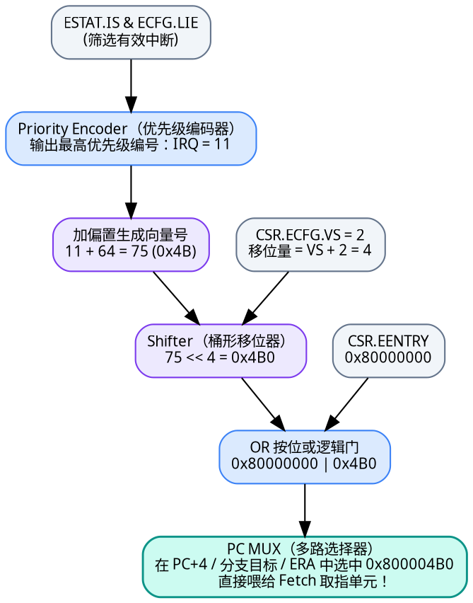

### 13.3 硬件跳过去之后，为什么那里刚好有处理代码？

硬件只负责“死板地套公式算地址并跳转”，它根本不知道你的 C 函数叫 `timer_handler`。这需要**软件与链接器提前按约定铺好路**：

操作系统或裸机 Runtime 在编译链接时，严格按照 `VS` 规定的间隔（例如 `VS=2` 时每间隔 $2^{2+2} = 16$ 字节）在 `EENTRY` 开始的内存区域排布一张跳转桩表（Vector Stub Table）：

| 内存地址     | 存放的机器指令                           | 对应向量号    |
| :----------- | :--------------------------------------- | :------------ |
| `0x80000490` | `b hwi7_handler`（直接跳去真正处理函数） | 向量 73       |
| `0x800004A0` | `b pmi_handler`                          | 向量 74       |
| `0x800004B0` | `b timer_handler`                        | 向量 75（TI） |
| `0x800004C0` | `b ipi_handler`                          | 向量 76       |

这样，硬件算出 `0x800004B0` 并把 `PC` 指过去，取出来的第一条指令正好就是跳往 `timer_handler` 的短跳转指令，省去了非向量化中断里“进入公共入口 → 软件读 CSR → 大型 `switch-case` 判断来源”的额外开销。

---

## 十四、微架构深潜（三）：直接地址翻译 vs 直接映射窗口（DMW）

这两个概念名字极其相似，且在 LoongArch64 里都不需要查页表，甚至连计算物理地址的方式都长得差不多（都截取低位），导致无数初学者彻底糊涂。

### 14.1 先看清它们在 MMU 电路中的层级关系

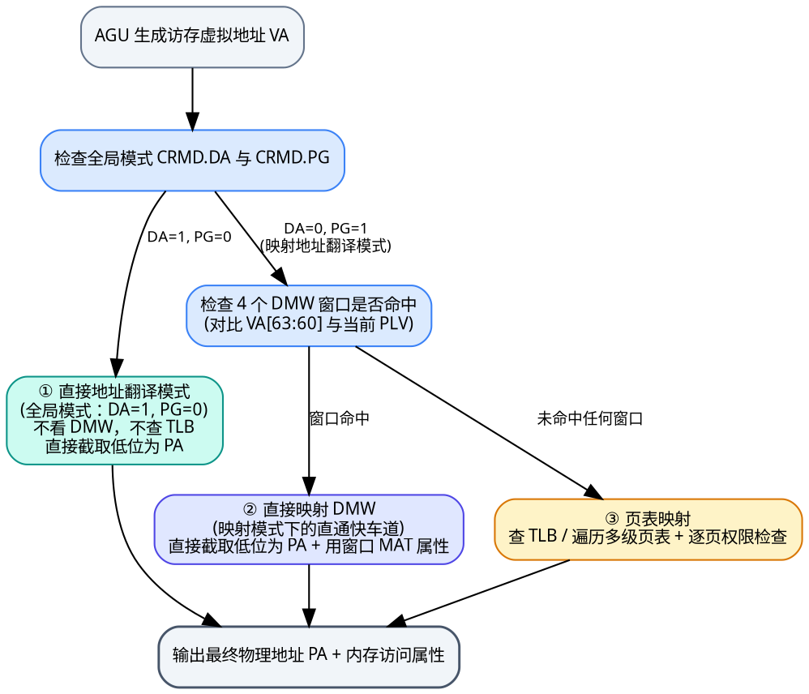

**一句话点破本质**：

- **直接地址翻译**是一种**全局 CPU 运行模式**（关掉了虚拟内存分页）；
- **直接映射（DMW）**是在**已经开启了虚拟内存分页的映射模式下**，专门给内核开出的几条“高速直通窗口”。

### 14.2 为什么有了直接地址翻译，还需要 DMW？

想象操作系统已经正常运转起来了（`DA=0, PG=1`）：

- 用户进程全都依赖页表和 TLB 做严格的内存隔离与权限检查；
- 此时操作系统**内核自己**经常需要快速访问全量物理 DDR（比如去改某个进程的页表）或者读写各种硬件设备的 **MMIO 寄存器**。

如果内核每次读写 MMIO 都要先切回 `DA=1, PG=0` 的直接地址翻译模式，干完活再切回 `DA=0, PG=1`，不仅性能暴跌，还会把正在并发运行的地址环境搞得极其脆弱！

于是，LoongArch64 设计了 4 个直接映射窗口配置寄存器（`CSR.DMW0` ~ `CSR.DMW3`）。每个窗口只看虚拟地址的最高 4 位 `VSEG`（Bits `63:60`）、允许访问的特权级 `PLV0~PLV3`，以及内存访问属性 `MAT`（Memory Access Type，例如是否可缓存）。

### 14.3 实战妙用：用 DMW 区分“可缓存 DDR”与“不可缓存 MMIO”

在系统开发与加速器控制中，这招非常经典！假设一块物理硬件地址是 `PA = 0x0000_0066_7000`，内核配置了两个窗口：

- **`DMW0`**：`VSEG = 0x8`，仅允许 `PLV0`，`MAT = 0`（**强序不可缓存 Strongly-Ordered Uncached**）→ 专门用来访问硬件 MMIO 状态寄存器（确保每次读写直达硬件，不被 Cache 吞掉）；
- **`DMW1`**：`VSEG = 0x9`，仅允许 `PLV0`，`MAT = 1`（**一致可缓存 Coherent Cached**）→ 专门用来高速访问普通物理 DDR。

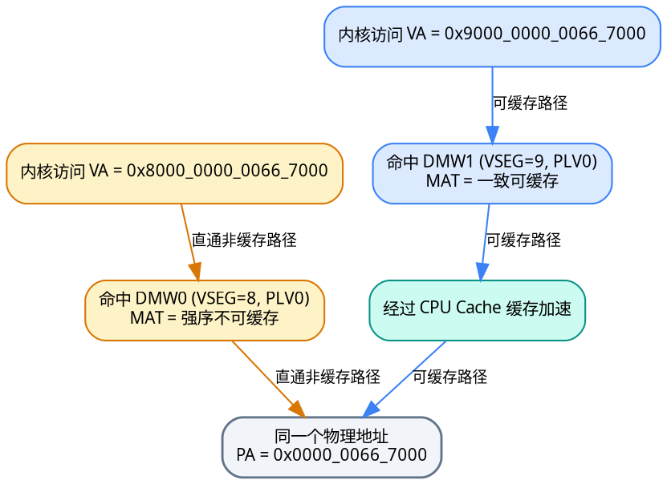

> [!CAUTION] 地址别名（Address Aliasing）警告
> 虽然两个不同的虚拟地址可以指到同一个物理地址且各自走不同缓存属性，但**切忌在没有硬件一致性保障或未执行 Cache 刷回（Flush/Invalidate）的情况下，对着同一块物理内存混用可缓存和不可缓存两种路径**，否则极易读到 Cache 里的陈旧脏数据！

### 14.4 三种地址翻译路径终极对比表

| 对比维度                | 直接地址翻译               | 直接映射窗口（DMW）                 | 页表映射（TLB）                      |
| :---------------------- | :------------------------- | :---------------------------------- | :----------------------------------- |
| **`CRMD.DA / PG`**      | `DA=1, PG=0`               | `DA=0, PG=1`                        | `DA=0, PG=1`                         |
| **作用范围**            | 全局所有访存               | 仅匹配 `VSEG` 且满足 `PLV` 的特定段 | 未命中任何 DMW 的普通虚拟地址        |
| **是否需要配置窗口**    | 否                         | 是（配置 `CSR.DMW0~3`）             | 否                                   |
| **是否需要查 TLB/页表** | 否                         | **否**（彻底免除 TLB Miss 开销）    | 是                                   |
| **权限检查粒度**        | 无页表权限检查             | 按整个窗口配置特权级（`PLV`）       | **极细粒度**：每页独立控制 R/W/X/PLV |
| **缓存属性来源**        | `CRMD.DATF` / `DATM`       | 窗口的 `DMW.MAT`                    | 页表项里的 `MAT`                     |
| **典型应用场景**        | 开机启动固件、TLB 重填异常 | 内核全内存访问、MMIO 寄存器读写     | 用户态进程隔离、虚拟内存分页管理     |

---

## 十五、大道至简：把所有机制统一起来理解

回望上篇与下篇的所有复杂机制——无论是精确异常、向量化中断还是 MMU 地址转换，它们共同演绎了计算机体系结构最核心的设计哲学：**用微架构的复杂性，换取软件视角的简洁与确定性**。

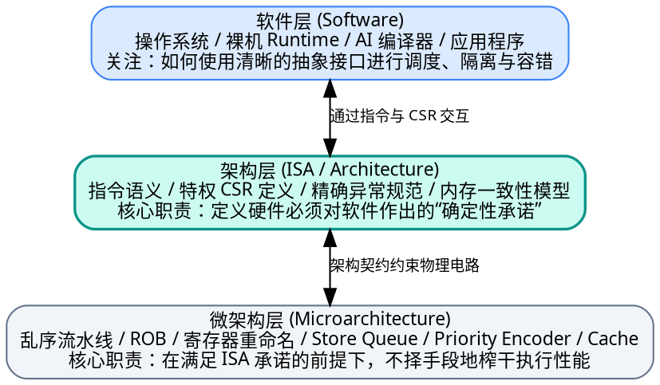

对于从事**编译器后端、裸机 Runtime 或异构加速芯片（NPU/GPU）**开发的工程师，从这篇文章中最值得带走的，是敏锐区分四个关键时间节点的能力：

1. **Execute（执行）**：算力单元把算术算完；
2. **Commit（提交）**：确认不再受前序异常回滚影响，逻辑上正式生效；
3. **Completion（完成）**：Store Queue / DMA 引擎真正把操作推送完毕；
4. **Visibility（可见性）**：写缓冲区刷入存储层次、Cache 一致性/失效同步完成，**下一个消费者一定能读到新结果**。

---

## 十六、知识点掌握自查清单

合上笔记之前，试着先不看折叠答案自己回答以下核心问题，检验是否真正打通了任督二脉：

<details>
<summary><strong>1. 用户态和核心态是不是两颗不同的物理 CPU？</strong></summary>

不是。它们是同一颗物理 CPU 在不同时刻所处的不同特权状态（如 `CRMD.PLV`），通过异常/系统调用进入高权限核心态，通过 `ERTN` 返回低权限用户态。

</details>

<details>
<summary><strong>2. CSR 寄存器和 MMIO 寄存器有什么本质区别？</strong></summary>

CSR 位于 CPU 核内部独立的控制空间，通过专门的特权指令（如 `csrrd` / `csrr`）访问，用于控制 CPU 自身状态；MMIO 则是外设（如 DMA、定时器）将自己的控制寄存器映射到物理内存地址空间，通过普通 `load`/`store` 指令访问。

</details>

<details>
<summary><strong>3. 为什么异常返回不能用几条普通指令分步完成，而必须用专用的 ERTN / ERET / MRET？</strong></summary>

因为异常返回需要**同时、原子地**恢复程序计数器 `PC`、降回原特权级 `PLV` 以及恢复中断使能 `IE`。拆成多条指令的话，无论先做哪一步都会导致权限冲突、提前被中断踩踏现场或无法执行剩余恢复指令。

</details>

<details>
<summary><strong>4. 为什么修改单个 CSR 控制位需要 CSRXCHG 等原子修改指令？</strong></summary>

传统的“读-改-写”三步操作之间如果被中断或异常打断，内层处理程序对寄存器其他位域的修改会在外层写回旧值时被无情覆盖丢失；`CSRXCHG` 按掩码硬件原子更新指定位，彻底消除竞态。

</details>

<details>
<summary><strong>5. TLB Miss 一定意味着发生了 Page Fault（缺页）吗？</strong></summary>

不一定。TLB 只是页表的硬件高速缓存。TLB Miss 可能仅仅是因为这条映射最近没被缓存进 TLB，其实主存的页表里早已映射好了，重填一下即可；而 Page Fault 指的是页表里本身就无效（`V=0`）或访问越权，必须由操作系统分配物理页或报错处理。

</details>

<details>
<summary><strong>6. 为什么修改了内存中的页表之后，软件必须执行 INVTLB？</strong></summary>

因为 CPU 内部的 TLB 里可能还缓存着修改前的陈旧映射关系，如果不使用 `INVTLB` 使过期表项失效，CPU 会继续按老的物理地址去读写错误的内存。

</details>

<details>
<summary><strong>7. 精确异常是否要求把 L1 Cache 里的推测数据也恢复到异常前的样子？</strong></summary>

不要求。精确异常约束的是 ISA 规定的**架构状态**（寄存器、PC、内存可见数据）。推测 Load 填充的 Cache Line 只是正确内存数据的只读副本，保留它不影响功能正确性（但可能产生时间侧信道）。而对于未提交的 Store 修改，硬件必须用 **Store Queue** 拦住，绝对不能在 Commit 前污染 Cache 和内存。

</details>

<details>
<summary><strong>8. LoongArch 向量化中断一定需要硬件去主存里查中断向量表吗？</strong></summary>

不需要。在 `VS != 0` 时，硬件通过优先级编码器拿到中断编号后，直接用移位器和按位或门电路按公式 $\text{EENTRY} \mid ((\text{IRQ} + 64) \times 2^{\text{VS}+2})$ 单周期硬算出入口地址，跳到软件预先按固定间距排布好的跳转桩代码处。

</details>

<details>
<summary><strong>9. 直接地址翻译与直接映射窗口（DMW）的根本区别是什么？</strong></summary>

直接地址翻译（`DA=1, PG=0`）是关掉虚拟分页的**全局运行模式**，常用于开机引导和 TLB 重填；DMW 则是开启虚拟分页后（`DA=0, PG=1`）内部专门开给内核的**直通高速窗口**，允许在不关虚拟内存的情况下绕过 TLB 快速访问物理内存和 MMIO，还能按窗口独立指定可缓存/不可缓存（`MAT`）属性。

</details>

---

## 推荐延伸阅读

如果希望从真实的开源处理器代码与官方 ISA 手册中进一步验证上述硬件细节，推荐精读以下一手资料：

- **[RISC-V BOOM 文档：Reorder Buffer (ROB)](https://docs.boom-core.org/en/latest/sections/reorder-buffer.html)**：深入理解乱序提交、异常流水线冲刷与 PNR 边界；
- **[RISC-V BOOM 文档：Load/Store Unit (LSU)](https://docs.boom-core.org/en/latest/sections/load-store-unit.html)**：深入理解 Store Queue、Load Queue 与 Store-to-Load 转发硬件细节；
- **[LoongArch 架构官方参考手册（Vol.1）](https://loongson.github.io/LoongArch-Documentation/LoongArch-Vol1-EN.html)**：查阅完整 CSR 位域定义、地址转换与例外中断规范；
- **[LLVM 文档：Speculative Load Hardening](https://llvm.org/docs/SpeculativeLoadHardening.html)**：从编译器视角理解 CPU 推测执行的微架构副作用与防护。
