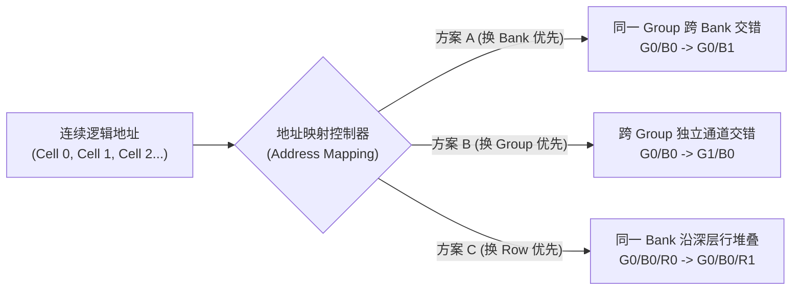
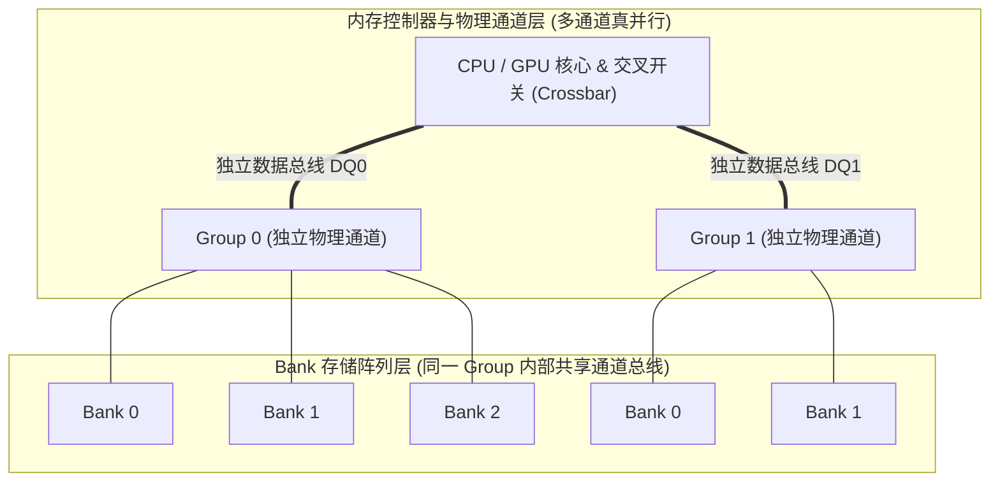
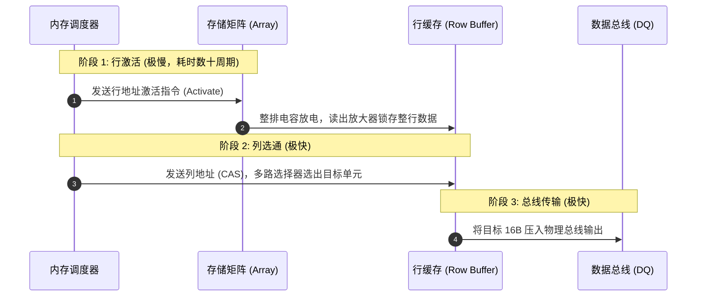
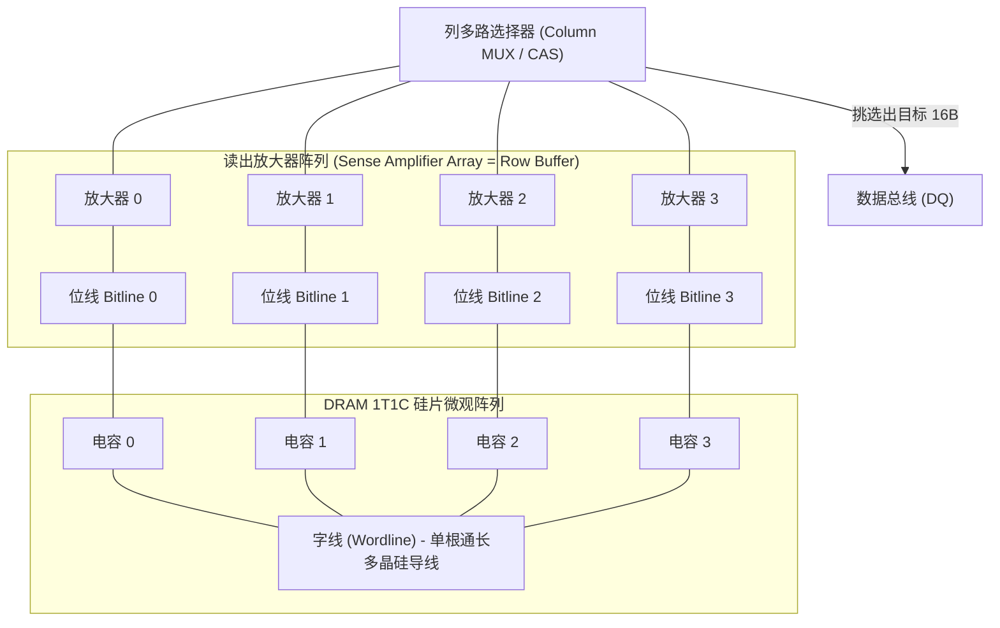
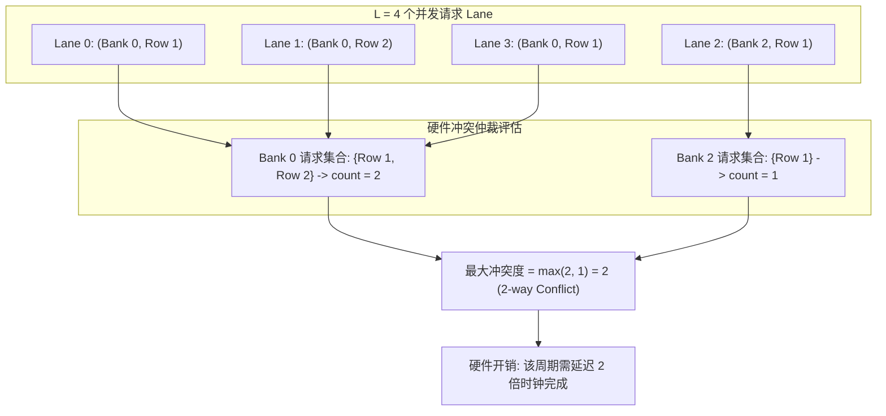

在高性能计算（HPC）、GPU 并行编程（如 CUDA）以及 NPU 深度学习硬件加速器的底层性能优化中，许多开发者常陷入一个经典的思维误区：**“只要容量足够大，程序就能畅行无阻”**。

然而在真实的硬件架构中，**“知道内存容量”与“知道数据落点及访问性能”完全是两码事**。

例如，即便芯片手册明确标注了总容量为 $2\text{ MiB}$，包含 16 个 Group，每个 Group 划分为 16 个 Bank，行深度（Row depth）为 512，单个单元（Cell）为 $16\text{ B}$——你依然无法预测一段连续内存读取到底能跑满数百 GB/s 的峰值带宽，还是会因为灾难性的存储体冲突（Bank Conflict）而断崖式跌落至原性能的十几分之一。

本文从**宏观映射策略**、**物理总线层级**、**硅片微观电路**与**数学量化定理**四个维度，彻底揭开现代存储系统（DRAM / Banked SRAM / Shared Memory）的寻址黑盒与冲突规避之道。

---

## 一、为什么知道容量仍然不知道访问落点？

考虑如下硬件规格参数：

- **SMEM / 片上总容量**：$2\text{ MiB}$
- **Group 数量**：$16$
- **每 Group 的 Bank 数量**：$16$
- **Bank 行深度（Row Depth）**：$512$
- **最小寻址单元（Cell）**：$16\text{ B}$（$128\text{ bit}$）

通过基础算术可以快速得出以下推导：

$$\text{总 Bank 数} = 16 \times 16 = 256$$

$$\text{单 Bank 容量} = \frac{2\text{ MiB}}{256} = 8\text{ KiB}$$

$$\text{单 Bank 单行大小} = \frac{8\text{ KiB}}{512} = 16\text{ B}$$

但关键问题在于：**一段逻辑上连续递增的地址空间（Cell 0, Cell 1, Cell 2...），在物理硬件上究竟是按怎样的规则跳跃排布的？**



硬件设计者在实现地址映射（Address Mapping）时，存在三种典型的路线抉择，它们赋予了硬件完全迥异的并发访问特性。

### 1. 方案 A：先换 Bank，再换 Group（Bank-first Interleaving）

- **映射规则**：$\text{Cell 0} \to \text{G0/B0}$，$\text{Cell 1} \to \text{G0/B1}$，$\dots$，$\text{Cell 15} \to \text{G0/B15}$，$\text{Cell 16} \to \text{G1/B0}$。
- **排布逻辑**：在同一个物理 Group 内部，连续数据依次横向轮流分发给不同的 Bank。直到当前 Group 的 16 个 Bank 全部分配完毕后，才推进到下一个 Group。
- **硬件影响**：
  - **多线程并发能力极佳**：这是 GPU 共享内存（Shared Memory）与高性能向量缓存中最经典的设计。
  - **天然避开冲突**：当一个 Warp（如 32 线程）中的连续线程并发请求相邻连续地址时，请求会被均匀打散到不同的 Bank，实现无阻塞并发读取。

### 2. 方案 B：先换 Group，再换 Bank（Group-first Interleaving）

- **映射规则**：$\text{Cell 0} \to \text{G0/B0}$，$\text{Cell 1} \to \text{G1/B0}$，$\dots$，$\text{Cell 15} \to \text{G15/B0}$，$\text{Cell 16} \to \text{G0/B1}$。
- **排布逻辑**：连续数据首先被平摊到各个独立的物理大区（Group）中，之后才在各 Group 内递增 Bank。
- **硬件影响**：
  - **多通道总线负载均衡**：在主机主存（DDR/LPDDR）或 GPU 全局显存（HBM/GDDR）中，不同的 Group 往往对应完全独立的**物理内存通道（Channel）**或内存控制器（MC）。
  - **最大化利用外部带宽**：顺序读取时能够同时压榨所有通道的独立物理总线。

### 3. 方案 C：先保持同一 Bank，增加 Row（Row-first Sequential）

- **映射规则**：$\text{Cell 0} \to \text{G0/B0/R0}$，$\text{Cell 1} \to \text{G0/B0/R1}$，$\dots$。
- **排布逻辑**：连续数据先沿着同一个 Bank 的深度（Row 0, Row 1, Row 2...）纵向堆叠，填满该 Bank 的行深后才换下一个 Bank。
- **硬件影响**：
  - **单线程流式传输友好**：在大块顺序 DMA 传输中，因为目标始终落在同一 Bank 的连续行上，行激活缓存局部性强。
  - **多线程并发的毁灭级灾难**：如果多个并发线程同时读取这组数据，所有请求将瞬间拥堵在同一个 Bank 门口，触发极高代价的串行排队与行冲突。

| 评估维度 | 方案 A（换 Bank 优先） | 方案 B（换 Group 优先） | 方案 C（换 Row 优先） |
| :--- | :--- | :--- | :--- |
| **首要交错轴** | Group 内跨 Bank 横向交错 | 跨 Group 通道交错 | Bank 内沿 Row 纵向填充 |
| **典型应用场景** | GPU 共享内存、多线程片上 SRAM | 主存多通道交织、全局内存控制器 | 单任务长流式 DMA 顺序拷贝 |
| **多线程并发性能** | 极高（零 Bank 冲突） | 极高（多物理总线并行） | 极差（全线程争抢单 Bank 串行化） |
| **总线利用机制** | 利用多 Bank 流水线隐藏激活延迟 | 借助多物理独立总线真并行拉货 | 频繁关行与重开行，总线长期停顿 |

---

## 二、打破认知盲区：总线与通道的物理真相

在初次接触存储体系结构时，开发者常提出两个看似直觉合理却与物理实际相悖的疑问：

### 疑问 1：“换 Group 不换 Bank，难道不是也在争抢同一根数据线吗？”

> [!NOTE]
> **直觉误区**：认为整个芯片只有唯一一套公共数据总线，无论怎么换 Group，最终都要通过一根线传回计算单元。

**物理真相**：现代高端处理器（CPU/GPU/NPU）的内存子系统是严格**分层设计**的：



- **Group 层面**：每个 Group 通常映射到独立的**物理内存通道（Channel）**，拥有专属的物理走线（DQ 数据线与控制逻辑）。Group 0 的数据总线与 Group 1 的数据总线在硅片走线上物理隔绝。方案 B（跨 Group）利用的是**多条独立数据线的空间并行（True Parallelism）**，总线带宽成倍叠加。
- **Bank 层面**：同一个 Group 内部的各个 Bank，确实共享属于该 Group 的那唯一一条数据总线。

### 疑问 2：“既然同一个 Group 内的 Bank 共享同一根数据总线，换 Bank 又如何做到并发？”

> [!NOTE]
> **直觉误区**：如果单条总线在同一时钟周期只能传一个数据，那么把数据分散在 Bank 0 到 Bank 15 上，传输时依然只能一个一个排队，怎么可能提高效率？

这触及了计算机体系结构中最核心的哲学：**并发（Concurrency） $\neq$ 物理绝对并行（Parallelism）**。

在同一 Group 内部，换 Bank 之所以能带来指数级性能跃迁，核心在于**利用多 Bank 重叠执行时间，实现流水线化（Pipelining）并完美隐藏延迟（Latency Hiding）**。

#### 内存读取的耗时三步曲

读取一次 DRAM/SRAM 数据绝非通电瞬间即出，必须经历物理上耗时悬殊的三个动作：

1. **行激活（Row Activate / RAS）**：控制信号拉高字线，将目标 Row 的数据完整搬移并锁存进读出放大器（Row Buffer）。$\to$ **极慢（需要数十个时钟周期）**。
2. **列选通（Column Select / CAS）**：多路选择器在 Row Buffer 中锁定目标偏移行单元。$\to$ **极快（仅需少数周期）**。
3. **总线传输（Data Burst Transfer）**：被选中的数据经由物理总线输出给计算核心。$\to$ **极快（如猝发传输，几个周期）**。



#### 方案 C（同 Bank 换 Row）的时序死穴

如果连续地址都塞在同一个 Bank 的不同行（Row 0, Row 1, Row 2...）：

- 读取 Cell 0：激活 Row 0（**总线干等 30 周期**） $\to$ 传输 Cell 0（**总线忙碌 2 周期**）。
- 读取 Cell 1：由于同一 Bank 在同一时间**只能保持一行处于打开状态**，必须执行关闭与预充电（Precharge，**总线干等**），再激活 Row 1（**总线继续干等 30 周期**） $\to$ 传输 Cell 1（**总线忙碌 2 周期**）。

> [!CAUTION]
> 在方案 C 中，数据总线在超过 $90\%$ 的时间内处于**饥饿空转（Wait State）**，总线带宽被底层的行颠簸（Row Buffer Conflict）彻底吞噬。

#### 方案 A（换 Bank 优先）的流水线接力魔法

在方案 A 中，连续地址分布在 Bank 0, Bank 1, Bank 2... 上。**由于各个 Bank 内部的行激活电路是物理完全解耦的**：

- **周期 0**：内存控制器向 Bank 0 发送激活指令，Bank 0 启动内部行激活（预计耗时 30 周期）。
- **周期 1**：内存控制器紧接着向 Bank 1 发送激活指令，Bank 1 在后台同步激活其内部行！
- **周期 2~3**：Bank 2、Bank 3 依次在后台无阻碍并发激活。
- **周期 30**：Bank 0 数据就绪，开始占用公用数据总线输出（耗时 2 周期）。
- **周期 32**：Bank 0 传输完成；此时 Bank 1 早已在后台激活完毕就绪，**无缝接管总线**输出！
- **周期 34**：Bank 2 无缝接管总线输出……

```
【方案 C：同 Bank 换 Row（总线大面积干等空转）】
Bank 0: |--- 激活 Row0 (慢) ---| [读] |-- 关行+激活 Row1 (慢) --| [读] |
Bus DQ: [====== 空闲等待 ======] [传0] [======= 空闲等待 =======] [传1] |

【方案 A：同 Group 跨 Bank 交织（多 Bank 接力流水线）】
Bank 0: |--- 激活 Row (慢) ---| [读] |
Bank 1:    |--- 后台激活 Row (慢) ---| [读] |
Bank 2:       |--- 后台激活 Row (慢) ---| [读] |
Bus DQ: [====== 初始等待 ======] [传B0] [传B1] [传B2] [传B3] ... (总线 100% 满载)
```

> [!TIP]
> 方案 A 虽然在数据总线上依然是串行分时复用，但它**将极慢的行激活延迟全部在后台重叠隐藏**，使得物理总线实现了连续不断的满载突发传输（Burst）。

---

## 三、微观物理真相：为什么必须“整排搬运”到 Row Buffer？

此时，一个极其尖锐的工程问题浮出水面：**“既然程序只要那 16 字节，为什么硬件非要大动干戈把整整一行（通常 1KB ~ 8KB）全部搬进 Row Buffer？只搬需要的 16 字节不行吗？”**

答案是：**在硅片物理层面，无法单独只读一个 Cell。**



### 1. 字线（Wordline）的物理连通性

DRAM 存储单元采用经典的 **1T1C（一个晶体管 + 一个微型电容）** 结构。
- 横向贯穿整行的导线称为**字线（Wordline）**，它直接连接着这一整行成千上万个晶体管的控制栅极（Gate）。
- 当内存控制器发起“激活某一行”的命令时，这根字线的电压被拉高。**由于它是一根整段的物理导线，全行所有晶体管会在同一时刻不可抗拒地全部导通**。在微观电路上，根本不存在“只切通第 5 个晶体管而断开其他晶体管”的物理开关。

### 2. 微弱电荷与读出放大器（Sense Amplifier）

存储在 1T1C 电容中的电荷量极其微弱（仅数十飞库伦，$\approx 10^{-15}\text{ C}$），根本没有能力驱动高负载的芯片长导线走向外部总线。
- 纵向布置的导线被称为**位线（Bitline）**。
- 当字线拉高全行导通后，整行电容的电荷瞬间泄放到位线上。位于每条位线底端的**读出放大器（Sense Amplifier）**立刻感知极其微小的电压摆幅，并将其放大钳位为稳定的逻辑电平 `0` 或 `1`。

> [!IMPORTANT]
> **Row Buffer 在物理本质上并不是一块独立的 SRAM 缓存，而正是整排读出放大器阵列（Sense Amplifier Array）本身的集合！** 整行电荷涌出并被放大器锁存的过程，就是所谓的“行激活”。

### 3. 破坏性读出（Destructive Readout）与芯片面积博弈

DRAM 电容的读出是“破坏性”的——读出的那一刻，电容的电荷就已被放掉。读出放大器在完成信号放大后，必须在预充电阶段之前顺带把数据重新充入这排电容中。

如果硬要实现“按单字节单独读写”，就必须为每个 Cell 配置独立的选通走线和放大器。这会导致芯片面积膨胀数十倍，制造成本直接失控。因此，**“按行整排激活、以时间换面积”**是人类半导体工程学在物理与成本博弈下的最优解。

### 4. Row Buffer 的容量陷阱

一些初学者会担忧：“如果每个 Bank 都要整行搬运，那芯片内岂不是要占用海量的缓冲空间？”

事实上，**每个 Bank 内部都镶嵌了一套自己专属的读出放大器（Row Buffer）**：
- 假设单 Bank 行宽为 $1\text{ KB}$，即使 256 个 Bank 全部保持激活状态，所有专属 Row Buffer 的总硅片存储容量也不过 $256\text{ KB}$，相比片上数兆甚至主存数吉字节的容量而言，开销微乎其微。
- 正是因为**每个 Bank 拥有自己独立的 Row Buffer**，才从物理上支撑起了各个 Bank 在后台独立、同时进行行激活操作！

---

## 四、Banked SRAM 寻址的数学本质与通用映射公式

转向片上加速器（如 NPU、张量计算核心、GPU 共享内存）中广泛使用的 **Banked SRAM** 架构，其内部由多块独立的 SRAM 实体拼接而成。

以典型的 NPU 向量存储单元为例，其物理参数如下：
- **Bank 数量** $B = 16$
- **Bank 数据位宽** $W_b = 16\text{ B}$（$128\text{ bit}$）
- **Bank 深度（行数）** $D_b = 1024$
- **单行跨 Bank 总吞吐**：$B \times W_b = 16 \times 16\text{ B} = 256\text{ B}$

```
               ◄──────────────────── 16 个 Bank (宽度 256 字节) ────────────────────►
               Bank 0        Bank 1        Bank 2         ...        Bank 15
            ┌────────────┬────────────┬────────────┬────────────┬────────────┐
   Row 0    │ 0   ~ 15B  │ 16  ~ 31B  │ 32  ~ 47B  │    ...     │ 240 ~ 255B │ ──► 合计 256 字节
            ├────────────┼────────────┼────────────┼────────────┼────────────┤
   Row 1    │ 256 ~ 271B │ 272 ~ 287B │ 288 ~ 303B │    ...     │ 496 ~ 511B │ ──► 合计 256 字节
            ├────────────┼────────────┼────────────┼────────────┼────────────┤
    ...     │    ...     │    ...     │    ...     │    ...     │    ...     │
            ├────────────┼────────────┼────────────┼────────────┼────────────┤
  Row 1023  │            │            │            │            │            │
            └────────────┴────────────┴────────────┴────────────┴────────────┘
            ◄── 16B ───►
```

### 通用地址映射公式

当控制单元给出一个连续的一维线性字节地址 $addr$ 时，硬件寻址译码逻辑通过以下公式，将其瞬间解构成三维物理坐标 $(\text{Bank}, \text{Row}, \text{Offset})$：

#### 1. 数据块索引（Block Index）
$$block(addr) = \left\lfloor \frac{addr}{W_b} \right\rfloor$$
将线性字节地址切分为以 $W_b$（此处为 $16\text{ B}$）为粒度的基础块序号。

#### 2. 横向 Bank 索引（Bank Index）
$$bank(addr) = block(addr) \bmod B = \left\lfloor \frac{addr}{W_b} \right\rfloor \bmod B$$
通过对 Bank 总数 $B$ 取模，将连续的数据块以**轮询（Round-Robin）**方式散列到各个 Bank 上。

#### 3. 纵向 Row 索引（Row Index）
$$row(addr) = \left\lfloor \frac{block(addr)}{B} \right\rfloor = \left\lfloor \frac{addr}{B \times W_b} \right\rfloor$$
每当轮询完所有 $B$ 个 Bank（即填满 $B \times W_b$ 字节后），行深度才向下递增 1 行。

#### 4. 块内字节偏移（Byte Offset）
$$offset(addr) = addr \bmod W_b$$

### 真实地址演算算例

设给定访问字节地址 $addr = 300$：

1. **计算 Block**：$\lfloor 300 / 16 \rfloor = 18$，余数 $12$。代表第 18 号数据块，块内偏移为 12 字节。
2. **计算 Bank**：$18 \bmod 16 = 2$。数据落在 **Bank 2**。
3. **计算 Row**：$\lfloor 18 / 16 \rfloor = 1$（或 $\lfloor 300 / 256 \rfloor = 1$）。数据落在 **Row 1**。

**结论**：地址 300 在物理存储介质上的精确落点为 **Bank 2 的 Row 1，第 12 号字节处**。

---

## 五、n-way Bank Conflict 的数学量化

现代 SIMD / SIMT（单指令多线程）计算架构由多个处理通道（Lane）组成。设某一周期内，硬件同时发起 $L$ 个并发访问请求，各 Lane 的目标物理坐标表示为：

$$\text{Lane}_l \to (bank_l, row_l), \quad l \in [0, L-1]$$

### 1. 独立行数统计公式
对每一个特定的存储体 $b \in [0, B-1]$，统计命中该 Bank 的**互异行地址数量**：

$$count_b = \#\left\{ row_l \mid bank_l = b \right\}$$

公式中的 $\#\{\dots\}$ 代表集合的势（基数，即去除重复项后的元素个数）。

> [!NOTE]
> **为什么必须去重？**
> 如果多个 Lane 在同一时刻访问**同一个 Bank 的同一行甚至同一个单元**，硬件内部集成的数据广播总线（Broadcast / Multicast Network）可以在单个周期内将该数据同时扇出给所有请求 Lane，**这不构成物理冲突**。只有当请求指向**同一 Bank 的不同 Row** 时，内部电路才被迫串行排队。

### 2. 冲突度（Conflict Degree）定义

硬件整体的冲突度等于所有 Bank 中最拥堵的那一个：

$$\text{conflictDegree} = \max_{b} (count_b)$$



- **$\text{conflictDegree} = 1$（无冲突）**：每个被命中的 Bank 最多只被请求了 1 个不同的 Row，硬件在一个时钟周期内全并行吞吐。
- **$\text{conflictDegree} = 2$（2-way Conflict）**：最忙碌的 Bank 需要串行服务 2 个不同的行请求，执行时间翻倍。
- **$\text{conflictDegree} = 16$（16-way Conflict）**：极端灾难情况。16 个并发请求全部扎堆在同一个 Bank 的 16 个不同行上。此时其余 15 个 Bank 全部闲置，硬件退化为纯串行模式，吞吐量暴跌至 $\frac{1}{16}$。

---

## 六、固定步长（Stride）访问的魔咒：$\gcd$ 与 $2^d$ 定理

在实际编程中（如矩阵乘法、张量转置、卷积提取），最普遍的数据访问形态是**固定步长（Strided Access）**。

设并发 Lane 数与 Bank 数匹配（$L = B = 16$），基准数据块为 $block_0$，相邻 Lane 之间的步长为 $u$ 个数据块：

$$block(i) = block_0 + i \cdot u, \quad i \in [0, B-1]$$

其命中的 Bank 编号为：

$$bank(i) = (block_0 + i \cdot u) \bmod B$$

### 核心数学定理

在 $L = B$ 的前提下，该序列所覆盖的**有效不同 Bank 数量（Unique Banks）**以及**最大冲突度（Conflict Degree）**，完全由初等数论中的**最大公约数（Greatest Common Divisor, $\gcd$）**唯一决定：

$$\text{uniqueBanks} = \frac{B}{\gcd(u, B)}$$

$$\text{conflictDegree} = \gcd(u, B)$$

#### 16-Bank 系统全步长实例对照表

| 访问步长 $u$ | Bank 命中序列特征 | $\gcd(u, 16)$ | 覆盖 Bank 数 | 冲突度 | 硬件并发状态 |
| :---: | :--- | :---: | :---: | :---: | :--- |
| **$u = 1$** | $0, 1, 2, 3, \dots, 15$ | **$1$** | $16$ | **$1$** | 完美全满载并行（无冲突） |
| **$u = 2$** | $0, 2, 4, 6, \dots, 14, 0, 2, \dots$ | **$2$** | $8$ | **$2$** | 2-way 冲突（仅落于偶数 Bank） |
| **$u = 3$** | $0, 3, 6, 9, 12, 15, 2, 5, \dots$ | **$1$** | $16$ | **$1$** | **奇数互质，零冲突全覆盖！** |
| **$u = 4$** | $0, 4, 8, 12, 0, 4, 8, 12, \dots$ | **$4$** | $4$ | **$4$** | 4-way 严重冲突（仅落于 4 个 Bank） |
| **$u = 8$** | $0, 8, 0, 8, \dots$ | **$8$** | $2$ | **$8$** | 8-way 重度冲突（仅落于 2 个 Bank） |
| **$u = 16$** | $0, 0, 0, 0, \dots, 0$ | **$16$** | $1$ | **$16$** | **16-way 全拥堵（彻底串行化）** |

> [!TIP]
> **反直觉的数学之美**：步长 $u=3$ 虽然在直觉上比 $u=2$ 跨度更大，但由于 $\gcd(3, 16) = 1$，它能够完美遍历所有 16 个 Bank，实现零冲突并行！而 $u=2$ 却会产生 2-way 冲突。

### 步长 $u$ 与硬件的本质关系

在软硬件协同设计中：
- **$u$ 是软件行为**：由程序员编写的代码逻辑、多维数组转置的步长或编译器决定的内存排布决定。
- **$B$ 是硬件常量**：芯片制造出厂后，Bank 总数 $B$（如 $16 = 2^4$）已在硅片上固定，无法改变。

#### $2^d$ 冲突定理
因为硬件 Bank 数绝大多数设计为 2 的幂次方（$B = 2^k$，此处 $k=4$）。根据算术基本定理（唯一分解定理），任意正整数步长 $u$ 均可唯一拆解为：

$$u = 2^d \times n \quad (n \text{ 为奇数})$$

其中 $d$ 为 $u$ 包含的素因子 2 的幂次（在二进制表示下等于末尾连续 0 的个数）。

此时，冲突度公式可直接化简为：

$$\text{conflictDegree} = \gcd(2^d \times n, 2^k) = 2^{\min(d, k)}$$

> [!WARNING]
> **破除妄想：步长 $u$ 一旦固定，无法靠改变 $n$ 来改变 $d$！**
> 任何正整数的质因数分解是绝对唯一的。例如当 $u=12 = 2^2 \times 3$ 时，$d$ 必定等于 $2$，$n$ 必定等于 $3$。开发者绝不能在保持 $u=12$ 的同时幻想降低 $d$。要想消除冲突，唯一的物理出路是**打破 $u$ 中素因子 2 的垄断**。

---

## 七、工程实战指南：如何破解 Bank 冲突魔咒？

理解了底层的物理与数学机制后，在实际工程（CUDA 编程、OpenCL、NPU 算子开发）中，我们可以采用以下行之有效的优化策略：

### 1. 软件策略：内存填充（Memory Padding / Stride Shift）

当算法逻辑必须按列跨步访问二维矩阵（例如矩阵转置、列规约）且行宽刚好是 Bank 数的倍数时，连续跨步 $u$ 将携带极大的 $2^d$ 因子。

**解决策略**：在分配共享内存或片上缓冲区时，**在每一行的末尾人为填充少量无用占位符（Padding）**：

```c
// ❌ 存在严重 16-way 冲突的共享内存定义 (16x16 矩阵)
__shared__ float smem[16][16]; 
// 线程按列访问 smem[threadIdx.x][col] 时，步长 u = 16，gcd(16, 16) = 16

// ✅ 引入 Padding 填充后的定义
__shared__ float smem[16][17]; 
// 逻辑行宽变为 17，步长 u = 17。
// 由于 gcd(17, 16) = 1，按列访问冲突度瞬间降为 1，性能提升数倍！
```

通过引入少于 $6\%$ 的内存空间浪费，强行将步长中的奇数项 $n$ 重新组合，将素因子 2 的幂次降为 $d=0$，实现空间换时间的飞跃。

### 2. 软件策略：异或混淆寻址（XOR-based Bank Swizzling）

现代先进体系结构（如 NVIDIA Hopper 架构的 Tensor Core 共享内存、高通 NPU）引入了硬件或编译层面的 **XOR 混淆映射**：

$$bank = \left( \left\lfloor \frac{addr}{W_b} \right\rfloor \oplus \left\lfloor \frac{addr}{\text{Stride}} \right\rfloor \right) \bmod B$$

通过利用地址高位与低位进行异或运算，打破了线性步长与 Bank 编号之间的严格周期性映射，将原本会扎堆在同一 Bank 的访问动态散列至不同 Bank。

### 3. 硬件策略：奇数 / 质数 Bank 拓扑设计

部分专用嵌入式 DSP 或高性能加速器在硬件架构设计初期，会放弃设计为 2 的幂次方的 Bank 数量，转而采用质数个 Bank（例如 17 或 31 个 Bank）。
- 任何小于 $B$ 的偶数或常规步长与质数求 $\gcd$，结果恒为 $1$。
- 彻底从芯片物理根源上消除了常见 2 的幂次跨步访问带来的冲突风险。

---

## 八、总结与核心知识速查表

```
┌─────────────────────────────────────────────────────────────────────────────┐
│                       存储体系结构寻址与并发核心思维导图                     │
└─────────────────────────────────────────────────────────────────────────────┘
                                       │
     ┌─────────────────────────────────┼─────────────────────────────────┐
     ▼                                 ▼                                 ▼
【宏观拓扑映射】                  【微观物理实现】                  【数学量化与规避】
• 方案 A (跨 Bank):               • 1T1C 结构决定字线全导通:         • 映射公式:
  多线程高并发黄金法则               物理上无法单字节读取              Bank = (addr/Wb) % B
  流水线隐藏行激活延迟            • 读出放大器 (Row Buffer):        • 冲突度公式:
• 方案 B (跨 Group):                各 Bank 独立配备专属暂存           conflict = gcd(u, B)
  多物理通道真并行                   支撑后台独立异步行激活         • 优化破局:
• 方案 C (跨 Row):                • DRAM 耗时三阶段:                  矩阵行尾 Padding 消除 2^d
  流式 DMA 友好但并发必溃           RAS (慢) -> CAS (快) -> DQ (极快)  XOR Swizzling 打散访问
```

在系统级性能调优的深水区，软件从来都不是运行在虚无的抽象图灵机之上，而是运行在遵循半导体电磁规律与数论法则的实体芯片之上。

唯有穿透代码表层，洞悉从硅片字线导通、读出放大器锁存，到数据总线分时复用与质因数映射的完整链路，才能写出真正压榨硬件潜能的极致高性能程序。
