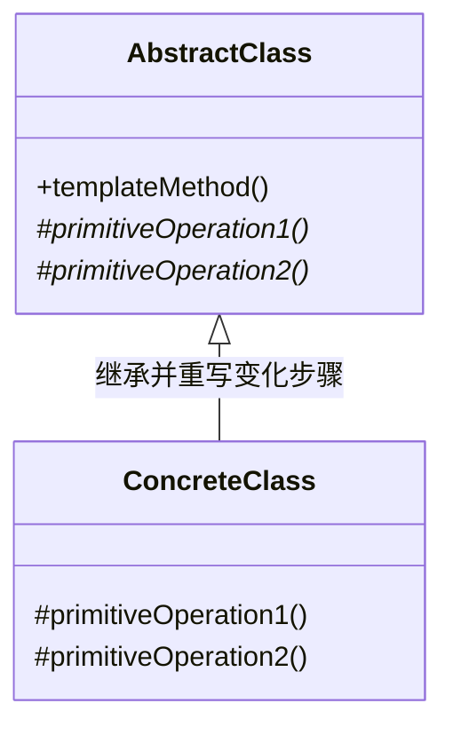

# 设计模式沉思录（第03讲）：模板方法模式（Template Method）

> [!NOTE] 专栏导读
> 本文是 **《侯捷 C++ 设计模式沉思录》** 系列专栏的第 **03** 讲。
> - **上一讲**：[上一讲：第02讲 面向对象八大设计原则深度解析](file:///home/ubuntu/git/blog/src/content/posts/design-patterns-02-object-oriented-principles.md)
> - **下一讲**：[下一讲：第04讲 策略模式（Strategy Pattern）](file:///home/ubuntu/git/blog/src/content/posts/design-patterns-04-strategy.md)
> - **架构进阶**：[异构计算与 AI 编译器设计模式全景实践指南](file:///home/ubuntu/git/blog/src/content/posts/heterogeneous-computing-and-ai-compiler-design-patterns-guide.md)


## 一、设计模式总览与分类

### 1.1 GOF 经典分类

GoF（Gang of Four）在《Design Patterns: Elements of Reusable Object-Oriented Software》中将 23 种设计模式分为三大类：

| 分类 | 核心关注点 | 示例模式 |
|------|-----------|---------|
| **创建型（Creational）** | 对象创建的过程与依赖关系 | Factory Method, Abstract Factory, Singleton |
| **结构型（Structural）** | 需求变化时对对象结构的冲击 | Adapter, Bridge, Composite, Decorator |
| **行为型（Behavioral）** | 多个类之间的交互与责任划分 | Template Method, Strategy, Observer |

GoF 还从实现手段的角度分为：

- **类模式**：侧重于类与子类之间的静态关系（偏重继承方案）
- **对象模式**：侧重于对象之间的动态关系（偏重组合方案）

### 1.2 侯捷老师的分类

| 分类 | 核心关注点 |
|------|-----------|
| 组件协作 | 框架与应用之间的协作问题 |
| 单一职责 | 类与类之间的责任划分 |
| 对象创建 | 对象创建过程中的依赖关系 |
| 性能优化 | 解决性能相关问题 |
| 接口隔离 | 接口设计的隔离原则 |
| 状态变化 | 状态管理与转换 |
| 数据结构 | 典型数据结构特征 |
| 行为变化 | 行为的灵活变化 |
| 领域问题 | 特定领域相关设计 |

---

## 二、重构与设计模式的关系

### 架构类图与时序关系




### 2.1 核心理念

> **好的面向对象设计** = 能够应对变化、提高复用的设计。

现代软件的特征是需求频繁变化。设计模式的要点是：

1. **寻找变化点**
2. **在变化点处应用设计模式**
3. 将变化的部分和稳定的**部分分离开来**

> **什么时候、什么地点应用设计模式，比理解设计模式的结构代码本身更为重要。**

### 2.2 重构到模式（Refactoring to Patterns）

- 不要先入为主地套用设计模式
- 没有一步到位的设计模式
- 敏捷软件开发倡导：**Refactoring to Patterns**（重构到模式）
- 讲课方式：先展示没有使用模式时代码的缺陷 -> 迭代修正 -> 最终得到良好方案（碰巧就是某个模式）

推荐书籍：
- 《Refactoring to Patterns》（Joshua Kerievsky）
- 《Refactoring: Improving the Design of Existing Code》（Martin Fowler）

### 2.3 重构的五个关键技术

| 技术 | 说明 |
|------|------|
| 静态绑定 -> 动态绑定 | 从编译期确定调用目标改为运行期确定 |
| 早绑定 -> 晚绑定 | 让"晚"的代码调用"早"的代码，通过虚函数等机制实现 |
| 继承 -> 组合 | 优先使用组合而非继承（组合关系更灵活） |
| 编译时依赖 -> 运行时依赖 | 减少编译期耦合，增加运行时灵活性 |
| 紧耦合 -> 松耦合 | 降低模块间的依赖程度 |

> 这五个关键词本质上是从不同角度描述同一件事情：**让系统更灵活、更可扩展**。

---

## 三、组件协作模式

现代软件专业化分工产生了两个核心部分：

- **框架（Framework / Library）**：提供稳定的整体结构和通用步骤
- **应用程序（Application）**：实现具体的业务逻辑

组件协作模式通过**晚绑定**来实现框架与应用之间的**松耦合**，常用模式包括：

1. **Template Method**（模板方法）
2. **Strategy**（策略模式）
3. **Observer**（观察者模式 / 事件模式）

---

## 四、Template Method 模式详解

### 4.1 动机与场景

在软件构建过程中，对某一项任务常常有：

- **稳定的整体操作结构**（算法骨架）
- 但**各个子步骤**却有很多变化的需求
- 由于框架与应用的分工，无法同时实现所有步骤

**核心问题**：如何在确定稳定操作结构的前提下，灵活应对各个子步骤的变化？

### 4.2 两种实现方式对比

#### 方式一：结构化设计（不使用 Template Method）

```
应用程序开发人员的职责：
1. 实现 step2, step4（自己的业务逻辑）
2. 编写主流程 run()，将 step1~step5 串联起来
```

问题：应用程序开发人员负担重，必须理解并编写整个流程。

#### 方式二：Template Method 模式

```
框架开发人员的职责：
1. 实现 step1, step3, step5（稳定的步骤）
2. 编写 run() 主流程（算法骨架）
3. 声明 step2, step4 为虚函数（变化的步骤）

应用程序开发人员的职责：
1. 继承框架类
2. 重写 step2, step4（自己的业务逻辑）
```

优势：应用程序开发人员只需关注变化的部分，主流程由框架复用。

### 4.3 早绑定 vs 晚绑定

```
方式一（早绑定）：Application（晚） ──调用──> Library（早）
  → 一个"晚"的东西调用一个"早"的东西 = 早绑定
  → C 语言时代的主流做法

方式二（晚绑定）：Library（早） ──虚函数调用──> Application（晚）
  → 一个"早"的东西调用一个"晚"的东西 = 晚绑定
  → 面向对象语言的核心机制
```

### 4.4 GOF 定义

> **Template Method**：定义一个操作中的算法的**骨架**（稳定），将一些步骤**延迟到子类**。Template Method 使得子类可以不改变（复用）一个算法的结构，同时可以重新定义（override）该算法的某些特定步骤。

映射到代码：

| GOF 概念 | 代码对应 |
|---------|---------|
| 算法骨架 | `run()` 方法（非虚函数，稳定） |
| 延迟到子类 | `step2()`, `step4()`（虚函数，变化） |
| 不改变算法结构 | 子类复用 `run()` |
| 重新定义特定步骤 | 子类 override `step2()`, `step4()` |

### 4.5 类图分析

```
┌─────────────────────────────────┐
│     AbstractClass (Library)     │  ← 红色（稳定）
├─────────────────────────────────┤
│ + TemplateMethod()   // run()   │  ← 非虚函数，稳定骨架
│ # PrimitiveOp1()     // step2   │  ← 虚/纯虚函数，变化点
│ # PrimitiveOp2()     // step4   │  ← 虚/纯虚函数，变化点
└────────────┬────────────────────┘
             │ 继承
             ▼
┌─────────────────────────────────┐
│  ConcreteClass (Application)    │  ← 蓝色（变化）
├─────────────────────────────────┤
│ # PrimitiveOp1() override       │  ← 子类重写
│ # PrimitiveOp2() override       │  ← 子类重写
└─────────────────────────────────┘
```

**阅读类图的习惯**：用红色标注稳定部分，蓝色标注变化部分，理解变化与稳定的力量对比。

### 4.6 反向控制结构（好莱坞原则）

> **"Don't call us, we'll call you."**（不要调用我，让我来调用你）

- 结构化设计时代：应用程序调用库（正向调用）
- Template Method 时代：框架（通过虚函数）调用应用程序（反向控制）
- 虚函数是面向对象最核心的晚绑定机制，C++ 中还有函数指针等其他晚绑定手段

### 4.7 关键设计要点

**基类析构函数必须是虚函数**：

```cpp
class Library {
public:
    virtual ~Library() {}  // 基类析构函数必须为虚函数
    // ...
};
```

原因：当通过基类指针 `delete` 派生类对象时，如果析构函数不是虚函数，将不会调用派生类的析构函数，导致资源泄漏。

**被 Template Method 调用的虚方法建议声明为 `protected`**：

- 这些方法单独调用没有意义，必须在特定流程上下文中才有意义
- 不对外暴露，声明为 `protected` 更符合封装原则

### 4.8 Template Method 的适用条件与限制

**前提条件**：必须存在一个**稳定的算法骨架**可以被复用。

| 极端假设 | 结论 |
|---------|------|
| 所有步骤都变化（run 也不稳定） | 任何设计模式都无法使用 |
| 所有步骤都稳定（不需要虚函数） | 设计模式没有意义 |
| 部分稳定、部分变化 | **Template Method 的适用场景** |

设计模式的核心作用：**在变化和稳定之间寻找隔离点，分离它们，从而管理变化**。

> 将变化像小兔子一样关到笼子里，让它在笼子里随便跳，不至于跳出来污染整个房间。

### 4.9 Template Method 的价值总结

1. **极其常用**：几乎所有面向对象系统都使用了 Template Method 模式
2. **机制简洁**：核心就是虚函数机制，易于理解
3. **提供灵活扩展点**：为框架提供了基于继承+虚函数的扩展能力
4. **代码复用**：算法骨架在基类中复用，子类只需实现变化部分
5. **反向控制结构**：框架调用应用，而非应用调用框架

---

## 五、示例代码

### 5.1 方式一：结构化设计（不使用 Template Method）

```cpp
// 结构化设计方式 —— 应用程序开发人员负责编写主流程
// 早绑定：Application（晚）调用 Library（早）
#include <iostream>
using namespace std;

// 程序库开发人员提供的步骤
class Library {
public:
    void step1() { cout << "  Library::step1()" << endl; }
    void step3() { cout << "  Library::step3()" << endl; }
    void step5() { cout << "  Library::step5()" << endl; }
};

// 应用程序开发人员需要：
// 1. 实现自己的步骤（step2, step4）
// 2. 编写主流程，将所有步骤串联起来
class Application {
public:
    bool step2() {
        cout << "  Application::step2()" << endl;
        return true; // 模拟条件判断
    }

    void step4() {
        cout << "  Application::step4()" << endl;
    }

    // 应用程序开发人员必须自己编写主流程
    void run() {
        Library lib;
        lib.step1();                          // 调用库的步骤
        if (step2()) {                        // 自己的步骤 + 流程控制
            lib.step3();                      // 调用库的步骤
        }
        for (int i = 0; i < 4; ++i) {        // 流程控制
            step4();                          // 自己的步骤
        }
        lib.step5();                          // 调用库的步骤
    }
};

int main() {
    Application app;
    app.run();
    return 0;
}
```

**运行结果**：

```
  Library::step1()
  Application::step2()
  Library::step3()
  Application::step4()
  Application::step4()
  Application::step4()
  Application::step4()
  Library::step5()
```

### 5.2 方式二：Template Method 模式

```cpp
// Template Method 模式 —— 框架开发人员编写主流程（run）
// 晚绑定：Library（早）通过虚函数调用 Application（晚）
#include <iostream>
using namespace std;

class Library {
public:
    // 稳定的算法骨架 —— 非虚函数，子类不改变（复用）
    void run() {
        step1();
        if (step2()) {
            step3();
        }
        for (int i = 0; i < 4; ++i) {
            step4();
        }
        step5();
    }

    // 基类的析构函数应为虚函数
    virtual ~Library() {}

protected:
    // 稳定的步骤 —— 非虚函数，子类复用
    void step1() { cout << "  Library::step1()" << endl; }
    void step3() { cout << "  Library::step3()" << endl; }
    void step5() { cout << "  Library::step5()" << endl; }

    // 变化的步骤 —— 虚函数，支持子类重定义
    // 可以是纯虚函数（=0）或带默认实现的虚函数
    virtual bool step2() = 0;   // 纯虚函数：子类必须实现
    virtual void step4() = 0;   // 纯虚函数：子类必须实现
};

// 应用程序开发人员只需继承并重写虚函数
class Application : public Library {
protected:
    bool step2() override {
        cout << "  Application::step2()" << endl;
        return true;
    }

    void step4() override {
        cout << "  Application::step4()" << endl;
    }
};

int main() {
    // 多态指针：声明类型为 Library*，实际类型为 Application*
    Library* pLib = new Application();
    pLib->run();  // run() 是非虚函数，内部调用的 step2/step4 是虚函数 → 动态绑定
    delete pLib;  // 析构函数为虚函数 → 正确调用 Application 的析构
    return 0;
}
```

**运行结果**：

```
  Library::step1()
  Application::step2()
  Library::step3()
  Application::step4()
  Application::step4()
  Application::step4()
  Application::step4()
  Library::step5()
```

### 5.3 实际应用示例：文档处理框架

```cpp
// Template Method 实际应用示例：文档处理框架
// 框架定义稳定的处理流程，应用程序只需重写具体步骤
#include <iostream>
#include <string>
using namespace std;

// 框架层：定义文档处理的算法骨架
class DataParser {
public:
    // 模板方法 —— 稳定的算法骨架，非虚函数
    void parseData(const string& rawData) {
        cout << "[1] 数据预处理（去空白字符）..." << endl;
        string cleaned = preprocess(rawData);

        cout << "[2] 解析数据..." << endl;
        parse(cleaned);

        cout << "[3] 校验数据..." << endl;
        bool valid = validate();

        if (valid) {
            cout << "[4] 保存数据..." << endl;
            save();
            cout << "[5] 发送完成通知..." << endl;
            notifyComplete();
        } else {
            cout << "[!] 数据校验失败，流程终止。" << endl;
        }
    }

    virtual ~DataParser() {}

protected:
    // 稳定步骤 —— 非虚，子类复用
    string preprocess(const string& data) {
        string result;
        for (char c : data) {
            if (c != ' ' && c != '\t' && c != '\n') {
                result += c;
            }
        }
        return result;
    }

    void notifyComplete() {
        cout << "  -> 解析完成通知已发送。" << endl;
    }

    // 变化步骤 —— 虚函数，子类重写
    virtual void parse(const string& data) = 0;
    virtual bool validate() = 0;
    virtual void save() = 0;
};

// 应用层：JSON 解析器
class JsonParser : public DataParser {
protected:
    void parse(const string& data) override {
        cout << "  -> JSON 解析: 处理 {" << data << "}" << endl;
    }

    bool validate() override {
        cout << "  -> JSON 校验: 检查字段完整性... 通过" << endl;
        return true;
    }

    void save() override {
        cout << "  -> JSON 保存: 写入 JSON 数据库。" << endl;
    }
};

// 应用层：XML 解析器
class XmlParser : public DataParser {
protected:
    void parse(const string& data) override {
        cout << "  -> XML 解析: 处理 <root>" << data << "</root>" << endl;
    }

    bool validate() override {
        cout << "  -> XML 校验: 检查 DTD Schema... 通过" << endl;
        return true;
    }

    void save() override {
        cout << "  -> XML 保存: 写入 XML 文件。" << endl;
    }
};

int main() {
    cout << "===== JSON Parser =====" << endl;
    DataParser* p1 = new JsonParser();
    p1->parseData("{\"name\":\"test\"}");
    delete p1;

    cout << "\n===== XML Parser =====" << endl;
    DataParser* p2 = new XmlParser();
    p2->parseData("<name>test</name>");
    delete p2;

    return 0;
}
```

**运行结果**：

```
===== JSON Parser =====
[1] 数据预处理（去空白字符）...
[2] 解析数据...
  -> JSON 解析: 处理 {{"name":"test"}}
[3] 校验数据...
  -> JSON 校验: 检查字段完整性... 通过
[4] 保存数据...
  -> JSON 保存: 写入 JSON 数据库。
[5] 发送完成通知...
  -> 解析完成通知已发送。

===== XML Parser =====
[1] 数据预处理（去空白字符）...
[2] 解析数据...
  -> XML 解析: 处理 <root><name>test</name></root>
[3] 校验数据...
  -> XML 校验: 检查 DTD Schema... 通过
[4] 保存数据...
  -> XML 保存: 写入 XML 文件。
[5] 发送完成通知...
  -> 解析完成通知已发送。
```

---

## 六、补充知识

### 6.1 Template Method 在实际框架中的应用

几乎所有主流框架都大量使用了 Template Method 模式：

| 框架 | 模板方法示例 |
|------|------------|
| **MFC** | `CView::OnDraw()`, `CWinApp::InitInstance()` |
| **Qt** | `QWidget::paintEvent()`, `QAbstractItemModel::data()` |
| **STL** | `std::sort()` 内部调用比较函数（类似思想） |
| **JUnit / Google Test** | `setUp()`, `tearDown()` 生命周期方法 |
| **Servlet (Java)** | `HttpServlet` 的 `doGet()`, `doPost()` |
| **Android** | `Activity.onCreate()`, `Activity.onResume()` |

### 6.2 Template Method 与 Strategy 的区别

| 对比维度 | Template Method | Strategy |
|---------|----------------|----------|
| 实现机制 | 继承 + 虚函数 | 组合 + 接口/函数对象 |
| 变化点 | 算法中的某些步骤 | 整个算法 |
| 复用方式 | 复用算法骨架（基类） | 复用上下文（持有策略对象） |
| 灵活性 | 编译时确定（类的关系） | 运行时可切换策略 |
| 设计原则 | 偏重继承 | 偏重组合（更推荐） |

### 6.3 "只见树木，不见森林"

使用 Template Method 模式后，应用程序开发人员往往只看到自己重写的几个虚函数，而看不到整个算法骨架。这会导致：

- 对程序整体流程缺乏理解
- 调试困难时不知问题出在哪一层

**建议**：应用开发人员应主动了解框架基类中的 Template Method 实现，理解整个流程。

### 6.4 虚函数表（vtable）原理简述

Template Method 的核心机制是虚函数。在 C++ 中，虚函数通过虚函数表（vtable）实现：

```
Library 对象的内存布局：
┌──────────────┐
│  vptr ─────────> vtable for Library
├──────────────┤     ┌──────────────────┐
│  其他成员     │     │ &Library::step2  │
└──────────────┘     │ &Library::step4  │
                     └──────────────────┘

Application 对象的内存布局：
┌──────────────┐
│  vptr ─────────> vtable for Application
├──────────────┤     ┌───────────────────────┐
│  其他成员     │     │ &Application::step2   │
└──────────────┘     │ &Application::step4   │
                     └───────────────────────┘
```

当通过基类指针调用虚函数时，程序会通过 vptr 找到 vtable，再从 vtable 中取出实际的函数地址进行调用，从而实现动态绑定。

### 6.5 C++ 中的其他晚绑定机制

虚函数不是 C++ 中唯一的晚绑定手段：

| 机制 | 说明 |
|------|------|
| **虚函数** | 最核心的面向对象晚绑定机制，有抽象性 |
| **函数指针** | C 语言时代就有，抽象性较低 |
| **`std::function`** | C++11 引入，类型擦除的可调用对象包装器 |
| **模板（CRTP）** | 编译期多态，静态多态，不走 vtable |
| **`if constexpr`** | C++17 编译期分支 |

---

## 七、关键术语对照

| 原文术语 | 中文术语 | 说明 |
|---------|---------|------|
| Template Method | 模板方法 | 本讲核心模式 |
| Primitive Operation | 基本操作 | 被模板方法调用的虚函数 |
| Algorithm Skeleton | 算法骨架 | 稳定的整体操作结构 |
| Late Binding | 晚绑定 | 运行时确定调用目标 |
| Early Binding | 早绑定 | 编译时确定调用目标 |
| Dynamic Binding | 动态绑定 | 同晚绑定 |
| Static Binding | 静态绑定 | 同早绑定 |
| Virtual Function | 虚函数 | C++ 实现晚绑定的核心机制 |
| Pure Virtual Function | 纯虚函数 | 无默认实现，子类必须重写 |
| vtable | 虚函数表 | 存放虚函数地址的表 |
| Refactoring | 重构 | 改善代码结构而不改变行为 |
| Coupling | 耦合 | 模块间的依赖程度 |
| Inversion of Control | 控制反转 | "不要调用我，让我来调用你" |
| Framework | 框架 | 提供可复用结构的半成品软件 |
| Library | 程序库 | 提供可调用功能的代码集合 |


---

## 专栏导航与全景索引

- [上一讲：第02讲 面向对象八大设计原则深度解析](file:///home/ubuntu/git/blog/src/content/posts/design-patterns-02-object-oriented-principles.md)
- [下一讲：第04讲 策略模式（Strategy Pattern）](file:///home/ubuntu/git/blog/src/content/posts/design-patterns-04-strategy.md)
- 架构进阶：[异构计算与 AI 编译器设计模式全景实践指南](file:///home/ubuntu/git/blog/src/content/posts/heterogeneous-computing-and-ai-compiler-design-patterns-guide.md)
