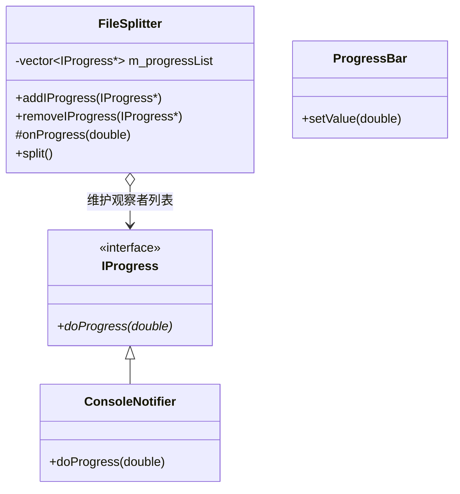

# 设计模式沉思录（第05讲）：观察者模式（Observer Pattern）

> [!NOTE] 专栏导读
> 本文是 **《侯捷 C++ 设计模式沉思录》** 系列专栏的第 **05** 讲。
> - **上一讲**：[上一讲：第04讲 策略模式（Strategy Pattern）](file:///home/ubuntu/git/blog/src/content/posts/design-patterns-04-strategy.md)
> - **下一讲**：[下一讲：第06讲 装饰模式（Decorator Pattern）](file:///home/ubuntu/git/blog/src/content/posts/design-patterns-06-decorator.md)
> - **架构进阶**：[异构计算与 AI 编译器设计模式全景实践指南](file:///home/ubuntu/git/blog/src/content/posts/heterogeneous-computing-and-ai-compiler-design-patterns-guide.md)


## 一、模式定义

**观察者模式**定义了对象之间**一对多**的依赖关系，当一个对象（目标对象/Subject）的状态发生改变时，所有依赖于它的对象（观察者/Observer）都会得到通知并自动更新。

核心目标：建立一种**松耦合**的通知机制，使得目标对象和观察者之间可以独立变化。

---

## 二、设计场景：文件分割器

### 架构类图与时序关系




### 2.1 需求背景

设计一个文件分割器程序，包含：
- **界面层（MainForm）**：提供文件路径输入框和分割数量输入控件
- **业务层（FileSplitter）**：执行文件分割的核心逻辑

当文件较大时，分割过程耗时较长，用户需要看到**进度反馈**。

### 2.2 初始设计（紧耦合版本）

最直观的实现：FileSplitter 直接持有 ProgressBar 控件的指针，在分割循环中更新进度。

```cpp
// 反面示例：紧耦合设计
#include <iostream>
#include <string>

class ProgressBar {
public:
    void setValue(double value) {
        int percent = static_cast<int>(value * 100);
        std::cout << "\r进度: " << percent << "%" << std::flush;
    }
};

class FileSplitter {
    std::string m_filePath;
    int m_fileNumber;
    ProgressBar* m_progressBar;  // 直接依赖具体控件

public:
    FileSplitter(const std::string& filePath, int fileNumber, ProgressBar* progressBar)
        : m_filePath(filePath), m_fileNumber(fileNumber), m_progressBar(progressBar) {}

    void split() {
        for (int i = 0; i < m_fileNumber; ++i) {
            // ... 分割文件的逻辑 ...
            if (m_progressBar != nullptr) {
                double progressValue = static_cast<double>(i + 1) / m_fileNumber;
                m_progressBar->setValue(progressValue);
            }
        }
        std::cout << "\n文件分割完成！" << std::endl;
    }
};

int main() {
    ProgressBar progressBar;
    FileSplitter splitter("test.txt", 5, &progressBar);
    splitter.split();
    return 0;
}
```

### 2.3 问题分析

此设计违反了**依赖倒置原则（DIP, Dependency Inversion Principle）**：

> - 高层模块不应依赖低层模块，二者都应依赖抽象
> - 抽象不应依赖实现细节，实现细节应依赖抽象

具体问题：
- `FileSplitter`（高层模块）直接依赖 `ProgressBar`（具体实现细节）
- `ProgressBar` 只是进度通知的**一种实现方式**，未来可能变化：
  - 改用 Label 显示百分比数字（如 "85%"）
  - 改为控制台程序，在终端打印点号表示进度
  - 改为其他平台的 UI 控件
- 一旦通知方式变化，`FileSplitter` 的代码也必须修改

**核心认知**：ProgressBar 在此场景中扮演的角色是"通知机制"，而非"界面控件"。我们真正需要抽象的是**通知行为**本身。

---

## 三、重构过程

### 3.1 第一步：引入抽象接口（依赖倒置）

将具体的 ProgressBar 替换为抽象接口 `IProgress`：

```cpp
#include <iostream>
#include <string>

// 抽象接口：进度通知机制
class IProgress {
public:
    virtual void doProgress(double value) = 0;
    virtual ~IProgress() {}
};

// 文件分割器 —— 依赖抽象接口
class FileSplitter {
    std::string m_filePath;
    int m_fileNumber;
    IProgress* m_progress;  // 依赖抽象

public:
    FileSplitter(const std::string& filePath, int fileNumber, IProgress* progress)
        : m_filePath(filePath), m_fileNumber(fileNumber), m_progress(progress) {}

    void split() {
        for (int i = 0; i < m_fileNumber; ++i) {
            // ... 分割文件的逻辑 ...
            if (m_progress != nullptr) {
                double progressValue = static_cast<double>(i + 1) / m_fileNumber;
                onProgress(progressValue);
            }
        }
        std::cout << "\n文件分割完成！" << std::endl;
    }

protected:
    void onProgress(double value) {
        if (m_progress != nullptr) {
            m_progress->doProgress(value);
        }
    }
};
```

**关键变化**：
- `ProgressBar`（具体控件）→ `IProgress`（抽象接口）
- 从"依赖具体通知控件"变为"依赖抽象通知机制"
- `FileSplitter` 不再耦合任何具体的 UI 框架，可在任何平台复用

### 3.2 界面类实现接口

```cpp
class ProgressBar {
public:
    void setValue(double value) {
        int percent = static_cast<int>(value * 100);
        std::cout << "\r进度: " << percent << "%" << std::flush;
    }
};

// MainForm 实现 IProgress 接口
class MainForm : public IProgress {
    ProgressBar progressBar;

public:
    std::string filePath;
    int fileNumber;

    MainForm(const std::string& path, int num)
        : filePath(path), fileNumber(num) {}

    void doProgress(double value) override {
        progressBar.setValue(value);  // 转发给具体控件
    }

    void Button1_Click() {
        FileSplitter splitter(filePath, fileNumber, this);
        splitter.split();
    }
};
```

> **C++ 多继承的最佳实践**：C++ 支持多继承，但推荐的形式是"一个主继承类 + 若干接口（纯抽象类）"。这与 Java、C#、Swift 等后来语言的设计理念一致——单继承 + 多接口实现。

### 3.3 第二步：支持多个观察者

上述设计只支持**一个观察者**。若需要同时通知多个对象（如进度条 + 控制台日志），需要引入容器管理观察者列表：

```cpp
#include <iostream>
#include <string>
#include <vector>
#include <algorithm>

// 抽象观察者
class IProgress {
public:
    virtual void doProgress(double value) = 0;
    virtual ~IProgress() {}
};

// 文件分割器（Subject）—— 支持多个观察者
class FileSplitter {
    std::string m_filePath;
    int m_fileNumber;
    std::vector<IProgress*> m_progressList;  // 观察者列表

public:
    FileSplitter(const std::string& filePath, int fileNumber)
        : m_filePath(filePath), m_fileNumber(fileNumber) {}

    // 注册观察者
    void addIProgress(IProgress* progress) {
        m_progressList.push_back(progress);
    }

    // 移除观察者
    void removeIProgress(IProgress* progress) {
        m_progressList.erase(
            std::remove(m_progressList.begin(), m_progressList.end(), progress),
            m_progressList.end()
        );
    }

protected:
    // 通知所有观察者
    void onProgress(double value) {
        for (auto* progress : m_progressList) {
            if (progress != nullptr) {
                progress->doProgress(value);
            }
        }
    }

public:
    void split() {
        for (int i = 0; i < m_fileNumber; ++i) {
            // ... 分割文件的逻辑 ...
            double progressValue = static_cast<double>(i + 1) / m_fileNumber;
            onProgress(progressValue);
        }
        std::cout << std::endl;
    }
};
```

### 3.4 具体观察者实现

```cpp
// 具体观察者1：进度条
class ProgressBar {
public:
    void setValue(double value) {
        int percent = static_cast<int>(value * 100);
        std::cout << "\r[ProgressBar] 进度: " << percent << "%" << std::flush;
    }
};

class MainForm : public IProgress {
    ProgressBar progressBar;
public:
    std::string filePath;
    int fileNumber;

    MainForm(const std::string& path, int num) : filePath(path), fileNumber(num) {}

    void doProgress(double value) override {
        progressBar.setValue(value);
    }

    void Button1_Click() {
        FileSplitter splitter(filePath, fileNumber);
        splitter.addIProgress(this);
        splitter.split();
    }
};

// 具体观察者2：控制台通知
class ConsoleNotifier : public IProgress {
public:
    void doProgress(double value) override {
        int percent = static_cast<int>(value * 100);
        std::cout << "\n[Console] 分割进度: " << percent << "%" << std::flush;
    }
};
```

### 3.5 使用示例

```cpp
// 完整可编译的观察者驱动示例
#include <iostream>
#include <string>
#include <vector>
#include <algorithm>
#include <memory>

class IProgress {
public:
    virtual void doProgress(double value) = 0;
    virtual ~IProgress() = default;
};

class FileSplitter {
    std::string m_filePath;
    int m_fileNumber;
    std::vector<IProgress*> m_progressList;
    void onProgress(double value) {
        for (auto* p : m_progressList) if (p) p->doProgress(value);
    }
public:
    FileSplitter(const std::string& path, int num) : m_filePath(path), m_fileNumber(num) {}
    void addIProgress(IProgress* p) { m_progressList.push_back(p); }
    void removeIProgress(IProgress* p) {
        m_progressList.erase(std::remove(m_progressList.begin(), m_progressList.end(), p), m_progressList.end());
    }
    void split() {
        for (int i = 0; i < m_fileNumber; ++i) {
            onProgress((double)(i + 1) / m_fileNumber);
        }
    }
};

class ProgressBar {
public:
    void setValue(double value) {
        std::cout << "\r[ProgressBar] 进度: " << (int)(value * 100) << "%" << std::flush;
    }
};

class ConsoleNotifier : public IProgress {
public:
    void doProgress(double value) override {
        std::cout << " [Console] 收到进度: " << (value * 100) << "%\n";
    }
};

int main() {
    FileSplitter splitter("largefile.zip", 5);

    // 使用 lambda 适配器注册 ProgressBar
    ProgressBar progressBar;
    class ProgressBarAdapter : public IProgress {
        ProgressBar& bar;
    public:
        ProgressBarAdapter(ProgressBar& b) : bar(b) {}
        void doProgress(double value) override { bar.setValue(value); }
    };

    ProgressBarAdapter adapter(progressBar);
    ConsoleNotifier consoleNotifier;

    splitter.addIProgress(&adapter);
    splitter.addIProgress(&consoleNotifier);

    splitter.split();
    // 输出：ProgressBar 和 ConsoleNotifier 同时显示进度
    return 0;
}
```

---

## 四、类图与角色映射

观察者模式的标准类图（GoF 定义）：

```
┌──────────────────┐         ┌──────────────────┐
│    Subject        │         │    Observer       │
├──────────────────┤         ├──────────────────┤
│ +attach(Observer) │         │ +update()         │
│ +detach(Observer) │         └──────────────────┘
│ +notify()         │                   ▲
└──────────────────┘                   │
         ▲                    ┌────────┴────────┐
         │                    │ ConcreteObserver  │
┌────────┴─────────┐         ├──────────────────┤
│ ConcreteSubject   │         │ +update()         │
├──────────────────┤         └──────────────────┘
│ +getState()       │
│ +setState()       │
└──────────────────┘
```

**与代码的对应关系**：

| GoF 角色 | 本例对应 | 说明 |
|----------|---------|------|
| Observer | `IProgress` | 抽象观察者接口 |
| update() | `doProgress()` | 通知回调方法 |
| Subject | `FileSplitter`（含 add/remove/onProgress） | 管理观察者的主体 |
| attach() | `addIProgress()` | 注册观察者 |
| detach() | `removeIProgress()` | 移除观察者 |
| notify() | `onProgress()` | 遍历通知所有观察者 |
| ConcreteSubject | `FileSplitter` 的具体业务逻辑 | 具体的目标对象 |
| ConcreteObserver | `MainForm`、`ConsoleNotifier` | 具体的观察者实现 |

> **注**：GoF 建议将 `attach`/`detach`/`notify` 提取到独立的 `Subject` 基类中。但很多框架直接将这些方法写在具体 Subject 类中，两种做法都是观察者模式的合法实现。

---

## 五、核心设计思想

### 5.1 稳定与变化的分离

用红线（稳定）和蓝线（变化）来分析：

- **稳定的部分**（应依赖的方向）：
  - `IProgress`（抽象观察者接口）
  - `Subject` 的 `attach`/`detach`/`notify` 机制
- **变化的部分**：
  - 具体的观察者实现（MainForm、ConsoleNotifier 等）
  - 具体的 Subject 业务逻辑

### 5.2 松耦合的体现

1. **独立变化**：添加任意数量的观察者，Subject 的代码无需修改
2. **无需指定观察者**：Subject 发送通知时不需要知道具体的观察者是谁
3. **自动传播**：通知按照注册列表自动传播，观察者自行决定是否订阅
4. **目标对象对观察者一无所知**：Subject 只依赖抽象接口即可完成任务

### 5.3 依赖倒置原则的实践

| 设计版本 | 依赖关系 | 耦合程度 |
|---------|---------|---------|
| 初始版本 | FileSplitter → ProgressBar | 紧耦合 |
| 重构版本 | FileSplitter → IProgress ← MainForm | 松耦合 |

形式上看只是把 `ProgressBar.setValue()` 从第 6 行移到了第 21 行，但本质变化是从**不良耦合**变为**良好耦合**。

---

## 六、补充知识

### 6.1 观察者模式的应用场景

观察者模式是非常常用的模式，与 Template Method 模式的使用频率相当。只要写过面向对象的应用程序，绝大多数情况下都会用到。

典型应用：
- **事件驱动的 UI 框架**：基于事件的 UI 框架核心就是观察者模式
- **Java 的 Listener 机制**：按钮点击事件、鼠标事件等都是观察者模式
- **C# 的 Event 模式**：C# 中的事件（event/delegate）本质上就是观察者模式
- **MVC 架构**：Model 通知 View 更新，就是观察者模式的体现
- **发布-订阅系统**：消息队列、通知系统等

### 6.2 观察者模式 vs 发布-订阅模式

| 特性 | 观察者模式 | 发布-订阅模式 |
|------|-----------|--------------|
| 耦合方式 | Subject 直接通知 Observer | 通过中间件（消息代理）转发 |
| 通信方式 | 直接调用 Observer 的方法 | 通过事件通道/主题间接通信 |
| 典型应用 | UI 框架的事件机制 | 消息队列（Kafka、RabbitMQ） |

### 6.3 注意事项

1. **内存管理**：观察者注册后，需确保在观察者生命周期结束前正确注销，避免悬空指针
2. **循环依赖**：避免 A 观察 B、B 又观察 A 导致的无限循环通知
3. **通知顺序**：多个观察者的通知顺序通常不保证，若有顺序依赖需额外处理
4. **线程安全**：多线程环境下，观察者列表的增删和遍历需要同步保护
5. **性能考量**：观察者数量较多或通知频繁时，需注意性能影响

### 6.4 与 C++ 智能指针的结合

现代 C++ 中，可使用 `std::shared_ptr` 和 `std::weak_ptr` 管理观察者的生命周期：

```cpp
#include <memory>
#include <vector>
#include <algorithm>

class IProgress {
public:
    virtual void doProgress(double value) = 0;
    virtual ~IProgress() = default;
};

class FileSplitter {
    std::string m_filePath;
    int m_fileNumber;
    std::vector<std::weak_ptr<IProgress>> m_progressList;  // 使用 weak_ptr 避免循环引用

public:
    FileSplitter(const std::string& filePath, int fileNumber)
        : m_filePath(filePath), m_fileNumber(fileNumber) {}

    void addIProgress(std::shared_ptr<IProgress> progress) {
        m_progressList.push_back(progress);
    }

protected:
    void onProgress(double value) {
        // 清理已失效的观察者并通知存活的观察者
        m_progressList.erase(
            std::remove_if(m_progressList.begin(), m_progressList.end(),
                [](const std::weak_ptr<IProgress>& wp) { return wp.expired(); }),
            m_progressList.end()
        );
        for (auto& wp : m_progressList) {
            if (auto sp = wp.lock()) {
                sp->doProgress(value);
            }
        }
    }
};
```

---

## 七、设计原则回顾

本案例涉及的核心设计原则：

| 原则 | 在观察者模式中的体现 |
|------|-------------------|
| **依赖倒置原则（DIP）** | Subject 依赖 IProgress 抽象接口，而非具体的 ProgressBar |
| **开闭原则（OCP）** | 新增观察者无需修改 Subject 代码，只需实现 IProgress 接口 |
| **单一职责原则（SRP）** | Subject 负责业务逻辑和通知管理，Observer 负责各自的响应逻辑 |
| **里氏替换原则（LSP）** | 任何 IProgress 的子类都可以替换父类被 Subject 通知 |
| **接口隔离原则（ISP）** | IProgress 接口精简，只包含一个 doProgress 方法 |


---

## 专栏导航与全景索引

- [上一讲：第04讲 策略模式（Strategy Pattern）](file:///home/ubuntu/git/blog/src/content/posts/design-patterns-04-strategy.md)
- [下一讲：第06讲 装饰模式（Decorator Pattern）](file:///home/ubuntu/git/blog/src/content/posts/design-patterns-06-decorator.md)
- 架构进阶：[异构计算与 AI 编译器设计模式全景实践指南](file:///home/ubuntu/git/blog/src/content/posts/heterogeneous-computing-and-ai-compiler-design-patterns-guide.md)
