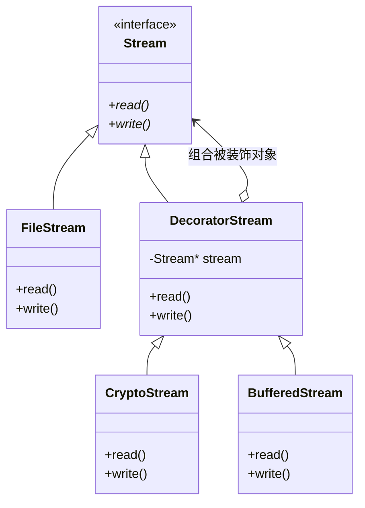

# 设计模式沉思录（第06讲）：装饰模式（Decorator Pattern）

> [!NOTE] 专栏导读
> 本文是 **《侯捷 C++ 设计模式沉思录》** 系列专栏的第 **06** 讲。
> - **上一讲**：[上一讲：第05讲 观察者模式（Observer Pattern）](file:///home/ubuntu/git/blog/src/content/posts/design-patterns-05-observer.md)
> - **下一讲**：[下一讲：第07讲 桥模式（Bridge Pattern）](file:///home/ubuntu/git/blog/src/content/posts/design-patterns-07-bridge.md)
> - **架构进阶**：[异构计算与 AI 编译器设计模式全景实践指南](file:///home/ubuntu/git/blog/src/content/posts/heterogeneous-computing-and-ai-compiler-design-patterns-guide.md)


## 一、模式概述

装饰模式属于**单一职责模式**类别（与桥模式 Bridge Pattern 同属此类）。单一职责模式关注的是：在软件组件设计过程中，如果责任划分不清晰，过度使用继承往往导致子类急剧膨胀，并充斥大量重复代码——这是两种典型的**代码坏味道 (Bad Smell)**。

装饰模式的核心动机：**动态地给对象增加职责（功能）**，在增加功能方面，装饰模式比生成子类（继承）更为灵活。

> **GOF 定义**：动态地给一个对象增加一些额外的职责。就增加功能而言，Decorator 模式比生成子类更为灵活。

---

## 二、设计场景：IO 流库

### 架构类图与时序关系




### 2.1 需求分析

设计一个 IO 流操作库，需要支持：

- **多种流类型**：文件流 (FileStream)、网络流 (NetworkStream)、内存流 (MemoryStream)
- **多种扩展操作**：加密 (Crypto)、缓冲 (Buffer) 等
- **操作组合**：对任意流进行任意组合的扩展操作（如既加密又缓冲）

### 2.2 版本一：问题设计（过度使用继承）

#### 设计思路

为每种流类型和操作组合都创建一个继承子类：

```
Stream (基类)
├── FileStream
│   ├── CryptoFileStream         (加密文件流)
│   ├── BufferedFileStream       (缓冲文件流)
│   └── CryptoBufferedFileStream (加密缓冲文件流)
├── NetworkStream
│   ├── CryptoNetworkStream
│   ├── BufferedNetworkStream
│   └── CryptoBufferedNetworkStream
└── MemoryStream
    ├── CryptoMemoryStream
    ├── BufferedMemoryStream
    └── CryptoBufferedMemoryStream
```

#### 问题分析

**1. 类数量爆炸**

设流类型有 `n` 种，扩展操作有 `m` 种，考虑操作的任意组合（包括同时使用多种操作），类的总数量为：

$$1 + n + n \times \frac{m!}{2}$$

当 `n=3, m=2` 时，已有 **13** 个类；当 `n=5, m=6` 时，类数量膨胀到**上百个**。

**2. 代码重复严重**

加密操作的代码在 `CryptoFileStream`、`CryptoNetworkStream`、`CryptoMemoryStream` 中**完全一样**，缓冲操作同理。这是典型的代码重复（Bad Smell），违反了 DRY 原则。

#### 代码示例（问题版本）

```cpp
#include <iostream>
using namespace std;

class Stream {
public:
    virtual ~Stream() = default;
    virtual void read() = 0;
    virtual void seek() = 0;
    virtual void write() = 0;
};

class FileStream : public Stream {
public:
    void read() override  { cout << "  读取文件流" << endl; }
    void seek() override  { cout << "  定位文件流" << endl; }
    void write() override { cout << "  写入文件流" << endl; }
};

class NetworkStream : public Stream {
public:
    void read() override  { cout << "  读取网络流" << endl; }
    void seek() override  { cout << "  定位网络流" << endl; }
    void write() override { cout << "  写入网络流" << endl; }
};

// 加密文件流 - 继承 FileStream
class CryptoFileStream : public FileStream {
public:
    void read() override {
        cout << "  [加密] 解密操作" << endl;  // 重复代码
        FileStream::read();
    }
    void seek() override {
        cout << "  [加密] 前处理" << endl;    // 重复代码
        FileStream::seek();
        cout << "  [加密] 后处理" << endl;    // 重复代码
    }
    void write() override {
        FileStream::write();
        cout << "  [加密] 加密操作" << endl;  // 重复代码
    }
};

// 加密网络流 - 继承 NetworkStream
// 加密操作的代码与 CryptoFileStream 完全一样！
class CryptoNetworkStream : public NetworkStream {
public:
    void read() override {
        cout << "  [加密] 解密操作" << endl;  // 重复代码
        NetworkStream::read();
    }
    void seek() override {
        cout << "  [加密] 前处理" << endl;    // 重复代码
        NetworkStream::seek();
        cout << "  [加密] 后处理" << endl;    // 重复代码
    }
    void write() override {
        NetworkStream::write();
        cout << "  [加密] 加密操作" << endl;  // 重复代码
    }
};
// 缓冲操作同理，每种流都要单独写一遍...
```

---

### 2.3 重构过程：从继承到组合

#### 第一步：识别重复点

`CryptoFileStream`、`CryptoNetworkStream`、`CryptoMemoryStream` 中，加密操作的代码完全一样，唯一不同的是调用的 `read()` 具体实现不同（一个是文件流的 read，一个是网络流的 read）。

#### 第二步：用组合替代继承

将继承关系改为组合关系——把具体的流对象作为成员字段：

```cpp
// 重构后：一个 CryptoStream 搞定所有流的加密
class CryptoStream : public Stream {
private:
    Stream* stream;  // 组合：运行时决定具体是哪种流
public:
    CryptoStream(Stream* s) : stream(s) {}

    void read() override {
        cout << "  [加密] 解密操作" << endl;
        stream->read();  // 委托给具体的流
    }
    // ...
};
```

关键变化：
- **编译时**：`CryptoStream` 的代码是统一的、可复用的
- **运行时**：通过传入不同的流对象（`FileStream`、`NetworkStream` 等），实现不同的行为

> 这就是设计模式的核心思想：**编译时复用代码，运行时通过多态支持变化。**

#### 第三步：提取 Decorator 中间基类

`CryptoStream` 和 `BufferedStream` 都有 `Stream* stream` 字段，根据重构原则"多个子类有相同字段时应往上提取"，设计 `DecoratorStream` 中间基类：

```cpp
class DecoratorStream : public Stream {
protected:
    Stream* stream;
public:
    DecoratorStream(Stream* s) : stream(s) {}
};
```

注意：不能把 `stream` 字段直接放到 `Stream` 基类中，因为 `FileStream` 等具体流（主体操作）不需要这个字段。

---

### 2.4 版本三：最终设计（装饰模式）

#### 类图结构

```
Stream (Component - 抽象基类)
├── FileStream (ConcreteComponent - 具体组件)
├── NetworkStream (ConcreteComponent)
├── MemoryStream (ConcreteComponent)
└── DecoratorStream (Decorator - 装饰器基类)
    ├── CryptoStream (ConcreteDecoratorA - 具体装饰器)
    └── BufferedStream (ConcreteDecoratorB - 具体装饰器)
```

- **红色（稳定部分）**：`Stream`、`DecoratorStream`
- **蓝色（变化部分）**：`FileStream`/`NetworkStream`/`MemoryStream`（流类型的变化）、`CryptoStream`/`BufferedStream`（扩展操作的变化）

#### 类数量对比

| 设计方式 | 类数量公式 | n=3, m=2 | n=5, m=6 |
|---------|-----------|----------|----------|
| 版本一（继承） | $1 + n + n \times \frac{m!}{2}$ | 13 | 上百个 |
| 版本三（装饰） | $1 + n + 1 + m$ | 7 | 13 |

#### 完整代码

```cpp
#include <iostream>
#include <string>
using namespace std;

// Component: 抽象流基类
class Stream {
public:
    virtual ~Stream() = default;
    virtual void read() = 0;
    virtual void seek() = 0;
    virtual void write() = 0;
};

// ConcreteComponent: 具体流实现
class FileStream : public Stream {
public:
    void read() override  { cout << "  读取文件流" << endl; }
    void seek() override  { cout << "  定位文件流" << endl; }
    void write() override { cout << "  写入文件流" << endl; }
};

class NetworkStream : public Stream {
public:
    void read() override  { cout << "  读取网络流" << endl; }
    void seek() override  { cout << "  定位网络流" << endl; }
    void write() override { cout << "  写入网络流" << endl; }
};

class MemoryStream : public Stream {
public:
    void read() override  { cout << "  读取内存流" << endl; }
    void seek() override  { cout << "  定位内存流" << endl; }
    void write() override { cout << "  写入内存流" << endl; }
};

// Decorator: 装饰器基类
// 关键特征：既继承 Stream（接口规范），又组合 Stream（实现委托）
class DecoratorStream : public Stream {
protected:
    Stream* stream;  // 组合：指向被装饰的对象
public:
    DecoratorStream(Stream* s) : stream(s) {}
};

// ConcreteDecoratorA: 加密装饰器
class CryptoStream : public DecoratorStream {
public:
    CryptoStream(Stream* s) : DecoratorStream(s) {}

    void read() override {
        cout << "  [加密] 解密操作" << endl;
        stream->read();
        cout << "  [加密] 后处理" << endl;
    }
    void seek() override {
        cout << "  [加密] 前处理" << endl;
        stream->seek();
        cout << "  [加密] 后处理" << endl;
    }
    void write() override {
        cout << "  [加密] 前处理" << endl;
        stream->write();
        cout << "  [加密] 加密操作" << endl;
    }
};

// ConcreteDecoratorB: 缓冲装饰器
class BufferedStream : public DecoratorStream {
public:
    BufferedStream(Stream* s) : DecoratorStream(s) {}

    void read() override {
        cout << "  [缓冲] 从缓冲区读取" << endl;
        stream->read();
    }
    void seek() override {
        cout << "  [缓冲] 清空缓冲区" << endl;
        stream->seek();
    }
    void write() override {
        stream->write();
        cout << "  [缓冲] 写入缓冲区" << endl;
    }
};

int main() {
    // 基本使用：单独的流
    cout << "--- 基本文件流 ---" << endl;
    FileStream fs;
    fs.read();

    // 运行时装配：加密文件流
    cout << "\n--- 加密文件流 ---" << endl;
    Stream* s1 = new FileStream();
    Stream* s2 = new CryptoStream(s1);
    s2->read();

    // 运行时装配：缓冲文件流
    cout << "\n--- 缓冲文件流 ---" << endl;
    Stream* s3 = new FileStream();
    Stream* s4 = new BufferedStream(s3);
    s4->read();

    // 运行时装配：加密 + 缓冲文件流（装饰器嵌套）
    cout << "\n--- 加密+缓冲文件流 ---" << endl;
    Stream* s5 = new FileStream();
    Stream* s6 = new CryptoStream(s5);    // 先加密
    Stream* s7 = new BufferedStream(s6);  // 再缓冲
    s7->read();

    // 不同组合顺序：缓冲 + 加密网络流
    cout << "\n--- 缓冲+加密网络流 ---" << endl;
    Stream* s8 = new NetworkStream();
    Stream* s9 = new BufferedStream(s8);  // 先缓冲
    Stream* s10 = new CryptoStream(s9);   // 再加密
    s10->read();

    // 释放内存
    delete s2; delete s1;
    delete s4; delete s3;
    delete s7; delete s6; delete s5;
    delete s10; delete s9; delete s8;

    return 0;
}
```

**运行输出**：
```
--- 基本文件流 ---
  读取文件流

--- 加密文件流 ---
  [加密] 解密操作
  读取文件流
  [加密] 后处理

--- 缓冲文件流 ---
  [缓冲] 从缓冲区读取
  读取文件流

--- 加密+缓冲文件流 ---
  [缓冲] 从缓冲区读取
  [加密] 解密操作
  读取文件流
  [加密] 后处理

--- 缓冲+加密网络流 ---
  [加密] 解密操作
  [缓冲] 从缓冲区读取
  读取网络流
  [加密] 后处理
```

---

## 三、运行时装配

装饰模式的核心优势之一是**运行时装配**，而非编译时静态确定：

```cpp
// 编译时：没有 CryptoFileStream、BufferedFileStream 这些类
// 运行时：通过组合方式动态装配

Stream* fs = new FileStream();                    // 创建文件流
Stream* cryptoFs = new CryptoStream(fs);          // 装配加密
Stream* bufferCryptoFs = new BufferedStream(cryptoFs); // 装配缓冲

// 效果等同于传统的 CryptoBufferedFileStream，但无需那个类
```

这种运行时装配的灵活性使得：
- 可以任意组合扩展功能
- 可以动态调整装饰顺序
- 新增装饰器不影响已有代码

---

## 四、核心要点总结

### 4.1 设计原则

| 原则 | 说明 |
|------|------|
| **组合优于继承** | 用组合替代继承来扩展功能，避免类爆炸 |
| **开闭原则** | 新增扩展操作（如加密）只需新增装饰器类，无需修改已有类 |
| **单一职责** | 主体操作（流类型）和扩展操作（加密/缓冲）分离到不同分支 |

### 4.2 Decorator 类的独特特征

`DecoratorStream` 类同时具有两种关系：

- **is-a 关系**（继承 `Stream`）：完善接口规范，使装饰器可以被当作流来使用
- **has-a 关系**（组合 `Stream` 字段）：持有被装饰对象的引用，支持实现委托

> **识别技巧**：如果你看到一个类，它的父类是 `X`，内部又有一个 `X*` 类型的字段，那它 99% 是装饰模式。

### 4.3 静态特质 vs 动态特质

| 特质 | 实现方式 | 灵活性 |
|------|---------|--------|
| **静态特质** | 继承（编译时确定调用哪个基类的方法） | 低，定死了调用关系 |
| **动态特质** | 组合 + 多态（运行时通过指针调用虚函数） | 高，支持运行时变化 |

版本一中的 `FileStream::read()` 是静态特质——编译时就绑定了调用目标；版本三中的 `stream->read()` 是动态特质——运行时才确定调用哪个流的 `read()`。

### 4.4 适用场景

- 需要**在不影响其他对象的情况下**，动态地给单个对象添加职责
- 需要**撤销**已添加的职责（去掉一层装饰即可）
- 扩展功能有**多种组合**，用继承会导致类数量爆炸
- 主体类有**多个扩展方向**（如流类型是一个方向，加密/缓冲是另一个方向）

### 4.5 与其他模式的关系

- **与桥模式 (Bridge)**：同属单一职责模式，都关注将不同变化方向分离
- **与代理模式 (Proxy)**：结构相似（都持有目标对象引用），但意图不同——代理控制访问，装饰增加功能
- **与适配器模式 (Adapter)**：适配器改变接口，装饰器保持接口不变

---

## 五、补充知识

### 5.1 经典参考

- **《设计模式：可复用面向对象软件的基础》** (GOF, 1994)：Decorator 模式的原始定义
- **《重构：改善既有代码的设计》** (Martin Fowler, 1999)：识别代码坏味道和重构技巧
- 设计原则：**Prefer Composition over Inheritance**（组合优于继承）

### 5.2 实际应用

装饰模式在实际项目中非常常见：

- **Java I/O 库**：`InputStream` → `FileInputStream` → `BufferedInputStream` → `DataInputStream`，层层装饰
- **Python 装饰器语法**：`@decorator` 语法糖本质上就是装饰模式的函数式应用
- **C++ 中的智能指针**：`std::shared_ptr` 在原始指针基础上增加了引用计数等功能

### 5.3 注意事项

- 装饰器的顺序可能影响最终行为（先加密再缓冲 vs 先缓冲再加密）
- 使用裸指针时需注意内存管理，实际项目中建议使用智能指针
- 装饰器不应改变组件的接口，否则违反透明性原则


---

## 专栏导航与全景索引

- [上一讲：第05讲 观察者模式（Observer Pattern）](file:///home/ubuntu/git/blog/src/content/posts/design-patterns-05-observer.md)
- [下一讲：第07讲 桥模式（Bridge Pattern）](file:///home/ubuntu/git/blog/src/content/posts/design-patterns-07-bridge.md)
- 架构进阶：[异构计算与 AI 编译器设计模式全景实践指南](file:///home/ubuntu/git/blog/src/content/posts/heterogeneous-computing-and-ai-compiler-design-patterns-guide.md)
