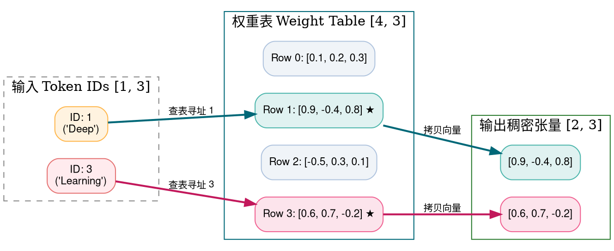
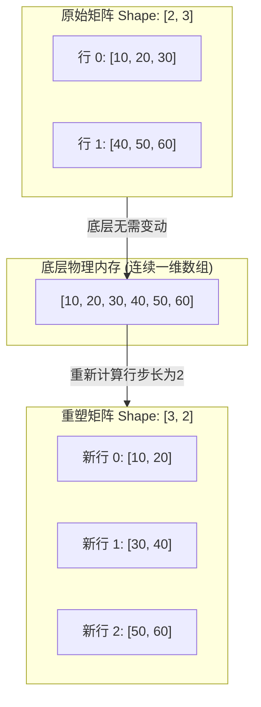
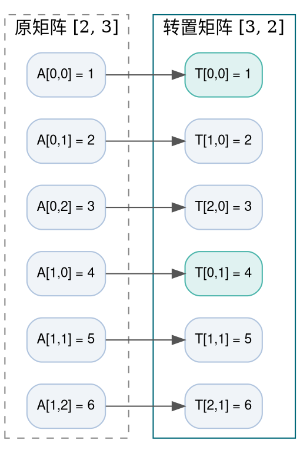
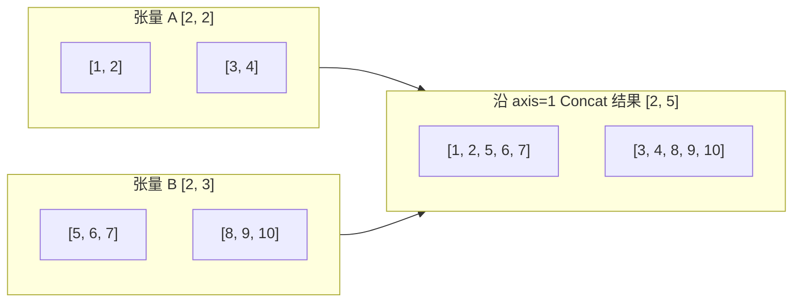
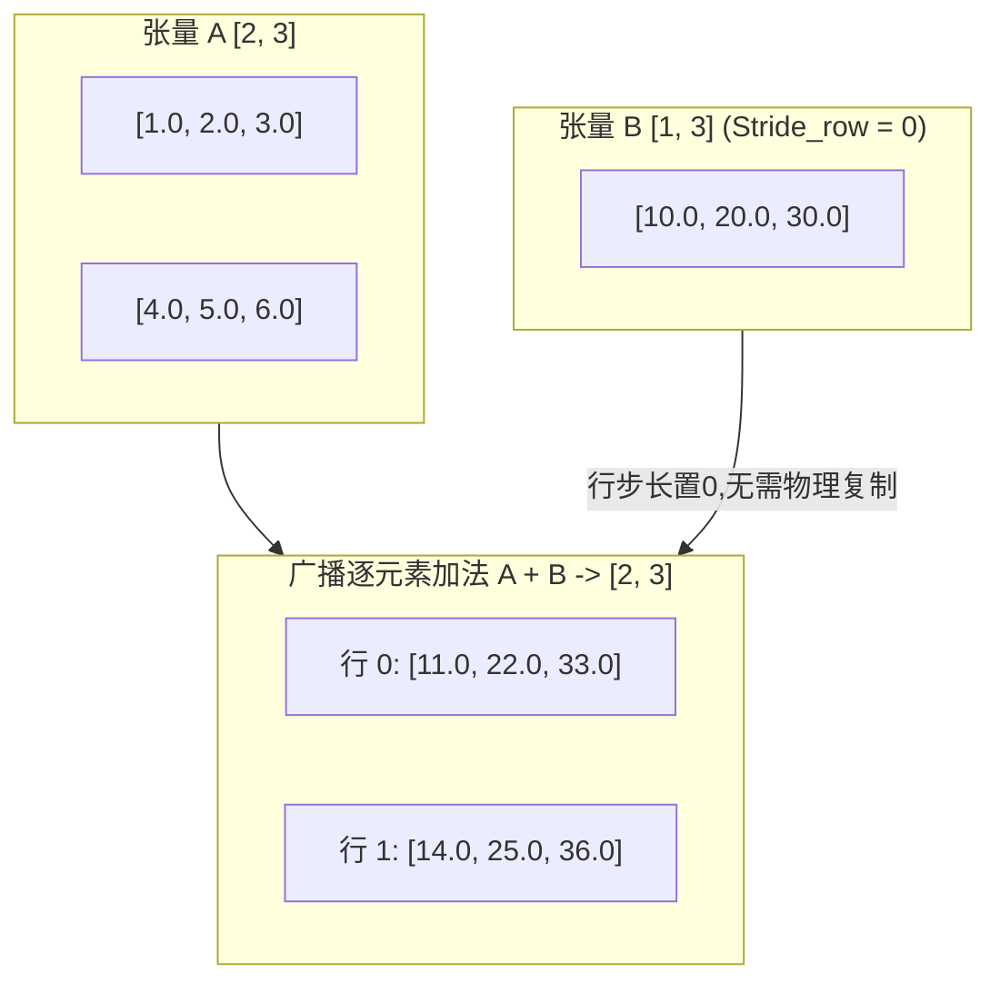
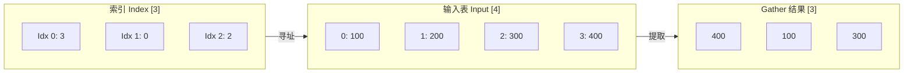

> **导读**：在深入深度学习的高阶模型（如 Transformer、GPT、LLaMA、ResNet）之前，90% 的性能瓶颈和“难以理解的诡异 Bug”并非来自微积分或优化算法，而是源于最底层的**物理内存排布与数据搬运**。
>
> 很多初学者常产生一个误解：以为张量（Tensor）在计算机硬件中真的就像多维立方体一样漂浮在空间里。其实，**物理内存永远是一维连续的线性字节数组**。所谓的多维张量，只是程序员和编译器根据**形状（Shape）**与**步长（Stride）**在脑海与数学中构建的虚拟投影！
>
> 本篇作为《深度学习底层算子从零到一》系列的第一讲，将彻底揭开张量在内存中的底层密码，逐一拆解 11 个经典张量与内存操作算子。所有算子均配有生动的初学者名词释义、Graphviz/Mermaid 架构图，以及**可直接在浏览器中运行的原生 Python 与 C++ 朴素实现**（不依赖任何第三方重量级库）。

---

## 零、初学者核心概念速查：张量、步长与连续性

在阅读具体算子前，请先掌握以下贯穿整个深度学习底层栈的核心基石：

> [!NOTE] 核心概念形象字典
>
> - **张量（Tensor）**：多维数组的数学统称。0维叫标量（Scalar，单个数值），1维叫向量（Vector，一行数），2维叫矩阵（Matrix，一张表格），3维及以上称为高维张量。
> - **物理内存（Physical RAM）**：一串从低地址连续编号到高地址的线性平铺空间，本质上只有一维，任何多维数据最终都必须“排成一列纵队”保存在里面。
> - **行优先排布（Row-Major）**：C/C++ 与 Python（NumPy/PyTorch）默认的张量内存平铺规则。即**最右侧的维度在内存中是连续相邻的**；遍历时，最右边的索引跑得最快，最左边的索引跑得最慢。
> - **步长（Stride）**：在某个维度上移动 1 步时，在底层一维线性内存中跳跃跨过的元素个数。例如一个 $2 \times 3$ 的矩阵，在行维度移动 1 步，需要跳过整整一行（3个元素），因此行步长为 3；列步长为 1。
> - **连续内存（Contiguous Memory）**：张量在底层平铺的物理地址区间中间没有空隙，且各维度的物理排布顺序与逻辑维度严格递进吻合。
> - **零拷贝（Zero-Copy） / 视图（View）**：不真正复制底层数据，仅改变描述这块内存的元数据（如 Shape、Stride），实现超高效率的“移花接木”。
> - **广播机制（Broadcasting）**：当两个形状不同的张量进行算术运算时，在不实际复制拷贝数据的前提下，通过将某一维度的步长（Stride）设为 0，使硬件在逻辑上自动“扩展”维度的黑科技。

```mermaid
graph LR
    subgraph Logical["逻辑三维视角 Shape [2, 2, 3]"]
        A["批次 0, 行 0: [0, 1, 2]"]
        B["批次 0, 行 1: [3, 4, 5]"]
        C["批次 1, 行 0: [6, 7, 8]"]
        D["批次 1, 行 1: [9, 10, 11]"]
    end
    subgraph Physical["物理一维线性内存 (Row-Major 平铺)"]
        M["[0, 1, 2, 3, 4, 5, 6, 7, 8, 9, 10, 11]"]
    end
    Logical -->|Stride = (6, 3, 1)| Physical
```

---

## 1. Embedding (词嵌入查表)

### 1.1 原理解析
在自然语言处理（NLP）中，模型无法直接阅读文本字符串。文本会首先被分词器（Tokenizer）转换成离散的整数编号（Token ID，如“你”=101，“好”=102）。
**Embedding 算子**本质上就是一个高效的**二维矩阵查表器（Lookup Table）**：
- 输入为一个包含离散整型 ID 的张量，形状为 $[B, S]$（Batch 批次大小，Sequence 序列长度）。
- 权重矩阵为 Embedding Table，形状为 $[V, D]$（$V$ 为词表大小 Vocabulary Size，$D$ 为隐藏层特征维度 Hidden Dimension）。
- 算子根据每个输入的 ID $i$，直接抽取权重表中的第 $i$ 行（长度为 $D$ 的稠密连续向量）作为输出，输出张量形状变为 $[B, S, D]$。



### 1.2 原生 Python 实现
```python
def naive_embedding(indices: list[int], weight: list[list[float]]) -> list[list[float]]:
    """原生纯 Python 朴素 Embedding 查表实现
    :param indices: 离散整数索引列表，长度为 N
    :param weight: 词表权重矩阵，形状为 [V, D]
    :return: 查表提取出的嵌入向量集合，形状为 [N, D]
    """
    vocab_size = len(weight)
    dim = len(weight[0])
    output = []
    
    for idx in indices:
        if idx < 0 or idx >= vocab_size:
            raise IndexError(f"Token ID {idx} 超出词表范围 [0, {vocab_size - 1}]")
        # 查表复制对应行的隐藏维度切片
        output.append(weight[idx].copy())
    return output

if __name__ == "__main__":
    # 定义简单的词表权重 (V=4, D=3)
    embed_table = [
        [0.1, 0.2, 0.3],     # ID 0
        [0.9, -0.4, 0.8],    # ID 1
        [-0.5, 0.3, 0.1],    # ID 2
        [0.6, 0.7, -0.2]     # ID 3
    ]
    tokens = [1, 3, 0, 1]
    res = naive_embedding(tokens, embed_table)
    print("Embedding 输出结果 (共 4 个 Token，每个维度 3):")
    for r in res:
        print(f"  {r}")
```

### 1.3 原生 C++ 实现
```cpp
#include <iostream>
#include <vector>
#include <iomanip>

int main() {
    // 词表大小 V=4, 嵌入维度 D=3
    constexpr int V = 4;
    constexpr int D = 3;
    const float embed_table[V][D] = {
        {0.1f, 0.2f, 0.3f},
        {0.9f, -0.4f, 0.8f},
        {-0.5f, 0.3f, 0.1f},
        {0.6f, 0.7f, -0.2f}
    };

    const int input_ids[] = {1, 3, 0, 1};
    constexpr int N = 4;

    std::cout << "=== 原生 C++ Embedding 查表输出 ===" << std::endl;
    for (int i = 0; i < N; ++i) {
        int id = input_ids[i];
        std::cout << "Token ID " << id << " -> [";
        for (int d = 0; d < D; ++d) {
            std::cout << std::fixed << std::setprecision(1) << embed_table[id][d] << (d + 1 < D ? ", " : "");
        }
        std::cout << "]" << std::endl;
    }
    return 0;
}
```

---

## 2. Reshape / View (视图变换)

### 2.1 原理解析
- **Reshape / View 的本质**：改变张量的逻辑形状，但**总元素数量必须完全一致**（即 $\prod \text{old\_shape} = \prod \text{new\_shape}$）。
- **View（零拷贝视图）**：如果底层物理内存是连续的（Contiguous），仅需修改张量头信息中的 Shape 和 Stride，底层一维数据完全不发生任何内存搬移，时间复杂度为 $O(1)$。
- **Reshape**：如果张量经过转置后物理内存已经不连续，Reshape 内部会先触发一次底层数据复制（Contiguous 操作），再生成新视图。

$$ \text{一维平铺索引} = \sum_{i=0}^{N-1} (\text{coord}_i \times \text{stride}_i) $$



### 2.2 原生 Python 实现
```python
def naive_reshape(data: list[float], old_shape: tuple[int, ...], new_shape: tuple[int, ...]) -> list:
    """计算连续内存视图变换 (支持 -1 自动推导维度)"""
    # 统计元素总数
    total_elements = len(data)
    
    # 解析 new_shape 中的 -1
    inferred_shape = list(new_shape)
    if -1 in inferred_shape:
        neg_count = inferred_shape.count(-1)
        if neg_count > 1:
            raise ValueError("new_shape 中最多只能有一个 -1 维度")
        idx = inferred_shape.index(-1)
        known_prod = 1
        for s in inferred_shape:
            if s != -1:
                known_prod *= s
        inferred_shape[idx] = total_elements // known_prod

    # 验证新旧容量是否严格相等
    new_prod = 1
    for s in inferred_shape:
        new_prod *= s
    if new_prod != total_elements:
        raise ValueError(f"元素总数不匹配: 原数据 {total_elements} 个, 新形状乘积为 {new_prod}")

    # 将一维数据嵌套重组成新形状的多维结构
    def build_nested(flat_list, dims):
        if len(dims) == 1:
            return flat_list[:dims[0]]
        step = len(flat_list) // dims[0]
        return [build_nested(flat_list[i*step : (i+1)*step], dims[1:]) for i in range(dims[0])]

    return build_nested(data, inferred_shape)

if __name__ == "__main__":
    flat_data = [1, 2, 3, 4, 5, 6]
    reshaped_3x2 = naive_reshape(flat_data, (6,), (3, 2))
    print("Reshape 结果 (3x2):", reshaped_3x2)
    reshaped_auto = naive_reshape(flat_data, (6,), (2, -1))
    print("Reshape 自动推导 (2x-1 -> 2x3):", reshaped_auto)
```

### 2.3 原生 C++ 实现
```cpp
#include <iostream>
#include <vector>

// 步长计算工具：从 Shape 计算 Row-Major 连续步长
std::vector<int> compute_strides(const std::vector<int>& shape) {
    std::vector<int> strides(shape.size());
    int stride = 1;
    for (int i = static_cast<int>(shape.size()) - 1; i >= 0; --i) {
        strides[i] = stride;
        stride *= shape[i];
    }
    return strides;
}

int main() {
    // 物理内存一维数组
    const float raw_memory[] = {10.f, 20.f, 30.f, 40.f, 50.f, 60.f};

    // 逻辑 Shape 由 [2, 3] Reshape 为 [3, 2]
    std::vector<int> new_shape = {3, 2};
    std::vector<int> new_strides = compute_strides(new_shape);

    std::cout << "=== 原生 C++ 步长重映射与 Reshape 访问 ===" << std::endl;
    for (int r = 0; r < new_shape[0]; ++r) {
        std::cout << "行 " << r << ": [";
        for (int c = 0; c < new_shape[1]; ++c) {
            // 一维线性内存偏移计算: offset = r * stride[0] + c * stride[1]
            int flat_index = r * new_strides[0] + c * new_strides[1];
            std::cout << raw_memory[flat_index] << (c + 1 < new_shape[1] ? ", " : "");
        }
        std::cout << "]" << std::endl;
    }
    return 0;
}
```

---

## 3. Transpose / Permute (维度交换)

### 3.1 原理解析
- **Transpose（二维转置）**：交换矩阵的行和列，$A^T[j, i] = A[i, j]$。
- **Permute（高维置换）**：将任意多维张量的维度轴进行重新排列。例如将图像从 PyTorch 的 NCHW 格式转换为 TensorFlow 的 NHWC 格式，对应的 permute 轴序列为 `(0, 2, 3, 1)`。
- **物理陷阱**：单纯修改步长（Stride）可以实现虚拟转置，但此时内存变得**非连续（Non-contiguous）**；若要使下游算子享受向量化读写，必须在物理内存中进行真实的元素搬运（物理重排）。



### 3.2 原生 Python 实现
```python
def naive_transpose_2d(matrix: list[list[float]]) -> list[list[float]]:
    """二维矩阵转置"""
    rows = len(matrix)
    cols = len(matrix[0])
    transposed = [[0.0] * rows for _ in range(cols)]
    for r in range(rows):
        for c in range(cols):
            transposed[c][r] = matrix[r][c]
    return transposed

def naive_permute(data: list[float], shape: list[int], dims_order: list[int]) -> tuple[list[float], list[int]]:
    """高维张量物理置换 (支持任意维度)"""
    ndim = len(shape)
    new_shape = [shape[d] for d in dims_order]
    
    # 计算原形状和新形状的一维步长
    def get_strides(s):
        st = [1] * len(s)
        for i in range(len(s) - 2, -1, -1):
            st[i] = st[i + 1] * s[i + 1]
        return st

    old_strides = get_strides(shape)
    new_strides = get_strides(new_shape)
    
    total = len(data)
    output = [0.0] * total

    # 遍历原物理平铺数组，根据多维坐标映射到新物理数组
    for old_flat_idx in range(total):
        # 拆解原多维坐标
        temp = old_flat_idx
        old_coords = [0] * ndim
        for d in range(ndim):
            old_coords[d] = temp // old_strides[d]
            temp %= old_strides[d]
        
        # 根据 dims_order 置换坐标
        new_coords = [old_coords[d] for d in dims_order]
        
        # 计算新的一维索引
        new_flat_idx = sum(new_coords[d] * new_strides[d] for d in range(ndim))
        output[new_flat_idx] = data[old_flat_idx]

    return output, new_shape

if __name__ == "__main__":
    mat = [
        [1.0, 2.0, 3.0],
        [4.0, 5.0, 6.0]
    ]
    t = naive_transpose_2d(mat)
    print("2D 转置后结果 (3x2):")
    for row in t:
        print(f"  {row}")
```

### 3.3 原生 C++ 实现
```cpp
#include <iostream>
#include <vector>

int main() {
    constexpr int R = 2;
    constexpr int C = 3;
    const float input[R][C] = {
        {1.0f, 2.0f, 3.0f},
        {4.0f, 5.0f, 6.0f}
    };
    float transposed[C][R];

    for (int r = 0; r < R; ++r) {
        for (int c = 0; c < C; ++c) {
            transposed[c][r] = input[r][c];
        }
    }

    std::cout << "=== 原生 C++ 2D 转置验证 ===" << std::endl;
    for (int c = 0; c < C; ++c) {
        std::cout << "新行 " << c << ": [";
        for (int r = 0; r < R; ++r) {
            std::cout << transposed[c][r] << (r + 1 < R ? ", " : "");
        }
        std::cout << "]" << std::endl;
    }
    return 0;
}
```

---

## 4. Concat (沿轴拼接)

### 4.1 原理解析
- **定义**：将两个或多个在**除拼接轴以外其他所有维度尺寸都完全相同**的张量，沿着指定维度缝合成一个大张量。
- **示例**：张量 $A$ 为 $[2, 3]$，张量 $B$ 为 $[2, 5]$，沿着列维度（$\text{axis}=1$）拼接后，输出张量形状为 $[2, 3+5] = [2, 8]$。
- **内存搬移机理**：拼接涉及重新开辟一块更大的连续内存空间，需要将各源张量的数据块按步长交替拷贝写入对应槽位。



### 4.2 原生 Python 实现
```python
def naive_concat(tensors: list[list[list[float]]], axis: int) -> list[list[float]]:
    """二维张量沿指定轴拼接 (axis=0 垂直拼接, axis=1 水平拼接)"""
    if not tensors:
        return []
    if axis == 0:
        # 沿着行维度堆叠，直接首尾相接
        out = []
        for t in tensors:
            for row in t:
                out.append(row.copy())
        return out
    elif axis == 1:
        # 沿着列维度横向缝合
        rows = len(tensors[0])
        out = [[] for _ in range(rows)]
        for r in range(rows):
            for t in tensors:
                out[r].extend(t[r])
        return out
    else:
        raise ValueError("示例仅支持 axis=0 或 axis=1")

if __name__ == "__main__":
    t1 = [[1.0, 2.0], [3.0, 4.0]]
    t2 = [[5.0, 6.0, 7.0], [8.0, 9.0, 10.0]]
    cat_axis1 = naive_concat([t1, t2], axis=1)
    print("Concat (axis=1 水平拼接 2x2 与 2x3 -> 2x5):")
    for r in cat_axis1:
        print(f"  {r}")
```

### 4.3 原生 C++ 实现
```cpp
#include <iostream>
#include <vector>

int main() {
    // 两个输入矩阵：A 为 2x2，B 为 2x3
    constexpr int R = 2;
    constexpr int C_A = 2;
    constexpr int C_B = 3;
    constexpr int C_OUT = C_A + C_B;

    const float A[R][C_A] = {{1.0f, 2.0f}, {3.0f, 4.0f}};
    const float B[R][C_B] = {{5.0f, 6.0f, 7.0f}, {8.0f, 9.0f, 10.0f}};
    float OUT[R][C_OUT];

    // 水平缝合
    for (int r = 0; r < R; ++r) {
        for (int c = 0; c < C_A; ++c) {
            OUT[r][c] = A[r][c];
        }
        for (int c = 0; c < C_B; ++c) {
            OUT[r][C_A + c] = B[r][c];
        }
    }

    std::cout << "=== 原生 C++ Concat (axis=1) 结果 ===" << std::endl;
    for (int r = 0; r < R; ++r) {
        std::cout << "行 " << r << ": [";
        for (int c = 0; c < C_OUT; ++c) {
            std::cout << OUT[r][c] << (c + 1 < C_OUT ? ", " : "");
        }
        std::cout << "]" << std::endl;
    }
    return 0;
}
```

---

## 5. Split / Chunk (切分)

### 5.1 原理解析
- **Chunk（均分）**：给定分块数量 $K$ 或每个块的目标大小，尽可能将张量沿指定轴均匀分成若干子张量（最后一块可能会稍短）。
- **Split（指定长度切分）**：传入一个具体的长度列表（如 `[2, 3, 5]`），严格按指定的尺寸切开。
- **与 Concat 的对偶性**：Split 是 Concat 的逆操作，常用于将注意力机制中的多头特征合并矩阵（$QKV$ 投影）拆解为独立的 $Q$、$K$、$V$。

### 5.2 原生 Python 实现
```python
def naive_chunk(data: list[float], num_chunks: int) -> list[list[float]]:
    """将一维数组切分成 num_chunks 份"""
    total = len(data)
    chunk_size = (total + num_chunks - 1) // num_chunks
    chunks = []
    for i in range(0, total, chunk_size):
        chunks.append(data[i : i + chunk_size])
    return chunks

if __name__ == "__main__":
    raw = [10, 20, 30, 40, 50, 60, 70, 80]
    chunks = naive_chunk(raw, 3)
    print("将 8 个元素分入 3 个 Chunk:")
    for idx, c in enumerate(chunks):
        print(f"  Chunk {idx}: {c}")
```

### 5.3 原生 C++ 实现
```cpp
#include <iostream>
#include <vector>

int main() {
    const int data[] = {10, 20, 30, 40, 50, 60, 70, 80};
    constexpr int total = 8;
    constexpr int num_chunks = 3;
    int chunk_size = (total + num_chunks - 1) / num_chunks;

    std::cout << "=== 原生 C++ Chunk 均分输出 ===" << std::endl;
    for (int i = 0; i < total; i += chunk_size) {
        int end = (i + chunk_size < total) ? (i + chunk_size) : total;
        std::cout << "Chunk [";
        for (int j = i; j < end; ++j) {
            std::cout << data[j] << (j + 1 < end ? ", " : "");
        }
        std::cout << "]" << std::endl;
    }
    return 0;
}
```

---

## 6. Slice (切片与步进)

### 6.1 原理解析
- **三元组参数**：$[start : stop : step]$。
- **多维寻址公式**：对于二维矩阵 $A$，切片 $A[r_0:r_1, c_0:c_1]$ 的元素在底层内存中的一维地址映射公式为：
  $$ \text{offset} = (r_0 + i \times step_r) \times stride_0 + (c_0 + j \times step_c) \times stride_1 $$

### 6.2 原生 Python 实现
```python
def naive_slice_2d(matrix: list[list[float]], row_range: tuple[int, int], col_range: tuple[int, int]) -> list[list[float]]:
    """提取二维矩阵的指定子窗口切片"""
    r_start, r_end = row_range
    c_start, c_end = col_range
    sub_matrix = []
    for r in range(r_start, r_end):
        sub_matrix.append(matrix[r][c_start:c_end])
    return sub_matrix

if __name__ == "__main__":
    matrix = [
        [1, 2, 3, 4],
        [5, 6, 7, 8],
        [9, 10, 11, 12]
    ]
    sliced = naive_slice_2d(matrix, (0, 2), (1, 3))
    print("切片提取 matrix[0:2, 1:3]:")
    for r in sliced:
        print(f"  {r}")
```

### 6.3 原生 C++ 实现
```cpp
#include <iostream>

int main() {
    constexpr int R = 3;
    constexpr int C = 4;
    const int mat[R][C] = {
        {1, 2, 3, 4},
        {5, 6, 7, 8},
        {9, 10, 11, 12}
    };

    // 切片范围：行 [0, 2)，列 [1, 3)
    int r_start = 0, r_end = 2;
    int c_start = 1, c_end = 3;

    std::cout << "=== 原生 C++ 2D 切片提取 ===" << std::endl;
    for (int r = r_start; r < r_end; ++r) {
        std::cout << "[";
        for (int c = c_start; c < c_end; ++c) {
            std::cout << mat[r][c] << (c + 1 < c_end ? ", " : "");
        }
        std::cout << "]" << std::endl;
    }
    return 0;
}
```

---

## 7. Broadcast (广播机制)

### 7.1 原理解析
当对两个形状不同的张量进行逐元素运算（如相加）时，如果每次都要把较小的张量拷贝扩展成大张量，显存将发生巨大浪费。
**广播法则（Broadcasting Rules）**：
1. **右对齐比较**：从最右侧维度（最后一个轴）开始向左依次逐维核对。
2. **兼容条件**：在某个维度上，两者的尺寸要么**完全相等**，要么**其中一个必须为 1**。若不满足则报错。
3. **Stride=0 的魔法**：对于尺寸为 1 的那个维度，系统并不复制任何数据，而是将其对应维度的**步长（Stride）直接置为 0**！这意味着无论外层索引循环递增多少次，底层寻址乘以步长 0 始终读取同一个内存地址，实现了“零开销虚拟扩展”！



### 7.2 原生 Python 实现
```python
def naive_broadcast_add_2d(matrix: list[list[float]], bias: list[float]) -> list[list[float]]:
    """模拟 [M, N] 矩阵与 [1, N] 向量的步长置零广播加法"""
    M = len(matrix)
    N = len(matrix[0])
    if len(bias) != N:
        raise ValueError("维度无法对齐广播")
    
    out = [[0.0] * N for _ in range(M)]
    # 模拟 bias 的行步长 stride_row = 0
    stride_row = 0
    stride_col = 1
    
    for r in range(M):
        for c in range(N):
            # 无论 r 是多少，r * stride_row 永远为 0
            bias_offset = r * stride_row + c * stride_col
            out[r][c] = matrix[r][c] + bias[bias_offset]
    return out

if __name__ == "__main__":
    mat = [
        [1.0, 2.0, 3.0],
        [4.0, 5.0, 6.0]
    ]
    bias_vec = [10.0, 20.0, 30.0]
    res = naive_broadcast_add_2d(mat, bias_vec)
    print("广播加法输出 [2, 3]:")
    for row in res:
        print(f"  {row}")
```

### 7.3 原生 C++ 实现
```cpp
#include <iostream>

int main() {
    constexpr int M = 2;
    constexpr int N = 3;
    const float A[M][N] = {
        {1.0f, 2.0f, 3.0f},
        {4.0f, 5.0f, 6.0f}
    };
    const float B[N] = {10.0f, 20.0f, 30.0f}; // Shape: [1, 3]
    float C[M][N];

    // 核心：B 的行步长为 0
    constexpr int b_row_stride = 0;
    constexpr int b_col_stride = 1;

    for (int r = 0; r < M; ++r) {
        for (int c = 0; c < N; ++c) {
            int b_idx = r * b_row_stride + c * b_col_stride;
            C[r][c] = A[r][c] + B[b_idx];
        }
    }

    std::cout << "=== 原生 C++ Stride=0 广播加法结果 ===" << std::endl;
    for (int r = 0; r < M; ++r) {
        std::cout << "行 " << r << ": [";
        for (int c = 0; c < N; ++c) {
            std::cout << C[r][c] << (c + 1 < N ? ", " : "");
        }
        std::cout << "]" << std::endl;
    }
    return 0;
}
```

---

## 8. Gather / Scatter (索引寻址)

### 8.1 原理解析
- **Gather（收集）**：根据提供的索引矩阵 `index`，从输入张量中挑选出指定位置的数值，输出与 `index` 形状相同的新张量。
  $$ \text{output}[i][j] = \text{input}[\text{index}[i][j]][j] \quad (\text{若 } \text{dim}=0) $$
- **Scatter（打散写入 / 累加）**：Gather 的对偶操作。根据 `index`，将源张量 `src` 中的数据写入到目标张量的对应槽位中。若遇到相同索引位置，通常选择累加（Scatter Add）或覆写。



### 8.2 原生 Python 实现
```python
def naive_gather_1d(input_tensor: list[float], indices: list[int]) -> list[float]:
    """1D Gather: output[i] = input[indices[i]]"""
    return [input_tensor[idx] for idx in indices]

def naive_scatter_add_1d(target_size: int, indices: list[int], src: list[float]) -> list[float]:
    """1D Scatter Add: target[indices[i]] += src[i]"""
    target = [0.0] * target_size
    for idx, val in zip(indices, src):
        target[idx] += val
    return target

if __name__ == "__main__":
    table = [100.0, 200.0, 300.0, 400.0]
    idxs = [3, 0, 2, 3]
    gathered = naive_gather_1d(table, idxs)
    print("Gather 收集输出:", gathered)
    scattered = naive_scatter_add_1d(4, idxs, [1.0, 2.0, 3.0, 4.0])
    print("Scatter Add 累加输出:", scattered)
```

### 8.3 原生 C++ 实现
```cpp
#include <iostream>
#include <vector>

int main() {
    const float input_tensor[] = {100.f, 200.f, 300.f, 400.f};
    const int indices[] = {3, 0, 2, 3};
    constexpr int N = 4;
    float gathered[N];

    // Gather 操作
    for (int i = 0; i < N; ++i) {
        gathered[i] = input_tensor[indices[i]];
    }

    std::cout << "=== 原生 C++ Gather 验证 ===" << std::endl;
    for (int i = 0; i < N; ++i) {
        std::cout << "gathered[" << i << "] = " << gathered[i] << std::endl;
    }
    return 0;
}
```

---

## 9. MaskedFill / Where (条件掩码)

### 9.1 原理解析
- **MaskedFill**：根据一个布尔掩码（Mask）张量，当 `mask[i] == True` 时，将当前位置的值替换为特定的填充值（在因果注意力机制中，未来位置通常填充为 $-\infty$ 或 $-1e9$）。
- **Where（三元选择）**：$C = \text{where}(cond, A, B)$。当条件为真时选 $A$，否则选 $B$。

### 9.2 原生 Python 实现
```python
def naive_masked_fill(data: list[list[float]], mask: list[list[bool]], fill_value: float) -> list[list[float]]:
    """布尔掩码填充"""
    R = len(data)
    C = len(data[0])
    out = [[0.0] * C for _ in range(R)]
    for r in range(R):
        for c in range(C):
            out[r][c] = fill_value if mask[r][c] else data[r][c]
    return out

if __name__ == "__main__":
    scores = [
        [1.2, 0.5, 0.8],
        [0.4, 2.1, 1.7]
    ]
    # 模拟未来时序掩码
    causal_mask = [
        [False, True, True],
        [False, False, True]
    ]
    masked = naive_masked_fill(scores, causal_mask, -1e9)
    print("因果掩码 MaskedFill 输出:")
    for r in masked:
        print(f"  {r}")
```

### 9.3 原生 C++ 实现
```cpp
#include <iostream>

int main() {
    constexpr int R = 2;
    constexpr int C = 3;
    const float scores[R][C] = {
        {1.2f, 0.5f, 0.8f},
        {0.4f, 2.1f, 1.7f}
    };
    const bool mask[R][C] = {
        {false, true, true},
        {false, false, true}
    };
    constexpr float NEG_INF = -1e9f;
    float out[R][C];

    for (int r = 0; r < R; ++r) {
        for (int c = 0; c < C; ++c) {
            out[r][c] = mask[r][c] ? NEG_INF : scores[r][c];
        }
    }

    std::cout << "=== 原生 C++ MaskedFill 输出 ===" << std::endl;
    for (int r = 0; r < R; ++r) {
        std::cout << "[";
        for (int c = 0; c < C; ++c) {
            std::cout << out[r][c] << (c + 1 < C ? ", " : "");
        }
        std::cout << "]" << std::endl;
    }
    return 0;
}
```

---

## 10. Pad (边缘填充) 与 11. Crop (边界裁剪)

### 10.1 原理解析
- **Pad（填充）**：在图像或序列张量外围包裹一圈数值（常数 0、镜像反射或边缘值），以便卷积核能够对图像最外围像素进行无损滑动覆盖。
- **Crop（裁剪）**：截取张量的子矩阵窗口，舍弃边缘冗余边框。

```mermaid
graph TD
    subgraph Original["原始图像 [2, 2]"]
        O0["[1, 2]"]
        O1["[3, 4]"]
    end
    subgraph Padded["Constant Pad (四周补0) [4, 4]"]
        P0["[0, 0, 0, 0]"]
        P1["[0, 1, 2, 0]"]
        P2["[0, 3, 4, 0]"]
        P3["[0, 0, 0, 0]"]
    end
    subgraph Cropped["Crop 中心裁剪 [2, 2]"]
        C0["[1, 2]"]
        C1["[3, 4]"]
    end
    Original -->|Pad (pad=1)| Padded
    Padded -->|Crop (start=1, size=2)| Cropped
```

### 10.2 原生 Python 实现
```python
def naive_pad_2d(matrix: list[list[float]], pad_top: int, pad_bottom: int, pad_left: int, pad_right: int, val: float = 0.0) -> list[list[float]]:
    """二维常数填充"""
    in_h = len(matrix)
    in_w = len(matrix[0])
    out_h = in_h + pad_top + pad_bottom
    out_w = in_w + pad_left + pad_right
    
    padded = [[val] * out_w for _ in range(out_h)]
    for r in range(in_h):
        for c in range(in_w):
            padded[pad_top + r][pad_left + c] = matrix[r][c]
    return padded

def naive_crop_2d(matrix: list[list[float]], start_h: int, start_w: int, crop_h: int, crop_w: int) -> list[list[float]]:
    """二维裁剪"""
    cropped = []
    for r in range(start_h, start_h + crop_h):
        cropped.append(matrix[r][start_w : start_w + crop_w])
    return cropped

if __name__ == "__main__":
    img = [[1.0, 2.0], [3.0, 4.0]]
    pad_img = naive_pad_2d(img, pad_top=1, pad_bottom=1, pad_left=1, pad_right=1, val=0.0)
    print("Pad 四周补 0 结果 (4x4):")
    for r in pad_img:
        print(f"  {r}")
    
    crop_img = naive_crop_2d(pad_img, start_h=1, start_w=1, crop_h=2, crop_w=2)
    print("Crop 裁剪恢复结果 (2x2):")
    for r in crop_img:
        print(f"  {r}")
```

### 10.3 原生 C++ 实现
```cpp
#include <iostream>

int main() {
    constexpr int H = 2;
    constexpr int W = 2;
    const float input[H][W] = {{1.0f, 2.0f}, {3.0f, 4.0f}};

    constexpr int PAD = 1;
    constexpr int OUT_H = H + 2 * PAD;
    constexpr int OUT_W = W + 2 * PAD;
    float padded[OUT_H][OUT_W] = {0.0f};

    for (int r = 0; r < H; ++r) {
        for (int c = 0; c < W; ++c) {
            padded[PAD + r][PAD + c] = input[r][c];
        }
    }

    std::cout << "=== 原生 C++ 2D Pad 输出 (4x4) ===" << std::endl;
    for (int r = 0; r < OUT_H; ++r) {
        std::cout << "[";
        for (int c = 0; c < OUT_W; ++c) {
            std::cout << padded[r][c] << (c + 1 < OUT_W ? ", " : "");
        }
        std::cout << "]" << std::endl;
    }
    return 0;
}
```

---

## 总结与思维进阶

在本讲中，我们从物理内存的一维线性本质出发，系统推导了张量数据流中的 11 个基础算子：
1. **Embedding**：通过稀疏查表替代大型浮点矩阵乘法；
2. **Reshape / View**：理解连续性与步长对零拷贝优化的决定性作用；
3. **Transpose / Permute**：看透逻辑维度调换与物理数据重排的区别；
4. **Concat / Split**：掌握沿轴缝合与拆分的空间分配机制；
5. **Broadcast**：利用 Stride=0 实现虚拟内存维度的无损扩展；
6. **Gather / Scatter**：构建灵活离散寻址与图神经网络底层索引骨架；
7. **MaskedFill / Pad / Crop**：搞定因果注意力与视觉图像边界前处理。

在下一讲中，我们将正式迈入算力核心——**基础数学与线性代数算子（GEMM / BMM / GEMV / Einsum / Softmax）**，深入剖析大模型与神经网络每秒千万亿次浮点运算（FLOPs）背后的数学之美！
