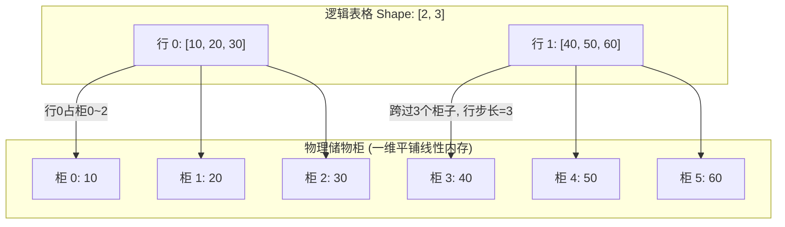
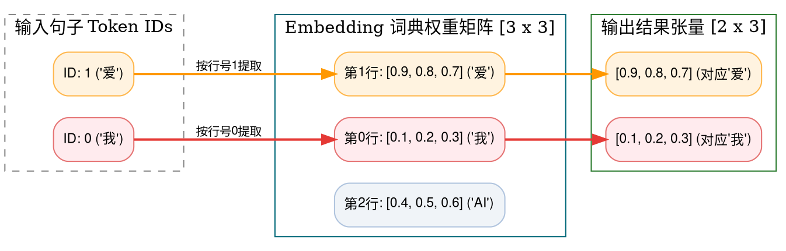
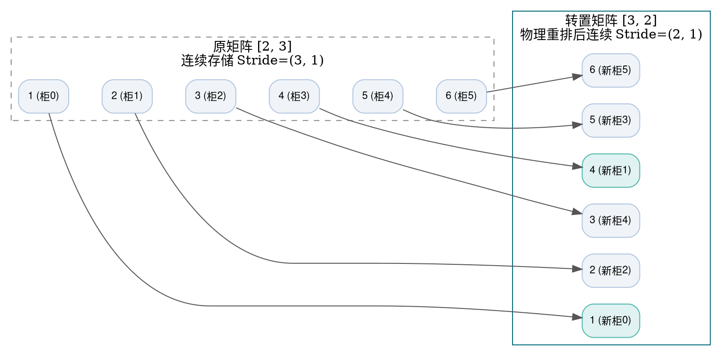
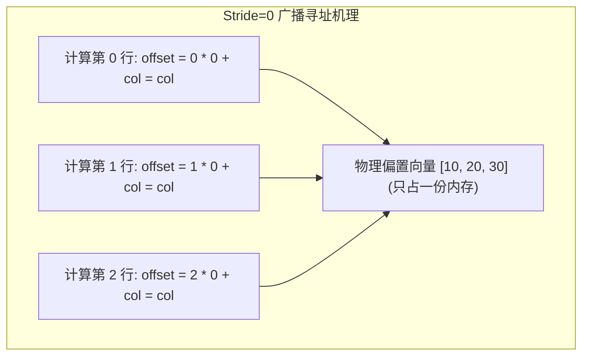

> **致初学者**：当你刚开始学习 PyTorch、TensorFlow 或 CUDA 编程时，经常会遇到各种让人抓狂的报错：
> - `RuntimeError: view size is not compatible with input tensor's size and stride (at least one dimension spans across two contiguous subspaces). Use .reshape(...) instead.`
> - `ValueError: operands could not be broadcast together with shapes (2, 3) (3, 2)`
> - `IndexError: index out of range in gather`
>
> 许多教材一上来就堆砌高维数学符号 $\mathcal{T} \in \mathbb{R}^{B \times S \times D}$，把人看晕了。但请相信：**计算机硬件里根本不存在“多维立方体”，物理内存永远只是一根从 0 开始连续编号的一维电线（线性地址数组）！**
>
> 所谓的“二维矩阵”、“三维张量”，纯粹是程序员和编译器根据**形状（Shape）**与**步长（Stride）**在头脑中计算出来的“地址跳跃幻觉”。
>
> 本篇作为《深度学习底层算子从零到一》系列的第一讲，将彻底打破晦涩术语，用**最通俗的生活比喻、拿具体的数字一步步算一遍、配合流程图与避坑指南**，带你从底层物理内存开始，把 11 个经典张量操作彻底学会！

---

## 零、必须先吃透的“底层三剑客”：内存、行优先与步长

在开始看具体算子之前，我们先花 3 分钟把最底层的“游戏规则”搞清楚。搞懂了这三个概念，后面的 11 个算子你就会发现它们不过是在这三个概念上玩“数字跳格子”游戏。

### 1. 物理内存：一排整齐的储物柜
把计算机的物理内存想象成**火车站的一排整齐的储物柜**：
- 储物柜只有一整排（一维），编号从 `0, 1, 2, 3, 4, 5...` 一直向后延伸。
- 每个柜子只能存 1 个数字（比如一个 32 位的浮点数 `float32`，占 4 字节）。
- **不管你在 Python 里写的是几维张量，最终在硬件里都必须排成这一队一维的储物柜！**

### 2. 行优先（Row-Major）：怎么把一张表格塞进一排储物柜？
假设你有一张 2 行 3 列的表格：
$$
\begin{pmatrix} 10 & 20 & 30 \\ 40 & 50 & 60 \end{pmatrix}
$$
计算机怎么把这两行放进一维储物柜？
- **行优先（Row-Major，C/C++ 与 Python 默认）**：先把第 0 行从左到右放完，紧接着放第 1 行。
  储物柜排列为：`[10, 20, 30,  40, 50, 60]`。
  最右边的列索引变化最频繁（连续挨着），最左边的行索引变化最慢。
- **列优先（Col-Major，Fortran/MATLAB 默认）**：先把第 0 列从上到下放完，再放第 1 列。
  储物柜排列为：`[10, 40,  20, 50,  30, 60]`。

### 3. 步长（Stride）：大脑里的“跳格子口诀”
当你想在表格里找第 `row` 行、第 `col` 列的元素时，CPU 在底层储物柜里要往后数几个柜子？
- 如果你在同一行往右移 1 格（`col + 1`），储物柜地址只加 1。所以**列步长（Stride_col）= 1**。
- 如果你想换到下一行（`row + 1`），你必须把当前整整一行的 3 个数字全跨过去！所以**行步长（Stride_row）= 3**。

**通用地址换算公式**：
$$ \text{物理储物柜索引} = \text{row} \times \text{Stride}_{\text{row}} + \text{col} \times \text{Stride}_{\text{col}} = \text{row} \times 3 + \text{col} \times 1 $$



> [!TIP] 动手验算一次
> 想找表格里的第 1 行、第 2 列（即数值 `60`）：
> - $\text{row} = 1, \text{col} = 2$；
> - $\text{物理柜号} = 1 \times 3 + 2 \times 1 = 5$；
> - 去找柜号 5，正是数值 `60`！数学和物理完美闭环。

---

## 1. Embedding (词嵌入查表)

### 1.1 生活比喻与痛点剖析
- **为什么需要它？**
  计算机只能对数字进行加减乘除，根本读不懂汉字“猫”或者英文“dog”。为了让模型理解文本，分词器（Tokenizer）会先给每个单词发一张“身份证编号”（例如“我”=0，“爱”=1，“AI”=2）。
  但是，数字编号 0、1、2 本身没有任何语义——难道“AI(2)”的含义是“爱(1)”的两倍吗？显然不是！
- **通俗比喻**：
  **Embedding 就像一本《新华字典》**：
  - 字典总共有 $V$ 页（词表大小 Vocabulary Size，比如 50000 个词）；
  - 每一页印着一段对这个词详尽的多维度特征描述（隐藏特征向量 Hidden Dimension $D$，比如 768 或 4096 个浮点数，代表这个词的情感、类别、属性等）；
  - 输入 Token ID 为 `1` 时，Embedding 算子做的事情极度纯粹：**直接翻到第 1 页，把整页上的那排浮点数原封不动撕下来交给你！**



### 1.2 手把手极小数字推演
假设词表大小 $V=3$，特征维度 $D=3$，字典内容如下：
- 行 0: `[0.1, 0.2, 0.3]`
- 行 1: `[0.9, 0.8, 0.7]`
- 行 2: `[0.4, 0.5, 0.6]`

现在输入输入序列为 `[1, 0]`（代表“爱，我”）：
- 第 1 个词是 ID `1`：直接抄写行 1 $\to$ `[0.9, 0.8, 0.7]`；
- 第 2 个词是 ID `0`：直接抄写行 0 $\to$ `[0.1, 0.2, 0.3]`；
- 最终拼成输出形状为 $[2, 3]$ 的矩阵：`[[0.9, 0.8, 0.7], [0.1, 0.2, 0.3]]`。

> [!NOTE] 为什么说 Embedding 是特殊的矩阵乘法？
> 在数学上，查第 1 行等价于用一个 One-Hot 独热向量 `[0, 1, 0]` 乘以整个权重矩阵。但**工程上绝不能这么做**！如果词表有 10 万个词，做矩阵乘法意味着要跟 99999 个 0 做无用的乘加，算力浪费 10 万倍。所以底层**必须直接做纯粹的指针内存查表**！

### 1.3 原生 Python 逐行注释实现
```python
def naive_embedding(token_ids: list[int], weight_table: list[list[float]]) -> list[list[float]]:
    """纯 Python 原生 Embedding 查表算子
    :param token_ids: 输入的整数 Token 编号列表，如 [1, 0]
    :param weight_table: 形状为 [V, D] 的词表权重矩阵
    :return: 提取出的特征张量，形状为 [len(token_ids), D]
    """
    vocab_size = len(weight_table)       # 词表总行数 V
    hidden_dim = len(weight_table[0])    # 隐藏特征维度 D
    output = []

    for step, token_id in enumerate(token_ids):
        # 边界安全检查：防止传入负数或超过词表总大小的非法 ID 导致越界崩溃
        if token_id < 0 or token_id >= vocab_size:
            raise IndexError(f"Token ID {token_id} 越界！有效范围是 [0, {vocab_size - 1}]")
        
        # 核心操作：直接拷贝对应行（切片拷贝，避免外部修改污染内部权重）
        row_vector = weight_table[token_id].copy()
        output.append(row_vector)

    return output

if __name__ == "__main__":
    # 定义一本小字典 (3个词，每个词3个特征)
    vocab = [
        [0.1, 0.2, 0.3], # ID 0: "我"
        [0.9, 0.8, 0.7], # ID 1: "爱"
        [0.4, 0.5, 0.6]  # ID 2: "AI"
    ]
    query_tokens = [1, 2, 0] # 查询 "爱 AI 我"
    result = naive_embedding(query_tokens, vocab)
    print("Embedding 查表结果:")
    for tid, vec in zip(query_tokens, result):
        print(f"  Token {tid} -> {vec}")
```

### 1.4 原生 C++ 逐行注释实现
```cpp
#include <iostream>
#include <vector>
#include <iomanip>

int main() {
    // 词表大小 V=3, 向量维度 D=3
    constexpr int V = 3;
    constexpr int D = 3;
    const float weight_table[V][D] = {
        {0.1f, 0.2f, 0.3f}, // 词 0
        {0.9f, 0.8f, 0.7f}, // 词 1
        {0.4f, 0.5f, 0.6f}  // 词 2
    };

    const int input_ids[] = {1, 2, 0};
    constexpr int N = 3; // 查询 3 个词
    float output[N][D];

    // 底层物理内存寻址：直接按行首地址偏移拷贝
    for (int i = 0; i < N; ++i) {
        int id = input_ids[i];
        for (int d = 0; d < D; ++d) {
            output[i][d] = weight_table[id][d];
        }
    }

    std::cout << "=== 原生 C++ Embedding 查表验证 ===" << std::endl;
    for (int i = 0; i < N; ++i) {
        std::cout << "Token ID " << input_ids[i] << " 向量: [";
        for (int d = 0; d < D; ++d) {
            std::cout << std::fixed << std::setprecision(1) << output[i][d] << (d + 1 < D ? ", " : "");
        }
        std::cout << "]" << std::endl;
    }
    return 0;
}
```

---

## 2. Reshape / View (视图变换与零拷贝)

### 2.1 生活比喻与痛点剖析
- **为什么需要它？**
  你经常需要把输入数据换个视角看。比如把 6 张并排的单寸照片，重新摆成 2 行 3 列的相册；或者在全连接层前，把图像展平成一维长条。
- **通俗比喻**：
  **View 就像换一副有色眼镜看同一排储物柜**：
  柜子里的 6 个苹果（物理内存）**动都没动过一下**！你只是换了个记账本，刚才在记账本上写“一排 6 个”，现在在记账本上写“两排，每排 3 个”。
  因为**数据零搬移（Zero-Copy）**，耗时仅几纳秒，效率极高！
- **初学者最大疑惑：什么时候会报错？**
  如果张量之前做过转置（Transpose），储物柜里的物理顺序已经被搞乱了，不再满足规整的“行步长”规则，这时候直接用 `view()` 就会报错崩溃！必须先调用 `.contiguous()` 真正花时间在内存里重新搬运排好，才能继续变换。

### 2.2 手把手极小数字推演
现有 6 个数字连续存在物理内存中：
`储物柜: [10, 20, 30, 40, 50, 60]`
- 原形状：$[6]$，步长为 $[1]$。
- **重塑为 $[2, 3]$**：
  - 新形状有两个维度：第 0 维大小为 2，第 1 维大小为 3；
  - 检查元素总数：$2 \times 3 = 6$，总数相等，合法！
  - 计算新步长：列步长为 1，行步长为 3；
  - 逻辑效果：第 0 行取柜号 `0, 1, 2` $\to$ `[10, 20, 30]`；第 1 行取柜号 `3, 4, 5` $\to$ `[40, 50, 60]`。
- **重塑为 $[3, 2]$**：
  - 计算新步长：列步长为 1，行步长为 2；
  - 逻辑效果：行 0 取 `[10, 20]`，行 1 取 `[30, 40]`，行 2 取 `[50, 60]`。

### 2.3 原生 Python 逐行注释实现
```python
def naive_reshape_1d_to_2d(flat_data: list[float], rows: int, cols: int) -> list[list[float]]:
    """将一维平铺数据虚拟重组为 [rows, cols] 的二维矩阵视图"""
    total = len(flat_data)
    
    # 自动推导维度支持：允许某一个维度传入 -1 (自动算出该维度尺寸)
    if rows == -1 and cols != -1:
        rows = total // cols
    elif cols == -1 and rows != -1:
        cols = total // rows
        
    # 容量严格一致性检验
    if rows * cols != total:
        raise ValueError(f"无法重塑！原数据总数 {total} 无法分成 {rows} 行 x {cols} 列 (乘积为 {rows*cols})")

    matrix = []
    for r in range(rows):
        # 按照步长切分：每一行跨越 cols 个元素
        start_idx = r * cols
        end_idx = start_idx + cols
        matrix.append(flat_data[start_idx:end_idx])
    return matrix

if __name__ == "__main__":
    memory_buf = [10.0, 20.0, 30.0, 40.0, 50.0, 60.0]
    m_2x3 = naive_reshape_1d_to_2d(memory_buf, 2, 3)
    print("Reshape 成 2x3:", m_2x3)
    m_3x2 = naive_reshape_1d_to_2d(memory_buf, 3, -1) # 自动推导列数为 2
    print("Reshape 自动推导为 3x2:", m_3x2)
```

### 2.4 原生 C++ 逐行注释实现
```cpp
#include <iostream>

int main() {
    // 物理连续一维内存
    const float raw_mem[] = {10.0f, 20.0f, 30.0f, 40.0f, 50.0f, 60.0f};
    constexpr int rows = 3;
    constexpr int cols = 2;
    // 步长：行步长 = 列数 = 2，列步长 = 1
    constexpr int stride_row = cols;
    constexpr int stride_col = 1;

    std::cout << "=== 原生 C++ 步长寻址 Reshape (3x2) ===" << std::endl;
    for (int r = 0; r < rows; ++r) {
        std::cout << "Row " << r << ": [";
        for (int c = 0; c < cols; ++c) {
            // 用步长公式算出对应一维储物柜柜号
            int flat_idx = r * stride_row + c * stride_col;
            std::cout << raw_mem[flat_idx] << (c + 1 < cols ? ", " : "");
        }
        std::cout << "]" << std::endl;
    }
    return 0;
}
```

---

## 3. Transpose / Permute (维度交换与转置陷阱)

### 3.1 生活比喻与“非连续陷阱”
- **生活比喻**：
  把一张横版印刷的报纸，旋转 90 度竖过来看。原来的一行变成了现在的一列。
- **初学者的直觉陷阱**：
  在数学上，$A^T[j, i] = A[i, j]$。但在物理计算机里，如果你只是把步长从 `(3, 1)` 改成 `(1, 3)`，那么逻辑上确实完成了转置。
  **但是灾难随之发生**：
  以前读取同行相邻元素，物理地址加 1（顺次读，CPU 缓存命中率 100%）；
  现在读取“新行”的相邻元素，物理地址每次要加上 3！CPU 必须在内存里疯狂大跳跃。
  因此，在很多高性能算子执行前，必须调用一次 **物理内存数据重排（Physical Reorder）**，真正把数据在内存里重新搬运整齐。



### 3.2 手把手极小数字推演
原矩阵 $A$（2 行 3 列）：
$$
A = \begin{pmatrix} 1 & 2 & 3 \\ 4 & 5 & 6 \end{pmatrix}
$$
- 原坐标 $(0, 0)=1, (0, 1)=2, (0, 2)=3$
- 原坐标 $(1, 0)=4, (1, 1)=5, (1, 2)=6$

转置后矩阵 $T$ 形状变为 3 行 2 列：
- $T$ 的第 0 行取原第 0 列：$(0, 0)=1, (1, 0)=4 \implies [1, 4]$
- $T$ 的第 1 行取原第 1 列：$(0, 1)=2, (1, 1)=5 \implies [2, 5]$
- $T$ 的第 2 行取原第 2 列：$(0, 2)=3, (1, 2)=6 \implies [3, 6]$

最终转置矩阵：
$$
T = \begin{pmatrix} 1 & 4 \\ 2 & 5 \\ 3 & 6 \end{pmatrix}
$$

### 3.3 原生 Python 逐行注释实现
```python
def naive_transpose_2d(matrix: list[list[float]]) -> list[list[float]]:
    """二维矩阵转置 (物理内存真正重排)"""
    old_rows = len(matrix)
    old_cols = len(matrix[0])
    
    # 新矩阵形状: [old_cols, old_rows]
    new_rows = old_cols
    new_cols = old_rows
    transposed = [[0.0] * new_cols for _ in range(new_rows)]
    
    # 嵌套循环：将原坐标 [r][c] 写入新坐标 [c][r]
    for r in range(old_rows):
        for c in range(old_cols):
            transposed[c][r] = matrix[r][c]
            
    return transposed

if __name__ == "__main__":
    mat = [
        [1.0, 2.0, 3.0],
        [4.0, 5.0, 6.0]
    ]
    t_mat = naive_transpose_2d(mat)
    print("转置后的 3x2 矩阵:")
    for row in t_mat:
        print(" ", row)
```

### 3.4 原生 C++ 逐行注释实现
```cpp
#include <iostream>

int main() {
    constexpr int R = 2;
    constexpr int C = 3;
    const float A[R][C] = {
        {1.0f, 2.0f, 3.0f},
        {4.0f, 5.0f, 6.0f}
    };
    float T[C][R]; // 转置后为 3x2

    for (int r = 0; r < R; ++r) {
        for (int c = 0; c < C; ++c) {
            T[c][r] = A[r][c]; // 行列索引互换
        }
    }

    std::cout << "=== 原生 C++ 转置输出 (3x2) ===" << std::endl;
    for (int c = 0; c < C; ++c) {
        std::cout << "[";
        for (int r = 0; r < R; ++r) {
            std::cout << T[c][r] << (r + 1 < R ? ", " : "");
        }
        std::cout << "]" << std::endl;
    }
    return 0;
}
```

---

## 4. Concat (拼接) 与 5. Split / Chunk (切分)

### 4.1 生活比喻与轴向认知
- **Concat（拼接）**：
  把两节火车车厢挂在一起。
  - `axis=0`（沿行垂直拼）：上下叠汉堡。两块汉堡皮的**宽度必须一模一样**！
  - `axis=1`（沿列水平拼）：左右拼长桌。两张桌子的**长度必须一模一样**！
- **Split / Chunk（切分）**：
  切西瓜。给你一个大西瓜，沿着某个轴一刀切成指定份额的小块。常用于多头注意力（MHA）中把巨大的 $QKV$ 混合矩阵一刀切成 3 个独立的 $Q$、$K$、$V$。

### 4.2 手把手极小数字推演
设张量 $A$ 为 $2 \times 2$：
$$ A = \begin{pmatrix} 1 & 2 \\ 3 & 4 \end{pmatrix} $$
张量 $B$ 为 $2 \times 3$：
$$ B = \begin{pmatrix} 5 & 6 & 7 \\ 8 & 9 & 10 \end{pmatrix} $$
- **尝试沿 `axis=0` 拼接**：A 的列数是 2，B 的列数是 3，列数不一致，**报错！无法垂直拼接！**
- **沿 `axis=1` 水平拼接**：两者行数都是 2，合法！
  - 第 0 行：`[1, 2]` 接上 `[5, 6, 7]` $\to$ `[1, 2, 5, 6, 7]`
  - 第 1 行：`[3, 4]` 接上 `[8, 9, 10]` $\to$ `[3, 4, 8, 9, 10]`
  - 最终新形状为 $[2, 2+3] = [2, 5]$。

### 4.3 原生 Python 逐行注释实现
```python
def naive_concat_axis1(A: list[list[float]], B: list[list[float]]) -> list[list[float]]:
    """沿列方向 (axis=1) 水平拼接两个矩阵"""
    rows_A = len(A)
    rows_B = len(B)
    if rows_A != rows_B:
        raise ValueError(f"axis=1 拼接失败！行数不匹配: A 有 {rows_A} 行, B 有 {rows_B} 行")

    result = []
    for r in range(rows_A):
        # 将两行的元素在内存中拼接缝合
        combined_row = A[r] + B[r]
        result.append(combined_row)
    return result

def naive_chunk_1d(data: list[float], chunk_size: int) -> list[list[float]]:
    """将一维数组按固定步长切分成多个小块"""
    chunks = []
    for i in range(0, len(data), chunk_size):
        chunks.append(data[i : i + chunk_size])
    return chunks

if __name__ == "__main__":
    mA = [[1.0, 2.0], [3.0, 4.0]]
    mB = [[5.0, 6.0, 7.0], [8.0, 9.0, 10.0]]
    cat_res = naive_concat_axis1(mA, mB)
    print("水平拼接结果 (2x5):", cat_res)
    split_res = naive_chunk_1d([10, 20, 30, 40, 50], chunk_size=2)
    print("切分结果 (每块2个):", split_res)
```

---

## 6. Broadcast (广播机制：步长置零的黑科技)

### 6.1 生活比喻与法则解密
- **痛点**：
  我们经常遇到一个大矩阵（如 1000 行 512 列的一篇文章），要给每一行都加上一个相同的偏置向量（1 行 512 列）。
  笨办法是：把偏置向量复制 1000 次，变成同样大的矩阵，然后逐个相加。但这样白白浪费了大量内存！
- **广播的真面目（Stride = 0）**：
  广播根本没有在内存里复制任何数据！
  它只是把偏置向量在行方向的**步长强行设为 0**！
  回忆步长公式：$\text{offset} = \text{row} \times \text{Stride}_{\text{row}} + \text{col} \times 1$。
  如果 $\text{Stride}_{\text{row}} = 0$，那么无论 $\text{row}$ 是第 0 行还是第 999 行，$\text{row} \times 0$ 恒等于 0！CPU 始终读取偏置向量的那同一行数据，**实现了“物理上只有一份，逻辑上好像有 1000 份”的无损黑魔法！**



### 6.2 广播三大铁律（NumPy / PyTorch 通用）
从**最右边的维度（末尾）**开始向左比对两者的形状：
1. 两个维度大小相等 $\to$ **允许**；
2. 其中一个维度大小为 1 $\to$ **允许**（该维度步长将被置 0 虚拟展开）；
3. 某个张量维度缺失 $\to$ **允许**（缺失维度自动在最左边补 1）；
4. 两个维度大小不同且都不为 1 $\to$ **严厉报错！无法广播！**

> [!TIP] 测验一下
> - $[2, 3]$ 和 $[1, 3]$ 能广播吗？能！右对齐：$3=3$，$2$ 和 $1$ 兼容，最终结果 $[2, 3]$。
> - $[2, 3]$ 和 $[2, 1]$ 能广播吗？能！最终结果 $[2, 3]$。
> - $[2, 3]$ 和 $[3, 2]$ 能广播吗？**不能！** $3 \ne 2$，报错！

### 6.3 原生 Python 逐行注释实现
```python
def naive_broadcast_add(A: list[list[float]], B_bias: list[float]) -> list[list[float]]:
    """模拟矩阵 [M, N] 与偏置向量 [1, N] 的零开销广播加法"""
    M = len(A)
    N = len(A[0])
    if len(B_bias) != N:
        raise ValueError(f"无法广播！列数不一致: A 有 {N} 列, B 只有 {len(B_bias)} 列")

    output = [[0.0] * N for _ in range(M)]
    
    # 模拟底层的 Stride=0 寻址
    stride_row = 0
    stride_col = 1
    
    for r in range(M):
        for c in range(N):
            # 关键点：r * stride_row 永远是 0，无论行号多大，都只读取 B_bias[c]
            b_val = B_bias[r * stride_row + c * stride_col]
            output[r][c] = A[r][c] + b_val
            
    return output

if __name__ == "__main__":
    mat = [
        [1.0, 2.0, 3.0],
        [4.0, 5.0, 6.0]
    ] # 2x3
    bias = [10.0, 20.0, 30.0] # 1x3
    res = naive_broadcast_add(mat, bias)
    print("广播加法输出结果:")
    for row in res:
        print(" ", row)
```

### 6.4 原生 C++ 逐行注释实现
```cpp
#include <iostream>

int main() {
    constexpr int M = 2;
    constexpr int N = 3;
    const float A[M][N] = {
        {1.0f, 2.0f, 3.0f},
        {4.0f, 5.0f, 6.0f}
    };
    const float bias[N] = {10.0f, 20.0f, 30.0f}; // 1x3
    float C[M][N];

    // 行步长为 0
    constexpr int b_stride_row = 0;
    constexpr int b_stride_col = 1;

    for (int r = 0; r < M; ++r) {
        for (int c = 0; c < N; ++c) {
            int b_idx = r * b_stride_row + c * b_stride_col;
            C[r][c] = A[r][c] + bias[b_idx];
        }
    }

    std::cout << "=== 原生 C++ Stride=0 广播加法验证 ===" << std::endl;
    for (int r = 0; r < M; ++r) {
        std::cout << "[";
        for (int c = 0; c < N; ++c) {
            std::cout << C[r][c] << (c + 1 < N ? ", " : "");
        }
        std::cout << "]" << std::endl;
    }
    return 0;
}
```

---

## 7. Gather (收集) 与 Scatter (打散写入)

### 7.1 生活比喻与图解
- **Gather（收集）**：
  就像去超市拿着一张**购物清单（索引矩阵）**，清单上写着“去第 3 号货架拿东西、再去第 0 号货架拿东西”。你按照清单把东西一件件放进自己的购物车。
- **Scatter（打散写入）**：
  Gather 的逆向操作。理货员把进货箱里的货物，按照标签上的目标货架号，分别摆放回对应的货架上。如果有两件货物要去同一个货架，通常选择加在一起（Scatter Add）。

### 7.2 手把手极小数字推演
货架数据（原数组）：`Table = [100, 200, 300, 400]`（下标 0~3）。
购物清单（索引）：`Indices = [3, 0, 2, 3]`。
- 提取第 0 个：`Table[3] = 400`
- 提取第 1 个：`Table[0] = 100`
- 提取第 2 个：`Table[2] = 300`
- 提取第 3 个：`Table[3] = 400`
- 收集结果（Gather Output）：`[400, 100, 300, 400]`。

### 7.3 原生 Python 逐行注释实现
```python
def naive_gather_1d(source: list[float], indices: list[int]) -> list[float]:
    """1D Gather 收集算子"""
    output = []
    for idx in indices:
        if idx < 0 or idx >= len(source):
            raise IndexError(f"Gather 索引 {idx} 超出源数组范围 [0, {len(source)-1}]")
        output.append(source[idx])
    return output

def naive_scatter_add_1d(target_size: int, indices: list[int], updates: list[float]) -> list[float]:
    """1D Scatter Add 打散累加算子"""
    target = [0.0] * target_size
    for idx, val in zip(indices, updates):
        target[idx] += val # 相同位置累加
    return target

if __name__ == "__main__":
    data = [100.0, 200.0, 300.0, 400.0]
    idxs = [3, 0, 2, 3]
    print("Gather 收集输出:", naive_gather_1d(data, idxs))
    
    # 将 [1, 2, 3, 4] 累加写回目标
    print("Scatter Add 累加写回:", naive_scatter_add_1d(4, idxs, [1.0, 2.0, 3.0, 4.0]))
```

---

## 8. MaskedFill 与 Where (条件替换与掩码)

### 8.1 生活比喻与痛点剖析
- **为什么在 Transformer 里生死攸关？**
  在语言模型生成第 3 个字时，它**绝对不能提前偷看第 4、5 个字的内容**！
  怎么在矩阵计算中强行让未来的字“失明”？
  **MaskedFill** 就是那张遮羞布：用一个布尔掩码（Mask）标记未来所有位置，把它们强行填上一个极小的值（比如 $-10^9$ 或 $-\infty$）。后面算 Softmax 时，$e^{-\infty} = 0$，未来的字被选中的概率彻底归零！

### 8.2 手把手极小数字推演
原始打分矩阵（注意力 Logits）：
$$
\begin{pmatrix} 1.5 & 0.8 \\ 2.1 & 3.4 \end{pmatrix}
$$
下三角因果掩码（True 表示需要被遮挡替换的未来位置）：
$$
\begin{pmatrix} \text{False} & \text{True} \\ \text{False} & \text{False} \end{pmatrix}
$$
执行 `MaskedFill(mask, value=-1e9)`：
- 坐标 $(0, 0)$：掩码为 False，保留原值 $1.5$；
- 坐标 $(0, 1)$：掩码为 True，属于偷看未来，替换为 $-1e9$；
- 坐标 $(1, 0)$ 和 $(1, 1)$：掩码为 False，保留原值。

替换后输出：
$$
\begin{pmatrix} 1.5 & -1e9 \\ 2.1 & 3.4 \end{pmatrix}
$$

### 8.3 原生 Python 逐行注释实现
```python
def naive_masked_fill(data: list[list[float]], mask: list[list[bool]], fill_val: float = -1e9) -> list[list[float]]:
    """根据布尔掩码执行条件值填充"""
    R = len(data)
    C = len(data[0])
    out = [[0.0] * C for _ in range(R)]
    
    for r in range(R):
        for c in range(C):
            # 若 mask 为真，换成遮挡值；否则保留原值
            out[r][c] = fill_val if mask[r][c] else data[r][c]
    return out

if __name__ == "__main__":
    scores = [[1.5, 0.8], [2.1, 3.4]]
    causal_mask = [[False, True], [False, False]]
    res = naive_masked_fill(scores, causal_mask, -1e9)
    print("因果掩码填充输出:")
    for row in res:
        print(" ", row)
```

---

## 9. Pad (填充) 与 10. Crop (裁剪)

### 9.1 生活比喻与图像处理
- **Pad（填充）**：就像给一张明信片加上一个保护性的相框。如果不加框，卷积核滑到图像最边缘时就会“悬空掉出去”；加了 0 填充后，边缘像素也能被卷积核居中采样。
- **Crop（裁剪）**：拿着剪刀把多余的边框剪掉，只保留核心中心区域。

### 9.2 原生 Python 逐行注释实现
```python
def naive_pad_2d(img: list[list[float]], pad_size: int, fill_val: float = 0.0) -> list[list[float]]:
    """四周均匀填充常数值"""
    old_h = len(img)
    old_w = len(img[0])
    new_h = old_h + 2 * pad_size
    new_w = old_w + 2 * pad_size
    
    padded = [[fill_val] * new_w for _ in range(new_h)]
    # 把原图贴在正中间
    for r in range(old_h):
        for c in range(old_w):
            padded[pad_size + r][pad_size + c] = img[r][c]
    return padded

def naive_crop_2d(img: list[list[float]], start_r: int, start_c: int, h: int, w: int) -> list[list[float]]:
    """从指定起始坐标裁剪子区域"""
    cropped = []
    for r in range(start_r, start_r + h):
        cropped.append(img[r][start_c : start_c + w])
    return cropped

if __name__ == "__main__":
    small_pic = [[1.0, 2.0], [3.0, 4.0]]
    pad_pic = naive_pad_2d(small_pic, pad_size=1, fill_val=0.0)
    print("Pad 四周补0后 (4x4):")
    for r in pad_pic:
        print(" ", r)
    restored = naive_crop_2d(pad_pic, start_r=1, start_c=1, h=2, w=2)
    print("Crop 裁剪中心恢复 (2x2):", restored)
```

---

## 总结与初学者避坑指南

回顾本篇的 11 个算子，请在脑海中建立以下这几张“肌肉记忆反射卡片”：

1. **Embedding**：不是高深的黑魔法，本质就是**快速安全的二维数组查表**。
2. **Reshape / View**：数据没动，只是换了**步长（Stride）**去读。
3. **Transpose**：改了步长后数据变得**不连续**，小心引发后续计算的 Cache Miss 性能陷阱！
4. **Broadcast**：不是真复制，而是将某一维度的**步长设为 0**，零成本虚拟复用！
5. **MaskedFill**：生成模型里的“保密胶带”，用 $-10^9$ 遮住未来的答案。

下一讲，我们将带着扎实的内存直觉，杀入深度学习的算力引擎核心——**矩阵乘法（GEMM / BMM / GEMV）与数值稳定性（Safe-Softmax）**！
