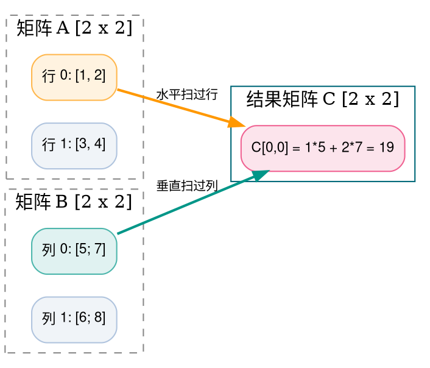
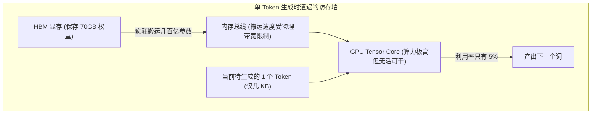
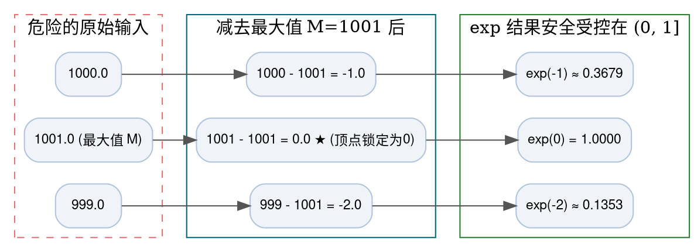

> **致初学者**：当你翻开任何一篇深度学习论文，映入眼帘的几乎全是密密麻麻的矩阵公式：$Y = X W + b$、$Q K^T$、$\text{Softmax}(\dots)$。
>
> 许多初学者可能会困惑：
> - **为什么矩阵乘法能占到现代大模型 90% 以上的计算时间？**
> - **为什么三层简单的 `for` 循环写出来的矩阵乘法在 CPU 上跑得极慢，而工业级库能快几十甚至上百倍？**
> - **为什么大模型在生成一长串文字时 GPU 显卡轰鸣，而一个字一个字向外吐字时，显存带宽被榨干但算力利用率却只有可怜的 5%？**
> - **为什么好端端的模型在训练时突然全网数值变成 `NaN`（Not a Number），直接报废？**
>
> 本篇作为系列第二讲，将抛开抽象难懂的泛函与高深理论，**用最简单的数字手把手算一遍**，带你从底层硬件 Cache 访存与数值溢出的物理本质，彻底搞懂 GEMM、BMM、GEMV、Einsum 和 Softmax！

---

## 零、必须先掌握的初学者概念：算力、访存与 NaN 炸弹

> [!NOTE] 核心概念形象字典
>
> - **FLOPs（浮点运算次数）**：计算机执行乘法或加法的次数。算一次 $a \times b + c$ 包含 1 次乘法和 1 次加法，共计 2 次 FLOPs。千亿大模型训练一次往往需要 $10^{23}$ 次以上的 FLOPs！
> - **算力受限（Compute-Bound）**：好比你的书桌上堆满了食材，你的双手（CPU/GPU 核心）已经切菜切到冒烟，限制做饭速度的是“你的手速”。典型代表：大 Batch 的矩阵乘法 **GEMM**。
> - **访存受限 / 存储墙（Memory-Bound）**：好比你的手速极快，但食材放在 10 公里外的冷库（外部显存 HBM/DDR），你每切一刀就要等卡车送半天，限制做饭速度的是“卡车运输速度”。典型代表：单 Token 解码的 **GEMV**。
> - **NaN（非数值，Not a Number）**：深度学习工程师的头号噩梦！当出现 $0/0$、$\infty / \infty$ 或 $\infty - \infty$ 等非法数学未定式时，计算单元会吐出 `NaN`。它就像烈性传染病，反向传播时经过链式法则一乘，顷刻间把整个模型的几十亿参数全部染成垃圾数据，无法抢救！

---

## 1. GEMM (通用矩阵乘法 / General Matrix Multiply)

### 1.1 生活比喻与数学定义
- **BLAS 工业标准定义**：
  $$ C = \alpha (A \times B) + \beta C $$
  其中 $A$ 形状为 $[M, K]$，$B$ 形状为 $[K, N]$，输出 $C$ 形状为 $[M, N]$。
  $\alpha$ 和 $\beta$ 是标量缩放系数。在深度学习中，绝大多数时候 $\alpha = 1, \beta = 0$，也就是我们最熟悉的纯粹矩阵乘法 $C = A \times B$。
- **生活比喻：流水线工人算工钱**：
  - 矩阵 $A$（$M$ 行 $K$ 列）：$M$ 个工人，每人在 $K$ 种不同工种上的工作小时数；
  - 矩阵 $B$（$K$ 行 $N$ 列）：$K$ 种工种在 $N$ 种不同结算货币下的时薪单价；
  - 矩阵 $C$（$M$ 行 $N$ 列）：每个工人最终在每种货币下应领取的总工资！



### 1.2 手把手极小数字推演
给定两个 $2 \times 2$ 的矩阵：
$$
A = \begin{pmatrix} 1 & 2 \\ 3 & 4 \end{pmatrix}, \quad B = \begin{pmatrix} 5 & 6 \\ 7 & 8 \end{pmatrix}
$$
我们手算每一个格子的诞生：
1. **左上角 $C[0, 0]$**：拿 $A$ 的第 0 行 `[1, 2]` 和 $B$ 的第 0 列 `[5, 7]` 对应相乘相加：
   $$ C[0, 0] = 1 \times 5 + 2 \times 7 = 5 + 14 = 19 $$
2. **右上角 $C[0, 1]$**：拿 $A$ 的第 0 行 `[1, 2]` 和 $B$ 的第 1 列 `[6, 8]` 相乘相加：
   $$ C[0, 1] = 1 \times 6 + 2 \times 8 = 6 + 16 = 22 $$
3. **左下角 $C[1, 0]$**：拿 $A$ 的第 1 行 `[3, 4]` 和 $B$ 的第 0 列 `[5, 7]` 相乘相加：
   $$ C[1, 0] = 3 \times 5 + 4 \times 7 = 15 + 28 = 43 $$
4. **右下角 $C[1, 1]$**：拿 $A$ 的第 1 行 `[3, 4]` 和 $B$ 的第 1 列 `[6, 8]` 相乘相加：
   $$ C[1, 1] = 3 \times 6 + 4 \times 8 = 18 + 32 = 50 $$

最终输出矩阵：
$$
C = \begin{pmatrix} 19 & 22 \\ 43 & 50 \end{pmatrix}
$$

### 1.3 硬件底层的秘密：为什么最朴素的三重循环很慢？
初学者写矩阵乘法，往往直接写出三层嵌套循环：
```python
for i in range(M):
    for j in range(N):
        for k in range(K):
            C[i][j] += A[i][k] * B[k][j]
```
**硬件杀手在哪里？在 `B[k][j]` 上！**
回忆第一讲讲过的**行优先内存排布**：
- 访问 `A[i][k]` 时，内层循环 `k` 每次加 1，读取的是紧挨着的下一个内存地址。CPU 的 Cache Line 会一口气预先抓取接下来的 16 个数字，这叫**缓存命中（Cache Hit）**，速度飞快！
- 但是访问 `B[k][j]` 时，`k` 每次加 1，意味着从当前行的第 `j` 列跳到**下一行的第 `j` 列**！物理地址直接跨越了整整一整行（加上了 $N$）！
- 这导致 CPU 缓存预读完全落空，每次都要重新去漫长的外部内存抓数据（**Cache Miss 缓存缺失**），导致处理器核心大量时间处于发呆等待状态！

### 1.4 原生 Python 逐行注释实现
```python
def naive_gemm(A: list[list[float]], B: list[list[float]]) -> list[list[float]]:
    """纯 Python 原生朴素矩阵乘法: C = A @ B"""
    M = len(A)       # A 的行数
    K = len(A[0])    # A 的列数
    K_B = len(B)     # B 的行数
    N = len(B[0])    # B 的列数

    # 矩阵乘法先决条件：A 的列数必须完全等于 B 的行数！
    if K != K_B:
        raise ValueError(f"内积维度不匹配！A 的列数 {K} != B 的行数 {K_B}")

    # 初始化输出结果矩阵 [M, N]，初始全填 0.0
    C = [[0.0] * N for _ in range(M)]

    # 三重循环计算
    for i in range(M):
        for j in range(N):
            dot_sum = 0.0
            for k in range(K):
                dot_sum += A[i][k] * B[k][j]
            C[i][j] = dot_sum

    return C

if __name__ == "__main__":
    mA = [[1.0, 2.0], [3.0, 4.0]]
    mB = [[5.0, 6.0], [7.0, 8.0]]
    mC = naive_gemm(mA, mB)
    print("GEMM 计算结果矩阵 (2x2):")
    for row in mC:
        print(" ", row)
```

### 1.5 原生 C++ 逐行注释实现
```cpp
#include <iostream>
#include <iomanip>

int main() {
    constexpr int M = 2;
    constexpr int K = 2;
    constexpr int N = 2;

    const float A[M][K] = {{1.0f, 2.0f}, {3.0f, 4.0f}};
    const float B[K][N] = {{5.0f, 6.0f}, {7.0f, 8.0f}};
    float C[M][N] = {0.0f};

    // 三重循环：外层遍历输出行 i，中层遍历输出列 j，内层累加求和 k
    for (int i = 0; i < M; ++i) {
        for (int j = 0; j < N; ++j) {
            float sum = 0.0f;
            for (int k = 0; k < K; ++k) {
                sum += A[i][k] * B[k][j];
            }
            C[i][j] = sum;
        }
    }

    std::cout << "=== 原生 C++ 朴素 GEMM 输出 ===" << std::endl;
    for (int i = 0; i < M; ++i) {
        std::cout << "[";
        for (int j = 0; j < N; ++j) {
            std::cout << std::fixed << std::setprecision(1) << C[i][j] << (j + 1 < N ? ", " : "");
        }
        std::cout << "]" << std::endl;
    }
    return 0;
}
```

---

## 2. BMM (批量矩阵乘 / Batch MatMul)

### 2.1 生活比喻与并行性
- **生活比喻：复印机打印多份试卷**：
  假设你要给班上 30 位同学批改试卷（Batch Size $B = 30$）。
  每份试卷内部都是标准的矩阵乘法计算。30 位同学的试卷彼此之间**没有任何关联，互不影响**！
- **数学形状**：
  输入张量 $A$ 是三维的 $[B, M, K]$，输入张量 $B$ 是三维的 $[B, K, N]$；
  输出张量 $C$ 形状为 $[B, M, N]$。
  相当于顺着第 0 维，并发执行了 $B$ 次独立的二维 GEMM。现代 GPU 的成千上万个流处理器核心最喜欢这种结构，因为可以把第 0 维切散，让每组核心各自算一个批次，实现极高的并行吞吐。

### 2.2 原生 Python 逐行注释实现
```python
def naive_bmm(A: list[list[list[float]]], B: list[list[list[float]]]) -> list[list[list[float]]]:
    """批量矩阵乘法: [B, M, K] x [B, K, N] -> [B, M, N]"""
    batch_size = len(A)
    M = len(A[0])
    K = len(A[0][0])
    N = len(B[0][0])

    output = []
    # 遍历每一个独立的批次
    for b in range(batch_size):
        # 提取当前批次的二维矩阵
        sub_A = A[b]
        sub_B = B[b]
        # 对该批次独立做 GEMM
        sub_C = naive_gemm(sub_A, sub_B)
        output.append(sub_C)
    return output

if __name__ == "__main__":
    # Batch=2, 每个批次都是 2x2 矩阵
    b_A = [
        [[1.0, 0.0], [0.0, 1.0]], # 批次 0: 单位阵
        [[2.0, 0.0], [0.0, 2.0]]  # 批次 1: 2倍单位阵
    ]
    b_B = [
        [[5.0, 6.0], [7.0, 8.0]],
        [[1.0, 2.0], [3.0, 4.0]]
    ]
    res_bmm = naive_bmm(b_A, b_B)
    print("BMM 批次 0 结果 (乘单位阵保持原样):", res_bmm[0])
    print("BMM 批次 1 结果 (乘以2倍单位阵):   ", res_bmm[1])
```

---

## 3. GEMV (矩阵-向量乘：大模型 Decode 阶段的死结)

### 3.1 痛点解密：为什么大模型逐字吐字时显卡在“偷懒”？
- **公式**：
  $$ y = A \times x $$
  其中矩阵 $A$ 是 $[M, K]$，向量 $x$ 是 $[K]$，输出 $y$ 是 $[M]$。
  **它其实就是 $N=1$ 时的特殊矩阵乘法！**
- **初学者的灵魂发问**：
  为什么在大模型输入整篇 Prompt（Prefill 阶段）时，推理飞快且 GPU 利用率极高，而大模型一个词一个词向外输出时（Decode 阶段），速度骤降？
- **残酷的物理事实**：
  - 在生成单个词时，当前输入只有一个向量（$N=1$）；
  - 为了给这个新词做全连接变换，GPU 必须把模型**几十个 GB 的全部权重从外部显存（HBM）中完整读取一遍**！
  - 每一个读取出来的权重浮点数，仅仅和一个数字乘了一次，就被无情地抛弃了！
  - 此时，GPU 内部极其强大的计算核心几乎处于 95% 空转等待状态，所有的瓶颈全卡在**显存向芯片搬运数据的带宽上限**（典型的 Memory-Bound 访存受限）。



### 3.2 原生 Python 逐行注释实现
```python
def naive_gemv(A: list[list[float]], x: list[float]) -> list[float]:
    """矩阵-向量乘法: y = A @ x (形状: [M, K] x [K] -> [M])"""
    M = len(A)
    K = len(A[0])
    if len(x) != K:
        raise ValueError(f"维度不匹配: 矩阵列数 {K} != 向量长度 {len(x)}")

    y = [0.0] * M
    for i in range(M):
        # 矩阵的第 i 行与向量 x 做内积
        row_sum = 0.0
        for k in range(K):
            row_sum += A[i][k] * x[k]
        y[i] = row_sum
    return y

if __name__ == "__main__":
    weight = [
        [1.0, 2.0, 3.0],
        [4.0, 5.0, 6.0]
    ] # 2x3
    token_vec = [0.5, 1.0, -0.5] # 长度 3
    out_vec = naive_gemv(weight, token_vec)
    print("GEMV 输出向量 (长度 2):", out_vec)
```

---

## 4. Einsum (爱因斯坦求和：消消乐的艺术)

### 4.1 初学者语法破译指南
许多初学者看前沿代码时，经常看到类似 `torch.einsum('bqd,bkd->bqk', q, k)` 的神秘字符串，觉得像是密码。
其实它超级简单，就像玩**“消消乐”**：
1. **箭头 `->` 分开左右**：左边是输入各个矩阵的维度代号，右边是输出矩阵的维度代号；
2. **留下的字母是“自由维度”**：左右两边都出现的字母，代表原样保留；
3. **消失的字母是“求和维度（$\Sigma$）”**：**在左边出现、但在右边消失的字母，代表把这个维度顺次乘起来累加消掉！**

> [!TIP] 破译常见表达式
> - `"i,i->"`：输入两个向量，长度都是 `i`。箭头右边什么都没有（`i` 消失了）$\implies$ **把所有分量乘起来求和，输出一个标量（向量点积）**！
> - `"ik,kj->ij"`：输入矩阵 A(i, k) 和 B(k, j)。字母 `k` 消失了 $\implies$ **对 `k` 求和，留下 `i` 和 `j`（这不就是标准矩阵乘法 $C[i,j] = \sum_k A[i,k] B[k,j]$ 嘛！）**！
> - `"ii->"`：矩阵对角线元素求和 $\implies$ **矩阵的迹（Trace）**！

### 4.2 原生 Python 逐行注释实现
```python
def naive_einsum_dot(x: list[float], y: list[float]) -> float:
    """模拟 'i,i->' 向量点积"""
    return sum(a * b for a, b in zip(x, y))

def naive_einsum_trace(matrix: list[list[float]]) -> float:
    """模拟 'ii->' 对角线求和 (矩阵迹)"""
    return sum(matrix[i][i] for i in range(min(len(matrix), len(matrix[0]))))

if __name__ == "__main__":
    v1 = [1.0, 2.0, 3.0]
    v2 = [4.0, 5.0, 6.0]
    print("Einsum 'i,i->' 点积:", naive_einsum_dot(v1, v2))
    
    mat = [[10.0, 2.0], [3.0, 40.0]]
    print("Einsum 'ii->' 对角线迹:", naive_einsum_trace(mat))
```

---

## 5. Softmax 与 Safe-Softmax (数值稳定拯救机制)

### 5.1 为什么直接算 Softmax 会让整个模型瞬间爆炸？
标准 Softmax 的公式我们都很熟悉，用来把一组分数变成总和为 1 的概率：
$$ P_i = \frac{e^{x_i}}{\sum_{j=1}^N e^{x_j}} $$

现在，我们带入一组很正常的数字来算算看：
假设注意力算子算出来的未缩放分数为：`x = [1000.0, 1001.0, 999.0]`。
- 计算机尝试计算 $e^{1000}$；
- 悲剧发生：单精度浮点数（FP32）最大能存的数字大约是 $3.4 \times 10^{38}$；而 $e^{1000} \approx 10^{434}$，**瞬间超越了硬件物理极限，直接溢出为 `+Inf`（正无穷）！**
- 分母累加：`+Inf + +Inf + +Inf = +Inf`；
- 分子除以分母：`+Inf / +Inf` $\implies$ **硬件直接吐出 `NaN`（未定式致命错误）！**
- 此时模型的所有参数立刻被感染为全零或全垃圾，几百万美元训练费用瞬间打了水漂！

### 5.2 救星：Safe-Softmax（减去最大值的初等数学奇迹）
初中数学告诉我们：分子分母同时除以一个常数，结果不变。
$$
P_i = \frac{e^{x_i}}{\sum_j e^{x_j}} = \frac{e^{x_i} / e^M}{\sum_j (e^{x_j} / e^M)} = \frac{e^{x_i - M}}{\sum_j e^{x_j - M}}
$$
如果我们令常数 $M = \max(x)$（当前向量中的**最大值**）：
那么每一个输入 $x_i - M$ 都必然 $\le 0$！
- 最大的那个数变成了 $M - M = 0$，$e^0 = 1.0$；
- 其余比它小的数都变成了负数，$e^{\text{负数}} \in (0, 1)$；
- **所有指数结果被牢牢死死按在 $(0, 1]$ 之间，绝对不可能超过 1.0，彻底根除了上溢成 `+Inf` 的可能！**



### 5.3 手把手极小数字推演
我们用手工把这组极端大数 `[1000.0, 1001.0, 999.0]` 算一遍：
1. 找到最大值 $M = 1001.0$；
2. 减去最大值：`[-1.0, 0.0, -2.0]`；
3. 计算自然常数指数：
   - $e^{-1.0} \approx 0.3679$
   - $e^{0.0} = 1.0$
   - $e^{-2.0} \approx 0.1353$
4. 分母求和：$\text{Sum} = 0.3679 + 1.0 + 0.1353 = 1.5032$；
5. 各自分子除以分母归一化：
   - $P_0 = 0.3679 / 1.5032 \approx 0.2447$（即 24.47%）
   - $P_1 = 1.0 / 1.5032 \approx 0.6652$（即 66.52%）
   - $P_2 = 0.1353 / 1.5032 \approx 0.0900$（即 9.00%）
6. 检查概率总和：$0.2447 + 0.6652 + 0.0900 = 1.0000$！完美收敛，零溢出，零 `NaN`！

### 5.4 原生 Python 逐行注释实现
```python
import math

def naive_safe_softmax(logits: list[float]) -> list[float]:
    """数值绝对稳定的 Safe-Softmax 算法"""
    # 步骤 1: 找出这组数中的最大值 M
    max_val = max(logits)
    
    # 步骤 2: 每个数减去 M 后再求 exp，把指数压到 <= 0 的安全区
    exp_shifted = [math.exp(x - max_val) for x in logits]
    
    # 步骤 3: 累加分母总和
    sum_exp = sum(exp_shifted)
    
    # 步骤 4: 归一化为概率
    probabilities = [val / sum_exp for val in exp_shifted]
    return probabilities

if __name__ == "__main__":
    # 若直接计算 exp(1000)，Python 会直接抛出 OverflowError: math range error
    big_numbers = [1000.0, 1001.0, 999.0]
    probs = naive_safe_softmax(big_numbers)
    print("Safe-Softmax 稳定输出概率分布:")
    for idx, p in enumerate(probs):
        print(f"  P(x_{idx}) = {p:.6f}")
    print(f"概率总和校验: {sum(probs):.4f}")
```

### 5.5 原生 C++ 逐行注释实现
```cpp
#include <iostream>
#include <cmath>
#include <iomanip>

int main() {
    // 包含极端数值的数组
    const float logits[] = {1000.0f, 1001.0f, 999.0f};
    constexpr int N = 3;

    // 1. 寻找最大值 M
    float max_val = logits[0];
    for (int i = 1; i < N; ++i) {
        if (logits[i] > max_val) max_val = logits[i];
    }

    // 2. 减去 M 并求指数和
    float exp_vals[N];
    float sum_exp = 0.0f;
    for (int i = 0; i < N; ++i) {
        exp_vals[i] = std::exp(logits[i] - max_val);
        sum_exp += exp_vals[i];
    }

    // 3. 归一化输出
    std::cout << "=== 原生 C++ Safe-Softmax 验证 ===" << std::endl;
    for (int i = 0; i < N; ++i) {
        float p = exp_vals[i] / sum_exp;
        std::cout << "P(x_" << i << ") = " << std::fixed << std::setprecision(4) << p << std::endl;
    }
    return 0;
}
```

---

## 总结与初学者避坑指南

1. **GEMM 速度的真正秘密不是算法，是 Cache 命中率**：在真实优化中，必须通过分块（Tiling）让数据呆在片上缓存里，防止 column-major 读导致的缓存颠簸。
2. **大模型单字生成天生慢于批量理解**：因为退化成了 **GEMV**，瓶颈在 HBM 带宽而不是芯片算力。
3. **永远不要裸写 $e^{x_i} / \sum e^{x_j}$**：第一步必须先减去 $\max(x)$，否则 `NaN` 爆炸迟早会找上门！

下一讲，我们将探讨神经网络表达丰富多彩非线性世界的源泉——**激活函数（ReLU / GELU / SiLU / Sigmoid / Tanh / GLU）**！
