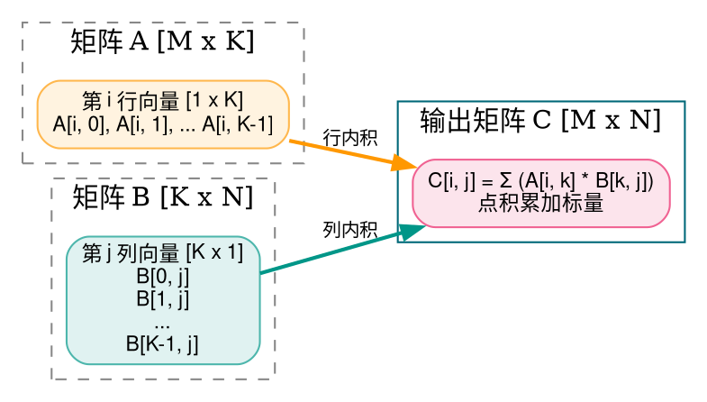
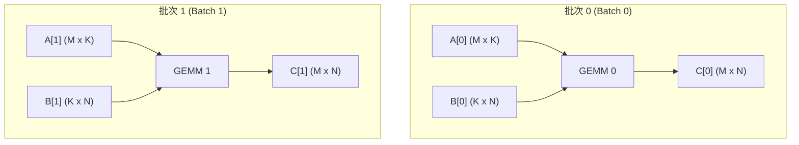
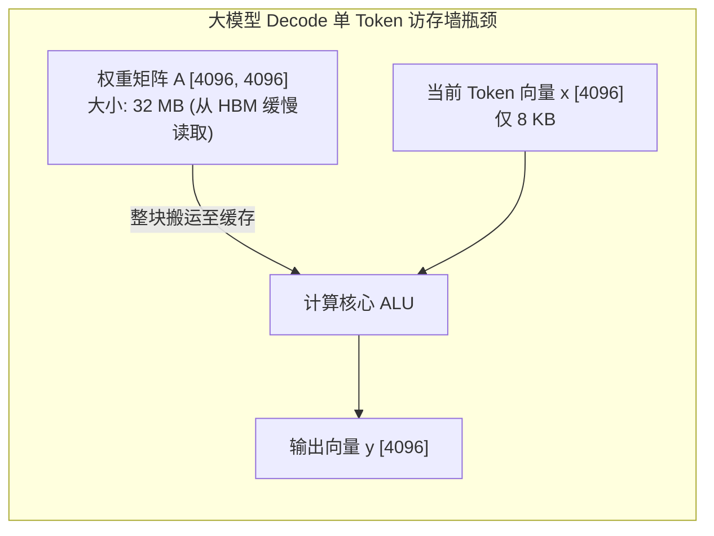
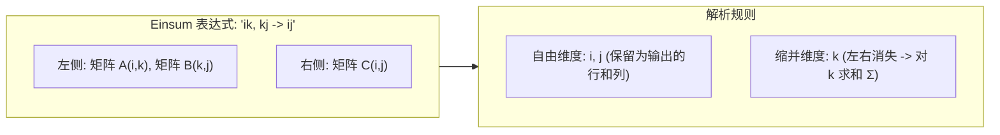
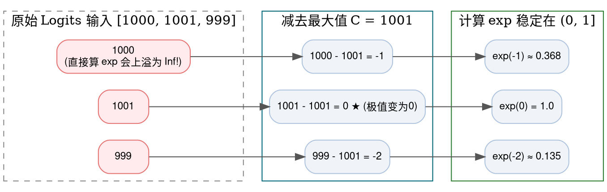

> **导读**：在当今千亿参数大模型（LLM）与前沿深度学习架构中，**超过 80% 的前向传播耗时和 95% 以上的浮点计算量（FLOPs）都消耗在线性代数算子中**。
>
> 无论是全连接层（MLP）、卷积核展开，还是 Transformer 的注意力投影矩阵，本质上都在做一件事：**矩阵乘法**。然而，同样的数学公式在真实计算机体系结构中运行时，却面临着**算力受限（Compute-Bound）**与**访存受限（Memory-Bound）**的截然分野；同时，面对极大或极小的实数输入，稍有不慎就会引发导致模型训练崩溃的 `NaN`（Not a Number）或 `Inf`（无穷大）灾难。
>
> 本篇作为《深度学习底层算子从零到一》系列的第二讲，将带你从最朴素的线性代数几何意义出发，彻底搞懂 GEMM、BMM、GEMV、Einsum 以及 Softmax 的底层运行机制。

---

## 零、初学者核心概念速查：算力受限、访存墙与数值稳定

> [!NOTE] 核心概念形象字典
>
> - **FLOPs（浮点运算次数）**：Floating Point Operations，衡量算法计算复杂度的物理度量。例如进行一次乘加运算 $a \times b + c$，包含 1 次乘法和 1 次加法，共计 2 次 FLOPs。
> - **计算强度（Arithmetic Intensity）**：每从内存读取 1 个字节（Byte）数据，能在处理器中进行多少次浮点运算（FLOPs/Byte）。计算强度越高，硬件的算力利用率越饱满。
> - **算力受限（Compute-Bound）**：数据早已塞满了芯片的内部高速缓存（SRAM/Cache），计算核心（ALU/Tensor Core）已经 100% 满负荷旋转，瓶颈在于芯片的极限峰值算力。典型代表：大 Batch 的 **GEMM**。
> - **访存受限 / 存储墙（Memory-Bound / Memory Wall）**：处理器的计算核心大多处于“饥饿等待”状态，因为外部显存（DDR/HBM）向芯片搬运数据的速度太慢了。典型代表：大模型逐字解码阶段的 **GEMV**。
> - **数值上溢（Overflow）**：浮点数绝对值太大，超出了 IEEE 754 浮点格式能表示的上限（在 FP32 中约为 $3.4 \times 10^{38}$，在 FP16 中仅为 $65504$），导致数值直接变成正无穷 `+Inf`。
> - **数值下溢（Underflow）**：浮点数绝对值太小，接近于 0，硬件无法分辨其精度而强行截断为 `0.0`，导致除以 0 或对数 $\ln(0)$ 产生 `-Inf`。
> - **NaN（Not a Number）**：非有效数值。当出现 $0/0$、$\infty - \infty$ 或 $0 \times \infty$ 等非法数学未定式时，浮点单元产生的灾难性标记，会像病毒一样迅速污染整个神经网络的所有梯度。

---

## 1. GEMM / MatMul (通用矩阵乘法)

### 1.1 原理解析
- **标准定义（BLAS 规范）**：
  $$ C = \alpha (A \times B) + \beta C $$
  其中矩阵 $A$ 形状为 $[M, K]$，矩阵 $B$ 形状为 $[K, N]$，输出矩阵 $C$ 形状为 $[M, N]$。$\alpha, \beta$ 为标量缩放因子（深度学习中通常 $\alpha=1, \beta=0$，即 $C = A \times B$）。
- **计算复杂度**：对于每个输出元素 $C[i, j]$，都需要执行长度为 $K$ 的内积（$K$ 次乘法和 $K$ 次累加）。因此：
  $$ \text{总计算量} = 2 \times M \times N \times K \text{ FLOPs} $$
  时间复杂度为三阶多项式 $O(M \cdot N \cdot K)$。
- **Cache 访存局部性（Memory Locality）**：
  在最朴素的三重循环中（遍历 $i \in [0, M)$, $j \in [0, N)$, $k \in [0, K)$），访问矩阵 $B$ 时每次跳跃的步长为 $N$（在列方向跨行），极易发生 Cache Miss。工业级 GEMM（如 cuBLAS、OpenBLAS、Eigen）都会对矩阵进行微块切分（Tiling）与循环重排（Loop Permutation）。



### 1.2 原生 Python 实现
```python
def naive_gemm(A: list[list[float]], B: list[list[float]], alpha: float = 1.0, beta: float = 0.0, C: list[list[float]] = None) -> list[list[float]]:
    """纯 Python 原生 GEMM 实现: C = alpha * (A @ B) + beta * C"""
    M = len(A)
    K = len(A[0])
    K_B = len(B)
    N = len(B[0])
    
    if K != K_B:
        raise ValueError(f"矩阵内积维度不匹配: A 列数 {K} != B 行数 {K_B}")
    
    # 初始化输出矩阵 C
    if C is None or beta == 0.0:
        out = [[0.0] * N for _ in range(M)]
    else:
        out = [[C[r][c] * beta for c in range(N)] for r in range(M)]
        
    # 三重循环计算内积
    for i in range(M):
        for j in range(N):
            acc = 0.0
            for k in range(K):
                acc += A[i][k] * B[k][j]
            out[i][j] += alpha * acc
            
    return out

if __name__ == "__main__":
    mat_A = [
        [1.0, 2.0, 3.0],
        [4.0, 5.0, 6.0]
    ] # 2 x 3
    mat_B = [
        [7.0, 8.0],
        [9.0, 1.0],
        [2.0, 3.0]
    ] # 3 x 2
    
    res = naive_gemm(mat_A, mat_B)
    print("GEMM 输出矩阵 [2 x 2]:")
    for row in res:
        print(f"  {row}")
```

### 1.3 原生 C++ 实现
```cpp
#include <iostream>
#include <vector>
#include <iomanip>

int main() {
    constexpr int M = 2;
    constexpr int K = 3;
    constexpr int N = 2;

    const float A[M][K] = {
        {1.0f, 2.0f, 3.0f},
        {4.0f, 5.0f, 6.0f}
    };
    const float B[K][N] = {
        {7.0f, 8.0f},
        {9.0f, 1.0f},
        {2.0f, 3.0f}
    };
    float C[M][N] = {0.0f};

    // 朴素三重循环 GEMM
    for (int i = 0; i < M; ++i) {
        for (int j = 0; j < N; ++j) {
            float sum = 0.0f;
            for (int k = 0; k < K; ++k) {
                sum += A[i][k] * B[k][j];
            }
            C[i][j] = sum;
        }
    }

    std::cout << "=== 原生 C++ 朴素 GEMM 计算结果 ===" << std::endl;
    for (int i = 0; i < M; ++i) {
        std::cout << "行 " << i << ": [";
        for (int j = 0; j < N; ++j) {
            std::cout << std::fixed << std::setprecision(1) << C[i][j] << (j + 1 < N ? ", " : "");
        }
        std::cout << "]" << std::endl;
    }
    return 0;
}
```

---

## 2. BMM (批量矩阵乘 / Batch MatMul)

### 2.1 原理解析
- **定义**：在现代深度学习中，数据几乎总是以批次（Batch）为单位进行组织的。BMM 接受两个三维张量：
  - 张量 $A$: $[B, M, K]$
  - 张量 $B$: $[B, K, N]$
  - 输出张量 $C$: $[B, M, N]$
- **物理机制**：相当于沿着第 0 维（Batch 维度），独立并发执行 $B$ 次彼此互不干扰的标准 GEMM。每个批次内的矩阵互相独立，极易在现代并行硬件（GPU 流处理器、多核 CPU）上实现大跨度的批次级并行化调度。



### 2.2 原生 Python 实现
```python
def naive_bmm(A: list[list[list[float]]], B: list[list[list[float]]]) -> list[list[list[float]]]:
    """批量矩阵乘法 [B, M, K] x [B, K, N] -> [B, M, N]"""
    batch_size = len(A)
    if len(B) != batch_size:
        raise ValueError("Batch 维度必须相等")
        
    M = len(A[0])
    K = len(A[0][0])
    N = len(B[0][0])
    
    output = [[[0.0] * N for _ in range(M)] for _ in range(batch_size)]
    
    for b in range(batch_size):
        for i in range(M):
            for j in range(N):
                acc = 0.0
                for k in range(K):
                    acc += A[b][i][k] * B[b][k][j]
                output[b][i][j] = acc
    return output

if __name__ == "__main__":
    # Batch = 2, M = 2, K = 2, N = 2
    batch_A = [
        [[1.0, 0.0], [0.0, 1.0]],     # 单位矩阵
        [[2.0, 0.0], [0.0, 2.0]]      # 2倍单位阵
    ]
    batch_B = [
        [[4.0, 5.0], [6.0, 7.0]],
        [[1.0, 2.0], [3.0, 4.0]]
    ]
    res_bmm = naive_bmm(batch_A, batch_B)
    print("BMM 批次计算输出:")
    for b_idx, mat in enumerate(res_bmm):
        print(f"Batch {b_idx}: {mat}")
```

### 2.3 原生 C++ 实现
```cpp
#include <iostream>

int main() {
    constexpr int B = 2;
    constexpr int M = 2;
    constexpr int K = 2;
    constexpr int N = 2;

    const float batch_A[B][M][K] = {
        {{1.f, 0.f}, {0.f, 1.f}},
        {{2.f, 0.f}, {0.f, 2.f}}
    };
    const float batch_B[B][K][N] = {
        {{4.f, 5.f}, {6.f, 7.f}},
        {{1.f, 2.f}, {3.f, 4.f}}
    };
    float batch_C[B][M][N] = {0.0f};

    for (int b = 0; b < B; ++b) {
        for (int i = 0; i < M; ++i) {
            for (int j = 0; j < N; ++j) {
                float sum = 0.0f;
                for (int k = 0; k < K; ++k) {
                    sum += batch_A[b][i][k] * batch_B[b][k][j];
                }
                batch_C[b][i][j] = sum;
            }
        }
    }

    std::cout << "=== 原生 C++ BMM 批次矩阵乘验证 ===" << std::endl;
    for (int b = 0; b < B; ++b) {
        std::cout << "Batch " << b << ":\n";
        for (int i = 0; i < M; ++i) {
            std::cout << "  [";
            for (int j = 0; j < N; ++j) {
                std::cout << batch_C[b][i][j] << (j + 1 < N ? ", " : "");
            }
            std::cout << "]\n";
        }
    }
    return 0;
}
```

---

## 3. GEMV (矩阵-向量乘 / Matrix-Vector Multiplication)

### 3.1 原理解析：为什么 GEMV 是大模型自回归解码的死敌？
- **公式**：
  $$ y = \alpha (A \times x) + \beta y $$
  其中矩阵 $A$ 形状为 $[M, K]$，向量 $x$ 形状为 $[K]$，输出向量 $y$ 形状为 $[M]$。
- **大模型落地核心瓶颈**：
  - 在大模型预训练（Prefill 阶段）中，输入是长度为 $S$ 的一整串 Prompt，此时计算是 $M=S$ 的 GEMM（计算密集型，GPU 利用率高达 60%+）。
  - 但在**逐字自回归解码（Decode 阶段）**中，模型每次只能吐出 1 个 Token（$M=1$），此时所有的全连接投影瞬间退化成了 **GEMV**！
  - **致命后果**：为了计算这个单 Token 的输出，芯片必须把模型数十吉字节（GB）的庞大权重参数全盘从显存（HBM）中读入核心一次，而每个读取出来的权重数字只与向量做了一次乘法就被抛弃！计算强度跌入谷底（典型的**极致访存受限 Memory-Bound**），硬件利用率往往暴跌至个位数。



### 3.2 原生 Python 实现
```python
def naive_gemv(A: list[list[float]], x: list[float], alpha: float = 1.0, beta: float = 0.0, y: list[float] = None) -> list[float]:
    """矩阵-向量乘法 y = alpha * (A @ x) + beta * y"""
    M = len(A)
    K = len(A[0])
    if len(x) != K:
        raise ValueError(f"维度不匹配: 矩阵列数 {K} != 向量长度 {len(x)}")
        
    out = [0.0] * M
    for i in range(M):
        acc = 0.0
        for k in range(K):
            acc += A[i][k] * x[k]
        orig_y = y[i] if y is not None else 0.0
        out[i] = alpha * acc + beta * orig_y
    return out

if __name__ == "__main__":
    matrix = [
        [1.0, 2.0, 3.0],
        [4.0, 5.0, 6.0]
    ] # 2 x 3
    vec = [0.5, -1.0, 2.0] # 3
    y_out = naive_gemv(matrix, vec)
    print("GEMV 输出向量 (长度 2):", y_out)
```

### 3.3 原生 C++ 实现
```cpp
#include <iostream>

int main() {
    constexpr int M = 2;
    constexpr int K = 3;
    const float A[M][K] = {
        {1.0f, 2.0f, 3.0f},
        {4.0f, 5.0f, 6.0f}
    };
    const float x[K] = {0.5f, -1.0f, 2.0f};
    float y[M] = {0.0f};

    for (int i = 0; i < M; ++i) {
        float sum = 0.0f;
        for (int k = 0; k < K; ++k) {
            sum += A[i][k] * x[k];
        }
        y[i] = sum;
    }

    std::cout << "=== 原生 C++ GEMV 输出 ===" << std::endl;
    for (int i = 0; i < M; ++i) {
        std::cout << "y[" << i << "] = " << y[i] << std::endl;
    }
    return 0;
}
```

---

## 4. Einsum (爱因斯坦求和约定)

### 4.1 原理解析
- **来源**：阿尔伯特·爱因斯坦在研究广义相对论时为简化张量公式提出的数学紧凑标记法。
- **核心法则**：
  1. 方程分为输入签名与输出签名，由箭头 `->` 分隔（如 `"ik,kj->ij"`）。
  2. **自由维度（Free Index）**：在箭头左右两侧都出现的字母，表示保留该维度。
  3. **缩并维度（Reduction Index）**：只在箭头左侧出现、在右侧消失的字母，表示**对该维度进行全范围累加求和（$\Sigma$）**。
- **百变算子统一度量**：
  - 内积（点乘 Dot Product）：`"i,i->"`
  - 外积（Outer Product）：`"i,j->ij"`
  - 矩阵转置：`"ij->ji"`
  - 矩阵迹（对角线求和 Trace）：`"ii->"`
  - 标准矩阵乘法：`"ik,kj->ij"`
  - 批量多头注意力分数计算：`"bhqd,bhkd->bhqk"`



### 4.2 原生 Python 实现
```python
def naive_einsum_matmul(A: list[list[float]], B: list[list[float]]) -> list[list[float]]:
    """以爱因斯坦求和语义 'ik,kj->ij' 朴素模拟矩阵乘法"""
    M = len(A)
    K = len(A[0])
    N = len(B[0])
    
    # 按照 'ij' 构造输出
    C = [[0.0] * N for _ in range(M)]
    for i in range(M):
        for j in range(N):
            # 对缩并字母 'k' 进行累加
            for k in range(K):
                C[i][j] += A[i][k] * B[k][j]
    return C

def naive_einsum_trace(A: list[list[float]]) -> float:
    """以爱因斯坦求和语义 'ii->' 计算矩阵对角线迹 (Trace)"""
    N = min(len(A), len(A[0]))
    trace_val = 0.0
    for i in range(N):
        trace_val += A[i][i]
    return trace_val

if __name__ == "__main__":
    mat = [
        [3.0, 1.0],
        [2.0, 5.0]
    ]
    trace = naive_einsum_trace(mat)
    print("Einsum 'ii->' (矩阵迹 Trace):", trace)
```

### 4.3 原生 C++ 实现
```cpp
#include <iostream>

int main() {
    // 模拟 Einsum "i,i->" (向量点积)
    constexpr int N = 3;
    const float x[N] = {1.0f, 2.0f, 3.0f};
    const float y[N] = {4.0f, 5.0f, 6.0f};

    float dot_product = 0.0f;
    for (int i = 0; i < N; ++i) {
        dot_product += x[i] * y[i];
    }

    std::cout << "=== 原生 C++ Einsum 'i,i->' 向量点积 ===" << std::endl;
    std::cout << "Dot Product = " << dot_product << std::endl;
    return 0;
}
```

---

## 5. Softmax 与数值稳定机制 (Safe-Softmax)

### 5.1 原理解析：为什么直接算 Softmax 会爆炸？
标准 Softmax 负责将一个任意实数向量 $x = [x_1, x_2, \dots, x_N]$ 转换为概率分布：
$$ \text{Softmax}(x)_i = \frac{e^{x_i}}{\sum_{j=1}^N e^{x_j}} $$

#### 致命灾难：浮点上溢（Overflow）
自然常数指数函数 $e^x$ 的增长速度极快：
- 当 $x = 100$ 时，$e^{100} \approx 2.68 \times 10^{43}$。
- 而单精度浮点（FP32）的最大上限仅仅是 $3.4 \times 10^{38}$！
- 因此，一旦输入的 Logits 出现稍大的数值（例如注意力分数未经缩放时达到 89），$e^{89}$ 就会直接溢出为 `+Inf`。随后的分母求和得到 `+Inf`，计算 $\frac{\infty}{\infty}$ 就会瞬间在整个网络中爆发 `NaN`！

#### 数学救星：减去最大值（Safe-Softmax 原理）
利用指数运算的乘除性质，分子分母同除以一个常数 $e^C$：
$$ \frac{e^{x_i}}{\sum_j e^{x_j}} = \frac{e^{x_i - C}}{\sum_j e^{x_j - C}} $$
如果我们令常数 $C = \max(x) = \max(\{x_1, \dots, x_N\})$，那么：
$$ x_i - C \le 0 \quad (\forall i) $$
所有的幂次指数全部被平移到了非正数区间 $(-\infty, 0]$ 内！最大项为 $e^0 = 1.0$。
**这在数学上保证了计算 $e^{x_i - \max(x)}$ 的数值绝对不会超过 1.0，彻底根除了上溢风险！**



### 5.2 原生 Python 实现
```python
import math

def naive_safe_softmax(logits: list[float]) -> list[float]:
    """数值稳定的 Safe-Softmax 算法"""
    # 步骤 1: 寻找序列最大值 max_val，防止指数上溢
    max_val = max(logits)
    
    # 步骤 2: 平移指数求和
    exp_vals = [math.exp(x - max_val) for x in logits]
    sum_exp = sum(exp_vals)
    
    # 步骤 3: 归一化为概率分布
    probs = [v / sum_exp for v in exp_vals]
    return probs

if __name__ == "__main__":
    # 测试极端大数 (若不平移，exp(1000) 必然发生 Overflow 崩溃)
    large_logits = [1000.0, 1001.0, 999.0]
    safe_probs = naive_safe_softmax(large_logits)
    print("Safe-Softmax 在极端大数下的安全输出:")
    for idx, p in enumerate(safe_probs):
        print(f"  P(x_{idx}) = {p:.6f}")
    print(f"概率总和归一验证: {sum(safe_probs):.6f}")
```

### 5.3 原生 C++ 实现
```cpp
#include <iostream>
#include <vector>
#include <cmath>
#include <algorithm>
#include <iomanip>

int main() {
    // 包含极端大值的输入向量
    const float logits[] = {1000.0f, 1001.0f, 999.0f};
    constexpr int N = 3;

    // 1. 寻找最大值
    float max_val = logits[0];
    for (int i = 1; i < N; ++i) {
        if (logits[i] > max_val) {
            max_val = logits[i];
        }
    }

    // 2. 平移并计算指数和
    float exp_vals[N];
    float sum_exp = 0.0f;
    for (int i = 0; i < N; ++i) {
        exp_vals[i] = std::exp(logits[i] - max_val);
        sum_exp += exp_vals[i];
    }

    // 3. 归一化
    std::cout << "=== 原生 C++ Safe-Softmax 验证 ===" << std::endl;
    float total_p = 0.0f;
    for (int i = 0; i < N; ++i) {
        float prob = exp_vals[i] / sum_exp;
        total_p += prob;
        std::cout << "P(x_" << i << ") = " << std::fixed << std::setprecision(6) << prob << std::endl;
    }
    std::cout << "概率和 SUM = " << total_p << std::endl;
    return 0;
}
```

---

## 总结与思维进阶

在本讲中，我们系统剖析了深度学习的核心算力引擎：
1. **GEMM**：理解 $O(M \cdot K \cdot N)$ 计算量与矩阵分块（Tiling）对缓存命中的决定性意义；
2. **BMM**：掌握批次维度并发执行的无依赖性；
3. **GEMV**：彻底看透大模型自回归解码（Decode）阶段“显存带宽被榨干、算力空转”的物理本质；
4. **Einsum**：掌握由自由维度与缩并维度构成的紧凑现代张量运算语言；
5. **Softmax**：领悟通过减去极值（Safe-Softmax）避免浮点数上溢与 `NaN` 的经典工程技巧。

下一讲，我们将探索**激活函数（ReLU / GELU / SiLU / Sigmoid / Tanh / GLU）**——看它们如何打破线性代数的单调堆叠，赋予深度神经网络逼近复杂现实世界的奇迹力量！
