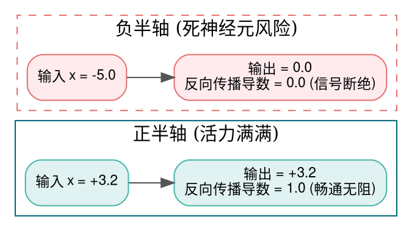
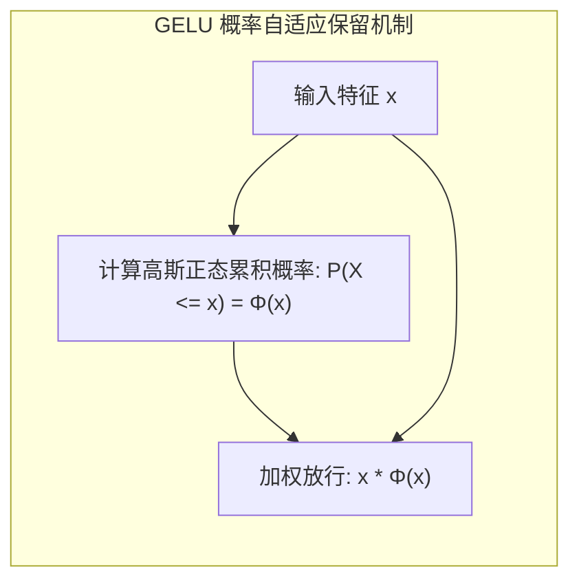
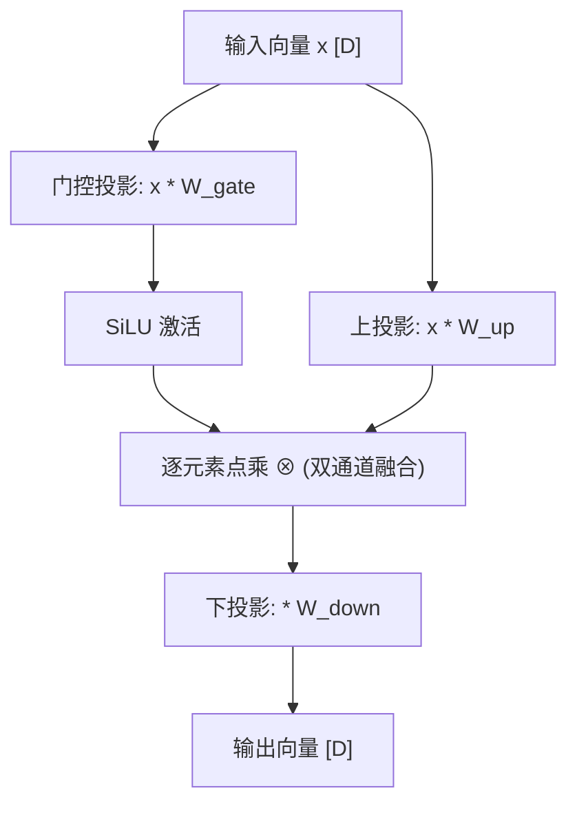

> **致初学者**：很多初学者刚接触神经网络时，总以为“网络层数越深越聪明”。
>
> 于是有人写了一个 100 层的神经网络，每一层都是简单的矩阵乘法：
> $$ y = W_{100} \times (W_{99} \dots (W_1 \times x)) $$
> 结果发现，这个 100 层的超深网络，连最简单的“异或逻辑（XOR）”都学不会！
>
> 为什么？因为初等代数告诉我们：两个矩阵相乘还是矩阵，$W_2 \times W_1 = W_{\text{new}}$。**无论你叠 100 层还是 1000 层，它在数学上完全等价于一个单层线性矩阵！**
>
> 真正给神经网络注入“灵魂”、让它能够弯曲高维空间、拟合宇宙中万事万物规律的，正是**激活函数（Activation Function）引入的非线性（Non-Linearity）**！
>
> 但激活函数也是一把双刃剑：选得不好，反向传播的梯度会瞬间缩小为 0（**梯度消失**），或者让神经元彻底死翘翘（**Dying ReLU**）。
>
> 本篇作为系列第三讲，将用最通俗的数字推演，带你彻底吃透 ReLU、GELU、SiLU、Sigmoid、Tanh 以及大模型新宠 SwiGLU！

---

## 零、初学者必懂概念：为什么没有非线性，网络就是个“废物”？

我们用最纯粹的 $2 \times 2$ 矩阵乘法来亲自证明一次：
假设第一层权重为：$W_1 = \begin{pmatrix} 1 & 2 \\ 3 & 4 \end{pmatrix}$，第二层权重为：$W_2 = \begin{pmatrix} 5 & 6 \\ 7 & 8 \end{pmatrix}$。
如果中间**不加任何激活函数**，第二层的输出为：
$$
y = W_2 \times (W_1 \times x) = (W_2 \times W_1) \times x
$$
我们算一下 $W_2 \times W_1$：
$$
\begin{pmatrix} 5 & 6 \\ 7 & 8 \end{pmatrix} \begin{pmatrix} 1 & 2 \\ 3 & 4 \end{pmatrix} = \begin{pmatrix} 5\times 1 + 6\times 3 & 5\times 2 + 6\times 4 \\ 7\times 1 + 8\times 3 & 7\times 2 + 8\times 4 \end{pmatrix} = \begin{pmatrix} 23 & 34 \\ 31 & 46 \end{pmatrix}
$$
看！两层网络直接坍缩成了一个单一的矩阵 $\begin{pmatrix} 23 & 34 \\ 31 & 46 \end{pmatrix}$！
你花双倍电费跑两层，跟直接跑一层没有任何区别。**这就是为什么每一层之间必须强行塞入一个非线性激活函数，把直线“折弯”！**

> [!NOTE] 核心概念形象字典
>
> - **饱和区（Saturation）**：当输入 $x$ 变得很大或很小时，函数的曲线变得几乎完全水平，斜率（导数）趋近于 0。落在饱和区的神经元在反向传播时无法提供有效梯度。
> - **梯度消失（Vanishing Gradient）**：反向传播时，根据微积分链式法则，梯度是一层层相乘的：$\frac{\partial L}{\partial x} = g_1 \times g_2 \times \dots \times g_n$。如果每个激活函数的导数都在 $0.25$ 左右，乘上 10 层后：$0.25^{10} \approx 0.00000095$！前序层的梯度被缩减到几乎为 0，参数彻底停止学习！
> - **死神经元（Dying ReLU）**：神经元的权重更新到了一个极负的值，导致之后的任何正负输入算出来都是负数。由于 ReLU 在负半轴输出和导数恒为 0，该神经元永远无法复活。
> - **零中心化（Zero-Centered）**：函数的输出均值是否在 0 附近。若输出永远为正数，下一层神经元的梯度在反向更新时只能同正或同负，导致梯度在最优解周围走“之字形（Zig-zag）”折线震荡，收敛缓慢。

---

## 1. ReLU (修正线性单元 / Rectified Linear Unit)

### 1.1 生活比喻与公式
- **公式**：
  $$ \text{ReLU}(x) = \max(0, x) = \begin{cases} x, & x > 0 \\ 0, & x \le 0 \end{cases} $$
  导数极其单纯：
  $$ \text{ReLU}'(x) = \begin{cases} 1, & x > 0 \\ 0, & x \le 0 \end{cases} $$
- **生活比喻：单向水阀（止回阀）**：
  水往正方向流（$x > 0$），阀门完全打开，水流无损通过（导数为 1）；水往反方向倒灌（$x \le 0$），阀门彻底焊死，滴水不漏（输出为 0，导数为 0）。
- **神级优点**：
  1. **没有指数开销**：硬件只需读取浮点数的最高符号位即可，计算速度比 Sigmoid 快数十倍！
  2. **正半轴梯度永不衰减**：导数恒为 1，彻底治好了深层网络正向区间的梯度消失病。



### 1.2 手把手极小数字推演
输入向量为：`x = [-3.0, 0.0, 2.5]`
- 对 $x_0 = -3.0$：$\max(0, -3.0) = 0.0$；反向传播导数为 $0.0$；
- 对 $x_1 = 0.0$：$\max(0, 0.0) = 0.0$；反向传播导数为 $0.0$；
- 对 $x_2 = 2.5$：$\max(0, 2.5) = 2.5$；反向传播导数为 $1.0$；
- 输出结果：`[0.0, 0.0, 2.5]`。

### 1.3 原生 Python 逐行注释实现
```python
def naive_relu(x: list[float]) -> tuple[list[float], list[float]]:
    """原生 ReLU 前向输出与反向传播局部导数"""
    outputs = []
    derivatives = []
    for val in x:
        if val > 0.0:
            outputs.append(val)
            derivatives.append(1.0) # 正半轴导数恒为 1.0
        else:
            outputs.append(0.0)
            derivatives.append(0.0) # 负半轴被截断，导数为 0.0
    return outputs, derivatives

if __name__ == "__main__":
    test_data = [-3.0, -0.5, 0.0, 1.5, 4.0]
    out, grads = naive_relu(test_data)
    print("输入数据:", test_data)
    print("ReLU 输出:", out)
    print("ReLU 导数:", grads)
```

### 1.4 原生 C++ 逐行注释实现
```cpp
#include <iostream>

int main() {
    const float input[] = {-3.0f, -0.5f, 0.0f, 1.5f, 4.0f};
    constexpr int N = 5;
    float output[N];
    float grad[N];

    for (int i = 0; i < N; ++i) {
        if (input[i] > 0.0f) {
            output[i] = input[i];
            grad[i] = 1.0f;
        } else {
            output[i] = 0.0f;
            grad[i] = 0.0f;
        }
    }

    std::cout << "=== 原生 C++ ReLU 输出验证 ===" << std::endl;
    for (int i = 0; i < N; ++i) {
        std::cout << "x = " << input[i] << " -> ReLU = " << output[i] << " | 导数 = " << grad[i] << std::endl;
    }
    return 0;
}
```

---

## 2. Sigmoid 与 Tanh (早期功臣与梯度消失祸首)

### 2.1 深度拆解：为什么深层网络不能用 Sigmoid 当隐层激活？
- **Sigmoid 公式**：
  $$ \sigma(x) = \frac{1}{1 + e^{-x}} $$
  将任意实数压缩到 $(0, 1)$。
- **致命的导数峰值缺陷**：
  Sigmoid 的导数公式为：
  $$ \sigma'(x) = \sigma(x) \cdot (1 - \sigma(x)) $$
  这个函数在什么时候能取得最大值？
  当 $\sigma(x) = 0.5$（即 $x = 0$）时，导数取得**历史最高峰值：$0.5 \times (1 - 0.5) = 0.25$！**
  **这意味着：即便在最理想的状态下，梯度每倒退反向穿过一层 Sigmoid，其能量至少被砍掉 75%！**
  只要网络有 6 层，$0.25^6 \approx 0.000244$；到了第 10 层，梯度已化为乌有。所以经典多层网络根本无法训练，直到 ReLU 的出现才拯救了深度学习。
- **Tanh（双曲正切）**：
  $$ \tanh(x) = \frac{e^x - e^{-x}}{e^x + e^{-x}} = 2\sigma(2x) - 1 $$
  值域为 $(-1, 1)$。在 $x=0$ 处的导数峰值为 $1.0$；并且是**严格零中心化的**。但输入一旦大于 3 或小于 -3，曲线立即进入两端平坦的饱和区，依然难逃梯度消失。


### 2.2 手把手极小数字推演
计算 $x = 0.0$ 与 $x = 2.0$ 的 Sigmoid 表现：
- $x = 0.0$：
  - $\sigma(0) = \frac{1}{1 + e^0} = \frac{1}{1 + 1} = 0.5$
  - 导数 $\sigma'(0) = 0.5 \times (1 - 0.5) = 0.25$
- $x = 2.0$：
  - $e^{-2} \approx 0.1353$
  - $\sigma(2) = \frac{1}{1 + 0.1353} = \frac{1}{1.1353} \approx 0.8808$
  - 导数 $\sigma'(2) = 0.8808 \times (1 - 0.8808) = 0.8808 \times 0.1192 \approx 0.1050$（只剩 10% 的梯度能穿过去！）

---

## 3. GELU (高斯误差线性单元 / Gaussian Error Linear Unit)

### 3.1 生活比喻与哲学思想
- **背景**：BERT、GPT-2、GPT-3、ViT 的标配。
- **痛点反思**：ReLU 的生硬截断太野蛮了——在 0 处突然断崖式拐角，导数突变为不可导；负数直接一刀切全杀掉。
- **通俗比喻：智能概率门禁**：
  GELU 将量子物理和概率思想引入了激活函数：
  每一个输入数字 $x$ 能不能被保留通过，取决于它**打败标准正态分布随机噪声的概率**！
  - 如果 $x = +3.0$（极其强烈的正向特征），它大于噪声的概率是 $99.87\%$，于是几乎 $100\%$ 原样放行；
  - 如果 $x = -3.0$（极其糟糕的负向特征），它大于噪声的概率仅有 $0.13\%$，于是几乎 $100\%$ 被抹杀丢弃；
  - 如果 $x = -0.5$（边缘微弱的弱信号），它保留一点点微小的负值通道（产生平滑浅谷），给网络一丝改过自新的微弱生机。



### 3.2 工业常用 Tanh 近似公式与手算
精确的 GELU 依赖误差函数 $\text{erf}$，硬件计算极慢。实际工程全用 Hendrycks 提出的极速近似版：
$$ \text{GELU}(x) \approx 0.5 x \left( 1 + \tanh\left( \sqrt{\frac{2}{\pi}} \left( x + 0.044715 x^3 \right) \right) \right) $$
我们手算 $x = 1.0$：
1. $x + 0.044715 x^3 = 1.0 + 0.044715 \times 1.0 = 1.044715$；
2. $\sqrt{2/\pi} \approx 0.79788$；
3. 相乘：$0.79788 \times 1.044715 \approx 0.83356$；
4. $\tanh(0.83356) \approx 0.6822$；
5. $0.5 \times 1.0 \times (1 + 0.6822) = 0.5 \times 1.6822 = 0.8411$！
对比：输入 1.0，被平滑保留了 84.11%！

### 3.3 原生 Python 逐行注释实现
```python
import math

def naive_gelu(x: list[float]) -> list[float]:
    """Tanh 快速近似版 GELU"""
    sqrt_2_over_pi = math.sqrt(2.0 / math.pi) # 约 0.7978846
    output = []
    for val in x:
        inner = sqrt_2_over_pi * (val + 0.044715 * (val ** 3))
        gelu_val = 0.5 * val * (1.0 + math.tanh(inner))
        output.append(gelu_val)
    return output

if __name__ == "__main__":
    sample_inputs = [-2.0, -1.0, 0.0, 1.0, 2.0]
    res_gelu = naive_gelu(sample_inputs)
    print("GELU 输出:")
    for v_in, v_out in zip(sample_inputs, res_gelu):
        print(f"  x = {v_in:>4} -> GELU(x) = {v_out:.4f}")
```

---

## 4. SiLU / Swish (自门控激活：开源大模型新王)

### 4.1 公式与手算推导
- **公式**：
  $$ \text{SiLU}(x) = x \cdot \sigma(x) = \frac{x}{1 + e^{-x}} $$
  由 Google Brain（Swish）与 Elfwing 等人独立提出。
- **大模型为什么全都在用 SiLU？**
  LLaMA、LLaMA-2/3、Mistral、DeepSeek、Qwen 全系标配！
  它比 GELU 的公式更简炼（只需要一个简单的 Sigmoid），在负半轴 $x \approx -1.28$ 处有一个小小的低谷底（约为 $-0.278$），**具有处处可导的平滑非单调性（Non-monotonicity）**，在万亿参数模型上被证明收敛稳定性显著超越经典 ReLU。


### 4.2 手把手极小数字推演
- 输入 $x = 2.0$：
  $\sigma(2.0) \approx 0.8808 \implies \text{SiLU}(2.0) = 2.0 \times 0.8808 = 1.7616$；
- 输入 $x = -2.0$：
  $\sigma(-2.0) \approx 0.1192 \implies \text{SiLU}(-2.0) = -2.0 \times 0.1192 = -0.2384$（保留了一个微弱的负信号）；
- 输入 $x = 0.0$：
  $\sigma(0.0) = 0.5 \implies \text{SiLU}(0.0) = 0.0 \times 0.5 = 0.0$。

---

## 5. GLU 与 SwiGLU (门控线性单元机制：大模型 FFN 的终极杀招)

### 5.1 痛点剖析：传统 FFN 为什么不够聪明？
- 传统的全连接前馈层（FFN）非常单调：
  $$ \text{Output} = \text{Activation}(x W_1) \times W_2 $$
  所有输入特征只能呆板地沿着同一条管道往前冲。
- **GLU（门控线性单元）的降维打击**：
  引入**双通路信息流机制**：
  将线性投影一分为二：一条通路作为**待处理内容（Up Projection）**，另一条通路作为**动态智能闸门（Gate Projection）**！
  $$ \text{GLU}(x) = (x W_{\text{content}}) \otimes \sigma(x W_{\text{gate}}) $$
- **SwiGLU（现代大模型统治者）**：
  Shazeer 在 2020 年提出，将门控开关的激活函数从 Sigmoid 换成 SiLU：
  $$ \text{SwiGLU}(x) = (x W_{\text{up}}) \otimes \text{SiLU}(x W_{\text{gate}}) $$
  最终整个前馈模块设计为：
  $$ \text{FFN}_{\text{SwiGLU}}(x) = \Big( (x W_{\text{up}}) \otimes \text{SiLU}(x W_{\text{gate}}) \Big) W_{\text{down}} $$
  **模型可以根据当前上下文，在每一个特征维度上自主决定“这个特征允许通过多少”，表达能力产生了质的飞跃！**



### 5.2 原生 Python 逐行注释实现
```python
import math

def naive_swiglu(x: list[float], w_gate: list[float], w_up: list[float]) -> list[float]:
    """单向量朴素 SwiGLU 门控变换: Output = Up * SiLU(Gate)"""
    dim = len(x)
    output = []

    for i in range(dim):
        # 1. 计算门控分支与激活值
        gate_val = x[i] * w_gate[i]
        silu_gate = gate_val / (1.0 + math.exp(-gate_val)) # SiLU(Gate)
        
        # 2. 计算上投影分支内容
        up_val = x[i] * w_up[i]
        
        # 3. 门控与内容在特征维度逐元素点乘
        output.append(silu_gate * up_val)

    return output

if __name__ == "__main__":
    test_x = [1.0, 2.0, -1.0]
    weights_gate = [0.5, 1.2, 0.8]
    weights_up = [2.0, 1.0, -2.0]
    
    res = naive_swiglu(test_x, weights_gate, weights_up)
    print("SwiGLU 门控变换输出:", [round(v, 4) for v in res])
```

### 5.3 原生 C++ 逐行注释实现
```cpp
#include <iostream>
#include <cmath>
#include <iomanip>

int main() {
    constexpr int D = 3;
    const float x[D] = {1.0f, 2.0f, -1.0f};
    const float w_gate[D] = {0.5f, 1.2f, 0.8f};
    const float w_up[D] = {2.0f, 1.0f, -2.0f};
    float out[D];

    for (int i = 0; i < D; ++i) {
        float gate = x[i] * w_gate[i];
        float silu_gate = gate / (1.0f + std::exp(-gate)); // SiLU(Gate)
        float up = x[i] * w_up[i];
        out[i] = silu_gate * up; // 点乘门控
    }

    std::cout << "=== 原生 C++ SwiGLU 计算验证 ===" << std::endl;
    for (int i = 0; i < D; ++i) {
        std::cout << "out[" << i << "] = " << std::fixed << std::setprecision(4) << out[i] << std::endl;
    }
    return 0;
}
```

---

## 总结与初学者避坑指南

| 激活算子 | 核心公式 | 导数峰值 | 优缺点/痛点 | 最佳现代落地 |
| :--- | :--- | :--- | :--- | :--- |
| **ReLU** | $\max(0, x)$ | **1.0** | 计算零成本，但负半轴存在死神经元风险 | 传统视觉网络 (ResNet/CNN) |
| **Sigmoid** | $\frac{1}{1 + e^{-x}}$ | **0.25** | 深层极易发生梯度消失，非零均值 | 仅用于二分类概率或门控系数 |
| **Tanh** | $\frac{e^x - e^{-x}}{e^x + e^{-x}}$ | 1.0 | 严格零均值，但两端依然饱和消失 | 循环神经网络 (LSTM/GRU) 内部 |
| **GELU** | $x \cdot \Phi(x)$ | 平滑无拐点 | 引入概率正则平滑，计算较慢（需近似） | 经典 Transformer (BERT/GPT-2) |
| **SiLU** | $x \cdot \sigma(x)$ | 自门控 | 简单平滑非单调，训练更稳定 | **现代大模型 (LLaMA/Mistral)** |
| **SwiGLU** | $Up \otimes \text{SiLU}(Gate)$ | 双通路 | 参数增加约 50%，但表征容量质的飞跃 | **全系顶尖开源 LLM FFN 标配** |

下一讲，我们将探讨深度神经网络稳定收敛的生命线——**归一化算子（LayerNorm / RMSNorm / BatchNorm）**！
