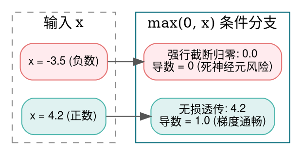
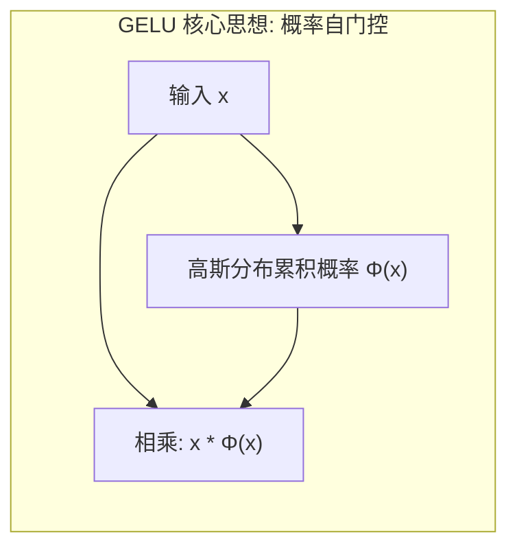
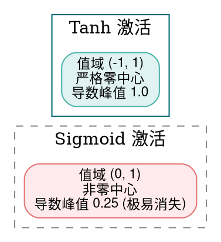
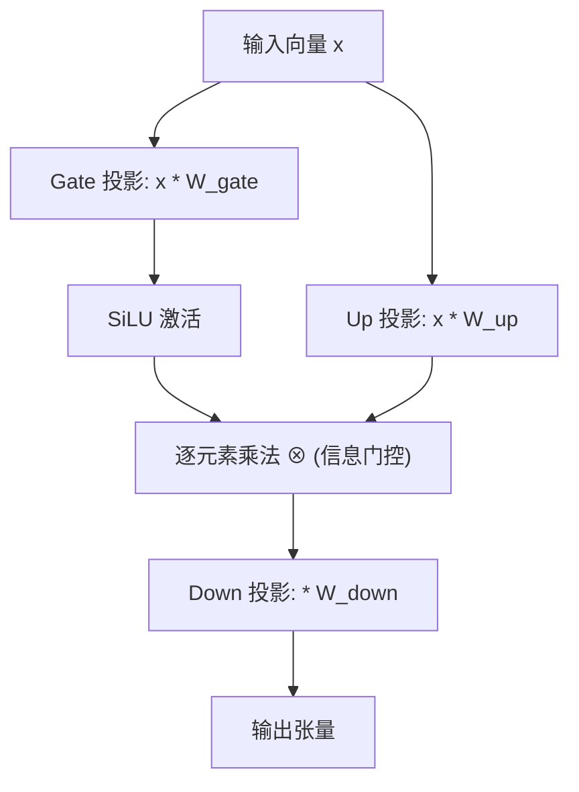

> **导读**：如果一个多层神经网络只包含线性变换（矩阵乘法 $W \cdot x + b$），那么无论你堆叠 10 层还是 1000 层，数学上它都**完全等价于一个单层线性矩阵**：
> $$ y = W_3 (W_2 (W_1 x)) = (W_3 W_2 W_1) x = W_{\text{combined}} x $$
> 这样的网络甚至无法解决一个最简单的异或（XOR）逻辑门问题！
>
> 真正赋予深度神经网络“能够拟合宇宙中任何连续复杂函数”（通用近似定理 Universal Approximation Theorem）神圣魔力的，正是**激活函数（Activation Functions）**引入的非线性变换。
>
> 然而，引入非线性并不是毫无代价的：指数运算的硬件耗时、反向传播时的**梯度消失（Vanishing Gradient）**与**梯度爆炸（Exploding Gradient）**、神经元永久坏死的 **Dying ReLU 现象**，一直贯穿着深度学习演进的数十年历程。
>
> 本篇作为系列第三讲，将带你彻底吃透 ReLU、GELU、SiLU、Sigmoid、Tanh 和现代大模型标配 GLU 的底层数学演进与工程实现。

---

## 零、初学者核心概念速查：非线性、饱和区与梯度消失

> [!NOTE] 核心概念形象字典
>
> - **线性（Linearity）与非线性（Non-Linearity）**：如果输出与输入成正比（满足叠加原理 $f(ax + by) = a f(x) + b f(y)$），就是线性的；反之，曲线拐弯或被截断就是非线性的。没有非线性，多层网络就无法折叠高维空间。
> - **饱和区（Saturation Region）**：当输入 $x$ 变得很大或很小时，函数的输出曲线变得几乎完全平坦，导数趋近于 0 的区域。
> - **梯度消失（Vanishing Gradient）**：根据微积分链式法则，反向传播时梯度由深层向前层逐层相乘。如果激活函数的导数落在饱和区（远小于 1），数十层连续连乘会导致梯度呈指数级衰减至 0，前层权重再也无法更新，网络彻底瘫痪。
> - **梯度爆炸（Exploding Gradient）**：反向传播时若各层权重或导数大于 1，多层连乘导致梯度呈指数级膨胀为无穷大（`Inf` 或 `NaN`），参数直接被震飞。
> - **零中心化（Zero-Centered）**：函数的输出均值是否接近于 0。若激活函数输出永远为正数（如 Sigmoid），会导致下一层神经元的输入全部为正，反向传播时权重梯度的符号全正或全负，导致梯度更新产生锯齿状震荡，收敛变慢。
> - **死神经元（Dying Neuron）**：某些激活函数在特定输入区间输出与导数全部为 0（如 ReLU 在负半轴），一旦某个神经元的权重偏置落入该区域，它对任何数据的梯度都将永远为 0，再也无法被训练激活，形同脑死亡。

---

## 1. ReLU (修正线性单元 / Rectified Linear Unit)

### 1.1 原理解析
- **数学定义**：
  $$ \text{ReLU}(x) = \max(0, x) = \begin{cases} x, & \text{if } x > 0 \\ 0, & \text{if } x \le 0 \end{cases} $$
  其一阶导数极其纯粹：
  $$ \text{ReLU}'(x) = \begin{cases} 1, & \text{if } x > 0 \\ 0, & \text{if } x \le 0 \end{cases} $$
- **第一性原理优势**：
  1. **计算零成本**：不需要做昂贵的自然对数指数 `exp` 运算，底层硬件只需检测浮点数的符号位即可完成计算。
  2. **正半轴不饱和**：当 $x > 0$ 时，导数恒为 1，彻底解决了正向区间深层网络的梯度消失难题。
- **物理缺陷：Dying ReLU**
  在负半轴，$f(x) = 0$ 且导数 $f'(x) = 0$。如果学习率设置过大，导致反向传播将偏置更新到了极负的位置，该神经元将永久输出 0，无法自愈。



### 1.2 原生 Python 实现
```python
def naive_relu(x: list[float]) -> list[float]:
    """逐元素 ReLU 激活函数"""
    return [max(0.0, val) for val in x]

def naive_relu_backward(x: list[float], grad_out: list[float]) -> list[float]:
    """ReLU 反向传播求导"""
    return [g if val > 0.0 else 0.0 for val, g in zip(x, grad_out)]

if __name__ == "__main__":
    test_x = [-2.5, 0.0, 1.5, 3.8]
    test_grad = [1.0, 1.0, 1.0, 1.0]
    out = naive_relu(test_x)
    grad_in = naive_relu_backward(test_x, test_grad)
    print("ReLU 前向输出:", out)
    print("ReLU 反向传播梯度:", grad_in)
```

### 1.3 原生 C++ 实现
```cpp
#include <iostream>

int main() {
    const float input[] = {-2.5f, 0.0f, 1.5f, 3.8f};
    constexpr int N = 4;
    float output[N];

    for (int i = 0; i < N; ++i) {
        output[i] = input[i] > 0.0f ? input[i] : 0.0f;
    }

    std::cout << "=== 原生 C++ ReLU 输出 ===" << std::endl;
    for (int i = 0; i < N; ++i) {
        std::cout << "ReLU(" << input[i] << ") = " << output[i] << std::endl;
    }
    return 0;
}
```

---

## 2. GELU (高斯误差线性单元 / Gaussian Error Linear Unit)

### 2.1 原理解析
- **背景**：BERT、GPT-2、GPT-3、ViT（视觉 Transformer）等里程碑模型的标配激活函数。
- **哲学思想**：结合了 Dropout 的随机正则化与 ReLU 的非线性。它将输入看作服从正态分布的变量，输入越大，保留该输入的概率越高；输入越小，被丢弃的概率越大：
  $$ \text{GELU}(x) = x \cdot \Phi(x) = x \cdot P(X \le x) = x \cdot \frac{1}{2} \left[ 1 + \text{erf}\left(\frac{x}{\sqrt{2}}\right) \right] $$
  其中 $\text{erf}$ 为误差函数（Gauss Error Function）。
- **Tanh 快速近似公式（深度学习框架常用）**：
  $$ \text{GELU}_{\text{approx}}(x) \approx 0.5 x \left( 1 + \tanh\left( \sqrt{\frac{2}{\pi}} \left( x + 0.044715 x^3 \right) \right) \right) $$
- **特性**：在负数区域具有一个平滑的凹陷谷底（在 $x \approx -0.17$ 附近），且**全局一阶可导**，避免了 ReLU 的不可导拐点。



### 2.2 原生 Python 实现
```python
import math

def naive_gelu_exact(x: list[float]) -> list[float]:
    """精确版 GELU (基于 math.erf)"""
    return [0.5 * val * (1.0 + math.erf(val / math.sqrt(2.0))) for val in x]

def naive_gelu_approx(x: list[float]) -> list[float]:
    """Tanh 快速近似版 GELU"""
    const_sqrt = math.sqrt(2.0 / math.pi)
    output = []
    for val in x:
        inner = const_sqrt * (val + 0.044715 * (val ** 3))
        output.append(0.5 * val * (1.0 + math.tanh(inner)))
    return output

if __name__ == "__main__":
    inputs = [-2.0, -1.0, 0.0, 1.0, 2.0]
    exact = naive_gelu_exact(inputs)
    approx = naive_gelu_approx(inputs)
    print("GELU 精确版:", [round(v, 4) for v in exact])
    print("GELU 近似版:", [round(v, 4) for v in approx])
```

### 2.3 原生 C++ 实现
```cpp
#include <iostream>
#include <cmath>
#include <iomanip>

int main() {
    const float input[] = {-2.0f, -1.0f, 0.0f, 1.0f, 2.0f};
    constexpr int N = 5;
    constexpr float SQRT_2_OVER_PI = 0.7978845608f;

    std::cout << "=== 原生 C++ GELU (Tanh 近似) 输出 ===" << std::endl;
    for (int i = 0; i < N; ++i) {
        float x = input[i];
        float inner = SQRT_2_OVER_PI * (x + 0.044715f * x * x * x);
        float gelu_val = 0.5f * x * (1.0f + std::tanh(inner));
        std::cout << "GELU(" << std::fixed << std::setprecision(1) << x << ") = " 
                  << std::setprecision(5) << gelu_val << std::endl;
    }
    return 0;
}
```

---

## 3. SiLU / Swish (Sigmoid 线性单元)

### 3.1 原理解析
- **数学定义**：
  $$ \text{SiLU}(x) = x \cdot \sigma(x) = \frac{x}{1 + e^{-x}} $$
- **大模型新王**：LLaMA、LLaMA-2/3、Mistral、DeepSeek、Qwen 等现代绝大多数顶尖开源 LLM 的 FFN 模块普遍采用 SiLU。
- **与 GELU 的相似性**：SiLU 同样具备平滑非单调性（在负区间有浅凹），但相比于复杂的 $\text{erf}$，SiLU 仅依赖一个成熟的 Sigmoid 计算，结构更加清晰优美。

### 3.2 原生 Python 实现
```python
import math

def naive_silu(x: list[float]) -> list[float]:
    """逐元素 SiLU / Swish: x / (1 + exp(-x))"""
    output = []
    for val in x:
        sigmoid = 1.0 / (1.0 + math.exp(-val))
        output.append(val * sigmoid)
    return output

if __name__ == "__main__":
    inputs = [-3.0, -1.0, 0.0, 1.0, 3.0]
    out = naive_silu(inputs)
    print("SiLU 输出:", [round(v, 5) for v in out])
```

### 3.3 原生 C++ 实现
```cpp
#include <iostream>
#include <cmath>
#include <iomanip>

int main() {
    const float input[] = {-3.0f, -1.0f, 0.0f, 1.0f, 3.0f};
    constexpr int N = 5;

    std::cout << "=== 原生 C++ SiLU 激活函数验证 ===" << std::endl;
    for (int i = 0; i < N; ++i) {
        float x = input[i];
        float silu = x / (1.0f + std::exp(-x));
        std::cout << "SiLU(" << std::fixed << std::setprecision(1) << x << ") = " 
                  << std::setprecision(5) << silu << std::endl;
    }
    return 0;
}
```

---

## 4. Sigmoid 与 5. Tanh

### 4.1 原理解析
- **Sigmoid（S型曲线）**：
  $$ \sigma(x) = \frac{1}{1 + e^{-x}} $$
  将任意实数压缩至 $(0, 1)$ 区间，常用于概率输出与门控权重。其导数形式极其优美：
  $$ \sigma'(x) = \sigma(x)(1 - \sigma(x)) $$
  当 $\sigma(x) = 0.5$（即 $x=0$）时，导数取得最大峰值 $0.25$！这意味着每反向穿过一层 Sigmoid，梯度至少被压缩为原先的 $\frac{1}{4}$，深层网络极易迅速发生梯度消失。
- **Tanh（双曲正切）**：
  $$ \tanh(x) = \frac{e^x - e^{-x}}{e^x + e^{-x}} = 2\sigma(2x) - 1 $$
  输出范围压缩至 $(-1, 1)$。相比于 Sigmoid，Tanh 是严格的**零中心化（Zero-Centered）**函数，且在 $x=0$ 处导数峰值达到 $1.0$。



### 4.2 原生 Python 实现
```python
import math

def naive_sigmoid(x: list[float]) -> list[float]:
    return [1.0 / (1.0 + math.exp(-val)) for val in x]

def naive_tanh(x: list[float]) -> list[float]:
    return [math.tanh(val) for val in x]

if __name__ == "__main__":
    vals = [-4.0, 0.0, 4.0]
    print("Sigmoid 输出:", [round(v, 4) for v in naive_sigmoid(vals)])
    print("Tanh 输出:   ", [round(v, 4) for v in naive_tanh(vals)])
```

### 4.3 原生 C++ 实现
```cpp
#include <iostream>
#include <cmath>
#include <iomanip>

int main() {
    const float x[] = {-4.0f, 0.0f, 4.0f};
    constexpr int N = 3;

    std::cout << "=== 原生 C++ Sigmoid 与 Tanh 对比 ===" << std::endl;
    for (int i = 0; i < N; ++i) {
        float sig = 1.0f / (1.0f + std::exp(-x[i]));
        float th = std::tanh(x[i]);
        std::cout << "x = " << x[i] << " | Sigmoid = " << std::fixed << std::setprecision(4) 
                  << sig << " | Tanh = " << th << std::endl;
    }
    return 0;
}
```

---

## 6. GLU (门控线性单元机制 / Gated Linear Unit)

### 6.1 原理解析：大模型 FFN 为什么全面拥抱 SwiGLU？
- **标准 GLU 定义（Dauphin 等人，2017）**：
  将线性投影的输出张量沿特征维度切分为两半 $a$ 和 $b$：
  $$ \text{GLU}(a, b) = a \otimes \sigma(b) $$
  其中 $\sigma(b)$ 扮演一个动态连续门控控制器（Gating），通过点积运算决定允许信息流 $a$ 中的多少成分通行。
- **现代大模型变种（SwiGLU，Shazeer 提出）**：
  将门控激活函数从 Sigmoid 替换为 SiLU：
  $$ \text{SwiGLU}(x) = (x W_{\text{gate}}) \otimes \text{SiLU}(x W_{\text{up}}) $$
  最终再经过一个下投影矩阵：
  $$ \text{FFN}_{\text{SwiGLU}}(x) = \left( \text{SiLU}(x W_{\text{gate}}) \otimes (x W_{\text{up}}) \right) W_{\text{down}} $$
  **优势**：虽然引入了额外的参数量，但极大增强了神经网络在高维流形上的非线性交互与特征选择能力，目前已成为几乎所有顶级开源 LLM 的绝对标配！



### 6.2 原生 Python 实现
```python
import math

def naive_swiglu(x: list[float], w_gate: list[float], w_up: list[float]) -> list[float]:
    """纯 Python 模拟单向量 SwiGLU 门控变换"""
    dim = len(x)
    # 计算门控分支与上投影分支
    gate_out = [0.0] * dim
    up_out = [0.0] * dim
    for i in range(dim):
        gate_out[i] = x[i] * w_gate[i]
        up_out[i] = x[i] * w_up[i]
        
    # 计算 SiLU(gate) 并在元素级别与 up 相乘
    output = [0.0] * dim
    for i in range(dim):
        g = gate_out[i]
        silu_g = g / (1.0 + math.exp(-g))
        output[i] = silu_g * up_out[i]
    return output

if __name__ == "__main__":
    test_x = [1.0, -2.0, 0.5]
    w_g = [0.8, 1.2, 0.5]
    w_u = [2.0, 1.5, -1.0]
    swiglu_res = naive_swiglu(test_x, w_g, w_u)
    print("SwiGLU 门控运算输出:", [round(v, 4) for v in swiglu_res])
```

### 6.3 原生 C++ 实现
```cpp
#include <iostream>
#include <cmath>
#include <iomanip>

int main() {
    constexpr int D = 3;
    const float x[D] = {1.0f, -2.0f, 0.5f};
    const float w_gate[D] = {0.8f, 1.2f, 0.5f};
    const float w_up[D] = {2.0f, 1.5f, -1.0f};
    float out[D];

    for (int i = 0; i < D; ++i) {
        float gate = x[i] * w_gate[i];
        float up = x[i] * w_up[i];
        float silu_gate = gate / (1.0f + std::exp(-gate));
        out[i] = silu_gate * up;
    }

    std::cout << "=== 原生 C++ SwiGLU 门控机制输出 ===" << std::endl;
    for (int i = 0; i < D; ++i) {
        std::cout << "out[" << i << "] = " << std::fixed << std::setprecision(4) << out[i] << std::endl;
    }
    return 0;
}
```

---

## 总结与思维进阶

在本讲中，我们系统梳理了激活函数的演进逻辑：
1. **ReLU**：用最朴素的符号截断击溃了正半轴梯度消失，但留下了负半轴死神经元隐患；
2. **GELU**：借助正态累积分布实现平滑随机正则化，成为经典 Transformer 的基石；
3. **SiLU**：以简洁优雅的自门控特性成为大模型 FFN 模块的宠儿；
4. **Sigmoid / Tanh**：领悟其在门控与概率压缩中的不可替代性及深层反向传播时的梯度衰减边界；
5. **GLU / SwiGLU**：掌握双通路门控信息流设计，理解现代前馈网络（FFN）表征能力爆发的核心源泉。

下一讲，我们将攻坚模型训练稳定性的定海神针——**归一化算子（LayerNorm / RMSNorm / BatchNorm）**！
