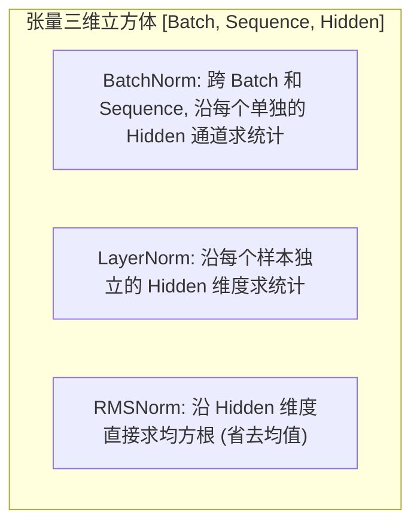
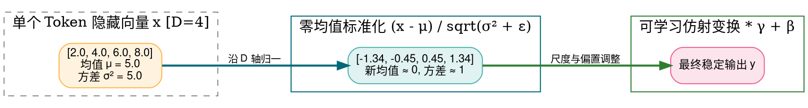
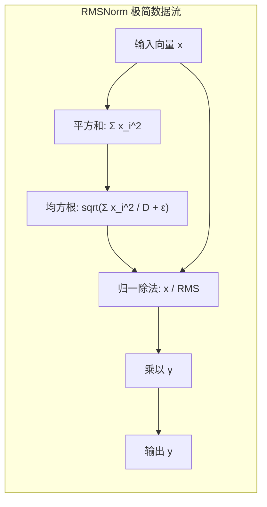
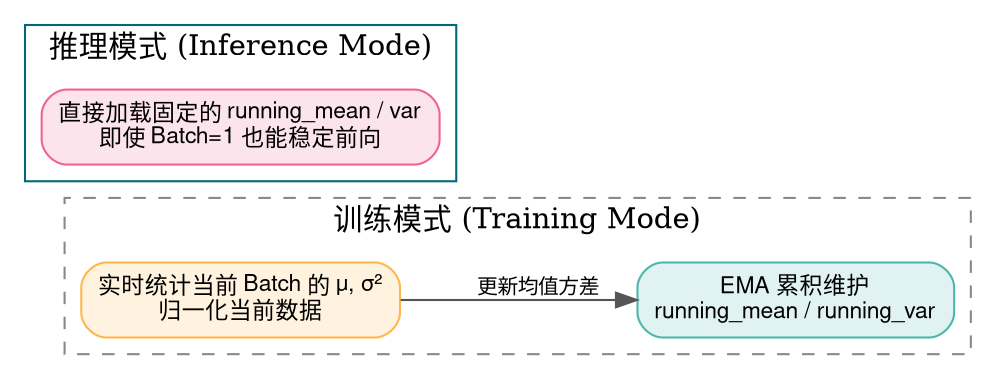

> **导读**：在数十层乃至上百层的深度神经网络中，前层参数的微小变动经过层层放大，会导致后层输入的统计分布发生剧烈颠簸——这一现象被称为**内部协变量偏移（Internal Covariate Shift）**。它会导致网络梯度极易陷入饱和区或剧烈震荡，迫使工程师使用极其保守的极小学习率。
>
> **归一化（Normalization）算子**的诞生，彻底改变了这一切。它通过强行将数据重新拉回到“零均值、单位方差”的标准正态尺度附近，成为保证超深网络能够平稳收敛的“定海神针”。
>
> 从早期统治计算机视觉的 **BatchNorm**，到让 Transformer 在自然语言处理中大放异彩的 **LayerNorm**，再到如今被 LLaMA、DeepSeek、Mistral 等前沿大模型奉为极简工业标准的 **RMSNorm**，归一化算子经历了一场精妙的进化。
>
> 本篇作为系列第四讲，将带你彻底看懂它们各自在张量立方体上的切分轴向与工程优化细节。

---

## 零、初学者核心概念速查：统计量、仿射变换与数值稳定性

> [!NOTE] 核心概念形象字典
>
> - **均值（Mean, $\mu$）**：一组数据的算术平均数，代表数据的“重心原点”。减去均值就是将数据的中心平移回原点（零中心化）。
> - **方差（Variance, $\sigma^2$）与标准差（Standard Deviation, $\sigma$）**：衡量数据偏离均值的离散分散程度。除以标准差就是将数据的胖瘦胖度压缩缩放至统一刻度（尺度标准化）。
> - **均方根（Root Mean Square, RMS）**：所有数值平方和平均值的算术平方根，衡量信号的物理有效强度。
> - **仿射变换（Affine Transformation / Scale & Shift）**：如果将数据强行规范化为均值 0、方差 1，会抹杀网络在前序层学到的特征表达能力。因此引入两个可学习参数：可学习缩放因子 $\gamma$（Gamma）与可学习偏置 $\beta$（Beta），让网络能够自适应恢复所需的分布幅度：$y = \hat{x} \cdot \gamma + \beta$。
> - **极小防除零常数（$\epsilon$, Epsilon）**：通常设为 $10^{-5}$ 或 $10^{-6}$。在方差计算分母上加上它，防止当所有输入数值完全相同时方差为 0 导致除零崩溃。
> - **统计轴向（Reduction Axis）**：归一化算子最根本的区别，就在于**沿着哪几个维度求均值和方差**！



---

## 1. LayerNorm (层归一化 / Layer Normalization)

### 1.1 原理解析：为什么 Transformer 抛弃了 BatchNorm？
- **公式**：
  对于输入张量中的每一个独立样本向量 $x \in \mathbb{R}^D$（$D$ 为隐藏层维度 Hidden Dimension）：
  1. 计算样本自身的均值：
     $$ \mu = \frac{1}{D} \sum_{i=1}^D x_i $$
  2. 计算样本自身的方差：
     $$ \sigma^2 = \frac{1}{D} \sum_{i=1}^D (x_i - \mu)^2 $$
  3. 标准化与仿射变换：
     $$ \hat{x}_i = \frac{x_i - \mu}{\sqrt{\sigma^2 + \epsilon}} $$
     $$ y_i = \hat{x}_i \cdot \gamma_i + \beta_i $$
- **为什么在 Transformer 中碾压 BatchNorm？**
  - **Batch 独立性**：LayerNorm 仅在单个 Token 自身的隐藏特征内部计算统计量，**与 Batch Size 的大小完全无关**！
  - **适应变长序列**：NLP 中的文本序列长短不一，BatchNorm 在变长序列上统计会引入严重的边界填充污染，而 LayerNorm 对每个位置的 Token 都是即时独立归一化，极其稳健。



### 1.2 原生 Python 实现
```python
import math

def naive_layernorm(x: list[float], gamma: list[float], beta: list[float], eps: float = 1e-5) -> list[float]:
    """一维特征向量的朴素 LayerNorm 实现"""
    D = len(x)
    
    # 步骤 1: 计算均值 μ
    mean = sum(x) / D
    
    # 步骤 2: 计算方差 σ²
    var = sum((val - mean) ** 2 for val in x) / D
    
    # 步骤 3: 归一化与仿射重构
    inv_std = 1.0 / math.sqrt(var + eps)
    output = []
    for i in range(D):
        normed = (x[i] - mean) * inv_std
        output.append(normed * gamma[i] + beta[i])
    return output

if __name__ == "__main__":
    feat = [2.0, 4.0, 6.0, 8.0]
    g = [1.0, 1.0, 1.0, 1.0]   # 默认权重缩放
    b = [0.0, 0.0, 0.0, 0.0]   # 默认偏置平移
    res = naive_layernorm(feat, g, b)
    print("LayerNorm 输出:", [round(v, 4) for v in res])
    print(f"验证输出均值: {sum(res)/len(res):.6f}")
```

### 1.3 原生 C++ 实现
```cpp
#include <iostream>
#include <cmath>
#include <iomanip>

int main() {
    constexpr int D = 4;
    const float x[D] = {2.0f, 4.0f, 6.0f, 8.0f};
    const float gamma[D] = {1.0f, 1.0f, 1.0f, 1.0f};
    const float beta[D] = {0.0f, 0.0f, 0.0f, 0.0f};
    constexpr float eps = 1e-5f;

    // 1. 求均值
    float sum = 0.0f;
    for (int i = 0; i < D; ++i) sum += x[i];
    float mean = sum / D;

    // 2. 求方差
    float sum_sq_diff = 0.0f;
    for (int i = 0; i < D; ++i) {
        float diff = x[i] - mean;
        sum_sq_diff += diff * diff;
    }
    float var = sum_sq_diff / D;

    // 3. 归一化
    float inv_std = 1.0f / std::sqrt(var + eps);
    float out[D];
    std::cout << "=== 原生 C++ LayerNorm 输出 ===" << std::endl;
    for (int i = 0; i < D; ++i) {
        out[i] = ((x[i] - mean) * inv_std) * gamma[i] + beta[i];
        std::cout << "y[" << i << "] = " << std::fixed << std::setprecision(4) << out[i] << std::endl;
    }
    return 0;
}
```

---

## 2. RMSNorm (均方根归一化 / Root Mean Square Normalization)

### 2.1 原理解析：大模型为什么舍弃均值？
- **作者洞察（Zhang & Sennrich, 2019）**：
  研究发现，LayerNorm 之所以能稳定训练，其**最关键的作用在于缩放不变性（Scaling Invariance）**，即控制特征的尺度幅度；而**减去均值平移这一步对模型性能几乎没有任何实质贡献**！
- **RMSNorm 公式**：
  直接抛弃均值计算，仅使用均方根（RMS）进行归一化：
  $$ \text{RMS}(x) = \sqrt{\frac{1}{D} \sum_{i=1}^D x_i^2 + \epsilon} $$
  $$ y_i = \frac{x_i}{\text{RMS}(x)} \cdot \gamma_i $$
- **工业界性能跃迁**：
  1. **减少访存遍历**：LayerNorm 需要两次遍历向量（先遍历求均值，再遍历求方差）；而 RMSNorm 只需要一次遍历求出平方和，直接省下一半的内存读写！
  2. **砍掉偏置 $\beta$**：在大模型时代，绝大部分模型（LLaMA/Mistral/DeepSeek）移除了所有偏置参数 $\beta$，仅保留缩放参数 $\gamma$。



### 2.2 原生 Python 实现
```python
import math

def naive_rmsnorm(x: list[float], gamma: list[float], eps: float = 1e-6) -> list[float]:
    """大模型标配 RMSNorm 朴素实现"""
    D = len(x)
    # 计算均方和
    mean_square = sum(val * val for val in x) / D
    rms = math.sqrt(mean_square + eps)
    inv_rms = 1.0 / rms
    
    # 仅保留缩放 gamma，无偏置 beta
    return [val * inv_rms * g for val, g in zip(x, gamma)]

if __name__ == "__main__":
    feat = [1.0, 2.0, 3.0, 4.0]
    g = [1.0, 1.0, 1.0, 1.0]
    res_rms = naive_rmsnorm(feat, g)
    print("RMSNorm 归一化输出:", [round(v, 4) for v in res_rms])
```

### 2.3 原生 C++ 实现
```cpp
#include <iostream>
#include <cmath>
#include <iomanip>

int main() {
    constexpr int D = 4;
    const float x[D] = {1.0f, 2.0f, 3.0f, 4.0f};
    const float gamma[D] = {1.0f, 1.0f, 1.0f, 1.0f};
    constexpr float eps = 1e-6f;

    // 1. 单遍循环计算平方和
    float sum_sq = 0.0f;
    for (int i = 0; i < D; ++i) {
        sum_sq += x[i] * x[i];
    }
    float rms = std::sqrt(sum_sq / D + eps);
    float inv_rms = 1.0f / rms;

    // 2. 尺度缩放
    std::cout << "=== 原生 C++ RMSNorm 计算输出 ===" << std::endl;
    for (int i = 0; i < D; ++i) {
        float y = (x[i] * inv_rms) * gamma[i];
        std::cout << "y[" << i << "] = " << std::fixed << std::setprecision(4) << y << std::endl;
    }
    return 0;
}
```

---

## 3. BatchNorm (批归一化 / Batch Normalization)

### 3.1 原理解析：视觉 CNN 的王者与双状态机制
- **切分轴向**：
  在图像数据 $[B, C, H, W]$ 中，BatchNorm 沿着**批次维度 $B$ 与空间像素维度 $H, W$** 共同计算统计量。也就是说，对于某一个具体的通道 $c$，将一个 Mini-batch 中所有图像的所有像素全部拉在一起求均值和方差：
  $$ \mu_c = \frac{1}{B \times H \times W} \sum_{b=1}^B \sum_{h=1}^H \sum_{w=1}^W x[b, c, h, w] $$
- **训练态 vs 推理态的双状态机制**：
  1. **训练阶段（Training）**：使用当前 Mini-batch 的均值 $\mu_B$ 和方差 $\sigma_B^2$ 归一化；同时利用**指数移动平均（EMA）**悄悄维护全局统计量：
     $$ \text{running\_mean} = (1 - \text{momentum}) \cdot \text{running\_mean} + \text{momentum} \cdot \mu_B $$
  2. **推理阶段（Inference）**：完全冻结 Mini-batch 统计，**直接使用训练好的全局固定常数 `running_mean` 与 `running_var`**！这意味着在推理单张图像时，输出结果是确定且完全自包含的。



### 3.2 原生 Python 实现
```python
import math

class NaiveBatchNorm1D:
    """纯 Python 模拟 BatchNorm1D 的训练与推理双状态机制"""
    def __init__(self, num_features: int, momentum: float = 0.1, eps: float = 1e-5):
        self.num_features = num_features
        self.momentum = momentum
        self.eps = eps
        self.gamma = [1.0] * num_features
        self.beta = [0.0] * num_features
        self.running_mean = [0.0] * num_features
        self.running_var = [1.0] * num_features
        self.training = True

    def forward(self, batch_x: list[list[float]]) -> list[list[float]]:
        # batch_x 形状为 [B, num_features]
        B = len(batch_x)
        output = [[0.0] * self.num_features for _ in range(B)]

        for c in range(self.num_features):
            if self.training:
                # 跨 Batch 计算通道 c 的均值
                mean_c = sum(batch_x[b][c] for b in range(B)) / B
                # 跨 Batch 计算方差
                var_c = sum((batch_x[b][c] - mean_c) ** 2 for b in range(B)) / B
                
                # EMA 更新全局统计量
                self.running_mean[c] = (1.0 - self.momentum) * self.running_mean[c] + self.momentum * mean_c
                self.running_var[c] = (1.0 - self.momentum) * self.running_var[c] + self.momentum * var_c
                
                curr_mean, curr_var = mean_c, var_c
            else:
                curr_mean, curr_var = self.running_mean[c], self.running_var[c]

            inv_std = 1.0 / math.sqrt(curr_var + self.eps)
            for b in range(B):
                normed = (batch_x[b][c] - curr_mean) * inv_std
                output[b][c] = normed * self.gamma[c] + self.beta[c]

        return output

if __name__ == "__main__":
    bn = NaiveBatchNorm1D(num_features=2)
    sample_batch = [
        [1.0, 10.0],
        [2.0, 20.0],
        [3.0, 30.0]
    ]
    train_out = bn.forward(sample_batch)
    print("BatchNorm 训练态输出 (Shape 3x2):", train_out)
    
    bn.training = False
    infer_out = bn.forward([[2.0, 20.0]])
    print("BatchNorm 推理态单样本输出:", infer_out)
```

### 3.3 原生 C++ 实现
```cpp
#include <iostream>
#include <cmath>
#include <iomanip>

int main() {
    // 模拟 Batch=3, Channels=2
    constexpr int B = 3;
    constexpr int C = 2;
    const float x[B][C] = {
        {1.0f, 10.0f},
        {2.0f, 20.0f},
        {3.0f, 30.0f}
    };
    constexpr float eps = 1e-5f;
    float out[B][C];

    std::cout << "=== 原生 C++ BatchNorm (跨 Batch 归一) 输出 ===" << std::endl;
    for (int c = 0; c < C; ++c) {
        // 1. 跨 Batch 求当前通道均值
        float sum = 0.0f;
        for (int b = 0; b < B; ++b) sum += x[b][c];
        float mean = sum / B;

        // 2. 跨 Batch 求方差
        float sum_sq = 0.0f;
        for (int b = 0; b < B; ++b) {
            float diff = x[b][c] - mean;
            sum_sq += diff * diff;
        }
        float var = sum_sq / B;
        float inv_std = 1.0f / std::sqrt(var + eps);

        // 3. 归一化
        for (int b = 0; b < B; ++b) {
            out[b][c] = (x[b][c] - mean) * inv_std;
        }
    }

    for (int b = 0; b < B; ++b) {
        std::cout << "Sample " << b << ": [" 
                  << std::fixed << std::setprecision(4) << out[b][0] << ", " << out[b][1] << "]" << std::endl;
    }
    return 0;
}
```

---

## 总结与思维进阶

| 算子 | 统计轴向 | 是否依赖 Batch | 核心应用场景 | 工业级优化亮点 |
| :--- | :--- | :--- | :--- | :--- |
| **LayerNorm** | 样本内特征轴 $[D]$ | **否** | 经典 Transformer (BERT / GPT-2) | 消除序列变长带来的填充污染 |
| **RMSNorm** | 样本内特征轴 $[D]$ | **否** | 现代主流大模型 (LLaMA / Mistral) | **舍弃均值**，访存带宽减半，极简加速 |
| **BatchNorm** | 跨样本批次轴 $[B, H, W]$ | **是** | 卷积神经网络 (CNN / ResNet) | 具备正则化能力，推理期与卷积权重融合 |

下一讲，我们将探讨语言模型的空间罗盘——**位置编码（Absolute PE / RoPE / ALiBi）**！
