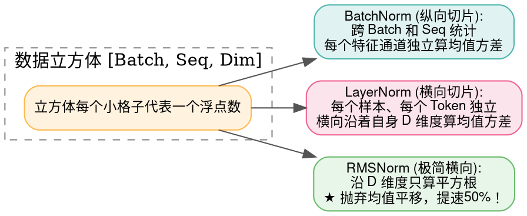
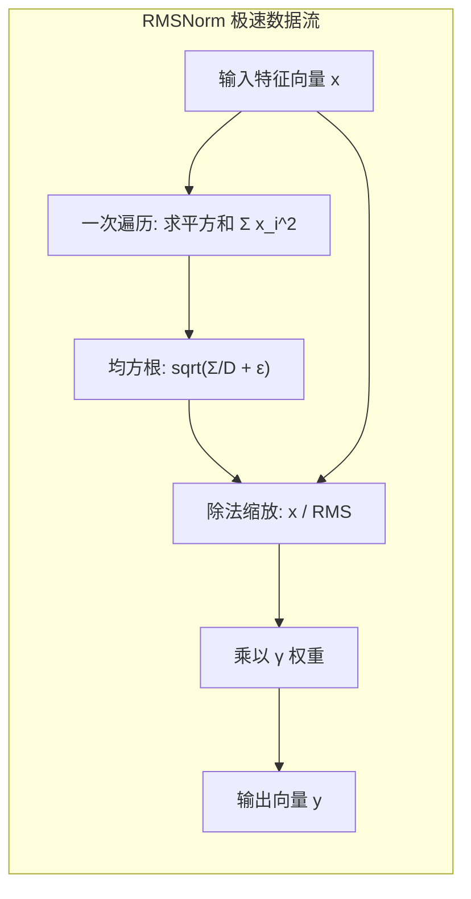

> **致初学者**：在训练深层神经网络时，你很可能会遭遇这样一种让人崩溃的现象：
> 训练刚开始时好好的，跑着跑着，后面的网络层输出突然开始剧烈颠簸——一会儿所有特征值暴涨到几千，一会儿全部跌落到零点几。为了防止网络崩溃，你不得不把学习率调得极其微小（如 $0.00001$），导致模型跑了一个月还在原地踏步！
>
> 这种现象在学术界被称为**内部协变量偏移（Internal Covariate Shift）**。
>
> 怎么彻底制服这头脱缰的野马？答案就是**归一化（Normalization）**！
> 它就像一把**游标卡尺**，不管前一层输送进来的数据有多么疯狂，强行把它拉回到“均值为 0、方差为 1”的标准健康尺度。
>
> 很多初学者常被 **BatchNorm**、**LayerNorm** 和 **RMSNorm** 搞混。
> 本篇作为系列第四讲，将用**切豆腐的比喻、具体数字手算一遍**，带你从几何切面与底层显存读写彻底看懂这三大王者算子！

---

## 零、初学者必懂概念：切豆腐的比喻与内部协变量偏移

### 1. 生活比喻：高考标准分（Z-Score）
想象有一所高中的高三摸底考试：
- 第一次月考题目极难，全班平均分只有 30 分，最高分 50 分；
- 第二次月考题目极简单，全班平均分 85 分，最高分 99 分。
如果大学招生办直接看绝对分数，肯定会被完全搞糊涂！
**聪明的做法是算“标准分（Z-score 归一化）”**：
把每次月考的分数都**减去当次平均分，再除以当次标准差**。
这样不论考卷难易，全班成绩都被规整到了“平均分 0、离散度 1”的标准正态尺度上！
**归一化算子就是神经网络每一层之间的“标准分计算器”！**

### 2. 张量立方体切豆腐：它们到底在哪个方向归一化？
在深度学习中，批次数据通常是一个三维立方体：
形状为 $[B, S, D]$（$B$ 是 Batch 批次大小，$S$ 是 Sequence 序列长度，$D$ 是每个 Token 的特征维度 Hidden Dim）。
**三种算子的根本区别，仅仅在于“拿刀切豆腐的方向不同”！**



---

## 1. LayerNorm (层归一化：Transformer 的定海神针)

### 1.1 为什么自然语言处理（NLP）离不开 LayerNorm？
在卷积视觉中，BatchNorm 是绝对的统治者。但到了自然语言和大模型时代，BatchNorm 彻底扑街了：
1. **变长序列的诅咒**：一句话可能只有 3 个词，另一句话有 100 个词。短句子必须补 0（Padding）。BatchNorm 跨句子纵向统计时，会被那些虚假的 0 严重污染统计量！
2. **Batch 依赖**：如果推理时用户只发了一条请求（$B=1$），BatchNorm 根本算不出方差。
**LayerNorm 的大智慧：自给自足！**
它在单个 Token 内部沿着自身的特征维度 $D$ 独立计算均值 $\mu$ 与方差 $\sigma^2$。**不管是单条推理还是变长序列，哪怕整个世界只剩下一个 Token，LayerNorm 都能稳稳当当地完成归一化！**

### 1.2 手把手极小数字推演
假设某个 Token 的隐藏特征向量包含 4 个数字：
$$ x = [2.0, 4.0, 6.0, 8.0] $$
我们手工一步步推演 LayerNorm 的计算：

1. **算均值 $\mu$**：
   $$ \mu = \frac{2.0 + 4.0 + 6.0 + 8.0}{4} = \frac{20.0}{4} = 5.0 $$
2. **算每个数与均值的差值（中心化）**：
   $$ x - \mu = [2 - 5, 4 - 5, 6 - 5, 8 - 5] = [-3.0, -1.0, 1.0, 3.0] $$
3. **算方差 $\sigma^2$**：
   平方和：$(-3)^2 + (-1)^2 + 1^2 + 3^2 = 9 + 1 + 1 + 9 = 20.0$；
   $$ \sigma^2 = \frac{20.0}{4} = 5.0 $$
4. **算标准差与归一化（设 $\epsilon = 0$）**：
   标准差 $\sigma = \sqrt{5.0} \approx 2.236$；
   - $\hat{x}_0 = -3.0 / 2.236 \approx -1.3416$
   - $\hat{x}_1 = -1.0 / 2.236 \approx -0.4472$
   - $\hat{x}_2 = 1.0 / 2.236 \approx +0.4472$
   - $\hat{x}_3 = 3.0 / 2.236 \approx +1.3416$
5. **仿射变换（Scale $\gamma$ & Shift $\beta$）**：
   若初始权重 $\gamma = 1, \beta = 0$，最终输出即为：
   $$ y = [-1.3416, -0.4472, 0.4472, 1.3416] $$
   检验：均值 $(-1.3416 - 0.4472 + 0.4472 + 1.3416)/4 = 0$！方差为 1！

### 1.3 原生 Python 逐行注释实现
```python
import math

def naive_layernorm(x: list[float], gamma: list[float] = None, beta: list[float] = None, eps: float = 1e-5) -> list[float]:
    """一维特征向量的朴素 LayerNorm"""
    D = len(x)
    if gamma is None: gamma = [1.0] * D
    if beta is None: beta = [0.0] * D

    # 步骤 1: 沿特征维度求算术平均值 (均值)
    mean = sum(x) / D

    # 步骤 2: 沿特征维度求方差
    variance = sum((val - mean) ** 2 for val in x) / D

    # 步骤 3: 归一化并叠加上可学习的缩放 gamma 与偏置 beta
    std_inv = 1.0 / math.sqrt(variance + eps)
    output = []
    for i in range(D):
        x_hat = (x[i] - mean) * std_inv
        y = x_hat * gamma[i] + beta[i]
        output.append(y)

    return output

if __name__ == "__main__":
    feat = [2.0, 4.0, 6.0, 8.0]
    out = naive_layernorm(feat)
    print("LayerNorm 手算结果验证:", [round(v, 4) for v in out])
```

---

## 2. RMSNorm (均方根归一化：现代大模型的极致精简)

### 2.1 为什么 LLaMA 和 DeepSeek 全面抛弃 LayerNorm？
- **作者的震撼洞察（Zhang & Sennrich, 2019）**：
  研究人员通过海量实验发现：LayerNorm 之所以能让训练稳定，**99% 的功劳在于“除以标准差控制了尺度（Scaling Invariance）”；而“减去均值平移这一步”对模型性能几乎没有任何帮助！**
- **RMSNorm 的惊人简化**：
  既然减去均值没用，**那就彻底扔掉均值！直接除以均方根（RMS）！**
  $$ \text{RMS}(x) = \sqrt{\frac{1}{D} \sum_{i=1}^D x_i^2 + \epsilon} $$
  $$ y_i = \frac{x_i}{\text{RMS}(x)} \cdot \gamma_i $$
- **工业级暴击优势**：
  1. **节省一次内存遍历（Memory Pass）**：LayerNorm 要先遍历一遍求均值，再遍历一遍求方差；而 RMSNorm 只需要遍历一遍求平方和即可！显存往返耗时直接减半！
  2. **砍掉偏置参数 $\beta$**：现在的千亿大模型（LLaMA-3、Mistral、DeepSeek-V2/V3）全面移除了所有的偏置项，参数更少、吞吐更高。



### 2.2 手把手极小数字推演
我们拿同样的数字 $x = [2.0, 4.0, 6.0, 8.0]$ 来算 RMSNorm，感受它的极简魅力：
1. **直接算平方和（不用管均值！）**：
   $$ 2^2 + 4^2 + 6^2 + 8^2 = 4 + 16 + 36 + 64 = 120.0 $$
2. **算均方值（Mean Square）**：
   $$ \frac{120.0}{4} = 30.0 $$
3. **算均方根 RMS**：
   $$ \text{RMS} = \sqrt{30.0} \approx 5.4772 $$
4. **各自直接除以 RMS（设 $\gamma = 1.0$）**：
   - $y_0 = 2.0 / 5.4772 \approx 0.3651$
   - $y_1 = 4.0 / 5.4772 \approx 0.7303$
   - $y_2 = 6.0 / 5.4772 \approx 1.0954$
   - $y_3 = 8.0 / 5.4772 \approx 1.4606$

> [!TIP] 观察美妙的数学性质
> 看看这四个输出：$0.3651 : 0.7303 : 1.0954 : 1.4606$。
> 它们的比例是严格的 **$1 : 2 : 3 : 4$**！
> **RMSNorm 完美保留了特征向量原始的相对方向与相对比例，同时把整个向量的能量幅度死死稳定在一个受控的标准范围内！**

### 2.3 原生 Python 逐行注释实现
```python
import math

def naive_rmsnorm(x: list[float], gamma: list[float] = None, eps: float = 1e-6) -> list[float]:
    """大模型标配 RMSNorm 算法"""
    D = len(x)
    if gamma is None: gamma = [1.0] * D

    # 步骤 1: 单遍扫描，直接计算平方和与均方值
    mean_square = sum(val * val for val in x) / D
    
    # 步骤 2: 计算均方根 RMS
    rms = math.sqrt(mean_square + eps)
    rms_inv = 1.0 / rms

    # 步骤 3: 尺度缩放并乘上可学习权重 gamma
    output = [x[i] * rms_inv * gamma[i] for i in range(D)]
    return output

if __name__ == "__main__":
    feat = [2.0, 4.0, 6.0, 8.0]
    out_rms = naive_rmsnorm(feat)
    print("RMSNorm 输出结果:", [round(v, 4) for v in out_rms])
```

### 2.4 原生 C++ 逐行注释实现
```cpp
#include <iostream>
#include <cmath>
#include <iomanip>

int main() {
    constexpr int D = 4;
    const float x[D] = {2.0f, 4.0f, 6.0f, 8.0f};
    const float gamma[D] = {1.0f, 1.0f, 1.0f, 1.0f};
    constexpr float eps = 1e-6f;

    // 1. 单遍循环计算平方和
    float sum_sq = 0.0f;
    for (int i = 0; i < D; ++i) {
        sum_sq += x[i] * x[i];
    }

    // 2. 均方根
    float rms = std::sqrt(sum_sq / D + eps);
    float inv_rms = 1.0f / rms;

    std::cout << "=== 原生 C++ RMSNorm 计算输出 ===" << std::endl;
    for (int i = 0; i < D; ++i) {
        float y = (x[i] * inv_rms) * gamma[i];
        std::cout << "y[" << i << "] = " << std::fixed << std::setprecision(4) << y << std::endl;
    }
    return 0;
}
```

---

## 3. BatchNorm (批归一化：视觉 CNN 时代的王者)

### 3.1 核心机制与 `model.eval()` 的秘密
- **统计方向**：跨 Batch 统计每个通道的均值和方差。
- **训练态 vs 推理态（初学者必踩巨坑）**：
  很多新手在部署模型时，忘记写 `model.eval()`，结果输入单张图片时，模型输出乱七八糟的乱码。
  **为什么？**
  1. **训练时（Training）**：网络每次看一整个 Mini-batch（比如 32 张图）。它实时计算这 32 张图当前通道的均值方差，同时用**指数移动平均（EMA）**默默记下一个全局小账本（`running_mean` 和 `running_var`）；
  2. **推理时（Inference）**：必须锁死小账本！**直接使用训练期间固化下来的 `running_mean` 和 `running_var`**！因为单张图根本无法计算统计量。

---

## 总结与初学者避坑指南

| 归一化算子 | 统计轴向 | 是否依赖 Batch 大小 | 是否需要减去均值 | 主流适用模型 |
| :--- | :--- | :--- | :--- | :--- |
| **LayerNorm** | 样本内特征轴 $[D]$ | **否**（即使 $B=1$ 也能算） | **是**（先减 $\mu$ 再除 $\sigma$） | 经典 Transformer (BERT / GPT-2) |
| **RMSNorm** | 样本内特征轴 $[D]$ | **否** | **否（彻底扔掉均值，提速翻倍）** | **现代全系大模型 (LLaMA / DeepSeek)** |
| **BatchNorm** | 跨样本批次轴 $[B, H, W]$ | **是**（必须依赖大 Batch） | **是** | 卷积视觉网络 (ResNet / ConvNet) |

下一讲，我们将探讨让大模型摆脱“文字记忆混乱”的罗盘——**位置编码（Absolute PE / RoPE / ALiBi）**！
