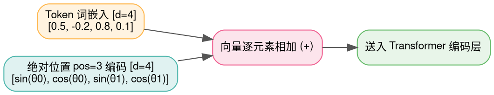
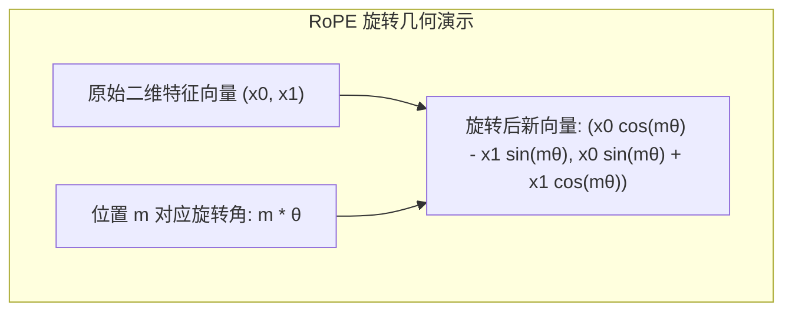
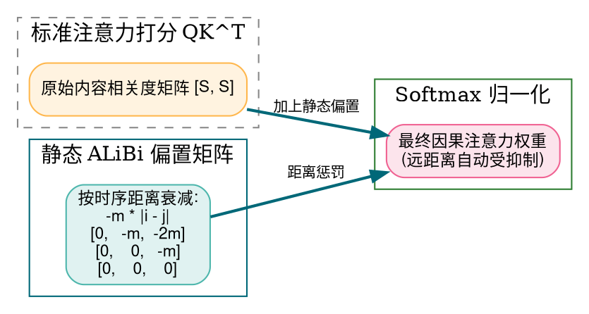

> **导读**：自注意力机制（Self-Attention）有一个致命的先天天赋缺陷：**置换不变性（Permutation Invariance）**。
>
> 也就是说，对于注意力算子而言，句子“猫吃鱼”和“鱼吃猫”由完全相同的三个词向量集合构成；如果不加任何特殊手段，模型计算出的注意力分数将**完全一模一样**！这在强调语法时序的自然语言处理与多模态世界中是灾难性的。
>
> 为了让神经网络知道“谁在谁的前面、谁和谁离得有多远”，深度学习科学家们开辟了精妙的探索之路：
> - 从最初简单粗暴的**绝对位置编码（Absolute PE）**相加；
> - 到被 LLaMA、DeepSeek、Qwen 奉为现代大模型骨骼的**旋转位置编码（RoPE）**；
> - 再到突破长度外推极限、直接修改注意力矩阵的 **ALiBi 线性偏置**。
>
> 本篇作为系列第五讲，将带你从二维复数旋转与几何投影的第一性原理出发，彻底穿透这三大里程碑位置编码算子。

---

## 零、初学者核心概念速查：置换不变性、相对距离与长度外推

> [!NOTE] 核心概念形象字典
>
> - **置换不变性（Permutation Invariance）**：输入元素的排列顺序被任意打乱后，函数的运算结果完全保持不变。词袋模型（Bag-of-Words）和原始自注意力都具备该性质。
> - **绝对位置编码（Absolute Positional Encoding）**：为序列中的每一个绝对坐标（第 0 个、第 1 个……第 $pos$ 个词）生成一个独一无二的位置特征向量，直接与输入的 Token 嵌入向量做加法。
> - **相对位置编码（Relative Positional Encoding）**：模型不关心某个词在全文中的绝对坐标，只关心当前词与目标词之间的**相对距离差（$m - n$）**。
> - **长度外推性（Length Extrapolation）**：模型在训练时上下文窗口很短（例如 4K Token），在实际推理时直接喂入 32K 甚至 128K 的长文本，模型能否依然保持不胡言乱语、逻辑清晰。绝对位置编码在此表现极差，而 RoPE 与 ALiBi 具备优异的外推特性。
> - **复数与旋转矩阵（Complex & Rotation）**：利用欧拉公式 $e^{i \theta} = \cos \theta + i \sin \theta$，将高维特征向量切分成两两一对的二维平面坐标，通过乘以旋转角度实现相对位移感知。

---

## 1. 经典正弦余弦绝对位置编码 (Absolute PE)

### 1.1 原理解析
在经典论文《Attention Is All You Need》中，Vaswani 等人设计了基于正弦和余弦函数的固定几何级数编码：
对于第 $pos$ 个位置，特征维度第 $2i$ 与 $2i+1$ 位的值定义为：
$$ PE_{(pos, 2i)} = \sin\left( \frac{pos}{10000^{2i / d}} \right) $$
$$ PE_{(pos, 2i+1)} = \cos\left( \frac{pos}{10000^{2i / d}} \right) $$
- **几何周期性**：波长从 $2\pi$ 一直指数级拉长到 $10000 \cdot 2\pi$。高维通道震荡缓慢，记录宏观全局跨度；低维通道震荡剧烈，记录近距离微小偏置。
- **与词嵌入直接相加**：$X_{\text{input}} = X_{\text{embed}} + PE$。
- **致命软肋**：当推理长度超过训练长度（如预训练只有 512，遇到 1000 长度），模型遇到从未见过的超出范围的周期相位，外推性能呈悬崖式下跌。



### 1.2 原生 Python 实现
```python
import math

def naive_sinusoidal_pe(seq_len: int, d_model: int) -> list[list[float]]:
    """生成 Vaswani 原生正弦余弦绝对位置编码矩阵 [seq_len, d_model]"""
    pe_matrix = [[0.0] * d_model for _ in range(seq_len)]
    
    for pos in range(seq_len):
        for i in range(0, d_model, 2):
            # 计算分母频率因子 10000^(2i / d_model)
            div_term = math.exp((i / d_model) * math.log(10000.0))
            theta = pos / div_term
            pe_matrix[pos][i] = math.sin(theta)
            if i + 1 < d_model:
                pe_matrix[pos][i + 1] = math.cos(theta)
    return pe_matrix

if __name__ == "__main__":
    pe = naive_sinusoidal_pe(seq_len=3, d_model=4)
    print("绝对位置编码 PE 矩阵 (3x4):")
    for pos, row in enumerate(pe):
        print(f"  Pos {pos}: {[round(v, 4) for v in row]}")
```

### 1.3 原生 C++ 实现
```cpp
#include <iostream>
#include <cmath>
#include <iomanip>

int main() {
    constexpr int SEQ_LEN = 3;
    constexpr int D_MODEL = 4;
    float pe[SEQ_LEN][D_MODEL];

    for (int pos = 0; pos < SEQ_LEN; ++pos) {
        for (int i = 0; i < D_MODEL; i += 2) {
            float div_term = std::exp((static_cast<float>(i) / D_MODEL) * std::log(10000.0f));
            float theta = static_cast<float>(pos) / div_term;
            pe[pos][i] = std::sin(theta);
            if (i + 1 < D_MODEL) {
                pe[pos][i + 1] = std::cos(theta);
            }
        }
    }

    std::cout << "=== 原生 C++ 正弦余弦绝对位置编码输出 ===" << std::endl;
    for (int pos = 0; pos < SEQ_LEN; ++pos) {
        std::cout << "Pos " << pos << ": [";
        for (int j = 0; j < D_MODEL; ++j) {
            std::cout << std::fixed << std::setprecision(4) << pe[pos][j] << (j + 1 < D_MODEL ? ", " : "");
        }
        std::cout << "]" << std::endl;
    }
    return 0;
}
```

---

## 2. RoPE (旋转位置编码 / Rotary Position Embedding)

### 2.1 原理解析：复平面上的神级几何构想
- **提出者**：苏剑林（Jianlin Su 等人，2021）。
- **第一性原理动机**：
  我们希望找到一个函数，它给 Query 向量 $q$ 注入绝对位置 $m$，给 Key 向量 $k$ 注入绝对位置 $n$；而在计算它们的点积相似度 $\langle \tilde{q}_m, \tilde{k}_n \rangle$ 时，结果**只取决于相对位移 $m - n$**！
  $$ \langle R_m q, R_n k \rangle = g(q, k, m - n) $$
- **二维复数旋转解法**：
  将向量两两配对成二维平面坐标 $(x_0, x_1)$，在复平面上乘以旋转角度 $e^{i m \theta}$：
  $$ R_{\Theta, m}^d = \begin{pmatrix} \cos m\theta & -\sin m\theta \\ \sin m\theta & \cos m\theta \end{pmatrix} \begin{pmatrix} x_0 \\ x_1 \end{pmatrix} $$
- **相对距离的自然显现**：
  由于正交旋转矩阵满足性质 $R_m^T R_n = R_{n - m}$，因此：
  $$ (R_m q)^T (R_n k) = q^T (R_m^T R_n) k = q^T R_{n - m} k $$
  **通过将每个位置的向量在空间中旋转对应角度，点积内积天然、无损地还原出了两者的相对角位移 $n - m$！**



### 2.2 原生 Python 实现
```python
import math

def naive_apply_rope_2d(vec: list[float], pos: int, base: float = 10000.0) -> list[float]:
    """对单向量应用 RoPE 旋转 (长度需为偶数)"""
    dim = len(vec)
    out = [0.0] * dim
    
    # 两两一组执行 2D 旋转
    for i in range(0, dim, 2):
        theta = 1.0 / (base ** (i / dim))
        m_theta = pos * theta
        cos_m = math.cos(m_theta)
        sin_m = math.sin(m_theta)
        
        x0 = vec[i]
        x1 = vec[i + 1]
        
        # 二维旋转公式: [cos, -sin; sin, cos] * [x0, x1]^T
        out[i] = x0 * cos_m - x1 * sin_m
        out[i + 1] = x0 * sin_m + x1 * cos_m
    return out

if __name__ == "__main__":
    q_vec = [1.0, 0.0, 0.5, 0.5] # 4维向量
    q_pos0 = naive_apply_rope_2d(q_vec, pos=0)
    q_pos1 = naive_apply_rope_2d(q_vec, pos=1)
    print("RoPE pos=0 旋转结果:", [round(v, 4) for v in q_pos0])
    print("RoPE pos=1 旋转结果:", [round(v, 4) for v in q_pos1])
```

### 2.3 原生 C++ 实现
```cpp
#include <iostream>
#include <cmath>
#include <iomanip>

int main() {
    constexpr int D = 4;
    const float vec[D] = {1.0f, 0.0f, 0.5f, 0.5f};
    constexpr int pos = 2; // 位置坐标
    constexpr float base = 10000.0f;
    float rotated[D];

    for (int i = 0; i < D; i += 2) {
        float theta = 1.0f / std::pow(base, static_cast<float>(i) / D);
        float m_theta = static_cast<float>(pos) * theta;
        float c = std::cos(m_theta);
        float s = std::sin(m_theta);

        float x0 = vec[i];
        float x1 = vec[i + 1];

        rotated[i] = x0 * c - x1 * s;
        rotated[i + 1] = x0 * s + x1 * c;
    }

    std::cout << "=== 原生 C++ RoPE 旋转计算输出 (Pos=2) ===" << std::endl;
    for (int i = 0; i < D; ++i) {
        std::cout << "rotated[" << i << "] = " << std::fixed << std::setprecision(4) << rotated[i] << std::endl;
    }
    return 0;
}
```

---

## 3. ALiBi (线性偏置注意力 / Attention with Linear Biases)

### 3.1 原理解析：彻底告别位置嵌入向量！
- **作者反思（Press 等人，2021）**：
  既然无论是绝对位置编码还是 RoPE，本质都是为了让注意力权重感知距离，**那为什么还要费尽心机去修改 $Q$ 和 $K$ 向量本身？**
- **核心公式**：
  直接在 $Q K^T$ 计算出的注意力分数矩阵上，按元素之间的相对距离施加一个静态的**负线性衰减偏置（Linear Bias）**：
  $$ \text{Attention} = \text{Softmax}\left( \frac{Q K^T}{\sqrt{d_k}} - m \cdot (i - j) \right) \quad (i \ge j) $$
  其中 $(i - j)$ 是 Query 和 Key 的时序距离差。
- **多头多样性斜率（Head Slopes）**：
  针对不同的注意力头（Head），赋予不同的衰减斜率 $m$。对于总共有 $H$ 个头的模型，$m$ 按照等比数列取值：
  $$ m = 2^{-\frac{8 \cdot h}{H}} \quad (h \in [1, H]) $$
- **超凡外推优势**：
  在小窗口（如 1024 Token）上训练的模型，在推理长达数万 Token 时依然能保持极高困惑度指标，真正做到了“零开销完美外推”。



### 3.2 原生 Python 实现
```python
def naive_alibi_bias(seq_len: int, num_heads: int) -> list[list[list[float]]]:
    """生成 ALiBi 多头线性偏置张量 [num_heads, seq_len, seq_len]"""
    # 计算每个 Head 的衰减斜率 m (几何级数递减)
    slopes = [2.0 ** (-8.0 * (h + 1) / num_heads) for h in range(num_heads)]
    
    biases = []
    for m in slopes:
        head_bias = [[0.0] * seq_len for _ in range(seq_len)]
        for i in range(seq_len):
            for j in range(seq_len):
                # 仅对因果下三角施加距离衰减
                if j <= i:
                    head_bias[i][j] = -m * (i - j)
                else:
                    head_bias[i][j] = -1e9 # 未来时序掩码
        biases.append(head_bias)
    return biases

if __name__ == "__main__":
    alibi = naive_alibi_bias(seq_len=3, num_heads=2)
    print("ALiBi Head 0 偏置矩阵 (斜率较大):")
    for row in alibi[0]:
        print(f"  {[round(v, 3) for v in row]}")
    print("ALiBi Head 1 偏置矩阵 (斜率较小):")
    for row in alibi[1]:
        print(f"  {[round(v, 3) for v in row]}")
```

### 3.3 原生 C++ 实现
```cpp
#include <iostream>
#include <cmath>
#include <iomanip>

int main() {
    constexpr int SEQ = 3;
    constexpr int HEADS = 2;
    float slopes[HEADS];
    for (int h = 0; h < HEADS; ++h) {
        slopes[h] = std::pow(2.0f, -8.0f * (h + 1) / HEADS);
    }

    std::cout << "=== 原生 C++ ALiBi 线性偏置矩阵生成 ===" << std::endl;
    for (int h = 0; h < HEADS; ++h) {
        float m = slopes[h];
        std::cout << "Head " << h << " (Slope m = " << std::fixed << std::setprecision(4) << m << "):\n";
        for (int i = 0; i < SEQ; ++i) {
            std::cout << "  [";
            for (int j = 0; j < SEQ; ++j) {
                float bias = (j <= i) ? (-m * (i - j)) : -999.0f;
                std::cout << std::setprecision(2) << bias << (j + 1 < SEQ ? ", " : "");
            }
            std::cout << "]\n";
        }
    }
    return 0;
}
```

---

## 总结与思维进阶

| 编码方案 | 作用位置 | 相对距离感知 | 外推能力 | 业界代表模型 |
| :--- | :--- | :--- | :--- | :--- |
| **绝对正弦余弦 PE** | 输入端直接与词向量相加 | 弱（隐式三角函数拟合） | 极差 | 原始 Transformer、BERT |
| **RoPE (旋转位置)** | 在注意力层旋转 $Q$ 与 $K$ 向量 | **强（正交旋转内积不变性）** | 极佳（配合 NTK/插值） | **LLaMA 全系、DeepSeek、Qwen** |
| **ALiBi (线性偏置)** | 注意力矩阵 Softmax 前直接叠加 | **强（直接减去线性距离）** | 极佳（无训练零样本外推） | BLOOM、MPT |

下一讲，我们将直击大语言模型的绝对王冠——**注意力机制全家桶（SDPA / MHA / MQA / GQA / FlashAttention / PagedAttention / MLA / SWA）**！
