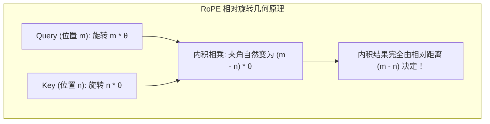
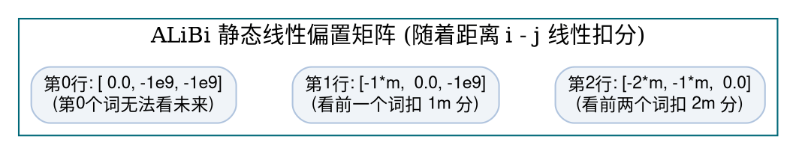

> **致初学者**：自注意力机制（Self-Attention）有一个非常致命的“脑回路缺陷”：
>
> 假设有一句话叫 **“狗 咬 人”**，三个词分别对应三个词向量。
> 如果你把词的顺序打乱成 **“人 咬 狗”**，甚至 **“咬 狗 人”**，
> 在原始的自注意力公式 $\text{Softmax}(Q K^T) V$ 看来，**由于点积只计算词向量之间的相似度，这三句话计算出的注意力权重和特征输出完全一模一样！**
>
> 这在数学上被称为**置换不变性（Permutation Invariance）**。如果模型分不清“谁在前、谁在后”，语言的语法结构将荡然无存！
>
> 为了给大模型装上“时空罗盘”，深度学习经历了三代传奇演进：
> 1. **第一代：绝对位置编码（Vaswani 正余弦 PE）**：像时钟刻度一样，强行给每个词加上一个时间戳；
> 2. **第二代：旋转位置编码（RoPE）**：现代大模型（LLaMA/DeepSeek/Qwen）的绝对骨架，利用美妙的二维几何旋转，让相对位置在内积中自然显现；
> 3. **第三代：ALiBi 线性偏置**：彻底抛弃向量注入，直接在注意力打分矩阵上按物理距离做线性扣分！
>
> 本篇作为系列第五讲，将带你从几何旋转与手算数字出发，彻底搞透这三大位置编码算子！

---

## 零、初学者必懂概念：为什么点积分不清前后？

假设“猫”的向量是 $v_{\text{cat}}$，“鱼”的向量是 $v_{\text{fish}}$。
在“猫 吃 鱼”里，“猫”对“鱼”计算注意力：点积为 $v_{\text{cat}} \cdot v_{\text{fish}}$。
在“鱼 吃 猫”里，“猫”对“鱼”计算注意力：点积依然为 $v_{\text{cat}} \cdot v_{\text{fish}}$！
点积是一个纯粹的标量乘积，**它根本不知道谁站在第 0 位、谁站在第 2 位！**
所以，我们必须人为地给向量注入“位置信息”。

---

## 1. 经典正弦余弦绝对位置编码 (Absolute PE)

### 1.1 钟表指针的生活比喻
- **公式**：
  对于第 $pos$ 个单词，其特征维度的第 $2i$ 和第 $2i+1$ 位定义为：
  $$ PE_{(pos, 2i)} = \sin\left( \frac{pos}{10000^{2i / d}} \right), \quad PE_{(pos, 2i+1)} = \cos\left( \frac{pos}{10000^{2i / d}} \right) $$
- **生活比喻：石英钟的三根指针**：
  - **秒针（低维通道 $2i=0$）**：转动极其飞快（周期短、频率极高），负责记录相邻两个单词之间的微小位移（比如第 1 个词和第 2 个词的差别）；
  - **分针（中维通道）**：转动适中，负责记录一小段句子的跨度；
  - **时针（高维通道 $2i \to d$）**：转动极其缓慢（周期极长，最大波长达 $10000 \cdot 2\pi$），负责记录整篇文章开头与结尾的宏观时空尺度。
- **结合方式**：直接与词向量做加法：$X_{\text{final}} = X_{\text{word}} + PE$。
- **初学者必知软肋**：
  如果模型在预训练时只见过最大长度 512，当遇到 1000 长度的长文本时，后半截的位置编码是模型从未见过的三角函数相位，**外推性能直接崩盘**。


### 1.2 手把手极小数字推演
假设维度 $d = 4$。
- 当 $i=0$ 时：分母 $10000^{0/4} = 10000^0 = 1.0$；
- 当 $i=1$ 时（即维度 2 和 3）：分母 $10000^{2/4} = 10000^{0.5} = 100.0$。

计算第 $pos = 0$ 个词的位置编码：
- 维度 0：$\sin(0 / 1.0) = \sin(0) = 0.0$
- 维度 1：$\cos(0 / 1.0) = \cos(0) = 1.0$
- 维度 2：$\sin(0 / 100.0) = \sin(0) = 0.0$
- 维度 3：$\cos(0 / 100.0) = \cos(0) = 1.0$
- $PE(pos=0) = [0.0, 1.0, 0.0, 1.0]$

计算第 $pos = 1$ 个词的位置编码：
- 维度 0：$\sin(1 / 1.0) = \sin(1) \approx 0.8415$
- 维度 1：$\cos(1 / 1.0) = \cos(1) \approx 0.5403$
- 维度 2：$\sin(1 / 100.0) = \sin(0.01) \approx 0.0100$
- 维度 3：$\cos(1 / 100.0) = \cos(0.01) \approx 0.9999$
- $PE(pos=1) = [0.8415, 0.5403, 0.0100, 0.9999]$

看！低维（0 和 1）已经从 0 剧烈跳到了 0.84，而高维（2 和 3）才刚挪动了 0.01！

---

## 2. RoPE (旋转位置编码：复平面上的几何神作)

### 2.1 为什么 RoPE 统治了当今所有顶尖大模型？
苏剑林老师在 2021 年提出了 RoPE（Rotary Position Embedding）。它诞生于一个极其深刻的数学执念：
**“能不能找到一种方法，给位置 $m$ 的向量 $q$ 和位置 $n$ 的向量 $k$ 注入位置后，它们做内积时，结果只与两者的相对距离 $m - n$ 有关？”**

### 2.2 二维平面旋转的几何奇迹
我们回忆高中复数与二维向量旋转：
把向量的每两个数字 $(x_0, x_1)$ 当成二维平面上的一个点。
如果在位置 $m$，我们把这个点在圆盘上顺时针**旋转角度 $m\theta$**；
在位置 $n$，我们把另一个向量在圆盘上**旋转角度 $n\theta$**。
**现在把这两个旋转后的向量做点积，会发生什么？**
初中平面几何告诉我们：
两个向量的点积等于它们的长度相乘再乘以夹角余弦 $\cos(\alpha)$。
旋转后，两者的夹角刚好就是 **$(m\theta - n\theta) = (m - n)\theta$**！
$$ \langle R_m q, R_n k \rangle = q^T R_m^T R_n k = q^T R_{n - m} k $$
**绝对位置 $m$ 和 $n$ 在相乘的瞬间彻底消失了，留在算式里的只剩下纯净的相对距离 $(m - n)$！**



### 2.3 手把手极小数字推演
设二维向量 $q = [1.0, 0.0]$（在单位圆的 0 度位置，即 $(1, 0)$）。
设基频 $\theta = \frac{\pi}{2}$（90度）。
- **在位置 $pos = 0$**：旋转角度 $0 \times 90^\circ = 0^\circ$。
  $q_0 = [1.0 \times \cos(0) - 0.0 \times \sin(0), 1.0 \times \sin(0) + 0.0 \times \cos(0)] = [1.0, 0.0]$。
- **在位置 $pos = 1$**：旋转角度 $1 \times 90^\circ = 90^\circ$。
  $\cos(90^\circ) = 0, \sin(90^\circ) = 1$。
  $q_1 = [1.0 \times 0 - 0.0 \times 1, 1.0 \times 1 + 0.0 \times 0] = [0.0, 1.0]$。
- **在位置 $pos = 2$**：旋转角度 $2 \times 90^\circ = 180^\circ$。
  $\cos(180^\circ) = -1, \sin(180^\circ) = 0$。
  $q_2 = [-1.0, 0.0]$。

看！随着位置 $pos$ 前进，向量就像在钟表圆盘上旋转跳舞，每一拍都转过固定的角度！

### 2.4 原生 Python 逐行注释实现
```python
import math

def naive_rope_2d(vec: list[float], pos: int, base: float = 10000.0) -> list[float]:
    """对单向量应用 RoPE 旋转 (向量长度需为偶数)"""
    dim = len(vec)
    out = [0.0] * dim

    # 两两一组，构成二维复平面旋转
    for i in range(0, dim, 2):
        # 计算该二维子空间的旋转频率 θ
        theta = 1.0 / (base ** (i / dim))
        angle = pos * theta
        cos_val = math.cos(angle)
        sin_val = math.sin(angle)

        x0 = vec[i]
        x1 = vec[i + 1]

        # 二维旋转变换: [cos, -sin; sin, cos] * [x0, x1]
        out[i]     = x0 * cos_val - x1 * sin_val
        out[i + 1] = x0 * sin_val + x1 * cos_val

    return out

if __name__ == "__main__":
    v = [1.0, 0.0, 0.5, 0.5]
    print("RoPE pos=0 旋转结果:", [round(x, 4) for x in naive_rope_2d(v, pos=0)])
    print("RoPE pos=1 旋转结果:", [round(x, 4) for x in naive_rope_2d(v, pos=1)])
```

---

## 3. ALiBi (线性偏置注意力：零样本长文本外推王者)

### 3.1 为什么 ALiBi 连向量都懒得旋转了？
- **作者的大胆直觉（Press 等人，2021）**：
  不管是绝对位置编码还是 RoPE，本质都是为了告诉注意力：“离我越远的词，我通常关注度越低”。
  **既然如此，为什么还要费尽心机去修改 $Q$ 和 $K$ 向量？**
  **直接在注意力得分矩阵上扣分不就得了吗！**
- **公式**：
  $$ \text{Score}_{i, j} = \frac{q_i \cdot k_j^T}{\sqrt{d_k}} - m \cdot (i - j) \quad (i \ge j) $$
  其中 $(i - j)$ 是两个词之间的物理距离。
  距离为 0（自己看自己），不扣分；
  距离为 1，扣 $m$ 分；
  距离为 10，扣 $10m$ 分！
- **多头斜率（Slopes）**：
  不同的注意力头（Head）赋予不同的扣分斜率 $m = 2^{-8h/H}$：
  有的头扣分极快（急脾气，只关心相邻 3 个词）；有的头扣分极慢（慢性子，能看几千字外的伏笔）。
- **神级外推能力**：
  在 1024 长度上训练的模型，推理时直接喂入 8192 长度，**完全不报错，困惑度平稳无损，真正做到了免训练直接外推！**



### 3.2 原生 Python 逐行注释实现
```python
def naive_alibi_bias(seq_len: int, slope: float = 0.5) -> list[list[float]]:
    """生成单头的 ALiBi 距离线性衰减偏置矩阵"""
    matrix = [[0.0] * seq_len for _ in range(seq_len)]
    for i in range(seq_len):
        for j in range(seq_len):
            if j <= i:
                # 距离越远 (i - j 越大)，扣分越多 (-slope * 距离)
                matrix[i][j] = -slope * (i - j)
            else:
                matrix[i][j] = -1e9 # 因果掩码，未来不可见
    return matrix

if __name__ == "__main__":
    bias_mat = naive_alibi_bias(seq_len=3, slope=0.5)
    print("ALiBi 偏置矩阵 (3x3):")
    for row in bias_mat:
        print(" ", [round(v, 2) for v in row])
```

---

## 总结与初学者避坑指南

1. **自注意力天生是“无序词袋”**：没有位置编码，它根本分不清语序；
2. **绝对位置编码（Vaswani）**：像钟表指针，但长文本外推能力差；
3. **RoPE（旋转位置编码）**：通过复平面旋转把绝对坐标转化为内积相对角位移，**是当今几乎所有顶尖大模型的绝对标配**；
4. **ALiBi**：直接在打分矩阵上线性扣分，外推能力最强悍。

下一讲，我们将直击大语言模型的王冠——**注意力机制全家桶（SDPA / MHA / MQA / GQA / FlashAttention / PagedAttention / MLA）**！
