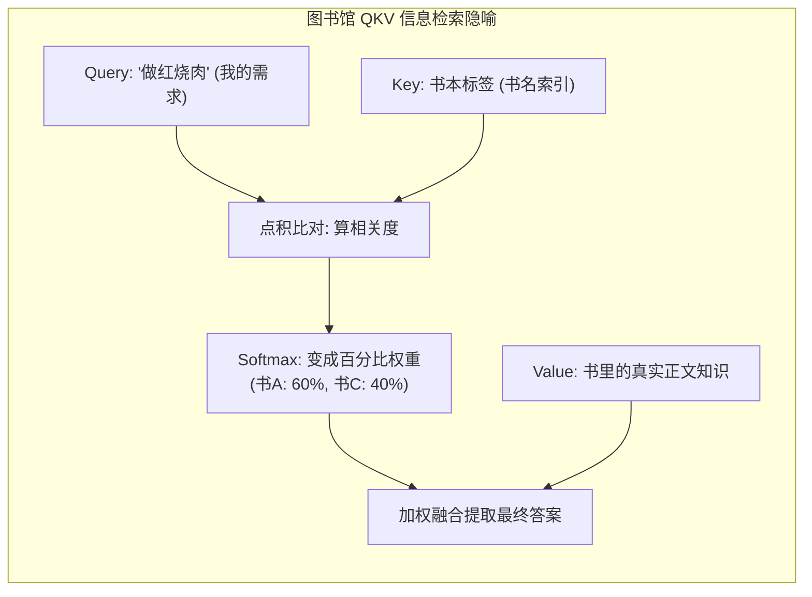
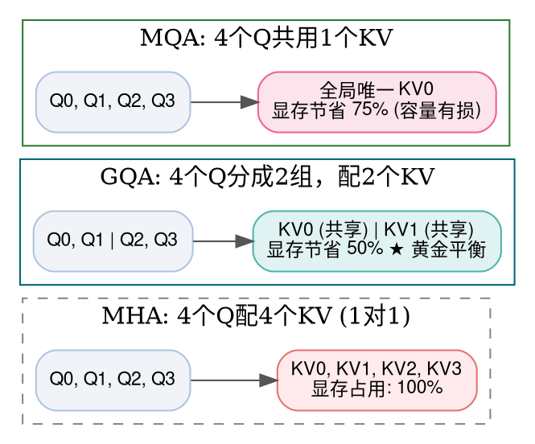
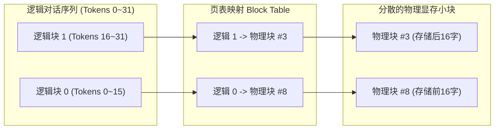

> **致初学者**：在接触现代大语言模型（如 ChatGPT、Claude、LLaMA、DeepSeek）时，你一定会反复听到这几个高频“黑话”：
> **“自注意力”、“KV Cache 显存爆炸”、“FlashAttention 分块”、“vLLM 分页内存”、“GQA 分组查询”、“DeepSeek MLA”**……
>
> 许多初学者翻开经典论文《Attention Is All You Need》，看到公式：
> $$ \text{Attention}(Q, K, V) = \text{Softmax}\left( \frac{Q K^T}{\sqrt{d_k}} \right) V $$
> 觉得这个式子看起来也没多长，怎么一到了 10 万字的长文本，显存就直接 OOM（Out of Memory 内存溢出）挂掉了？
> 为什么原本好好的 MHA（多头注意力），后来被改造成了 MQA、GQA，再到如今引爆全球的 DeepSeek MLA？
>
> 本篇作为系列第六讲，将彻底抛开所有晦涩的套话，**用生动形象的生活比喻（图书馆借书、服务员与厨师、小书桌与大书架）**，带你从最原始的点积注意力开始，一步一步搞懂注意力机制全家桶的 7 大核心算子！

---

## 零、Q、K、V 的生活真相：图书馆借书隐喻

很多初学者学了半年也没想明白：为什么非要搞出 $Q$、$K$、$V$ 三个矩阵？
我们用**图书馆借书**的生活场景，30 秒彻底搞懂：

- **Query（查询向量 $Q$）**：
  好比你走进图书馆时，脑子里想找的书的**搜索关键词**（比如：“我想学做红烧肉”）。
- **Key（键向量 $K$）**：
  好比图书馆书架上每一本书的**索引标签或书名**（比如：A 书标签是“川菜大全”，B 书标签是“高等数学”，C 书标签是“家常热菜”）。
- **$Q \cdot K^T$（计算相似度打分）**：
  拿着你的关键词去跟书架上的每本书标签挨个比对，算出一个**相关度分数**：
  你发现 A 书得分 90，C 书得分 80，B 书得分 0。
- **Softmax（归一化为概率权重）**：
  把相关度分数变成百分比权重：A 书占 60%，C 书占 40%，B 书占 0%。
- **Value（值向量 $V$）**：
  好比每一本书里面**真正印着的知识正文**！
- **最后与 $V$ 加权求和（$\text{Weights} \cdot V$）**：
  你按照 60% 参考 A 书的内容 + 40% 参考 C 书的内容，在脑海里提炼出最终的红烧肉做法！



---

## 1. ScaledDotProductAttention (缩放点积注意力：为什么除以 $\sqrt{d_k}$？)

### 1.1 初学者必懂：那个神秘的根号分母是干嘛的？
公式里为什么要除以 $\sqrt{d_k}$？直接算 $Q K^T$ 不行吗？
**答案：如果不除以 $\sqrt{d_k}$，Softmax 会瞬间梯度死亡！**

- **极小数字推演数学证明**：
  假设每个分量都是独立同分布的标准正态分布（均值 0，方差 1）。
  点积是 $d_k$ 个乘积的累加：$q \cdot k = \sum_{i=1}^{d_k} q_i k_i$。
  初中概率论告诉我们：$d_k$ 个方差为 1 的随机变量加起来，**总方差会直接变成 $d_k$！标准差变为 $\sqrt{d_k}$！**
- **如果维度 $d_k = 64$**：
  标准差高达 $\sqrt{64} = 8$！
  这意味着点积算出来的分数很容易飙到 $+24$ 或者 $-24$。
  我们看一下指数运算的恐怖威力：
  $e^{24} \approx 2.6 \times 10^{10}$，而 $e^{-24} \approx 3.7 \times 10^{-11}$。
  经过 Softmax 之后，最大那个数独揽了 $99.9999999999\%$ 的概率，其余所有数概率全部变成了 0（变成了一个极端的 One-Hot 冲激）！
  **此时，Softmax 的局部导数在所有地方全部等于 0，反向传播梯度彻底消失！**
- **除以 $\sqrt{d_k} = 8$ 的神效**：
  把点积结果重新除以 8，数值重新被拉回到 $[-3, 3]$ 的平缓健康激活区，Softmax 的梯度重新恢复充沛生机！

### 1.2 原生 Python 逐行注释实现
```python
import math

def naive_sdpa(Q: list[list[float]], K: list[list[float]], V: list[list[float]], is_causal: bool = True) -> list[list[float]]:
    """原生纯 Python 缩放点积注意力 (含因果掩码与 Safe-Softmax)"""
    Sq = len(Q)       # Query 序列长度
    Sk = len(K)       # Key 序列长度
    dk = len(Q[0])    # 隐藏特征维度
    scale = 1.0 / math.sqrt(dk) # 缩放因子 1/sqrt(dk)

    # 步骤 1: 计算 Q 与 K 的点积相似度矩阵 [Sq, Sk]
    scores = [[0.0] * Sk for _ in range(Sq)]
    for i in range(Sq):
        for j in range(Sk):
            # 向量点积
            dot = sum(Q[i][d] * K[j][d] for d in range(dk))
            scores[i][j] = dot * scale
            # 因果掩码 (Causal Mask)：如果是语言模型，不允许偷看未来的词 (j > i)
            if is_causal and j > i:
                scores[i][j] = -1e9

    # 步骤 2: 逐行执行 Safe-Softmax 归一化为注意力权重
    weights = [[0.0] * Sk for _ in range(Sq)]
    for i in range(Sq):
        max_s = max(scores[i]) # 减去行最大值，防上溢
        exp_row = [math.exp(s - max_s) for s in scores[i]]
        sum_exp = sum(exp_row)
        weights[i] = [v / sum_exp for v in exp_row]

    # 步骤 3: 用注意力权重对 Value 进行加权求和 [Sq, dv]
    dv = len(V[0])
    output = [[0.0] * dv for _ in range(Sq)]
    for i in range(Sq):
        for d in range(dv):
            output[i][d] = sum(weights[i][j] * V[j][d] for j in range(Sk))

    return output

if __name__ == "__main__":
    # 2 个 Token，每个维度为 2
    test_Q = [[1.0, 0.0], [0.0, 1.0]]
    test_K = [[1.0, 0.0], [0.0, 1.0]]
    test_V = [[10.0, 20.0], [30.0, 40.0]]
    out = naive_sdpa(test_Q, test_K, test_V, is_causal=True)
    print("SDPA 自注意力计算输出:")
    for row in out:
        print(" ", [round(v, 2) for v in row])
```

### 1.3 原生 C++ 逐行注释实现
```cpp
#include <iostream>
#include <cmath>
#include <iomanip>

int main() {
    constexpr int S = 2; // 序列长度
    constexpr int D = 2; // 特征维度

    const float Q[S][D] = {{1.0f, 0.0f}, {0.0f, 1.0f}};
    const float K[S][D] = {{1.0f, 0.0f}, {0.0f, 1.0f}};
    const float V[S][D] = {{10.0f, 20.0f}, {30.0f, 40.0f}};

    const float scale = 1.0f / std::sqrt(2.0f);
    float scores[S][S];

    // 1. QK^T 点积并乘以缩放因子
    for (int i = 0; i < S; ++i) {
        for (int j = 0; j < S; ++j) {
            float dot = 0.0f;
            for (int d = 0; d < D; ++d) {
                dot += Q[i][d] * K[j][d];
            }
            // 因果掩码：不能看未来 (j > i)
            if (j > i) {
                scores[i][j] = -1e9f;
            } else {
                scores[i][j] = dot * scale;
            }
        }
    }

    // 2. Safe-Softmax
    float weights[S][S];
    for (int i = 0; i < S; ++i) {
        float max_val = scores[i][0];
        for (int j = 1; j < S; ++j) {
            if (scores[i][j] > max_val) max_val = scores[i][j];
        }
        float sum_exp = 0.0f;
        for (int j = 0; j < S; ++j) {
            weights[i][j] = std::exp(scores[i][j] - max_val);
            sum_exp += weights[i][j];
        }
        for (int j = 0; j < S; ++j) {
            weights[i][j] /= sum_exp;
        }
    }

    // 3. 加权求和 Weights * V
    float output[S][D] = {0.0f};
    for (int i = 0; i < S; ++i) {
        for (int d = 0; d < D; ++d) {
            float sum = 0.0f;
            for (int j = 0; j < S; ++j) {
                sum += weights[i][j] * V[j][d];
            }
            output[i][d] = sum;
        }
    }

    std::cout << "=== 原生 C++ SDPA 自注意力验证 ===" << std::endl;
    for (int i = 0; i < S; ++i) {
        std::cout << "Token " << i << ": [";
        for (int d = 0; d < D; ++d) {
            std::cout << std::fixed << std::setprecision(2) << output[i][d] << (d + 1 < D ? ", " : "");
        }
        std::cout << "]" << std::endl;
    }
    return 0;
}
```

---

## 2. MHA vs MQA vs GQA (服务员与厨师的比喻)

### 2.1 为什么大模型要把 MHA 改造成 GQA？
自回归生成时，每一个历史 Token 的 Key 和 Value 都必须保存在显存里（这就是著名的 **KV Cache**）。
当上下文达到数万 Token 时，KV Cache 会占用几十个 GB 的宝贵显存！
我们用**餐馆里的服务员与后厨厨师**的比喻，30 秒秒懂三大变体：

- **Query Head（查询头）**：好比**前厅点单的服务员**；
- **Key-Value Head（键值头）**：好比**后厨做饭的厨师（占用昂贵的厨房操作台/显存空间）**。

1. **MHA（标准多头注意力）**：
   32 个服务员，配备 **32 位独立厨师**！
   每位服务员都有自己专属的厨师。**缺点：厨房操作台（显存）被挤爆了！**
2. **MQA（多查询注意力）**：
   32 个服务员，**全店只有 1 位公用大厨**！
   显存瞬间缩减为原先的 $\frac{1}{32}$！**缺点：1 位大厨照顾 32 个服务员，做出来的菜味道单调（模型表达能力下降）**。
3. **GQA（分组查询注意力，现代大模型标配）**：
   **黄金中庸折中！** 32 个服务员分成 8 组，每 4 个服务员共享 1 位厨师（共 8 位厨师）。
   **显存直接减少 4 倍，同时菜品的丰富度和质量几乎丝毫无损！**（LLaMA-2/3、Mistral 全面采用）。



---

## 3. FlashAttention (小书桌与大书架的比喻)

### 3.1 为什么标准注意力把 GPU 累死了？
- **小书桌（GPU 片上 SRAM）**：
  极快（1 纳秒就能拿放），但极小（每块核心只有 100KB~200KB）。
- **大书架（GPU 显存 HBM）**：
  极大（80GB），但很远很慢（走过去要 200 纳秒）。
- **标准注意力的愚蠢做法**：
  在算长文本时，中间的 $S \times S$ 注意力矩阵有几千万个数字（好几百兆）。小书桌放不下，GPU 就只能把这几百兆草稿纸**整捆搬到大书架上**；要算 Softmax 时，再从大书架**整捆搬回小书桌**；算完了再搬回大书架；要乘 $V$ 时再搬一次！
  **GPU 95% 的时间全浪费在楼道里搬书（访存墙），根本没时间做真正的计算！**

### 3.2 FlashAttention 的天才构想：在线递推 Softmax（Online Softmax）
FlashAttention 宣布：**那几百兆的巨大草稿纸，我们一个字也不要往大书架上写！**
把 $Q, K, V$ 切成刚刚能放下小书桌的微小分块（Tiles，比如 128 个词一块）：
在小书桌上边算边用 **Online Softmax 公式**在便利贴上实时修正局部极大值和累加分母，算完当场把结果累加进最终输出，然后**直接把草稿纸撕掉扔进垃圾桶**！
**中间的超大矩阵根本不需要写回显存，IO 搬运量直接暴跌一个数量级，提速 2~4 倍！**

---

## 4. PagedAttention (操作系统虚拟内存分页大拯救)

### 4.1 传统连续显存分配的荒谬浪费
在 vLLM 出现前，大模型服务器为了保存某个用户的对话 KV Cache，必须在显存里划出一块**连续的物理内存空间**。
因为用户可能会问很长的问题（比如上限 4096），系统哪怕这个用户只说了句“你好”，也必须提前在显存里给他霸占好 4096 个词的整片地皮！
结果：**60% 到 80% 的显存被空闲地皮白白霸占着，其他用户根本进不来！**

### 4.2 PagedAttention 机制：向 Windows/Linux 虚拟内存学习！
操作系统是怎么管理内存的？**分页（Paging）！**
- 将显存切成固定大小的“物理小格子”（比如每个物理块存 16 个 Token）；
- 维护一张**页表（Block Table）**；
- 用户的 Token 说到哪，就从空闲池里抓一个物理块挂上去。物理块可以散落在显存的任何角落！
**显存浪费率从 80% 暴降到 4% 以下，并发支持人数瞬间飙升数倍！**



---

## 5. MLA (多头潜在注意力：DeepSeek 引爆业界的杀手锏)

### 5.1 痛点直击：GQA 还不够省显存！
在前面讲的 GQA 中，虽然厨师数量变少了，但每个保留下来的 KV 维度依然非常庞大（动辄几千维）。
当百万上下文成为刚需时，显存依然吃紧。
### 5.2 DeepSeek 的神级创新：低秩潜在压缩（Latent Compression）
DeepSeek-V2 / V3 提出了 MLA（Multi-Head Latent Attention）：
1. **压缩进潜空间（Compression）**：
   不要直接缓存庞大的 Key 和 Value！用一个下投影矩阵，把几千维的 Key 和 Value **联合压缩成一个只有几百维的超低维小向量（潜向量 $c_t^{KV}$）**；
2. **显存只存潜向量**：
   在自回归生成时，显存**只缓存这个被深度压榨过的小潜向量**！
3. **即时解压（On-the-fly Decompress）**：
   要算注意力时，通过上投影矩阵瞬间解压出完整多头 Key 和 Value。
**成果：在保持完整多头注意力表征能力的同时，将 KV Cache 显存暴砍 80% 以上！**

---

## 总结与初学者避坑指南

| 注意力算子 | 核心攻克的技术痛点 | 工业界最佳方案 |
| :--- | :--- | :--- |
| **SDPA** | 注意力基础原型，除以 $\sqrt{d_k}$ 防止 Softmax 梯度饱和死亡 | 标配 |
| **GQA** | 解决解码期 KV Cache 显存爆炸，4个Q共享1个KV | LLaMA-2/3、Mistral 标配 |
| **FlashAttention** | 突破 GPU HBM 显存带宽墙，片上分块 + 在线递推 Softmax | 现代全栈训练加速基石 |
| **PagedAttention** | 借鉴操作系统页表，彻底消灭显存碎片 | vLLM 推理服务引擎底座 |
| **MLA** | 低秩联合潜向量压缩，保持表达力同时再砍 80% 显存 | DeepSeek-V2 / DeepSeek-V3 |

下一讲，我们将探讨让大模型以单卡算力驱动万亿参数的秘密武器——**混合专家与路由算子（TopK / MoE Router / Token Permute）**！
