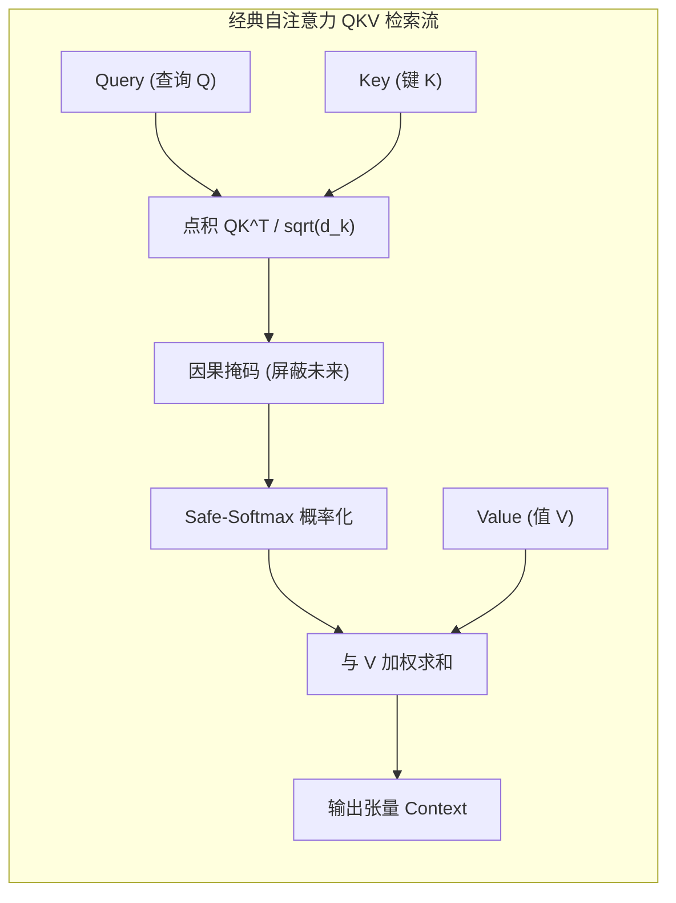
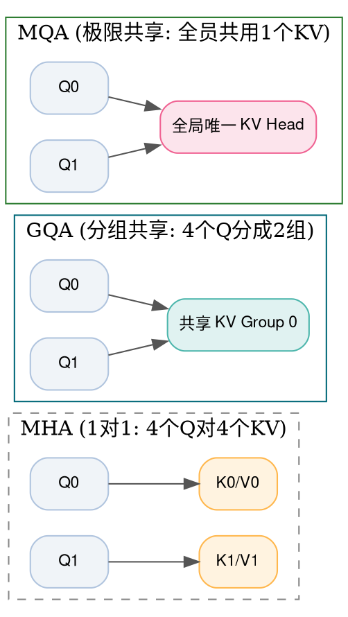
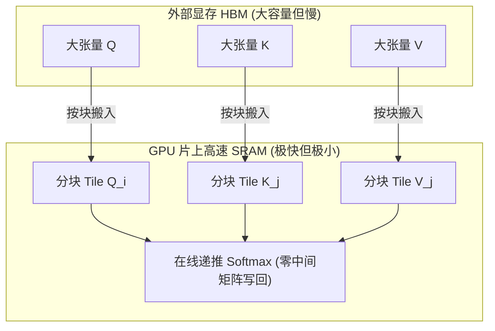
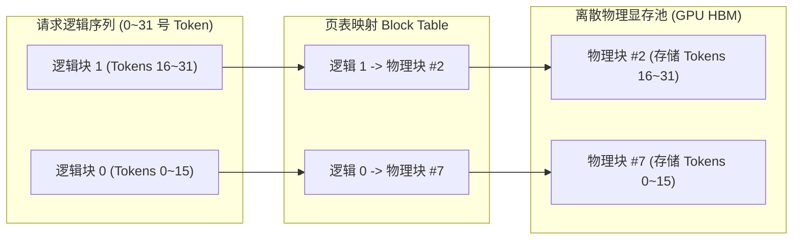
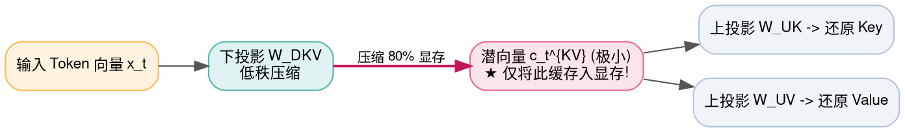

> **导读**：如果说线性代数是现代深度学习的肌肉，那么**注意力机制（Attention Mechanism）**就是所有大语言模型（LLM）的灵魂大脑。
>
> 2017 年，Google 论文《Attention Is All You Need》用最经典的 **Scaled Dot-Product Attention（缩放点积注意力）** 开启了整个大模型时代。然而，随着模型参数扩展到千亿、上下文长度从 2K 暴涨至 128K 乃至 1M，原始注意力机制遭遇了极其残酷的物理天花板：
> - **二次方复杂度诅咒**：注意力打分矩阵的显存和计算量随序列长度呈 $O(S^2)$ 爆炸式增长；
> - **KV Cache 显存暴涨**：高并发自回归解码时，仅保存历史 Token 的 Key 和 Value 就会将 80GB 的 A100/H100 显存榨干殆尽；
> - **物理访存墙（Memory Wall）**：在 GPU 的高带宽显存（HBM）与片上缓存（SRAM）之间反复来回搬运数以亿计的中间矩阵，导致算力空转。
>
> 为了攻破这些难题，工业界涌现出了**多查询与分组查询注意力（MQA/GQA）**、**FlashAttention**、**PagedAttention**、**滑动窗口注意力（SWA）**，以及 DeepSeek 引爆业界的**多头潜在注意力（MLA）**。
>
> 本篇作为系列第六讲，将带你逐一攻克这 7 个支撑起现代通用人工智能基石的顶级注意力算子。

---

## 零、初学者核心概念速查：QKV、KV Cache 与在线 Softmax

> [!NOTE] 核心概念形象字典
>
> - **Query（查询 $Q$）、Key（键 $K$）、Value（值 $V$）**：
>   - $Q$ 好比在搜索引擎搜索框输入的搜索关键词；
>   - $K$ 好比全网所有网页的标题与标签索引；
>   - $V$ 好比网页中真正包含的内容正文。
>   - $Q$ 与每个 $K$ 做内积相似度比对，经过 Softmax 得到“相关度权重”，最后用该权重对所有的 $V$ 进行加权求和，抽取出最相关的内容。
> - **缩放因子（Scaling Factor, $1 / \sqrt{d_k}$）**：防止高维向量点积后方差急剧发散为极端大数导致 Softmax 梯度饱和为 0。
> - **KV Cache（键值缓存）**：在生成下一个词时，前面的历史 Token 已经算好的 Key 和 Value 向量是固定不变的。将它们缓存起来避免每生成一个字都要重新算一遍全文，以空间换时间。
> - **IO 复杂度（IO Complexity）**：算法在处理器高速片上缓存（SRAM）与外部低速大显存（HBM/DDR）之间搬运字节的总量。
> - **在线 Softmax（Online Softmax）**：传统 Softmax 必须遍历完全部数据拿到全局最大值和总分母后才能算分子；在线 Softmax 允许分块逐步流式递推，在不占用全局显存的前提下无损合并结果。
> - **多头潜在压缩（Latent Compression）**：通过低秩矩阵分解，将庞大的 KV 向量压缩进一个极小的“特征潜空间”，需要时再动态恢复，成倍节省显存。



---

## 1. ScaledDotProductAttention (缩放点积注意力 / SDPA)

### 1.1 原理解析：为什么要除以 $\sqrt{d_k}$？
- **标准公式**：
  $$ \text{Attention}(Q, K, V) = \text{Softmax}\left( \frac{Q K^T}{\sqrt{d_k}} + M \right) V $$
  其中 $Q \in \mathbb{R}^{S_q \times d_k}$，$K \in \mathbb{R}^{S_k \times d_k}$，$V \in \mathbb{R}^{S_k \times d_v}$，$M$ 为因果下三角掩码矩阵（未来位置为 $-\infty$）。
- **数学第一性原理：方差守恒推导**：
  假设向量 $q$ 与 $k$ 的每个分量都是独立同分布的随机变量，均值为 0，方差为 1。其内积为：
  $$ q \cdot k = \sum_{i=1}^{d_k} q_i k_i $$
  每个乘积项 $q_i k_i$ 的均值为 0，方差为 $\mathbb{D}(q_i k_i) = \mathbb{D}(q_i)\mathbb{D}(k_i) = 1$。
  由于包含 $d_k$ 个独立项累加，因此整个内积的方差为：
  $$ \mathbb{D}(q \cdot k) = d_k \implies \text{标准差为 } \sqrt{d_k} $$
  当维度 $d_k = 128$ 时，标准差高达 $11.3$！这会导致点积数值极其分散，极大值轻易达到几十上百，喂入 Softmax 后输出概率被逼向极端的 0 和 1（成为 One-Hot 冲激），**局部导数瞬间归零，反向传播梯度彻底消失！**
  **除以 $\sqrt{d_k}$ 强行将内积方差拉回为 1，确保 Softmax 始终工作在梯度平稳的黄金激活区！**

### 1.2 原生 Python 实现
```python
import math

def naive_sdpa(Q: list[list[float]], K: list[list[float]], V: list[list[float]], is_causal: bool = True) -> list[list[float]]:
    """纯 Python 原生缩放点积注意力 (含因果掩码与 Safe-Softmax)"""
    Sq = len(Q)
    Sk = len(K)
    dk = len(Q[0])
    scale = 1.0 / math.sqrt(dk)
    
    # 步骤 1: 计算缩放点积 Q @ K.T
    scores = [[0.0] * Sk for _ in range(Sq)]
    for i in range(Sq):
        for j in range(Sk):
            dot = sum(Q[i][d] * K[j][d] for d in range(dk))
            scores[i][j] = dot * scale
            # 因果掩码：不能看到未来的词 (j > i)
            if is_causal and j > i:
                scores[i][j] = -1e9
                
    # 步骤 2: 沿行进行 Safe-Softmax
    attn_weights = [[0.0] * Sk for _ in range(Sq)]
    for i in range(Sq):
        max_val = max(scores[i])
        exp_row = [math.exp(s - max_val) for s in scores[i]]
        sum_exp = sum(exp_row)
        attn_weights[i] = [v / sum_exp for v in exp_row]
        
    # 步骤 3: 与 V 加权求和 Attn @ V
    dv = len(V[0])
    output = [[0.0] * dv for _ in range(Sq)]
    for i in range(Sq):
        for d in range(dv):
            output[i][d] = sum(attn_weights[i][j] * V[j][d] for j in range(Sk))
            
    return output

if __name__ == "__main__":
    # 序列长度 2, 维度 2
    Q = [[1.0, 0.0], [0.0, 1.0]]
    K = [[1.0, 0.0], [0.0, 1.0]]
    V = [[10.0, 20.0], [30.0, 40.0]]
    out = naive_sdpa(Q, K, V, is_causal=True)
    print("SDPA 因果注意力输出结果:")
    for row in out:
        print(f"  {[round(v, 4) for v in row]}")
```

### 1.3 原生 C++ 实现
```cpp
#include <iostream>
#include <cmath>
#include <vector>
#include <iomanip>

int main() {
    constexpr int S = 2;
    constexpr int D = 2;
    const float Q[S][D] = {{1.0f, 0.0f}, {0.0f, 1.0f}};
    const float K[S][D] = {{1.0f, 0.0f}, {0.0f, 1.0f}};
    const float V[S][D] = {{10.0f, 20.0f}, {30.0f, 40.0f}};

    float scale = 1.0f / std::sqrt(static_cast<float>(D));
    float scores[S][S];

    // 1. QK^T + Causal Mask
    for (int i = 0; i < S; ++i) {
        for (int j = 0; j < S; ++j) {
            if (j > i) {
                scores[i][j] = -1e9f;
            } else {
                float dot = 0.0f;
                for (int d = 0; d < D; ++d) dot += Q[i][d] * K[j][d];
                scores[i][j] = dot * scale;
            }
        }
    }

    // 2. Safe-Softmax
    float weights[S][S];
    for (int i = 0; i < S; ++i) {
        float max_s = scores[i][0];
        for (int j = 1; j < S; ++j) if (scores[i][j] > max_s) max_s = scores[i][j];
        float sum_exp = 0.0f;
        for (int j = 0; j < S; ++j) {
            weights[i][j] = std::exp(scores[i][j] - max_s);
            sum_exp += weights[i][j];
        }
        for (int j = 0; j < S; ++j) weights[i][j] /= sum_exp;
    }

    // 3. Attn @ V
    float out[S][D] = {0.0f};
    for (int i = 0; i < S; ++i) {
        for (int d = 0; d < D; ++d) {
            for (int j = 0; j < S; ++j) {
                out[i][d] += weights[i][j] * V[j][d];
            }
        }
    }

    std::cout << "=== 原生 C++ SDPA 输出 ===" << std::endl;
    for (int i = 0; i < S; ++i) {
        std::cout << "Token " << i << ": [" 
                  << std::fixed << std::setprecision(2) << out[i][0] << ", " << out[i][1] << "]" << std::endl;
    }
    return 0;
}
```

---

## 2. MultiHeadAttention (MHA)

### 2.1 原理解析：多头并行表征
- 单头注意力只能在单一的语义加权方向上提取信息。
- **MHA（多头注意力）** 将总隐藏特征维度 $D$ 均分为 $H$ 个头，每个头拥有独立的维度 $d_k = D / H$。
  - 各个注意力头在彼此正交的独立子空间内并行计算注意力（一个头关注语法从属，一个头关注实体距离，一个头关注情感色彩）。
  - 最后将 $H$ 个头的输出沿着特征维度拼接（Concat），再通过一个全连接输出投影矩阵 $W_O$ 融合信息。

---

## 3. MQA / GQA (多查询与分组查询注意力)

### 3.1 原理解析：KV Cache 显存暴涨的解药
随着模型上下文拉长到数十万 Token，自回归解码中每个 Token 都需要将所有头的 Key 和 Value 存入显存，显存占用与注意力头数 $H$ 线性成正比！
- **MHA（标准多头）**：每个 Query 头配有一对独立的 Key 头和 Value 头（$H_Q = H_{KV} = 32$）。
- **MQA（多查询注意力 / Shazeer 2019）**：**所有 Query 头共享同一组 Key 和 Value 头**（$H_Q = 32, H_{KV} = 1$）。KV Cache 显存占用瞬间暴跌 32 倍！但表征容量有轻微损失。
- **GQA（分组查询注意力 / Ainslie 2023）**：黄金中庸之道！将 $H_Q$ 个 Query 头均分为 $G$ 组，每组共享一组 Key 和 Value 头（例如 32 个 Q 头分为 8 组，每组 4 个 Q 头共享 1 对 KV 头）。既大幅节省显存，又几乎无损保持了 MHA 的强大表达能力！



### 3.2 原生 Python 实现 (GQA 广播展开)
```python
def naive_gqa_broadcast_kv(num_q_heads: int, num_kv_heads: int, kv_cache: list[list[float]]) -> list[list[list[float]]]:
    """模拟 GQA 将分组 KV Cache 广播匹配到对应 Query 头"""
    if num_q_heads % num_kv_heads != 0:
        raise ValueError("Query 头数必须能被 KV 头数整除")
    group_size = num_q_heads // num_kv_heads
    
    expanded_kv = []
    for q_idx in range(num_q_heads):
        kv_head_idx = q_idx // group_size
        # 共享复用同一个 KV 块
        expanded_kv.append(kv_cache[kv_head_idx])
    return expanded_kv

if __name__ == "__main__":
    # 模拟 4 个 Q 头，2 个 KV 头 (每组 2 个 Q 共享一个 KV)
    kv_heads_data = [
        [1.0, 1.0], # Group 0 对应 KV
        [2.0, 2.0]  # Group 1 对应 KV
    ]
    matched = naive_gqa_broadcast_kv(num_q_heads=4, num_kv_heads=2, kv_cache=kv_heads_data)
    print("GQA 广播匹配后各 Query 头使用的 KV 头数据:")
    for q_i, kv_d in enumerate(matched):
        print(f"  Q Head {q_i} 映射至 -> {kv_d}")
```

### 3.3 原生 C++ 实现
```cpp
#include <iostream>

int main() {
    constexpr int NUM_Q_HEADS = 4;
    constexpr int NUM_KV_HEADS = 2;
    constexpr int GROUP_SIZE = NUM_Q_HEADS / NUM_KV_HEADS;

    const int kv_head_ids[NUM_KV_HEADS] = {101, 202}; // KV 头特征标记

    std::cout << "=== 原生 C++ GQA 头映射关系 ===" << std::endl;
    for (int q = 0; q < NUM_Q_HEADS; ++q) {
        int kv_idx = q / GROUP_SIZE;
        std::cout << "Query Head " << q << " 绑定共享 -> KV Head " << kv_idx 
                  << " (Tag: " << kv_head_ids[kv_idx] << ")" << std::endl;
    }
    return 0;
}
```

---

## 4. FlashAttention (分块与在线递推 Softmax)

### 4.1 原理解析：突破 GPU 访存墙的登峰造极之作
- **核心瓶颈**：标准注意力需要把庞大的 $S \times S$ 注意力分数矩阵全部物化写回到显存（HBM）中，再读出来做 Softmax，再写回，再读出来乘 $V$。在 4K 序列下，这个中间矩阵高达几百 MB，访存往返极其缓慢。
- **Tri Dao 的破局之法**：
  将 $Q, K, V$ 切分成可以完全塞入芯片片上极速高速缓存（SRAM，仅几十 KB 到几百 KB 大小，带宽比 HBM 快一个数量级）的小块（Tiles）。
- **在线递推 Softmax（Online Softmax）数学核心**：
  设前一块局部最大值为 $m_1$，局部指数和为 $l_1$；新来一块局部最大值为 $m_2$，局部指数和为 $l_2$。
  合并后的全局新最大值 $m_{\text{new}} = \max(m_1, m_2)$。
  则合并后的总分母可以通过换底缩放瞬间完成递推：
  $$ l_{\text{new}} = l_1 \cdot e^{m_1 - m_{\text{new}}} + l_2 \cdot e^{m_2 - m_{\text{new}}} $$
  **完全不需要在全局显存中存储任何 $S \times S$ 矩阵，全程在 SRAM 中流水线流式完成！**



### 4.2 原生 Python 实现 (Online Softmax 增量递推)
```python
import math

def naive_online_softmax_step(m_prev: float, l_prev: float, out_prev: list[float], block_scores: list[float], block_V: list[float]) -> tuple[float, float, list[float]]:
    """模拟 FlashAttention 中的单个分块 Online Softmax 与输出累加递推"""
    # 1. 计算当前块局部最大值与指数和
    m_curr = max(block_scores)
    exp_curr = [math.exp(s - m_curr) for s in block_scores]
    l_curr = sum(exp_curr)
    
    # 2. 合并全局最大值
    m_new = max(m_prev, m_curr)
    
    # 3. 换底尺度更新旧分母与新分母
    alpha = math.exp(m_prev - m_new) if m_prev != -float('inf') else 0.0
    beta = math.exp(m_curr - m_new)
    l_new = l_prev * alpha + l_curr * beta
    
    # 4. 增量更新输出加权结果
    dim = len(out_prev)
    out_new = [0.0] * dim
    for d in range(dim):
        curr_block_v = sum(exp_curr[i] * block_V[i] for i in range(len(block_scores)))
        out_new[d] = (out_prev[d] * l_prev * alpha + curr_block_v * beta) / l_new
        
    return m_new, l_new, out_new

if __name__ == "__main__":
    # 分两个小批次到达的分块数据
    m, l, o = -float('inf'), 0.0, [0.0]
    # Block 1: 分数 [1.0, 2.0], V = [10.0, 20.0]
    m, l, o = naive_online_softmax_step(m, l, o, [1.0, 2.0], [10.0, 20.0])
    print(f"处理完 Block 1: 极大值={m:.2f}, 输出={o[0]:.4f}")
    # Block 2: 分数 [0.5, 3.0], V = [5.0, 40.0]
    m, l, o = naive_online_softmax_step(m, l, o, [0.5, 3.0], [5.0, 40.0])
    print(f"流式合并 Block 2: 极大值={m:.2f}, 最终流式输出={o[0]:.4f}")
```

### 4.3 原生 C++ 实现
```cpp
#include <iostream>
#include <cmath>
#include <algorithm>
#include <iomanip>

int main() {
    // 模拟在线合并两个分块的 Softmax 统计量
    float m_prev = 2.0f;
    float l_prev = std::exp(1.0f - 2.0f) + std::exp(2.0f - 2.0f); // Block 1
    float m_curr = 3.0f;
    float l_curr = std::exp(0.5f - 3.0f) + std::exp(3.0f - 3.0f); // Block 2

    float m_new = std::max(m_prev, m_curr);
    float alpha = std::exp(m_prev - m_new);
    float beta = std::exp(m_curr - m_new);
    float l_new = l_prev * alpha + l_curr * beta;

    std::cout << "=== 原生 C++ FlashAttention 在线分母递推 ===" << std::endl;
    std::cout << "新全局极大值 m_new = " << std::fixed << std::setprecision(2) << m_new << std::endl;
    std::cout << "合并后总分母 l_new  = " << std::setprecision(4) << l_new << std::endl;
    return 0;
}
```

---

## 5. PagedAttention (分页显存管理原理)

### 5.1 原理解析：操作系统虚拟内存对大模型的降维打击
- **问题根源**：在 vLLM 诞生前，系统为了保存一个请求的 KV Cache，必须在显存中预先分配一块**连续的物理内存空间**。由于文本长度事先无法预知，系统只能按最大的最大长度（如 4096）静态分配，造成了高达 60% 到 80% 的显存碎片浪费（由于等待或没填满）。
- **PagedAttention 核心机制**：
  借鉴经典操作系统（OS）的分页虚拟内存体系：
  - 将每个序列的 KV Cache 离散切分为固定大小的 **物理块（Block / Page，如每个 Block 存 16 个 Token）**；
  - 维护一张**逻辑块到物理块的页表（Block Table）**；
  - 物理显存块可以离散分布在显存的任何角落，随生成动态按需申请分配，彻底将显存浪费降至 4% 以下，并发吞吐量飙升数倍！



### 5.2 原生 Python 实现
```python
class NaivePagedKVManager:
    """纯 Python 模拟 PagedAttention 显存分页调度与寻址"""
    def __init__(self, block_size: int, total_blocks: int):
        self.block_size = block_size
        self.free_blocks = list(range(total_blocks))
        # 物理显存池: [total_blocks, block_size]
        self.physical_pool = [[0.0] * block_size for _ in range(total_blocks)]

    def allocate_token(self, block_table: list[int], token_idx: int, val: float):
        logical_block = token_idx // self.block_size
        offset = token_idx % self.block_size
        
        # 若需要新物理块，从空闲池挂载
        if logical_block >= len(block_table):
            new_phys_id = self.free_blocks.pop(0)
            block_table.append(new_phys_id)
            
        phys_id = block_table[logical_block]
        self.physical_pool[phys_id][offset] = val

if __name__ == "__main__":
    manager = NaivePagedKVManager(block_size=2, total_blocks=5)
    req_block_table = []
    
    # 模拟写入 3 个 Token 的 KV 特征
    for t_id, v in enumerate([11.0, 22.0, 33.0]):
        manager.allocate_token(req_block_table, t_id, v)
        
    print("分配完成！请求对应的逻辑页表映射:", req_block_table)
    print("物理块 0 内容:", manager.physical_pool[req_block_table[0]])
    print("物理块 1 内容:", manager.physical_pool[req_block_table[1]])
```

### 5.3 原生 C++ 实现
```cpp
#include <iostream>

int main() {
    constexpr int BLOCK_SIZE = 16;
    // 模拟页表：逻辑块 0 映射物理块 9，逻辑块 1 映射物理块 3
    const int block_table[] = {9, 3};

    int token_idx = 18; // 查询第 18 号 Token
    int logical_block = token_idx / BLOCK_SIZE;
    int offset = token_idx % BLOCK_SIZE;
    int physical_block = block_table[logical_block];

    std::cout << "=== 原生 C++ PagedAttention 页表寻址 ===" << std::endl;
    std::cout << "Token ID: " << token_idx << std::endl;
    std::cout << "  -> 逻辑块号: " << logical_block << std::endl;
    std::cout << "  -> 映射物理块号: #" << physical_block << std::endl;
    std::cout << "  -> 块内偏移 Offset: " << offset << std::endl;
    return 0;
}
```

---

## 6. MLA (多头潜在注意力 / Multi-Head Latent Attention)

### 6.1 原理解析：DeepSeek 惊艳业界的 KV 极限压缩黑科技
- **背景**：在传统的 GQA 中，虽然 KV Cache 被压缩了，但每个保留下来的 KV Head 维度仍然很大，长文本下依然沉重。
- **MLA 破局之道**：
  1. **低秩压缩（Low-rank Joint Compression）**：
     将原本巨大的所有 Key 和 Value 向量，通过一个下投影矩阵 $W_{DKV}$ 联合压缩为一个极小维度的**隐空间潜向量（Latent Vector $c_t^{KV}$，维度仅几百）**：
     $$ c_t^{KV} = x_t W_{DKV} $$
  2. **推理期无需保存解压后的完整 KV**：
     在自回归生成时，显存**只缓存这个超低维度的 $c_t^{KV}$**！在计算注意力前夕，再通过上投影矩阵 $W_{UK}$ 与 $W_{UV}$ 瞬间还原；
  3. **解耦 RoPE（Decoupled RoPE）**：
     因为 RoPE 旋转具有位置敏感性，不能被线性投影随意压缩，MLA 巧妙设计了一条独立的极小维度专有向量 $k_t^R$ 专门承载 RoPE 旋转！
  **成果**：在保持完整多头注意力表征能力的同时，将推理期 KV Cache 显存暴砍 **80% 以上**！



### 6.2 原生 Python 实现
```python
def naive_mla_compress_decompress(x: list[float], W_down: list[list[float]], W_up_k: list[list[float]]) -> tuple[list[float], list[float]]:
    """模拟 MLA 低秩潜向量压缩与即时还原"""
    # 1. 压缩入低秩 Latent 潜空间 (只缓存这个)
    d_latent = len(W_down[0])
    latent_c = [0.0] * d_latent
    for l_idx in range(d_latent):
        latent_c[l_idx] = sum(x[i] * W_down[i][l_idx] for i in range(len(x)))
        
    # 2. 推理计算时，即时解压还原出完整的多头 Key
    d_out_k = len(W_up_k[0])
    restored_k = [0.0] * d_out_k
    for k_idx in range(d_out_k):
        restored_k[k_idx] = sum(latent_c[l] * W_up_k[l][k_idx] for l in range(d_latent))
        
    return latent_c, restored_k

if __name__ == "__main__":
    # 输入维度 4, 压缩潜维度 2, 最终多头 Key 维度 4
    sample_x = [1.0, 2.0, 3.0, 4.0]
    W_down = [[0.5, 0.1], [0.2, 0.4], [0.1, 0.3], [0.4, 0.2]] # 4x2
    W_up = [[1.0, 0.0, 1.0, 0.0], [0.0, 1.0, 0.0, 1.0]]       # 2x4
    c_lat, k_full = naive_mla_compress_decompress(sample_x, W_down, W_up)
    print("MLA 缓存的低秩潜向量 (仅2维):", [round(v, 3) for v in c_lat])
    print("即时解压出的完整 Key 向量 (4维):", [round(v, 3) for v in k_full])
```

### 6.3 原生 C++ 实现
```cpp
#include <iostream>
#include <iomanip>

int main() {
    constexpr int D_IN = 4;
    constexpr int D_LATENT = 2; // 极小潜维度
    constexpr int D_OUT = 4;

    const float x[D_IN] = {1.0f, 2.0f, 3.0f, 4.0f};
    const float W_down[D_IN][D_LATENT] = {
        {0.5f, 0.1f}, {0.2f, 0.4f}, {0.1f, 0.3f}, {0.4f, 0.2f}
    };

    // 1. 低秩压缩
    float latent_c[D_LATENT] = {0.0f};
    for (int l = 0; l < D_LATENT; ++l) {
        for (int i = 0; i < D_IN; ++i) {
            latent_c[l] += x[i] * W_down[i][l];
        }
    }

    std::cout << "=== 原生 C++ MLA 潜向量压缩验证 ===" << std::endl;
    std::cout << "压缩后显存只需存放 " << D_LATENT << " 个浮点数: ["
              << std::fixed << std::setprecision(3) << latent_c[0] << ", " << latent_c[1] << "]" << std::endl;
    return 0;
}
```

---

## 7. SlidingWindowAttention (滑动窗口注意力 / SWA)

### 7.1 原理解析：局部局域稀疏注意力
- **核心思想**：语言模型中，绝大部分信息交互发生在相邻近的词之间（局部相关性极强）。
- **算法设计**：给定一个固定大小的窗口 $W$（例如 4096）。在计算第 $i$ 个 Token 的注意力时，**只允许关注左侧最近的 $W$ 个 Token（$[i - W + 1, i]$）**，更早的 Token 一律掩码屏蔽。
- **复杂度下降**：计算复杂度与 KV Cache 长度由 $O(S^2)$ 骤降为线性 **$O(S \times W)$**。
- **多层感受野堆叠**：通过深层 Transformer 的逐层透传，第 $k$ 层神经元的理论有效感受野可达 $k \times W$，兼顾了长程依赖与推理轻量化。

---

## 总结与思维进阶

| 算子 | 核心攻克难题 | 显存/IO 优化原理 | 工业代表 |
| :--- | :--- | :--- | :--- |
| **SDPA / MHA** | 基础多维语义表征 | 缩放因数维持方差稳定 | 原始 Transformer、GPT-3 |
| **MQA / GQA** | 解码期 KV Cache 显存爆炸 | 分组/单组共享 Key-Value 头 | LLaMA-2/3、Mistral |
| **FlashAttention** | 频繁往返 GPU HBM 显存墙 | 片上 SRAM 分块 + 在线递推 Softmax | 现代全栈训练推理加速库 |
| **PagedAttention** | 并发服务显存碎片化与浪费 | OS 虚拟分页机制，离散动态挂载 | vLLM、TGI 引擎底座 |
| **MLA** | 保持 MHA 表征同时极限压 KV | 低秩联合投影 + 解耦 RoPE | DeepSeek-V2 / DeepSeek-V3 |
| **SWA** | 超长序列 $O(S^2)$ 计算瓶颈 | 局域滑动窗口截断，线性 $O(S \cdot W)$ | Mistral-7B、Longformer |

下一讲，我们将迈入现代超万亿稀疏大模型的核心枢纽——**路由与混合专家算子（MoE Gating / TopK / Token Permute）**！
