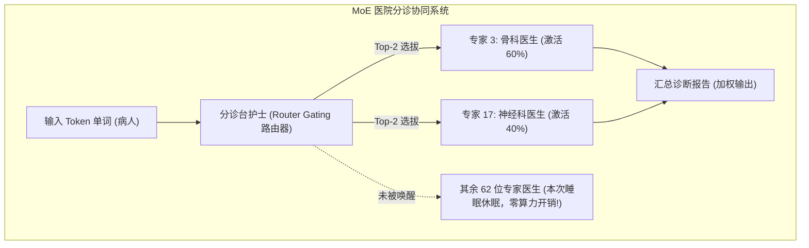
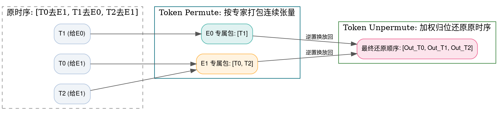

> **致初学者**：在过去，深度学习模型几乎都是**稠密模型（Dense Model）**：
> 一个 70B（700 亿）参数的模型，每一个输入进来的词，都要把这 700 亿个参数全盘运算一遍，计算极其昂贵、速度极慢。
>
> 后来，以 **Mixtral 8x7B、DeepSeek-V2/V3、Grok** 为代表的 **MoE（Mixture of Experts，混合专家模型）** 横空出世：
> 它们的总参数量高达几千亿，但跑起来的速度却跟一个十几亿的小模型一样飞快！
>
> 为什么能做到这么神奇？
> 很多初学者翻开 MoE 代码，被里面的 `TopK`、`Router Gating`、`Token Permute`、`Token Unpermute` 搞得一头雾水。
>
> 本篇作为系列第七讲，将用**医院分诊台与专科医生的通俗比喻，配合手工具体数字推演**，带你 10 分钟彻底搞懂 MoE 底层的三大核心算子！

---

## 零、医院分诊台比喻：30 秒搞懂 MoE 核心逻辑

想象一家拥有 64 位专科顶级医生的三甲大医院：
- **传统的稠密模型（Dense）做法**：
  每一个来看病的病人（输入的 Token），**必须强行把全院 64 位医生全部看一遍！**
  每个医生都给病人开一遍检查、写一遍病历。这不仅把医院累瘫痪了，病人也排队排到吐血！
- **现代的 MoE 混合专家做法**：
  门口设一个**分诊台护士（MoE Router 门控路由器）**。
  病人刚走到门口，护士扫一眼病人的特征（Token 向量），在挂号单上打分：
  - 骨科得分 95 分，神经科得分 80 分，儿科 5 分，妇科 0 分……
  - 护士挑选得分最高的两位医生（**Top-2 决策**）：请去找“骨科医生（专家 3）”和“神经科医生（专家 17）”！
  - 其余 62 位医生该干嘛干嘛，不为这位病人消耗任何精力！
- **为什么强大？**
  整个医院拥有 64 个学科的浩瀚全科知识储备（模型参数总量巨大），但针对每一个具体问题，**只需要消耗 2 位医生的精力（推理算力极小）！**



---

## 1. TopK 与 MoEGating / Router (门控路由打分算子)

### 1.1 手把手极小数字推演
假设模型当前只有 4 个专家（编号 0、1、2、3），我们要选出最匹配的 **Top-2 个专家**。
输入一个 Token 向量 $x$ 后，路由器线性打分输出 Logits 为：
$$ \text{Logits} = [0.2, 1.8, 0.1, 2.4] $$

1. **Step 1：执行 TopK 极值排序**：
   - 最大的是第 3 号专家：得分 $2.4$；
   - 第二大的是第 1 号专家：得分 $1.8$；
   - 其余第 0、2 号专家被无情淘汰！
2. **Step 2：对入选的 Top-2 分数重新做 Safe-Softmax 归一化**：
   极大值 $M = 2.4$。
   - 专家 3：$e^{2.4 - 2.4} = e^0 = 1.0$；
   - 专家 1：$e^{1.8 - 2.4} = e^{-0.6} \approx 0.5488$；
   - 指数总和：$\text{Sum} = 1.0 + 0.5488 = 1.5488$；
   - 归一化权重：
     - 专家 3 权重：$W_3 = 1.0 / 1.5488 \approx 0.6457$（即 64.57%）；
     - 专家 1 权重：$W_1 = 0.5488 / 1.5488 \approx 0.3543$（即 35.43%）；
3. **输出路由决策**：
   把这个 Token 派送给专家 3 和专家 1，最终结果按 $0.6457 \times \text{Expert}_3 + 0.3543 \times \text{Expert}_1$ 加权求和！

### 1.2 初学者必知的灾难：专家坍缩与负载均衡
如果分诊护士在训练最初几天发现 1 号专家看病稍微准确一点点，之后的几乎所有病人都被送给了 1 号专家！
- **灾难后果**：
  1 号医生门前排起了几万人的长龙（那张 GPU 显存爆满、严重堵车延迟）；而其余 63 位医生闲得无聊看报纸，永远学不到新知识（学术界称为 **专家坍缩 Expert Collapse**）。
- **解法：辅助平衡损失（Auxiliary Load Balancing Loss）**：
  在总 Loss 中加一个惩罚项，强行要求护士派发的病人必须均匀分散到所有专家头上。

### 1.3 原生 Python 逐行注释实现
```python
import math

def naive_moe_router(token_feat: list[float], W_router: list[list[float]], top_k: int = 2) -> list[tuple[int, float]]:
    """纯 Python 原生 MoE 门控路由器"""
    num_experts = len(W_router[0])
    dim = len(token_feat)

    # 1. 线性投影算出所有专家的初选得分 Logits
    logits = [0.0] * num_experts
    for e in range(num_experts):
        logits[e] = sum(token_feat[d] * W_router[d][e] for d in range(dim))

    # 2. 挑选出得分最高的 Top-K 专家
    indexed_scores = sorted([(score, idx) for idx, score in enumerate(logits)], reverse=True)
    top_candidates = indexed_scores[:top_k]

    # 3. 对 Top-K 分数重新做 Safe-Softmax 归一化
    max_val = top_candidates[0][0]
    exp_vals = [math.exp(item[0] - max_val) for item in top_candidates]
    sum_exp = sum(exp_vals)

    routing_plan = []
    for (score, expert_id), exp_v in zip(top_candidates, exp_vals):
        weight = exp_v / sum_exp
        routing_plan.append((expert_id, weight))

    return routing_plan

if __name__ == "__main__":
    t_feat = [1.0, 0.5, -1.0]
    # 模拟 3 维特征投影到 4 个专家
    W_g = [
        [0.2, 1.0, -0.5, 2.0],
        [0.1, 0.5,  0.3, 0.4],
        [0.0, 0.2,  0.1, 0.1]
    ]
    decisions = naive_moe_router(t_feat, W_g, top_k=2)
    print("MoE 路由派发决策 (专家编号, 贡献权重):")
    for exp_id, w in decisions:
        print(f"  分配给专家 #{exp_id} -> 权重系数: {w:.4f}")
```

---

## 2. Token Permute 与 Token Unpermute (数据重排与逆向回收)

### 2.1 为什么必须在物理内存中重排（Permute）？
很多初学者以为：既然算出了路由，直接写个循环 `for tok in tokens: Expert(tok)` 不就行了？
**硬件大忌！GPU 痛恨碎片化的“单样本跳跃调用”！**
GPU 最擅长的是：一次性喂给它一个规整的二维大矩阵，让它的几千个 Tensor Core 一起做超大规模 GEMM。
如果 100 个 Token 里面：
- 有 20 个被分给了专家 0；
- 有 30 个被分给了专家 1；
底层必须做两件事：
1. **Token Permute（重排打包）**：把分散在句子各处的这 20 个 Token 挑出来，在内存中整整齐齐紧挨着拼成一个 $[20, D]$ 的连续矩阵，一口气喂进专家 0 的神经网络！
2. **Token Unpermute（还原回收）**：专家 0 算完后，根据之前记住的位置小账本，把结果准确放回原本的句子句号、逗号位置，并乘以刚才算好的门控权重。



### 2.2 原生 Python 逐行注释跑通全流程
```python
def naive_moe_permute_unpermute():
    """纯 Python 跑通从分发重排、专家批量计算到加权归位的全过程"""
    # 原始序列: 3 个 Token (特征维度 2)
    tokens = [
        [1.0, 2.0], # Token 0
        [3.0, 4.0], # Token 1
        [5.0, 6.0]  # Token 2
    ]
    # 模拟路由结果: (token_id, 目标专家, 权重)
    # Token 0 -> 专家 1 (权重 1.0)
    # Token 1 -> 专家 0 (权重 1.0)
    # Token 2 -> 专家 1 (权重 1.0)
    routing = [(0, 1, 1.0), (1, 0, 1.0), (2, 1, 1.0)]

    # 步骤 1: Token Permute (分类入桶，打包成连续批次)
    expert_buckets = {0: [], 1: []}
    for tok_idx, exp_id, weight in routing:
        expert_buckets[exp_id].append((tok_idx, tokens[tok_idx], weight))

    # 步骤 2: 专家批量计算 (专家 0 翻 2 倍，专家 1 加 10)
    expert_outputs = []
    for exp_id in [0, 1]:
        for tok_idx, feat, weight in expert_buckets[exp_id]:
            if exp_id == 0:
                out_feat = [v * 2.0 for v in feat]
            else:
                out_feat = [v + 10.0 for v in feat]
            expert_outputs.append((tok_idx, out_feat, weight))

    # 步骤 3: Token Unpermute (根据 tok_idx 放回原有时序槽位并加权累加)
    final_output = [[0.0, 0.0] for _ in range(len(tokens))]
    for tok_idx, out_feat, weight in expert_outputs:
        for d in range(2):
            final_output[tok_idx][d] += out_feat[d] * weight

    return final_output

if __name__ == "__main__":
    final_seq = naive_moe_permute_unpermute()
    print("完整 MoE 流转还原后的最终序列:")
    for idx, t in enumerate(final_seq):
        print(f"  Token {idx}: {t}")
```

---

## 总结与初学者避坑指南

1. **MoE 的灵魂是“分工与稀疏激活”**：拥有千亿全科知识，但每个词只激活极小部分参数；
2. **TopK + Softmax**：分诊台选出最顶尖的 $K$ 位专家并归一化加权系数；
3. **Token Permute / Unpermute**：为了迎合 GPU 的连续 GEMM 胃口，必须在内存中“重新打包 $\to$ 算完加权放回”。

下一讲，我们将探讨计算机视觉与多模态空间感知的骨骼——**卷积与池化算子全家桶（Conv2D / Depthwise / ConvTranspose / Pool）**！
