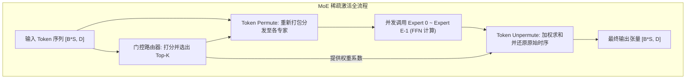
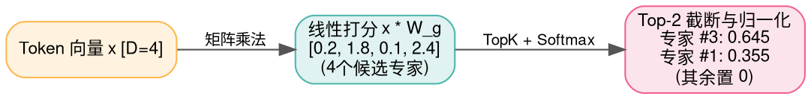
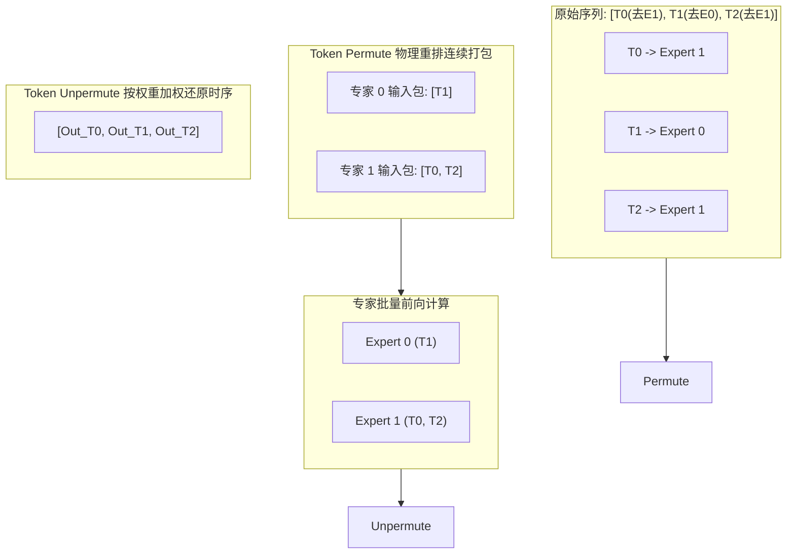

> **导读**：在传统的稠密模型（Dense Model）中，每当模型接收一个 Token 输入，网络中**100% 的神经元与参数都必须被激活计算一次**。这意味着模型的参数量越大，推理的计算成本与延迟就呈线性直线上升。
>
> 怎么才能既拥有几千亿参数的宏大知识库，又保持几十亿参数模型的极快推理速度？
>
> **混合专家架构（Mixture of Experts, MoE）** 交出了完美的答卷：
> 它将庞大的前馈网络（FFN）拆分成数十个甚至数百个小巧的“专家网络（Experts）”。每当一个 Token 到来时，一个精巧的**门控路由器（Router）** 只会挑选与当前词最匹配的少数几个专家（例如 64 个专家中仅激活 2 个）进行针对性计算。
>
> 然而，这种“按需激活”在底层引发了极具挑战的工程难题：**动态数据分发与重排（Token Permute / Unpermute）** 以及**专家负载不均导致的硬件拥堵**。
>
> 本篇作为系列第七讲，将带你彻底拆解 MoE 底层的三大核心算子。

---

## 零、初学者核心概念速查：稀疏激活、负载失衡与 Token 调度

> [!NOTE] 核心概念形象字典
>
> - **稠密（Dense） vs 稀疏（Sparse）**：Dense 模型所有参数全员上阵；Sparse MoE 模型参数总量虽然极其庞大，但对每个样本只有极少数参数真正参与前向计算（激活参数量远小于总参数量）。
> - **专家网络（Expert）**：通常是一个标准的 FFN（全连接前馈层）模块。不同的专家可以在海量数据训练中自发学到不同的专业特长（如数学推理、编程代码、诗歌写作、常识事实等）。
> - **门控路由（Router / Gating Network）**：一个轻量级的线性分类器，根据 Token 的当前特征向量给所有专家打分，决定将这个 Token 派发给谁。
> - **Top-K 稀疏选择**：从打分列表中挑选出分值最高的 $K$ 个专家（如 Top-2）。
> - **专家坍缩与负载均衡（Expert Collapse & Load Balancing）**：如果路由器在初期发现某两个“明星专家”表现稍好，就会将所有 Token 都派给它们，导致这两个专家被累死（硬件显存溢出与排队延迟），而其余几十个专家变成无人问津的“僵尸专家”。因此必须引入辅助损失（Auxiliary Loss）强行平衡分配。
> - **Token Permute（分发重排）**：因为送给同一专家的 Token 零散分布在不同的序列位置，底层必须将它们挑选出来、在内存中连续打包成一个批次，才能调用高效的 GEMM 矩阵乘法。
> - **Token Unpermute（回收还原）**：各专家处理完毕后，根据之前的索引记录将结果逆向放回原时序位置，并按门控权重加权求和。



---

## 1. TopK (Top-K 选择算子)

### 1.1 原理解析
- **定义**：给定一个长度为 $E$ 的一维分值向量，输出前 $K$ 个最大数值及其对应的原始索引编号：
  $$ \text{values}, \text{indices} = \text{TopK}(x, K) $$
- **复杂度权衡**：
  - **全排序（Sort）**：$O(E \log E)$，当 $E$ 较小时实现最简单；
  - **最小堆（Min-Heap）**：维护一个大小为 $K$ 的小顶堆，$O(E \log K)$，适合 $K \ll E$ 的场景；
  - **快速选择（QuickSelect）**：平均时间复杂度为线性 $O(E)$。

### 1.2 原生 Python 实现
```python
def naive_topk(scores: list[float], k: int) -> tuple[list[float], list[int]]:
    """朴素 Top-K 提取 (返回前 K 个最大值及原始索引)"""
    # 携带原始索引组成元组列表
    indexed_scores = [(val, idx) for idx, val in enumerate(scores)]
    # 按分值从大到小排序
    indexed_scores.sort(key=lambda x: x[0], reverse=True)
    
    topk_vals = [indexed_scores[i][0] for i in range(k)]
    topk_idxs = [indexed_scores[i][1] for i in range(k)]
    return topk_vals, topk_idxs

if __name__ == "__main__":
    expert_scores = [0.12, 0.85, 0.05, 0.92, 0.43, 0.01]
    vals, idxs = naive_topk(expert_scores, k=2)
    print("Top-2 选中的专家索引:", idxs)
    print("Top-2 对应的原始打分:", vals)
```

### 1.3 原生 C++ 实现
```cpp
#include <iostream>
#include <vector>
#include <algorithm>

struct ScoreIndex {
    float val;
    int idx;
};

int main() {
    constexpr int E = 6;
    constexpr int K = 2;
    const float scores[E] = {0.12f, 0.85f, 0.05f, 0.92f, 0.43f, 0.01f};

    std::vector<ScoreIndex> list;
    for (int i = 0; i < E; ++i) {
        list.push_back({scores[i], i});
    }

    // 排序挑出 Top-K
    std::sort(list.begin(), list.end(), [](const ScoreIndex& a, const ScoreIndex& b) {
        return a.val > b.val;
    });

    std::cout << "=== 原生 C++ Top-K 选择结果 ===" << std::endl;
    for (int i = 0; i < K; ++i) {
        std::cout << "Rank " << i + 1 << " -> 专家 ID #" << list[i].idx 
                  << " (Score = " << list[i].val << ")" << std::endl;
    }
    return 0;
}
```

---

## 2. MoEGating / Router (专家路由与门控)

### 2.1 原理解析：软路由打分与归一化
- **前向计算三步曲**：
  1. **线性投影计算 Logits**：每个 Token 向量 $x \in \mathbb{R}^D$ 乘以路由权重矩阵 $W_g \in \mathbb{R}^{D \times E}$，得到对所有 $E$ 个专家的初选分数：
     $$ H(x) = x \cdot W_g $$
  2. **Top-K 截断与过滤**：保留最高的 $K$ 个专家打分，其余非候选专家的分值直接置为 $-\infty$：
     $$ \text{KeepTopK}(v, K)_i = \begin{cases} v_i, & \text{if } v_i \in \text{TopK}(v) \\ -\infty, & \text{otherwise} \end{cases} $$
  3. **Softmax 重新归一化**：对选拔出的 $K$ 个分数重新做 Softmax，确保分配给这 $K$ 个专家的权重系数和恒为 1.0：
     $$ G(x) = \text{Softmax}(\text{KeepTopK}(H(x), K)) $$



### 2.2 原生 Python 实现
```python
import math

def naive_moe_router(token_x: list[float], W_gate: list[list[float]], top_k: int = 2) -> list[tuple[int, float]]:
    """原生 MoE Router: 输出 [(专家ID, 归一化权重), ...]"""
    D = len(token_x)
    num_experts = len(W_gate[0])
    
    # 1. 线性投影得到 Logits
    logits = [0.0] * num_experts
    for e in range(num_experts):
        logits[e] = sum(token_x[d] * W_gate[d][e] for d in range(D))
        
    # 2. 挑选 Top-K 索引
    indexed = sorted([(val, idx) for idx, val in enumerate(logits)], reverse=True)
    selected_k = indexed[:top_k]
    
    # 3. 对 Top-K 重新做 Safe-Softmax 归一化
    max_score = selected_k[0][0]
    exp_scores = [math.exp(item[0] - max_score) for item in selected_k]
    sum_exp = sum(exp_scores)
    
    routing_weights = []
    for (orig_val, exp_id), e_val in zip(selected_k, exp_scores):
        weight = e_val / sum_exp
        routing_weights.append((exp_id, weight))
        
    return routing_weights

if __name__ == "__main__":
    t_feat = [1.0, 0.5, -1.0] # D=3
    # 3x4 路由权重 (3个特征维度，4个专家)
    W_g = [
        [0.1, 0.8, -0.2, 1.2],
        [0.4, 0.5,  0.3, 0.1],
        [-0.5, 0.2, 0.9, -0.4]
    ]
    routes = naive_moe_router(t_feat, W_g, top_k=2)
    print("MoE 路由分配结果 (专家编号, 组合权重):")
    for exp_id, weight in routes:
        print(f"  派发给专家 #{exp_id} -> 权重系数: {weight:.4f}")
```

### 2.3 原生 C++ 实现
```cpp
#include <iostream>
#include <cmath>
#include <vector>
#include <algorithm>
#include <iomanip>

struct Route {
    int expert_id;
    float weight;
};

int main() {
    constexpr int D = 3;
    constexpr int E = 4;
    constexpr int K = 2;

    const float x[D] = {1.0f, 0.5f, -1.0f};
    const float W_gate[D][E] = {
        {0.1f, 0.8f, -0.2f, 1.2f},
        {0.4f, 0.5f,  0.3f, 0.1f},
        {-0.5f, 0.2f, 0.9f, -0.4f}
    };

    // 1. 线性打分
    std::vector<std::pair<float, int>> logits;
    for (int e = 0; e < E; ++e) {
        float score = 0.0f;
        for (int d = 0; d < D; ++d) score += x[d] * W_gate[d][e];
        logits.push_back({score, e});
    }

    // 2. 选 Top-K
    std::sort(logits.begin(), logits.end(), [](const auto& a, const auto& b) {
        return a.first > b.first;
    });

    // 3. Softmax
    float max_v = logits[0].first;
    float sum_exp = 0.0f;
    float exp_vals[K];
    for (int i = 0; i < K; ++i) {
        exp_vals[i] = std::exp(logits[i].first - max_v);
        sum_exp += exp_vals[i];
    }

    std::cout << "=== 原生 C++ MoE 门控路由输出 ===" << std::endl;
    for (int i = 0; i < K; ++i) {
        float w = exp_vals[i] / sum_exp;
        std::cout << "专家 #" << logits[i].second << " | 路由权重: " 
                  << std::fixed << std::setprecision(4) << w << std::endl;
    }
    return 0;
}
```

---

## 3. TokenPermute 与 TokenUnpermute (Token 分发与回收)

### 3.1 原理解析：矩阵重排的艺术
- **为什么必须 Permute？**
  硬件加速芯片（GPU/NPU）无法高效处理离散的“单个 Token 跳跃调用”。如果 10 个 Token 中有 3 个分配给了专家 #1，硬件最渴望的是将这 3 个 Token 拼成一个 $[3, D]$ 的连续张量，一口气灌进专家 #1 的 GEMM 核心中！
- **Permute 流程（分发）**：
  根据路由决策，为每个 Token 复制其分配的目标任务，按照 `expert_id` 进行排序重排，生成连续的专家批次，并记录**逆置换索引（Reverse Indices）**。
- **Unpermute 流程（回收）**：
  各个专家并行完成前向推理后，根据保存的逆置换索引将结果搬回原来的时序槽位，并乘以各自的门控权重相加：
  $$ y_t = \sum_{k \in \text{TopK}} g_{t, k} \cdot \text{Expert}_k(x_t) $$



### 3.2 原生 Python 实现
```python
def naive_token_permute_unpermute():
    """纯 Python 完整跑通 Token 分发、虚拟专家计算与逆向加权回收"""
    # 模拟两个 Token 的输入特征 (D=2)
    tokens = [
        [1.0, 2.0], # Token 0
        [3.0, 4.0]  # Token 1
    ]
    # 模拟路由分发结果: (token_id, expert_id, weight)
    assignments = [
        (0, 1, 0.7), # Token 0 去专家 1 (权重 0.7)
        (0, 0, 0.3), # Token 0 去专家 0 (权重 0.3)
        (1, 0, 1.0)  # Token 1 去专家 0 (权重 1.0)
    ]
    
    # 1. Permute 分发打包至各专家桶中
    expert_buckets = {0: [], 1: []}
    for tok_id, exp_id, w in assignments:
        expert_buckets[exp_id].append((tok_id, tokens[tok_id], w))
        
    # 2. 模拟专家 FFN 运算: Expert 0 翻倍, Expert 1 加 10
    expert_results = []
    for exp_id in [0, 1]:
        for tok_id, feat, w in expert_buckets[exp_id]:
            if exp_id == 0:
                out_feat = [v * 2.0 for v in feat]
            else:
                out_feat = [v + 10.0 for v in feat]
            expert_results.append((tok_id, out_feat, w))
            
    # 3. Unpermute 加权还原回收至原时序槽位
    final_output = [[0.0, 0.0], [0.0, 0.0]]
    for tok_id, out_feat, w in expert_results:
        for d in range(2):
            final_output[tok_id][d] += out_feat[d] * w
            
    return final_output

if __name__ == "__main__":
    final_res = naive_token_permute_unpermute()
    print("经过 Permute -> 专家计算 -> Unpermute 还原后的最终张量:")
    print("  Token 0:", [round(v, 2) for v in final_res[0]])
    print("  Token 1:", [round(v, 2) for v in final_res[1]])
```

### 3.3 原生 C++ 实现
```cpp
#include <iostream>
#include <iomanip>

int main() {
    // 模拟两个 Token，经由两个专家计算并加权汇总
    // Token 0: 30% 专家 0 (乘2), 70% 专家 1 (加10)
    // 原始 Token 0 特征 = [1.0, 2.0]
    float t0[2] = {1.0f, 2.0f};

    float e0_out[2] = {t0[0] * 2.0f, t0[1] * 2.0f};        // [2.0, 4.0]
    float e1_out[2] = {t0[0] + 10.0f, t0[1] + 10.0f};      // [11.0, 12.0]

    float final_t0[2];
    final_t0[0] = 0.3f * e0_out[0] + 0.7f * e1_out[0];
    final_t0[1] = 0.3f * e0_out[1] + 0.7f * e1_out[1];

    std::cout << "=== 原生 C++ Token Unpermute 加权汇总 ===" << std::endl;
    std::cout << "Token 0 最终输出: [" 
              << std::fixed << std::setprecision(2) 
              << final_t0[0] << ", " << final_t0[1] << "]" << std::endl;
    return 0;
}
```

---

## 总结与思维进阶

| 核心算子 | 职责担当 | 物理与算法难点 | 工业应对之道 |
| :--- | :--- | :--- | :--- |
| **TopK** | 稀疏决策 | 排序开销与分支跳转 | 树形归约并行筛选 |
| **MoE Router** | 动态权衡分配 | 专家坍缩、负载不均衡 | 辅助损失（Load Balance Loss） |
| **Token Permute** | 物理内存连续化 | 非连续访存、跨卡 All-To-All 通信 | 专有重排内核融合 |
| **Token Unpermute** | 逆向还原恢复 | 动态累加原子写 | 融合加权 Scatter-Add |

下一讲，我们将进军多模态视觉基础——**卷积与池化算子全家桶（Conv2D / DepthwiseConv / ConvTranspose / MaxPool / AvgPool）**！
