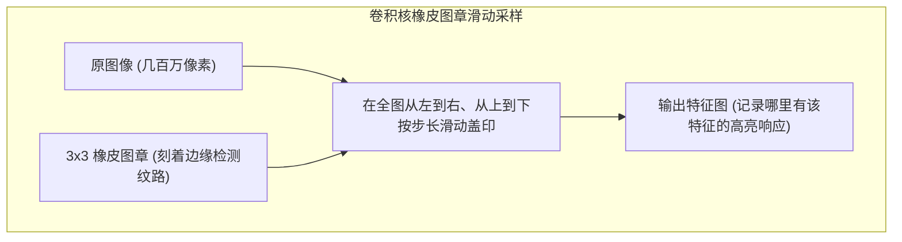
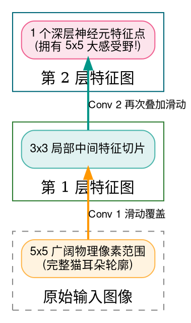
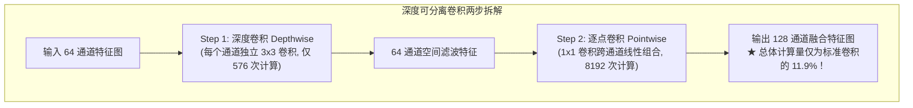

> **致初学者**：在计算机视觉（CV）和多模态图像处理中，一张普通的 1080P 高清图片拥有超过 200 万个像素点。
>
> 如果像全连接层那样，让这 200 万个像素点每一个都与下一层的 1000 个神经元建立连接，仅仅这一层就会产生 **20 亿个浮点权重参数**！
> 随便跑一张图片，显卡显存就会瞬间被撑爆。
>
> 怎么才能用极其轻量的参数，看透整张几百万像素的复杂画卷？
> 答案就是计算机视觉的伟大基石——**卷积（Convolution）与池化（Pooling）**！
>
> 很多初学者搞不懂：
> - **卷积核到底在物理上干了什么？**
> - **为什么说深层网络的一颗像素能“看到整只猫”（感受野）？**
> - **MobileNet 为什么能把参数量直接砍掉 8~9 倍，装进手机里流畅运行？**
> - **所谓的反卷积（转置卷积）真的是数学上的除法逆运算吗？**
>
> 本篇作为系列第八讲，将用**橡皮图章与手电筒的通俗比喻**，带你从具体数字手算一步步穿透这 5 大视觉算子！

---

## 零、橡皮图章的比喻：30 秒搞懂卷积本质

想象你手里拿着一枚小小的、带有特定刻纹的**橡皮图章（卷积核 Kernel，比如 $3 \times 3$ 大小）**：
- 这个图章上刻着一种微观几何模式（比如一条“垂直的边缘线”）；
- 你把它盖在图像的左上角（小滑动窗口内），算一下这块图像跟图章刻纹的吻合程度（**点积乘积累加**）：
  - 如果图像这里刚好也是一条垂直边缘，吻合度极高，输出一个**大正数（如 +50）**；
  - 如果图像这里是一片平坦白纸，毫无边缘特征，输出 **0**。
- 接着，你把图章往右挪动 1 步（**步长 Stride=1**），再盖一次；盖完全图后，你得到了一张全新的“垂直边缘分布图”（**输出特征图 Feature Map**）！

> [!NOTE] 权值共享的伟大奇迹
> 整个图像无论长多大（甚至上万像素），手里永远只用这枚 $3 \times 3 = 9$ 个参数的小图章！**同一个图章在全图所有位置重复复用**，参数量直接从几十亿暴跌到只有区区几个数字！这就是**权值共享（Weight Sharing）**的无上威力。



---

## 1. Conv2D (二维标准卷积与尺寸推导)

### 1.1 手把手极小数字推演
假设有一张 $3 \times 3$ 的极简单通道图像，和一个 $2 \times 2$ 的卷积核：
$$
\text{图像 } I = \begin{pmatrix} 1 & 2 & 3 \\ 4 & 5 & 6 \\ 7 & 8 & 9 \end{pmatrix}, \quad \text{卷积核 } K = \begin{pmatrix} 1 & 0 \\ 0 & 1 \end{pmatrix}
$$
设步长 $S = 1$，填充 $P = 0$。

1. **第 1 步：图章盖在左上角窗口 $\begin{pmatrix} 1 & 2 \\ 4 & 5 \end{pmatrix}$**：
   逐元素对应相乘相加：
   $$ 1 \times 1 + 2 \times 0 + 4 \times 0 + 5 \times 1 = 1 + 0 + 0 + 5 = 6 $$
2. **第 2 步：向右滑动 1 格，覆盖窗口 $\begin{pmatrix} 2 & 3 \\ 5 & 6 \end{pmatrix}$**：
   $$ 2 \times 1 + 3 \times 0 + 5 \times 0 + 6 \times 1 = 2 + 0 + 0 + 6 = 8 $$
3. **第 3 步：换到下一行左侧，覆盖窗口 $\begin{pmatrix} 4 & 5 \\ 7 & 8 \end{pmatrix}$**：
   $$ 4 \times 1 + 5 \times 0 + 7 \times 0 + 8 \times 1 = 4 + 0 + 0 + 8 = 12 $$
4. **第 4 步：换到下一行右侧，覆盖窗口 $\begin{pmatrix} 5 & 6 \\ 8 & 9 \end{pmatrix}$**：
   $$ 5 \times 1 + 6 \times 0 + 8 \times 0 + 9 \times 1 = 5 + 0 + 0 + 9 = 14 $$

最终输出特征图为 $2 \times 2$ 的矩阵：
$$
\text{Output} = \begin{pmatrix} 6 & 8 \\ 12 & 14 \end{pmatrix}
$$

### 1.2 输出尺寸黄金通用公式
$$ H_{\text{out}} = \left\lfloor \frac{H_{\text{in}} - K_h + 2P}{S} \right\rfloor + 1 $$
代入上面数据验证：$H_{\text{in}} = 3, K_h = 2, P = 0, S = 1$：
$$ H_{\text{out}} = \frac{3 - 2 + 0}{1} + 1 = 1 + 1 = 2 $$
完全正确！

---

## 2. 感受野 (Receptive Field：小像素看大世界的几何魔法)

### 2.1 为什么深层网络能看懂“整只猫”？
在第一层卷积中，每个输出点只能看到原图 $3 \times 3$ 的微小局部（只能看清几根猫毛）；
但是在第二层卷积中，它又在一个 $3 \times 3$ 的第一层特征图上滑动！
**层层回溯传递推导**：
- 第 1 层：感受野为 $3 \times 3$；
- 第 2 层：窗口大小为 3，但它覆盖的第 1 层特征本身是有宽度的，在原图上等效感受野扩张为：
  $$ \text{RF}_2 = \text{RF}_1 + (K - 1) = 3 + (3 - 1) = 5 \times 5 $$
- 到了第 10 层：感受野膨胀到了几十甚至上百像素，足以把整只猫的轮廓尽收眼底！



---

## 3. DepthwiseConv2D (深度可分离卷积：MobileNet 算力暴减 8.4 倍的数学底牌)

### 3.1 传统卷积的巨大浪费
假设输入有 64 个通道，想要输出 128 个通道，卷积核大小为 $3 \times 3$：
- **传统标准卷积**：
  每一个输出通道，都要对全部 64 个输入通道执行 $3 \times 3$ 的乘加！
  每次滑动需要执行的乘法次数为：
  $$ 64 \times 128 \times 3 \times 3 = \mathbf{73728} \text{ 次乘法！} $$
  太笨重了！很多通道其实根本不需要混合得这么复杂！

### 3.2 MobileNet 的分工大智慧：拆解两步走！
1. **第一步：深度卷积（Depthwise Conv）——各扫门前雪**
   64 个通道各自独立配备一个 $3 \times 3$ 的小图章。**通道之间完全不交互！**
   乘法次数：
   $$ 64 \times 3 \times 3 = \mathbf{576} \text{ 次乘法} $$
2. **第二步：逐点卷积（Pointwise Conv）——$1 \times 1$ 纯通道融合**
   用最轻量的 $1 \times 1$ 卷积核，专门负责把这 64 个通道组合成 128 个通道：
   乘法次数：
   $$ 64 \times 128 \times 1 \times 1 = \mathbf{8192} \text{ 次乘法} $$

### 3.3 震撼的算力对比
$$ \text{总计算量} = 576 + 8192 = \mathbf{8768} \text{ 次乘法} $$
对比传统卷积的 $73728$ 次：
$$ \frac{8768}{73728} \approx \frac{1}{8.4} $$
**计算量被硬生生砍掉了 88%！而模型的图像识别准确率几乎毫无下降！**
这就是 MobileNet 能够在百元智能手机和边缘嵌入式设备上流畅跑实时视觉检测的核心奥秘！



---

## 4. ConvTranspose2D (转置卷积：特征图如何放大还原？)

### 4.1 初学者最常被误导的谎言：“反卷积是卷积的逆运算”
**反卷积（转置卷积）绝对不能还原像素数值！**
它只是一个**尺寸放大器（上采样 Upsampling）**，常用于超分辨率、语义分割（U-Net）或生成对抗网络（GAN）中把小特征图放大回高清大图。
- **放大机制：插零法**：
  如果步长 $S=2$，它在原本挨着的输入像素之间，**硬生生插入 $(S-1) = 1$ 个零**！
  然后把卷积核翻转一下，在补零后的大矩阵上做普通卷积，特征图尺寸立刻翻倍膨胀！

---

## 5. MaxPool (最大池化) 与 AvgPool (平均池化)

### 5.1 生活比喻与特征提炼
- **MaxPool（最大池化）**：
  好比在一片漆黑的夜空里找最亮的星星。在 $2 \times 2$ 的小窗口里只留下最大的那个数值。
  **优点**：对微小的平移、旋转极其鲁棒，死死锁住最显著的边缘和骨骼特征；
- **AvgPool（平均池化）**：
  好比磨砂玻璃，把 $2 \times 2$ 窗口里的所有像素求平均。常用于网络最后一层的**全局平均池化（GAP）**，把整个大图拍平为一个向量，彻底取代笨重的全连接层。

### 5.2 原生 Python 逐行注释实现 (MaxPool 与 AvgPool)
```python
def naive_pool2d(matrix: list[list[float]], pool_size: int = 2, stride: int = 2, mode: str = "max") -> list[list[float]]:
    """原生 2D 池化算子"""
    H = len(matrix)
    W = len(matrix[0])
    out_h = (H - pool_size) // stride + 1
    out_w = (W - pool_size) // stride + 1

    out = [[0.0] * out_w for _ in range(out_h)]
    for oh in range(out_h):
        for ow in range(out_w):
            r_start = oh * stride
            c_start = ow * stride
            
            # 抓取局部小窗内所有像素
            window = [matrix[r][c] 
                      for r in range(r_start, r_start + pool_size) 
                      for c in range(c_start, c_start + pool_size)]
            
            if mode == "max":
                out[oh][ow] = max(window) # 提取最强响应
            else:
                out[oh][ow] = sum(window) / len(window) # 平滑平均
                
    return out

if __name__ == "__main__":
    grid = [
        [10.0, 2.0, 4.0, 6.0],
        [4.0,  8.0, 1.0, 3.0],
        [5.0,  3.0, 9.0, 7.0],
        [2.0,  6.0, 8.0, 4.0]
    ]
    print("MaxPool 最大池化 (2x2):", naive_pool2d(grid, mode="max"))
    print("AvgPool 平均池化 (2x2):", naive_pool2d(grid, mode="avg"))
```

---

## 总结与初学者避坑指南

1. **Conv2D**：靠**权值共享**消灭百亿参数，用小图章漫步扫描整张图；
2. **DepthwiseConv2D**：分两步（空间独立 + $1 \times 1$ 通道融合），算力狂降 8~9 倍；
3. **转置卷积**：不是求逆，是通过**插零放大空间尺寸**；
4. **MaxPool vs AvgPool**：一个抓最强显著特征，一个提炼全局平滑背景。

下一讲，我们将探讨深度学习时序记忆的经典王者——**循环机制算子（LSTM / GRU 状态保持与门控更新）**！
