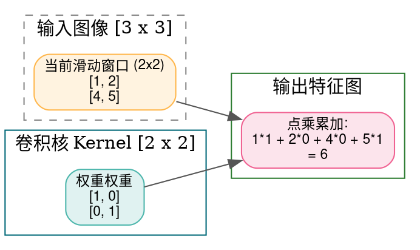
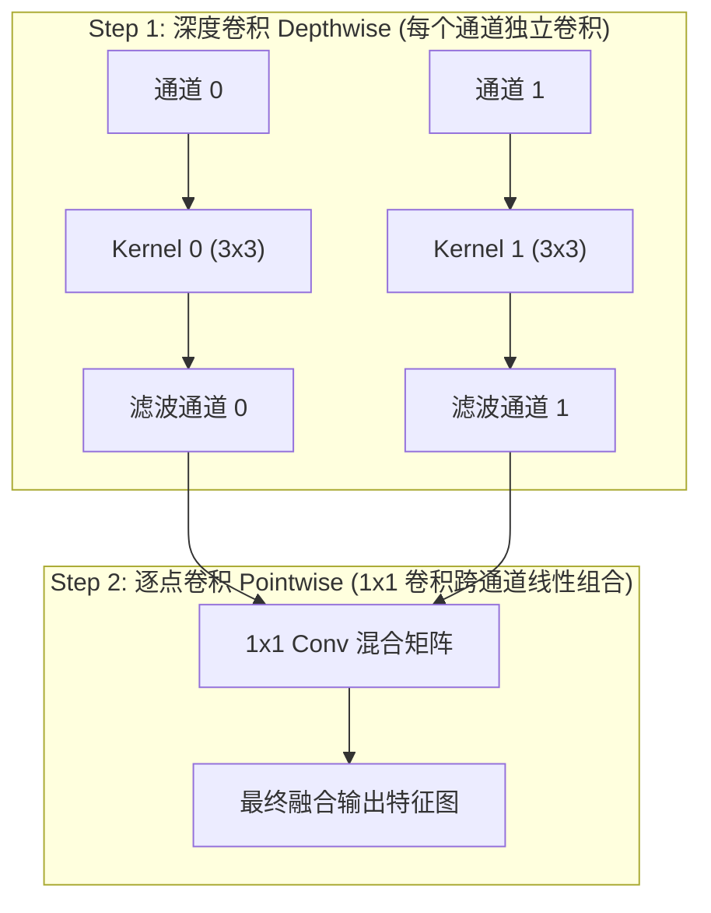
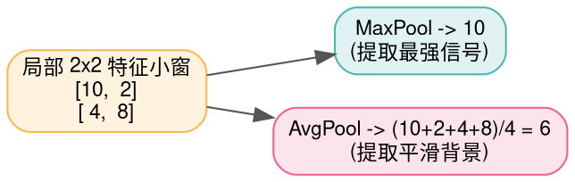

> **导读**：在计算机视觉（CV）与多模态大模型（Vision-Language Models, VLM）的世界中，一张高分辨率图片动辄包含数百万像素。如果像全连接层（MLP）那样让每个像素都与下一层神经元建立连接，参数量将直接暴涨到千亿级别，任何硬件都会瞬间内存溢出！
>
> 深度学习先驱们从生物视觉皮层中汲取灵感，创造出了**卷积（Convolution）与池化（Pooling）**算子：
> - **局部连接（Local Connectivity）**：每个神经元只关注局部的一小块像素窗口；
> - **权值共享（Weight Sharing）**：同一个卷积核在整张图像上漫步滑动，在所有位置复用同一组参数，参数量骤降数个数量级！
>
> 从统治视觉时代的 ResNet，到移动端极致轻量化的 **MobileNet（深度可分离卷积）**，再到超分辨率与生成对抗网络（GAN）的**转置卷积（ConvTranspose2D）**，卷积与池化构成了视觉时空表征的骨骼。
>
> 本篇作为系列第八讲，将带你从几何网格与滑动窗口的第一性原理出发，彻底穿透这 5 个经典视觉算子。

---

## 零、初学者核心概念速查：感受野、步长与通道

> [!NOTE] 核心概念形象字典
>
> - **感受野（Receptive Field, RF）**：网络深层的某一个特征点，在物理上究竟能“看到”原始输入图像多大面积的像素区域。感受野越宽广，网络越能把握宏观全局语义（如整只猫的外轮廓）；感受野越小，网络越关注微观纹理细节（如猫须或毛发边缘）。
> - **权值共享（Weight Sharing）**：在整个图像空间滑动时，卷积核内的权重数值始终保持不变。这意味着一旦卷积核学会了检测“一条45度的倾斜边缘”，它就能在整张图片的任何角落精准揪出这种边缘。
> - **填充（Padding, $P$）**：在图像边缘四周人为补上一圈像素（通常补 0），防止滑动到边界时由于窗口越界导致特征图尺寸逐层急剧缩水，或者保护边缘信息不丢失。
> - **步长（Stride, $S$）**：卷积核每次滑动向前跳跃的像素间隔。步长为 1 表示密集的逐像素滑动；步长大于 1（如 $S=2$）可以在提取特征的同时实现空间下采样（特征图长宽减半）。
> - **通道（Channels, $C$）**：彩色图像由红、绿、蓝（RGB）3 个通道构成；经过卷积变换后，通道数通常会扩展到 64、128 甚至 512，每个通道代表一种特定的抽象模式响应特征图。
> - **下采样（Downsampling） vs 上采样（Upsampling）**：下采样缩小特征图长宽（提取高维摘要，降低计算量）；上采样放大特征图长宽（恢复精细空间定位或生成图像）。

---

## 1. Conv2D (二维标准卷积)

### 1.1 原理解析
- **前向几何过程**：
  输入张量形状为 $[C_{\text{in}}, H_{\text{in}}, W_{\text{in}}]$，卷积核权重张量形状为 $[C_{\text{out}}, C_{\text{in}}, K_h, K_w]$。
  对于输出的第 $c_{\text{out}}$ 个通道上的坐标 $(h, w)$，提取输入张量对应感受野小窗口内所有通道的切片，与卷积核对应权重进行**三维逐元素乘积累加**，再加上偏置 $b$：
  $$ \text{Out}[c_{\text{out}}, h, w] = b[c_{\text{out}}] + \sum_{c_{\text{in}}=0}^{C_{\text{in}}-1} \sum_{i=0}^{K_h-1} \sum_{j=0}^{K_w-1} \text{In}[c_{\text{in}}, h \cdot S + i - P, w \cdot S + j - P] \times W[c_{\text{out}}, c_{\text{in}}, i, j] $$
- **输出尺寸黄金计算公式**：
  $$ H_{\text{out}} = \left\lfloor \frac{H_{\text{in}} - K_h + 2P}{S} \right\rfloor + 1, \quad W_{\text{out}} = \left\lfloor \frac{W_{\text{in}} - K_w + 2P}{S} \right\rfloor + 1 $$



### 1.2 原生 Python 实现
```python
def naive_conv2d_single_channel(img: list[list[float]], kernel: list[list[float]], stride: int = 1, pad: int = 0) -> list[list[float]]:
    """单通道朴素 2D 卷积实现"""
    in_h = len(img)
    in_w = len(img[0])
    kh = len(kernel)
    kw = len(kernel[0])
    
    # 边缘 Padding 填充
    padded_h = in_h + 2 * pad
    padded_w = in_w + 2 * pad
    padded = [[0.0] * padded_w for _ in range(padded_h)]
    for r in range(in_h):
        for c in range(in_w):
            padded[pad + r][pad + c] = img[r][c]
            
    # 计算输出尺寸
    out_h = (padded_h - kh) // stride + 1
    out_w = (padded_w - kw) // stride + 1
    output = [[0.0] * out_w for _ in range(out_h)]
    
    # 滑动窗口计算乘积累加
    for oh in range(out_h):
        for ow in range(out_w):
            ih_start = oh * stride
            iw_start = ow * stride
            acc = 0.0
            for ki in range(kh):
                for kj in range(kw):
                    acc += padded[ih_start + ki][iw_start + kj] * kernel[ki][kj]
            output[oh][ow] = acc
            
    return output

if __name__ == "__main__":
    test_img = [
        [1.0, 2.0, 3.0],
        [4.0, 5.0, 6.0],
        [7.0, 8.0, 9.0]
    ]
    test_k = [
        [1.0, 0.0],
        [0.0, 1.0]
    ]
    res_conv = naive_conv2d_single_channel(test_img, test_k, stride=1, pad=0)
    print("Conv2D 输出特征图 (2x2):")
    for r in res_conv:
        print(f"  {r}")
```

### 1.3 原生 C++ 实现
```cpp
#include <iostream>

int main() {
    constexpr int H = 3;
    constexpr int W = 3;
    constexpr int K = 2;
    constexpr int OUT_H = H - K + 1; // 2
    constexpr int OUT_W = W - K + 1; // 2

    const float img[H][W] = {
        {1.0f, 2.0f, 3.0f},
        {4.0f, 5.0f, 6.0f},
        {7.0f, 8.0f, 9.0f}
    };
    const float kernel[K][K] = {
        {1.0f, 0.0f},
        {0.0f, 1.0f}
    };
    float out[OUT_H][OUT_W];

    // 滑动窗口卷积
    for (int oh = 0; oh < OUT_H; ++oh) {
        for (int ow = 0; ow < OUT_W; ++ow) {
            float sum = 0.0f;
            for (int ki = 0; ki < K; ++ki) {
                for (int kj = 0; kj < K; ++kj) {
                    sum += img[oh + ki][ow + kj] * kernel[ki][kj];
                }
            }
            out[oh][ow] = sum;
        }
    }

    std::cout << "=== 原生 C++ Conv2D 输出 ===" << std::endl;
    for (int oh = 0; oh < OUT_H; ++oh) {
        std::cout << "[";
        for (int ow = 0; ow < OUT_W; ++ow) {
            std::cout << out[oh][ow] << (ow + 1 < OUT_W ? ", " : "");
        }
        std::cout << "]" << std::endl;
    }
    return 0;
}
```

---

## 2. DepthwiseConv2D (深度可分离卷积之通道分离)

### 2.1 原理解析：MobileNet 的轻量化神话
- **计算瓶颈反思**：标准 Conv2D 的卷积核同时在空间维度（$K \times K$）和跨通道维度（$C_{\text{in}} \to C_{\text{out}}$）混合运算，总计算量与 $C_{\text{in}} \times C_{\text{out}} \times K^2$ 成正比，极其笨重。
- **拆解两步走（Separable Convolution）**：
  1. **深度卷积（Depthwise Conv）**：**通道之间完全不交互！** 输入有 $C$ 个通道，就配备 $C$ 个独立的二维卷积核，每个通道各自完成自己空间范围的特征滤波；
  2. **逐点卷积（Pointwise Conv）**：使用 $1 \times 1$ 的标准小卷积核，专门负责跨通道的信息交互与融合。
- **算力暴减 8~9 倍**：
  $$ \frac{\text{Depthwise} + \text{Pointwise}}{\text{标准 Conv}} = \frac{C_{\text{in}} \times K^2 + C_{\text{in}} \times C_{\text{out}}}{C_{\text{in}} \times C_{\text{out}} \times K^2} = \frac{1}{C_{\text{out}}} + \frac{1}{K^2} \approx \frac{1}{K^2} $$
  对于经典的 $3 \times 3$ 卷积核，计算量与参数量瞬间缩减为原先的 **$\frac{1}{9}$**！



### 2.2 原生 Python 实现
```python
def naive_depthwise_conv2d(img_3d: list[list[list[float]]], kernels_3d: list[list[list[float]]]) -> list[list[list[float]]]:
    """深度卷积: 输入 [C, H, W], 卷积核 [C, Kh, Kw], 输出 [C, H_out, W_out]"""
    C = len(img_3d)
    out_channels = []
    
    for c in range(C):
        # 每个通道使用专属的二维卷积核独立计算
        out_c = naive_conv2d_single_channel(img_3d[c], kernels_3d[c], stride=1, pad=0)
        out_channels.append(out_c)
        
    return out_channels

if __name__ == "__main__":
    # 模拟 2 个通道的输入特征图
    sample_img = [
        [[1.0, 1.0], [1.0, 1.0]], # 通道 0
        [[2.0, 2.0], [2.0, 2.0]]  # 通道 1
    ]
    # 2 个通道的独立卷积核
    dw_kernels = [
        [[1.0]], # 通道 0 权重
        [[0.5]]  # 通道 1 权重
    ]
    dw_res = naive_depthwise_conv2d(sample_img, dw_kernels)
    print("Depthwise 独立通道卷积输出:")
    print("  通道 0 输出:", dw_res[0])
    print("  通道 1 输出:", dw_res[1])
```

### 2.3 原生 C++ 实现
```cpp
#include <iostream>

int main() {
    constexpr int C = 2;
    constexpr int H = 2;
    constexpr int W = 2;
    // 输入张量 [C, H, W]
    const float img[C][H][W] = {
        {{1.f, 1.f}, {1.f, 1.f}},
        {{2.f, 2.f}, {2.f, 2.f}}
    };
    // 独立的单通道卷积核 (1x1)
    const float kernel[C] = {1.0f, 0.5f};
    float out[C][H][W];

    for (int c = 0; c < C; ++c) {
        for (int h = 0; h < H; ++h) {
            for (int w = 0; w < W; ++w) {
                out[c][h][w] = img[c][h][w] * kernel[c];
            }
        }
    }

    std::cout << "=== 原生 C++ DepthwiseConv 输出 ===" << std::endl;
    for (int c = 0; c < C; ++c) {
        std::cout << "通道 " << c << ": [" << out[c][0][0] << ", " << out[c][0][1] << "]" << std::endl;
    }
    return 0;
}
```

---

## 3. ConvTranspose2D (转置卷积 / 反卷积)

### 3.1 原理解析：特征图如何放大还原？
- **误区厘清**：转置卷积常被称为“反卷积（Deconvolution）”，但它**并不是数学意义上的逆运算**（无法无损还原输入数值），而是**前向梯度的转置映射（空间尺寸放大）**。
- **插零放大算法机制**：
  若步长为 $S=2$，它在相邻输入像素之间**均匀插入 $(S - 1) = 1$ 个零**，然后再执行带 Padding 的常规卷积，从而让特征图长宽倍增！
- **常见缺陷：棋盘效应（Checkerboard Artifacts）**：由于卷积核滑动覆盖重叠不均匀，转置卷积在生成图像时极易在画面上留下网格状条纹，工业界常改用双线性插值（Bilinear Resize）配合普通卷积。

---

## 4. MaxPool (最大池化) 与 5. AvgPool (平均池化)

### 4.1 原理解析：特征下采样与平移不变性
- **MaxPool（取最大值）**：
  在滑动窗口内挑选出最大的激活值。极大强化了图像中最显著的纹理、骨架和边缘响应；具有极佳的**微小平移不变性**（目标平移几个像素，窗口极大值依然相同）。
- **AvgPool（取算术平均）**：
  计算滑动窗口内所有像素的平均值。能够平滑局部噪声，常用于网络最后一层的**全局平均池化（Global Average Pooling, GAP）**，将整个特征图压缩为一个标量，彻底替代参数繁重易过拟合的全连接层。



### 4.2 原生 Python 实现
```python
def naive_pool2d(matrix: list[list[float]], pool_size: int = 2, stride: int = 2, mode: str = "max") -> list[list[float]]:
    """朴素 2D 池化实现 (支持 'max' 与 'avg')"""
    H = len(matrix)
    W = len(matrix[0])
    out_h = (H - pool_size) // stride + 1
    out_w = (W - pool_size) // stride + 1
    
    out = [[0.0] * out_w for _ in range(out_h)]
    for oh in range(out_h):
        for ow in range(out_w):
            r_start = oh * stride
            c_start = ow * stride
            # 收集窗口内所有元素
            window_vals = []
            for r in range(r_start, r_start + pool_size):
                for c in range(c_start, c_start + pool_size):
                    window_vals.append(matrix[r][c])
                    
            if mode == "max":
                out[oh][ow] = max(window_vals)
            elif mode == "avg":
                out[oh][ow] = sum(window_vals) / len(window_vals)
                
    return out

if __name__ == "__main__":
    grid = [
        [10.0, 2.0, 4.0, 6.0],
        [4.0,  8.0, 1.0, 3.0],
        [5.0,  3.0, 9.0, 7.0],
        [2.0,  6.0, 8.0, 4.0]
    ]
    max_res = naive_pool2d(grid, pool_size=2, stride=2, mode="max")
    avg_res = naive_pool2d(grid, pool_size=2, stride=2, mode="avg")
    print("MaxPool 输出 (2x2):", max_res)
    print("AvgPool 输出 (2x2):", avg_res)
```

### 4.3 原生 C++ 实现
```cpp
#include <iostream>
#include <algorithm>

int main() {
    constexpr int H = 4;
    constexpr int W = 4;
    const float img[H][W] = {
        {10.f, 2.f, 4.f, 6.f},
        {4.f,  8.f, 1.f, 3.f},
        {5.f,  3.f, 9.f, 7.f},
        {2.f,  6.f, 8.f, 4.f}
    };
    constexpr int OUT_H = 2;
    constexpr int OUT_W = 2;
    float max_out[OUT_H][OUT_W];

    for (int oh = 0; oh < OUT_H; ++oh) {
        for (int ow = 0; ow < OUT_W; ++ow) {
            int r = oh * 2;
            int c = ow * 2;
            float m = img[r][c];
            m = std::max(m, img[r][c + 1]);
            m = std::max(m, img[r + 1][c]);
            m = std::max(m, img[r + 1][c + 1]);
            max_out[oh][ow] = m;
        }
    }

    std::cout << "=== 原生 C++ MaxPool (2x2, Stride=2) 输出 ===" << std::endl;
    for (int r = 0; r < OUT_H; ++r) {
        std::cout << "[" << max_out[r][0] << ", " << max_out[r][1] << "]" << std::endl;
    }
    return 0;
}
```

---

## 总结与思维进阶

| 视觉算子 | 空间尺寸变化 | 跨通道运算 | 核心设计初衷 |
| :--- | :--- | :--- | :--- |
| **Conv2D** | 下采样或保持 | **是** | 局部特征提取、全连接参数量压缩 |
| **DepthwiseConv2D** | 下采样或保持 | **否（独立通道）** | 剔除冗余乘法，移动端极致轻量化 |
| **ConvTranspose2D** | **放大倍增** | **是** | 像素级上采样、图像超分与生成还原 |
| **MaxPool** | 下采样截半 | 否 | 显著纹理捕获、平移旋转鲁棒性 |
| **AvgPool** | 下采样截半 | 否 | 背景平滑、全局信息汇总（GAP 替代全连接） |

下一讲，我们将回溯时序建模的经典王者——**循环机制算子（LSTM / GRU 状态保持与门控更新）**！
