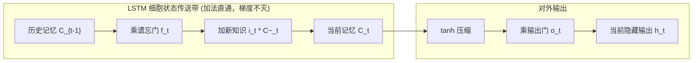
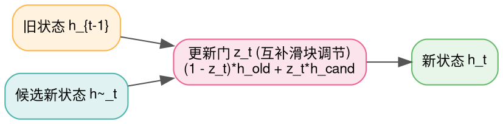

> **致初学者**：在过去处理时间序列（如天气预报、股票行情、心电图以及早期的机器翻译）时，我们使用的是**循环神经网络（RNN）**。
>
> 传统的朴素 RNN 思维非常纯粹：读一个词，吐出一个隐藏状态 $h_t$，传给下一个词用。
> 然而在实际训练中，初学者会发现一个非常痛苦的现象：
> 一旦一句话超过 15 个词，**朴素 RNN 就会像金鱼一样，把开头的词忘得一干二净！**
>
> 为什么会这样？
> 1997 年诞生的 **LSTM** 和 2014 年诞生的 **GRU**，究竟用了什么绝妙的数学黑科技，让神经网络打破“失忆症”，拥有长达上百步甚至上千步的深邃记忆？
>
> 本篇作为系列第九讲，将用**水平传送带与记忆水龙头的通俗比喻**，带你从具体数字手算推演，彻底搞懂这两个统治时序领域数十年的经典算子！

---

## 零、朴素 RNN 为什么一定会“失忆”？（BPTT 梯度崩溃推导）

我们用最朴素的高中数学，看看传统 RNN 是怎么一步步得“健忘症”的：
传统 RNN 每一刻的状态递推公式为：
$$ h_t = \tanh(W x_t + U h_{t-1}) $$
注意看这个权重矩阵 $U$！它在每一个时间步都被**重复乘了一次**。
如果我们要计算第 100 步的损失对第 1 步状态的梯度，根据微积分链式法则：
$$ \frac{\partial h_{100}}{\partial h_1} = \frac{\partial h_{100}}{\partial h_{99}} \times \frac{\partial h_{99}}{\partial h_{98}} \times \dots \times \frac{\partial h_2}{\partial h_1} \approx U^{99} $$
**关键就在于这个 $U^{99}$（矩阵被连乘了 99 次）！**
- 如果 $U$ 的特征值稍微小于 1（哪怕是 $0.9$）：$0.9^{99} \approx 0.0000295$！
  100 步传回去，梯度几乎被抹杀归零！第一步的参数再也收不到任何更新反馈（**时序梯度消失**）！
- 如果 $U$ 稍微大于 1（哪怕是 $1.1$）：$1.1^{99} \approx 12527$！梯度直接爆炸！

---

## 1. LSTM (长短期记忆网络：传送带加法的神迹)

### 1.1 破局之法：乘法会消失，但加法的导数是 1.0！
Hochreiter 与 Schmidhuber 在 1997 年想出了一个名垂青史的创举：
在微积分里，如果两个变量相乘（$u \cdot v$），导数会随着因子连乘急剧缩水；
**但是加法的导数永远是 $1.0$！**
$$ \frac{d(u + v)}{du} = 1.0 $$
**LSTM 在所有时间步之间，架设了一条横跨时空的“主细胞传送带（Cell State $C_t$）”！**
信息在这条传送带上移动时，主要依靠**加法更新**，梯度沿着传送带反向传播时导数几乎恒为 1.0，彻底根除了梯度消失！

### 1.2 三大门控水龙头的职责分工
传送带上的货物（记忆）不能无限堆积，必须加以控制。LSTM 设计了 3 个连续门控（值域在 $0 \sim 1$ 之间，用 Sigmoid 函数控制开关开度）：

1. **遗忘门（Forget Gate, $f_t$）**：
   “昨天的旧记忆，有多少应该扔进垃圾桶？”
   $f_t = 0$ 代表彻底洗脑忘掉；$f_t = 1$ 代表原封不动全盘保留。
2. **输入门（Input Gate, $i_t$）与候选新记忆（$\tilde{C}_t$）**：
   “今天新发生的事情，有多少值得登记写入主记忆库？”
3. **主传送带加法汇总（Cell State Highway）**：
   $$ C_t = f_t \times C_{t-1} + i_t \times \tilde{C}_t $$
   **看这个加号！旧记忆打折加上新记忆写入，纯线性加法组合！**
4. **输出门（Output Gate, $o_t$）**：
   “脑子里记了这么多知识，当前这一秒我需要对外说出什么？”
   $$ h_t = o_t \times \tanh(C_t) $$



### 1.3 手把手极小数字推演
假设上一时刻的记忆 $C_{t-1} = 10.0$。
当前输入进来的新信息算出的候选记忆 $\tilde{C}_t = 4.0$。
- 遗忘门算出来 $f_t = 0.8$（决定保留 80% 的旧记忆）；
- 输入门算出来 $i_t = 0.5$（决定采纳 50% 的新知识）；
- **当前传送带更新**：
  $$ C_t = 0.8 \times 10.0 + 0.5 \times 4.0 = 8.0 + 2.0 = 10.0 $$
- 输出门算出来 $o_t = 0.5$；
- **当前对外输出**：
  $$ h_t = 0.5 \times \tanh(10.0) \approx 0.5 \times 1.0 = 0.5 $$

---

## 2. GRU (门控循环单元：轻盈的线性插值)

### 2.1 为什么 GRU 能砍掉 25% 的参数？
- **痛点**：LSTM 虽然强悍，但每一个单元里有 4 套独立的线性层权重矩阵（遗忘、输入、候选、输出），计算开销偏大。
- **Cho 等人的精简妙计（2014）**：
  1. **合二为一**：取消独立的细胞状态 $C_t$，将记忆和输出统一融合在唯一的隐藏状态 $h_t$ 中；
  2. **互补插值更新门（Update Gate $z_t$）**：
     遗忘和输入其实是一枚硬币的正反面！
     用一个 $0 \sim 1$ 的更新门 $z_t$ 同时控制新旧比例：
     $$ h_t = (1 - z_t) \times h_{t-1} + z_t \times \tilde{h}_t $$
     - 如果 $z_t = 0.1$：网络保留 90% 的旧历史，只吸收 10% 的新知识；
     - 如果 $z_t = 0.9$：网络拥抱 90% 的新知识，只留存 10% 的旧历史。
  3. **参数量直接减少 25%**，收敛速度大幅提升！



### 2.2 原生 Python 逐行注释实现 (LSTM 与 GRU 对比)
```python
import math

def sig(x): return 1.0 / (1.0 + math.exp(-x))

def naive_lstm_step(x: float, h_prev: float, c_prev: float) -> tuple[float, float]:
    """极简标量版 LSTM 单步前向"""
    # 模拟简单的线性变换权重
    f = sig(0.5 * x + 0.1 * h_prev)       # 遗忘门
    i = sig(0.6 * x + 0.2 * h_prev)       # 输入门
    c_cand = math.tanh(0.8 * x + 0.3 * h_prev) # 候选记忆
    
    # 核心：主细胞状态加法更新
    c_next = f * c_prev + i * c_cand
    
    o = sig(0.7 * x + 0.1 * h_prev)       # 输出门
    h_next = o * math.tanh(c_next)
    return h_next, c_next

def naive_gru_step(x: float, h_prev: float) -> float:
    """极简标量版 GRU 单步前向 (互补插值)"""
    r = sig(0.5 * x + 0.2 * h_prev)       # 重置门
    h_cand = math.tanh(0.8 * x + 0.3 * (r * h_prev)) # 候选隐状态
    z = sig(0.6 * x + 0.1 * h_prev)       # 更新门
    
    # 核心：互补加权插值
    h_next = (1.0 - z) * h_prev + z * h_cand
    return h_next

if __name__ == "__main__":
    h_lstm, c_lstm = 0.0, 0.0
    h_gru = 0.0
    print("喂入时序信号 [1.0, -0.5, 2.0]:")
    for step, val in enumerate([1.0, -0.5, 2.0]):
        h_lstm, c_lstm = naive_lstm_step(val, h_lstm, c_lstm)
        h_gru = naive_gru_step(val, h_gru)
        print(f"Step {step} | LSTM 输出 h={h_lstm:.4f}, C={c_lstm:.4f} | GRU 输出 h={h_gru:.4f}")
```

### 2.3 原生 C++ 逐行注释实现 (LSTM 与 GRU 单步推演)
```cpp
#include <iostream>
#include <cmath>
#include <iomanip>

float sigmoid_fn(float x) {
    return 1.0f / (1.0f + std::exp(-x));
}

int main() {
    // 模拟时序信号输入
    const float inputs[] = {1.0f, -0.5f, 2.0f};
    constexpr int T = 3;

    // LSTM 内部状态
    float h_lstm = 0.0f;
    float c_lstm = 0.0f;

    // GRU 内部状态
    float h_gru = 0.0f;

    std::cout << "=== 原生 C++ LSTM 与 GRU 时序单步推演 ===" << std::endl;
    for (int t = 0; t < T; ++t) {
        float x = inputs[t];

        // --- LSTM 前向更新 ---
        float f = sigmoid_fn(0.5f * x + 0.1f * h_lstm);       // 遗忘门
        float i = sigmoid_fn(0.6f * x + 0.2f * h_lstm);       // 输入门
        float c_cand = std::tanh(0.8f * x + 0.3f * h_lstm);   // 候选记忆
        c_lstm = f * c_lstm + i * c_cand;                     // 加法传送带更新
        float o = sigmoid_fn(0.7f * x + 0.1f * h_lstm);       // 输出门
        h_lstm = o * std::tanh(c_lstm);

        // --- GRU 前向更新 ---
        float r = sigmoid_fn(0.5f * x + 0.2f * h_gru);        // 重置门
        float h_cand = std::tanh(0.8f * x + 0.3f * (r * h_gru));
        float z = sigmoid_fn(0.6f * x + 0.1f * h_gru);        // 互补更新门
        h_gru = (1.0f - z) * h_gru + z * h_cand;              // 凸组合插值

        std::cout << "Step " << t << " (x=" << x << ") | "
                  << "LSTM h=" << std::fixed << std::setprecision(4) << h_lstm 
                  << ", C=" << c_lstm << " | "
                  << "GRU h=" << h_gru << std::endl;
    }
    return 0;
}
```

---

## 总结与初学者避坑指南

1. **朴素 RNN 失忆的元凶是 $U^T$ 连乘**：小于 1 指数级衰减归零，大于 1 爆炸；
2. **LSTM 的神圣救星是“加法传送带（$C_t$）”**：通过加法保持导数为 1.0，跨越长时序；
3. **GRU 的核心是“互补更新门（$1-z$ 与 $z$）”**：省去独立细胞，减少 25% 参数，轻盈收敛。

下一讲，我们将探讨神经网络模型从无序噪声收敛为超级智能的指路明灯——**损失函数与优化器算子（CrossEntropy / KL散度 / AdamW / SGD）**！
