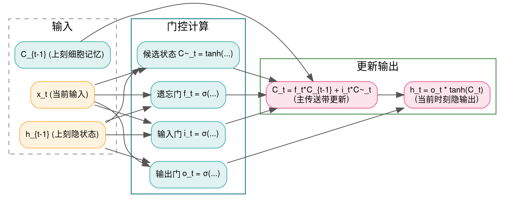
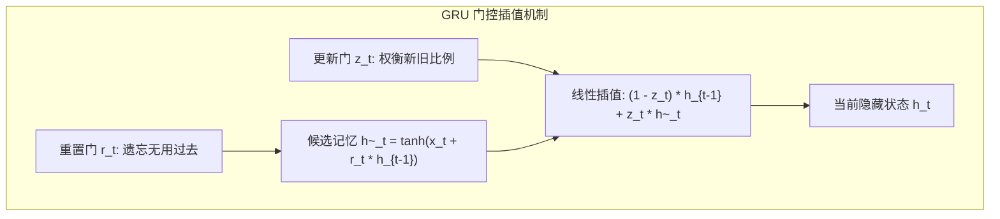

> **导读**：在 Transformer 一统天下之前，自然语言处理、语音识别和时间序列预测的无可争议的统治者是**循环神经网络（RNN）家族**。
>
> 传统的朴素 RNN 拥有最自然的循环思维结构：隐藏状态 $h_t = \tanh(W x_t + U h_{t-1})$。然而在工程落地上，朴素 RNN 面临着致命的死穴：**随着时间反向传播（BPTT, Backpropagation Through Time）**。当序列长度达到上百步时，权重矩阵 $U$ 在反向链条中被**连乘上百次（$U^T$）**！只要矩阵的最大特征值稍微小于 1，梯度便呈指数级衰减至 0，网络对 10 步之前的历史记忆瞬间荡然无存。
>
> 1997 年，Hochreiter 与 Schmidhuber 提出了名垂青史的 **LSTM（长短期记忆网络）**，开创性地设计了由加法主导的**细胞状态（Cell State）高速通道**与**三大连续门控（Gates）**；随后 2014 年，Kyunghyun Cho 等人提出了更为轻盈高效的 **GRU（门控循环单元）**。
>
> 本篇作为系列第九讲，将带你从状态保持与动态遗忘的第一性原理出发，彻底攻克这两个经典的时序算子。

---

## 零、初学者核心概念速查：记忆通道、门控与加法梯度直通

> [!NOTE] 核心概念形象字典
>
> - **时序展开（Time Unrolling）**：将循环结构沿着时间轴像折叠扇子一样一张张展开，变成一个深度等于序列长度 $T$ 的超深前馈网络。
> - **门控机制（Gating Mechanism）**：利用值为 $0 \sim 1$ 的连续浮点数作为信息流的“水龙头开关”。通过将输入与 Sigmoid 函数相乘，$0$ 代表彻底关死水龙头（完全遗忘/丢弃），$1$ 代表完全大开水龙头（全盘保留透传）。
> - **细胞状态（Cell State, $C_t$）**：LSTM 独创的核心结构。好比一条横贯所有时间步的**水平传送带**，信息只需在上面平稳滑行，沿途仅发生线性的元素级加减法，不受恶性矩阵连乘侵蚀。
> - **隐藏状态（Hidden State, $h_t$）**：当前时间步的对外工作记忆，直接送给当前时刻的输出层或上层网络。
> - **加法梯度的魔力**：在微积分中，乘法的导数会逐层缩小（$\frac{d(u \cdot v)}{dx}$ 会连乘），而**加法的导数是 $1.0$**（$\frac{d(u + v)}{du} = 1$）！LSTM 将状态更新设计为 $C_t = C_{t-1} + \dots$，使得反向传播时梯度可以沿着传送带无损直通遥远的过去！

```mermaid
graph LR
    subgraph CellStateHighway["LSTM 细胞状态传送带 (加法直通，梯度不灭)"]
        C_prev["历史细胞 C_{t-1}"] --> MulForget["乘遗忘门 f_t (保留或抹去)"]
        MulForget --> AddInput["加新信息 i_t * C~_t"]
        AddInput --> C_curr["当前细胞 C_t"]
    end
    subgraph GateControl["三大门控控制器 (输入 x_t + 上刻状态 h_{t-1})"]
        Input_t["当前输入 x_t"]
        H_prev["上一隐状态 h_{t-1}"]
        Input_t --> GateControl
        H_prev --> GateControl
    end
    GateControl -.->|控制| MulForget
    GateControl -.->|控制| AddInput
```

---

## 1. LSTM (长短期记忆网络 / Long Short-Term Memory)

### 1.1 原理解析：四大数学支柱
在时间步 $t$，LSTM 接收当前输入向量 $x_t$ 与上一时间步的隐藏状态 $h_{t-1}$，执行以下连续四步推演：
1. **遗忘门（Forget Gate, $f_t$）**：
   决定上一时刻的细胞状态 $C_{t-1}$ 有多少需要被遗忘清除：
   $$ f_t = \sigma(W_f x_t + U_f h_{t-1} + b_f) $$
2. **输入门（Input Gate, $i_t$）与候选记忆（$\tilde{C}_t$）**：
   决定当前时间步产生的新知识有多少值得被写入记忆库：
   $$ i_t = \sigma(W_i x_t + U_i h_{t-1} + b_i) $$
   $$ \tilde{C}_t = \tanh(W_c x_t + U_c h_{t-1} + b_c) $$
3. **细胞状态更新（Cell State Highway）**：
   旧记忆打折加上新记忆写入，**纯线性加法组合**：
   $$ C_t = f_t \otimes C_{t-1} + i_t \otimes \tilde{C}_t $$
4. **输出门（Output Gate, $o_t$）与隐藏状态输出**：
   从饱满的细胞状态中提取出当前最迫切需要输出的工作记忆：
   $$ o_t = \sigma(W_o x_t + U_o h_{t-1} + b_o) $$
   $$ h_t = o_t \otimes \tanh(C_t) $$



### 1.2 原生 Python 实现
```python
import math

def sigmoid(x: float) -> float:
    return 1.0 / (1.0 + math.exp(-x))

def naive_lstm_cell(x_val: float, h_prev: float, c_prev: float, weights: dict) -> tuple[float, float]:
    """单标量特征维度的极简 LSTM 单元前向计算"""
    # 1. 遗忘门
    f = sigmoid(weights["Wf"] * x_val + weights["Uf"] * h_prev + weights["bf"])
    # 2. 输入门与候选状态
    i = sigmoid(weights["Wi"] * x_val + weights["Ui"] * h_prev + weights["bi"])
    c_cand = math.tanh(weights["Wc"] * x_val + weights["Uc"] * h_prev + weights["bc"])
    # 3. 细胞状态加法更新
    c_curr = f * c_prev + i * c_cand
    # 4. 输出门与隐藏状态
    o = sigmoid(weights["Wo"] * x_val + weights["Uo"] * h_prev + weights["bo"])
    h_curr = o * math.tanh(c_curr)
    return h_curr, c_curr

if __name__ == "__main__":
    w = {
        "Wf": 0.5, "Uf": 0.1, "bf": 0.0,
        "Wi": 0.6, "Ui": 0.2, "bi": 0.0,
        "Wc": 0.8, "Uc": 0.3, "bc": 0.0,
        "Wo": 0.7, "Uo": 0.1, "bo": 0.0
    }
    h_state, c_state = 0.0, 0.0
    # 模拟时序步进: 连续喂入 3 个时刻的输入信号
    inputs = [1.0, -0.5, 2.0]
    print("LSTM 状态时序演进:")
    for step, x in enumerate(inputs):
        h_state, c_state = naive_lstm_cell(x, h_state, c_state, w)
        print(f"  Step {step}: 输入 x={x:>4} -> 细胞状态 C={c_state:.4f}, 隐藏输出 h={h_state:.4f}")
```

### 1.3 原生 C++ 实现
```cpp
#include <iostream>
#include <cmath>
#include <iomanip>

float sig(float x) {
    return 1.0f / (1.0f + std::exp(-x));
}

int main() {
    // 权重参数
    float Wf = 0.5f, Uf = 0.1f;
    float Wi = 0.6f, Ui = 0.2f;
    float Wc = 0.8f, Uc = 0.3f;
    float Wo = 0.7f, Uo = 0.1f;

    float h = 0.0f;
    float c = 0.0f;
    const float inputs[] = {1.0f, -0.5f, 2.0f};

    std::cout << "=== 原生 C++ LSTM 时序状态演进 ===" << std::endl;
    for (int t = 0; t < 3; ++t) {
        float x = inputs[t];
        float f = sig(Wf * x + Uf * h);
        float i = sig(Wi * x + Ui * h);
        float c_cand = std::tanh(Wc * x + Uc * h);
        c = f * c + i * c_cand; // 传送带加法更新
        float o = sig(Wo * x + Uo * h);
        h = o * std::tanh(c);

        std::cout << "Step " << t << " | x = " << std::fixed << std::setprecision(1) << x 
                  << " -> C_t = " << std::setprecision(4) << c 
                  << " | h_t = " << h << std::endl;
    }
    return 0;
}
```

---

## 2. GRU (门控循环单元 / Gated Recurrent Unit)

### 2.1 原理解析：更轻盈的统一状态架构
- **精简思想**：
  LSTM 拥有 4 个线性层（遗忘、输入、候选、输出），计算开销偏大。GRU 将其大胆简化：
  1. **取消独立的细胞状态 $C_t$**，将记忆和输出统一融合在唯一的隐藏状态 $h_t$ 中；
  2. **将遗忘门与输入门合并为单一的更新门（Update Gate $z_t$）**。
- **公式推导**：
  1. **重置门（Reset Gate, $r_t$）**：
     决定先前的历史状态有多少可以被暂时抛弃：
     $$ r_t = \sigma(W_r x_t + U_r h_{t-1}) $$
  2. **候选隐藏状态（$\tilde{h}_t$）**：
     利用重置门筛选历史信息，生成候选新特征：
     $$ \tilde{h}_t = \tanh(W_h x_t + U_h (r_t \otimes h_{t-1})) $$
  3. **更新门动态插值（Update Gate, $z_t$）**：
     $$ z_t = \sigma(W_z x_t + U_z h_{t-1}) $$
     $$ h_t = (1 - z_t) \otimes h_{t-1} + z_t \otimes \tilde{h}_t $$
  **注意看最后一步**：$(1 - z_t)$ 与 $z_t$ 形成了一组天然的互补权重（和恒为 1.0）！如果 $z_t \approx 0$，历史记忆 $h_{t-1}$ 被原封不动照搬传递；如果 $z_t \approx 1$，网络全面拥抱当前候选新知识 $\tilde{h}_t$。



### 2.2 原生 Python 实现
```python
def naive_gru_cell(x_val: float, h_prev: float, weights: dict) -> float:
    """单标量特征维度的 GRU 单元前向计算"""
    # 1. 重置门
    r = sigmoid(weights["Wr"] * x_val + weights["Ur"] * h_prev)
    # 2. 候选隐状态
    h_cand = math.tanh(weights["Wh"] * x_val + weights["Uh"] * (r * h_prev))
    # 3. 更新门
    z = sigmoid(weights["Wz"] * x_val + weights["Uz"] * h_prev)
    # 4. 互补插值合成
    h_curr = (1.0 - z) * h_prev + z * h_cand
    return h_curr

if __name__ == "__main__":
    w_gru = {
        "Wr": 0.5, "Ur": 0.2,
        "Wh": 0.8, "Uh": 0.3,
        "Wz": 0.6, "Uz": 0.1
    }
    h = 0.0
    print("GRU 状态演进:")
    for step, x in enumerate([1.0, -0.5, 2.0]):
        h = naive_gru_cell(x, h, w_gru)
        print(f"  Step {step}: 输入 x={x:>4} -> 隐藏状态 h={h:.4f}")
```

### 2.3 原生 C++ 实现
```cpp
#include <iostream>
#include <cmath>
#include <iomanip>

int main() {
    float Wr = 0.5f, Ur = 0.2f;
    float Wh = 0.8f, Uh = 0.3f;
    float Wz = 0.6f, Uz = 0.1f;

    auto sig_fn = [](float v) { return 1.0f / (1.0f + std::exp(-v)); };

    float h = 0.0f;
    const float inputs[] = {1.0f, -0.5f, 2.0f};

    std::cout << "=== 原生 C++ GRU 状态更新 ===" << std::endl;
    for (int t = 0; t < 3; ++t) {
        float x = inputs[t];
        float r = sig_fn(Wr * x + Ur * h);
        float h_cand = std::tanh(Wh * x + Uh * (r * h));
        float z = sig_fn(Wz * x + Uz * h);
        h = (1.0f - z) * h + z * h_cand; // 互补插值

        std::cout << "Step " << t << " | x = " << std::fixed << std::setprecision(1) << x 
                  << " -> h_t = " << std::setprecision(4) << h << std::endl;
    }
    return 0;
}
```

---

## 总结与思维进阶

| 循环算子 | 状态容器 | 门控数量 | 参数量 | 优势与劣势 |
| :--- | :--- | :--- | :--- | :--- |
| **LSTM** | 双状态：$C_t$（细胞记忆）+ $h_t$（隐输出） | 3 个门（遗忘、输入、输出） | 较大（4套权重） | 记忆保持能力极强，长文本抗衰减优异 |
| **GRU** | 单状态：$h_t$（统一隐藏状态） | 2 个门（重置、更新） | 较小（3套权重，降25%） | 结构紧凑，收敛快，小数据上不易过拟合 |

下一讲，我们将直击网络训练收敛的动力学引擎——**损失函数与优化器算子（CrossEntropy / KL散度 / AdamW / SGD）**！
