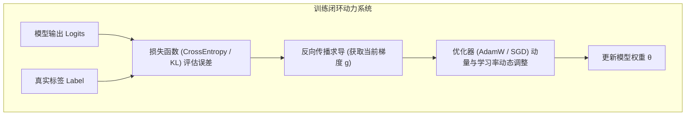
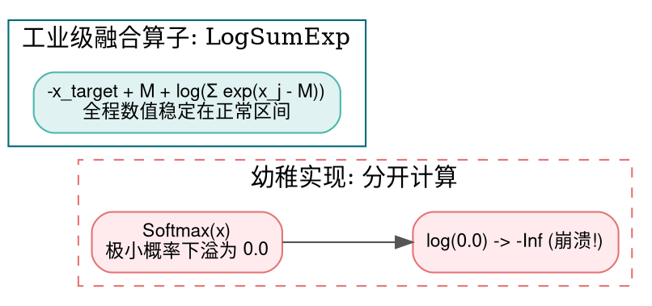
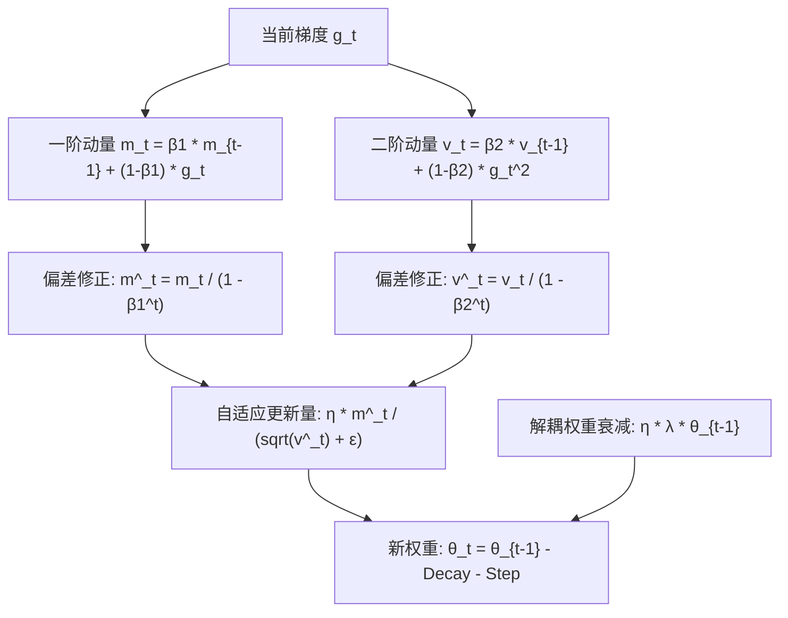

> **导读**：一个神经网络在未经训练之前，其内部成百上千亿的权重参数只是一堆毫无意义的纯随机噪声。
>
> 是什么力量在驱使着这头庞然大物，在长达数周的高性能集群运转中，从混乱无序逐步收敛为能够写诗作画、推演逻辑的超级智能？
>
> 答案就是**损失函数（Loss Functions）与优化器（Optimizers）**构成的“指路明灯与动力引擎”：
> - **损失函数**：定义了“模型当前犯了多大的错误”，为模型提供清晰的负反馈信号；
> - **优化器**：利用反向传播计算出的梯度，根据物理惯性（动量）与历史方差，动态调整每一个参数迈出的步幅，跨越崇山峻岭与高维鞍点。
>
> 从经典的**交叉熵（CrossEntropy）**与**KL散度**，到物理世界启发的一阶**SGD**，再到训练万亿大模型的工业绝对基石 **AdamW**，优化体系经历了一场关于数值稳定性与解耦正则化的终极蜕变。
>
> 本篇作为系列第十讲，将带你彻底吃透这 4 个核心收敛算子。

---

## 零、初学者核心概念速查：信息量、熵、动量与权重衰减

> [!NOTE] 核心概念形象字典
>
> - **信息量（Information Content）**：一件事情发生概率越小，带来的信息量越大。数学定义为 $I(x) = -\log P(x)$。“太阳明天从东边升起”几乎没信息量；“明天发生超新星爆发”信息量极大。
> - **信息熵（Entropy, $H(P)$）**：衡量一个概率系统的不确定性程度。分布越均匀，混乱度越大，熵越高。
> - **交叉熵（Cross Entropy, $H(P, Q)$）**：用模型的预测概率分布 $Q$ 来编码真实分布 $P$ 所需要的平均编码长度。$Q$ 越逼近真理 $P$，交叉熵越低。
> - **KL散度（Kullback-Leibler Divergence, 相对熵）**：衡量两个概率分布之间的“不对称距离”。在强化学习（RLHF PPO）中，专门用于惩罚模型，防止新模型把原本学到的安全常识给“练偏丢失”。
> - **一阶动量（First Momentum, $m_t$）**：梯度的滑动平均值（物理惯性）。好比小球滚落山谷，即便遇到平坦的鞍点或小上坡，凭借冲力依然能快速滚过。
> - **二阶动量（Second Momentum, $v_t$）**：梯度平方的滑动平均值（衡量梯度的波动剧烈程度）。对于频繁剧烈震荡的参数，主动缩小其学习率；对于罕见更新的参数，主动放大其步幅。
> - **解耦权重衰减（Decoupled Weight Decay, AdamW）**：传统 L2 正则化与梯度绑定在一起，在 Adam 的自适应二阶除法中被扭曲失效；AdamW 将权重收缩与梯度更新彻底解耦，成为所有大模型的训练标配。



---

## 1. CrossEntropyLoss (交叉熵损失与 Log-Softmax 融合)

### 1.1 原理解析：为什么不能先算 Softmax 再算 Log？
- **标准公式**：
  设真实标签为类别 $y \in \{0, 1, \dots, C-1\}$，模型预测的未归一化分数为 Logits $x = [x_0, \dots, x_{C-1}]$：
  $$ P_k = \text{Softmax}(x)_k = \frac{e^{x_k}}{\sum_{j=0}^{C-1} e^{x_j}} $$
  交叉熵（即负对数似然 NLL Loss）定义为：
  $$ \text{Loss} = -\log P_y = -\log \left( \frac{e^{x_y}}{\sum_j e^{x_j}} \right) = -x_y + \log \left( \sum_{j=0}^{C-1} e^{x_j} \right) $$
- **数值崩溃陷阱**：
  如果代码先调用 Softmax，对于某个概率极低的类别（如 $P_k = 10^{-50}$），由于下溢，浮点数直接变为 `0.0`。随后的 `log(0.0)` 瞬间变为 `-Inf`，导致梯度计算立刻爆发 `NaN`！
- **Log-Softmax 融合算子（LogSumExp 技巧）**：
  直接融合减去最大值 $M = \max(x)$：
  $$ \text{Loss} = -x_y + M + \log \left( \sum_{j=0}^{C-1} e^{x_j - M} \right) $$
  **整个计算链条永不发生上溢与下溢，极其平滑稳健！**



### 1.2 原生 Python 实现
```python
import math

def naive_cross_entropy_loss(logits: list[float], target_class: int) -> tuple[float, list[float]]:
    """数值稳定的单样本交叉熵损失与反向传播梯度"""
    C = len(logits)
    max_val = max(logits)
    
    # LogSumExp 计算
    sum_exp = sum(math.exp(x - max_val) for x in logits)
    log_sum_exp = max_val + math.log(sum_exp)
    
    # 损失计算: -logits[target] + log_sum_exp
    loss = -logits[target_class] + log_sum_exp
    
    # 反向传播梯度推导: grad_k = Softmax(x)_k - (1 if k == target else 0)
    grads = []
    for k in range(C):
        prob_k = math.exp(logits[k] - max_val) / sum_exp
        if k == target_class:
            grads.append(prob_k - 1.0)
        else:
            grads.append(prob_k)
            
    return loss, grads

if __name__ == "__main__":
    test_logits = [2.0, 1.0, 0.1] # 3 分类
    target = 0 # 真实标签为第 0 类
    loss_val, d_logits = naive_cross_entropy_loss(test_logits, target)
    print(f"交叉熵 Loss: {loss_val:.4f}")
    print("对输入 Logits 的梯度 (P - Y):", [round(g, 4) for g in d_logits])
```

### 1.3 原生 C++ 实现
```cpp
#include <iostream>
#include <cmath>
#include <vector>
#include <iomanip>

int main() {
    constexpr int C = 3;
    const float logits[C] = {2.0f, 1.0f, 0.1f};
    constexpr int target = 0;

    // 1. 找极大值
    float max_val = logits[0];
    for (int i = 1; i < C; ++i) if (logits[i] > max_val) max_val = logits[i];

    // 2. LogSumExp
    float sum_exp = 0.0f;
    for (int i = 0; i < C; ++i) sum_exp += std::exp(logits[i] - max_val);
    float log_sum_exp = max_val + std::log(sum_exp);

    // 3. Loss
    float loss = -logits[target] + log_sum_exp;

    std::cout << "=== 原生 C++ 交叉熵损失与梯度计算 ===" << std::endl;
    std::cout << "CrossEntropy Loss = " << std::fixed << std::setprecision(4) << loss << std::endl;
    for (int i = 0; i < C; ++i) {
        float prob = std::exp(logits[i] - max_val) / sum_exp;
        float grad = prob - (i == target ? 1.0f : 0.0f);
        std::cout << "dLoss/dLogits[" << i << "] = " << grad << std::endl;
    }
    return 0;
}
```

---

## 2. KLDivergence (KL 散度 / 相对熵)

### 2.1 原理解析：分布距离与 RLHF 护栏
- **公式**：
  对于两个离散概率分布 $P$（真实/基准分布）与 $Q$（预测分布）：
  $$ D_{KL}(P \parallel Q) = \sum_{i} P(i) \log \left( \frac{P(i)}{Q(i)} \right) = \sum_{i} P(i) \left( \log P(i) - \log Q(i) \right) $$
- **关键性质**：
  1. **非负性**：$D_{KL}(P \parallel Q) \ge 0$，当且仅当 $P = Q$ 时取等号为 0。
  2. **不对称性**：$D_{KL}(P \parallel Q) \ne D_{KL}(Q \parallel P)$，因此它不是严格意义上的几何距离。
- **大模型大放异彩的应用：RLHF PPO 惩罚**：
  在基于人类反馈的强化学习（RLHF）中，模型为了最大化奖励模型（Reward Model）的打分，可能会学会通过“胡言乱语或讨好漏洞”作弊。
  因此算法强行在损失中加入一项 **KL 惩罚项**：$\beta \cdot D_{KL}(\pi_{\theta} \parallel \pi_{\text{ref}})$，如果新策略 $\pi_{\theta}$ 的词表预测分布偏离最初预训练模型 $\pi_{\text{ref}}$ 太远，立刻施加剧烈惩罚，确保大模型始终保持在人类语言的安全航道上！

### 2.2 原生 Python 实现
```python
import math

def naive_kl_divergence(P: list[float], Q: list[float], eps: float = 1e-9) -> float:
    """计算离散分布的 KL 散度: D_KL(P || Q)"""
    kl = 0.0
    for p, q in zip(P, Q):
        # 加上微小常数防止 log(0) 崩溃
        p_safe = max(p, eps)
        q_safe = max(q, eps)
        kl += p_safe * math.log(p_safe / q_safe)
    return kl

if __name__ == "__main__":
    dist_P = [0.7, 0.2, 0.1]
    dist_Q = [0.6, 0.3, 0.1]
    res_kl = naive_kl_divergence(dist_P, dist_Q)
    print(f"KL 散度 D_KL(P || Q) = {res_kl:.6f}")
    # 验证同一分布的 KL 为 0
    print(f"相同分布 D_KL(P || P) = {naive_kl_divergence(dist_P, dist_P):.6f}")
```

### 2.3 原生 C++ 实现
```cpp
#include <iostream>
#include <cmath>
#include <algorithm>
#include <iomanip>

int main() {
    constexpr int N = 3;
    const float P[N] = {0.7f, 0.2f, 0.1f};
    const float Q[N] = {0.6f, 0.3f, 0.1f};
    constexpr float eps = 1e-9f;

    float kl = 0.0f;
    for (int i = 0; i < N; ++i) {
        float p_val = std::max(P[i], eps);
        float q_val = std::max(Q[i], eps);
        kl += p_val * std::log(p_val / q_val);
    }

    std::cout << "=== 原生 C++ KL 散度验证 ===" << std::endl;
    std::cout << "KL Divergence = " << std::fixed << std::setprecision(6) << kl << std::endl;
    return 0;
}
```

---

## 3. AdamW (带解耦权重衰减的自适应矩估计)

### 3.1 原理解析：大模型训练的绝对王者
- **经典 Adam 的致命隐患**：
  在原始 Adam 论文中，权重衰减是通过在梯度 $g_t$ 上直接累加 L2 正则项 $\lambda \theta_{t-1}$ 实现的。然而，随后这个梯度要除以二阶方差 $\sqrt{v_t}$。这导致**更新频繁的大梯度参数其权重衰减被无理缩小，而更新罕见的小梯度参数其衰减反而被过度放大**！
- **AdamW 的解耦革命（Loshchilov & Hutter, 2017）**：
  将权重衰减从梯度更新中完全剥离，直接作用于参数本身：
  $$ \theta_t = \theta_{t-1} - \eta \cdot \lambda \cdot \theta_{t-1} - \frac{\eta}{\sqrt{\hat{v}_t} + \epsilon} \cdot \hat{m}_t $$
- **四大执行流程**：
  1. **一阶动量（梯度期望）**：$m_t = \beta_1 m_{t-1} + (1 - \beta_1) g_t$（通常 $\beta_1 = 0.9$）
  2. **二阶动量（方差平方）**：$v_t = \beta_2 v_{t-1} + (1 - \beta_2) g_t^2$（通常 $\beta_2 = 0.95 \sim 0.999$）
  3. **偏差修正（Bias Correction）**：由于 $m_0 = 0, v_0 = 0$，训练初期动量被严重拉向 0，必须除以膨胀系数：
     $$ \hat{m}_t = \frac{m_t}{1 - \beta_1^t}, \quad \hat{v}_t = \frac{v_t}{1 - \beta_2^t} $$
  4. **参数联合更新**：同时执行自适应步进与解耦衰减。



### 3.2 原生 Python 实现
```python
import math

class NaiveAdamW:
    """纯 Python 原生 AdamW 优化器实现"""
    def __init__(self, params: list[float], lr: float = 1e-3, beta1: float = 0.9, beta2: float = 0.999, eps: float = 1e-8, weight_decay: float = 0.01):
        self.params = params
        self.lr = lr
        self.beta1 = beta1
        self.beta2 = beta2
        self.eps = eps
        self.wd = weight_decay
        self.t = 0
        self.m = [0.0] * len(params)
        self.v = [0.0] * len(params)

    def step(self, grads: list[float]):
        self.t += 1
        for i in range(len(self.params)):
            g = grads[i]
            # 1. 动量累积
            self.m[i] = self.beta1 * self.m[i] + (1.0 - self.beta1) * g
            self.v[i] = self.beta2 * self.v[i] + (1.0 - self.beta2) * (g * g)
            
            # 2. 偏差修正
            m_hat = self.m[i] / (1.0 - (self.beta1 ** self.t))
            v_hat = self.v[i] / (1.0 - (self.beta2 ** self.t))
            
            # 3. 解耦权重衰减
            self.params[i] -= self.lr * self.wd * self.params[i]
            
            # 4. 自适应梯度更新
            self.params[i] -= (self.lr * m_hat) / (math.sqrt(v_hat) + self.eps)

if __name__ == "__main__":
    w_vec = [1.0, 2.0]
    opt = NaiveAdamW(w_vec, lr=0.1, weight_decay=0.01)
    # 模拟连续两次梯度更新
    opt.step(grads=[0.5, -0.2])
    print("AdamW 第 1 步更新后参数:", [round(v, 4) for v in w_vec])
    opt.step(grads=[0.4, -0.1])
    print("AdamW 第 2 步更新后参数:", [round(v, 4) for v in w_vec])
```

### 3.3 原生 C++ 实现
```cpp
#include <iostream>
#include <cmath>
#include <iomanip>

int main() {
    float param = 1.0f;
    float grad = 0.5f;

    float lr = 0.1f;
    float beta1 = 0.9f;
    float beta2 = 0.999f;
    float eps = 1e-8f;
    float weight_decay = 0.01f;

    float m = 0.0f;
    float v = 0.0f;
    int t = 1;

    // 1. 动量
    m = beta1 * m + (1.0f - beta1) * grad;
    v = beta2 * v + (1.0f - beta2) * (grad * grad);

    // 2. 偏差修正
    float m_hat = m / (1.0f - std::pow(beta1, t));
    float v_hat = v / (1.0f - std::pow(beta2, t));

    // 3. 解耦衰减 + 更新
    param -= lr * weight_decay * param;
    param -= (lr * m_hat) / (std::sqrt(v_hat) + eps);

    std::cout << "=== 原生 C++ AdamW 单步更新验证 ===" << std::endl;
    std::cout << "更新后权重 Param = " << std::fixed << std::setprecision(5) << param << std::endl;
    return 0;
}
```

---

## 4. SGD (随机梯度下降与动量加速)

### 4.1 原理解析：经典物理惯性
- **朴素 SGD**：$\theta_t = \theta_{t-1} - \eta g_t$。
- **带动量 SGD（SGD with Momentum）**：
  引入速度变量 $v_t$（好比滚珠在凹凸不平的重力场滚落）：
  $$ v_t = \mu \cdot v_{t-1} + g_t $$
  $$ \theta_t = \theta_{t-1} - \eta \cdot v_t $$
  **物理效果**：在震荡剧烈的沟壑两侧，正负交替的梯度在速度累加中被相互抵消；而在持续下坡的平坦主方向，速度不断叠加变大，极大加速了逃逸鞍点的进程。

---

## 总结与思维进阶

| 算子 | 核心职责 | 数值与工程关键 | 现代落地标配 |
| :--- | :--- | :--- | :--- |
| **CrossEntropyLoss** | 评估分类与词元生成预测误差 | **LogSumExp 融合**，杜绝下溢 $\ln(0)$ | 所有语言模型预训练目标 |
| **KLDivergence** | 评估两组概率分布的相对偏差 | 不对称性，零保护 | 知识蒸馏、RLHF PPO 惩罚护栏 |
| **AdamW** | 高维大模型参数自适应更新 | **解耦权重衰减** + 一二阶矩偏差修正 | **LLM/Transformer 绝对主宰** |
| **SGD** | 经典卷积网络基础更新 | 动量冲破狭长峡谷鞍点 | 计算机视觉经典架构 (ResNet/VGG) |

下一讲，我们将探讨语言模型生成下一个字的核心决策机制——**采样与解码策略算子（Argmax / Top-K / Top-P / Temperature）**！
