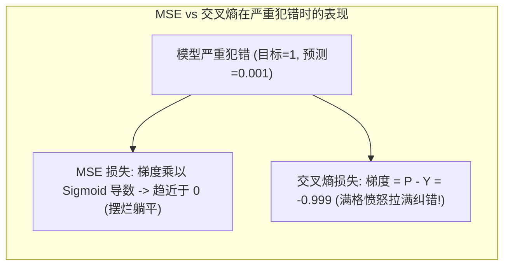
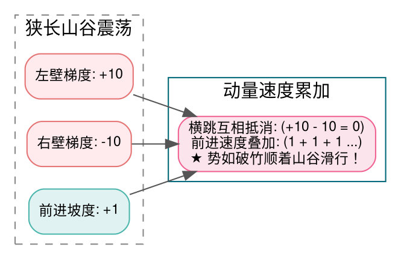

> **致初学者**：在刚接触神经网络训练时，你可能会有这样的疑问：
> - **分类任务直接用高中学过的“均方误差（MSE，真实值减预测值的平方）”不行吗？为什么非要用听起来高大上的“交叉熵”？**
> - **为什么好端端的损失值（Loss）突然变成 `-inf` 或 `NaN`？**
> - **为什么在强化学习（RLHF）训练 ChatGPT 时，必须加一个“KL 散度”惩罚项，否则模型就会胡说八道？**
> - **为什么所有大模型论文里，优化器清一色写着 `AdamW`，而不是经典的 `SGD` 或原本的 `Adam`？那个字母 `W` 到底拯救了什么？**
>
> 损失函数是神经网络在漫漫长夜中的**灯塔**，告诉它犯了多大的错；
> 优化器是神经网络攀登崇山峻岭的**双腿**，决定了每一步跨多大、往哪迈。
>
> 本篇作为系列第十讲，将用**生动的生活比喻与具体数字手算推演**，带你从底层彻底吃透这 4 大收敛核心算子！

---

## 零、初学者必懂：为什么分类任务绝不能用 MSE？

很多初学者觉得：预测概率 $\hat{y}$ 和真实标签 $y \in \{0, 1\}$，直接算 $(\hat{y} - y)^2$ 不就挺好吗？
**答案：如果在分类任务上用 MSE，模型犯大错时会彻底“摆烂躺平”！**

- **极小数字手算推导残酷真相**：
  假设真实标签是第 1 类（$y = 1$）。
  模型当前错得极其离谱，预测概率只有 $\hat{y} = 0.001$。
  - 如果用 **MSE + Sigmoid**：
    损失函数对输出的梯度包含一项 $\sigma'(\hat{y})$。
    我们在第三讲学过，当 $\hat{y} \to 0$ 时，Sigmoid 的导数**趋近于 0**！
    梯度算出来是：$2(\hat{y} - y) \cdot \sigma' \approx 2(-0.999) \times 0.001 \approx \mathbf{-0.0019}$！
    **模型错得越离谱，梯度反而越微弱！模型在错误中安详地睡着了！**
  - 如果用 **交叉熵损失（CrossEntropyLoss）**：
    它的反向传播梯度推导出来是极其优美的：
    $$ \frac{\partial \text{Loss}}{\partial \text{Logit}} = P_{\text{pred}} - Y_{\text{true}} $$
    当真实标签是 1，预测只有 $0.001$ 时：
    $$ \text{梯度} = 0.001 - 1.0 = \mathbf{-0.999}！ $$
    **梯度直接拉满到最大极限！像一记响亮的耳光瞬间把模型抽醒，逼迫参数以最快速度全力纠错！**



---

## 1. CrossEntropyLoss (交叉熵损失与 LogSumExp 融合)

### 1.1 避免 `log(0)` 崩溃的 LogSumExp 融合魔法
在实际代码中，千万不要分步写 `log(softmax(x))`！
因为对于 10 万个词的词表，排在后面的生僻词概率只有 $10^{-45}$。在单精度浮点（FP32）中，它会直接下溢变成 `0.0`。
随后的 `log(0.0)` 瞬间吐出 `-Inf`，梯度当场爆炸！
**工业级解法：LogSumExp 融合算子**：
$$ \text{Loss} = -x_{\text{target}} + M + \log\left( \sum_{j} e^{x_j - M} \right) $$
其中 $M = \max(x)$。减去最大值后，指数永远不会溢出，再求对数，数值稳如泰山！

### 1.2 手把手极小数字推演
假设 3 分类任务，Logits 为 `[2.0, 1.0, 0.1]`，真实标签是第 0 类（$target = 0$）：
1. 找出最大值 $M = 2.0$；
2. 减去最大值：`[0.0, -1.0, -1.9]`；
3. 求指数：
   - $e^0 = 1.0$
   - $e^{-1.0} \approx 0.3679$
   - $e^{-1.9} \approx 0.1496$
4. 累加求和：$\text{Sum} = 1.0 + 0.3679 + 0.1496 = 1.5175$；
5. LogSumExp 值为：$M + \ln(1.5175) = 2.0 + 0.4171 = 2.4171$；
6. **最终交叉熵 Loss**：
   $$ \text{Loss} = -x_0 + \text{LogSumExp} = -2.0 + 2.4171 = \mathbf{0.4171} $$
7. **反向传播对 Logits 的梯度（$P - Y$）**：
   各类别预测概率为：$P = [1.0/1.5175, 0.3679/1.5175, 0.1496/1.5175] \approx [0.6590, 0.2424, 0.0986]$。
   - 类别 0（目标类，减 1）：$0.6590 - 1.0 = \mathbf{-0.3410}$；
   - 类别 1（非目标类）：$\mathbf{0.2424}$；
   - 类别 2（非目标类）：$\mathbf{0.0986}$。

---

## 2. KLDivergence (KL 散度：RLHF 防走偏护栏)

### 2.1 强化学习（PPO）中为什么要强制加 KL 惩罚？
在大模型对齐阶段（RLHF），我们用一个奖励模型（Reward Model）给回答打分。
如果不加限制，模型会迅速找到“作弊漏洞”：比如疯狂堆砌礼貌用语或者把句子写得无限长，把奖励模型忽悠瘸了。
**KL 散度护栏机制**：
我们保留一份最初没受污染的底座模型（Reference Model）。
每当新模型预测下一个词的概率分布 $P$ 时，我们算一下它和底座模型分布 $Q$ 之间的 **KL 散度（相对熵距离）**：
$$ D_{KL}(P \parallel Q) = \sum_{i} P(i) \ln\left( \frac{P(i)}{Q(i)} \right) $$
**如果新模型跑偏太远（KL 散度过大），立刻在奖励分里重重扣分！强制模型在安全常识的航道内优化！**

---

## 3. SGD (随机梯度下降与动量小球)

### 3.1 狭长山谷与滚落小球的比喻
传统的朴素 SGD 就像一个醉汉下山：$\theta_t = \theta_{t-1} - \eta g_t$。
遇到狭长的峡谷地貌时：
- 两侧悬崖非常陡峭，梯度很大；
- 沿着山谷往下的主坡道非常平缓，梯度很小。
醉汉会在两侧悬崖之间疯狂左右横跳震荡，半天走不下山！
**带动量的 SGD（SGD with Momentum）**：
引入**物理惯性速度 $v_t$**：
$$ v_t = \beta \cdot v_{t-1} + g_t, \quad \theta_t = \theta_{t-1} - \eta \cdot v_t $$
- 在两侧来回震荡的方向，正负梯度在速度累加中**相互抵消**；
- 在持续向下的平缓山谷方向，惯性速度**不断滚雪球加速**！小球一鼓作气冲破阻碍，直奔全局最优！



---

## 4. AdamW (现代千亿大模型的绝对统治者)

### 4.1 那个字母 `W` 到底拯救了什么？（Adam vs AdamW 的历史大决战）
- **老版 Adam 的隐秘 BUG**：
  在老版 Adam 中，工程师为了防止权重过大（权重衰减 Weight Decay），直接把正则化加进了梯度里：$g_{\text{new}} = g + \lambda \theta$。
  接着，Adam 会做自适应学习率调节：除以二阶方差根号 $\sqrt{v_t}$。
  **结果好心办了坏事！**
  - 对于那些经常更新、梯度很大的参数，$\sqrt{v_t}$ 极大，导致原本的正则衰减被除以了一个大数，**衰减名存实亡**！
  - 对于那些罕见更新、梯度很小的参数，$\sqrt{v_t}$ 极小，导致正则衰减被无理放大，**参数被过度压死**！
- **AdamW 的解耦革命（Loshchilov & Hutter, 2017）**：
  把权重衰减从梯度除法里彻底拽出来！独立作为一项直接作用在参数身上：
  $$ \theta_t = \theta_{t-1} - \mathbf{\eta \lambda \theta_{t-1}} - \frac{\eta}{\sqrt{\hat{v}_t} + \epsilon} \hat{m}_t $$
  这个小小的改动，让现代大模型的泛化能力与训练收敛速度产生了质的飞跃，成为了全行业不可动摇的黄金标配！

### 4.2 手把手带入具体数值追踪 AdamW 步进
设参数初始值 $\theta_0 = 1.0$，学习率 $\eta = 0.1$，权重衰减 $\lambda = 0.01$，$\beta_1 = 0.9, \beta_2 = 0.99$。
在第 1 步，反向传播算出的梯度是 $g_1 = 0.5$。
1. **一阶动量（惯性方向）**：
   $$ m_1 = 0.9 \times 0 + 0.1 \times 0.5 = 0.05 $$
2. **二阶动量（波动大小）**：
   $$ v_1 = 0.99 \times 0 + 0.01 \times (0.5)^2 = 0.01 \times 0.25 = 0.0025 $$
3. **初期偏差修正（Bias Correction）**：
   - $\hat{m}_1 = \frac{0.05}{1 - 0.9^1} = \frac{0.05}{0.1} = 0.5$
   - $\hat{v}_1 = \frac{0.0025}{1 - 0.99^1} = \frac{0.0025}{0.01} = 0.25$
4. **两路合并更新参数**：
   - 独立权重衰减项：$0.1 \times 0.01 \times 1.0 = 0.001$；
   - 自适应梯度步进项：$\frac{0.1}{\sqrt{0.25} + 1e-8} \times 0.5 = \frac{0.1}{0.5} \times 0.5 = 0.1$；
   - **最终更新后参数**：
     $$ \theta_1 = 1.0 - 0.001 - 0.1 = \mathbf{0.899} $$

### 4.3 原生 Python 逐行注释实现
```python
import math

class NaiveAdamW:
    """纯 Python 原生 AdamW 优化器"""
    def __init__(self, params: list[float], lr: float = 0.1, beta1: float = 0.9, beta2: float = 0.99, wd: float = 0.01):
        self.params = params
        self.lr = lr
        self.b1 = beta1
        self.b2 = beta2
        self.wd = wd
        self.step_t = 0
        self.m = [0.0] * len(params)
        self.v = [0.0] * len(params)

    def step(self, grads: list[float]):
        self.step_t += 1
        t = self.step_t
        for i in range(len(self.params)):
            g = grads[i]
            # 1. 更新一二阶动量
            self.m[i] = self.b1 * self.m[i] + (1.0 - self.b1) * g
            self.v[i] = self.b2 * self.v[i] + (1.0 - self.b2) * (g * g)

            # 2. 消除初期 0 偏置影响
            m_hat = self.m[i] / (1.0 - (self.b1 ** t))
            v_hat = self.v[i] / (1.0 - (self.b2 ** t))

            # 3. 独立解耦权重衰减
            self.params[i] -= self.lr * self.wd * self.params[i]

            # 4. 自适应步进
            self.params[i] -= (self.lr * m_hat) / (math.sqrt(v_hat) + 1e-8)

if __name__ == "__main__":
    weights = [1.0]
    optimizer = NaiveAdamW(weights, lr=0.1, wd=0.01)
    optimizer.step(grads=[0.5])
    print(f"手算验证: 期望 0.8990 -> 实际代码更新结果: {weights[0]:.4f}")
```

---

## 总结与初学者避坑指南

1. **分类任务必用交叉熵**：利用 $P - Y$ 的强反馈惩罚机制，绝不能用 MSE；
2. **永远写 LogSumExp 融合**：杜绝 $P \approx 0$ 导致的 $\ln(0)$ 崩溃；
3. **KL 散度是强化学习的“安全护栏”**：防止大模型为了骗取高分而走火入魔；
4. **大模型只认 AdamW**：把权重衰减解耦，才是自适应学习率正确的打开方式。

下一讲，我们将探讨语言模型吐出文字的核心决策机制——**采样与解码策略算子（Greedy / Temperature / Top-K / Top-P 核采样）**！
