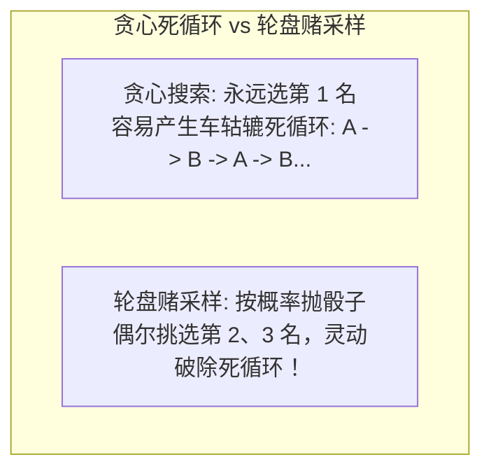
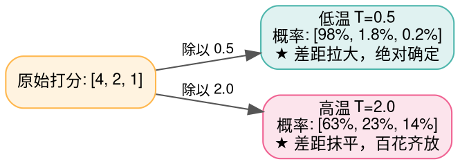
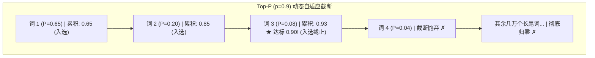

> **致初学者**：当你与 ChatGPT、Claude 或 LLaMA 对话时，它那行云流水、有时严谨缜密、有时充满灵性的回答，究竟是怎么从冰冷的矩阵计算中吐出来的？
>
> 很多初学者以为：模型算完后，直接挑选预测概率最高的那个词吐出来不就行了吗？
> 结果一试才发现：**如果永远选概率最大的词（贪心搜索），模型经常会陷入恐怖的“车轱辘话死循环”——“我认为是这样，因为我认为是这样，我认为是这样……”**
>
> 为什么会这样？
> 参数调节里的 **Temperature（温度）**、**Top-K**、**Top-P（核采样）** 到底在物理上干了什么？
> 为什么把温度调高模型就会充满创造力甚至产生幻觉，而把温度调到 0 模型就会变得冷酷严谨？
>
> 本篇作为系列第十一讲，将用**掷骰子、轮盘赌与热力学分子的通俗比喻**，带你从具体数字手算推演，彻底搞懂这 4 大解码采样算子！

---

## 零、贪心搜索（Greedy Search）的死穴：为什么最聪明的决定反而会死循环？

贪心搜索（Argmax）极其单纯：每一刻都挑选当前 Logits 打分最高的唯一一个 Token。
$$ t_{\text{next}} = \arg\max_i (\text{Logits}_i) $$

### 1. 致命的局部最优陷阱与车轱辘死循环
假设模型生成了一句话：“……我觉得这件事很”。
在接下来的预测中：
- 概率最高的是“好”（概率 40%），第二是“有意思”（概率 35%）；
- 贪心搜索选了“好”；
- 接着生成：“……我觉得这件事很好，因为”。
- 在“因为”后面，在预训练语料的局部统计中，概率最高的词竟然又是“我觉得”！
- 于是模型吐出：“我觉得”。
- 接着它又看到了“我觉得”，下一个最高又是“这件事很”……
**一旦落入这个闭环，由于贪心搜索没有任何随机扰动，它将 100% 确定性地沿着这条轨道永久循环下去，直到把你的显存全部塞满！**

> [!NOTE] 破解之道：引入受控的随机抽样（Sampling）
> 我们不能永远只挑第一名！我们应该把打分变成一个**概率转盘（轮盘赌）**：第一名占 60% 面积，第二名占 30% 面积，第三名占 10% 面积。轻轻转动轮盘，偶尔让第二名、第三名也有机会登场，从而彻底打破死循环！



---

## 1. TemperatureScaling (温度缩放：热力学分子的狂欢与冷静)

### 1.1 物理热力学隐喻
统计物理学家玻尔兹曼在研究气体分子时发现：
- **在绝对零度（$T \to 0$）**：所有水分子全部冻结成冰砖，分子纹丝不动，绝对确定、毫无变化（对应 **严谨保守、写代码或做数学推导**）；
- **在常温状态（$T = 0.7$）**：水分子灵动流淌，既有规律又有生机（对应 **日常对话与写作**）；
- **在沸腾高温（$T \ge 1.5$）**：水分子剧烈狂奔汽化，毫无规律到处乱撞（对应 **极度发散、胡言乱语与幻觉爆发**）。

### 1.2 数学公式与手把手极小数字推演
公式极其优雅，就是在算 Softmax 前，**先把每个原始打分 Logit 除以温度常数 $T$**：
$$ P_i = \frac{e^{x_i / T}}{\sum_j e^{x_j / T}} $$

假设模型算出来的原始打分为：`[4.0, 2.0, 1.0]`。

#### 情况 A：极低温度 $T = 0.5$（理智冷静模式）
1. 每个数除以 $0.5$（相当于乘以 2）：`[8.0, 4.0, 2.0]`；
   原本只有 2 分的微小差距，被强行放大成了 4 分甚至 6 分的巨大鸿沟！
2. 减去最大值 8.0：`[0.0, -4.0, -6.0]`；
3. 求指数：$e^0 = 1.0, e^{-4} \approx 0.0183, e^{-6} \approx 0.0025$；
4. 归一化概率：
   - 候选 0：$1.0 / 1.0208 \approx \mathbf{97.96\%}$（绝对统治地位！）
   - 候选 1：$0.0183 / 1.0208 \approx \mathbf{1.79\%}$
   - 候选 2：$0.0025 / 1.0208 \approx \mathbf{0.25\%}$

#### 情况 B：极高温度 $T = 2.0$（疯狂发散模式）
1. 每个数除以 $2.0$：`[2.0, 1.0, 0.5]`；
   差距被急剧缩小压缩！
2. 减去最大值 2.0：`[0.0, -1.0, -1.5]`；
3. 求指数：$e^0 = 1.0, e^{-1} \approx 0.3679, e^{-1.5} \approx 0.2231$；
4. 归一化概率：
   - 候选 0：$1.0 / 1.591 \approx \mathbf{62.85\%}$
   - 候选 1：$0.3679 / 1.591 \approx \mathbf{23.12\%}$（被选中的机会大增！）
   - 候选 2：$0.2231 / 1.591 \approx \mathbf{14.03\%}$（冷门词被激活！）



---

## 2. TopK vs TopP (核采样：固定死板 vs 自适应弹性)

### 2.1 Top-K 的致命漏洞
Top-K 是最直观的长尾过滤器：不管三七二十一，**永远只保留概率最大的前 $K$ 个词（如 $K=50$）**，其余几万个生僻词全部扔掉。
**但遇到以下两种真实场景，Top-K 会当场现原形**：
1. **场景一：答案极其明确（确定性语境）**：
   “中华人民共和国的首都是____”
   在这个句子里，“北京”这一个词的概率高达 99.8%！
   如果强行保留 $K=50$ 个词，剩下 49 个完全不相干的荒谬词汇依然有微小几率被随机抽中（模型突然吐出一个“首都是香蕉”）！
2. **场景二：答案极度丰富发散（创意语境）**：
   “从前有一座山，山里有一座____”
   合理的词太多了（庙、道观、城堡、村庄、古宅、山洞、宝塔……）。
   优秀的词可能多达 200 个！如果死板地限制 $K=50$，**大量绝妙生动的词汇被一刀切提前扼杀了！**

### 2.2 Top-P (核采样 Nucleus Sampling) 的神级自适应
Ari Holtzman 在 2020 年提出了轰动业界的 **Top-P（核采样）**：
不要去定死候选词的“个数 $K$”，**而是定死累积概率阈值（如 $p = 0.9$，即 90%）**！
把所有词按概率从大到小排成一列，从头开始累加：
累加到什么时候刚好达到 90%，就在哪里一刀切断！后面的全部丢掉！
- 面对“中国的首都是____”：“北京”自己一个人就占了 99.8%，超过了 90%，**核心池大小自适应缩减为 1！绝对稳妥！**
- 面对“从前有一座山”：需要累加 80 个词才凑齐 90%，**核心池自适应弹性扩张到 80！百花齐放！**



### 2.3 原生 Python 逐行注释跑通完整采样流水线
```python
import math

def naive_generate_next_token(logits: list[float], temperature: float = 0.7, top_p: float = 0.9, pseudo_random_seed: float = 0.42) -> int:
    """工业级解码标准流水线: Logits -> 温度缩放 -> Top-P 过滤 -> 重新归一 -> 轮盘赌抽样"""
    # 步骤 1: 温度缩放
    scaled_logits = [x / temperature for x in logits]
    max_val = max(scaled_logits)
    
    # 步骤 2: 计算基础概率分布
    exp_vals = [math.exp(x - max_val) for x in scaled_logits]
    sum_exp = sum(exp_vals)
    probs = [v / sum_exp for v in exp_vals]

    # 步骤 3: 降序排序并执行 Top-P 截断
    indexed_probs = sorted([(p, idx) for idx, p in enumerate(probs)], reverse=True)
    cum_sum = 0.0
    nucleus = []
    for p_val, idx in indexed_probs:
        nucleus.append((p_val, idx))
        cum_sum += p_val
        if cum_sum >= top_p:
            break # 累加达到阈值，立即截断！

    # 步骤 4: 核心词池内部重新归一化 (让选出的几个词概率和重新恢复为 1.0)
    nucleus_total_p = sum(item[0] for item in nucleus)
    renorm_candidates = [(item[0] / nucleus_total_p, item[1]) for item in nucleus]

    # 步骤 5: 轮盘赌抽样 (根据传入的伪随机数摇号)
    acc = 0.0
    for norm_p, orig_idx in renorm_candidates:
        acc += norm_p
        if pseudo_random_seed <= acc:
            return orig_idx

    return renorm_candidates[-1][1]

if __name__ == "__main__":
    raw_scores = [3.5, 2.1, 0.5, -1.0, -3.0]
    chosen_id = naive_generate_next_token(raw_scores, temperature=0.7, top_p=0.9, pseudo_random_seed=0.5)
    print(f"经过完整温度与 Top-P 采样选中的下一个 Token ID: {chosen_id}")
```

---

## 总结与初学者避坑指南

1. **写代码、做数学题、抽取事实数据时**：将温度调为 **0（或使用贪心搜索）**，确保回答严肃、严谨、100% 确定；
2. **写故事、头脑风暴、角色扮演时**：将温度调至 **$0.7 \sim 0.9$**，配合 **$\text{Top-P} = 0.9$**，既能放飞想象力，又不会崩出乱码生僻字；
3. **永远记住解码三步曲**：温度控制松紧，Top-P 弹性裁切，轮盘赌随机投掷！

下一讲，我们将迈入大规模工业部署与万卡集群通信的终极底层深水区——**模型量化与分布式集合通信算子（Quantize / AllReduce / AllGather / AllToAll）**！
