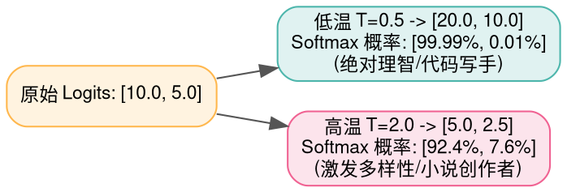
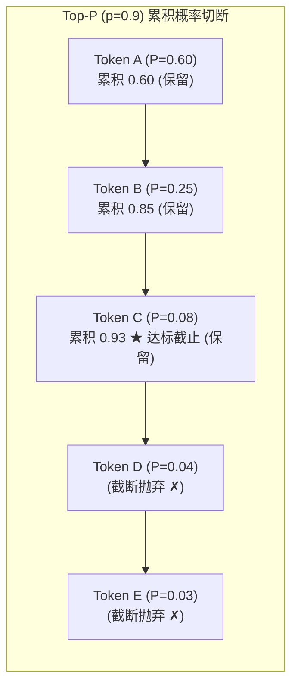

> **导读**：当一个千亿大模型完成前向推理后，它的最顶层输出并不是一段直接可见的文字，而是一个覆盖了数万到数十万词表的**未归一化打分向量（Logits）**。
>
> 接下来这个至关重要的瞬间，将决定模型究竟是生成一段严谨缜密的代码，还是创作一篇天马行空的优美诗歌，亦或是陷入“你好你好你好”的恐怖车轱辘死循环——**这就是采样与解码（Sampling & Decoding）算子的神圣职责**。
>
> 许多初学者常问：
> - **为什么永远选概率最大的那个词（贪心解码），模型反而会经常说胡话或卡死在死循环里？**
> - **温度（Temperature）在物理热力学和概率曲线上到底在做什么？**
> - **Top-K 与 Top-P（核采样）是如何联手将数以万计的乱码长尾一刀切除的？**
>
> 本篇作为系列第十一讲，将带你从玻尔兹曼能量分布与自回归解码的第一性原理出发，彻底穿透这 4 个主宰大模型生成风格的核心算子。

---

## 零、初学者核心概念速查：自回归、长尾噪声与核采样

> [!NOTE] 核心概念形象字典
>
> - **自回归解码（Autoregressive Decoding）**：大模型生成文本是“一个字一个字吐出来的”。每生成一个新的 Token，就必须将它追加到当前对话末尾，作为下一轮前向推理的新输入，如此循环往复。
> - **贪心解码（Greedy Search / Argmax）**：没有任何随机性，每次只挑选预测概率最高的唯一一个 Token。虽然在写代码或做数学题时很稳，但在开放文本生成中极易陷入低俗套话或死循环。
> - **退化与死循环（Degeneration）**：模型在贪心模式下，由于某个高频词的微小概率优势被连乘反复放大，导致不断重复生成同一句话（如“是的，是的，是的……”）。
> - **温度缩放（Temperature Scaling, $T$）**：借用统计物理中的温度概念，通过给 Logits 除以 $T$ 来控制分布的“混乱度/熵”。温度越高，各个词的被选概率越趋于均等（越有创造力）；温度越低，头部最高概率词越被极限放大（越确定保守）。
> - **长尾截断（Tail Truncation）**：一个词表通常有 32000~150000 个 Token。绝大部分排在后面的低频生僻词都是当前语境下完全无关的胡话（如突然冒出火星文或专业化学分子式），必须在采样前将其概率强行归零抹杀。
> - **Top-P（核采样 / Nucleus Sampling）**：抛弃固定的候选数量 $K$，改为固定累积概率阈值（如 90%）。模型只在概率总和达到 90% 的那个“最小动态核心词元集合”中摇号抽奖，实现了上下文敏感的弹性伸缩。


---

## 1. Argmax / GreedySearch (贪心搜索解码)

### 1.1 原理解析
- **数学公式**：
  $$ t_{\text{next}} = \arg\max_{i} (\text{Logits}_i) $$
- **特性分析**：
  - **确定性（Deterministic）**：给定相同的 Prompt 输入，模型每次吐出的回答绝对一模一样（等价于采样温度 $T \to 0$）。
  - **局部最优陷阱**：在自回归第 1 步挑选概率最高的词，并不代表整句话在全局联合概率上是最优的。一旦某一步走入死胡同，后续生成再也无法调头挽回。

### 1.2 原生 Python 实现
```python
def naive_argmax(logits: list[float]) -> int:
    """提取最大分数的索引编号 (贪心选择)"""
    max_idx = 0
    max_val = logits[0]
    for i in range(1, len(logits)):
        if logits[i] > max_val:
            max_val = logits[i]
            max_idx = i
    return max_idx

if __name__ == "__main__":
    vocab_scores = [-2.1, 4.5, 1.2, 0.8]
    chosen = naive_argmax(vocab_scores)
    print(f"贪心搜索选中 Token 编号: {chosen} (得分: {vocab_scores[chosen]})")
```

### 1.3 原生 C++ 实现
```cpp
#include <iostream>

int main() {
    constexpr int V = 4;
    const float logits[V] = {-2.1f, 4.5f, 1.2f, 0.8f};

    int best_idx = 0;
    float best_score = logits[0];
    for (int i = 1; i < V; ++i) {
        if (logits[i] > best_score) {
            best_score = logits[i];
            best_idx = i;
        }
    }

    std::cout << "=== 原生 C++ 贪心解码输出 ===" << std::endl;
    std::cout << "Argmax 选中 Token ID: " << best_idx << " | 得分: " << best_score << std::endl;
    return 0;
}
```

---

## 2. TemperatureScaling (温度缩放算子)

### 2.1 原理解析：热力学玻尔兹曼分布的数学映射
- **公式**：
  设原始未归一化打分为 $z_i$，温度常数为 $T > 0$：
  $$ P_i = \frac{e^{z_i / T}}{\sum_j e^{z_j / T}} $$
- **三大极限状态**：
  1. **低光速冷却（$T \to 0$，例如 $T=0.1$）**：
     $z_i / T$ 将分数差异放大了 10 倍！原本微弱的领先优势（如 2.5 对 2.0）被放大成 25 对 20，经过 $e^x$ 之后，最高分数的概率被无限推向 100%，其余全灭，**退化为绝对贪心模式**。
  2. **标准基准态（$T = 1.0$）**：
     不改变原始 Logits 比例，保留模型训练时的天然原汁原味分布。
  3. **高温剧烈膨胀（$T \to \infty$，例如 $T=2.0$ 或更大）**：
     所有 $z_i / T$ 被急剧缩小贴近 0，所有分数的指数 $e^0 \to 1.0$，整个词表概率分布被彻底“抹平”成均匀分布。每个词被挑中的概率趋于一致，模型产生狂野、荒诞不羁的幻觉联想。



### 2.2 原生 Python 实现
```python
import math

def naive_temperature_scale(logits: list[float], temperature: float) -> list[float]:
    """对 Logits 执行温度缩放并返回 Safe-Softmax 概率分布"""
    if temperature <= 0.0:
        raise ValueError("温度 T 必须大于 0")
        
    scaled = [x / temperature for x in logits]
    max_v = max(scaled)
    exp_vals = [math.exp(s - max_v) for s in scaled]
    sum_exp = sum(exp_vals)
    return [v / sum_exp for v in exp_vals]

if __name__ == "__main__":
    scores = [4.0, 2.0, 1.0]
    p_low = naive_temperature_scale(scores, temperature=0.5)
    p_mid = naive_temperature_scale(scores, temperature=1.0)
    p_high = naive_temperature_scale(scores, temperature=2.0)
    print("低温 T=0.5 概率:", [round(p, 4) for p in p_low])
    print("标准 T=1.0 概率:", [round(p, 4) for p in p_mid])
    print("高温 T=2.0 概率:", [round(p, 4) for p in p_high])
```

### 2.3 原生 C++ 实现
```cpp
#include <iostream>
#include <cmath>
#include <iomanip>

int main() {
    constexpr int N = 3;
    const float logits[N] = {4.0f, 2.0f, 1.0f};
    constexpr float T = 0.5f; // 低温

    float scaled[N];
    for (int i = 0; i < N; ++i) scaled[i] = logits[i] / T;

    float max_s = scaled[0];
    for (int i = 1; i < N; ++i) if (scaled[i] > max_s) max_s = scaled[i];

    float exp_sum = 0.0f;
    float exp_vals[N];
    for (int i = 0; i < N; ++i) {
        exp_vals[i] = std::exp(scaled[i] - max_s);
        exp_sum += exp_vals[i];
    }

    std::cout << "=== 原生 C++ 温度缩放 (T=0.5) 输出 ===" << std::endl;
    for (int i = 0; i < N; ++i) {
        std::cout << "P(Token " << i << ") = " << std::fixed << std::setprecision(4) 
                  << (exp_vals[i] / exp_sum) << std::endl;
    }
    return 0;
}
```

---

## 3. TopK_Sampling (Top-K 截断采样)

### 3.1 原理解析
- **机制**：在完成温度缩放后，仅保留前 $K$ 个概率最高的候选词元（如 $K=50$），其余所有词元直接排除（分数设为 $-\infty$）。
- **局限性（固定尺寸弊端）**：
  - 当模型面对“巴黎是法国的____”这种确定性极高的填空时，前 1 个词“首都”的概率可能就高达 99%。如果强行保留 $K=50$ 个词，后面 49 个无关词依然有被抽中的微小风险。
  - 当模型面对开放式创意写作时，真正合理优秀的词可能多达上百个，$K=50$ 又过早扼杀了更宽广的选择空间。

---

## 4. TopP_Sampling (核采样 / Nucleus Sampling)

### 4.1 原理解析：动态弹性的概率核心
- **提出者**：Ari Holtzman 等人（ICLR 2020）。
- **核心操作三部曲**：
  1. 将所有候选词按照概率从高到低严格降序排列；
  2. 计算累积概率（Cumulative Probability）：
     $$ \sum_{i=1}^k P_{(i)} \ge p $$
  3. 找到使得累积概率首次达到或刚刚超过阈值 $p$（如 $p=0.9$）的临界下标 $k$；将该下标之后的长尾词**全部抹杀剔除**，仅保留前 $k$ 个词构成“核心集合（Nucleus）”；
  4. 对核心集合内的词重新做除法归一化，使其概率和恢复为 1.0，最后通过随机数掷骰子（轮盘赌）选定最终 Token！



### 4.2 原生 Python 实现 (含轮盘赌抽样)
```python
def naive_top_p_sampling(probs: list[float], top_p: float = 0.9, pseudo_random_val: float = 0.5) -> int:
    """纯 Python 朴素核采样 (Top-P 截断 + 重新归一化 + 轮盘赌抽样)"""
    # 1. 携带原始索引降序排序
    sorted_pairs = sorted([(p, idx) for idx, p in enumerate(probs)], reverse=True)
    
    # 2. 累积概率截断
    cum_sum = 0.0
    nucleus = []
    for p_val, idx in sorted_pairs:
        nucleus.append((p_val, idx))
        cum_sum += p_val
        if cum_sum >= top_p:
            break
            
    # 3. 核心集合内部重新归一化
    total_nucleus_p = sum(item[0] for item in nucleus)
    renorm_probs = [(item[0] / total_nucleus_p, item[1]) for item in nucleus]
    
    # 4. 轮盘赌抽样 (根据传入的随机数定位)
    acc = 0.0
    for p_norm, orig_idx in renorm_probs:
        acc += p_norm
        if pseudo_random_val <= acc:
            return orig_idx
    return renorm_probs[-1][1]

if __name__ == "__main__":
    p_dist = [0.60, 0.25, 0.08, 0.04, 0.03]
    # 模拟随机掷骰子
    chosen_token = naive_top_p_sampling(p_dist, top_p=0.9, pseudo_random_val=0.7)
    print(f"Top-P (p=0.9) 采样选中的 Token ID: {chosen_token}")
```

### 4.3 原生 C++ 实现
```cpp
#include <iostream>
#include <vector>
#include <algorithm>

struct TokenProb {
    float p;
    int id;
};

int main() {
    constexpr int V = 5;
    const float probs[V] = {0.60f, 0.25f, 0.08f, 0.04f, 0.03f};
    constexpr float TOP_P = 0.90f;

    std::vector<TokenProb> list;
    for (int i = 0; i < V; ++i) list.push_back({probs[i], i});

    // 降序排序
    std::sort(list.begin(), list.end(), [](const auto& a, const auto& b) {
        return a.p > b.p;
    });

    // 累积截断
    float cum = 0.0f;
    std::cout << "=== 原生 C++ Top-P 核集合筛选 ===" << std::endl;
    for (const auto& item : list) {
        cum += item.p;
        std::cout << "入选核心 Token #" << item.id << " (P = " << item.p << ", 累积: " << cum << ")" << std::endl;
        if (cum >= TOP_P) {
            std::cout << "★ 累积概率达到 " << TOP_P << "，截断后续长尾！" << std::endl;
            break;
        }
    }
    return 0;
}
```

---

## 总结与思维进阶

| 策略/算子 | 机制原理 | 典型参数建议 | 最佳应用场景 |
| :--- | :--- | :--- | :--- |
| **Greedy (Argmax)** | 仅取最高绝对极大值 | 无 | 单元测试、确定性代码补全、数学公式演算 |
| **Temperature** | 玻尔兹曼尺度平滑/尖锐化 | 0.2 (理智) ~ 0.8 (发散) | 控制模型回答的发散度与保守度 |
| **Top-K** | 固定尺寸强行截断最强候选 | 20 ~ 50 | 快速滤除词表中数万生僻乱码 |
| **Top-P (核采样)** | **自适应累积概率动态选拔** | 0.8 ~ 0.95 | **现代所有大模型首选标配采样策略** |

下一讲，我们将迈入底层系统与大规模集群部署的终极深水区——**模型量化与分布式集合通信算子（Quantize / AllReduce / AllGather / ReduceScatter / AllToAll）**！
