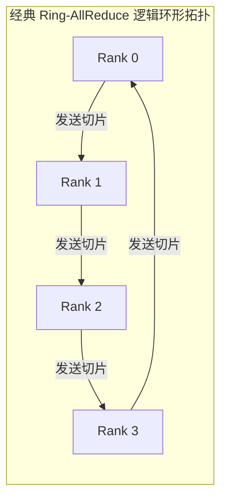
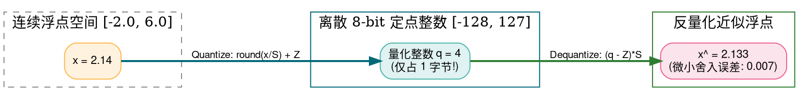
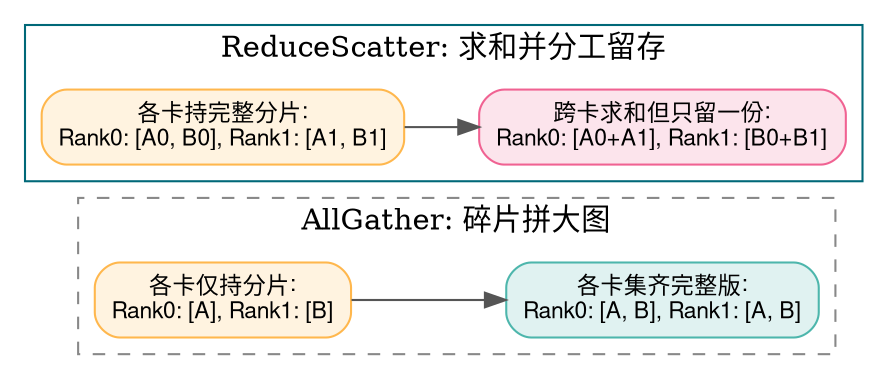
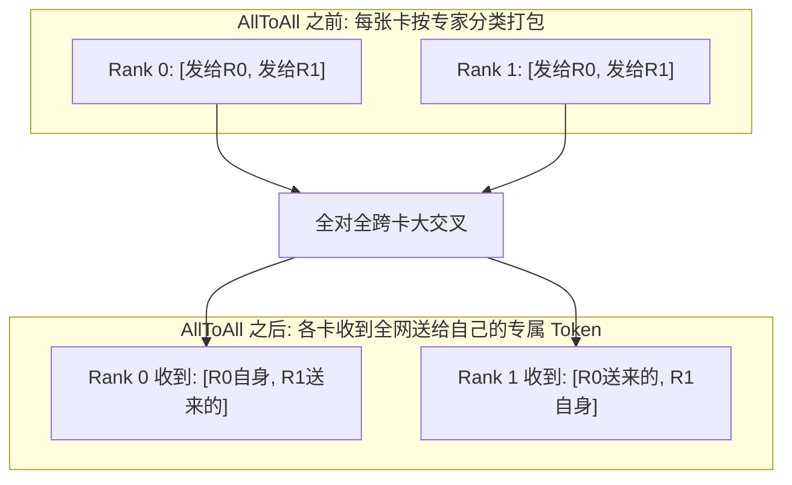

> **导读**：当模型从几千万参数爆炸至千亿、万亿参数时，单张 GPU 的显存容量（如 80GB）甚至连模型的权重参数都无法装下，更遑论庞大的训练梯度与激活值；同时，大模型在端侧设备（手机、笔记本、嵌入式 NPU）上的实时交互部署，也对显存占用与访存带宽提出了极为苛刻的要求。
>
> 现代 AI 基础设施在底层依靠两座不可或缺的工程基石支撑起这场计算革命：
> 1. **低比特量化（Quantization）**：将高精度浮点（FP32/FP16）通过仿射标定压缩至整型（INT8/INT4），显存瞬间暴砍 50%~75%，访存带宽压力成倍释放；
> 2. **集合通信（Collective Communication）**：在由成千上万张加速卡（H100/Ascend）组成的超级集群中，通过 **AllReduce、AllGather、ReduceScatter、AllToAll** 等高效通信原语，让跨节点数据在纳秒级网络中如血液般高速循环流通。
>
> 本篇作为《深度学习底层算子从零到一》系列的终结篇，将带你从第一性原理彻底吃透这 5 个底层系统工程算子。

---

## 零、初学者核心概念速查：Scale、零点、集合通信与环形拓扑

> [!NOTE] 核心概念形象字典
>
> - **量化（Quantization）与反量化（Dequantization）**：
>   - 量化：将连续的高精度浮点数（如 3.14159）映射并舍入为低比特离散整数（如 8-bit 的 -128~127）；
>   - 反量化：在需要高精度计算时，通过缩放因子将低比特整数乘回浮点数近似值。
> - **缩放因子（Scale, $S$）与零点（Zero-Point, $Z$）**：
>   - Scale 是浮点数与整数之间的“刻度尺比例”；
>   - Zero-Point 是浮点数 `0.0` 在量化整数空间所对应的整数编号（偏移量）。
> - **对称量化（Symmetric） vs 非对称量化（Asymmetric）**：
>   - 对称量化强制浮点 0 严格映射为整数 0（$Z=0$），硬件计算电路极其简洁高效；
>   - 非对称量化允许浮点 0 映射为任意非零整数（$Z \ne 0$），对单侧偏态分布（如 ReLU 后的全正数）利用率更高。
> - **集合通信（Collective Communication）**：在并行计算中，涉及通信域（Communicator）内**所有参与节点（All Ranks）协同一致参与的通信操作**，远比两两单独点对点（P2P）发送效率高得多。
> - **环形拓扑（Ring Topology）**：将多张 GPU 在逻辑上连接成一个首尾相连的单向或双向环（GPU 0 $\to$ GPU 1 $\to$ GPU 2 $\to \dots \to$ GPU 0），各卡只与相邻邻居通信，彻底化解网络主交换机中央拥堵。



---

## 1. Quantize 与 Dequantize (量化与反量化)

### 1.1 原理解析：浮点数到定点数的仿射映射
- **非对称量化前向公式（Uniform Affine Quantization）**：
  设浮点输入区间为 $[x_{\min}, x_{\max}]$，目标量化整数区间为 $[q_{\min}, q_{\max}]$（以 INT8 为例，通常为 $[-128, 127]$ 或 $[0, 255]$）：
  1. 计算缩放尺度 Scale：
     $$ S = \frac{x_{\max} - x_{\min}}{q_{\max} - q_{\min}} $$
  2. 计算零点 Zero-Point：
     $$ Z = \text{round}\left( -\frac{x_{\min}}{S} \right) + q_{\min} $$
  3. 量化（Quantize）与截断饱和（Clamp）：
     $$ q = \text{clamp}\left( \text{round}\left( \frac{x}{S} \right) + Z, \ q_{\min}, \ q_{\max} \right) $$
- **反量化（Dequantize）恢复近似浮点**：
  $$ \hat{x} = (q - Z) \times S $$
  由于舍入操作（$\text{round}$），$\hat{x}$ 与原始 $x$ 之间存在不可逆的微小**量化误差（Quantization Error）**。



### 1.2 原生 Python 实现
```python
def naive_quantize_dequantize_int8(data: list[float]) -> tuple[list[int], list[float], float, int]:
    """非对称 INT8 量化与反量化"""
    x_min = min(data)
    x_max = max(data)
    q_min = -128
    q_max = 127
    
    # 1. 计算 Scale 与 Zero-Point
    scale = (x_max - x_min) / (q_max - q_min) if x_max != x_min else 1.0
    zero_point = round(-x_min / scale) + q_min
    zero_point = max(q_min, min(q_max, zero_point))
    
    # 2. 量化
    quantized = []
    for x in data:
        q = round(x / scale) + zero_point
        q_clamped = max(q_min, min(q_max, q))
        quantized.append(q_clamped)
        
    # 3. 反量化恢复
    dequantized = [(q - zero_point) * scale for q in quantized]
    
    return quantized, dequantized, scale, zero_point

if __name__ == "__main__":
    floats = [-5.2, -1.0, 0.0, 3.4, 7.8]
    q_ints, recovered, s, z = naive_quantize_dequantize_int8(floats)
    print(f"Scale: {s:.4f}, Zero-Point: {z}")
    print("量化后的 INT8 数据: ", q_ints)
    print("反量化恢复的数据:   ", [round(v, 4) for v in recovered])
```

### 1.3 原生 C++ 实现
```cpp
#include <iostream>
#include <cmath>
#include <algorithm>
#include <iomanip>

int main() {
    const float raw[] = {-5.2f, -1.0f, 0.0f, 3.4f, 7.8f};
    constexpr int N = 5;
    constexpr int q_min = -128;
    constexpr int q_max = 127;

    float x_min = raw[0], x_max = raw[0];
    for (int i = 1; i < N; ++i) {
        if (raw[i] < x_min) x_min = raw[i];
        if (raw[i] > x_max) x_max = raw[i];
    }

    float scale = (x_max - x_min) / (q_max - q_min);
    int zero_point = std::round(-x_min / scale) + q_min;
    zero_point = std::max(q_min, std::min(q_max, zero_point));

    int8_t quantized[N];
    float dequantized[N];

    std::cout << "=== 原生 C++ INT8 量化与反量化 ===" << std::endl;
    for (int i = 0; i < N; ++i) {
        int q = std::round(raw[i] / scale) + zero_point;
        quantized[i] = static_cast<int8_t>(std::max(q_min, std::min(q_max, q)));
        dequantized[i] = (quantized[i] - zero_point) * scale;
        
        std::cout << "原值 " << std::fixed << std::setprecision(1) << raw[i] 
                  << " -> INT8: " << static_cast<int>(quantized[i]) 
                  << " -> 恢复: " << std::setprecision(4) << dequantized[i] << std::endl;
    }
    return 0;
}
```

---

## 2. AllReduce (全局归约累加)

### 2.1 原理解析：Ring-AllReduce 环形接力两阶段
- **定义**：设有 $N$ 个参与卡，每张卡持有一个相同形状的数据向量。AllReduce 要求通信结束后，**所有节点都获得所有卡局部数据的求和（或平均）**：
  $$ \text{Out}_i = \sum_{r=0}^{N-1} \text{In}_r \quad (\forall i \in [0, N-1]) $$
- **百度与 NCCL 的破局之作：Ring-AllReduce**：
  如果让所有卡都把数据发给 0 号卡汇总再广播，0 号卡网卡带宽会彻底瘫痪。Ring 算法将数据均分为 $N$ 块（Chunks），分为两个阶段：
  1. **阶段 1：Reduce-Scatter（归约发散）**：
     各卡将自己的第 $k$ 块数据发送给顺时针邻居，邻居与自己的对应块做累加，再传给下下家。经过 $(N - 1)$ 次传送，**每张卡都各自持有一块集齐了所有卡求和结果的完整归约分片**！
  2. **阶段 2：All-Gather（全收集广播）**：
     各卡将自己刚刚算好的那份完整分片发送给邻居顺时针接力接龙。再经过 $(N - 1)$ 次传送，**所有卡都集齐了所有分片，拼装出最终完整的全局结果！**
- **通信带宽恒定神话**：
  每张卡在整个过程中发送的总数据量恒为：
  $$ 2 \times \left( \frac{N - 1}{N} \right) \times M \text{ 字节} \approx 2M \text{ 字节} $$
  **总传输耗时与集群机器数量 $N$ 几乎完全无关！这使得成千上万张卡的大规模并行成为可能！**

---

## 3. AllGather (全收集) 与 4. ReduceScatter (归约发散)

### 3.1 原理解析：对偶的一体两面
- **AllGather（局部拼接为全局）**：
  每张卡原本只有总数据的 $\frac{1}{N}$ 分片（长度为 $M$）。通信结束后，所有卡都获得了包含全部 $N$ 个分片的完整大张量（长度为 $N \times M$）。
  - **大模型应用**：ZeRO-3 显存优化中，平时各卡只存 $\frac{1}{N}$ 的模型权重；在前向计算该层时，瞬间调用 AllGather 将完整权重收集齐，算完立刻销毁，极大释放显存！
- **ReduceScatter（全局归约并切片留存）**：
  每张卡都持有长度为 $N \times M$ 的大张量。通信中跨卡求和，但最终每张卡只保留属于自己负责的那 $\frac{1}{N}$ 局部归约切片。
  - **大模型应用**：数据并行反向传播结束后，各卡将巨大的梯度做 ReduceScatter，各自只更新属于自己的那部分优化器状态（ZeRO-1/2 的灵魂）。



---

## 5. AllToAll (全对全个性化交换)

### 5.1 原理解析：MoE 分布式路由的骨架
- **定义**：每个节点都为其他每个节点量身准备了一份**专属的数据块**。节点 $i$ 发送给节点 $j$ 的数据是专门定制的。
  $$ \text{Rank } j \text{ 接收来自 Rank } i \text{ 的第 } j \text{ 号数据块} $$
- **本质等价**：相当于跨越集群物理网络进行一次**巨型多维矩阵转置（Matrix Transpose）**！
- **混合专家（MoE）的命脉**：
  当专家分布在不同的节点机卡上（Expert Parallelism）时：
  1. Rank 0 上的 Token 可能要送给 Rank 3 的专家；
  2. Rank 3 上的 Token 可能要送给 Rank 0 的专家；
  所有卡必须同时调用 **AllToAll 通信**，如同立交桥一样瞬间将不同专家的 Token 在卡间完成大置换！



### 5.2 原生 Python 实现 (模拟 2 节点集合通信全套逻辑)
```python
def naive_simulate_collective_communication():
    """纯 Python 模拟 Rank 0 与 Rank 1 的集合通信行为"""
    # 模拟输入: Rank 0 与 Rank 1 各持有 2 个元素
    rank0_data = [1.0, 2.0]
    rank1_data = [10.0, 20.0]
    
    # 1. 模拟 AllReduce (跨卡逐元素求和，两卡均得全局和)
    allreduce_res = [r0 + r1 for r0, r1 in zip(rank0_data, rank1_data)]
    
    # 2. 模拟 AllGather (两卡各提供 1 个元素，拼装出长度为 2 的完整数组)
    allgather_r0_input = [100.0]
    allgather_r1_input = [200.0]
    allgather_res = allgather_r0_input + allgather_r1_input
    
    # 3. 模拟 AllToAll (Rank 0 准备给 [R0, R1] 分别送 [A, B]; Rank 1 准备送 [C, D])
    # 交换后: Rank 0 收到 [A, C]; Rank 1 收到 [B, D]
    r0_to_all = ["Token_from_R0_to_R0", "Token_from_R0_to_R1"]
    r1_to_all = ["Token_from_R1_to_R0", "Token_from_R1_to_R1"]
    
    r0_received = [r0_to_all[0], r1_to_all[0]]
    r1_received = [r0_to_all[1], r1_to_all[1]]
    
    return allreduce_res, allgather_res, r0_received, r1_received

if __name__ == "__main__":
    red, gather, a2a_0, a2a_1 = naive_simulate_collective_communication()
    print("AllReduce 跨节点求和输出:", red)
    print("AllGather 碎片全收集拼装:", gather)
    print("AllToAll Rank 0 接收包:", a2a_0)
    print("AllToAll Rank 1 接收包:", a2a_1)
```

### 5.3 原生 C++ 实现
```cpp
#include <iostream>
#include <vector>

int main() {
    // 模拟 2 个 Rank 的 AllReduce 规整
    float rank0_buf[2] = {1.0f, 2.0f};
    float rank1_buf[2] = {10.0f, 20.0f};

    float allreduce_out[2];
    for (int i = 0; i < 2; ++i) {
        allreduce_out[i] = rank0_buf[i] + rank1_buf[i];
    }

    std::cout << "=== 原生 C++ 模拟分布式 AllReduce ===" << std::endl;
    std::cout << "所有 Rank 最终同步获得的全局结果: [" 
              << allreduce_out[0] << ", " << allreduce_out[1] << "]" << std::endl;
    return 0;
}
```

---

## 全系列大总结：算子全景知识图谱

至此，《深度学习底层算子从零到一》十二讲全集圆满收官！我们从最底层的**物理一维线性内存**一路攀登，跨越了：
1. **张量与内存**（步长 Stride、连续性 Contiguous、广播机制）；
2. **算力核心**（GEMM、GEMV、访存受限与 Safe-Softmax）；
3. **非线性来源**（ReLU、GELU、SiLU、SwiGLU）；
4. **稳定航标**（LayerNorm、大模型标配 RMSNorm）；
5. **空间坐标**（正余弦 PE、RoPE 复数旋转、ALiBi 外推）；
6. **大模型灵魂**（SDPA、MQA/GQA、FlashAttention、PagedAttention、MLA）；
7. **稀疏世界**（TopK、MoE 路由与 Token Permute）；
8. **空间感知**（二维卷积、轻量化 Depthwise、转置反卷积、池化）；
9. **时序序列**（LSTM 细胞高速公路、GRU 门控插值）；
10. **动力收敛**（交叉熵 LogSumExp、KL 散度、解耦 AdamW）；
11. **灵动表达**（贪心、温度缩放、Top-P 核采样）；
12. **工程终章**（INT8/INT4 仿射量化与 Ring-AllReduce / AllToAll 分布式集群通信）。

掌握了这 58 个经典算子的数学本质、硬件瓶颈与代码实现，你就真正拥有了穿透一切前沿大模型与深度学习架构的**底层硬核透视眼**！
