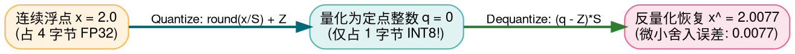
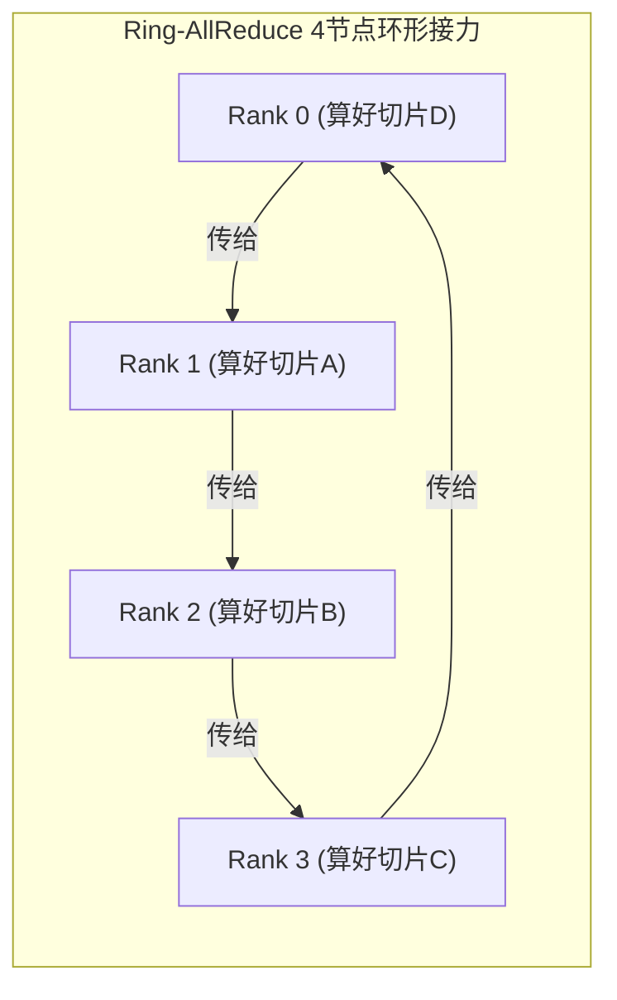
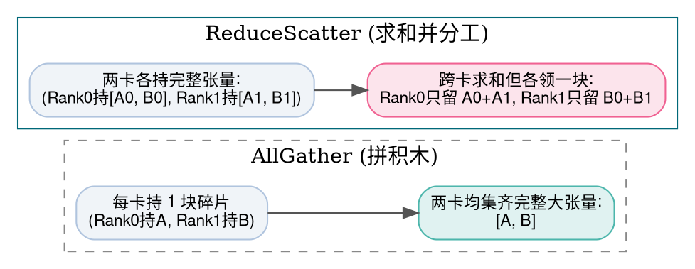

> **致初学者**：当你把一个训练好的 70B（700 亿参数）大模型下载到本地电脑时，你会发现一个残酷的现实：
> - 如果使用单精度浮点（FP32，每个数字占 4 字节），模型权重高达 **$700 \times 10^8 \times 4 \approx 280\text{ GB}$**！你至少需要 4 张顶级 80GB 的 A100/H100 显卡才能把它塞进显存！
> - 但如果把它**量化为 4-bit 整数（INT4，每个数字只占半个字节）**，模型大小瞬间暴跌到 **35 GB**，甚至在一台稍微好一点的苹果笔记本或家用游戏显卡（RTX 4090）上就能流畅飞奔！
>
> 另一方面，当我们要训练一个万亿参数的超级基座大模型时，单张甚至单台机器根本装不下，必须将上万张 GPU 用高速光纤网络连接成一个庞大的集群。
> 怎么让上万张显卡在纳秒级网络中步调一致地同步数据，而不发生中央网络大堵车？
>
> 这就是底层系统的两大支柱——**低比特量化（Quantization）与分布式集合通信（Collective Communication）**！
>
> 本篇作为《深度学习底层算子从零到一》系列的压轴终结篇，将用**皮尺刻度与操场接力赛跑的生动比喻**，带你从底层手算彻底攻克这 5 大系统级核心算子！

---

## 零、初学者必懂概念：低比特压缩与集合通信

> [!NOTE] 核心概念形象字典
>
> - **量化（Quantization）**：把连续、精细的高精度浮点数（如 3.1415926），映射到有限、粗糙的低比特离散整数（如 -128 到 127）。好比把一张千万像素的高清照片缩略成表情包，虽然丢失了一点画质细节，但文件体积缩小了 75%！
> - **集合通信（Collective Communication）**：如果 8 张 GPU 彼此两两单独打电话（点对点 P2P），整个网络需要打 $8 \times 7 = 56$ 通电话，中央交换机瞬间瘫痪。集合通信定义了一套“集体做体操”的标准广播归约指令，所有 GPU 步调高度协同一致。
> - **通信域（Communicator / World）**：参与本次集体通信的所有 GPU 卡的总集合，每张卡拥有一个独一无二的编号（Rank 0, Rank 1, ...）。
> - **环形拓扑（Ring Topology）**：把所有的 GPU 在逻辑上围成一个首尾相接的大圆圈。每张卡只跟自己的左右邻居通信，彻底消灭中央拥堵！

---

## 1. Quantize 与 Dequantize (量化与反量化：皮尺刻度的艺术)

### 1.1 手把手极小数字推演
假设有一组浮点数：$[-2.0, 0.0, 2.0, 6.0]$。
浮点总跨度为：从最小值 $x_{\min} = -2.0$ 到最大值 $x_{\max} = 6.0$，跨度为 $8.0$。
现在我们要把它压缩进 **8-bit 整数（范围为 $[-128, 127]$，共 255 个有效刻度）**。

1. **算缩放尺度 Scale（每一格代表多宽）**：
   $$ S = \frac{x_{\max} - x_{\min}}{q_{\max} - q_{\min}} = \frac{6.0 - (-2.0)}{127 - (-128)} = \frac{8.0}{255} \approx \mathbf{0.03137} $$
2. **算零点 Zero-Point（浮点 0.0 对应的整数编号）**：
   $$ Z = \text{round}\left( -\frac{-2.0}{0.03137} \right) + (-128) = \text{round}(63.75) - 128 = 64 - 128 = \mathbf{-64} $$
3. **把数字 $x = 2.0$ 量化为整数（Quantize）**：
   $$ q = \text{round}\left( \frac{2.0}{0.03137} \right) + (-64) = \text{round}(63.75) - 64 = 64 - 64 = \mathbf{0} $$
   浮点数 $2.0$ 变成了整数 $0$！在内存里只占 1 个字节！
4. **计算时反量化恢复回浮点（Dequantize）**：
   $$ \hat{x} = (q - Z) \times S = (0 - (-64)) \times 0.03137 = 64 \times 0.03137 = \mathbf{2.00768} $$
   **对比**：恢复出来的 $2.00768$ 和原始的 $2.0$ 仅相差 $0.00768$！这就是量化的微小舍入误差，对大模型神经网络来说几乎无伤大雅，却换来了 4 倍的显存暴减！



---

## 2. AllReduce (全局归约：操场接力接龙的奇迹)

### 2.1 为什么中央汇总会瘫痪？
假设有 4 张 GPU（Rank 0, 1, 2, 3），每张卡各自算出了自己这批数据的梯度向量。
现在需要让**所有卡都拿到这 4 份梯度的求和结果（$g_0 + g_1 + g_2 + g_3$）**。
- **愚蠢的中央集权做法**：
  让 Rank 1, 2, 3 把数据全部发给 Rank 0 汇总，Rank 0 算完再发回给它们。
  Rank 0 的网卡带宽瞬间被 3 倍流量撑爆，其余卡都在闲置干等！

### 2.2 百度与 NCCL 的破局之作：Ring-AllReduce 环形接力赛
把 4 张 GPU 连成一个逻辑圆环：$0 \to 1 \to 2 \to 3 \to 0$。
把总数据切成 4 块切片（A, B, C, D）：
1. **阶段一：Reduce-Scatter（归约发散接龙）**：
   - 第 1 步：0 传切片 A 给 1，1 把自己的切片 A 累加上去；同时 1 传切片 B 给 2……
   - 经过 3 轮接力传送，**每张卡都各自持有一块集齐了所有卡总和的完整归约切片**（比如 1 号卡集齐了全局的切片 A，2 号卡集齐了全局的切片 B……）！
2. **阶段二：All-Gather（全收集接龙）**：
   - 各卡把手上集齐的那份完整切片，顺着圆环传给下家广播分享；
   - 再经过 3 轮传送，**所有卡都收齐了 A, B, C, D 全部 4 个完整切片！**

> [!TIP] 震撼的物理结论
> 在这个过程中，每张卡发送的数据量永远恒定在：
> $$ 2 \times \frac{N - 1}{N} \times \text{Size} \approx 2 \times \text{Size} $$
> **不管你的集群有 4 张卡、64 张卡还是 10000 张卡，每张卡耗费的通信时间和网络流量几乎恒定不变！这才是万卡集群能够并联训练的工程基石！**



---

## 3. AllGather 与 ReduceScatter (拼图与分工的对偶一体)

- **AllGather（碎片拼大图）**：
  每张卡手里只有 $\frac{1}{N}$ 的碎片。大家在环里跑一圈分享，通信结束时，**所有卡都拼出了一整张包含所有人碎片的完整大拼图**！
  - **大模型实战**：ZeRO-3 显存优化中，平时各卡只存 $\frac{1}{N}$ 的模型权重；要算这一层的前向时，瞬间调用 AllGather 把完整权重拼齐，算完当场销毁，显存极度轻巧！
- **ReduceScatter（算完分工留存）**：
  每张卡手里都拿着一份完整的大数据。大家跨卡相加求和，但求完和之后，**每张卡只领走并保留属于自己负责的那 $\frac{1}{N}$ 局部切片**，其余丢掉！
  - **大模型实战**：数据并行反向传播算完梯度后，调用 ReduceScatter，各卡只留存属于自己的那部分梯度去更新优化器。



---

## 4. AllToAll (全对全个性化交换：MoE 跨卡调度的命脉)

### 4.1 为什么 MoE 必须依赖 AllToAll？
我们在第七讲学过：混合专家（MoE）把专家打散分派在不同的 GPU 卡上。
假设集群有 2 张卡：
- Rank 0 上的一句话，包含了 2 个 Token：Token 0 要去找 **Rank 0 上的专家**；Token 1 要去找 **Rank 1 上的专家**！
- 同时，Rank 1 上的一句话，Token 2 要去找 **Rank 0 上的专家**；Token 3 要去找 **Rank 1 上的专家**！
此时，每张卡都必须给对方精准送去属于对方的包裹，并接收对方精准送给自己的包裹！
**这就是 AllToAll：全网多卡之间的专属大交叉置换（分布式矩阵大转置）！**

### 4.2 原生 Python 逐行注释模拟集合通信
```python
def naive_simulate_all_to_all():
    """纯 Python 模拟 2 个 Rank 的 AllToAll 个性化数据大交叉"""
    # Rank 0 准备发送的包裹: 索引 0 送给自己，索引 1 送给 Rank 1
    rank0_send_buffer = ["TokA(留给R0)", "TokB(专送给R1)"]
    
    # Rank 1 准备发送的包裹: 索引 0 送给 Rank 0，索引 1 送给自己
    rank1_send_buffer = ["TokC(专送给R0)", "TokD(留给R1)"]

    # 跨卡 AllToAll 立交桥大置换
    rank0_received = [rank0_send_buffer[0], rank1_send_buffer[0]]
    rank1_received = [rank0_send_buffer[1], rank1_send_buffer[1]]

    return rank0_received, rank1_received

if __name__ == "__main__":
    r0_box, r1_box = naive_simulate_all_to_all()
    print("AllToAll 跨卡交换完成！")
    print("  Rank 0 最终收到的专属包裹:", r0_box)
    print("  Rank 1 最终收到的专属包裹:", r1_box)
```

---

## 全书大圆满：58 算子知识图谱终极回响

至此，《深度学习底层算子从零到一》十二讲全景教程全篇收官！
从第一行代码中的一维连续内存、步长跳跃，到中间的 GEMM 矩阵乘法、注意力 QKV、FlashAttention 片上分块、MoE 动态路由，再到最后的低比特 INT4 量化与 Ring-AllReduce 跨卡通信：
**当那些曾经高深莫测的名词被剥离掉神秘的外衣，展现在你眼前的，不过是一套优美、严谨、充满巧思与工程智慧的初等数学与计算机体系结构积木！**
掌握了这 58 个底层算子，你就拥有了真正穿透整个大模型时代技术迷雾的**终极底层硬核洞察力**！
