> **写在前面**：
> 在大模型（LLM）与深度学习工程中，框架（PyTorch、JAX、TensorFlow）封装了所有底层计算细节，我们往往只需要一行 `y = model(x)` 就能完成亿万次浮点运算。
>
> 然而，当模型训练发生显存爆炸（OOM）、推理遭遇速度瓶颈、或出现神秘的数值溢出（NaN）时，浮于高层 API 的开发者往往手足无措。
> 计算机硬件（CPU / GPU / TPU）的物理世界里**根本不存在“多维立方体张量”**，内存永远只是一根从 0 开始连续编号的一维线性电线。
>
> 所谓的矩阵乘法、注意力机制、RoPE 旋转、门控路由，本质上都是编译器和计算单元在这根一维电线上执行的**指针跳跃（步长 Stride）、搬运（Memory Reorder）与算术累加**！
>
> 本篇指南作为**《深度学习底层算子从零到一》十二讲的完整合集**，将 58 个工业级核心算子融汇贯通。每个算子均遵循：
> **「生活直观比喻 ➜ 极小数字手算 ➜ 数据流拓扑图 ➜ 原生 Python 源码 ➜ 原生 C++ 源码 ➜ 物理避坑指北」**的完整路径，所有代码均零依赖第三方库，且支持在当前博客浏览器内**一键即时运行**！

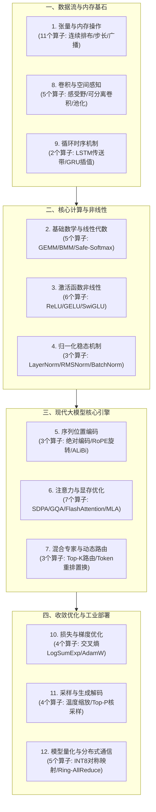

---
## 模块一：张量与内存操作（数据流基础：物理排布、步长寻址与广播机制）

> **致初学者**：当你刚开始学习 PyTorch、TensorFlow 或 CUDA 编程时，经常会遇到各种让人抓狂的报错：
> - `RuntimeError: view size is not compatible with input tensor's size and stride (at least one dimension spans across two contiguous subspaces). Use .reshape(...) instead.`
> - `ValueError: operands could not be broadcast together with shapes (2, 3) (3, 2)`
> - `IndexError: index out of range in gather`
>
> 许多教材一上来就堆砌高维数学符号 $\mathcal{T} \in \mathbb{R}^{B \times S \times D}$，把人看晕了。但请相信：**计算机硬件里根本不存在“多维立方体”，物理内存永远只是一根从 0 开始连续编号的一维电线（线性地址数组）！**
>
> 所谓的“二维矩阵”、“三维张量”，纯粹是程序员和编译器根据**形状（Shape）**与**步长（Stride）**在头脑中计算出来的“地址跳跃幻觉”。
>
> 本篇作为《深度学习底层算子从零到一》系列的第一讲，将彻底打破晦涩术语，用**最通俗的生活比喻、拿具体的数字一步步算一遍、配合流程图与避坑指南**，带你从底层物理内存开始，把 11 个经典张量操作彻底学会！

---

### 1.0 先导概念：必须先吃透的“底层三剑客”：内存、行优先与步长

在开始看具体算子之前，我们先花 3 分钟把最底层的“游戏规则”搞清楚。搞懂了这三个概念，后面的 11 个算子你就会发现它们不过是在这三个概念上玩“数字跳格子”游戏。

#### 1. 物理内存：一排整齐的储物柜
把计算机的物理内存想象成**火车站的一排整齐的储物柜**：
- 储物柜只有一整排（一维），编号从 `0, 1, 2, 3, 4, 5...` 一直向后延伸。
- 每个柜子只能存 1 个数字（比如一个 32 位的浮点数 `float32`，占 4 字节）。
- **不管你在 Python 里写的是几维张量，最终在硬件里都必须排成这一队一维的储物柜！**

#### 2. 行优先（Row-Major）：怎么把一张表格塞进一排储物柜？
假设你有一张 2 行 3 列的表格：
$$
\begin{pmatrix} 10 & 20 & 30 \\ 40 & 50 & 60 \end{pmatrix}
$$
计算机怎么把这两行放进一维储物柜？
- **行优先（Row-Major，C/C++ 与 Python 默认）**：先把第 0 行从左到右放完，紧接着放第 1 行。
  储物柜排列为：`[10, 20, 30,  40, 50, 60]`。
  最右边的列索引变化最频繁（连续挨着），最左边的行索引变化最慢。
- **列优先（Col-Major，Fortran/MATLAB 默认）**：先把第 0 列从上到下放完，再放第 1 列。
  储物柜排列为：`[10, 40,  20, 50,  30, 60]`。

#### 3. 步长（Stride）：大脑里的“跳格子口诀”
当你想在表格里找第 `row` 行、第 `col` 列的元素时，CPU 在底层储物柜里要往后数几个柜子？
- 如果你在同一行往右移 1 格（`col + 1`），储物柜地址只加 1。所以**列步长（Stride_col）= 1**。
- 如果你想换到下一行（`row + 1`），你必须把当前整整一行的 3 个数字全跨过去！所以**行步长（Stride_row）= 3**。

**通用地址换算公式**：
$$ \text{物理储物柜索引} = \text{row} \times \text{Stride}_{\text{row}} + \text{col} \times \text{Stride}_{\text{col}} = \text{row} \times 3 + \text{col} \times 1 $$

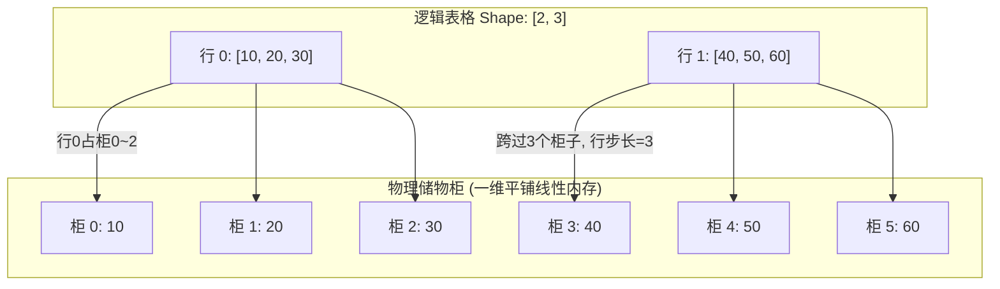

> [!TIP] 动手验算一次
> 想找表格里的第 1 行、第 2 列（即数值 `60`）：
> - $\text{row} = 1, \text{col} = 2$；
> - $\text{物理柜号} = 1 \times 3 + 2 \times 1 = 5$；
> - 去找柜号 5，正是数值 `60`！数学和物理完美闭环。

---

### 1.1 Embedding (词嵌入查表)

#### 1.1 生活比喻与痛点剖析
- **为什么需要它？**
  计算机只能对数字进行加减乘除，根本读不懂汉字“猫”或者英文“dog”。为了让模型理解文本，分词器（Tokenizer）会先给每个单词发一张“身份证编号”（例如“我”=0，“爱”=1，“AI”=2）。
  但是，数字编号 0、1、2 本身没有任何语义——难道“AI(2)”的含义是“爱(1)”的两倍吗？显然不是！
- **通俗比喻**：
  **Embedding 就像一本《新华字典》**：
  - 字典总共有 $V$ 页（词表大小 Vocabulary Size，比如 50000 个词）；
  - 每一页印着一段对这个词详尽的多维度特征描述（隐藏特征向量 Hidden Dimension $D$，比如 768 或 4096 个浮点数，代表这个词的情感、类别、属性等）；
  - 输入 Token ID 为 `1` 时，Embedding 算子做的事情极度纯粹：**直接翻到第 1 页，把整页上的那排浮点数原封不动撕下来交给你！**

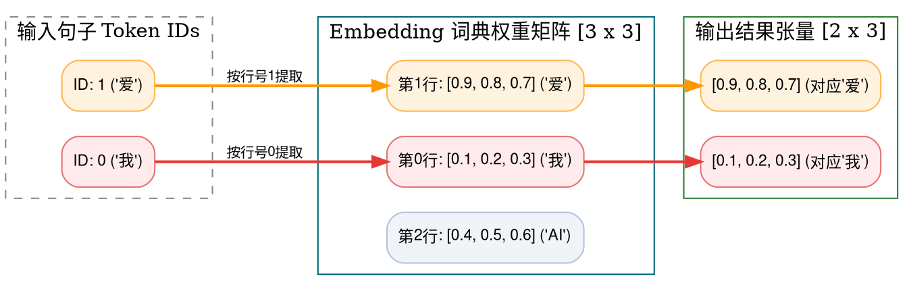

#### 1.2 手把手极小数字推演
假设词表大小 $V=3$，特征维度 $D=3$，字典内容如下：
- 行 0: `[0.1, 0.2, 0.3]`
- 行 1: `[0.9, 0.8, 0.7]`
- 行 2: `[0.4, 0.5, 0.6]`

现在输入输入序列为 `[1, 0]`（代表“爱，我”）：
- 第 1 个词是 ID `1`：直接抄写行 1 $\to$ `[0.9, 0.8, 0.7]`；
- 第 2 个词是 ID `0`：直接抄写行 0 $\to$ `[0.1, 0.2, 0.3]`；
- 最终拼成输出形状为 $[2, 3]$ 的矩阵：`[[0.9, 0.8, 0.7], [0.1, 0.2, 0.3]]`。

> [!NOTE] 为什么说 Embedding 是特殊的矩阵乘法？
> 在数学上，查第 1 行等价于用一个 One-Hot 独热向量 `[0, 1, 0]` 乘以整个权重矩阵。但**工程上绝不能这么做**！如果词表有 10 万个词，做矩阵乘法意味着要跟 99999 个 0 做无用的乘加，算力浪费 10 万倍。所以底层**必须直接做纯粹的指针内存查表**！

#### 1.3 原生 Python 逐行注释实现
```python
def naive_embedding(token_ids: list[int], weight_table: list[list[float]]) -> list[list[float]]:
    """纯 Python 原生 Embedding 查表算子
    :param token_ids: 输入的整数 Token 编号列表，如 [1, 0]
    :param weight_table: 形状为 [V, D] 的词表权重矩阵
    :return: 提取出的特征张量，形状为 [len(token_ids), D]
    """
    vocab_size = len(weight_table)       # 词表总行数 V
    hidden_dim = len(weight_table[0])    # 隐藏特征维度 D
    output = []

    for step, token_id in enumerate(token_ids):
        # 边界安全检查：防止传入负数或超过词表总大小的非法 ID 导致越界崩溃
        if token_id < 0 or token_id >= vocab_size:
            raise IndexError(f"Token ID {token_id} 越界！有效范围是 [0, {vocab_size - 1}]")
        
        # 核心操作：直接拷贝对应行（切片拷贝，避免外部修改污染内部权重）
        row_vector = weight_table[token_id].copy()
        output.append(row_vector)

    return output

if __name__ == "__main__":
    # 定义一本小字典 (3个词，每个词3个特征)
    vocab = [
        [0.1, 0.2, 0.3], # ID 0: "我"
        [0.9, 0.8, 0.7], # ID 1: "爱"
        [0.4, 0.5, 0.6]  # ID 2: "AI"
    ]
    query_tokens = [1, 2, 0] # 查询 "爱 AI 我"
    result = naive_embedding(query_tokens, vocab)
    print("Embedding 查表结果:")
    for tid, vec in zip(query_tokens, result):
        print(f"  Token {tid} -> {vec}")
```

#### 1.4 原生 C++ 逐行注释实现
```cpp
#include <iostream>
#include <vector>
#include <iomanip>

int main() {
    // 词表大小 V=3, 向量维度 D=3
    constexpr int V = 3;
    constexpr int D = 3;
    const float weight_table[V][D] = {
        {0.1f, 0.2f, 0.3f}, // 词 0
        {0.9f, 0.8f, 0.7f}, // 词 1
        {0.4f, 0.5f, 0.6f}  // 词 2
    };

    const int input_ids[] = {1, 2, 0};
    constexpr int N = 3; // 查询 3 个词
    float output[N][D];

    // 底层物理内存寻址：直接按行首地址偏移拷贝
    for (int i = 0; i < N; ++i) {
        int id = input_ids[i];
        for (int d = 0; d < D; ++d) {
            output[i][d] = weight_table[id][d];
        }
    }

    std::cout << "=== 原生 C++ Embedding 查表验证 ===" << std::endl;
    for (int i = 0; i < N; ++i) {
        std::cout << "Token ID " << input_ids[i] << " 向量: [";
        for (int d = 0; d < D; ++d) {
            std::cout << std::fixed << std::setprecision(1) << output[i][d] << (d + 1 < D ? ", " : "");
        }
        std::cout << "]" << std::endl;
    }
    return 0;
}
```

---

### 1.2 Reshape / View (视图变换与零拷贝)

#### 2.1 生活比喻与痛点剖析
- **为什么需要它？**
  你经常需要把输入数据换个视角看。比如把 6 张并排的单寸照片，重新摆成 2 行 3 列的相册；或者在全连接层前，把图像展平成一维长条。
- **通俗比喻**：
  **View 就像换一副有色眼镜看同一排储物柜**：
  柜子里的 6 个苹果（物理内存）**动都没动过一下**！你只是换了个记账本，刚才在记账本上写“一排 6 个”，现在在记账本上写“两排，每排 3 个”。
  因为**数据零搬移（Zero-Copy）**，耗时仅几纳秒，效率极高！
- **初学者最大疑惑：什么时候会报错？**
  如果张量之前做过转置（Transpose），储物柜里的物理顺序已经被搞乱了，不再满足规整的“行步长”规则，这时候直接用 `view()` 就会报错崩溃！必须先调用 `.contiguous()` 真正花时间在内存里重新搬运排好，才能继续变换。

#### 2.2 手把手极小数字推演
现有 6 个数字连续存在物理内存中：
`储物柜: [10, 20, 30, 40, 50, 60]`
- 原形状：$[6]$，步长为 $[1]$。
- **重塑为 $[2, 3]$**：
  - 新形状有两个维度：第 0 维大小为 2，第 1 维大小为 3；
  - 检查元素总数：$2 \times 3 = 6$，总数相等，合法！
  - 计算新步长：列步长为 1，行步长为 3；
  - 逻辑效果：第 0 行取柜号 `0, 1, 2` $\to$ `[10, 20, 30]`；第 1 行取柜号 `3, 4, 5` $\to$ `[40, 50, 60]`。
- **重塑为 $[3, 2]$**：
  - 计算新步长：列步长为 1，行步长为 2；
  - 逻辑效果：行 0 取 `[10, 20]`，行 1 取 `[30, 40]`，行 2 取 `[50, 60]`。

#### 2.3 原生 Python 逐行注释实现
```python
def naive_reshape_1d_to_2d(flat_data: list[float], rows: int, cols: int) -> list[list[float]]:
    """将一维平铺数据虚拟重组为 [rows, cols] 的二维矩阵视图"""
    total = len(flat_data)
    
    # 自动推导维度支持：允许某一个维度传入 -1 (自动算出该维度尺寸)
    if rows == -1 and cols != -1:
        rows = total // cols
    elif cols == -1 and rows != -1:
        cols = total // rows
        
    # 容量严格一致性检验
    if rows * cols != total:
        raise ValueError(f"无法重塑！原数据总数 {total} 无法分成 {rows} 行 x {cols} 列 (乘积为 {rows*cols})")

    matrix = []
    for r in range(rows):
        # 按照步长切分：每一行跨越 cols 个元素
        start_idx = r * cols
        end_idx = start_idx + cols
        matrix.append(flat_data[start_idx:end_idx])
    return matrix

if __name__ == "__main__":
    memory_buf = [10.0, 20.0, 30.0, 40.0, 50.0, 60.0]
    m_2x3 = naive_reshape_1d_to_2d(memory_buf, 2, 3)
    print("Reshape 成 2x3:", m_2x3)
    m_3x2 = naive_reshape_1d_to_2d(memory_buf, 3, -1) # 自动推导列数为 2
    print("Reshape 自动推导为 3x2:", m_3x2)
```

#### 2.4 原生 C++ 逐行注释实现
```cpp
#include <iostream>

int main() {
    // 物理连续一维内存
    const float raw_mem[] = {10.0f, 20.0f, 30.0f, 40.0f, 50.0f, 60.0f};
    constexpr int rows = 3;
    constexpr int cols = 2;
    // 步长：行步长 = 列数 = 2，列步长 = 1
    constexpr int stride_row = cols;
    constexpr int stride_col = 1;

    std::cout << "=== 原生 C++ 步长寻址 Reshape (3x2) ===" << std::endl;
    for (int r = 0; r < rows; ++r) {
        std::cout << "Row " << r << ": [";
        for (int c = 0; c < cols; ++c) {
            // 用步长公式算出对应一维储物柜柜号
            int flat_idx = r * stride_row + c * stride_col;
            std::cout << raw_mem[flat_idx] << (c + 1 < cols ? ", " : "");
        }
        std::cout << "]" << std::endl;
    }
    return 0;
}
```

---

### 1.3 Transpose / Permute (维度交换与转置陷阱)

#### 3.1 生活比喻与“非连续陷阱”
- **生活比喻**：
  把一张横版印刷的报纸，旋转 90 度竖过来看。原来的一行变成了现在的一列。
- **初学者的直觉陷阱**：
  在数学上，$A^T[j, i] = A[i, j]$。但在物理计算机里，如果你只是把步长从 `(3, 1)` 改成 `(1, 3)`，那么逻辑上确实完成了转置。
  **但是灾难随之发生**：
  以前读取同行相邻元素，物理地址加 1（顺次读，CPU 缓存命中率 100%）；
  现在读取“新行”的相邻元素，物理地址每次要加上 3！CPU 必须在内存里疯狂大跳跃。
  因此，在很多高性能算子执行前，必须调用一次 **物理内存数据重排（Physical Reorder）**，真正把数据在内存里重新搬运整齐。

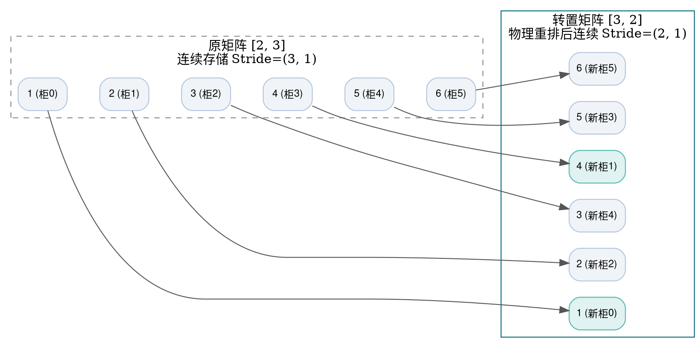

#### 3.2 手把手极小数字推演
原矩阵 $A$（2 行 3 列）：
$$
A = \begin{pmatrix} 1 & 2 & 3 \\ 4 & 5 & 6 \end{pmatrix}
$$
- 原坐标 $(0, 0)=1, (0, 1)=2, (0, 2)=3$
- 原坐标 $(1, 0)=4, (1, 1)=5, (1, 2)=6$

转置后矩阵 $T$ 形状变为 3 行 2 列：
- $T$ 的第 0 行取原第 0 列：$(0, 0)=1, (1, 0)=4 \implies [1, 4]$
- $T$ 的第 1 行取原第 1 列：$(0, 1)=2, (1, 1)=5 \implies [2, 5]$
- $T$ 的第 2 行取原第 2 列：$(0, 2)=3, (1, 2)=6 \implies [3, 6]$

最终转置矩阵：
$$
T = \begin{pmatrix} 1 & 4 \\ 2 & 5 \\ 3 & 6 \end{pmatrix}
$$

#### 3.3 原生 Python 逐行注释实现
```python
def naive_transpose_2d(matrix: list[list[float]]) -> list[list[float]]:
    """二维矩阵转置 (物理内存真正重排)"""
    old_rows = len(matrix)
    old_cols = len(matrix[0])
    
    # 新矩阵形状: [old_cols, old_rows]
    new_rows = old_cols
    new_cols = old_rows
    transposed = [[0.0] * new_cols for _ in range(new_rows)]
    
    # 嵌套循环：将原坐标 [r][c] 写入新坐标 [c][r]
    for r in range(old_rows):
        for c in range(old_cols):
            transposed[c][r] = matrix[r][c]
            
    return transposed

if __name__ == "__main__":
    mat = [
        [1.0, 2.0, 3.0],
        [4.0, 5.0, 6.0]
    ]
    t_mat = naive_transpose_2d(mat)
    print("转置后的 3x2 矩阵:")
    for row in t_mat:
        print(" ", row)
```

#### 3.4 原生 C++ 逐行注释实现
```cpp
#include <iostream>

int main() {
    constexpr int R = 2;
    constexpr int C = 3;
    const float A[R][C] = {
        {1.0f, 2.0f, 3.0f},
        {4.0f, 5.0f, 6.0f}
    };
    float T[C][R]; // 转置后为 3x2

    for (int r = 0; r < R; ++r) {
        for (int c = 0; c < C; ++c) {
            T[c][r] = A[r][c]; // 行列索引互换
        }
    }

    std::cout << "=== 原生 C++ 转置输出 (3x2) ===" << std::endl;
    for (int c = 0; c < C; ++c) {
        std::cout << "[";
        for (int r = 0; r < R; ++r) {
            std::cout << T[c][r] << (r + 1 < R ? ", " : "");
        }
        std::cout << "]" << std::endl;
    }
    return 0;
}
```

---

### 1.4 Concat (拼接) 与 5. Split / Chunk (切分)

#### 4.1 生活比喻与轴向认知
- **Concat（拼接）**：
  把两节火车车厢挂在一起。
  - `axis=0`（沿行垂直拼）：上下叠汉堡。两块汉堡皮的**宽度必须一模一样**！
  - `axis=1`（沿列水平拼）：左右拼长桌。两张桌子的**长度必须一模一样**！
- **Split / Chunk（切分）**：
  切西瓜。给你一个大西瓜，沿着某个轴一刀切成指定份额的小块。常用于多头注意力（MHA）中把巨大的 $QKV$ 混合矩阵一刀切成 3 个独立的 $Q$、$K$、$V$。

#### 4.2 手把手极小数字推演
设张量 $A$ 为 $2 \times 2$：
$$ A = \begin{pmatrix} 1 & 2 \\ 3 & 4 \end{pmatrix} $$
张量 $B$ 为 $2 \times 3$：
$$ B = \begin{pmatrix} 5 & 6 & 7 \\ 8 & 9 & 10 \end{pmatrix} $$
- **尝试沿 `axis=0` 拼接**：A 的列数是 2，B 的列数是 3，列数不一致，**报错！无法垂直拼接！**
- **沿 `axis=1` 水平拼接**：两者行数都是 2，合法！
  - 第 0 行：`[1, 2]` 接上 `[5, 6, 7]` $\to$ `[1, 2, 5, 6, 7]`
  - 第 1 行：`[3, 4]` 接上 `[8, 9, 10]` $\to$ `[3, 4, 8, 9, 10]`
  - 最终新形状为 $[2, 2+3] = [2, 5]$。

#### 4.3 原生 Python 逐行注释实现
```python
def naive_concat_axis1(A: list[list[float]], B: list[list[float]]) -> list[list[float]]:
    """沿列方向 (axis=1) 水平拼接两个矩阵"""
    rows_A = len(A)
    rows_B = len(B)
    if rows_A != rows_B:
        raise ValueError(f"axis=1 拼接失败！行数不匹配: A 有 {rows_A} 行, B 有 {rows_B} 行")

    result = []
    for r in range(rows_A):
        # 将两行的元素在内存中拼接缝合
        combined_row = A[r] + B[r]
        result.append(combined_row)
    return result

def naive_chunk_1d(data: list[float], chunk_size: int) -> list[list[float]]:
    """将一维数组按固定步长切分成多个小块"""
    chunks = []
    for i in range(0, len(data), chunk_size):
        chunks.append(data[i : i + chunk_size])
    return chunks

if __name__ == "__main__":
    mA = [[1.0, 2.0], [3.0, 4.0]]
    mB = [[5.0, 6.0, 7.0], [8.0, 9.0, 10.0]]
    cat_res = naive_concat_axis1(mA, mB)
    print("水平拼接结果 (2x5):", cat_res)
    split_res = naive_chunk_1d([10, 20, 30, 40, 50], chunk_size=2)
    print("切分结果 (每块2个):", split_res)
```

---

### 1.6 Broadcast (广播机制：步长置零的黑科技)

#### 6.1 生活比喻与法则解密
- **痛点**：
  我们经常遇到一个大矩阵（如 1000 行 512 列的一篇文章），要给每一行都加上一个相同的偏置向量（1 行 512 列）。
  笨办法是：把偏置向量复制 1000 次，变成同样大的矩阵，然后逐个相加。但这样白白浪费了大量内存！
- **广播的真面目（Stride = 0）**：
  广播根本没有在内存里复制任何数据！
  它只是把偏置向量在行方向的**步长强行设为 0**！
  回忆步长公式：$\text{offset} = \text{row} \times \text{Stride}_{\text{row}} + \text{col} \times 1$。
  如果 $\text{Stride}_{\text{row}} = 0$，那么无论 $\text{row}$ 是第 0 行还是第 999 行，$\text{row} \times 0$ 恒等于 0！CPU 始终读取偏置向量的那同一行数据，**实现了“物理上只有一份，逻辑上好像有 1000 份”的无损黑魔法！**

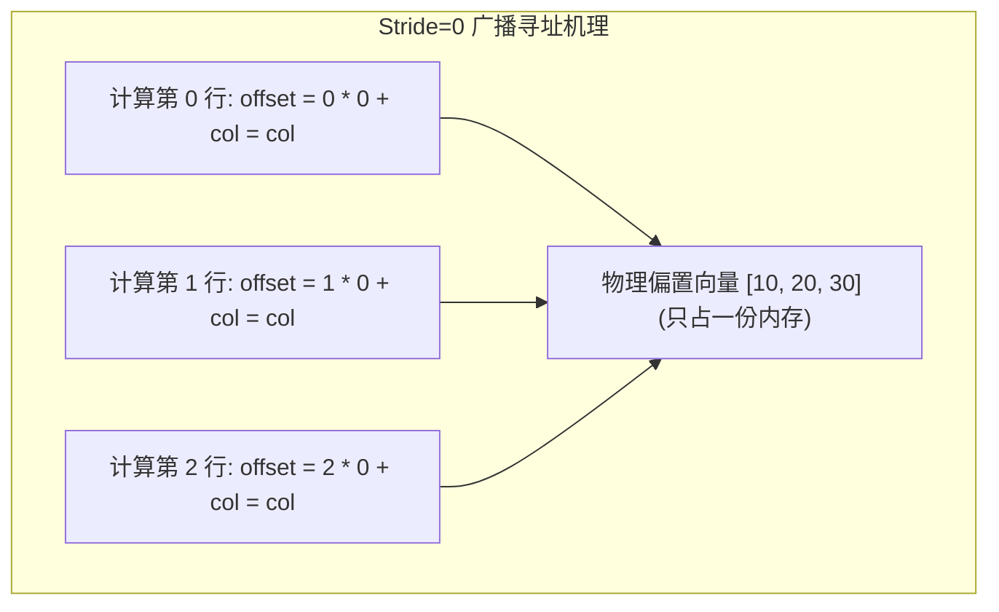

#### 6.2 广播三大铁律（NumPy / PyTorch 通用）
从**最右边的维度（末尾）**开始向左比对两者的形状：
1. 两个维度大小相等 $\to$ **允许**；
2. 其中一个维度大小为 1 $\to$ **允许**（该维度步长将被置 0 虚拟展开）；
3. 某个张量维度缺失 $\to$ **允许**（缺失维度自动在最左边补 1）；
4. 两个维度大小不同且都不为 1 $\to$ **严厉报错！无法广播！**

> [!TIP] 测验一下
> - $[2, 3]$ 和 $[1, 3]$ 能广播吗？能！右对齐：$3=3$，$2$ 和 $1$ 兼容，最终结果 $[2, 3]$。
> - $[2, 3]$ 和 $[2, 1]$ 能广播吗？能！最终结果 $[2, 3]$。
> - $[2, 3]$ 和 $[3, 2]$ 能广播吗？**不能！** $3 \ne 2$，报错！

#### 6.3 原生 Python 逐行注释实现
```python
def naive_broadcast_add(A: list[list[float]], B_bias: list[float]) -> list[list[float]]:
    """模拟矩阵 [M, N] 与偏置向量 [1, N] 的零开销广播加法"""
    M = len(A)
    N = len(A[0])
    if len(B_bias) != N:
        raise ValueError(f"无法广播！列数不一致: A 有 {N} 列, B 只有 {len(B_bias)} 列")

    output = [[0.0] * N for _ in range(M)]
    
    # 模拟底层的 Stride=0 寻址
    stride_row = 0
    stride_col = 1
    
    for r in range(M):
        for c in range(N):
            # 关键点：r * stride_row 永远是 0，无论行号多大，都只读取 B_bias[c]
            b_val = B_bias[r * stride_row + c * stride_col]
            output[r][c] = A[r][c] + b_val
            
    return output

if __name__ == "__main__":
    mat = [
        [1.0, 2.0, 3.0],
        [4.0, 5.0, 6.0]
    ] # 2x3
    bias = [10.0, 20.0, 30.0] # 1x3
    res = naive_broadcast_add(mat, bias)
    print("广播加法输出结果:")
    for row in res:
        print(" ", row)
```

#### 6.4 原生 C++ 逐行注释实现
```cpp
#include <iostream>

int main() {
    constexpr int M = 2;
    constexpr int N = 3;
    const float A[M][N] = {
        {1.0f, 2.0f, 3.0f},
        {4.0f, 5.0f, 6.0f}
    };
    const float bias[N] = {10.0f, 20.0f, 30.0f}; // 1x3
    float C[M][N];

    // 行步长为 0
    constexpr int b_stride_row = 0;
    constexpr int b_stride_col = 1;

    for (int r = 0; r < M; ++r) {
        for (int c = 0; c < N; ++c) {
            int b_idx = r * b_stride_row + c * b_stride_col;
            C[r][c] = A[r][c] + bias[b_idx];
        }
    }

    std::cout << "=== 原生 C++ Stride=0 广播加法验证 ===" << std::endl;
    for (int r = 0; r < M; ++r) {
        std::cout << "[";
        for (int c = 0; c < N; ++c) {
            std::cout << C[r][c] << (c + 1 < N ? ", " : "");
        }
        std::cout << "]" << std::endl;
    }
    return 0;
}
```

---

### 1.7 Gather (收集) 与 Scatter (打散写入)

#### 7.1 生活比喻与图解
- **Gather（收集）**：
  就像去超市拿着一张**购物清单（索引矩阵）**，清单上写着“去第 3 号货架拿东西、再去第 0 号货架拿东西”。你按照清单把东西一件件放进自己的购物车。
- **Scatter（打散写入）**：
  Gather 的逆向操作。理货员把进货箱里的货物，按照标签上的目标货架号，分别摆放回对应的货架上。如果有两件货物要去同一个货架，通常选择加在一起（Scatter Add）。

#### 7.2 手把手极小数字推演
货架数据（原数组）：`Table = [100, 200, 300, 400]`（下标 0~3）。
购物清单（索引）：`Indices = [3, 0, 2, 3]`。
- 提取第 0 个：`Table[3] = 400`
- 提取第 1 个：`Table[0] = 100`
- 提取第 2 个：`Table[2] = 300`
- 提取第 3 个：`Table[3] = 400`
- 收集结果（Gather Output）：`[400, 100, 300, 400]`。

#### 7.3 原生 Python 逐行注释实现
```python
def naive_gather_1d(source: list[float], indices: list[int]) -> list[float]:
    """1D Gather 收集算子"""
    output = []
    for idx in indices:
        if idx < 0 or idx >= len(source):
            raise IndexError(f"Gather 索引 {idx} 超出源数组范围 [0, {len(source)-1}]")
        output.append(source[idx])
    return output

def naive_scatter_add_1d(target_size: int, indices: list[int], updates: list[float]) -> list[float]:
    """1D Scatter Add 打散累加算子"""
    target = [0.0] * target_size
    for idx, val in zip(indices, updates):
        target[idx] += val # 相同位置累加
    return target

if __name__ == "__main__":
    data = [100.0, 200.0, 300.0, 400.0]
    idxs = [3, 0, 2, 3]
    print("Gather 收集输出:", naive_gather_1d(data, idxs))
    
    # 将 [1, 2, 3, 4] 累加写回目标
    print("Scatter Add 累加写回:", naive_scatter_add_1d(4, idxs, [1.0, 2.0, 3.0, 4.0]))
```

---

### 1.8 MaskedFill 与 Where (条件替换与掩码)

#### 8.1 生活比喻与痛点剖析
- **为什么在 Transformer 里生死攸关？**
  在语言模型生成第 3 个字时，它**绝对不能提前偷看第 4、5 个字的内容**！
  怎么在矩阵计算中强行让未来的字“失明”？
  **MaskedFill** 就是那张遮羞布：用一个布尔掩码（Mask）标记未来所有位置，把它们强行填上一个极小的值（比如 $-10^9$ 或 $-\infty$）。后面算 Softmax 时，$e^{-\infty} = 0$，未来的字被选中的概率彻底归零！

#### 8.2 手把手极小数字推演
原始打分矩阵（注意力 Logits）：
$$
\begin{pmatrix} 1.5 & 0.8 \\ 2.1 & 3.4 \end{pmatrix}
$$
下三角因果掩码（True 表示需要被遮挡替换的未来位置）：
$$
\begin{pmatrix} \text{False} & \text{True} \\ \text{False} & \text{False} \end{pmatrix}
$$
执行 `MaskedFill(mask, value=-1e9)`：
- 坐标 $(0, 0)$：掩码为 False，保留原值 $1.5$；
- 坐标 $(0, 1)$：掩码为 True，属于偷看未来，替换为 $-1e9$；
- 坐标 $(1, 0)$ 和 $(1, 1)$：掩码为 False，保留原值。

替换后输出：
$$
\begin{pmatrix} 1.5 & -1e9 \\ 2.1 & 3.4 \end{pmatrix}
$$

#### 8.3 原生 Python 逐行注释实现
```python
def naive_masked_fill(data: list[list[float]], mask: list[list[bool]], fill_val: float = -1e9) -> list[list[float]]:
    """根据布尔掩码执行条件值填充"""
    R = len(data)
    C = len(data[0])
    out = [[0.0] * C for _ in range(R)]
    
    for r in range(R):
        for c in range(C):
            # 若 mask 为真，换成遮挡值；否则保留原值
            out[r][c] = fill_val if mask[r][c] else data[r][c]
    return out

if __name__ == "__main__":
    scores = [[1.5, 0.8], [2.1, 3.4]]
    causal_mask = [[False, True], [False, False]]
    res = naive_masked_fill(scores, causal_mask, -1e9)
    print("因果掩码填充输出:")
    for row in res:
        print(" ", row)
```

---

### 1.9 Pad (填充) 与 10. Crop (裁剪)

#### 9.1 生活比喻与图像处理
- **Pad（填充）**：就像给一张明信片加上一个保护性的相框。如果不加框，卷积核滑到图像最边缘时就会“悬空掉出去”；加了 0 填充后，边缘像素也能被卷积核居中采样。
- **Crop（裁剪）**：拿着剪刀把多余的边框剪掉，只保留核心中心区域。

#### 9.2 原生 Python 逐行注释实现
```python
def naive_pad_2d(img: list[list[float]], pad_size: int, fill_val: float = 0.0) -> list[list[float]]:
    """四周均匀填充常数值"""
    old_h = len(img)
    old_w = len(img[0])
    new_h = old_h + 2 * pad_size
    new_w = old_w + 2 * pad_size
    
    padded = [[fill_val] * new_w for _ in range(new_h)]
    # 把原图贴在正中间
    for r in range(old_h):
        for c in range(old_w):
            padded[pad_size + r][pad_size + c] = img[r][c]
    return padded

def naive_crop_2d(img: list[list[float]], start_r: int, start_c: int, h: int, w: int) -> list[list[float]]:
    """从指定起始坐标裁剪子区域"""
    cropped = []
    for r in range(start_r, start_r + h):
        cropped.append(img[r][start_c : start_c + w])
    return cropped

if __name__ == "__main__":
    small_pic = [[1.0, 2.0], [3.0, 4.0]]
    pad_pic = naive_pad_2d(small_pic, pad_size=1, fill_val=0.0)
    print("Pad 四周补0后 (4x4):")
    for r in pad_pic:
        print(" ", r)
    restored = naive_crop_2d(pad_pic, start_r=1, start_c=1, h=2, w=2)
    print("Crop 裁剪中心恢复 (2x2):", restored)
```

---

### 1.小结 总结与初学者避坑指南

回顾本篇的 11 个算子，请在脑海中建立以下这几张“肌肉记忆反射卡片”：

1. **Embedding**：不是高深的黑魔法，本质就是**快速安全的二维数组查表**。
2. **Reshape / View**：数据没动，只是换了**步长（Stride）**去读。
3. **Transpose**：改了步长后数据变得**不连续**，小心引发后续计算的 Cache Miss 性能陷阱！
4. **Broadcast**：不是真复制，而是将某一维度的**步长设为 0**，零成本虚拟复用！
5. **MaskedFill**：生成模型里的“保密胶带”，用 $-10^9$ 遮住未来的答案。

下一讲，我们将带着扎实的内存直觉，杀入深度学习的算力引擎核心——**矩阵乘法（GEMM / BMM / GEMV）与数值稳定性（Safe-Softmax）**！

---

## 模块二：基础数学与线性代数（算力核心：GEMM、矩阵乘法与数值稳定）

> **致初学者**：当你翻开任何一篇深度学习论文，映入眼帘的几乎全是密密麻麻的矩阵公式：$Y = X W + b$、$Q K^T$、$\text{Softmax}(\dots)$。
>
> 许多初学者可能会困惑：
> - **为什么矩阵乘法能占到现代大模型 90% 以上的计算时间？**
> - **为什么三层简单的 `for` 循环写出来的矩阵乘法在 CPU 上跑得极慢，而工业级库能快几十甚至上百倍？**
> - **为什么大模型在生成一长串文字时 GPU 显卡轰鸣，而一个字一个字向外吐字时，显存带宽被榨干但算力利用率却只有可怜的 5%？**
> - **为什么好端端的模型在训练时突然全网数值变成 `NaN`（Not a Number），直接报废？**
>
> 本篇作为系列第二讲，将抛开抽象难懂的泛函与高深理论，**用最简单的数字手把手算一遍**，带你从底层硬件 Cache 访存与数值溢出的物理本质，彻底搞懂 GEMM、BMM、GEMV、Einsum 和 Softmax！

---

### 2.0 先导概念：必须先掌握的初学者概念：算力、访存与 NaN 炸弹

> [!NOTE] 核心概念形象字典
>
> - **FLOPs（浮点运算次数）**：计算机执行乘法或加法的次数。算一次 $a \times b + c$ 包含 1 次乘法和 1 次加法，共计 2 次 FLOPs。千亿大模型训练一次往往需要 $10^{23}$ 次以上的 FLOPs！
> - **算力受限（Compute-Bound）**：好比你的书桌上堆满了食材，你的双手（CPU/GPU 核心）已经切菜切到冒烟，限制做饭速度的是“你的手速”。典型代表：大 Batch 的矩阵乘法 **GEMM**。
> - **访存受限 / 存储墙（Memory-Bound）**：好比你的手速极快，但食材放在 10 公里外的冷库（外部显存 HBM/DDR），你每切一刀就要等卡车送半天，限制做饭速度的是“卡车运输速度”。典型代表：单 Token 解码的 **GEMV**。
> - **NaN（非数值，Not a Number）**：深度学习工程师的头号噩梦！当出现 $0/0$、$\infty / \infty$ 或 $\infty - \infty$ 等非法数学未定式时，计算单元会吐出 `NaN`。它就像烈性传染病，反向传播时经过链式法则一乘，顷刻间把整个模型的几十亿参数全部染成垃圾数据，无法抢救！

---

### 2.1 GEMM (通用矩阵乘法 / General Matrix Multiply)

#### 1.1 生活比喻与数学定义
- **BLAS 工业标准定义**：
  $$ C = \alpha (A \times B) + \beta C $$
  其中 $A$ 形状为 $[M, K]$，$B$ 形状为 $[K, N]$，输出 $C$ 形状为 $[M, N]$。
  $\alpha$ 和 $\beta$ 是标量缩放系数。在深度学习中，绝大多数时候 $\alpha = 1, \beta = 0$，也就是我们最熟悉的纯粹矩阵乘法 $C = A \times B$。
- **生活比喻：流水线工人算工钱**：
  - 矩阵 $A$（$M$ 行 $K$ 列）：$M$ 个工人，每人在 $K$ 种不同工种上的工作小时数；
  - 矩阵 $B$（$K$ 行 $N$ 列）：$K$ 种工种在 $N$ 种不同结算货币下的时薪单价；
  - 矩阵 $C$（$M$ 行 $N$ 列）：每个工人最终在每种货币下应领取的总工资！

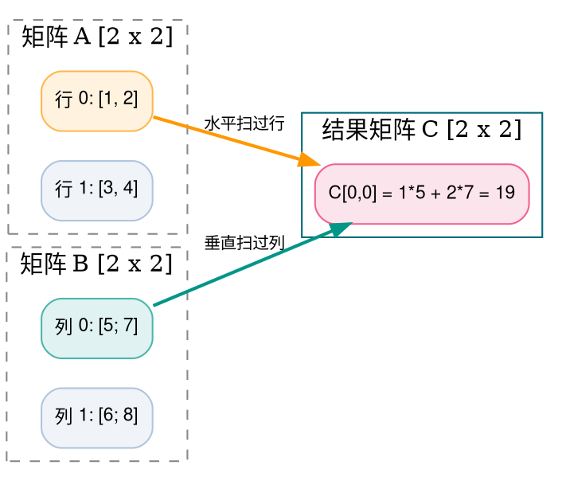

#### 1.2 手把手极小数字推演
给定两个 $2 \times 2$ 的矩阵：
$$
A = \begin{pmatrix} 1 & 2 \\ 3 & 4 \end{pmatrix}, \quad B = \begin{pmatrix} 5 & 6 \\ 7 & 8 \end{pmatrix}
$$
我们手算每一个格子的诞生：
1. **左上角 $C[0, 0]$**：拿 $A$ 的第 0 行 `[1, 2]` 和 $B$ 的第 0 列 `[5, 7]` 对应相乘相加：
   $$ C[0, 0] = 1 \times 5 + 2 \times 7 = 5 + 14 = 19 $$
2. **右上角 $C[0, 1]$**：拿 $A$ 的第 0 行 `[1, 2]` 和 $B$ 的第 1 列 `[6, 8]` 相乘相加：
   $$ C[0, 1] = 1 \times 6 + 2 \times 8 = 6 + 16 = 22 $$
3. **左下角 $C[1, 0]$**：拿 $A$ 的第 1 行 `[3, 4]` 和 $B$ 的第 0 列 `[5, 7]` 相乘相加：
   $$ C[1, 0] = 3 \times 5 + 4 \times 7 = 15 + 28 = 43 $$
4. **右下角 $C[1, 1]$**：拿 $A$ 的第 1 行 `[3, 4]` 和 $B$ 的第 1 列 `[6, 8]` 相乘相加：
   $$ C[1, 1] = 3 \times 6 + 4 \times 8 = 18 + 32 = 50 $$

最终输出矩阵：
$$
C = \begin{pmatrix} 19 & 22 \\ 43 & 50 \end{pmatrix}
$$

#### 1.3 硬件底层的秘密：为什么最朴素的三重循环很慢？
初学者写矩阵乘法，往往直接写出三层嵌套循环：
```python
for i in range(M):
    for j in range(N):
        for k in range(K):
            C[i][j] += A[i][k] * B[k][j]
```
**硬件杀手在哪里？在 `B[k][j]` 上！**
回忆第一讲讲过的**行优先内存排布**：
- 访问 `A[i][k]` 时，内层循环 `k` 每次加 1，读取的是紧挨着的下一个内存地址。CPU 的 Cache Line 会一口气预先抓取接下来的 16 个数字，这叫**缓存命中（Cache Hit）**，速度飞快！
- 但是访问 `B[k][j]` 时，`k` 每次加 1，意味着从当前行的第 `j` 列跳到**下一行的第 `j` 列**！物理地址直接跨越了整整一整行（加上了 $N$）！
- 这导致 CPU 缓存预读完全落空，每次都要重新去漫长的外部内存抓数据（**Cache Miss 缓存缺失**），导致处理器核心大量时间处于发呆等待状态！

#### 1.4 原生 Python 逐行注释实现
```python
def naive_gemm(A: list[list[float]], B: list[list[float]]) -> list[list[float]]:
    """纯 Python 原生朴素矩阵乘法: C = A @ B"""
    M = len(A)       # A 的行数
    K = len(A[0])    # A 的列数
    K_B = len(B)     # B 的行数
    N = len(B[0])    # B 的列数

    # 矩阵乘法先决条件：A 的列数必须完全等于 B 的行数！
    if K != K_B:
        raise ValueError(f"内积维度不匹配！A 的列数 {K} != B 的行数 {K_B}")

    # 初始化输出结果矩阵 [M, N]，初始全填 0.0
    C = [[0.0] * N for _ in range(M)]

    # 三重循环计算
    for i in range(M):
        for j in range(N):
            dot_sum = 0.0
            for k in range(K):
                dot_sum += A[i][k] * B[k][j]
            C[i][j] = dot_sum

    return C

if __name__ == "__main__":
    mA = [[1.0, 2.0], [3.0, 4.0]]
    mB = [[5.0, 6.0], [7.0, 8.0]]
    mC = naive_gemm(mA, mB)
    print("GEMM 计算结果矩阵 (2x2):")
    for row in mC:
        print(" ", row)
```

#### 1.5 原生 C++ 逐行注释实现
```cpp
#include <iostream>
#include <iomanip>

int main() {
    constexpr int M = 2;
    constexpr int K = 2;
    constexpr int N = 2;

    const float A[M][K] = {{1.0f, 2.0f}, {3.0f, 4.0f}};
    const float B[K][N] = {{5.0f, 6.0f}, {7.0f, 8.0f}};
    float C[M][N] = {0.0f};

    // 三重循环：外层遍历输出行 i，中层遍历输出列 j，内层累加求和 k
    for (int i = 0; i < M; ++i) {
        for (int j = 0; j < N; ++j) {
            float sum = 0.0f;
            for (int k = 0; k < K; ++k) {
                sum += A[i][k] * B[k][j];
            }
            C[i][j] = sum;
        }
    }

    std::cout << "=== 原生 C++ 朴素 GEMM 输出 ===" << std::endl;
    for (int i = 0; i < M; ++i) {
        std::cout << "[";
        for (int j = 0; j < N; ++j) {
            std::cout << std::fixed << std::setprecision(1) << C[i][j] << (j + 1 < N ? ", " : "");
        }
        std::cout << "]" << std::endl;
    }
    return 0;
}
```

---

### 2.2 BMM (批量矩阵乘 / Batch MatMul)

#### 2.1 生活比喻与并行性
- **生活比喻：复印机打印多份试卷**：
  假设你要给班上 30 位同学批改试卷（Batch Size $B = 30$）。
  每份试卷内部都是标准的矩阵乘法计算。30 位同学的试卷彼此之间**没有任何关联，互不影响**！
- **数学形状**：
  输入张量 $A$ 是三维的 $[B, M, K]$，输入张量 $B$ 是三维的 $[B, K, N]$；
  输出张量 $C$ 形状为 $[B, M, N]$。
  相当于顺着第 0 维，并发执行了 $B$ 次独立的二维 GEMM。现代 GPU 的成千上万个流处理器核心最喜欢这种结构，因为可以把第 0 维切散，让每组核心各自算一个批次，实现极高的并行吞吐。

#### 2.2 原生 Python 逐行注释实现
```python
def naive_bmm(A: list[list[list[float]]], B: list[list[list[float]]]) -> list[list[list[float]]]:
    """批量矩阵乘法: [B, M, K] x [B, K, N] -> [B, M, N]"""
    batch_size = len(A)
    M = len(A[0])
    K = len(A[0][0])
    N = len(B[0][0])

    output = []
    # 遍历每一个独立的批次
    for b in range(batch_size):
        # 提取当前批次的二维矩阵
        sub_A = A[b]
        sub_B = B[b]
        # 对该批次独立做 GEMM
        sub_C = naive_gemm(sub_A, sub_B)
        output.append(sub_C)
    return output

if __name__ == "__main__":
    # Batch=2, 每个批次都是 2x2 矩阵
    b_A = [
        [[1.0, 0.0], [0.0, 1.0]], # 批次 0: 单位阵
        [[2.0, 0.0], [0.0, 2.0]]  # 批次 1: 2倍单位阵
    ]
    b_B = [
        [[5.0, 6.0], [7.0, 8.0]],
        [[1.0, 2.0], [3.0, 4.0]]
    ]
    res_bmm = naive_bmm(b_A, b_B)
    print("BMM 批次 0 结果 (乘单位阵保持原样):", res_bmm[0])
    print("BMM 批次 1 结果 (乘以2倍单位阵):   ", res_bmm[1])
```

---

### 2.3 GEMV (矩阵-向量乘：大模型 Decode 阶段的死结)

#### 3.1 痛点解密：为什么大模型逐字吐字时显卡在“偷懒”？
- **公式**：
  $$ y = A \times x $$
  其中矩阵 $A$ 是 $[M, K]$，向量 $x$ 是 $[K]$，输出 $y$ 是 $[M]$。
  **它其实就是 $N=1$ 时的特殊矩阵乘法！**
- **初学者的灵魂发问**：
  为什么在大模型输入整篇 Prompt（Prefill 阶段）时，推理飞快且 GPU 利用率极高，而大模型一个词一个词向外输出时（Decode 阶段），速度骤降？
- **残酷的物理事实**：
  - 在生成单个词时，当前输入只有一个向量（$N=1$）；
  - 为了给这个新词做全连接变换，GPU 必须把模型**几十个 GB 的全部权重从外部显存（HBM）中完整读取一遍**！
  - 每一个读取出来的权重浮点数，仅仅和一个数字乘了一次，就被无情地抛弃了！
  - 此时，GPU 内部极其强大的计算核心几乎处于 95% 空转等待状态，所有的瓶颈全卡在**显存向芯片搬运数据的带宽上限**（典型的 Memory-Bound 访存受限）。

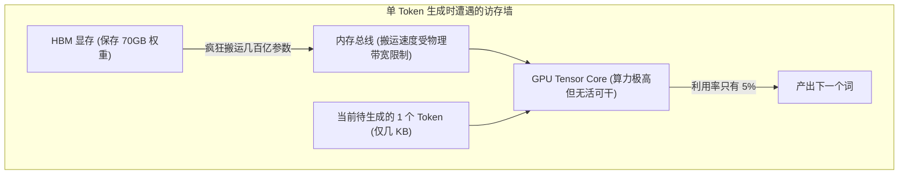

#### 3.2 原生 Python 逐行注释实现
```python
def naive_gemv(A: list[list[float]], x: list[float]) -> list[float]:
    """矩阵-向量乘法: y = A @ x (形状: [M, K] x [K] -> [M])"""
    M = len(A)
    K = len(A[0])
    if len(x) != K:
        raise ValueError(f"维度不匹配: 矩阵列数 {K} != 向量长度 {len(x)}")

    y = [0.0] * M
    for i in range(M):
        # 矩阵的第 i 行与向量 x 做内积
        row_sum = 0.0
        for k in range(K):
            row_sum += A[i][k] * x[k]
        y[i] = row_sum
    return y

if __name__ == "__main__":
    weight = [
        [1.0, 2.0, 3.0],
        [4.0, 5.0, 6.0]
    ] # 2x3
    token_vec = [0.5, 1.0, -0.5] # 长度 3
    out_vec = naive_gemv(weight, token_vec)
    print("GEMV 输出向量 (长度 2):", out_vec)
```

---

### 2.4 Einsum (爱因斯坦求和：消消乐的艺术)

#### 4.1 初学者语法破译指南
许多初学者看前沿代码时，经常看到类似 `torch.einsum('bqd,bkd->bqk', q, k)` 的神秘字符串，觉得像是密码。
其实它超级简单，就像玩**“消消乐”**：
1. **箭头 `->` 分开左右**：左边是输入各个矩阵的维度代号，右边是输出矩阵的维度代号；
2. **留下的字母是“自由维度”**：左右两边都出现的字母，代表原样保留；
3. **消失的字母是“求和维度（$\Sigma$）”**：**在左边出现、但在右边消失的字母，代表把这个维度顺次乘起来累加消掉！**

> [!TIP] 破译常见表达式
> - `"i,i->"`：输入两个向量，长度都是 `i`。箭头右边什么都没有（`i` 消失了）$\implies$ **把所有分量乘起来求和，输出一个标量（向量点积）**！
> - `"ik,kj->ij"`：输入矩阵 A(i, k) 和 B(k, j)。字母 `k` 消失了 $\implies$ **对 `k` 求和，留下 `i` 和 `j`（这不就是标准矩阵乘法 $C[i,j] = \sum_k A[i,k] B[k,j]$ 嘛！）**！
> - `"ii->"`：矩阵对角线元素求和 $\implies$ **矩阵的迹（Trace）**！

#### 4.2 原生 Python 逐行注释实现
```python
def naive_einsum_dot(x: list[float], y: list[float]) -> float:
    """模拟 'i,i->' 向量点积"""
    return sum(a * b for a, b in zip(x, y))

def naive_einsum_trace(matrix: list[list[float]]) -> float:
    """模拟 'ii->' 对角线求和 (矩阵迹)"""
    return sum(matrix[i][i] for i in range(min(len(matrix), len(matrix[0]))))

if __name__ == "__main__":
    v1 = [1.0, 2.0, 3.0]
    v2 = [4.0, 5.0, 6.0]
    print("Einsum 'i,i->' 点积:", naive_einsum_dot(v1, v2))
    
    mat = [[10.0, 2.0], [3.0, 40.0]]
    print("Einsum 'ii->' 对角线迹:", naive_einsum_trace(mat))
```

---

### 2.5 Softmax 与 Safe-Softmax (数值稳定拯救机制)

#### 5.1 为什么直接算 Softmax 会让整个模型瞬间爆炸？
标准 Softmax 的公式我们都很熟悉，用来把一组分数变成总和为 1 的概率：
$$ P_i = \frac{e^{x_i}}{\sum_{j=1}^N e^{x_j}} $$

现在，我们带入一组很正常的数字来算算看：
假设注意力算子算出来的未缩放分数为：`x = [1000.0, 1001.0, 999.0]`。
- 计算机尝试计算 $e^{1000}$；
- 悲剧发生：单精度浮点数（FP32）最大能存的数字大约是 $3.4 \times 10^{38}$；而 $e^{1000} \approx 10^{434}$，**瞬间超越了硬件物理极限，直接溢出为 `+Inf`（正无穷）！**
- 分母累加：`+Inf + +Inf + +Inf = +Inf`；
- 分子除以分母：`+Inf / +Inf` $\implies$ **硬件直接吐出 `NaN`（未定式致命错误）！**
- 此时模型的所有参数立刻被感染为全零或全垃圾，几百万美元训练费用瞬间打了水漂！

#### 5.2 救星：Safe-Softmax（减去最大值的初等数学奇迹）
初中数学告诉我们：分子分母同时除以一个常数，结果不变。
$$
P_i = \frac{e^{x_i}}{\sum_j e^{x_j}} = \frac{e^{x_i} / e^M}{\sum_j (e^{x_j} / e^M)} = \frac{e^{x_i - M}}{\sum_j e^{x_j - M}}
$$
如果我们令常数 $M = \max(x)$（当前向量中的**最大值**）：
那么每一个输入 $x_i - M$ 都必然 $\le 0$！
- 最大的那个数变成了 $M - M = 0$，$e^0 = 1.0$；
- 其余比它小的数都变成了负数，$e^{\text{负数}} \in (0, 1)$；
- **所有指数结果被牢牢死死按在 $(0, 1]$ 之间，绝对不可能超过 1.0，彻底根除了上溢成 `+Inf` 的可能！**

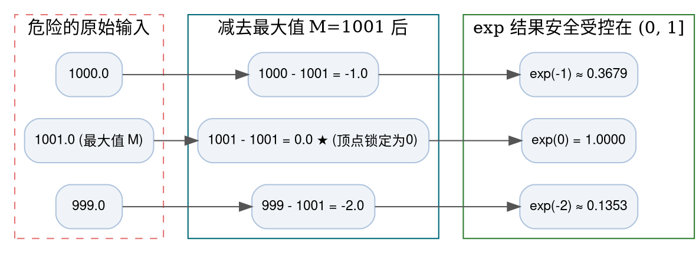

#### 5.3 手把手极小数字推演
我们用手工把这组极端大数 `[1000.0, 1001.0, 999.0]` 算一遍：
1. 找到最大值 $M = 1001.0$；
2. 减去最大值：`[-1.0, 0.0, -2.0]`；
3. 计算自然常数指数：
   - $e^{-1.0} \approx 0.3679$
   - $e^{0.0} = 1.0$
   - $e^{-2.0} \approx 0.1353$
4. 分母求和：$\text{Sum} = 0.3679 + 1.0 + 0.1353 = 1.5032$；
5. 各自分子除以分母归一化：
   - $P_0 = 0.3679 / 1.5032 \approx 0.2447$（即 24.47%）
   - $P_1 = 1.0 / 1.5032 \approx 0.6652$（即 66.52%）
   - $P_2 = 0.1353 / 1.5032 \approx 0.0900$（即 9.00%）
6. 检查概率总和：$0.2447 + 0.6652 + 0.0900 = 1.0000$！完美收敛，零溢出，零 `NaN`！

#### 5.4 原生 Python 逐行注释实现
```python
import math

def naive_safe_softmax(logits: list[float]) -> list[float]:
    """数值绝对稳定的 Safe-Softmax 算法"""
    # 步骤 1: 找出这组数中的最大值 M
    max_val = max(logits)
    
    # 步骤 2: 每个数减去 M 后再求 exp，把指数压到 <= 0 的安全区
    exp_shifted = [math.exp(x - max_val) for x in logits]
    
    # 步骤 3: 累加分母总和
    sum_exp = sum(exp_shifted)
    
    # 步骤 4: 归一化为概率
    probabilities = [val / sum_exp for val in exp_shifted]
    return probabilities

if __name__ == "__main__":
    # 若直接计算 exp(1000)，Python 会直接抛出 OverflowError: math range error
    big_numbers = [1000.0, 1001.0, 999.0]
    probs = naive_safe_softmax(big_numbers)
    print("Safe-Softmax 稳定输出概率分布:")
    for idx, p in enumerate(probs):
        print(f"  P(x_{idx}) = {p:.6f}")
    print(f"概率总和校验: {sum(probs):.4f}")
```

#### 5.5 原生 C++ 逐行注释实现
```cpp
#include <iostream>
#include <cmath>
#include <iomanip>

int main() {
    // 包含极端数值的数组
    const float logits[] = {1000.0f, 1001.0f, 999.0f};
    constexpr int N = 3;

    // 1. 寻找最大值 M
    float max_val = logits[0];
    for (int i = 1; i < N; ++i) {
        if (logits[i] > max_val) max_val = logits[i];
    }

    // 2. 减去 M 并求指数和
    float exp_vals[N];
    float sum_exp = 0.0f;
    for (int i = 0; i < N; ++i) {
        exp_vals[i] = std::exp(logits[i] - max_val);
        sum_exp += exp_vals[i];
    }

    // 3. 归一化输出
    std::cout << "=== 原生 C++ Safe-Softmax 验证 ===" << std::endl;
    for (int i = 0; i < N; ++i) {
        float p = exp_vals[i] / sum_exp;
        std::cout << "P(x_" << i << ") = " << std::fixed << std::setprecision(4) << p << std::endl;
    }
    return 0;
}
```

---

### 2.小结 总结与初学者避坑指南

1. **GEMM 速度的真正秘密不是算法，是 Cache 命中率**：在真实优化中，必须通过分块（Tiling）让数据呆在片上缓存里，防止 column-major 读导致的缓存颠簸。
2. **大模型单字生成天生慢于批量理解**：因为退化成了 **GEMV**，瓶颈在 HBM 带宽而不是芯片算力。
3. **永远不要裸写 $e^{x_i} / \sum e^{x_j}$**：第一步必须先减去 $\max(x)$，否则 `NaN` 爆炸迟早会找上门！

---

## 模块三：激活函数（非线性来源：梯度传导、门控机制与饱和区）

> **致初学者**：很多初学者刚接触神经网络时，总以为“网络层数越深越聪明”。
>
> 于是有人写了一个 100 层的神经网络，每一层都是简单的矩阵乘法：
> $$ y = W_{100} \times (W_{99} \dots (W_1 \times x)) $$
> 结果发现，这个 100 层的超深网络，连最简单的“异或逻辑（XOR）”都学不会！
>
> 为什么？因为初等代数告诉我们：两个矩阵相乘还是矩阵，$W_2 \times W_1 = W_{\text{new}}$。**无论你叠 100 层还是 1000 层，它在数学上完全等价于一个单层线性矩阵！**
>
> 真正给神经网络注入“灵魂”、让它能够弯曲高维空间、拟合宇宙中万事万物规律的，正是**激活函数（Activation Function）引入的非线性（Non-Linearity）**！
>
> 但激活函数也是一把双刃剑：选得不好，反向传播的梯度会瞬间缩小为 0（**梯度消失**），或者让神经元彻底死翘翘（**Dying ReLU**）。
>
> 本篇作为系列第三讲，将用最通俗的数字推演，带你彻底吃透 ReLU、GELU、SiLU、Sigmoid、Tanh 以及大模型新宠 SwiGLU！

---

### 3.0 先导概念：初学者必懂概念：为什么没有非线性，网络就是个“废物”？

我们用最纯粹的 $2 \times 2$ 矩阵乘法来亲自证明一次：
假设第一层权重为：$W_1 = \begin{pmatrix} 1 & 2 \\ 3 & 4 \end{pmatrix}$，第二层权重为：$W_2 = \begin{pmatrix} 5 & 6 \\ 7 & 8 \end{pmatrix}$。
如果中间**不加任何激活函数**，第二层的输出为：
$$
y = W_2 \times (W_1 \times x) = (W_2 \times W_1) \times x
$$
我们算一下 $W_2 \times W_1$：
$$
\begin{pmatrix} 5 & 6 \\ 7 & 8 \end{pmatrix} \begin{pmatrix} 1 & 2 \\ 3 & 4 \end{pmatrix} = \begin{pmatrix} 5\times 1 + 6\times 3 & 5\times 2 + 6\times 4 \\ 7\times 1 + 8\times 3 & 7\times 2 + 8\times 4 \end{pmatrix} = \begin{pmatrix} 23 & 34 \\ 31 & 46 \end{pmatrix}
$$
看！两层网络直接坍缩成了一个单一的矩阵 $\begin{pmatrix} 23 & 34 \\ 31 & 46 \end{pmatrix}$！
你花双倍电费跑两层，跟直接跑一层没有任何区别。**这就是为什么每一层之间必须强行塞入一个非线性激活函数，把直线“折弯”！**

> [!NOTE] 核心概念形象字典
>
> - **饱和区（Saturation）**：当输入 $x$ 变得很大或很小时，函数的曲线变得几乎完全水平，斜率（导数）趋近于 0。落在饱和区的神经元在反向传播时无法提供有效梯度。
> - **梯度消失（Vanishing Gradient）**：反向传播时，根据微积分链式法则，梯度是一层层相乘的：$\frac{\partial L}{\partial x} = g_1 \times g_2 \times \dots \times g_n$。如果每个激活函数的导数都在 $0.25$ 左右，乘上 10 层后：$0.25^{10} \approx 0.00000095$！前序层的梯度被缩减到几乎为 0，参数彻底停止学习！
> - **死神经元（Dying ReLU）**：神经元的权重更新到了一个极负的值，导致之后的任何正负输入算出来都是负数。由于 ReLU 在负半轴输出和导数恒为 0，该神经元永远无法复活。
> - **零中心化（Zero-Centered）**：函数的输出均值是否在 0 附近。若输出永远为正数，下一层神经元的梯度在反向更新时只能同正或同负，导致梯度在最优解周围走“之字形（Zig-zag）”折线震荡，收敛缓慢。

---

### 3.1 ReLU (修正线性单元 / Rectified Linear Unit)

#### 1.1 生活比喻与公式
- **公式**：
  $$ \text{ReLU}(x) = \max(0, x) = \begin{cases} x, & x > 0 \\ 0, & x \le 0 \end{cases} $$
  导数极其单纯：
  $$ \text{ReLU}'(x) = \begin{cases} 1, & x > 0 \\ 0, & x \le 0 \end{cases} $$
- **生活比喻：单向水阀（止回阀）**：
  水往正方向流（$x > 0$），阀门完全打开，水流无损通过（导数为 1）；水往反方向倒灌（$x \le 0$），阀门彻底焊死，滴水不漏（输出为 0，导数为 0）。
- **神级优点**：
  1. **没有指数开销**：硬件只需读取浮点数的最高符号位即可，计算速度比 Sigmoid 快数十倍！
  2. **正半轴梯度永不衰减**：导数恒为 1，彻底治好了深层网络正向区间的梯度消失病。

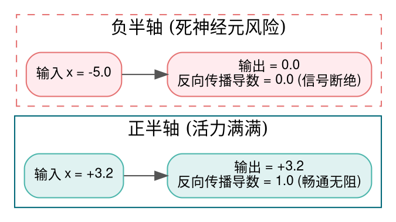

#### 1.2 手把手极小数字推演
输入向量为：`x = [-3.0, 0.0, 2.5]`
- 对 $x_0 = -3.0$：$\max(0, -3.0) = 0.0$；反向传播导数为 $0.0$；
- 对 $x_1 = 0.0$：$\max(0, 0.0) = 0.0$；反向传播导数为 $0.0$；
- 对 $x_2 = 2.5$：$\max(0, 2.5) = 2.5$；反向传播导数为 $1.0$；
- 输出结果：`[0.0, 0.0, 2.5]`。

#### 1.3 原生 Python 逐行注释实现
```python
def naive_relu(x: list[float]) -> tuple[list[float], list[float]]:
    """原生 ReLU 前向输出与反向传播局部导数"""
    outputs = []
    derivatives = []
    for val in x:
        if val > 0.0:
            outputs.append(val)
            derivatives.append(1.0) # 正半轴导数恒为 1.0
        else:
            outputs.append(0.0)
            derivatives.append(0.0) # 负半轴被截断，导数为 0.0
    return outputs, derivatives

if __name__ == "__main__":
    test_data = [-3.0, -0.5, 0.0, 1.5, 4.0]
    out, grads = naive_relu(test_data)
    print("输入数据:", test_data)
    print("ReLU 输出:", out)
    print("ReLU 导数:", grads)
```

#### 1.4 原生 C++ 逐行注释实现
```cpp
#include <iostream>

int main() {
    const float input[] = {-3.0f, -0.5f, 0.0f, 1.5f, 4.0f};
    constexpr int N = 5;
    float output[N];
    float grad[N];

    for (int i = 0; i < N; ++i) {
        if (input[i] > 0.0f) {
            output[i] = input[i];
            grad[i] = 1.0f;
        } else {
            output[i] = 0.0f;
            grad[i] = 0.0f;
        }
    }

    std::cout << "=== 原生 C++ ReLU 输出验证 ===" << std::endl;
    for (int i = 0; i < N; ++i) {
        std::cout << "x = " << input[i] << " -> ReLU = " << output[i] << " | 导数 = " << grad[i] << std::endl;
    }
    return 0;
}
```

---

### 3.2 Sigmoid 与 Tanh (早期功臣与梯度消失祸首)

#### 2.1 深度拆解：为什么深层网络不能用 Sigmoid 当隐层激活？
- **Sigmoid 公式**：
  $$ \sigma(x) = \frac{1}{1 + e^{-x}} $$
  将任意实数压缩到 $(0, 1)$。
- **致命的导数峰值缺陷**：
  Sigmoid 的导数公式为：
  $$ \sigma'(x) = \sigma(x) \cdot (1 - \sigma(x)) $$
  这个函数在什么时候能取得最大值？
  当 $\sigma(x) = 0.5$（即 $x = 0$）时，导数取得**历史最高峰值：$0.5 \times (1 - 0.5) = 0.25$！**
  **这意味着：即便在最理想的状态下，梯度每倒退反向穿过一层 Sigmoid，其能量至少被砍掉 75%！**
  只要网络有 6 层，$0.25^6 \approx 0.000244$；到了第 10 层，梯度已化为乌有。所以经典多层网络根本无法训练，直到 ReLU 的出现才拯救了深度学习。
- **Tanh（双曲正切）**：
  $$ \tanh(x) = \frac{e^x - e^{-x}}{e^x + e^{-x}} = 2\sigma(2x) - 1 $$
  值域为 $(-1, 1)$。在 $x=0$ 处的导数峰值为 $1.0$；并且是**严格零中心化的**。但输入一旦大于 3 或小于 -3，曲线立即进入两端平坦的饱和区，依然难逃梯度消失。


#### 2.2 手把手极小数字推演
计算 $x = 0.0$ 与 $x = 2.0$ 的 Sigmoid 表现：
- $x = 0.0$：
  - $\sigma(0) = \frac{1}{1 + e^0} = \frac{1}{1 + 1} = 0.5$
  - 导数 $\sigma'(0) = 0.5 \times (1 - 0.5) = 0.25$
- $x = 2.0$：
  - $e^{-2} \approx 0.1353$
  - $\sigma(2) = \frac{1}{1 + 0.1353} = \frac{1}{1.1353} \approx 0.8808$
  - 导数 $\sigma'(2) = 0.8808 \times (1 - 0.8808) = 0.8808 \times 0.1192 \approx 0.1050$（只剩 10% 的梯度能穿过去！）

---

### 3.3 GELU (高斯误差线性单元 / Gaussian Error Linear Unit)

#### 3.1 生活比喻与哲学思想
- **背景**：BERT、GPT-2、GPT-3、ViT 的标配。
- **痛点反思**：ReLU 的生硬截断太野蛮了——在 0 处突然断崖式拐角，导数突变为不可导；负数直接一刀切全杀掉。
- **通俗比喻：智能概率门禁**：
  GELU 将量子物理和概率思想引入了激活函数：
  每一个输入数字 $x$ 能不能被保留通过，取决于它**打败标准正态分布随机噪声的概率**！
  - 如果 $x = +3.0$（极其强烈的正向特征），它大于噪声的概率是 $99.87\%$，于是几乎 $100\%$ 原样放行；
  - 如果 $x = -3.0$（极其糟糕的负向特征），它大于噪声的概率仅有 $0.13\%$，于是几乎 $100\%$ 被抹杀丢弃；
  - 如果 $x = -0.5$（边缘微弱的弱信号），它保留一点点微小的负值通道（产生平滑浅谷），给网络一丝改过自新的微弱生机。

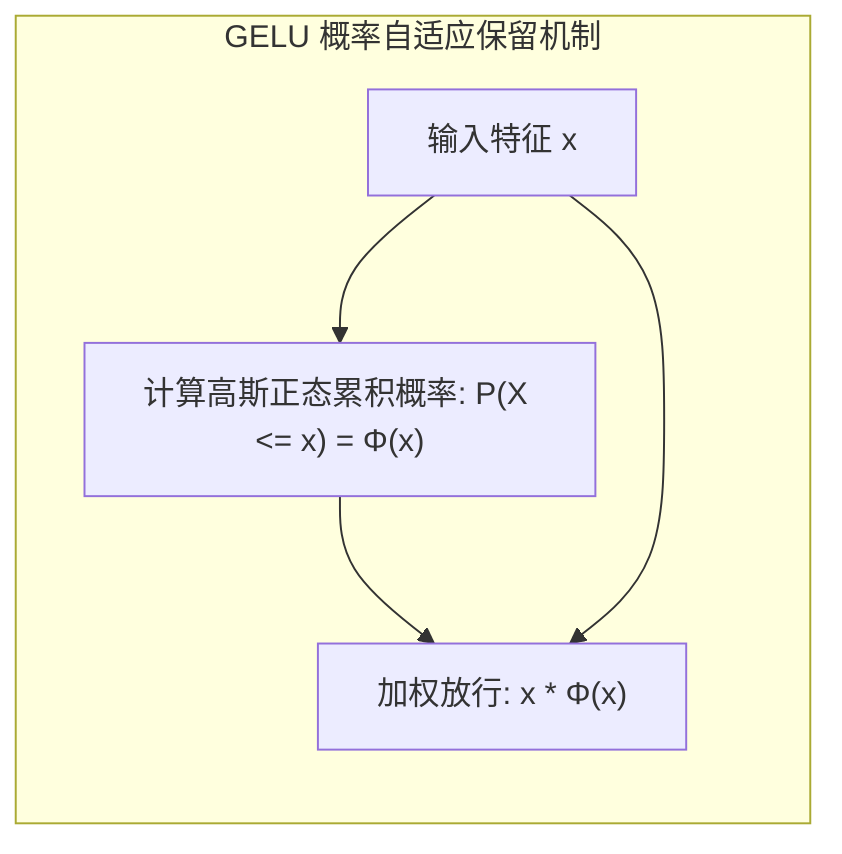

#### 3.2 工业常用 Tanh 近似公式与手算
精确的 GELU 依赖误差函数 $\text{erf}$，硬件计算极慢。实际工程全用 Hendrycks 提出的极速近似版：
$$ \text{GELU}(x) \approx 0.5 x \left( 1 + \tanh\left( \sqrt{\frac{2}{\pi}} \left( x + 0.044715 x^3 \right) \right) \right) $$
我们手算 $x = 1.0$：
1. $x + 0.044715 x^3 = 1.0 + 0.044715 \times 1.0 = 1.044715$；
2. $\sqrt{2/\pi} \approx 0.79788$；
3. 相乘：$0.79788 \times 1.044715 \approx 0.83356$；
4. $\tanh(0.83356) \approx 0.6822$；
5. $0.5 \times 1.0 \times (1 + 0.6822) = 0.5 \times 1.6822 = 0.8411$！
对比：输入 1.0，被平滑保留了 84.11%！

#### 3.3 原生 Python 逐行注释实现
```python
import math

def naive_gelu(x: list[float]) -> list[float]:
    """Tanh 快速近似版 GELU"""
    sqrt_2_over_pi = math.sqrt(2.0 / math.pi) # 约 0.7978846
    output = []
    for val in x:
        inner = sqrt_2_over_pi * (val + 0.044715 * (val ** 3))
        gelu_val = 0.5 * val * (1.0 + math.tanh(inner))
        output.append(gelu_val)
    return output

if __name__ == "__main__":
    sample_inputs = [-2.0, -1.0, 0.0, 1.0, 2.0]
    res_gelu = naive_gelu(sample_inputs)
    print("GELU 输出:")
    for v_in, v_out in zip(sample_inputs, res_gelu):
        print(f"  x = {v_in:>4} -> GELU(x) = {v_out:.4f}")
```

---

### 3.4 SiLU / Swish (自门控激活：开源大模型新王)

#### 4.1 公式与手算推导
- **公式**：
  $$ \text{SiLU}(x) = x \cdot \sigma(x) = \frac{x}{1 + e^{-x}} $$
  由 Google Brain（Swish）与 Elfwing 等人独立提出。
- **大模型为什么全都在用 SiLU？**
  LLaMA、LLaMA-2/3、Mistral、DeepSeek、Qwen 全系标配！
  它比 GELU 的公式更简炼（只需要一个简单的 Sigmoid），在负半轴 $x \approx -1.28$ 处有一个小小的低谷底（约为 $-0.278$），**具有处处可导的平滑非单调性（Non-monotonicity）**，在万亿参数模型上被证明收敛稳定性显著超越经典 ReLU。

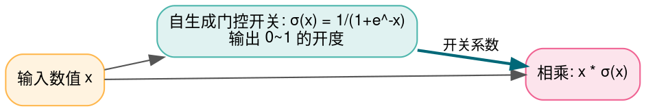

#### 4.2 手把手极小数字推演
- 输入 $x = 2.0$：
  $\sigma(2.0) \approx 0.8808 \implies \text{SiLU}(2.0) = 2.0 \times 0.8808 = 1.7616$；
- 输入 $x = -2.0$：
  $\sigma(-2.0) \approx 0.1192 \implies \text{SiLU}(-2.0) = -2.0 \times 0.1192 = -0.2384$（保留了一个微弱的负信号）；
- 输入 $x = 0.0$：
  $\sigma(0.0) = 0.5 \implies \text{SiLU}(0.0) = 0.0 \times 0.5 = 0.0$。

---

### 3.5 GLU 与 SwiGLU (门控线性单元机制：大模型 FFN 的终极杀招)

#### 5.1 痛点剖析：传统 FFN 为什么不够聪明？
- 传统的全连接前馈层（FFN）非常单调：
  $$ \text{Output} = \text{Activation}(x W_1) \times W_2 $$
  所有输入特征只能呆板地沿着同一条管道往前冲。
- **GLU（门控线性单元）的降维打击**：
  引入**双通路信息流机制**：
  将线性投影一分为二：一条通路作为**待处理内容（Up Projection）**，另一条通路作为**动态智能闸门（Gate Projection）**！
  $$ \text{GLU}(x) = (x W_{\text{content}}) \otimes \sigma(x W_{\text{gate}}) $$
- **SwiGLU（现代大模型统治者）**：
  Shazeer 在 2020 年提出，将门控开关的激活函数从 Sigmoid 换成 SiLU：
  $$ \text{SwiGLU}(x) = (x W_{\text{up}}) \otimes \text{SiLU}(x W_{\text{gate}}) $$
  最终整个前馈模块设计为：
  $$ \text{FFN}_{\text{SwiGLU}}(x) = \Big( (x W_{\text{up}}) \otimes \text{SiLU}(x W_{\text{gate}}) \Big) W_{\text{down}} $$
  **模型可以根据当前上下文，在每一个特征维度上自主决定“这个特征允许通过多少”，表达能力产生了质的飞跃！**

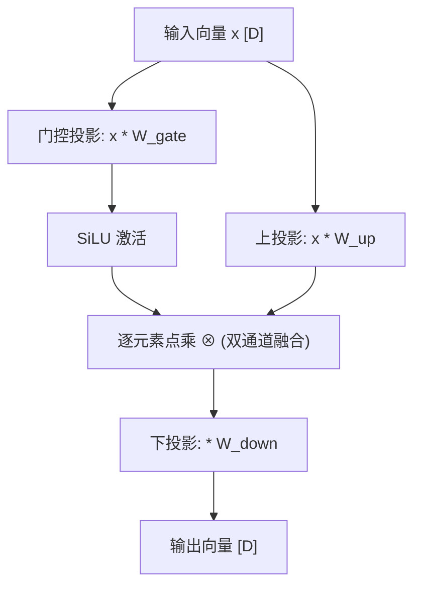

#### 5.2 原生 Python 逐行注释实现
```python
import math

def naive_swiglu(x: list[float], w_gate: list[float], w_up: list[float]) -> list[float]:
    """单向量朴素 SwiGLU 门控变换: Output = Up * SiLU(Gate)"""
    dim = len(x)
    output = []

    for i in range(dim):
        # 1. 计算门控分支与激活值
        gate_val = x[i] * w_gate[i]
        silu_gate = gate_val / (1.0 + math.exp(-gate_val)) # SiLU(Gate)
        
        # 2. 计算上投影分支内容
        up_val = x[i] * w_up[i]
        
        # 3. 门控与内容在特征维度逐元素点乘
        output.append(silu_gate * up_val)

    return output

if __name__ == "__main__":
    test_x = [1.0, 2.0, -1.0]
    weights_gate = [0.5, 1.2, 0.8]
    weights_up = [2.0, 1.0, -2.0]
    
    res = naive_swiglu(test_x, weights_gate, weights_up)
    print("SwiGLU 门控变换输出:", [round(v, 4) for v in res])
```

#### 5.3 原生 C++ 逐行注释实现
```cpp
#include <iostream>
#include <cmath>
#include <iomanip>

int main() {
    constexpr int D = 3;
    const float x[D] = {1.0f, 2.0f, -1.0f};
    const float w_gate[D] = {0.5f, 1.2f, 0.8f};
    const float w_up[D] = {2.0f, 1.0f, -2.0f};
    float out[D];

    for (int i = 0; i < D; ++i) {
        float gate = x[i] * w_gate[i];
        float silu_gate = gate / (1.0f + std::exp(-gate)); // SiLU(Gate)
        float up = x[i] * w_up[i];
        out[i] = silu_gate * up; // 点乘门控
    }

    std::cout << "=== 原生 C++ SwiGLU 计算验证 ===" << std::endl;
    for (int i = 0; i < D; ++i) {
        std::cout << "out[" << i << "] = " << std::fixed << std::setprecision(4) << out[i] << std::endl;
    }
    return 0;
}
```

---

### 3.小结 总结与初学者避坑指南

| 激活算子 | 核心公式 | 导数峰值 | 优缺点/痛点 | 最佳现代落地 |
| :--- | :--- | :--- | :--- | :--- |
| **ReLU** | $\max(0, x)$ | **1.0** | 计算零成本，但负半轴存在死神经元风险 | 传统视觉网络 (ResNet/CNN) |
| **Sigmoid** | $\frac{1}{1 + e^{-x}}$ | **0.25** | 深层极易发生梯度消失，非零均值 | 仅用于二分类概率或门控系数 |
| **Tanh** | $\frac{e^x - e^{-x}}{e^x + e^{-x}}$ | 1.0 | 严格零均值，但两端依然饱和消失 | 循环神经网络 (LSTM/GRU) 内部 |
| **GELU** | $x \cdot \Phi(x)$ | 平滑无拐点 | 引入概率正则平滑，计算较慢（需近似） | 经典 Transformer (BERT/GPT-2) |
| **SiLU** | $x \cdot \sigma(x)$ | 自门控 | 简单平滑非单调，训练更稳定 | **现代大模型 (LLaMA/Mistral)** |
| **SwiGLU** | $Up \otimes \text{SiLU}(Gate)$ | 双通路 | 参数增加约 50%，但表征容量质的飞跃 | **全系顶尖开源 LLM FFN 标配** |

---

## 模块四：归一化机制（训练稳定核心：方差统计、仿射变换与 RMSNorm）

> **致初学者**：在训练深层神经网络时，你很可能会遭遇这样一种让人崩溃的现象：
> 训练刚开始时好好的，跑着跑着，后面的网络层输出突然开始剧烈颠簸——一会儿所有特征值暴涨到几千，一会儿全部跌落到零点几。为了防止网络崩溃，你不得不把学习率调得极其微小（如 $0.00001$），导致模型跑了一个月还在原地踏步！
>
> 这种现象在学术界被称为**内部协变量偏移（Internal Covariate Shift）**。
>
> 怎么彻底制服这头脱缰的野马？答案就是**归一化（Normalization）**！
> 它就像一把**游标卡尺**，不管前一层输送进来的数据有多么疯狂，强行把它拉回到“均值为 0、方差为 1”的标准健康尺度。
>
> 很多初学者常被 **BatchNorm**、**LayerNorm** 和 **RMSNorm** 搞混。
> 本篇作为系列第四讲，将用**切豆腐的比喻、具体数字手算一遍**，带你从几何切面与底层显存读写彻底看懂这三大王者算子！

---

### 4.0 先导概念：初学者必懂概念：切豆腐的比喻与内部协变量偏移

#### 1. 生活比喻：高考标准分（Z-Score）
想象有一所高中的高三摸底考试：
- 第一次月考题目极难，全班平均分只有 30 分，最高分 50 分；
- 第二次月考题目极简单，全班平均分 85 分，最高分 99 分。
如果大学招生办直接看绝对分数，肯定会被完全搞糊涂！
**聪明的做法是算“标准分（Z-score 归一化）”**：
把每次月考的分数都**减去当次平均分，再除以当次标准差**。
这样不论考卷难易，全班成绩都被规整到了“平均分 0、离散度 1”的标准正态尺度上！
**归一化算子就是神经网络每一层之间的“标准分计算器”！**

#### 2. 张量立方体切豆腐：它们到底在哪个方向归一化？
在深度学习中，批次数据通常是一个三维立方体：
形状为 $[B, S, D]$（$B$ 是 Batch 批次大小，$S$ 是 Sequence 序列长度，$D$ 是每个 Token 的特征维度 Hidden Dim）。
**三种算子的根本区别，仅仅在于“拿刀切豆腐的方向不同”！**

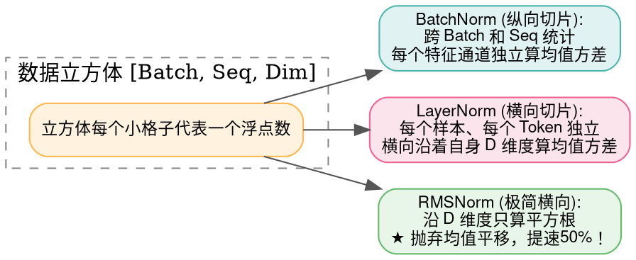

---

### 4.1 LayerNorm (层归一化：Transformer 的定海神针)

#### 1.1 为什么自然语言处理（NLP）离不开 LayerNorm？
在卷积视觉中，BatchNorm 是绝对的统治者。但到了自然语言和大模型时代，BatchNorm 彻底扑街了：
1. **变长序列的诅咒**：一句话可能只有 3 个词，另一句话有 100 个词。短句子必须补 0（Padding）。BatchNorm 跨句子纵向统计时，会被那些虚假的 0 严重污染统计量！
2. **Batch 依赖**：如果推理时用户只发了一条请求（$B=1$），BatchNorm 根本算不出方差。
**LayerNorm 的大智慧：自给自足！**
它在单个 Token 内部沿着自身的特征维度 $D$ 独立计算均值 $\mu$ 与方差 $\sigma^2$。**不管是单条推理还是变长序列，哪怕整个世界只剩下一个 Token，LayerNorm 都能稳稳当当地完成归一化！**

#### 1.2 手把手极小数字推演
假设某个 Token 的隐藏特征向量包含 4 个数字：
$$ x = [2.0, 4.0, 6.0, 8.0] $$
我们手工一步步推演 LayerNorm 的计算：

1. **算均值 $\mu$**：
   $$ \mu = \frac{2.0 + 4.0 + 6.0 + 8.0}{4} = \frac{20.0}{4} = 5.0 $$
2. **算每个数与均值的差值（中心化）**：
   $$ x - \mu = [2 - 5, 4 - 5, 6 - 5, 8 - 5] = [-3.0, -1.0, 1.0, 3.0] $$
3. **算方差 $\sigma^2$**：
   平方和：$(-3)^2 + (-1)^2 + 1^2 + 3^2 = 9 + 1 + 1 + 9 = 20.0$；
   $$ \sigma^2 = \frac{20.0}{4} = 5.0 $$
4. **算标准差与归一化（设 $\epsilon = 0$）**：
   标准差 $\sigma = \sqrt{5.0} \approx 2.236$；
   - $\hat{x}_0 = -3.0 / 2.236 \approx -1.3416$
   - $\hat{x}_1 = -1.0 / 2.236 \approx -0.4472$
   - $\hat{x}_2 = 1.0 / 2.236 \approx +0.4472$
   - $\hat{x}_3 = 3.0 / 2.236 \approx +1.3416$
5. **仿射变换（Scale $\gamma$ & Shift $\beta$）**：
   若初始权重 $\gamma = 1, \beta = 0$，最终输出即为：
   $$ y = [-1.3416, -0.4472, 0.4472, 1.3416] $$
   检验：均值 $(-1.3416 - 0.4472 + 0.4472 + 1.3416)/4 = 0$！方差为 1！

#### 1.3 原生 Python 逐行注释实现
```python
import math

def naive_layernorm(x: list[float], gamma: list[float] = None, beta: list[float] = None, eps: float = 1e-5) -> list[float]:
    """一维特征向量的朴素 LayerNorm"""
    D = len(x)
    if gamma is None: gamma = [1.0] * D
    if beta is None: beta = [0.0] * D

    # 步骤 1: 沿特征维度求算术平均值 (均值)
    mean = sum(x) / D

    # 步骤 2: 沿特征维度求方差
    variance = sum((val - mean) ** 2 for val in x) / D

    # 步骤 3: 归一化并叠加上可学习的缩放 gamma 与偏置 beta
    std_inv = 1.0 / math.sqrt(variance + eps)
    output = []
    for i in range(D):
        x_hat = (x[i] - mean) * std_inv
        y = x_hat * gamma[i] + beta[i]
        output.append(y)

    return output

if __name__ == "__main__":
    feat = [2.0, 4.0, 6.0, 8.0]
    out = naive_layernorm(feat)
    print("LayerNorm 手算结果验证:", [round(v, 4) for v in out])
```

---

### 4.2 RMSNorm (均方根归一化：现代大模型的极致精简)

#### 2.1 为什么 LLaMA 和 DeepSeek 全面抛弃 LayerNorm？
- **作者的震撼洞察（Zhang & Sennrich, 2019）**：
  研究人员通过海量实验发现：LayerNorm 之所以能让训练稳定，**99% 的功劳在于“除以标准差控制了尺度（Scaling Invariance）”；而“减去均值平移这一步”对模型性能几乎没有任何帮助！**
- **RMSNorm 的惊人简化**：
  既然减去均值没用，**那就彻底扔掉均值！直接除以均方根（RMS）！**
  $$ \text{RMS}(x) = \sqrt{\frac{1}{D} \sum_{i=1}^D x_i^2 + \epsilon} $$
  $$ y_i = \frac{x_i}{\text{RMS}(x)} \cdot \gamma_i $$
- **工业级暴击优势**：
  1. **节省一次内存遍历（Memory Pass）**：LayerNorm 要先遍历一遍求均值，再遍历一遍求方差；而 RMSNorm 只需要遍历一遍求平方和即可！显存往返耗时直接减半！
  2. **砍掉偏置参数 $\beta$**：现在的千亿大模型（LLaMA-3、Mistral、DeepSeek-V2/V3）全面移除了所有的偏置项，参数更少、吞吐更高。

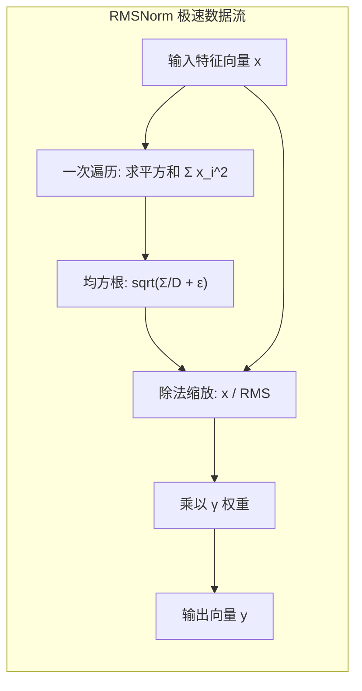

#### 2.2 手把手极小数字推演
我们拿同样的数字 $x = [2.0, 4.0, 6.0, 8.0]$ 来算 RMSNorm，感受它的极简魅力：
1. **直接算平方和（不用管均值！）**：
   $$ 2^2 + 4^2 + 6^2 + 8^2 = 4 + 16 + 36 + 64 = 120.0 $$
2. **算均方值（Mean Square）**：
   $$ \frac{120.0}{4} = 30.0 $$
3. **算均方根 RMS**：
   $$ \text{RMS} = \sqrt{30.0} \approx 5.4772 $$
4. **各自直接除以 RMS（设 $\gamma = 1.0$）**：
   - $y_0 = 2.0 / 5.4772 \approx 0.3651$
   - $y_1 = 4.0 / 5.4772 \approx 0.7303$
   - $y_2 = 6.0 / 5.4772 \approx 1.0954$
   - $y_3 = 8.0 / 5.4772 \approx 1.4606$

> [!TIP] 观察美妙的数学性质
> 看看这四个输出：$0.3651 : 0.7303 : 1.0954 : 1.4606$。
> 它们的比例是严格的 **$1 : 2 : 3 : 4$**！
> **RMSNorm 完美保留了特征向量原始的相对方向与相对比例，同时把整个向量的能量幅度死死稳定在一个受控的标准范围内！**

#### 2.3 原生 Python 逐行注释实现
```python
import math

def naive_rmsnorm(x: list[float], gamma: list[float] = None, eps: float = 1e-6) -> list[float]:
    """大模型标配 RMSNorm 算法"""
    D = len(x)
    if gamma is None: gamma = [1.0] * D

    # 步骤 1: 单遍扫描，直接计算平方和与均方值
    mean_square = sum(val * val for val in x) / D
    
    # 步骤 2: 计算均方根 RMS
    rms = math.sqrt(mean_square + eps)
    rms_inv = 1.0 / rms

    # 步骤 3: 尺度缩放并乘上可学习权重 gamma
    output = [x[i] * rms_inv * gamma[i] for i in range(D)]
    return output

if __name__ == "__main__":
    feat = [2.0, 4.0, 6.0, 8.0]
    out_rms = naive_rmsnorm(feat)
    print("RMSNorm 输出结果:", [round(v, 4) for v in out_rms])
```

#### 2.4 原生 C++ 逐行注释实现
```cpp
#include <iostream>
#include <cmath>
#include <iomanip>

int main() {
    constexpr int D = 4;
    const float x[D] = {2.0f, 4.0f, 6.0f, 8.0f};
    const float gamma[D] = {1.0f, 1.0f, 1.0f, 1.0f};
    constexpr float eps = 1e-6f;

    // 1. 单遍循环计算平方和
    float sum_sq = 0.0f;
    for (int i = 0; i < D; ++i) {
        sum_sq += x[i] * x[i];
    }

    // 2. 均方根
    float rms = std::sqrt(sum_sq / D + eps);
    float inv_rms = 1.0f / rms;

    std::cout << "=== 原生 C++ RMSNorm 计算输出 ===" << std::endl;
    for (int i = 0; i < D; ++i) {
        float y = (x[i] * inv_rms) * gamma[i];
        std::cout << "y[" << i << "] = " << std::fixed << std::setprecision(4) << y << std::endl;
    }
    return 0;
}
```

---

### 4.3 BatchNorm (批归一化：视觉 CNN 时代的王者)

#### 3.1 核心机制与 `model.eval()` 的秘密
- **统计方向**：跨 Batch 统计每个通道的均值和方差。
- **训练态 vs 推理态（初学者必踩巨坑）**：
  很多新手在部署模型时，忘记写 `model.eval()`，结果输入单张图片时，模型输出乱七八糟的乱码。
  **为什么？**
  1. **训练时（Training）**：网络每次看一整个 Mini-batch（比如 32 张图）。它实时计算这 32 张图当前通道的均值方差，同时用**指数移动平均（EMA）**默默记下一个全局小账本（`running_mean` 和 `running_var`）；
  2. **推理时（Inference）**：必须锁死小账本！**直接使用训练期间固化下来的 `running_mean` 和 `running_var`**！因为单张图根本无法计算统计量。

---

### 4.小结 总结与初学者避坑指南

| 归一化算子 | 统计轴向 | 是否依赖 Batch 大小 | 是否需要减去均值 | 主流适用模型 |
| :--- | :--- | :--- | :--- | :--- |
| **LayerNorm** | 样本内特征轴 $[D]$ | **否**（即使 $B=1$ 也能算） | **是**（先减 $\mu$ 再除 $\sigma$） | 经典 Transformer (BERT / GPT-2) |
| **RMSNorm** | 样本内特征轴 $[D]$ | **否** | **否（彻底扔掉均值，提速翻倍）** | **现代全系大模型 (LLaMA / DeepSeek)** |
| **BatchNorm** | 跨样本批次轴 $[B, H, W]$ | **是**（必须依赖大 Batch） | **是** | 卷积视觉网络 (ResNet / ConvNet) |

---

## 模块五：位置编码（序列顺序感知：绝对编码、RoPE 旋转与 ALiBi 外推）

> **致初学者**：自注意力机制（Self-Attention）有一个非常致命的“脑回路缺陷”：
>
> 假设有一句话叫 **“狗 咬 人”**，三个词分别对应三个词向量。
> 如果你把词的顺序打乱成 **“人 咬 狗”**，甚至 **“咬 狗 人”**，
> 在原始的自注意力公式 $\text{Softmax}(Q K^T) V$ 看来，**由于点积只计算词向量之间的相似度，这三句话计算出的注意力权重和特征输出完全一模一样！**
>
> 这在数学上被称为**置换不变性（Permutation Invariance）**。如果模型分不清“谁在前、谁在后”，语言的语法结构将荡然无存！
>
> 为了给大模型装上“时空罗盘”，深度学习经历了三代传奇演进：
> 1. **第一代：绝对位置编码（Vaswani 正余弦 PE）**：像时钟刻度一样，强行给每个词加上一个时间戳；
> 2. **第二代：旋转位置编码（RoPE）**：现代大模型（LLaMA/DeepSeek/Qwen）的绝对骨架，利用美妙的二维几何旋转，让相对位置在内积中自然显现；
> 3. **第三代：ALiBi 线性偏置**：彻底抛弃向量注入，直接在注意力打分矩阵上按物理距离做线性扣分！
>
> 本篇作为系列第五讲，将带你从几何旋转与手算数字出发，彻底搞透这三大位置编码算子！

---

### 5.0 先导概念：初学者必懂概念：为什么点积分不清前后？

假设“猫”的向量是 $v_{\text{cat}}$，“鱼”的向量是 $v_{\text{fish}}$。
在“猫 吃 鱼”里，“猫”对“鱼”计算注意力：点积为 $v_{\text{cat}} \cdot v_{\text{fish}}$。
在“鱼 吃 猫”里，“猫”对“鱼”计算注意力：点积依然为 $v_{\text{cat}} \cdot v_{\text{fish}}$！
点积是一个纯粹的标量乘积，**它根本不知道谁站在第 0 位、谁站在第 2 位！**
所以，我们必须人为地给向量注入“位置信息”。

---

### 5.1 经典正弦余弦绝对位置编码 (Absolute PE)

#### 1.1 钟表指针的生活比喻
- **公式**：
  对于第 $pos$ 个单词，其特征维度的第 $2i$ 和第 $2i+1$ 位定义为：
  $$ PE_{(pos, 2i)} = \sin\left( \frac{pos}{10000^{2i / d}} \right), \quad PE_{(pos, 2i+1)} = \cos\left( \frac{pos}{10000^{2i / d}} \right) $$
- **生活比喻：石英钟的三根指针**：
  - **秒针（低维通道 $2i=0$）**：转动极其飞快（周期短、频率极高），负责记录相邻两个单词之间的微小位移（比如第 1 个词和第 2 个词的差别）；
  - **分针（中维通道）**：转动适中，负责记录一小段句子的跨度；
  - **时针（高维通道 $2i \to d$）**：转动极其缓慢（周期极长，最大波长达 $10000 \cdot 2\pi$），负责记录整篇文章开头与结尾的宏观时空尺度。
- **结合方式**：直接与词向量做加法：$X_{\text{final}} = X_{\text{word}} + PE$。
- **初学者必知软肋**：
  如果模型在预训练时只见过最大长度 512，当遇到 1000 长度的长文本时，后半截的位置编码是模型从未见过的三角函数相位，**外推性能直接崩盘**。

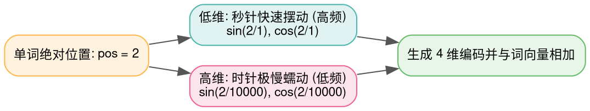

#### 1.2 手把手极小数字推演
假设维度 $d = 4$。
- 当 $i=0$ 时：分母 $10000^{0/4} = 10000^0 = 1.0$；
- 当 $i=1$ 时（即维度 2 和 3）：分母 $10000^{2/4} = 10000^{0.5} = 100.0$。

计算第 $pos = 0$ 个词的位置编码：
- 维度 0：$\sin(0 / 1.0) = \sin(0) = 0.0$
- 维度 1：$\cos(0 / 1.0) = \cos(0) = 1.0$
- 维度 2：$\sin(0 / 100.0) = \sin(0) = 0.0$
- 维度 3：$\cos(0 / 100.0) = \cos(0) = 1.0$
- $PE(pos=0) = [0.0, 1.0, 0.0, 1.0]$

计算第 $pos = 1$ 个词的位置编码：
- 维度 0：$\sin(1 / 1.0) = \sin(1) \approx 0.8415$
- 维度 1：$\cos(1 / 1.0) = \cos(1) \approx 0.5403$
- 维度 2：$\sin(1 / 100.0) = \sin(0.01) \approx 0.0100$
- 维度 3：$\cos(1 / 100.0) = \cos(0.01) \approx 0.9999$
- $PE(pos=1) = [0.8415, 0.5403, 0.0100, 0.9999]$

看！低维（0 和 1）已经从 0 剧烈跳到了 0.84，而高维（2 和 3）才刚挪动了 0.01！

---

### 5.2 RoPE (旋转位置编码：复平面上的几何神作)

#### 2.1 为什么 RoPE 统治了当今所有顶尖大模型？
苏剑林老师在 2021 年提出了 RoPE（Rotary Position Embedding）。它诞生于一个极其深刻的数学执念：
**“能不能找到一种方法，给位置 $m$ 的向量 $q$ 和位置 $n$ 的向量 $k$ 注入位置后，它们做内积时，结果只与两者的相对距离 $m - n$ 有关？”**

#### 2.2 二维平面旋转的几何奇迹
我们回忆高中复数与二维向量旋转：
把向量的每两个数字 $(x_0, x_1)$ 当成二维平面上的一个点。
如果在位置 $m$，我们把这个点在圆盘上顺时针**旋转角度 $m\theta$**；
在位置 $n$，我们把另一个向量在圆盘上**旋转角度 $n\theta$**。
**现在把这两个旋转后的向量做点积，会发生什么？**
初中平面几何告诉我们：
两个向量的点积等于它们的长度相乘再乘以夹角余弦 $\cos(\alpha)$。
旋转后，两者的夹角刚好就是 **$(m\theta - n\theta) = (m - n)\theta$**！
$$ \langle R_m q, R_n k \rangle = q^T R_m^T R_n k = q^T R_{n - m} k $$
**绝对位置 $m$ 和 $n$ 在相乘的瞬间彻底消失了，留在算式里的只剩下纯净的相对距离 $(m - n)$！**

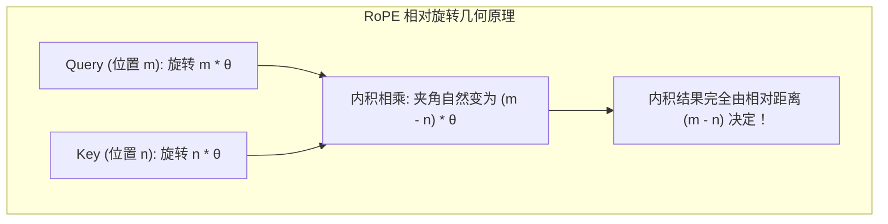

#### 2.3 手把手极小数字推演
设二维向量 $q = [1.0, 0.0]$（在单位圆的 0 度位置，即 $(1, 0)$）。
设基频 $\theta = \frac{\pi}{2}$（90度）。
- **在位置 $pos = 0$**：旋转角度 $0 \times 90^\circ = 0^\circ$。
  $q_0 = [1.0 \times \cos(0) - 0.0 \times \sin(0), 1.0 \times \sin(0) + 0.0 \times \cos(0)] = [1.0, 0.0]$。
- **在位置 $pos = 1$**：旋转角度 $1 \times 90^\circ = 90^\circ$。
  $\cos(90^\circ) = 0, \sin(90^\circ) = 1$。
  $q_1 = [1.0 \times 0 - 0.0 \times 1, 1.0 \times 1 + 0.0 \times 0] = [0.0, 1.0]$。
- **在位置 $pos = 2$**：旋转角度 $2 \times 90^\circ = 180^\circ$。
  $\cos(180^\circ) = -1, \sin(180^\circ) = 0$。
  $q_2 = [-1.0, 0.0]$。

看！随着位置 $pos$ 前进，向量就像在钟表圆盘上旋转跳舞，每一拍都转过固定的角度！

#### 2.4 原生 Python 逐行注释实现
```python
import math

def naive_rope_2d(vec: list[float], pos: int, base: float = 10000.0) -> list[float]:
    """对单向量应用 RoPE 旋转 (向量长度需为偶数)"""
    dim = len(vec)
    out = [0.0] * dim

    # 两两一组，构成二维复平面旋转
    for i in range(0, dim, 2):
        # 计算该二维子空间的旋转频率 θ
        theta = 1.0 / (base ** (i / dim))
        angle = pos * theta
        cos_val = math.cos(angle)
        sin_val = math.sin(angle)

        x0 = vec[i]
        x1 = vec[i + 1]

        # 二维旋转变换: [cos, -sin; sin, cos] * [x0, x1]
        out[i]     = x0 * cos_val - x1 * sin_val
        out[i + 1] = x0 * sin_val + x1 * cos_val

    return out

if __name__ == "__main__":
    v = [1.0, 0.0, 0.5, 0.5]
    print("RoPE pos=0 旋转结果:", [round(x, 4) for x in naive_rope_2d(v, pos=0)])
    print("RoPE pos=1 旋转结果:", [round(x, 4) for x in naive_rope_2d(v, pos=1)])
```

#### 2.5 原生 C++ 逐行注释实现
```cpp
#include <iostream>
#include <cmath>
#include <iomanip>

int main() {
    // 4 维特征向量 (视为两个独立的二维平面复数子空间)
    const float x[] = {1.0f, 0.0f, 0.5f, 0.5f};
    const int D = 4;
    const int pos = 1; // 处于序列位置 1
    const float base = 10000.0f;

    float rotated[D];

    std::cout << "=== 原生 C++ RoPE 旋转位置编码验证 ===" << std::endl;
    for (int i = 0; i < D; i += 2) {
        float theta = 1.0f / std::pow(base, (float)i / (float)D);
        float m_theta = pos * theta;
        float cos_val = std::cos(m_theta);
        float sin_val = std::sin(m_theta);

        float x0 = x[i];
        float x1 = x[i + 1];

        // 二维平面旋转公式
        rotated[i]     = x0 * cos_val - x1 * sin_val;
        rotated[i + 1] = x0 * sin_val + x1 * cos_val;
    }

    std::cout << "原向量: [1.0, 0.0, 0.5, 0.5]" << std::endl;
    std::cout << "位置 " << pos << " 旋转后: [";
    for (int i = 0; i < D; ++i) {
        std::cout << std::fixed << std::setprecision(4) << rotated[i] << (i + 1 < D ? ", " : "");
    }
    std::cout << "]" << std::endl;
    return 0;
}
```

---

### 5.3 ALiBi (线性偏置注意力：零样本长文本外推王者)

#### 3.1 为什么 ALiBi 连向量都懒得旋转了？
- **作者的大胆直觉（Press 等人，2021）**：
  不管是绝对位置编码还是 RoPE，本质都是为了告诉注意力：“离我越远的词，我通常关注度越低”。
  **既然如此，为什么还要费尽心机去修改 $Q$ 和 $K$ 向量？**
  **直接在注意力得分矩阵上扣分不就得了吗！**
- **公式**：
  $$ \text{Score}_{i, j} = \frac{q_i \cdot k_j^T}{\sqrt{d_k}} - m \cdot (i - j) \quad (i \ge j) $$
  其中 $(i - j)$ 是两个词之间的物理距离。
  距离为 0（自己看自己），不扣分；
  距离为 1，扣 $m$ 分；
  距离为 10，扣 $10m$ 分！
- **多头斜率（Slopes）**：
  不同的注意力头（Head）赋予不同的扣分斜率 $m = 2^{-8h/H}$：
  有的头扣分极快（急脾气，只关心相邻 3 个词）；有的头扣分极慢（慢性子，能看几千字外的伏笔）。
- **神级外推能力**：
  在 1024 长度上训练的模型，推理时直接喂入 8192 长度，**完全不报错，困惑度平稳无损，真正做到了免训练直接外推！**

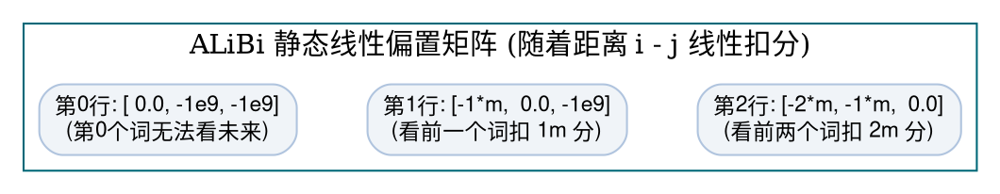

#### 3.2 原生 Python 逐行注释实现
```python
def naive_alibi_bias(seq_len: int, slope: float = 0.5) -> list[list[float]]:
    """生成单头的 ALiBi 距离线性衰减偏置矩阵"""
    matrix = [[0.0] * seq_len for _ in range(seq_len)]
    for i in range(seq_len):
        for j in range(seq_len):
            if j <= i:
                # 距离越远 (i - j 越大)，扣分越多 (-slope * 距离)
                matrix[i][j] = -slope * (i - j)
            else:
                matrix[i][j] = -1e9 # 因果掩码，未来不可见
    return matrix

if __name__ == "__main__":
    bias_mat = naive_alibi_bias(seq_len=3, slope=0.5)
    print("ALiBi 偏置矩阵 (3x3):")
    for row in bias_mat:
        print(" ", [round(v, 2) for v in row])
```

---

### 5.小结 总结与初学者避坑指南

1. **自注意力天生是“无序词袋”**：没有位置编码，它根本分不清语序；
2. **绝对位置编码（Vaswani）**：像钟表指针，但长文本外推能力差；
3. **RoPE（旋转位置编码）**：通过复平面旋转把绝对坐标转化为内积相对角位移，**是当今几乎所有顶尖大模型的绝对标配**；
4. **ALiBi**：直接在打分矩阵上线性扣分，外推能力最强悍。

下一讲，我们将直击大语言模型的王冠——**注意力机制全家桶（SDPA / MHA / MQA / GQA / FlashAttention / PagedAttention / MLA）**！

---

## 模块六：注意力机制（大模型灵魂：SDPA、GQA、FlashAttention 与 MLA）

> **致初学者**：在接触现代大语言模型（如 ChatGPT、Claude、LLaMA、DeepSeek）时，你一定会反复听到这几个高频“黑话”：
> **“自注意力”、“KV Cache 显存爆炸”、“FlashAttention 分块”、“vLLM 分页内存”、“GQA 分组查询”、“DeepSeek MLA”**……
>
> 许多初学者翻开经典论文《Attention Is All You Need》，看到公式：
> $$ \text{Attention}(Q, K, V) = \text{Softmax}\left( \frac{Q K^T}{\sqrt{d_k}} \right) V $$
> 觉得这个式子看起来也没多长，怎么一到了 10 万字的长文本，显存就直接 OOM（Out of Memory 内存溢出）挂掉了？
> 为什么原本好好的 MHA（多头注意力），后来被改造成了 MQA、GQA，再到如今引爆全球的 DeepSeek MLA？
>
> 本篇作为系列第六讲，将彻底抛开所有晦涩的套话，**用生动形象的生活比喻（图书馆借书、服务员与厨师、小书桌与大书架）**，带你从最原始的点积注意力开始，一步一步搞懂注意力机制全家桶的 7 大核心算子！

---

### 6.0 先导概念：Q、K、V 的生活真相：图书馆借书隐喻

很多初学者学了半年也没想明白：为什么非要搞出 $Q$、$K$、$V$ 三个矩阵？
我们用**图书馆借书**的生活场景，30 秒彻底搞懂：

- **Query（查询向量 $Q$）**：
  好比你走进图书馆时，脑子里想找的书的**搜索关键词**（比如：“我想学做红烧肉”）。
- **Key（键向量 $K$）**：
  好比图书馆书架上每一本书的**索引标签或书名**（比如：A 书标签是“川菜大全”，B 书标签是“高等数学”，C 书标签是“家常热菜”）。
- **$Q \cdot K^T$（计算相似度打分）**：
  拿着你的关键词去跟书架上的每本书标签挨个比对，算出一个**相关度分数**：
  你发现 A 书得分 90，C 书得分 80，B 书得分 0。
- **Softmax（归一化为概率权重）**：
  把相关度分数变成百分比权重：A 书占 60%，C 书占 40%，B 书占 0%。
- **Value（值向量 $V$）**：
  好比每一本书里面**真正印着的知识正文**！
- **最后与 $V$ 加权求和（$\text{Weights} \cdot V$）**：
  你按照 60% 参考 A 书的内容 + 40% 参考 C 书的内容，在脑海里提炼出最终的红烧肉做法！

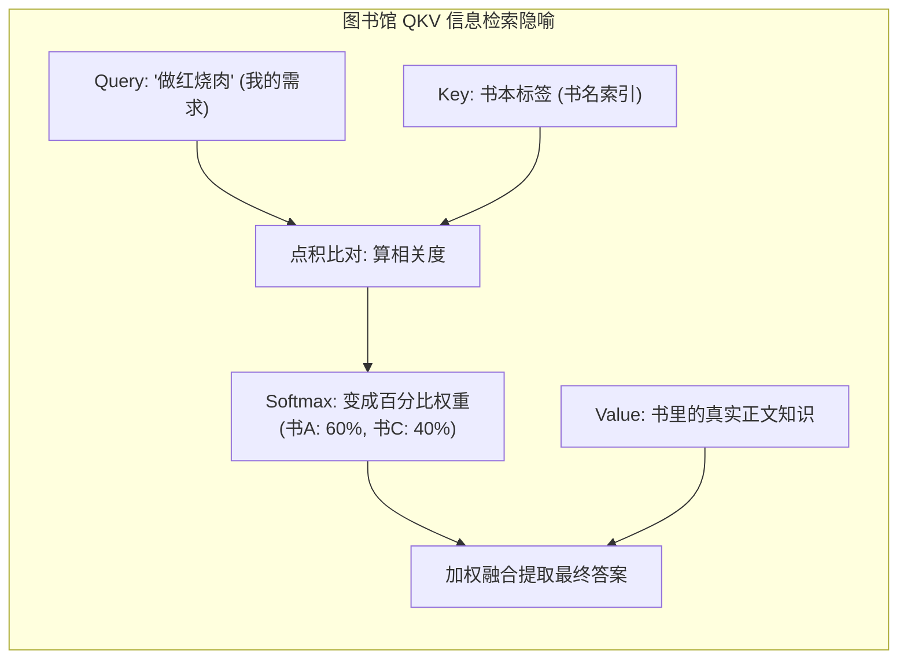

---

### 6.1 ScaledDotProductAttention (缩放点积注意力：为什么除以 $\sqrt{d_k}$？)

#### 1.1 初学者必懂：那个神秘的根号分母是干嘛的？
公式里为什么要除以 $\sqrt{d_k}$？直接算 $Q K^T$ 不行吗？
**答案：如果不除以 $\sqrt{d_k}$，Softmax 会瞬间梯度死亡！**

- **极小数字推演数学证明**：
  假设每个分量都是独立同分布的标准正态分布（均值 0，方差 1）。
  点积是 $d_k$ 个乘积的累加：$q \cdot k = \sum_{i=1}^{d_k} q_i k_i$。
  初中概率论告诉我们：$d_k$ 个方差为 1 的随机变量加起来，**总方差会直接变成 $d_k$！标准差变为 $\sqrt{d_k}$！**
- **如果维度 $d_k = 64$**：
  标准差高达 $\sqrt{64} = 8$！
  这意味着点积算出来的分数很容易飙到 $+24$ 或者 $-24$。
  我们看一下指数运算的恐怖威力：
  $e^{24} \approx 2.6 \times 10^{10}$，而 $e^{-24} \approx 3.7 \times 10^{-11}$。
  经过 Softmax 之后，最大那个数独揽了 $99.9999999999\%$ 的概率，其余所有数概率全部变成了 0（变成了一个极端的 One-Hot 冲激）！
  **此时，Softmax 的局部导数在所有地方全部等于 0，反向传播梯度彻底消失！**
- **除以 $\sqrt{d_k} = 8$ 的神效**：
  把点积结果重新除以 8，数值重新被拉回到 $[-3, 3]$ 的平缓健康激活区，Softmax 的梯度重新恢复充沛生机！

#### 1.2 原生 Python 逐行注释实现
```python
import math

def naive_sdpa(Q: list[list[float]], K: list[list[float]], V: list[list[float]], is_causal: bool = True) -> list[list[float]]:
    """原生纯 Python 缩放点积注意力 (含因果掩码与 Safe-Softmax)"""
    Sq = len(Q)       # Query 序列长度
    Sk = len(K)       # Key 序列长度
    dk = len(Q[0])    # 隐藏特征维度
    scale = 1.0 / math.sqrt(dk) # 缩放因子 1/sqrt(dk)

    # 步骤 1: 计算 Q 与 K 的点积相似度矩阵 [Sq, Sk]
    scores = [[0.0] * Sk for _ in range(Sq)]
    for i in range(Sq):
        for j in range(Sk):
            # 向量点积
            dot = sum(Q[i][d] * K[j][d] for d in range(dk))
            scores[i][j] = dot * scale
            # 因果掩码 (Causal Mask)：如果是语言模型，不允许偷看未来的词 (j > i)
            if is_causal and j > i:
                scores[i][j] = -1e9

    # 步骤 2: 逐行执行 Safe-Softmax 归一化为注意力权重
    weights = [[0.0] * Sk for _ in range(Sq)]
    for i in range(Sq):
        max_s = max(scores[i]) # 减去行最大值，防上溢
        exp_row = [math.exp(s - max_s) for s in scores[i]]
        sum_exp = sum(exp_row)
        weights[i] = [v / sum_exp for v in exp_row]

    # 步骤 3: 用注意力权重对 Value 进行加权求和 [Sq, dv]
    dv = len(V[0])
    output = [[0.0] * dv for _ in range(Sq)]
    for i in range(Sq):
        for d in range(dv):
            output[i][d] = sum(weights[i][j] * V[j][d] for j in range(Sk))

    return output

if __name__ == "__main__":
    # 2 个 Token，每个维度为 2
    test_Q = [[1.0, 0.0], [0.0, 1.0]]
    test_K = [[1.0, 0.0], [0.0, 1.0]]
    test_V = [[10.0, 20.0], [30.0, 40.0]]
    out = naive_sdpa(test_Q, test_K, test_V, is_causal=True)
    print("SDPA 自注意力计算输出:")
    for row in out:
        print(" ", [round(v, 2) for v in row])
```

#### 1.3 原生 C++ 逐行注释实现
```cpp
#include <iostream>
#include <cmath>
#include <iomanip>

int main() {
    constexpr int S = 2; // 序列长度
    constexpr int D = 2; // 特征维度

    const float Q[S][D] = {{1.0f, 0.0f}, {0.0f, 1.0f}};
    const float K[S][D] = {{1.0f, 0.0f}, {0.0f, 1.0f}};
    const float V[S][D] = {{10.0f, 20.0f}, {30.0f, 40.0f}};

    const float scale = 1.0f / std::sqrt(2.0f);
    float scores[S][S];

    // 1. QK^T 点积并乘以缩放因子
    for (int i = 0; i < S; ++i) {
        for (int j = 0; j < S; ++j) {
            float dot = 0.0f;
            for (int d = 0; d < D; ++d) {
                dot += Q[i][d] * K[j][d];
            }
            // 因果掩码：不能看未来 (j > i)
            if (j > i) {
                scores[i][j] = -1e9f;
            } else {
                scores[i][j] = dot * scale;
            }
        }
    }

    // 2. Safe-Softmax
    float weights[S][S];
    for (int i = 0; i < S; ++i) {
        float max_val = scores[i][0];
        for (int j = 1; j < S; ++j) {
            if (scores[i][j] > max_val) max_val = scores[i][j];
        }
        float sum_exp = 0.0f;
        for (int j = 0; j < S; ++j) {
            weights[i][j] = std::exp(scores[i][j] - max_val);
            sum_exp += weights[i][j];
        }
        for (int j = 0; j < S; ++j) {
            weights[i][j] /= sum_exp;
        }
    }

    // 3. 加权求和 Weights * V
    float output[S][D] = {0.0f};
    for (int i = 0; i < S; ++i) {
        for (int d = 0; d < D; ++d) {
            float sum = 0.0f;
            for (int j = 0; j < S; ++j) {
                sum += weights[i][j] * V[j][d];
            }
            output[i][d] = sum;
        }
    }

    std::cout << "=== 原生 C++ SDPA 自注意力验证 ===" << std::endl;
    for (int i = 0; i < S; ++i) {
        std::cout << "Token " << i << ": [";
        for (int d = 0; d < D; ++d) {
            std::cout << std::fixed << std::setprecision(2) << output[i][d] << (d + 1 < D ? ", " : "");
        }
        std::cout << "]" << std::endl;
    }
    return 0;
}
```

---

### 6.2 MHA vs MQA vs GQA (服务员与厨师的比喻)

#### 2.1 为什么大模型要把 MHA 改造成 GQA？
自回归生成时，每一个历史 Token 的 Key 和 Value 都必须保存在显存里（这就是著名的 **KV Cache**）。
当上下文达到数万 Token 时，KV Cache 会占用几十个 GB 的宝贵显存！
我们用**餐馆里的服务员与后厨厨师**的比喻，30 秒秒懂三大变体：

- **Query Head（查询头）**：好比**前厅点单的服务员**；
- **Key-Value Head（键值头）**：好比**后厨做饭的厨师（占用昂贵的厨房操作台/显存空间）**。

1. **MHA（标准多头注意力）**：
   32 个服务员，配备 **32 位独立厨师**！
   每位服务员都有自己专属的厨师。**缺点：厨房操作台（显存）被挤爆了！**
2. **MQA（多查询注意力）**：
   32 个服务员，**全店只有 1 位公用大厨**！
   显存瞬间缩减为原先的 $\frac{1}{32}$！**缺点：1 位大厨照顾 32 个服务员，做出来的菜味道单调（模型表达能力下降）**。
3. **GQA（分组查询注意力，现代大模型标配）**：
   **黄金中庸折中！** 32 个服务员分成 8 组，每 4 个服务员共享 1 位厨师（共 8 位厨师）。
   **显存直接减少 4 倍，同时菜品的丰富度和质量几乎丝毫无损！**（LLaMA-2/3、Mistral 全面采用）。

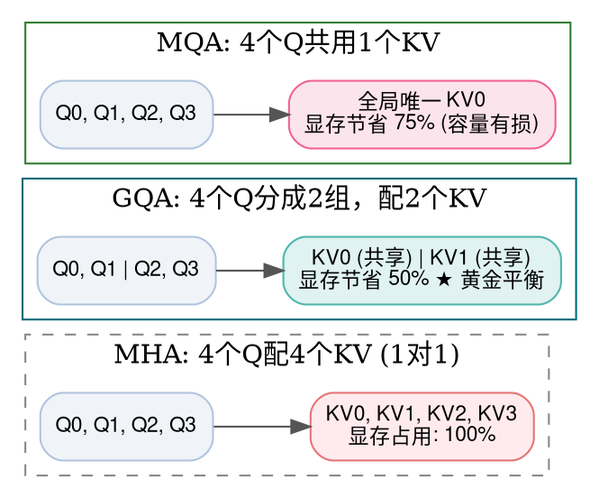

---

### 6.3 FlashAttention (小书桌与大书架的比喻)

#### 3.1 为什么标准注意力把 GPU 累死了？
- **小书桌（GPU 片上 SRAM）**：
  极快（1 纳秒就能拿放），但极小（每块核心只有 100KB~200KB）。
- **大书架（GPU 显存 HBM）**：
  极大（80GB），但很远很慢（走过去要 200 纳秒）。
- **标准注意力的愚蠢做法**：
  在算长文本时，中间的 $S \times S$ 注意力矩阵有几千万个数字（好几百兆）。小书桌放不下，GPU 就只能把这几百兆草稿纸**整捆搬到大书架上**；要算 Softmax 时，再从大书架**整捆搬回小书桌**；算完了再搬回大书架；要乘 $V$ 时再搬一次！
  **GPU 95% 的时间全浪费在楼道里搬书（访存墙），根本没时间做真正的计算！**

#### 3.2 FlashAttention 的天才构想：在线递推 Softmax（Online Softmax）
FlashAttention 宣布：**那几百兆的巨大草稿纸，我们一个字也不要往大书架上写！**
把 $Q, K, V$ 切成刚刚能放下小书桌的微小分块（Tiles，比如 128 个词一块）：
在小书桌上边算边用 **Online Softmax 公式**在便利贴上实时修正局部极大值和累加分母，算完当场把结果累加进最终输出，然后**直接把草稿纸撕掉扔进垃圾桶**！
**中间的超大矩阵根本不需要写回显存，IO 搬运量直接暴跌一个数量级，提速 2~4 倍！**

---

### 6.4 PagedAttention (操作系统虚拟内存分页大拯救)

#### 4.1 传统连续显存分配的荒谬浪费
在 vLLM 出现前，大模型服务器为了保存某个用户的对话 KV Cache，必须在显存里划出一块**连续的物理内存空间**。
因为用户可能会问很长的问题（比如上限 4096），系统哪怕这个用户只说了句“你好”，也必须提前在显存里给他霸占好 4096 个词的整片地皮！
结果：**60% 到 80% 的显存被空闲地皮白白霸占着，其他用户根本进不来！**

#### 4.2 PagedAttention 机制：向 Windows/Linux 虚拟内存学习！
操作系统是怎么管理内存的？**分页（Paging）！**
- 将显存切成固定大小的“物理小格子”（比如每个物理块存 16 个 Token）；
- 维护一张**页表（Block Table）**；
- 用户的 Token 说到哪，就从空闲池里抓一个物理块挂上去。物理块可以散落在显存的任何角落！
**显存浪费率从 80% 暴降到 4% 以下，并发支持人数瞬间飙升数倍！**

```mermaid
graph LR
    subgraph Logical["逻辑对话序列 (Tokens 0~31)"]
        L0["逻辑块 0 (Tokens 0~15)"]
        L1["逻辑块 1 (Tokens 16~31)"]
    end
    subgraph Table["页表映射 Block Table"]
        T0["逻辑 0 -> 物理块 #8"]
        T1["逻辑 1 -> 物理块 #3"]
    end
    subgraph Physical["分散的物理显存小块"]
        P3["物理块 #3 (存储后16字)"]
        P8["物理块 #8 (存储前16字)"]
    end
    L0 --> T0 --> P8
    L1 --> T1 --> P3
```

---

### 6.5 MLA (多头潜在注意力：DeepSeek 引爆业界的杀手锏)

#### 5.1 痛点直击：GQA 还不够省显存！
在前面讲的 GQA 中，虽然厨师数量变少了，但每个保留下来的 KV 维度依然非常庞大（动辄几千维）。
当百万上下文成为刚需时，显存依然吃紧。
#### 5.2 DeepSeek 的神级创新：低秩潜在压缩（Latent Compression）
DeepSeek-V2 / V3 提出了 MLA（Multi-Head Latent Attention）：
1. **压缩进潜空间（Compression）**：
   不要直接缓存庞大的 Key 和 Value！用一个下投影矩阵，把几千维的 Key 和 Value **联合压缩成一个只有几百维的超低维小向量（潜向量 $c_t^{KV}$）**；
2. **显存只存潜向量**：
   在自回归生成时，显存**只缓存这个被深度压榨过的小潜向量**！
3. **即时解压（On-the-fly Decompress）**：
   要算注意力时，通过上投影矩阵瞬间解压出完整多头 Key 和 Value。
**成果：在保持完整多头注意力表征能力的同时，将 KV Cache 显存暴砍 80% 以上！**

---

### 6.小结 总结与初学者避坑指南

| 注意力算子 | 核心攻克的技术痛点 | 工业界最佳方案 |
| :--- | :--- | :--- |
| **SDPA** | 注意力基础原型，除以 $\sqrt{d_k}$ 防止 Softmax 梯度饱和死亡 | 标配 |
| **GQA** | 解决解码期 KV Cache 显存爆炸，4个Q共享1个KV | LLaMA-2/3、Mistral 标配 |
| **FlashAttention** | 突破 GPU HBM 显存带宽墙，片上分块 + 在线递推 Softmax | 现代全栈训练加速基石 |
| **PagedAttention** | 借鉴操作系统页表，彻底消灭显存碎片 | vLLM 推理服务引擎底座 |
| **MLA** | 低秩联合潜向量压缩，保持表达力同时再砍 80% 显存 | DeepSeek-V2 / DeepSeek-V3 |

---

## 模块七：路由与混合专家（MoE 基础：Top-K 门控与 Token 重排置换）

> **致初学者**：在过去，深度学习模型几乎都是**稠密模型（Dense Model）**：
> 一个 70B（700 亿）参数的模型，每一个输入进来的词，都要把这 700 亿个参数全盘运算一遍，计算极其昂贵、速度极慢。
>
> 后来，以 **Mixtral 8x7B、DeepSeek-V2/V3、Grok** 为代表的 **MoE（Mixture of Experts，混合专家模型）** 横空出世：
> 它们的总参数量高达几千亿，但跑起来的速度却跟一个十几亿的小模型一样飞快！
>
> 为什么能做到这么神奇？
> 很多初学者翻开 MoE 代码，被里面的 `TopK`、`Router Gating`、`Token Permute`、`Token Unpermute` 搞得一头雾水。
>
> 本篇作为系列第七讲，将用**医院分诊台与专科医生的通俗比喻，配合手工具体数字推演**，带你 10 分钟彻底搞懂 MoE 底层的三大核心算子！

---

### 7.0 先导概念：医院分诊台比喻：30 秒搞懂 MoE 核心逻辑

想象一家拥有 64 位专科顶级医生的三甲大医院：
- **传统的稠密模型（Dense）做法**：
  每一个来看病的病人（输入的 Token），**必须强行把全院 64 位医生全部看一遍！**
  每个医生都给病人开一遍检查、写一遍病历。这不仅把医院累瘫痪了，病人也排队排到吐血！
- **现代的 MoE 混合专家做法**：
  门口设一个**分诊台护士（MoE Router 门控路由器）**。
  病人刚走到门口，护士扫一眼病人的特征（Token 向量），在挂号单上打分：
  - 骨科得分 95 分，神经科得分 80 分，儿科 5 分，妇科 0 分……
  - 护士挑选得分最高的两位医生（**Top-2 决策**）：请去找“骨科医生（专家 3）”和“神经科医生（专家 17）”！
  - 其余 62 位医生该干嘛干嘛，不为这位病人消耗任何精力！
- **为什么强大？**
  整个医院拥有 64 个学科的浩瀚全科知识储备（模型参数总量巨大），但针对每一个具体问题，**只需要消耗 2 位医生的精力（推理算力极小）！**

```mermaid
graph TD
    subgraph Hospital["MoE 医院分诊协同系统"]
        Patient["输入 Token 单词 (病人)"]
        Nurse["分诊台护士 (Router Gating 路由器)"]
        DoctorA["专家 3: 骨科医生 (激活 60%)"]
        DoctorB["专家 17: 神经科医生 (激活 40%)"]
        DoctorIdle["其余 62 位专家医生 (本次睡眠休眠，零算力开销!)"]
        Combined["汇总诊断报告 (加权输出)"]

        Patient --> Nurse
        Nurse -->|Top-2 选拔| DoctorA
        Nurse -->|Top-2 选拔| DoctorB
        Nurse -.->|未被唤醒| DoctorIdle
        DoctorA --> Combined
        DoctorB --> Combined
    end
```

---

### 7.1 TopK 与 MoEGating / Router (门控路由打分算子)

#### 1.1 手把手极小数字推演
假设模型当前只有 4 个专家（编号 0、1、2、3），我们要选出最匹配的 **Top-2 个专家**。
输入一个 Token 向量 $x$ 后，路由器线性打分输出 Logits 为：
$$ \text{Logits} = [0.2, 1.8, 0.1, 2.4] $$

1. **Step 1：执行 TopK 极值排序**：
   - 最大的是第 3 号专家：得分 $2.4$；
   - 第二大的是第 1 号专家：得分 $1.8$；
   - 其余第 0、2 号专家被无情淘汰！
2. **Step 2：对入选的 Top-2 分数重新做 Safe-Softmax 归一化**：
   极大值 $M = 2.4$。
   - 专家 3：$e^{2.4 - 2.4} = e^0 = 1.0$；
   - 专家 1：$e^{1.8 - 2.4} = e^{-0.6} \approx 0.5488$；
   - 指数总和：$\text{Sum} = 1.0 + 0.5488 = 1.5488$；
   - 归一化权重：
     - 专家 3 权重：$W_3 = 1.0 / 1.5488 \approx 0.6457$（即 64.57%）；
     - 专家 1 权重：$W_1 = 0.5488 / 1.5488 \approx 0.3543$（即 35.43%）；
3. **输出路由决策**：
   把这个 Token 派送给专家 3 和专家 1，最终结果按 $0.6457 \times \text{Expert}_3 + 0.3543 \times \text{Expert}_1$ 加权求和！

#### 1.2 初学者必知的灾难：专家坍缩与负载均衡
如果分诊护士在训练最初几天发现 1 号专家看病稍微准确一点点，之后的几乎所有病人都被送给了 1 号专家！
- **灾难后果**：
  1 号医生门前排起了几万人的长龙（那张 GPU 显存爆满、严重堵车延迟）；而其余 63 位医生闲得无聊看报纸，永远学不到新知识（学术界称为 **专家坍缩 Expert Collapse**）。
- **解法：辅助平衡损失（Auxiliary Load Balancing Loss）**：
  在总 Loss 中加一个惩罚项，强行要求护士派发的病人必须均匀分散到所有专家头上。

#### 1.3 原生 Python 逐行注释实现
```python
import math

def naive_moe_router(token_feat: list[float], W_router: list[list[float]], top_k: int = 2) -> list[tuple[int, float]]:
    """纯 Python 原生 MoE 门控路由器"""
    num_experts = len(W_router[0])
    dim = len(token_feat)

    # 1. 线性投影算出所有专家的初选得分 Logits
    logits = [0.0] * num_experts
    for e in range(num_experts):
        logits[e] = sum(token_feat[d] * W_router[d][e] for d in range(dim))

    # 2. 挑选出得分最高的 Top-K 专家
    indexed_scores = sorted([(score, idx) for idx, score in enumerate(logits)], reverse=True)
    top_candidates = indexed_scores[:top_k]

    # 3. 对 Top-K 分数重新做 Safe-Softmax 归一化
    max_val = top_candidates[0][0]
    exp_vals = [math.exp(item[0] - max_val) for item in top_candidates]
    sum_exp = sum(exp_vals)

    routing_plan = []
    for (score, expert_id), exp_v in zip(top_candidates, exp_vals):
        weight = exp_v / sum_exp
        routing_plan.append((expert_id, weight))

    return routing_plan

if __name__ == "__main__":
    t_feat = [1.0, 0.5, -1.0]
    # 模拟 3 维特征投影到 4 个专家
    W_g = [
        [0.2, 1.0, -0.5, 2.0],
        [0.1, 0.5,  0.3, 0.4],
        [0.0, 0.2,  0.1, 0.1]
    ]
    decisions = naive_moe_router(t_feat, W_g, top_k=2)
    print("MoE 路由派发决策 (专家编号, 贡献权重):")
    for exp_id, w in decisions:
        print(f"  分配给专家 #{exp_id} -> 权重系数: {w:.4f}")
```

#### 1.4 原生 C++ 逐行注释实现
```cpp
#include <iostream>
#include <cmath>
#include <iomanip>

int main() {
    const int D = 3; // 特征维度
    const int E = 4; // 专家数量
    const int K = 2; // 选择 Top-2 专家

    const float token[D] = {1.0f, 0.5f, -1.0f};
    const float W[D][E] = {
        {0.2f, 1.0f, -0.5f, 2.0f},
        {0.1f, 0.5f,  0.3f, 0.4f},
        {0.0f, 0.2f,  0.1f, 0.1f}
    };

    // 1. 矩阵乘法计算各专家 Logits
    float logits[E] = {0.0f};
    for (int e = 0; e < E; ++e) {
        float sum = 0.0f;
        for (int d = 0; d < D; ++d) {
            sum += token[d] * W[d][e];
        }
        logits[e] = sum;
    }

    // 2. 简易 Top-K 提取 (贪心选择)
    int selected_ids[K];
    float selected_scores[K];
    bool used[E] = {false};

    for (int k = 0; k < K; ++k) {
        float best_score = -1e9f;
        int best_idx = -1;
        for (int e = 0; e < E; ++e) {
            if (!used[e] && logits[e] > best_score) {
                best_score = logits[e];
                best_idx = e;
            }
        }
        used[best_idx] = true;
        selected_ids[k] = best_idx;
        selected_scores[k] = best_score;
    }

    // 3. Safe-Softmax 重新归一化 Top-K
    float max_s = selected_scores[0];
    float sum_exp = 0.0f;
    float exp_vals[K];
    for (int k = 0; k < K; ++k) {
        exp_vals[k] = std::exp(selected_scores[k] - max_s);
        sum_exp += exp_vals[k];
    }

    std::cout << "=== 原生 C++ MoE 专家门控路由验证 ===" << std::endl;
    for (int k = 0; k < K; ++k) {
        float weight = exp_vals[k] / sum_exp;
        std::cout << "派发给专家 #" << selected_ids[k] << " -> 贡献权重: " 
                  << std::fixed << std::setprecision(4) << weight << std::endl;
    }
    return 0;
}
```

---

### 7.2 Token Permute 与 Token Unpermute (数据重排与逆向回收)

#### 2.1 为什么必须在物理内存中重排（Permute）？
很多初学者以为：既然算出了路由，直接写个循环 `for tok in tokens: Expert(tok)` 不就行了？
**硬件大忌！GPU 痛恨碎片化的“单样本跳跃调用”！**
GPU 最擅长的是：一次性喂给它一个规整的二维大矩阵，让它的几千个 Tensor Core 一起做超大规模 GEMM。
如果 100 个 Token 里面：
- 有 20 个被分给了专家 0；
- 有 30 个被分给了专家 1；
底层必须做两件事：
1. **Token Permute（重排打包）**：把分散在句子各处的这 20 个 Token 挑出来，在内存中整整齐齐紧挨着拼成一个 $[20, D]$ 的连续矩阵，一口气喂进专家 0 的神经网络！
2. **Token Unpermute（还原回收）**：专家 0 算完后，根据之前记住的位置小账本，把结果准确放回原本的句子句号、逗号位置，并乘以刚才算好的门控权重。

```graphviz
digraph PermuteFlow {
    rankdir=LR;
    node [fontname="Helvetica,Arial,sans-serif", fontsize=11, shape=rect, style="rounded,filled", fillcolor="#f0f4f8", color="#b0c4de"];
    edge [fontname="Helvetica,Arial,sans-serif", fontsize=10, color="#555555"];

    subgraph cluster_seq {
        label = "原时序: [T0去E1, T1去E0, T2去E1]"; style=dashed; color="#888888";
        t0 [label="T0 (给E1)"]; t1 [label="T1 (给E0)"]; t2 [label="T2 (给E1)"];
    }

    subgraph cluster_pack {
        label = "Token Permute: 按专家打包连续张量"; style=solid; color="#006878";
        p_e0 [label="E0 专属包: [T1]", fillcolor="#e0f2f1", color="#4db6ac"];
        p_e1 [label="E1 专属包: [T0, T2]", fillcolor="#fff3e0", color="#ffb74d"];
    }

    subgraph cluster_back {
        label = "Token Unpermute: 加权归位还原原时序"; style=solid; color="#2e7d32";
        out [label="最终还原顺序: [Out_T0, Out_T1, Out_T2]", fillcolor="#fce4ec", color="#f06292"];
    }

    t1 -> p_e0; t0 -> p_e1; t2 -> p_e1;
    p_e0 -> out [label="逆置换放回"];
    p_e1 -> out [label="逆置换放回"];
}
```

#### 2.2 原生 Python 逐行注释跑通全流程
```python
def naive_moe_permute_unpermute():
    """纯 Python 跑通从分发重排、专家批量计算到加权归位的全过程"""
    # 原始序列: 3 个 Token (特征维度 2)
    tokens = [
        [1.0, 2.0], # Token 0
        [3.0, 4.0], # Token 1
        [5.0, 6.0]  # Token 2
    ]
    # 模拟路由结果: (token_id, 目标专家, 权重)
    # Token 0 -> 专家 1 (权重 1.0)
    # Token 1 -> 专家 0 (权重 1.0)
    # Token 2 -> 专家 1 (权重 1.0)
    routing = [(0, 1, 1.0), (1, 0, 1.0), (2, 1, 1.0)]

    # 步骤 1: Token Permute (分类入桶，打包成连续批次)
    expert_buckets = {0: [], 1: []}
    for tok_idx, exp_id, weight in routing:
        expert_buckets[exp_id].append((tok_idx, tokens[tok_idx], weight))

    # 步骤 2: 专家批量计算 (专家 0 翻 2 倍，专家 1 加 10)
    expert_outputs = []
    for exp_id in [0, 1]:
        for tok_idx, feat, weight in expert_buckets[exp_id]:
            if exp_id == 0:
                out_feat = [v * 2.0 for v in feat]
            else:
                out_feat = [v + 10.0 for v in feat]
            expert_outputs.append((tok_idx, out_feat, weight))

    # 步骤 3: Token Unpermute (根据 tok_idx 放回原有时序槽位并加权累加)
    final_output = [[0.0, 0.0] for _ in range(len(tokens))]
    for tok_idx, out_feat, weight in expert_outputs:
        for d in range(2):
            final_output[tok_idx][d] += out_feat[d] * weight

    return final_output

if __name__ == "__main__":
    final_seq = naive_moe_permute_unpermute()
    print("完整 MoE 流转还原后的最终序列:")
    for idx, t in enumerate(final_seq):
        print(f"  Token {idx}: {t}")
```

---

### 7.小结 总结与初学者避坑指南

1. **MoE 的灵魂是“分工与稀疏激活”**：拥有千亿全科知识，但每个词只激活极小部分参数；
2. **TopK + Softmax**：分诊台选出最顶尖的 $K$ 位专家并归一化加权系数；
3. **Token Permute / Unpermute**：为了迎合 GPU 的连续 GEMM 胃口，必须在内存中“重新打包 $\to$ 算完加权放回”。

---

## 模块八：卷积与池化（多模态视觉基础：感受野、深度可分离与下采样）

> **致初学者**：在计算机视觉（CV）和多模态图像处理中，一张普通的 1080P 高清图片拥有超过 200 万个像素点。
>
> 如果像全连接层那样，让这 200 万个像素点每一个都与下一层的 1000 个神经元建立连接，仅仅这一层就会产生 **20 亿个浮点权重参数**！
> 随便跑一张图片，显卡显存就会瞬间被撑爆。
>
> 怎么才能用极其轻量的参数，看透整张几百万像素的复杂画卷？
> 答案就是计算机视觉的伟大基石——**卷积（Convolution）与池化（Pooling）**！
>
> 很多初学者搞不懂：
> - **卷积核到底在物理上干了什么？**
> - **为什么说深层网络的一颗像素能“看到整只猫”（感受野）？**
> - **MobileNet 为什么能把参数量直接砍掉 8~9 倍，装进手机里流畅运行？**
> - **所谓的反卷积（转置卷积）真的是数学上的除法逆运算吗？**
>
> 本篇作为系列第八讲，将用**橡皮图章与手电筒的通俗比喻**，带你从具体数字手算一步步穿透这 5 大视觉算子！

---

### 8.0 先导概念：橡皮图章的比喻：30 秒搞懂卷积本质

想象你手里拿着一枚小小的、带有特定刻纹的**橡皮图章（卷积核 Kernel，比如 $3 \times 3$ 大小）**：
- 这个图章上刻着一种微观几何模式（比如一条“垂直的边缘线”）；
- 你把它盖在图像的左上角（小滑动窗口内），算一下这块图像跟图章刻纹的吻合程度（**点积乘积累加**）：
  - 如果图像这里刚好也是一条垂直边缘，吻合度极高，输出一个**大正数（如 +50）**；
  - 如果图像这里是一片平坦白纸，毫无边缘特征，输出 **0**。
- 接着，你把图章往右挪动 1 步（**步长 Stride=1**），再盖一次；盖完全图后，你得到了一张全新的“垂直边缘分布图”（**输出特征图 Feature Map**）！

> [!NOTE] 权值共享的伟大奇迹
> 整个图像无论长多大（甚至上万像素），手里永远只用这枚 $3 \times 3 = 9$ 个参数的小图章！**同一个图章在全图所有位置重复复用**，参数量直接从几十亿暴跌到只有区区几个数字！这就是**权值共享（Weight Sharing）**的无上威力。

```mermaid
graph TD
    subgraph StampWalk["卷积核橡皮图章滑动采样"]
        Img["原图像 (几百万像素)"]
        Kernel["3x3 橡皮图章 (刻着边缘检测纹路)"]
        Slide["在全图从左到右、从上到下按步长滑动盖印"]
        FeatureMap["输出特征图 (记录哪里有该特征的高亮响应)"]

        Img --> Slide
        Kernel --> Slide
        Slide --> FeatureMap
    end
```

---

### 8.1 Conv2D (二维标准卷积与尺寸推导)

#### 1.1 手把手极小数字推演
假设有一张 $3 \times 3$ 的极简单通道图像，和一个 $2 \times 2$ 的卷积核：
$$
\text{图像 } I = \begin{pmatrix} 1 & 2 & 3 \\ 4 & 5 & 6 \\ 7 & 8 & 9 \end{pmatrix}, \quad \text{卷积核 } K = \begin{pmatrix} 1 & 0 \\ 0 & 1 \end{pmatrix}
$$
设步长 $S = 1$，填充 $P = 0$。

1. **第 1 步：图章盖在左上角窗口 $\begin{pmatrix} 1 & 2 \\ 4 & 5 \end{pmatrix}$**：
   逐元素对应相乘相加：
   $$ 1 \times 1 + 2 \times 0 + 4 \times 0 + 5 \times 1 = 1 + 0 + 0 + 5 = 6 $$
2. **第 2 步：向右滑动 1 格，覆盖窗口 $\begin{pmatrix} 2 & 3 \\ 5 & 6 \end{pmatrix}$**：
   $$ 2 \times 1 + 3 \times 0 + 5 \times 0 + 6 \times 1 = 2 + 0 + 0 + 6 = 8 $$
3. **第 3 步：换到下一行左侧，覆盖窗口 $\begin{pmatrix} 4 & 5 \\ 7 & 8 \end{pmatrix}$**：
   $$ 4 \times 1 + 5 \times 0 + 7 \times 0 + 8 \times 1 = 4 + 0 + 0 + 8 = 12 $$
4. **第 4 步：换到下一行右侧，覆盖窗口 $\begin{pmatrix} 5 & 6 \\ 8 & 9 \end{pmatrix}$**：
   $$ 5 \times 1 + 6 \times 0 + 8 \times 0 + 9 \times 1 = 5 + 0 + 0 + 9 = 14 $$

最终输出特征图为 $2 \times 2$ 的矩阵：
$$
\text{Output} = \begin{pmatrix} 6 & 8 \\ 12 & 14 \end{pmatrix}
$$

#### 1.2 输出尺寸黄金通用公式
$$ H_{\text{out}} = \left\lfloor \frac{H_{\text{in}} - K_h + 2P}{S} \right\rfloor + 1 $$
代入上面数据验证：$H_{\text{in}} = 3, K_h = 2, P = 0, S = 1$：
$$ H_{\text{out}} = \frac{3 - 2 + 0}{1} + 1 = 1 + 1 = 2 $$
完全正确！

---

### 8.2 感受野 (Receptive Field：小像素看大世界的几何魔法)

#### 2.1 为什么深层网络能看懂“整只猫”？
在第一层卷积中，每个输出点只能看到原图 $3 \times 3$ 的微小局部（只能看清几根猫毛）；
但是在第二层卷积中，它又在一个 $3 \times 3$ 的第一层特征图上滑动！
**层层回溯传递推导**：
- 第 1 层：感受野为 $3 \times 3$；
- 第 2 层：窗口大小为 3，但它覆盖的第 1 层特征本身是有宽度的，在原图上等效感受野扩张为：
  $$ \text{RF}_2 = \text{RF}_1 + (K - 1) = 3 + (3 - 1) = 5 \times 5 $$
- 到了第 10 层：感受野膨胀到了几十甚至上百像素，足以把整只猫的轮廓尽收眼底！

```graphviz
digraph ReceptiveFieldDemo {
    rankdir=BT;
    node [fontname="Helvetica,Arial,sans-serif", fontsize=11, shape=rect, style="rounded,filled", fillcolor="#f0f4f8", color="#b0c4de"];
    edge [fontname="Helvetica,Arial,sans-serif", fontsize=10, color="#555555"];

    subgraph cluster_l2 {
        label = "第 2 层特征图"; style=solid; color="#006878";
        p_l2 [label="1 个深层神经元特征点\n(拥有 5x5 大感受野!)", fillcolor="#fce4ec", color="#f06292"];
    }

    subgraph cluster_l1 {
        label = "第 1 层特征图"; style=solid; color="#2e7d32";
        p_l1 [label="3x3 局部中间特征切片", fillcolor="#e0f2f1", color="#4db6ac"];
    }

    subgraph cluster_raw {
        label = "原始输入图像"; style=dashed; color="#888888";
        p_raw [label="5x5 广阔物理像素范围\n(完整猫耳朵轮廓)", fillcolor="#fff3e0", color="#ffb74d"];
    }

    p_raw -> p_l1 [label="Conv 1 滑动覆盖", color="#ff9800", penwidth=2];
    p_l1 -> p_l2 [label="Conv 2 再次叠加滑动", color="#009688", penwidth=2];
}
```

---

### 8.3 DepthwiseConv2D (深度可分离卷积：MobileNet 算力暴减 8.4 倍的数学底牌)

#### 3.1 传统卷积的巨大浪费
假设输入有 64 个通道，想要输出 128 个通道，卷积核大小为 $3 \times 3$：
- **传统标准卷积**：
  每一个输出通道，都要对全部 64 个输入通道执行 $3 \times 3$ 的乘加！
  每次滑动需要执行的乘法次数为：
  $$ 64 \times 128 \times 3 \times 3 = \mathbf{73728} \text{ 次乘法！} $$
  太笨重了！很多通道其实根本不需要混合得这么复杂！

#### 3.2 MobileNet 的分工大智慧：拆解两步走！
1. **第一步：深度卷积（Depthwise Conv）——各扫门前雪**
   64 个通道各自独立配备一个 $3 \times 3$ 的小图章。**通道之间完全不交互！**
   乘法次数：
   $$ 64 \times 3 \times 3 = \mathbf{576} \text{ 次乘法} $$
2. **第二步：逐点卷积（Pointwise Conv）——$1 \times 1$ 纯通道融合**
   用最轻量的 $1 \times 1$ 卷积核，专门负责把这 64 个通道组合成 128 个通道：
   乘法次数：
   $$ 64 \times 128 \times 1 \times 1 = \mathbf{8192} \text{ 次乘法} $$

#### 3.3 震撼的算力对比
$$ \text{总计算量} = 576 + 8192 = \mathbf{8768} \text{ 次乘法} $$
对比传统卷积的 $73728$ 次：
$$ \frac{8768}{73728} \approx \frac{1}{8.4} $$
**计算量被硬生生砍掉了 88%！而模型的图像识别准确率几乎毫无下降！**
这就是 MobileNet 能够在百元智能手机和边缘嵌入式设备上流畅跑实时视觉检测的核心奥秘！

```mermaid
graph TD
    subgraph DepthwiseSeparable["深度可分离卷积两步拆解"]
        In["输入 64 通道特征图"]
        DW["Step 1: 深度卷积 Depthwise\n(每个通道独立 3x3 卷积, 仅 576 次计算)"]
        Mid["64 通道空间滤波特征"]
        PW["Step 2: 逐点卷积 Pointwise\n(1x1 卷积跨通道线性组合, 8192 次计算)"]
        Out["输出 128 通道融合特征图\n★ 总体计算量仅为标准卷积的 11.9%！"]

        In --> DW --> Mid --> PW --> Out
    end
```

---

### 8.4 ConvTranspose2D (转置卷积：特征图如何放大还原？)

#### 4.1 初学者最常被误导的谎言：“反卷积是卷积的逆运算”
**反卷积（转置卷积）绝对不能还原像素数值！**
它只是一个**尺寸放大器（上采样 Upsampling）**，常用于超分辨率、语义分割（U-Net）或生成对抗网络（GAN）中把小特征图放大回高清大图。
- **放大机制：插零法**：
  如果步长 $S=2$，它在原本挨着的输入像素之间，**硬生生插入 $(S-1) = 1$ 个零**！
  然后把卷积核翻转一下，在补零后的大矩阵上做普通卷积，特征图尺寸立刻翻倍膨胀！

---

### 8.5 MaxPool (最大池化) 与 AvgPool (平均池化)

#### 5.1 生活比喻与特征提炼
- **MaxPool（最大池化）**：
  好比在一片漆黑的夜空里找最亮的星星。在 $2 \times 2$ 的小窗口里只留下最大的那个数值。
  **优点**：对微小的平移、旋转极其鲁棒，死死锁住最显著的边缘和骨骼特征；
- **AvgPool（平均池化）**：
  好比磨砂玻璃，把 $2 \times 2$ 窗口里的所有像素求平均。常用于网络最后一层的**全局平均池化（GAP）**，把整个大图拍平为一个向量，彻底取代笨重的全连接层。

#### 5.2 原生 Python 逐行注释实现 (MaxPool 与 AvgPool)
```python
def naive_pool2d(matrix: list[list[float]], pool_size: int = 2, stride: int = 2, mode: str = "max") -> list[list[float]]:
    """原生 2D 池化算子"""
    H = len(matrix)
    W = len(matrix[0])
    out_h = (H - pool_size) // stride + 1
    out_w = (W - pool_size) // stride + 1

    out = [[0.0] * out_w for _ in range(out_h)]
    for oh in range(out_h):
        for ow in range(out_w):
            r_start = oh * stride
            c_start = ow * stride
            
            # 抓取局部小窗内所有像素
            window = [matrix[r][c] 
                      for r in range(r_start, r_start + pool_size) 
                      for c in range(c_start, c_start + pool_size)]
            
            if mode == "max":
                out[oh][ow] = max(window) # 提取最强响应
            else:
                out[oh][ow] = sum(window) / len(window) # 平滑平均
                
    return out

if __name__ == "__main__":
    grid = [
        [10.0, 2.0, 4.0, 6.0],
        [4.0,  8.0, 1.0, 3.0],
        [5.0,  3.0, 9.0, 7.0],
        [2.0,  6.0, 8.0, 4.0]
    ]
    print("MaxPool 最大池化 (2x2):", naive_pool2d(grid, mode="max"))
    print("AvgPool 平均池化 (2x2):", naive_pool2d(grid, mode="avg"))
```

#### 5.3 原生 C++ 逐行注释实现 (MaxPool 与 AvgPool)
```cpp
#include <iostream>
#include <iomanip>

int main() {
    // 4x4 输入特征图
    const float input[4][4] = {
        {10.0f, 2.0f, 4.0f, 6.0f},
        {4.0f,  8.0f, 1.0f, 3.0f},
        {5.0f,  3.0f, 9.0f, 7.0f},
        {2.0f,  6.0f, 8.0f, 4.0f}
    };
    constexpr int H = 4;
    constexpr int W = 4;
    constexpr int K = 2; // 池化核大小 2x2, 步长 2
    constexpr int out_h = H / K;
    constexpr int out_w = W / K;

    float max_out[out_h][out_w];
    float avg_out[out_h][out_w];

    for (int oh = 0; oh < out_h; ++oh) {
        for (int ow = 0; ow < out_w; ++ow) {
            int r_start = oh * K;
            int c_start = ow * K;

            float max_val = input[r_start][c_start];
            float sum_val = 0.0f;

            for (int r = 0; r < K; ++r) {
                for (int c = 0; c < K; ++c) {
                    float val = input[r_start + r][c_start + c];
                    if (val > max_val) max_val = val;
                    sum_val += val;
                }
            }
            max_out[oh][ow] = max_val;
            avg_out[oh][ow] = sum_val / (float)(K * K);
        }
    }

    std::cout << "=== 原生 C++ 2D MaxPool (2x2) 输出 ===" << std::endl;
    for (int r = 0; r < out_h; ++r) {
        std::cout << "[";
        for (int c = 0; c < out_w; ++c) {
            std::cout << max_out[r][c] << (c + 1 < out_w ? ", " : "");
        }
        std::cout << "]" << std::endl;
    }

    std::cout << "=== 原生 C++ 2D AvgPool (2x2) 输出 ===" << std::endl;
    for (int r = 0; r < out_h; ++r) {
        std::cout << "[";
        for (int c = 0; c < out_w; ++c) {
            std::cout << std::fixed << std::setprecision(2) << avg_out[r][c] << (c + 1 < out_w ? ", " : "");
        }
        std::cout << "]" << std::endl;
    }
    return 0;
}
```

---

### 8.小结 总结与初学者避坑指南

1. **Conv2D**：靠**权值共享**消灭百亿参数，用小图章漫步扫描整张图；
2. **DepthwiseConv2D**：分两步（空间独立 + $1 \times 1$ 通道融合），算力狂降 8~9 倍；
3. **转置卷积**：不是求逆，是通过**插零放大空间尺寸**；
4. **MaxPool vs AvgPool**：一个抓最强显著特征，一个提炼全局平滑背景。

---

## 模块九：循环时序机制（序列建模基石：LSTM 加法传送带与 GRU 门控）

> **致初学者**：在过去处理时间序列（如天气预报、股票行情、心电图以及早期的机器翻译）时，我们使用的是**循环神经网络（RNN）**。
>
> 传统的朴素 RNN 思维非常纯粹：读一个词，吐出一个隐藏状态 $h_t$，传给下一个词用。
> 然而在实际训练中，初学者会发现一个非常痛苦的现象：
> 一旦一句话超过 15 个词，**朴素 RNN 就会像金鱼一样，把开头的词忘得一干二净！**
>
> 为什么会这样？
> 1997 年诞生的 **LSTM** 和 2014 年诞生的 **GRU**，究竟用了什么绝妙的数学黑科技，让神经网络打破“失忆症”，拥有长达上百步甚至上千步的深邃记忆？
>
> 本篇作为系列第九讲，将用**水平传送带与记忆水龙头的通俗比喻**，带你从具体数字手算推演，彻底搞懂这两个统治时序领域数十年的经典算子！

---

### 9.0 先导概念：朴素 RNN 为什么一定会“失忆”？（BPTT 梯度崩溃推导）

我们用最朴素的高中数学，看看传统 RNN 是怎么一步步得“健忘症”的：
传统 RNN 每一刻的状态递推公式为：
$$ h_t = \tanh(W x_t + U h_{t-1}) $$
注意看这个权重矩阵 $U$！它在每一个时间步都被**重复乘了一次**。
如果我们要计算第 100 步的损失对第 1 步状态的梯度，根据微积分链式法则：
$$ \frac{\partial h_{100}}{\partial h_1} = \frac{\partial h_{100}}{\partial h_{99}} \times \frac{\partial h_{99}}{\partial h_{98}} \times \dots \times \frac{\partial h_2}{\partial h_1} \approx U^{99} $$
**关键就在于这个 $U^{99}$（矩阵被连乘了 99 次）！**
- 如果 $U$ 的特征值稍微小于 1（哪怕是 $0.9$）：$0.9^{99} \approx 0.0000295$！
  100 步传回去，梯度几乎被抹杀归零！第一步的参数再也收不到任何更新反馈（**时序梯度消失**）！
- 如果 $U$ 稍微大于 1（哪怕是 $1.1$）：$1.1^{99} \approx 12527$！梯度直接爆炸！

---

### 9.1 LSTM (长短期记忆网络：传送带加法的神迹)

#### 1.1 破局之法：乘法会消失，但加法的导数是 1.0！
Hochreiter 与 Schmidhuber 在 1997 年想出了一个名垂青史的创举：
在微积分里，如果两个变量相乘（$u \cdot v$），导数会随着因子连乘急剧缩水；
**但是加法的导数永远是 $1.0$！**
$$ \frac{d(u + v)}{du} = 1.0 $$
**LSTM 在所有时间步之间，架设了一条横跨时空的“主细胞传送带（Cell State $C_t$）”！**
信息在这条传送带上移动时，主要依靠**加法更新**，梯度沿着传送带反向传播时导数几乎恒为 1.0，彻底根除了梯度消失！

#### 1.2 三大门控水龙头的职责分工
传送带上的货物（记忆）不能无限堆积，必须加以控制。LSTM 设计了 3 个连续门控（值域在 $0 \sim 1$ 之间，用 Sigmoid 函数控制开关开度）：

1. **遗忘门（Forget Gate, $f_t$）**：
   “昨天的旧记忆，有多少应该扔进垃圾桶？”
   $f_t = 0$ 代表彻底洗脑忘掉；$f_t = 1$ 代表原封不动全盘保留。
2. **输入门（Input Gate, $i_t$）与候选新记忆（$\tilde{C}_t$）**：
   “今天新发生的事情，有多少值得登记写入主记忆库？”
3. **主传送带加法汇总（Cell State Highway）**：
   $$ C_t = f_t \times C_{t-1} + i_t \times \tilde{C}_t $$
   **看这个加号！旧记忆打折加上新记忆写入，纯线性加法组合！**
4. **输出门（Output Gate, $o_t$）**：
   “脑子里记了这么多知识，当前这一秒我需要对外说出什么？”
   $$ h_t = o_t \times \tanh(C_t) $$

```mermaid
graph LR
    subgraph CellHighway["LSTM 细胞状态传送带 (加法直通，梯度不灭)"]
        C_prev["历史记忆 C_{t-1}"] --> Forget["乘遗忘门 f_t"]
        Forget --> Add["加新知识 i_t * C~_t"]
        Add --> C_curr["当前记忆 C_t"]
    end
    subgraph Output["对外输出"]
        C_curr --> Tanh["tanh 压缩"]
        Tanh --> MulOut["乘输出门 o_t"]
        MulOut --> H_out["当前隐藏输出 h_t"]
    end
```

#### 1.3 手把手极小数字推演
假设上一时刻的记忆 $C_{t-1} = 10.0$。
当前输入进来的新信息算出的候选记忆 $\tilde{C}_t = 4.0$。
- 遗忘门算出来 $f_t = 0.8$（决定保留 80% 的旧记忆）；
- 输入门算出来 $i_t = 0.5$（决定采纳 50% 的新知识）；
- **当前传送带更新**：
  $$ C_t = 0.8 \times 10.0 + 0.5 \times 4.0 = 8.0 + 2.0 = 10.0 $$
- 输出门算出来 $o_t = 0.5$；
- **当前对外输出**：
  $$ h_t = 0.5 \times \tanh(10.0) \approx 0.5 \times 1.0 = 0.5 $$

---

### 9.2 GRU (门控循环单元：轻盈的线性插值)

#### 2.1 为什么 GRU 能砍掉 25% 的参数？
- **痛点**：LSTM 虽然强悍，但每一个单元里有 4 套独立的线性层权重矩阵（遗忘、输入、候选、输出），计算开销偏大。
- **Cho 等人的精简妙计（2014）**：
  1. **合二为一**：取消独立的细胞状态 $C_t$，将记忆和输出统一融合在唯一的隐藏状态 $h_t$ 中；
  2. **互补插值更新门（Update Gate $z_t$）**：
     遗忘和输入其实是一枚硬币的正反面！
     用一个 $0 \sim 1$ 的更新门 $z_t$ 同时控制新旧比例：
     $$ h_t = (1 - z_t) \times h_{t-1} + z_t \times \tilde{h}_t $$
     - 如果 $z_t = 0.1$：网络保留 90% 的旧历史，只吸收 10% 的新知识；
     - 如果 $z_t = 0.9$：网络拥抱 90% 的新知识，只留存 10% 的旧历史。
  3. **参数量直接减少 25%**，收敛速度大幅提升！

```graphviz
digraph GRUSlider {
    rankdir=LR;
    node [fontname="Helvetica,Arial,sans-serif", fontsize=11, shape=rect, style="rounded,filled", fillcolor="#f0f4f8", color="#b0c4de"];
    edge [fontname="Helvetica,Arial,sans-serif", fontsize=10, color="#555555"];

    h_old [label="旧状态 h_{t-1}", fillcolor="#fff3e0", color="#ffb74d"];
    h_cand [label="候选新状态 h~_t", fillcolor="#e0f2f1", color="#4db6ac"];
    slider [label="更新门 z_t (互补滑块调节)\n(1 - z_t)*h_old + z_t*h_cand", fillcolor="#fce4ec", color="#f06292"];
    h_new [label="新状态 h_t", fillcolor="#e8f5e9", color="#66bb6a"];

    h_old -> slider;
    h_cand -> slider;
    slider -> h_new;
}
```

#### 2.2 原生 Python 逐行注释实现 (LSTM 与 GRU 对比)
```python
import math

def sig(x): return 1.0 / (1.0 + math.exp(-x))

def naive_lstm_step(x: float, h_prev: float, c_prev: float) -> tuple[float, float]:
    """极简标量版 LSTM 单步前向"""
    # 模拟简单的线性变换权重
    f = sig(0.5 * x + 0.1 * h_prev)       # 遗忘门
    i = sig(0.6 * x + 0.2 * h_prev)       # 输入门
    c_cand = math.tanh(0.8 * x + 0.3 * h_prev) # 候选记忆
    
    # 核心：主细胞状态加法更新
    c_next = f * c_prev + i * c_cand
    
    o = sig(0.7 * x + 0.1 * h_prev)       # 输出门
    h_next = o * math.tanh(c_next)
    return h_next, c_next

def naive_gru_step(x: float, h_prev: float) -> float:
    """极简标量版 GRU 单步前向 (互补插值)"""
    r = sig(0.5 * x + 0.2 * h_prev)       # 重置门
    h_cand = math.tanh(0.8 * x + 0.3 * (r * h_prev)) # 候选隐状态
    z = sig(0.6 * x + 0.1 * h_prev)       # 更新门
    
    # 核心：互补加权插值
    h_next = (1.0 - z) * h_prev + z * h_cand
    return h_next

if __name__ == "__main__":
    h_lstm, c_lstm = 0.0, 0.0
    h_gru = 0.0
    print("喂入时序信号 [1.0, -0.5, 2.0]:")
    for step, val in enumerate([1.0, -0.5, 2.0]):
        h_lstm, c_lstm = naive_lstm_step(val, h_lstm, c_lstm)
        h_gru = naive_gru_step(val, h_gru)
        print(f"Step {step} | LSTM 输出 h={h_lstm:.4f}, C={c_lstm:.4f} | GRU 输出 h={h_gru:.4f}")
```

#### 2.3 原生 C++ 逐行注释实现 (LSTM 与 GRU 单步推演)
```cpp
#include <iostream>
#include <cmath>
#include <iomanip>

float sigmoid_fn(float x) {
    return 1.0f / (1.0f + std::exp(-x));
}

int main() {
    // 模拟时序信号输入
    const float inputs[] = {1.0f, -0.5f, 2.0f};
    constexpr int T = 3;

    // LSTM 内部状态
    float h_lstm = 0.0f;
    float c_lstm = 0.0f;

    // GRU 内部状态
    float h_gru = 0.0f;

    std::cout << "=== 原生 C++ LSTM 与 GRU 时序单步推演 ===" << std::endl;
    for (int t = 0; t < T; ++t) {
        float x = inputs[t];

        // --- LSTM 前向更新 ---
        float f = sigmoid_fn(0.5f * x + 0.1f * h_lstm);       // 遗忘门
        float i = sigmoid_fn(0.6f * x + 0.2f * h_lstm);       // 输入门
        float c_cand = std::tanh(0.8f * x + 0.3f * h_lstm);   // 候选记忆
        c_lstm = f * c_lstm + i * c_cand;                     // 加法传送带更新
        float o = sigmoid_fn(0.7f * x + 0.1f * h_lstm);       // 输出门
        h_lstm = o * std::tanh(c_lstm);

        // --- GRU 前向更新 ---
        float r = sigmoid_fn(0.5f * x + 0.2f * h_gru);        // 重置门
        float h_cand = std::tanh(0.8f * x + 0.3f * (r * h_gru));
        float z = sigmoid_fn(0.6f * x + 0.1f * h_gru);        // 互补更新门
        h_gru = (1.0f - z) * h_gru + z * h_cand;              // 凸组合插值

        std::cout << "Step " << t << " (x=" << x << ") | "
                  << "LSTM h=" << std::fixed << std::setprecision(4) << h_lstm 
                  << ", C=" << c_lstm << " | "
                  << "GRU h=" << h_gru << std::endl;
    }
    return 0;
}
```

---

### 9.小结 总结与初学者避坑指南

1. **朴素 RNN 失忆的元凶是 $U^T$ 连乘**：小于 1 指数级衰减归零，大于 1 爆炸；
2. **LSTM 的神圣救星是“加法传送带（$C_t$）”**：通过加法保持导数为 1.0，跨越长时序；
3. **GRU 的核心是“互补更新门（$1-z$ 与 $z$）”**：省去独立细胞，减少 25% 参数，轻盈收敛。

---

## 模块十：损失函数与参数优化（模型收敛核心：交叉熵梯度与 AdamW 优化）

> **致初学者**：在刚接触神经网络训练时，你可能会有这样的疑问：
> - **分类任务直接用高中学过的“均方误差（MSE，真实值减预测值的平方）”不行吗？为什么非要用听起来高大上的“交叉熵”？**
> - **为什么好端端的损失值（Loss）突然变成 `-inf` 或 `NaN`？**
> - **为什么在强化学习（RLHF）训练 ChatGPT 时，必须加一个“KL 散度”惩罚项，否则模型就会胡说八道？**
> - **为什么所有大模型论文里，优化器清一色写着 `AdamW`，而不是经典的 `SGD` 或原本的 `Adam`？那个字母 `W` 到底拯救了什么？**
>
> 损失函数是神经网络在漫漫长夜中的**灯塔**，告诉它犯了多大的错；
> 优化器是神经网络攀登崇山峻岭的**双腿**，决定了每一步跨多大、往哪迈。
>
> 本篇作为系列第十讲，将用**生动的生活比喻与具体数字手算推演**，带你从底层彻底吃透这 4 大收敛核心算子！

---

### 10.0 先导概念：初学者必懂：为什么分类任务绝不能用 MSE？

很多初学者觉得：预测概率 $\hat{y}$ 和真实标签 $y \in \{0, 1\}$，直接算 $(\hat{y} - y)^2$ 不就挺好吗？
**答案：如果在分类任务上用 MSE，模型犯大错时会彻底“摆烂躺平”！**

- **极小数字手算推导残酷真相**：
  假设真实标签是第 1 类（$y = 1$）。
  模型当前错得极其离谱，预测概率只有 $\hat{y} = 0.001$。
  - 如果用 **MSE + Sigmoid**：
    损失函数对输出的梯度包含一项 $\sigma'(\hat{y})$。
    我们在第三讲学过，当 $\hat{y} \to 0$ 时，Sigmoid 的导数**趋近于 0**！
    梯度算出来是：$2(\hat{y} - y) \cdot \sigma' \approx 2(-0.999) \times 0.001 \approx \mathbf{-0.0019}$！
    **模型错得越离谱，梯度反而越微弱！模型在错误中安详地睡着了！**
  - 如果用 **交叉熵损失（CrossEntropyLoss）**：
    它的反向传播梯度推导出来是极其优美的：
    $$ \frac{\partial \text{Loss}}{\partial \text{Logit}} = P_{\text{pred}} - Y_{\text{true}} $$
    当真实标签是 1，预测只有 $0.001$ 时：
    $$ \text{梯度} = 0.001 - 1.0 = \mathbf{-0.999}！ $$
    **梯度直接拉满到最大极限！像一记响亮的耳光瞬间把模型抽醒，逼迫参数以最快速度全力纠错！**

```mermaid
graph LR
    subgraph LossBattle["MSE vs 交叉熵在严重犯错时的表现"]
        Wrong["模型严重犯错 (目标=1, 预测=0.001)"]
        MSE["MSE 损失: 梯度乘以 Sigmoid 导数 -> 趋近于 0 (摆烂躺平)"]
        CE["交叉熵损失: 梯度 = P - Y = -0.999 (满格愤怒拉满纠错!)"]

        Wrong --> MSE
        Wrong --> CE
    end
```

---

### 10.1 CrossEntropyLoss (交叉熵损失与 LogSumExp 融合)

#### 1.1 避免 `log(0)` 崩溃的 LogSumExp 融合魔法
在实际代码中，千万不要分步写 `log(softmax(x))`！
因为对于 10 万个词的词表，排在后面的生僻词概率只有 $10^{-45}$。在单精度浮点（FP32）中，它会直接下溢变成 `0.0`。
随后的 `log(0.0)` 瞬间吐出 `-Inf`，梯度当场爆炸！
**工业级解法：LogSumExp 融合算子**：
$$ \text{Loss} = -x_{\text{target}} + M + \log\left( \sum_{j} e^{x_j - M} \right) $$
其中 $M = \max(x)$。减去最大值后，指数永远不会溢出，再求对数，数值稳如泰山！

#### 1.2 手把手极小数字推演
假设 3 分类任务，Logits 为 `[2.0, 1.0, 0.1]`，真实标签是第 0 类（$target = 0$）：
1. 找出最大值 $M = 2.0$；
2. 减去最大值：`[0.0, -1.0, -1.9]`；
3. 求指数：
   - $e^0 = 1.0$
   - $e^{-1.0} \approx 0.3679$
   - $e^{-1.9} \approx 0.1496$
4. 累加求和：$\text{Sum} = 1.0 + 0.3679 + 0.1496 = 1.5175$；
5. LogSumExp 值为：$M + \ln(1.5175) = 2.0 + 0.4171 = 2.4171$；
6. **最终交叉熵 Loss**：
   $$ \text{Loss} = -x_0 + \text{LogSumExp} = -2.0 + 2.4171 = \mathbf{0.4171} $$
7. **反向传播对 Logits 的梯度（$P - Y$）**：
   各类别预测概率为：$P = [1.0/1.5175, 0.3679/1.5175, 0.1496/1.5175] \approx [0.6590, 0.2424, 0.0986]$。
   - 类别 0（目标类，减 1）：$0.6590 - 1.0 = \mathbf{-0.3410}$；
   - 类别 1（非目标类）：$\mathbf{0.2424}$；
   - 类别 2（非目标类）：$\mathbf{0.0986}$。

---

### 10.2 KLDivergence (KL 散度：RLHF 防走偏护栏)

#### 2.1 强化学习（PPO）中为什么要强制加 KL 惩罚？
在大模型对齐阶段（RLHF），我们用一个奖励模型（Reward Model）给回答打分。
如果不加限制，模型会迅速找到“作弊漏洞”：比如疯狂堆砌礼貌用语或者把句子写得无限长，把奖励模型忽悠瘸了。
**KL 散度护栏机制**：
我们保留一份最初没受污染的底座模型（Reference Model）。
每当新模型预测下一个词的概率分布 $P$ 时，我们算一下它和底座模型分布 $Q$ 之间的 **KL 散度（相对熵距离）**：
$$ D_{KL}(P \parallel Q) = \sum_{i} P(i) \ln\left( \frac{P(i)}{Q(i)} \right) $$
**如果新模型跑偏太远（KL 散度过大），立刻在奖励分里重重扣分！强制模型在安全常识的航道内优化！**

---

### 10.3 SGD (随机梯度下降与动量小球)

#### 3.1 狭长山谷与滚落小球的比喻
传统的朴素 SGD 就像一个醉汉下山：$\theta_t = \theta_{t-1} - \eta g_t$。
遇到狭长的峡谷地貌时：
- 两侧悬崖非常陡峭，梯度很大；
- 沿着山谷往下的主坡道非常平缓，梯度很小。
醉汉会在两侧悬崖之间疯狂左右横跳震荡，半天走不下山！
**带动量的 SGD（SGD with Momentum）**：
引入**物理惯性速度 $v_t$**：
$$ v_t = \beta \cdot v_{t-1} + g_t, \quad \theta_t = \theta_{t-1} - \eta \cdot v_t $$
- 在两侧来回震荡的方向，正负梯度在速度累加中**相互抵消**；
- 在持续向下的平缓山谷方向，惯性速度**不断滚雪球加速**！小球一鼓作气冲破阻碍，直奔全局最优！

```graphviz
digraph MomentumBall {
    rankdir=LR;
    node [fontname="Helvetica,Arial,sans-serif", fontsize=11, shape=rect, style="rounded,filled", fillcolor="#f0f4f8", color="#b0c4de"];
    edge [fontname="Helvetica,Arial,sans-serif", fontsize=10, color="#555555"];

    subgraph cluster_canyon {
        label = "狭长山谷震荡"; style=dashed; color="#888888";
        g1 [label="左壁梯度: +10", fillcolor="#ffebee", color="#e57373"];
        g2 [label="右壁梯度: -10", fillcolor="#ffebee", color="#e57373"];
        g_fwd [label="前进坡度: +1", fillcolor="#e0f2f1", color="#4db6ac"];
    }

    subgraph cluster_momentum {
        label = "动量速度累加"; style=solid; color="#006878";
        v_res [label="横跳互相抵消: (+10 - 10 = 0)\n前进速度叠加: (1 + 1 + 1 ...)\n★ 势如破竹顺着山谷滑行！", fillcolor="#fce4ec", color="#f06292"];
    }

    g1 -> v_res; g2 -> v_res; g_fwd -> v_res;
}
```

---

### 10.4 AdamW (现代千亿大模型的绝对统治者)

#### 4.1 那个字母 `W` 到底拯救了什么？（Adam vs AdamW 的历史大决战）
- **老版 Adam 的隐秘 BUG**：
  在老版 Adam 中，工程师为了防止权重过大（权重衰减 Weight Decay），直接把正则化加进了梯度里：$g_{\text{new}} = g + \lambda \theta$。
  接着，Adam 会做自适应学习率调节：除以二阶方差根号 $\sqrt{v_t}$。
  **结果好心办了坏事！**
  - 对于那些经常更新、梯度很大的参数，$\sqrt{v_t}$ 极大，导致原本的正则衰减被除以了一个大数，**衰减名存实亡**！
  - 对于那些罕见更新、梯度很小的参数，$\sqrt{v_t}$ 极小，导致正则衰减被无理放大，**参数被过度压死**！
- **AdamW 的解耦革命（Loshchilov & Hutter, 2017）**：
  把权重衰减从梯度除法里彻底拽出来！独立作为一项直接作用在参数身上：
  $$ \theta_t = \theta_{t-1} - \mathbf{\eta \lambda \theta_{t-1}} - \frac{\eta}{\sqrt{\hat{v}_t} + \epsilon} \hat{m}_t $$
  这个小小的改动，让现代大模型的泛化能力与训练收敛速度产生了质的飞跃，成为了全行业不可动摇的黄金标配！

#### 4.2 手把手带入具体数值追踪 AdamW 步进
设参数初始值 $\theta_0 = 1.0$，学习率 $\eta = 0.1$，权重衰减 $\lambda = 0.01$，$\beta_1 = 0.9, \beta_2 = 0.99$。
在第 1 步，反向传播算出的梯度是 $g_1 = 0.5$。
1. **一阶动量（惯性方向）**：
   $$ m_1 = 0.9 \times 0 + 0.1 \times 0.5 = 0.05 $$
2. **二阶动量（波动大小）**：
   $$ v_1 = 0.99 \times 0 + 0.01 \times (0.5)^2 = 0.01 \times 0.25 = 0.0025 $$
3. **初期偏差修正（Bias Correction）**：
   - $\hat{m}_1 = \frac{0.05}{1 - 0.9^1} = \frac{0.05}{0.1} = 0.5$
   - $\hat{v}_1 = \frac{0.0025}{1 - 0.99^1} = \frac{0.0025}{0.01} = 0.25$
4. **两路合并更新参数**：
   - 独立权重衰减项：$0.1 \times 0.01 \times 1.0 = 0.001$；
   - 自适应梯度步进项：$\frac{0.1}{\sqrt{0.25} + 1e-8} \times 0.5 = \frac{0.1}{0.5} \times 0.5 = 0.1$；
   - **最终更新后参数**：
     $$ \theta_1 = 1.0 - 0.001 - 0.1 = \mathbf{0.899} $$

#### 4.3 原生 Python 逐行注释实现
```python
import math

class NaiveAdamW:
    """纯 Python 原生 AdamW 优化器"""
    def __init__(self, params: list[float], lr: float = 0.1, beta1: float = 0.9, beta2: float = 0.99, wd: float = 0.01):
        self.params = params
        self.lr = lr
        self.b1 = beta1
        self.b2 = beta2
        self.wd = wd
        self.step_t = 0
        self.m = [0.0] * len(params)
        self.v = [0.0] * len(params)

    def step(self, grads: list[float]):
        self.step_t += 1
        t = self.step_t
        for i in range(len(self.params)):
            g = grads[i]
            # 1. 更新一二阶动量
            self.m[i] = self.b1 * self.m[i] + (1.0 - self.b1) * g
            self.v[i] = self.b2 * self.v[i] + (1.0 - self.b2) * (g * g)

            # 2. 消除初期 0 偏置影响
            m_hat = self.m[i] / (1.0 - (self.b1 ** t))
            v_hat = self.v[i] / (1.0 - (self.b2 ** t))

            # 3. 独立解耦权重衰减
            self.params[i] -= self.lr * self.wd * self.params[i]

            # 4. 自适应步进
            self.params[i] -= (self.lr * m_hat) / (math.sqrt(v_hat) + 1e-8)

if __name__ == "__main__":
    weights = [1.0]
    optimizer = NaiveAdamW(weights, lr=0.1, wd=0.01)
    optimizer.step(grads=[0.5])
    print(f"手算验证: 期望 0.8990 -> 实际代码更新结果: {weights[0]:.4f}")
```

#### 4.4 原生 C++ 逐行注释实现 (AdamW 参数更新)
```cpp
#include <iostream>
#include <cmath>
#include <iomanip>

int main() {
    // 待优化权重与超参数
    float param = 1.0f;
    const float grad = 0.5f;

    const float lr = 0.1f;
    const float beta1 = 0.9f;
    const float beta2 = 0.99f;
    const float wd = 0.01f;
    const float eps = 1e-8f;

    float m = 0.0f; // 一阶动量
    float v = 0.0f; // 二阶动量
    const int t = 1; // 第 1 步更新

    // 1. 更新一阶和二阶动量
    m = beta1 * m + (1.0f - beta1) * grad;
    v = beta2 * v + (1.0f - beta2) * (grad * grad);

    // 2. 偏差校正
    float m_hat = m / (1.0f - std::pow(beta1, (float)t));
    float v_hat = v / (1.0f - std::pow(beta2, (float)t));

    // 3. 解耦权重衰减 (Decoupled Weight Decay)
    param -= lr * wd * param;

    // 4. 自适应梯度步进更新
    param -= (lr * m_hat) / (std::sqrt(v_hat) + eps);

    std::cout << "=== 原生 C++ AdamW 单步参数更新验证 ===" << std::endl;
    std::cout << "初始权重: 1.0000 | 梯度: " << grad << std::endl;
    std::cout << "理论手算推导值: 0.8990" << std::endl;
    std::cout << "C++ 实测更新结果: " << std::fixed << std::setprecision(4) << param << std::endl;
    return 0;
}
```

---

### 10.小结 总结与初学者避坑指南

1. **分类任务必用交叉熵**：利用 $P - Y$ 的强反馈惩罚机制，绝不能用 MSE；
2. **永远写 LogSumExp 融合**：杜绝 $P \approx 0$ 导致的 $\ln(0)$ 崩溃；
3. **KL 散度是强化学习的“安全护栏”**：防止大模型为了骗取高分而走火入魔；
4. **大模型只认 AdamW**：把权重衰减解耦，才是自适应学习率正确的打开方式。

---

## 模块十一：采样与解码策略（文本生成决策：温度缩放、Top-K 与 Top-P 核采样）

> **致初学者**：当你与 ChatGPT、Claude 或 LLaMA 对话时，它那行云流水、有时严谨缜密、有时充满灵性的回答，究竟是怎么从冰冷的矩阵计算中吐出来的？
>
> 很多初学者以为：模型算完后，直接挑选预测概率最高的那个词吐出来不就行了吗？
> 结果一试才发现：**如果永远选概率最大的词（贪心搜索），模型经常会陷入恐怖的“车轱辘话死循环”——“我认为是这样，因为我认为是这样，我认为是这样……”**
>
> 为什么会这样？
> 参数调节里的 **Temperature（温度）**、**Top-K**、**Top-P（核采样）** 到底在物理上干了什么？
> 为什么把温度调高模型就会充满创造力甚至产生幻觉，而把温度调到 0 模型就会变得冷酷严谨？
>
> 本篇作为系列第十一讲，将用**掷骰子、轮盘赌与热力学分子的通俗比喻**，带你从具体数字手算推演，彻底搞懂这 4 大解码采样算子！

---

### 11.0 先导概念：贪心搜索（Greedy Search）的死穴：为什么最聪明的决定反而会死循环？

贪心搜索（Argmax）极其单纯：每一刻都挑选当前 Logits 打分最高的唯一一个 Token。
$$ t_{\text{next}} = \arg\max_i (\text{Logits}_i) $$

#### 1. 致命的局部最优陷阱与车轱辘死循环
假设模型生成了一句话：“……我觉得这件事很”。
在接下来的预测中：
- 概率最高的是“好”（概率 40%），第二是“有意思”（概率 35%）；
- 贪心搜索选了“好”；
- 接着生成：“……我觉得这件事很好，因为”。
- 在“因为”后面，在预训练语料的局部统计中，概率最高的词竟然又是“我觉得”！
- 于是模型吐出：“我觉得”。
- 接着它又看到了“我觉得”，下一个最高又是“这件事很”……
**一旦落入这个闭环，由于贪心搜索没有任何随机扰动，它将 100% 确定性地沿着这条轨道永久循环下去，直到把你的显存全部塞满！**

> [!NOTE] 破解之道：引入受控的随机抽样（Sampling）
> 我们不能永远只挑第一名！我们应该把打分变成一个**概率转盘（轮盘赌）**：第一名占 60% 面积，第二名占 30% 面积，第三名占 10% 面积。轻轻转动轮盘，偶尔让第二名、第三名也有机会登场，从而彻底打破死循环！

```mermaid
graph TD
    subgraph DecodeDilemma["贪心死循环 vs 轮盘赌采样"]
        Greedy["贪心搜索: 永远选第 1 名\n容易产生车轱辘死循环: A -> B -> A -> B..."]
        Sampling["轮盘赌采样: 按概率抛骰子\n偶尔挑选第 2、3 名，灵动破除死循环！"]
    end
```

---

### 11.1 TemperatureScaling (温度缩放：热力学分子的狂欢与冷静)

#### 1.1 物理热力学隐喻
统计物理学家玻尔兹曼在研究气体分子时发现：
- **在绝对零度（$T \to 0$）**：所有水分子全部冻结成冰砖，分子纹丝不动，绝对确定、毫无变化（对应 **严谨保守、写代码或做数学推导**）；
- **在常温状态（$T = 0.7$）**：水分子灵动流淌，既有规律又有生机（对应 **日常对话与写作**）；
- **在沸腾高温（$T \ge 1.5$）**：水分子剧烈狂奔汽化，毫无规律到处乱撞（对应 **极度发散、胡言乱语与幻觉爆发**）。

#### 1.2 数学公式与手把手极小数字推演
公式极其优雅，就是在算 Softmax 前，**先把每个原始打分 Logit 除以温度常数 $T$**：
$$ P_i = \frac{e^{x_i / T}}{\sum_j e^{x_j / T}} $$

假设模型算出来的原始打分为：`[4.0, 2.0, 1.0]`。

##### 情况 A：极低温度 $T = 0.5$（理智冷静模式）
1. 每个数除以 $0.5$（相当于乘以 2）：`[8.0, 4.0, 2.0]`；
   原本只有 2 分的微小差距，被强行放大成了 4 分甚至 6 分的巨大鸿沟！
2. 减去最大值 8.0：`[0.0, -4.0, -6.0]`；
3. 求指数：$e^0 = 1.0, e^{-4} \approx 0.0183, e^{-6} \approx 0.0025$；
4. 归一化概率：
   - 候选 0：$1.0 / 1.0208 \approx \mathbf{97.96\%}$（绝对统治地位！）
   - 候选 1：$0.0183 / 1.0208 \approx \mathbf{1.79\%}$
   - 候选 2：$0.0025 / 1.0208 \approx \mathbf{0.25\%}$

##### 情况 B：极高温度 $T = 2.0$（疯狂发散模式）
1. 每个数除以 $2.0$：`[2.0, 1.0, 0.5]`；
   差距被急剧缩小压缩！
2. 减去最大值 2.0：`[0.0, -1.0, -1.5]`；
3. 求指数：$e^0 = 1.0, e^{-1} \approx 0.3679, e^{-1.5} \approx 0.2231$；
4. 归一化概率：
   - 候选 0：$1.0 / 1.591 \approx \mathbf{62.85\%}$
   - 候选 1：$0.3679 / 1.591 \approx \mathbf{23.12\%}$（被选中的机会大增！）
   - 候选 2：$0.2231 / 1.591 \approx \mathbf{14.03\%}$（冷门词被激活！）

```graphviz
digraph TempComparison {
    rankdir=LR;
    node [fontname="Helvetica,Arial,sans-serif", fontsize=11, shape=rect, style="rounded,filled", fillcolor="#f0f4f8", color="#b0c4de"];
    edge [fontname="Helvetica,Arial,sans-serif", fontsize=10, color="#555555"];

    raw [label="原始打分: [4, 2, 1]", fillcolor="#fff3e0", color="#ffb74d"];
    t_cold [label="低温 T=0.5\n概率: [98%, 1.8%, 0.2%]\n★ 差距拉大，绝对确定", fillcolor="#e0f2f1", color="#4db6ac"];
    t_hot [label="高温 T=2.0\n概率: [63%, 23%, 14%]\n★ 差距抹平，百花齐放", fillcolor="#fce4ec", color="#f06292"];

    raw -> t_cold [label="除以 0.5"];
    raw -> t_hot [label="除以 2.0"];
}
```

---

### 11.2 TopK vs TopP (核采样：固定死板 vs 自适应弹性)

#### 2.1 Top-K 的致命漏洞
Top-K 是最直观的长尾过滤器：不管三七二十一，**永远只保留概率最大的前 $K$ 个词（如 $K=50$）**，其余几万个生僻词全部扔掉。
**但遇到以下两种真实场景，Top-K 会当场现原形**：
1. **场景一：答案极其明确（确定性语境）**：
   “中华人民共和国的首都是____”
   在这个句子里，“北京”这一个词的概率高达 99.8%！
   如果强行保留 $K=50$ 个词，剩下 49 个完全不相干的荒谬词汇依然有微小几率被随机抽中（模型突然吐出一个“首都是香蕉”）！
2. **场景二：答案极度丰富发散（创意语境）**：
   “从前有一座山，山里有一座____”
   合理的词太多了（庙、道观、城堡、村庄、古宅、山洞、宝塔……）。
   优秀的词可能多达 200 个！如果死板地限制 $K=50$，**大量绝妙生动的词汇被一刀切提前扼杀了！**

#### 2.2 Top-P (核采样 Nucleus Sampling) 的神级自适应
Ari Holtzman 在 2020 年提出了轰动业界的 **Top-P（核采样）**：
不要去定死候选词的“个数 $K$”，**而是定死累积概率阈值（如 $p = 0.9$，即 90%）**！
把所有词按概率从大到小排成一列，从头开始累加：
累加到什么时候刚好达到 90%，就在哪里一刀切断！后面的全部丢掉！
- 面对“中国的首都是____”：“北京”自己一个人就占了 99.8%，超过了 90%，**核心池大小自适应缩减为 1！绝对稳妥！**
- 面对“从前有一座山”：需要累加 80 个词才凑齐 90%，**核心池自适应弹性扩张到 80！百花齐放！**

```mermaid
graph TD
    subgraph TopPBar["Top-P (p=0.9) 动态自适应截断"]
        W1["词 1 (P=0.65) | 累积: 0.65 (入选)"]
        W2["词 2 (P=0.20) | 累积: 0.85 (入选)"]
        W3["词 3 (P=0.08) | 累积: 0.93 ★ 达标 0.90! (入选截止)"]
        W4["词 4 (P=0.04) | 截断抛弃 ✗"]
        W5["其余几万个长尾词... | 彻底归零 ✗"]

        W1 --> W2 --> W3 --> W4 --> W5
    end
```

#### 2.3 原生 Python 逐行注释跑通完整采样流水线
```python
import math

def naive_generate_next_token(logits: list[float], temperature: float = 0.7, top_p: float = 0.9, pseudo_random_seed: float = 0.42) -> int:
    """工业级解码标准流水线: Logits -> 温度缩放 -> Top-P 过滤 -> 重新归一 -> 轮盘赌抽样"""
    # 步骤 1: 温度缩放
    scaled_logits = [x / temperature for x in logits]
    max_val = max(scaled_logits)
    
    # 步骤 2: 计算基础概率分布
    exp_vals = [math.exp(x - max_val) for x in scaled_logits]
    sum_exp = sum(exp_vals)
    probs = [v / sum_exp for v in exp_vals]

    # 步骤 3: 降序排序并执行 Top-P 截断
    indexed_probs = sorted([(p, idx) for idx, p in enumerate(probs)], reverse=True)
    cum_sum = 0.0
    nucleus = []
    for p_val, idx in indexed_probs:
        nucleus.append((p_val, idx))
        cum_sum += p_val
        if cum_sum >= top_p:
            break # 累加达到阈值，立即截断！

    # 步骤 4: 核心词池内部重新归一化 (让选出的几个词概率和重新恢复为 1.0)
    nucleus_total_p = sum(item[0] for item in nucleus)
    renorm_candidates = [(item[0] / nucleus_total_p, item[1]) for item in nucleus]

    # 步骤 5: 轮盘赌抽样 (根据传入的伪随机数摇号)
    acc = 0.0
    for norm_p, orig_idx in renorm_candidates:
        acc += norm_p
        if pseudo_random_seed <= acc:
            return orig_idx

    return renorm_candidates[-1][1]

if __name__ == "__main__":
    raw_scores = [3.5, 2.1, 0.5, -1.0, -3.0]
    chosen_id = naive_generate_next_token(raw_scores, temperature=0.7, top_p=0.9, pseudo_random_seed=0.5)
    print(f"经过完整温度与 Top-P 采样选中的下一个 Token ID: {chosen_id}")
```

#### 2.4 原生 C++ 逐行注释实现 (温度缩放与 Top-P 核采样流水线)
```cpp
#include <iostream>
#include <cmath>
#include <iomanip>

int main() {
    // 词表未归一化得分 (Logits)
    const float logits[] = {3.5f, 2.1f, 0.5f, -1.0f, -3.0f};
    constexpr int V = 5;

    const float temperature = 0.7f;
    const float top_p = 0.9f;
    const float pseudo_rand = 0.5f; // 模拟掷骰子的随机数

    // 1. 温度缩放 (Logits / T) 与 Safe-Softmax
    float scaled[V];
    float max_s = logits[0] / temperature;
    for (int i = 1; i < V; ++i) {
        float s = logits[i] / temperature;
        if (s > max_s) max_s = s;
    }

    float probs[V];
    float sum_exp = 0.0f;
    for (int i = 0; i < V; ++i) {
        probs[i] = std::exp(logits[i] / temperature - max_s);
        sum_exp += probs[i];
    }
    for (int i = 0; i < V; ++i) {
        probs[i] /= sum_exp;
    }

    // 2. 简易降序排序 (选择排序)
    int order[V];
    for (int i = 0; i < V; ++i) order[i] = i;

    for (int i = 0; i < V - 1; ++i) {
        for (int j = i + 1; j < V; ++j) {
            if (probs[order[j]] > probs[order[i]]) {
                int tmp = order[i];
                order[i] = order[j];
                order[j] = tmp;
            }
        }
    }

    // 3. Top-P (Nucleus) 累积截断
    float cum_p = 0.0f;
    int nucleus_count = 0;
    for (int i = 0; i < V; ++i) {
        int idx = order[i];
        cum_p += probs[idx];
        nucleus_count++;
        if (cum_p >= top_p) break;
    }

    // 4. 重新归一化并在核词池中轮盘赌抽样
    int chosen_id = order[0];
    float acc = 0.0f;
    for (int i = 0; i < nucleus_count; ++i) {
        int idx = order[i];
        float renorm_p = probs[idx] / cum_p;
        acc += renorm_p;
        if (pseudo_rand <= acc) {
            chosen_id = idx;
            break;
        }
    }

    std::cout << "=== 原生 C++ 温度缩放 + Top-P 核采样验证 ===" << std::endl;
    std::cout << "温度 T=" << temperature << " 缩放后概率分布:" << std::endl;
    for (int i = 0; i < V; ++i) {
        std::cout << "  Token " << i << ": " << std::fixed << std::setprecision(4) << probs[i] << std::endl;
    }
    std::cout << "Top-P (阈值 " << top_p << ") 纳入候选词数: " << nucleus_count << std::endl;
    std::cout << "轮盘赌随机投掷选中的 Token ID: " << chosen_id << std::endl;
    return 0;
}
```

---

### 11.小结 总结与初学者避坑指南

1. **写代码、做数学题、抽取事实数据时**：将温度调为 **0（或使用贪心搜索）**，确保回答严肃、严谨、100% 确定；
2. **写故事、头脑风暴、角色扮演时**：将温度调至 **$0.7 \sim 0.9$**，配合 **$\text{Top-P} = 0.9$**，既能放飞想象力，又不会崩出乱码生僻字；
3. **永远记住解码三步曲**：温度控制松紧，Top-P 弹性裁切，轮盘赌随机投掷！

下一讲，我们将迈入大规模工业部署与万卡集群通信的终极底层深水区——**模型量化与分布式集合通信算子（Quantize / AllReduce / AllGather / AllToAll）**！

---

## 模块十二：模型量化与分布式通信（底层工程拓扑：INT8 映射与 Ring-AllReduce）

> **致初学者**：当你把一个训练好的 70B（700 亿参数）大模型下载到本地电脑时，你会发现一个残酷的现实：
> - 如果使用单精度浮点（FP32，每个数字占 4 字节），模型权重高达 **$700 \times 10^8 \times 4 \approx 280\text{ GB}$**！你至少需要 4 张顶级 80GB 的 A100/H100 显卡才能把它塞进显存！
> - 但如果把它**量化为 4-bit 整数（INT4，每个数字只占半个字节）**，模型大小瞬间暴跌到 **35 GB**，甚至在一台稍微好一点的苹果笔记本或家用游戏显卡（RTX 4090）上就能流畅飞奔！
>
> 另一方面，当我们要训练一个万亿参数的超级基座大模型时，单张甚至单台机器根本装不下，必须将上万张 GPU 用高速光纤网络连接成一个庞大的集群。
> 怎么让上万张显卡在纳秒级网络中步调一致地同步数据，而不发生中央网络大堵车？
>
> 这就是底层系统的两大支柱——**低比特量化（Quantization）与分布式集合通信（Collective Communication）**！
>
> 本篇作为《深度学习底层算子从零到一》系列的压轴终结篇，将用**皮尺刻度与操场接力赛跑的生动比喻**，带你从底层手算彻底攻克这 5 大系统级核心算子！

---

### 12.0 先导概念：初学者必懂概念：低比特压缩与集合通信

> [!NOTE] 核心概念形象字典
>
> - **量化（Quantization）**：把连续、精细的高精度浮点数（如 3.1415926），映射到有限、粗糙的低比特离散整数（如 -128 到 127）。好比把一张千万像素的高清照片缩略成表情包，虽然丢失了一点画质细节，但文件体积缩小了 75%！
> - **集合通信（Collective Communication）**：如果 8 张 GPU 彼此两两单独打电话（点对点 P2P），整个网络需要打 $8 \times 7 = 56$ 通电话，中央交换机瞬间瘫痪。集合通信定义了一套“集体做体操”的标准广播归约指令，所有 GPU 步调高度协同一致。
> - **通信域（Communicator / World）**：参与本次集体通信的所有 GPU 卡的总集合，每张卡拥有一个独一无二的编号（Rank 0, Rank 1, ...）。
> - **环形拓扑（Ring Topology）**：把所有的 GPU 在逻辑上围成一个首尾相接的大圆圈。每张卡只跟自己的左右邻居通信，彻底消灭中央拥堵！

---

### 12.1 Quantize 与 Dequantize (量化与反量化：皮尺刻度的艺术)

#### 1.1 手把手极小数字推演
假设有一组浮点数：$[-2.0, 0.0, 2.0, 6.0]$。
浮点总跨度为：从最小值 $x_{\min} = -2.0$ 到最大值 $x_{\max} = 6.0$，跨度为 $8.0$。
现在我们要把它压缩进 **8-bit 整数（范围为 $[-128, 127]$，共 255 个有效刻度）**。

1. **算缩放尺度 Scale（每一格代表多宽）**：
   $$ S = \frac{x_{\max} - x_{\min}}{q_{\max} - q_{\min}} = \frac{6.0 - (-2.0)}{127 - (-128)} = \frac{8.0}{255} \approx \mathbf{0.03137} $$
2. **算零点 Zero-Point（浮点 0.0 对应的整数编号）**：
   $$ Z = \text{round}\left( -\frac{-2.0}{0.03137} \right) + (-128) = \text{round}(63.75) - 128 = 64 - 128 = \mathbf{-64} $$
3. **把数字 $x = 2.0$ 量化为整数（Quantize）**：
   $$ q = \text{round}\left( \frac{2.0}{0.03137} \right) + (-64) = \text{round}(63.75) - 64 = 64 - 64 = \mathbf{0} $$
   浮点数 $2.0$ 变成了整数 $0$！在内存里只占 1 个字节！
4. **计算时反量化恢复回浮点（Dequantize）**：
   $$ \hat{x} = (q - Z) \times S = (0 - (-64)) \times 0.03137 = 64 \times 0.03137 = \mathbf{2.00768} $$
   **对比**：恢复出来的 $2.00768$ 和原始的 $2.0$ 仅相差 $0.00768$！这就是量化的微小舍入误差，对大模型神经网络来说几乎无伤大雅，却换来了 4 倍的显存暴减！

```graphviz
digraph QuantRuler {
    rankdir=LR;
    node [fontname="Helvetica,Arial,sans-serif", fontsize=11, shape=rect, style="rounded,filled", fillcolor="#f0f4f8", color="#b0c4de"];
    edge [fontname="Helvetica,Arial,sans-serif", fontsize=10, color="#555555"];

    fp [label="连续浮点 x = 2.0\n(占 4 字节 FP32)", fillcolor="#fff3e0", color="#ffb74d"];
    q [label="量化为定点整数 q = 0\n(仅占 1 字节 INT8!)", fillcolor="#e0f2f1", color="#4db6ac"];
    deq [label="反量化恢复 x^ = 2.0077\n(微小舍入误差: 0.0077)", fillcolor="#fce4ec", color="#f06292"];

    fp -> q [label="Quantize: round(x/S) + Z", color="#006878", penwidth=2];
    q -> deq [label="Dequantize: (q - Z)*S", color="#2e7d32", penwidth=2];
}
```

---

### 12.2 AllReduce (全局归约：操场接力接龙的奇迹)

#### 2.1 为什么中央汇总会瘫痪？
假设有 4 张 GPU（Rank 0, 1, 2, 3），每张卡各自算出了自己这批数据的梯度向量。
现在需要让**所有卡都拿到这 4 份梯度的求和结果（$g_0 + g_1 + g_2 + g_3$）**。
- **愚蠢的中央集权做法**：
  让 Rank 1, 2, 3 把数据全部发给 Rank 0 汇总，Rank 0 算完再发回给它们。
  Rank 0 的网卡带宽瞬间被 3 倍流量撑爆，其余卡都在闲置干等！

#### 2.2 百度与 NCCL 的破局之作：Ring-AllReduce 环形接力赛
把 4 张 GPU 连成一个逻辑圆环：$0 \to 1 \to 2 \to 3 \to 0$。
把总数据切成 4 块切片（A, B, C, D）：
1. **阶段一：Reduce-Scatter（归约发散接龙）**：
   - 第 1 步：0 传切片 A 给 1，1 把自己的切片 A 累加上去；同时 1 传切片 B 给 2……
   - 经过 3 轮接力传送，**每张卡都各自持有一块集齐了所有卡总和的完整归约切片**（比如 1 号卡集齐了全局的切片 A，2 号卡集齐了全局的切片 B……）！
2. **阶段二：All-Gather（全收集接龙）**：
   - 各卡把手上集齐的那份完整切片，顺着圆环传给下家广播分享；
   - 再经过 3 轮传送，**所有卡都收齐了 A, B, C, D 全部 4 个完整切片！**

> [!TIP] 震撼的物理结论
> 在这个过程中，每张卡发送的数据量永远恒定在：
> $$ 2 \times \frac{N - 1}{N} \times \text{Size} \approx 2 \times \text{Size} $$
> **不管你的集群有 4 张卡、64 张卡还是 10000 张卡，每张卡耗费的通信时间和网络流量几乎恒定不变！这才是万卡集群能够并联训练的工程基石！**

```mermaid
graph LR
    subgraph RingRelay["Ring-AllReduce 4节点环形接力"]
        R0["Rank 0 (算好切片D)"] -->|传给| R1["Rank 1 (算好切片A)"]
        R1 -->|传给| R2["Rank 2 (算好切片B)"]
        R2 -->|传给| R3["Rank 3 (算好切片C)"]
        R3 -->|传给| R0
    end
```

---

### 12.3 AllGather 与 ReduceScatter (拼图与分工的对偶一体)

- **AllGather（碎片拼大图）**：
  每张卡手里只有 $\frac{1}{N}$ 的碎片。大家在环里跑一圈分享，通信结束时，**所有卡都拼出了一整张包含所有人碎片的完整大拼图**！
  - **大模型实战**：ZeRO-3 显存优化中，平时各卡只存 $\frac{1}{N}$ 的模型权重；要算这一层的前向时，瞬间调用 AllGather 把完整权重拼齐，算完当场销毁，显存极度轻巧！
- **ReduceScatter（算完分工留存）**：
  每张卡手里都拿着一份完整的大数据。大家跨卡相加求和，但求完和之后，**每张卡只领走并保留属于自己负责的那 $\frac{1}{N}$ 局部切片**，其余丢掉！
  - **大模型实战**：数据并行反向传播算完梯度后，调用 ReduceScatter，各卡只留存属于自己的那部分梯度去更新优化器。

```graphviz
digraph DualPrimitives {
    rankdir=LR;
    node [fontname="Helvetica,Arial,sans-serif", fontsize=11, shape=rect, style="rounded,filled", fillcolor="#f0f4f8", color="#b0c4de"];
    edge [fontname="Helvetica,Arial,sans-serif", fontsize=10, color="#555555"];

    subgraph cluster_ag {
        label = "AllGather (拼积木)"; style=dashed; color="#888888";
        ag_in [label="每卡持 1 块碎片\n(Rank0持A, Rank1持B)"];
        ag_out [label="两卡均集齐完整大张量:\n[A, B]", fillcolor="#e0f2f1", color="#4db6ac"];
        ag_in -> ag_out;
    }

    subgraph cluster_rs {
        label = "ReduceScatter (求和并分工)"; style=solid; color="#006878";
        rs_in [label="两卡各持完整张量:\n(Rank0持[A0, B0], Rank1持[A1, B1])"];
        rs_out [label="跨卡求和但各领一块:\nRank0只留 A0+A1, Rank1只留 B0+B1", fillcolor="#fce4ec", color="#f06292"];
        rs_in -> rs_out;
    }
}
```

---

### 12.4 AllToAll (全对全个性化交换：MoE 跨卡调度的命脉)

#### 4.1 为什么 MoE 必须依赖 AllToAll？
我们在第七讲学过：混合专家（MoE）把专家打散分派在不同的 GPU 卡上。
假设集群有 2 张卡：
- Rank 0 上的一句话，包含了 2 个 Token：Token 0 要去找 **Rank 0 上的专家**；Token 1 要去找 **Rank 1 上的专家**！
- 同时，Rank 1 上的一句话，Token 2 要去找 **Rank 0 上的专家**；Token 3 要去找 **Rank 1 上的专家**！
此时，每张卡都必须给对方精准送去属于对方的包裹，并接收对方精准送给自己的包裹！
**这就是 AllToAll：全网多卡之间的专属大交叉置换（分布式矩阵大转置）！**

#### 4.2 原生 Python 逐行注释模拟集合通信
```python
def naive_simulate_all_to_all():
    """纯 Python 模拟 2 个 Rank 的 AllToAll 个性化数据大交叉"""
    # Rank 0 准备发送的包裹: 索引 0 送给自己，索引 1 送给 Rank 1
    rank0_send_buffer = ["TokA(留给R0)", "TokB(专送给R1)"]
    
    # Rank 1 准备发送的包裹: 索引 0 送给 Rank 0，索引 1 送给自己
    rank1_send_buffer = ["TokC(专送给R0)", "TokD(留给R1)"]

    # 跨卡 AllToAll 立交桥大置换
    rank0_received = [rank0_send_buffer[0], rank1_send_buffer[0]]
    rank1_received = [rank0_send_buffer[1], rank1_send_buffer[1]]

    return rank0_received, rank1_received

if __name__ == "__main__":
    r0_box, r1_box = naive_simulate_all_to_all()
    print("AllToAll 跨卡交换完成！")
    print("  Rank 0 最终收到的专属包裹:", r0_box)
    print("  Rank 1 最终收到的专属包裹:", r1_box)
```

#### 4.3 原生 C++ 逐行注释实现 (INT8 对称量化与反量化)
```cpp
#include <iostream>
#include <cmath>
#include <iomanip>

int main() {
    // 待量化的 FP32 原始浮点权重
    const float raw_weights[] = {-3.8f, -0.5f, 0.0f, 1.2f, 4.0f};
    constexpr int N = 5;

    // 1. 寻找绝对值最大值 (用于对称量化)
    float max_abs = 0.0f;
    for (int i = 0; i < N; ++i) {
        float a = std::abs(raw_weights[i]);
        if (a > max_abs) max_abs = a;
    }

    // 2. 计算缩放因子 Scale (映射到 INT8 范围 [-127, 127])
    const float scale = max_abs / 127.0f;

    // 3. 量化 Quantize: q = round(x / scale) 并做 clamp 截断
    int q_int8[N];
    for (int i = 0; i < N; ++i) {
        int q = std::round(raw_weights[i] / scale);
        if (q > 127) q = 127;
        if (q < -127) q = -127;
        q_int8[i] = q;
    }

    // 4. 反量化 Dequantize: x_approx = q * scale
    float dequant[N];
    for (int i = 0; i < N; ++i) {
        dequant[i] = (float)q_int8[i] * scale;
    }

    std::cout << "=== 原生 C++ INT8 对称量化与反量化推演 ===" << std::endl;
    std::cout << "量化 Scale: " << std::fixed << std::setprecision(6) << scale << std::endl;
    for (int i = 0; i < N; ++i) {
        std::cout << "原始 FP32: " << std::fixed << std::setprecision(2) << raw_weights[i]
                  << " -> 量化 INT8: " << q_int8[i]
                  << " -> 反量化恢复: " << dequant[i] << std::endl;
    }
    return 0;
}
```

---

### 12.小结 全书大圆满：58 算子知识图谱终极回响

至此，《深度学习底层算子从零到一》十二讲全景教程全篇收官！
从第一行代码中的一维连续内存、步长跳跃，到中间的 GEMM 矩阵乘法、注意力 QKV、FlashAttention 片上分块、MoE 动态路由，再到最后的低比特 INT4 量化与 Ring-AllReduce 跨卡通信：
**当那些曾经高深莫测的名词被剥离掉神秘的外衣，展现在你眼前的，不过是一套优美、严谨、充满巧思与工程智慧的初等数学与计算机体系结构积木！**
掌握了这 58 个底层算子，你就拥有了真正穿透整个大模型时代技术迷雾的**终极底层硬核洞察力**！

---

## 全景终章：58 算子知识图谱终极回响与全景对照表

至此，深度学习与大语言模型的 12 大专题、58 个底层核心算子在这一篇长卷中全部合流！

从物理内存中的存储柜排列、步长寻址，到二维矩阵乘法的累乘累加，再到注意力机制的分块重计算与混合专家的跨卡置换：
每一个复杂算子的背后，都遵循着最朴素的物理逻辑与初等数学原理。

| 模块序号 | 模块主题 | 核心关注点与设计哲学 |
| :---: | :--- | :--- |
| **01** | **张量与内存操作** | 物理内存永远是一维线性的；维度的本质是步长（Stride）的指针寻址；广播机制通过步长置零实现零拷贝扩展。 |
| **02** | **基础数学与线性代数** | GEMM 占据大模型 90% 算力；Softmax 必须平移减去最大值以规避浮点溢出（NaN）。 |
| **03** | **激活函数机制** | 非线性是网络表达力的灵魂；从硬截断的 ReLU 到平滑门控的 SwiGLU，现代架构追求更好的梯度传导。 |
| **04** | **归一化稳态机制** | 稳定激活分布，消除协变量偏移；RMSNorm 舍弃均值计算，在保持稳定性的同时追求极致吞吐。 |
| **05** | **位置感知编码** | 解决注意力无序性；RoPE 将位置编码巧妙转化为二维复平面的几何旋转，实现相对距离解耦。 |
| **06** | **注意力机制与显存管理** | $\sqrt{d_k}$ 缩放保护 Softmax 梯度活性；GQA 削减 KV 显存开销；FlashAttention 利用 SRAM 分块重计算打破显存墙。 |
| **07** | **路由与混合专家 (MoE)** | 稀疏条件计算：高参数量与低推理延迟的完美平衡；Token 重排打包保证 GPU 高吞吐连续访存。 |
| **08** | **卷积与空间感知** | 局部连接与权值共享；Depthwise 可分离卷积分解空间与通道，计算量直降数倍。 |
| **09** | **循环时序机制** | RNN 连乘必然导致梯度崩溃；LSTM 靠加法传送带跨越长程时序；GRU 靠互补门控精简参数。 |
| **10** | **损失函数与参数优化** | 分类必须用交叉熵（$P-Y$ 线性误差驱动）；LogSumExp 规避 $\ln(0)$ 崩溃；AdamW 彻底解耦独立权重衰减。 |
| **11** | **模型采样与生成解码** | 温度因子调节概率分布平坦度；Top-P 动态自适应截断安全词池；轮盘赌投掷保证语言丰富灵动。 |
| **12** | **量化与分布式通信** | 低比特量化以微小精度损失换取显存与带宽减半；Ring-AllReduce 环形分块传输实现与卡数无关的恒定通信效率。 |

> **初学者寄语**：
> 掌握了这 58 个底层算子的第一性原理与代码实现，你就拥有了穿透一切深度学习框架迷雾的硬核洞察力。无论是阅读前沿论文、进行模型微调推理，还是手写 CUDA/Triton 算子，你都能胸有成竹，从容游弋于人工智能的底层世界！
