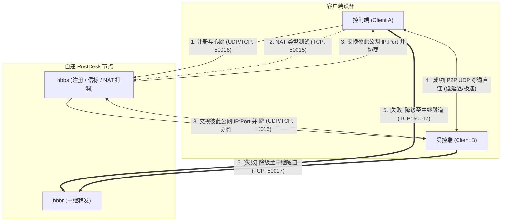

在远程办公与多设备协同场景中，商业远程桌面软件（如 ToDesk、向日葵、TeamViewer 等）近年来越发令人心累：越来越频繁的设备数限制、苛刻的带宽限速、动辄弹出的商业行为检测，以及第三方服务器中转可能带来的隐私隐患。

为了获得**完全自主掌控、低延迟、高画质且无设备限制**的远程桌面体验，自建开源远程桌面工具 **RustDesk** 成为了最优选择。

本文记录一次完整的生产级自建实践，重点解决**非标准端口规划、提高 P2P 直连率、杜绝黑客扫描探测、强制公钥鉴权，以及避开 Nginx 反代与 Cloudflare 代理的认知深坑**。

> [!WARNING]
> 本文中的域名（如 `rustdesk.example.com`）、示例端口（如 `50015 ~ 50017`）以及公钥 Key 均为**安全演示占位符**。实际部署时请务必挑选专属于自己的秘密端口并妥善保管私钥，切勿在公开文章或代码仓库中泄露个人服务器的真实 IP、端口与秘钥！

---

## 一、 RustDesk 核心架构与端口联动原理

RustDesk 的开源服务端主要由两个核心二进制程序构成：
1. **`hbbs` (RustDesk ID / Rendezvous Server)**：ID 注册与信标中介服务器。负责各端在线心跳、NAT 类型探测，并在两台设备尝试连接时充当 STUN 服务器协助 UDP 穿透打洞。
2. **`hbbr` (RustDesk Relay Server)**：中继转发服务器。当两端网络环境极为严苛（例如双方均为对称型 NAT）导致 P2P 打洞失败时，流量将无缝降级走 `hbbr` 节点进行中继转发。



### 端口连续偏移设计（Port Offset）

RustDesk 默认使用的是 `21115 ~ 21119` 端口。在公网暴露这类默认端口极易招致全网扫描器与撞库脚本。

在规划非标准端口时，**强烈建议采用连续端口区间（假设以自定义的 `50016` 为基准端口 $P$）**：

| 端口角色 | 计算公式 | 示例端口 | 传输协议 | 关键作用 |
| :--- | :--- | :--- | :--- | :--- |
| **NAT 测试端口** | $P - 1$ | `50015` | TCP | 客户端检测本地 NAT 类型（锥型/对称型） |
| **主通信/注册端口** | $P$ (基准) | `50016` | **TCP + UDP** | TCP 用于连接建立；**UDP 用于设备注册、心跳与 P2P 打洞（核心）** |
| **中继传输端口** | $P + 1$ | `50017` | TCP | `hbbr` 数据转发通道 |
| **WebSocket 端口** | $P + 2$ | `50018` | TCP | 网页端 Web 客户端支持（自用桌面端建议关闭） |

> [!TIP]
> **为什么保持连续偏移如此重要？**
> RustDesk 客户端在源码中内置了端口推算逻辑：如果你在客户端只填写 `ID 服务器: rustdesk.example.com:50016`，客户端会自动减 1 推算 NAT 端口为 `50015`，加 1 推算中继端口为 `50017`。遵循这一规则能让客户端配置与维护极其优雅。

---

## 二、 架构选型与两大典型认知误区

在开始写配置前，梳理清楚网络层级的设计至关重要。

### 1. 为什么选择 Host 网络模式而非 Bridge？
* **Bridge 桥接模式的硬伤**：Docker 默认的 Bridge 网络会通过 iptables 进行源地址转换（SNAT）。当外部客户端向容器发包时，容器看到的来源 IP 全都变成了网关 IP（如 `172.17.0.1`）。这会导致 `hbbs` 无法识别客户端真实的外部公网地址，**P2P 直连打洞成功率暴跌，几乎所有连接都会被迫走中继**。
* **Host 网络模式的优势**：容器直接共享宿主机的网络命名空间，完全不经过任何虚拟网桥和 NAT 转换，`hbbs` 能直接感知真实的客户端公网 IP，提供**最高的 P2P 打洞成功率与最低的数据转发延迟**。

### 2. 避坑一：能否用 Nginx 反代所有端口获得“更高安全”？
> **结论：完全不可行，切忌画蛇添足！**

很多同学习惯性在所有服务前面套一层 Nginx，但对于 RustDesk 核心端口（50015-50017）来说不仅无效，而且有害：
1. **真实 IP 再次丢失**：Nginx `stream` 四层代理同样会执行 SNAT，使后端收到的来源 IP 变成 `127.0.0.1`，打洞功能再度瘫痪。
2. **私有二进制协议无法套用 TLS 证书**：RustDesk 的数据流是专门设计的二进制协议，并非 HTTP，更无法走普通 HTTPS/TLS 握手。强行配置证书会导致客户端握手失败断连。
3. **端口冲突**：在 Host 模式下，Nginx 和 RustDesk 都在宿主机物理网络栈上，无法同时绑定同一个监听端口。

*(注：Nginx 反向代理在 RustDesk 官方文档中，仅用于商业版 Pro 的 Web 控制台 21114，或网页版客户端 WebSocket 21118/21119 转 WSS)*。

### 3. 避坑二：能否在 Cloudflare 开启“小黄云”隐藏源站？
> **结论：绝对不能开！必须设置为“仅限 DNS”（DNS Only / 灰色云朵）。**

很多朋友担心源站真实 IP 暴露，尝试在 Cloudflare DNS 解析里打开橙色小黄云（Proxy）：
1. **Cloudflare 免费 CDN 只代理 Web 流量**（HTTP/HTTPS 及少数 80/443 等标准端口），会直接丢弃非标端口（50015-50017）的流量。
2. **完全不支持纯 UDP 转发**：RustDesk 依赖的 `50016/UDP` 根本无法穿透 Cloudflare CDN。一旦开启小黄云，客户端将永远处于 *“Connecting to the RustDesk network...”* 状态。

---

## 三、 Docker Compose 编排实战

遵循方案 A（Host 网络模式 + 非标端口 + 强制密钥认证），在部署目录下创建配置文件：

### 1. 环境变量配置 `.env`

```bash
# 填写服务器公网 IP 或解析到该服务器的域名（Cloudflare 需为灰云）
RUSTDESK_SERVER_HOST=rustdesk.example.com
```

### 2. 编排文件 `compose.yaml`

```yaml
services:
  hbbs:
    container_name: rustdesk-hbbs
    image: rustdesk/rustdesk-server:latest
    # -p: 监听非标基准端口（此处以 50016 为例，自动推算 50015 为 NAT 测试端口）
    # -r: 显式指定中继服务器地址及非标端口 50017，下发给客户端
    # -k _: 强制开启公钥校验，未配置匹配 Key 的客户端直接拒绝连接
    command: hbbs -p 50016 -r ${RUSTDESK_SERVER_HOST}:50017 -k _
    volumes:
      - ./data:/root
    network_mode: "host"
    depends_on:
      - hbbr
    restart: unless-stopped

  hbbr:
    container_name: rustdesk-hbbr
    image: rustdesk/rustdesk-server:latest
    # -p: 监听非标中继端口 50017
    # -k _: 强制公钥匹配校验，与 hbbs 共享挂载同一个 ./data 卷中的密钥对
    command: hbbr -p 50017 -k _
    volumes:
      - ./data:/root
    network_mode: "host"
    restart: unless-stopped
```

> [!IMPORTANT]
> **`-k _` 参数是安全防线的灵魂**：默认情况下如果开放中继，任何人探测到端口都能无鉴权使用你的服务器带宽。加入 `-k _` 后，服务端启动时会自动在 `./data` 下生成 Ed25519 秘钥对，**所有未携带匹配 Key 的客户端在握手第一步就会被直接丢弃**。

---

## 四、 宿主机防火墙加固与持久化

因为使用了 `network_mode: "host"`，外部请求会直接抵达宿主机的 Linux `INPUT` 链。在许多云主机 Linux 环境中，默认规则链末尾往往存在 `REJECT all` 丢弃规则。

### 1. 放行特定非标端口

执行以下命令精准放行所需端口（拒绝未使用的 WebSocket 端口）：

```bash
# 1. 放行 NAT 测试端口 (TCP: 50015)
sudo iptables -I INPUT 1 -p tcp --dport 50015 -m comment --comment "rustdesk-nat-test" -j ACCEPT

# 2. 放行信标与打洞端口 (TCP & UDP: 50016)
sudo iptables -I INPUT 2 -p tcp --dport 50016 -m comment --comment "rustdesk-hbbs-tcp" -j ACCEPT
sudo iptables -I INPUT 3 -p udp --dport 50016 -m comment --comment "rustdesk-hbbs-udp" -j ACCEPT

# 3. 放行中继端口 (TCP: 50017)
sudo iptables -I INPUT 4 -p tcp --dport 50017 -m comment --comment "rustdesk-hbbr-tcp" -j ACCEPT
```

### 2. 避免重启失效：持久化保存

普通的 iptables 命令只是临时写入内存，重启即消失。在 Debian/Ubuntu 下我们使用 `netfilter-persistent` 将其固化到磁盘：

```bash
# 固化保存当前 IPv4 与 IPv6 规则至 /etc/iptables/rules.v4
sudo netfilter-persistent save

# 确保开机自启加载服务处于激活状态
sudo systemctl enable netfilter-persistent
```

### 3. 云控制台安全组（Security List）
如果实例托管在云服务商（如 Oracle Cloud、阿里云、腾讯云、AWS），还必须在云控制台的安全组或安全列表中放行入站：
* **TCP 协议**：端口范围 `50015-50017`，源地址 `0.0.0.0/0`
* **UDP 协议**：端口 `50016`，源地址 `0.0.0.0/0`

---

## 五、 服务启动与客户端配置指南

### 1. 启动服务与提取公钥

在配置目录启动 Docker Compose：

```bash
docker compose up -d
```

查看服务端生成的公钥字符串：

```bash
cat ./data/id_ed25519.pub
# 终端会输出一串 Ed25519 公钥，例如：
# YOUR_SERVER_PUBLIC_KEY_BASE64_STRING=
```

### 2. 客户端网络配置

在主控端与被控端设备上安装官方客户端（桌面端或手机端），依次点击 **设置**（或 ID 旁的 `⋮`）$\rightarrow$ **网络** $\rightarrow$ **解锁网络设置**：

* **ID 服务器 (ID Server)**：`rustdesk.example.com:50016`
* **中继服务器 (Relay Server)**：`rustdesk.example.com:50017`
* **API 服务器**：*(保持留空)*
* **Key**：粘贴上一步在终端获取到的真实 `id_ed25519.pub` 公钥内容

点击 **应用** 后，主界面左下角状态应迅速变为 **“就绪 (Ready)”**，表示与自建服务器通信成功。

### 3. 极速分发技巧：客户端一键免配

如果需要给多台家人或公司电脑安装受控端，无需逐台手动打开设置填写：

* **绿色版重命名免配（Windows）**：
  直接将下载的客户端可执行文件重命名，在文件名中嵌入服务器信息：
  ```text
  rustdesk-host=rustdesk.example.com,key=YOUR_SERVER_PUBLIC_KEY_BASE64_STRING=,port=50016.exe
  ```
  双击运行时，客户端会自动解析文件名并填入网络配置，即开即连！

---

## 六、 总结与日常运维

通过这套组合方案：
1. **Host 网络模式** 换取了极致的原生网络性能与 P2P 穿透率；
2. **非标端口偏移（$P-1, P, P+1$）** 彻底清净了来自公网的大规模脚本扫描；
3. **`-k _` 强制秘钥认证** 构建了底层的加密防线，非授权客户端连探测报文都会被直接 drop；
4. **系统级 iptables 规则持久化** 保证了服务器在维护重启后的高可用。

日常运维速记：
```bash
# 查看实时运行日志
docker compose logs -f

# 优雅重启服务
docker compose restart

# 更新镜像
docker compose pull && docker compose up -d
```
整个自建过程干净利落，从此告别商业软件的各种限制与卡顿，享受丝滑流畅且隐私可靠的自建远程桌面服务。
