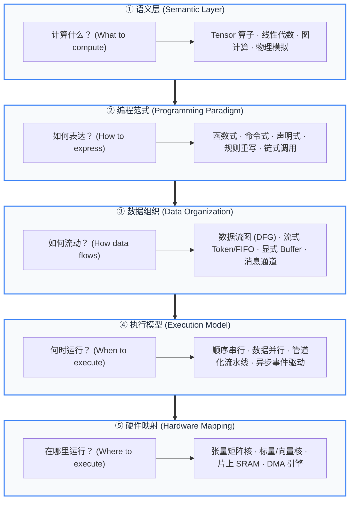
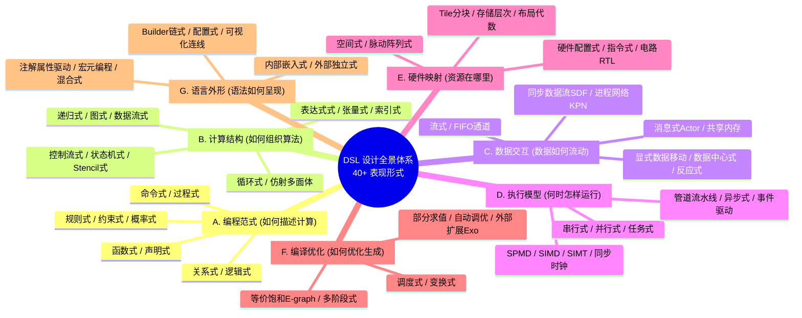
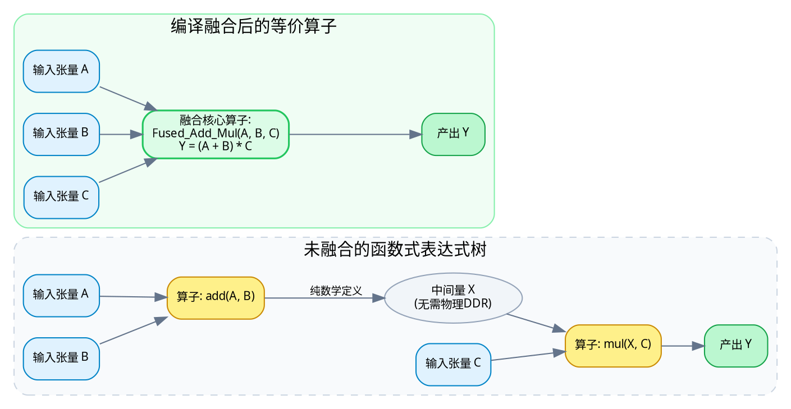
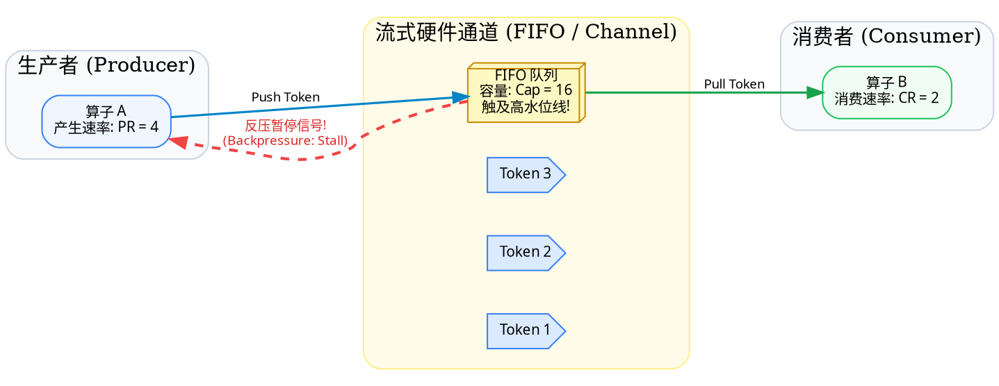
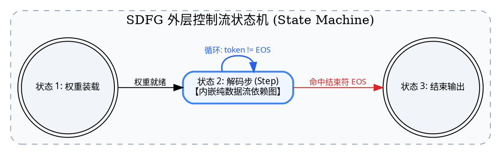
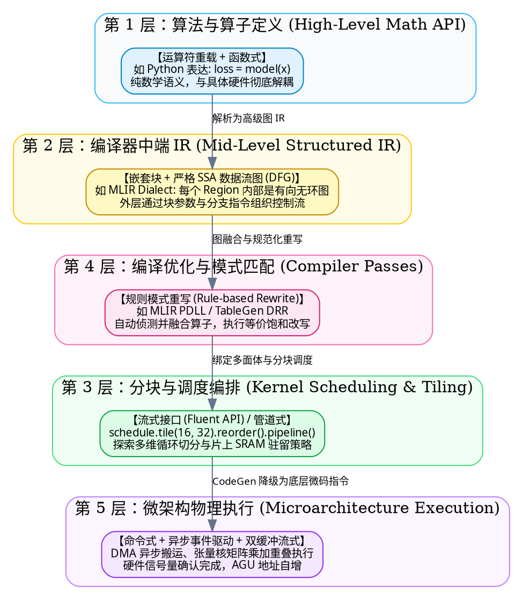
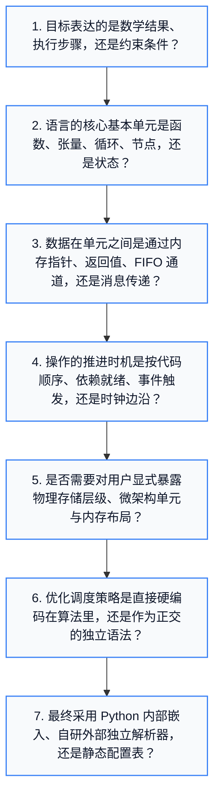

> **导读**：在领域特定语言（DSL, Domain-Specific Language）、AI 编译器（如 MLIR、TVM、Halide）以及专用加速处理器（如 NPU、TPU、GPU）的架构设计与编程体系中，开发者经常会被一堆纷繁复杂的术语狂轰滥炸：
>
> **流式（Streaming）、管道式（Pipeline）、函数式（Functional）、数据流式（Dataflow）、命令式（Imperative）、声明式（Declarative）、图式（Graph-based）、张量式、空间式、调度式……**
>
> 许多初学者在第一次接触这些概念时，往往会产生极大的认知混淆：
> 1. “流式”到底是像 Java Stream、C++ 链式调用 `a.b().c()` 那样的语法糖（Fluent Interface），还是指硬件通过 FIFO 队列像自来水一样按字节吞吐的物理传输？
> 2. “管道式”究竟是指 Unix Shell 里的单向管道符 `|`，还是指芯片微架构中按时钟节拍重叠运行的指令/任务流水线？
> 3. 为什么在现代 AI 编译器与加速芯片 DSL 中，一门语言可以**同时**被称为：**“声明式 + 函数式 + 数据流图式 + 流式执行 + 管道化调度”**？这难道不自相矛盾吗？
> 4. 面对专用加速芯片中**显式 SRAM 存储、异步 DMA 搬运、粗粒度张量核、硬件事件同步**的物理现实，究竟该如何选型设计 DSL，才能既拥有高级语言的优雅表达，又能压榨出极致的硬件性能？
>
> **答案是：完全不矛盾！因为这些术语根本不是同一个维度的分类，而是在回答各自正交的体系结构与语言设计问题。**
>
> 从编程语言理论、编译器中端到 GPU/NPU/FPGA 硬件抽象，我们可以梳理出 **40 余种 DSL 形式与组织模型**。本文将从计算机体系结构与编译原理的**第一性原理**出发，全景式解构 DSL 的分类地图与设计哲学。全篇严格遵循初学者友好原则，所有专业术语初次登场均配有直观类比，抹去私有特定硬件代号与微码接口，并配备丰富的 **Graphviz** 与 **Mermaid** 高清架构图、16 对混淆概念对照表与统一算子对比，帮助读者建立端到端贯穿“上层高级语法”到“底层硅片执行”的完整心智模型。

---

## 目录导览

- [零、初学者必读：核心概念与架构术语全景词典](#零初学者必读核心概念与架构术语全景词典)
- [一、第一性原理：DSL 设计的五个正交维度](#一第一性原理dsl-设计的五个正交维度)
- [二、宏观体系地图：40 余种 DSL 形式的七大分类全景](#二宏观体系地图40-余种-dsl-形式的七大分类全景)
  - [A 类：编程范式（如何描述计算）](#a-类编程范式如何描述计算)
  - [B 类：计算结构与算法表示（如何组织算法）](#b-类计算结构与算法表示如何组织算法)
  - [C 类：数据交互与通信模型（数据如何流动）](#c-类数据交互与通信模型数据如何流动)
  - [D 类：执行与并发模型（何时以及怎样运行）](#d-类执行与并发模型何时以及怎样运行)
  - [E 类：硬件映射与存储模型（在哪里使用何种资源）](#e-类硬件映射与存储模型在哪里使用何种资源)
  - [F 类：编译优化与调度策略（如何优化与生成代码）](#f-类编译优化与调度策略如何优化与生成代码)
  - [G 类：语言外形与呈现界面（DSL 语法如何呈现）](#g-类语言外形与呈现界面dsl-语法如何呈现)
- [三、核心范式深度剖析：函数式、管道式、流式与数据流式](#三核心范式深度剖析函数式管道式流式与数据流式)
  - [3.1 函数式 DSL：关注计算结果，而非执行时序](#31-函数式-dsl关注计算结果而非执行时序)
  - [3.2 管道式 DSL：关注计算阶段如何跨时间重叠](#32-管道式-dsl关注计算阶段如何跨时间重叠)
  - [3.3 流式 DSL：关注数据在通道中的连续传输与反压机制](#33-流式-dsl关注数据在通道中的连续传输与反压机制)
  - [3.4 数据流式 DSL 与状态化数据流图（SDFG）](#34-数据流式-dsl-与状态化数据流图sdfg)
- [四、概念手术刀：16 对最易混淆 DSL 概念深度辩析](#四概念手术刀16-对最易混淆-dsl-概念深度辩析)
- [五、罗塞塔石碑：同一个计算在 8 种 DSL 范式下的完整实现对比](#五罗塞塔石碑同一个计算在-8-种-dsl-范式下的完整实现对比)
- [六、异构加速硬件（NPU/TPU）的软硬件现实与分层编译栈](#六异构加速硬件nputpu的软硬件现实与分层编译栈)
  - [6.1 异构芯片的硬件物理现实](#61-异构芯片的硬件物理现实)
  - [6.2 编译栈的五层精准定位](#62-编译栈的五层精准定位)
  - [6.3 为什么单一 DSL 形式必然在异构芯片上折戟？](#63-为什么单一-dsl-形式必然在异构芯片上折戟)
- [七、架构师手记：兼顾优雅与性能的四大黄金设计戒律](#七架构师手记兼顾优雅与性能的四大黄金设计戒律)
- [八、工业界 11 大经典 DSL 项目全景研究矩阵](#八工业界-11-大经典-dsl-项目全景研究矩阵)
- [九、决策框架：审视新 DSL 的“灵魂七问”与标准落地配方](#九决策框架审视新-dsl-的灵魂七问与标准落地配方)
- [十、总结与结语](#十总结与结语)

---

## 零、初学者必读：核心概念与架构术语全景词典

为了让非体系结构或非编译器专业的初学者能够顺畅阅读，我们先将贯穿本文的“专业黑话”转化为直观的生活类比与工程定义：

> [!NOTE] 核心术语扫盲速查卡片
>
> 1. **DSL（Domain-Specific Language，领域特定语言）**：
>    专门为解决某一个特定领域问题而裁剪定制的计算机语言（如写数据库查询的 SQL、写硬件样式的 Verilog、写张量调度的 Halide）。与之相对的是 **GPL（General-Purpose Language，通用编程语言）**，如 C++ 或 Python。DSL 放弃了通用性，换来了极高密度的领域表达力与极大的编译器自动优化空间。
> 2. **编程范式（Programming Paradigm）**：
>    你“在代码纸面上如何组织思维与表达计算”。比如是用命令步步交代（命令式），还是用纯数学函数组合映射（函数式），抑或是只声明目标条件（声明式）。
> 3. **执行模型（Execution Model）**：
>    物理硬件上的晶体管、计算核与总线“在时钟节拍推进下究竟如何运转”。是单核排队执行（串行），还是千核并发（并行），抑或是分工流水（管道化）。
> 4. **Fluent Interface（流式接口 / 链式调用）**：
>    一种纯**语法设计手法**。每个函数调用完毕后都返回自身（`return this`）或下一个上下文对象，使得调用可以连成一条长线：`data.filter().map().sort()`，读起来像连贯的英文句子。
> 5. **Token（数据令牌 / 传输粒度）**：
>    在流式系统或数据流系统中，流淌在通道中的**最小逻辑数据块**。它可以是一个标量浮点数、一个 128 维的向量、一个 $32\times 32$ 的矩阵分块（Tile），甚至是一个网络数据包。
> 6. **FIFO（First-In, First-Out，先进先出队列）与 Channel（通道）**：
>    连接两个独立硬件单元或软件任务的单向通信缓冲区。先塞进去的 Token 先被读出来，用于隔离生产者和消费者的瞬时速度差异。
> 7. **Backpressure（反压 / 背压机制）**：
>    当下游消费者干活太慢导致 FIFO 堆满时，下游硬件向上一级发出“暂停灌水”的物理握手信号。若无反压机制，缓冲区就会直接溢出（Overflow）引发数据丢失或硬件异常。
> 8. **Deadlock（死锁）**：
>    两个或多个计算单元互相等待对方释放资源或吐出数据，导致整个系统彻底僵死、谁也无法推进的灾难状态。
> 9. **Tile / Tiling（分块 / 瓦片化）**：
>    AI 算子中极其关键的访存优化手段。现代神经网络的特征图动辄几十兆字节，但芯片内部极速的 SRAM 只有几兆甚至几百 KB。因此必须把浩瀚的张量“切成一块块豆腐干（Tile）”，分批拉进芯片内部计算。
> 10. **Latency（延迟）与 Initiation Interval（II，启动间隔 / 发起间隔）**：
>     - **Latency**：单个数据（或单个 Tile）从踏入流水线第一级到彻底完成输出所耗费的**总时长**。
>     - **Initiation Interval (II)**：流水线**连续接纳两个相邻新数据**之间的时钟间隔。理想流水线的 $II = 1$，即每个时钟周期都能吐出一个结果。
> 11. **DMA（Direct Memory Access，直接内存访问引擎）**：
>     芯片内部负责当“专业搬运工”的独立硬件控制器。它可以在完全不惊动 CPU/计算核心的情况下，在片外大容量慢速内存（DDR/HBM）和片内高速暂存器之间高速吞吐数据。
> 12. **片上暂存器（On-Chip SRAM / Scratchpad Memory / SMEM）**：
>     紧挨着计算核心的高速静态随机存储器。在专用加速芯片中，它通常不是透明的硬件缓存（Cache），而是**软件显式管理**的内存空间，程序员或编译器必须精确规划哪块地放输入、哪块地放输出。
> 13. **张量矩阵计算核（Tensor Core / Matrix Unit）与 通用标量/向量核（Scalar / Vector Core）**：
>     - **张量核**：由大规模乘加阵列（如脉动阵列 Systolic Array）组成的专用硬件，擅长单周期吞吐巨大的二维矩阵乘加（GEMM）。
>     - **标量/向量核**：带有丰富通用指令集（如通用向量扩展）的计算核心，擅长处理复杂的控制逻辑、非线性激活函数（Softmax、GELU）与元素级加减运算。
> 14. **AGU（Address Generation Unit，地址生成单元）**：
>     专用硬件中的寻址协处理器。它能够按照预设的步长（Stride）与偏移规则，自动生成连续或跨步的内存访问物理地址，解放主计算核。
> 15. **执行控制单元 / 序列发生器（Execution Controller / Sequencer）**：
>     专用加速芯片中的调度大脑。负责向 DMA、张量核、标量核下发启动信号，并监听硬件事件信号量以确认任务完成。
> 16. **DAG（Directed Acyclic Graph，有向无环图）与 DFG（Data Flow Graph，数据流图）**：
>     节点代表算子或指令，有向边代表数据流动与依赖。只要图中没有环路（无环），就构成了 DAG。
> 17. **SDFG（Stateful Dataflow Graph，状态化数据流图）**：
>     为了弥补纯 DFG 难以优雅表达 `if-else` 分支与 `for/while` 循环的短板，将“外层控制流状态机”与“内层纯数据流图”进行分层嵌套的图表示模型。
> 18. **算子融合（Operator Fusion）与 公共子表达式消除（CSE）**：
>     - **算子融合**：把连续执行的两个算子（如 $X = A + B$ 与 $Y = \text{ReLU}(X)$）合成一个联合算子在片上一次性算完，避免将巨大的中间结果 $X$ 倒腾到外部慢速内存中。
>     - **CSE**：编译器识别出代码中重复计算的相同子表达式，只计算一次并把结果直接共享给下游。
> 19. **SPMD（Single Program Multiple Data）与 SIMT（Single Instruction Multiple Threads）**：
>     - **SPMD**：一种宏观编程模型，多个并发执行实例（Program Instance）运行相同的代码逻辑，但依据各自的实例 ID 处理不同数据块。
>     - **SIMT**：硬件微架构层面的执行机制，硬件将多个逻辑线程组织成线程束（Warp），在锁步（Lockstep）时钟下共享同一条指令发射。
> 20. **等价饱和（Equality Saturation / E-Graph）**：
>     一种前沿的编译器重写技术。传统编译器每次应用规则都会破坏性地替换原代码；等价饱和把所有可能的数学等价形式同时塞进一张等价图（E-Graph）中，最后根据精确的代价模型全局挑出最优解。

---

## 一、第一性原理：DSL 设计的五个正交维度

为什么大家在讨论 DSL 时总是争论不休？
根本原因在于：**许多人把“语法怎么写”和“硬件怎么跑”混为一谈，把“数据组织”和“时间调度”混为一谈。**

从计算机科学的第一性原理出发，编写程序并将其映射到芯片硬件上，必须独立回答以下**五个核心问题**：



这五个维度在逻辑上是**高度解耦且完全正交**的：

1. **语义层（What）**：定义数学与计算规范。你是表达矩阵乘、卷积、Softmax，还是物理粒子碰撞？
2. **编程范式（How - Syntax & Style）**：程序员面向的语法界面。是用纯数学公式嵌套（函数式），是用链式方法点出来（Fluent），还是只声明最终输出约束（声明式）？
3. **数据组织（Data Flow & Channel）**：逻辑值在计算单元之间如何拓扑关联。是基于全局张量依赖边（DAG），还是基于点对点的单向 FIFO 管道（Streaming Token），抑或是显式的连续共享内存块（Buffer）？
4. **执行模型（When - Scheduling & Concurrency）**：操作在物理时间轴上的推进方式。不同 Tile 之间是老死不相往来地排队跑（Serial），还是同一时刻像工厂流水线一样交错前进（Pipelined）？
5. **硬件映射（Where - Microarchitecture Placement）**：具体由哪块硅片电路承载计算与搬运。由 DMA 负责拉入 SRAM，由张量计算核负责 GEMM 吞吐，由向量核负责激活函数。

由此可见，当有人说 **“一个专用加速芯片 DSL 是声明式 + 函数式 + 数据流图式 + 流式执行 + 管道化调度”** 时：
- **声明式**：用户定义期望的输出张量形状与约束，不手写多重循环；
- **函数式**：算子内部无全局可变状态副作用，数学表达式极其干净；
- **数据流图式**：编译器中间表示（IR）将算子组织为严格的 SSA Def-Use 依赖 DAG；
- **流式执行**：相邻算子或分块处理单元之间采用小颗粒 Token 与 FIFO 通道直连传输；
- **管道化调度**：调度器把搬运阶段与计算阶段在物理时间上交错重叠起来运行。

**它们处在完全不同的抽象层次上，各司其职，相辅相成！**

---

## 二、宏观体系地图：40 余种 DSL 形式的七大分类全景

为了彻底建立全局认知，我们将现代编译器、编程语言理论与体系结构中涉及的 40 多种 DSL 形式，归纳为**七大类别（A ~ G）**。



### A 类：编程范式（如何描述计算）

这一层回答：**程序员究竟通过什么思维方式表达计算意图？**

1. **命令式（Imperative）**：步步给出状态修改指令序列。核心是操作顺序与状态可变性。适合硬件驱动、底层运行时控制。
   ```python
   dma.load(A, sram_buf0)
   vector_engine.run_add(sram_buf0, sram_buf1, sram_buf2)
   dma.store(sram_buf2, Y)
   ```
2. **过程式（Procedural）**：命令式的结构化升级，将命令打包为可重用的函数/过程。适合板卡初始化流程、测试脚本。
3. **函数式（Functional）**：以无副作用的纯函数组合为核心，$f(x) = y$。相同输入必产生相同输出，极易进行公共子表达式消除（CSE）与算子融合。
   ```python
   def model(A, B, C):
       return mul(add(A, B), C)
   ```
4. **声明式（Declarative）**：只描述“期望达到什么目标/满足什么约束”，隐藏具体执行步骤。由编译器寻找可行实现。
   ```python
   output = A + B
   require(dtype=fp16, max_latency=100)
   ```
5. **关系式（Relational）**：基于关系代数，以表、集合及其连接投影为抽象（如 SQL）。在编译器中常用于查询 IR 元信息与优化候选。
6. **逻辑式（Logic / Datalog）**：用已知事实（Fact）与推导规则（Inference Rule）求出满足条件的事实全集。在编译器静态分析（如指针分析、死锁检测、可达性分析）中极具威力（典型代表：Soufflé）。
   ```prolog
   depends(A, B).
   depends(B, C).
   reachable(X, Z) :- depends(X, Y), reachable(Y, Z).
   ```
7. **规则模式匹配与重写式（Rule-based / Rewrite）**：定义“当匹配到某种 AST/DAG 模式时，改写为等价新结构”。是编译器 Passes 与窥孔优化的灵魂（如 MLIR PDLL / TableGen DRR）。
8. **约束式（Constraint-based）**：向约束求解器声明变量必须同时满足的等式与不等式，让求解器求解合法配置（如求解最优 Tile 尺寸、Bank 分配）。
9. **概率式（Probabilistic）**：用随机变量与概率分布定义计算，核心是推断与采样（如 Stan）。

---

### B 类：计算结构与算法表示（如何组织算法）

这一层回答：**计算任务本身具有何种内在的拓扑或空间结构？**

1. **表达式式（Expression-oriented）**：计算以一棵表达式树呈现，适合标量数学、符号代数。
2. **张量式（Tensor-oriented）**：把高维张量作为一等公民，单个算子（如 `matmul`）封装海量底层乘加，便于高层 Shape 推导和图融合。
3. **索引式（Index / Einstein Notation）**：显式写出每个元素的爱因斯坦求和约定，暴露并行轴与归约轴（典型代表：TACO）。
   $$C_{ij} = \sum_k A_{ik} B_{kj} \quad \Longrightarrow \quad \texttt{C[i, j] = sum(A[i, k] * B[k, j], over=k)}$$
4. **循环式（Loop-oriented）**：显式嵌套循环遍历迭代空间（如 `scf.for`），便于循环分块、交换、向量化。
5. **仿射式（Affine / Polyhedral-oriented）**：将循环边界与内存下标约束为线性仿射函数，使编译器能利用多面体整数线性规划严谨证明无数据依赖并自动并行化（如 MLIR Affine Dialect）。
6. **递归式（Recursive）**：通过分治子问题表达计算（如树状规约），可编译期展开为硬件拓扑。
7. **图式（Graph-based）**：用显式节点与有向边构建程序，边可承载数据依赖、控制依赖或事件同步。
8. **数据流式（Dataflow）**：计算的触发完全由“输入数据是否已全部就绪”驱动，天然具备隐式并行性。
9. **控制流式（Control-flow / CFG）**：以条件分支、循环跳转为主线，表达程序可能经过的执行路径。
10. **状态机式（State-machine / FSM）**：显式定义系统状态（State）与在何种事件触发下的状态转移（Transition），适合硬件握手与协议解析。
11. **邻域计算式（Stencil）**：每个输出点依赖输入滑动窗口内的固定局部点集（如图像卷积、差分网格），利于编译器设计行缓冲（Line Buffer）与数据复用。

---

### C 类：数据交互与通信模型（数据如何流动）

这一层回答：**两个计算单元之间的数据究竟如何跨空间或跨时间传递？**

1. **流式（Streaming）**：数据作为随时间持续涌入的 Token 序列，消费者随到随算，强调到达顺序、速率与反压。
2. **Channel / FIFO 式**：显式创建有容量上限的单向通道，生产者 push，消费者 pop。
3. **同步数据流（Synchronous Dataflow, SDF）**：算子每次触发产生和消费固定数量的 Token（编译期常数），可通过拓扑矩阵解出无死锁静态调度（典型代表：StreamIt）。
4. **进程网络（Process Network, KPN）**：独立进程通过无界（或大容量）FIFO 互通，确定性强。
5. **消息式 / Actor**：每个并发主体拥有独立内部状态与消息邮箱，通过异步投递消息协作。
6. **共享内存式（Shared-memory）**：通过公共物理内存空间读写数据，依赖内存屏障（Barrier）与锁同步。
7. **显式数据移动式（Explicit Data Movement）**：数据搬运本身是一等公民操作（如 DMA 异步拷贝指令），必须显式指明源/目标存储层次。
8. **数据中心式（Data-centric / DaCe）**：以数据容器与内存访问模式为优化核心，将计算视为伴随数据流动的副产物。
9. **反应式（Reactive）**：当上游信号（Signal）或值发生变更时，自动驱动下游依赖链式重新计算。

---

### D 类：执行与并发模型（何时以及怎样运行）

这一层回答：**计算任务在物理时间轴上如何被调度并重叠执行？**

1. **串行式（Sequential）**：一步接一步严格保序执行。
2. **并行式（Parallel）**：显式标注多个任务可同时由独立物理单元运行。
3. **任务式（Task-based）**：把工作切为具有显式依赖的 Task，由运行时或硬件任务队列动态分派调度。
4. **管道化流水线（Pipeline-oriented）**：将计算拆解为多个阶段，让不同批次的数据在时间轴上交错重叠执行。
5. **异步式（Asynchronous）**：操作的发起（Launch）与完成（Complete）解耦，非阻塞立即返回。
6. **事件驱动式（Event-driven）**：基于硬件中断或完成事件触发下游操作。
7. **SPMD（Single Program Multiple Data）**：多个独立程序实例运行同一套代码，根据自身 ID 处理不同数据切片（如 Triton、GPU Grid）。
8. **SIMD / 向量式（Vector-oriented）**：一条硬件指令同时对向量寄存器内的多个元素施加运算。
9. **SIMT（Single Instruction Multiple Threads）**：以细粒度线程表达算法，硬件微架构自动将线程编组为 Warp 锁步执行。
10. **时钟同步式（Synchronous / Clocked RTL）**：所有寄存器状态更新严格绑定在离散时钟上升沿（如硬件描述语言）。
11. **事务式（Transactional）**：操作集合具备 ACID 原子性，要么全部生效，要么在冲突时完整回滚。

---

### E 类：硬件映射与存储模型（在哪里使用何种资源）

这一层回答：**如何把逻辑算法绑定到芯片的具体晶体管、存储体与总线上？**

1. **空间式（Spatial）**：将算法中的不同计算操作直接映射到芯片物理空间中的不同处理单元（PE）上（如 CGRA、FPGA 空间流水线）。
2. **脉动阵列式（Systolic Array）**：数据按照精确时钟节奏在相邻 PE 之间水平/垂直传递流动，并在本地累加，实现极致的数据局部复用。
3. **Tile / Block 式**：将大规模张量切分为符合片上 SRAM 容量的规整分块。
4. **存储层次感知式（Memory-hierarchy-aware）**：在类型系统或语句中显式区分全局主存（DDR）、片上暂存器（SRAM）、向量寄存器。
5. **布局代数式（Layout-oriented / Tensor Layout）**：将逻辑多维坐标映射到物理内存连续地址的跨步（Stride）与 Swizzle 规则建模为代数对象（典型代表：CUTLASS CuTe）。
6. **硬件配置式（Configuration-oriented）**：以寄存器位域配置硬件功能模式。
7. **指令级 / Intrinsic 式**：直接暴露硬件专用机器指令或内建函数。
8. **电路网络式（Circuit / RTL）**：描述连线网表、逻辑门与触发器。

---

### F 类：编译优化与调度策略（如何优化与生成代码）

这一层专门用于**控制编译器内部如何优化代码**，而非描述算法本身：

1. **调度式（Schedule-oriented）**：算法描述“算什么”，调度代码描述“怎么算”（如 Halide、TVM TensorIR 的 `split`、`reorder`、`parallel`、`vectorize`）。
2. **变换式（Transformation-oriented）**：以 IR 形式书写编译器 Pass 本身，直接操作 Payload IR（如 MLIR Transform Dialect）。
3. **等价饱和式（Equality Saturation / E-graph）**：将多个等价重写形态保留在 E-Graph 中，避免贪心启发式死胡同（典型代表：egg 库）。
4. **多阶段式（Multi-stage / Staged Programming）**：显式区分编译期生成计算与运行期求值计算。
5. **部分求值式（Partial Evaluation）**：在部分输入参数已知时，提前在编译期求出定值并展开特化。
6. **自动调优式（Auto-tuning）**：定义分块尺寸、并行度的超参数搜索空间，由系统通过基准测试或代价模型自动寻优。
7. **外部可扩展编译式（Exocompilation）**：允许用户在不修改编译器核心代码的前提下，通过外部 Python/C++ 库扩展目标硬件的存储层级、微码指令和调度规则（典型代表：MIT Exo）。

---

### G 类：语言外形与呈现界面（DSL 语法如何呈现）

这一层回答：**程序员在键盘上究竟以什么外形敲出这门语言？**

1. **内部嵌入式（Internal / Embedded DSL）**：借用宿主语言（如 Python、C++）的原生语法与生态，通过重载运算符或上下文管理器构建。
2. **外部独立式（External DSL）**：拥有自己完全独立的语法与 Lexer/Parser（如使用 ANTLR 自研语法）。
3. **Builder / Fluent API 链式**：利用方法级联 `.methodA().methodB()` 构建。
4. **配置式（Configuration / Schema-based）**：纯静态 YAML/JSON/Protobuf/TableGen。
5. **可视化连线式（Visual Node-based）**：拖拽连线节点构建 DAG（如 ComfyUI、虚幻蓝图）。
6. **注解 / 编译指令驱动式（Annotation / Pragma-based）**：在原生代码上贴附元数据（如 `#pragma omp parallel`）。
7. **宏 / 元编程扩展式（Macro-based）**：利用语言宏系统在编译期改写语法树（如 Rust 过程宏、Lisp 宏）。
8. **混合式（Hybrid DSL）**：前端用 Python 嵌入式，中端用配置表与重写规则，底层外挂微内核——**现代成功框架的普遍归宿**。

---

## 三、核心范式深度剖析：函数式、管道式、流式与数据流式

在这几十种形式中，最常被放在一起比较、且最容易引起混淆的是：**函数式、管道式、流式与数据流式**。我们对其内在机理进行逐一解剖。

### 3.1 函数式 DSL：关注计算结果，而非执行时序

假设我们要计算：

$$Y = (A + B) \times C$$

函数式 DSL 的核心是表达纯粹的数学关系：

```python
def compute(A, B, C):
    X = add(A, B)
    Y = mul(X, C)
    return Y
```

它表达的是严格的等价代数式：$X = A + B, Y = X \times C$。

#### 核心优势
1. **天然的算子融合（Operator Fusion）**：编译器一眼就能发现 $X$ 只被消费了一次，可以直接把 Add 和 Mul 融合成一个单一的乘加算子（Fused MAdd）。
2. **零硬件偏见（Hardware Agnostic）**：函数式代码只表达因果，不预先钦定是在 CPU、GPU 还是专用加速核上跑。
3. **虚拟存储生命周期**：代码里声明了 $X$，但**编译器绝对不需要真正在物理片外内存（DDR）里为 $X$ 申请空间**。它可以留存在片上暂存器，甚至完全作为计算核内部的流水线电平信号流通。



> [!WARNING] 常见认知误区
> 函数式**不等于**硬件并行，也**不等于**流式传输。一个纯函数式代码完全可能被最朴素的编译器翻译成单核 CPU 上速度极慢的单线程串行机器指令。

---

### 3.2 管道式 DSL：关注计算阶段如何跨时间重叠

管道式（Pipeline-oriented）关注的核心不是计算公式，而是**如何将耗时任务拆分成连续阶段，并让不同分块（Tile）在时间轴上交错重叠运行**。

在典型加速芯片中，处理一个 Tile 包含三阶段：
1. **Stage 1: DMA 读取**（片外 DDR $\rightarrow$ 片上 SRAM）；
2. **Stage 2: 硬件核计算**（张量或标量计算）；
3. **Stage 3: DMA 写回**（片上 SRAM $\rightarrow$ 片外 DDR）。

#### 串行 vs 理想管道化流水线

假设每个阶段耗时 1 个时间单位，连续处理 3 个 Tile：
- **串行执行**：3 个 Tile $\times$ 3 阶段 = **9 个时间单位**；
- **管道化流水线执行**：仅需 **5 个时间单位**！在稳态时，三个物理硬件模块全部满负荷运作。

```mermaid
gantt
    title 管道化流水线 (Pipelined Execution) 阶段重叠时序图
    dateFormat  X
    axisFormat %s

    section Stage 1 (DMA 搬入)
    Tile 0 (Load)   :active, 0, 1
    Tile 1 (Load)   :active, 1, 2
    Tile 2 (Load)   :active, 2, 3

    section Stage 2 (硬件核心计算)
    Tile 0 (Compute):crit, 1, 2
    Tile 1 (Compute):crit, 2, 3
    Tile 2 (Compute):crit, 3, 4

    section Stage 3 (DMA 写回)
    Tile 0 (Store)  :done, 2, 3
    Tile 1 (Store)  :done, 3, 4
    Tile 2 (Store)  :done, 4, 5
```



两个核心物理标尺：
- **Latency（延迟）**：单个 Tile 从进管到出管的总时间（本例为 3）。
- **Initiation Interval（II，启动间隔）**：流水线连续吞入两个新 Tile 的时钟间隔（理想为 1）。系统吞吐率 $\text{Throughput} = \frac{1}{\text{II}}$。

> [!IMPORTANT] 硬件落地挑战
> 要想在硬件上实现理想流水线，编译器必须在片上 SRAM 规划**双缓冲（Ping-Pong Buffer）**：DMA 往 Ping 缓冲区搬入 Tile 1 的同时，计算核必须从 Pong 缓冲区读取 Tile 0 进行计算，绝不可抢占同一块物理 SRAM Bank。

---

### 3.3 流式 DSL：关注数据在通道中的连续传输与反压机制

流式（Streaming）的核心是**数据传递与消费的粒度**。它打破了“算子必须等全部完整大矩阵全部落盘后才开工”的批处理假设。

在流式 DSL 中，数据被视为微小的 **Token 序列**，通过物理或逻辑 **FIFO 通道** 连续流动。



流式 DSL 最关心的核心问题：
1. **Token 粒度**：是标量数字、一维向量，还是一个小分块 Tile？
2. **速率匹配（Production vs Consumption Rate）**：生产者每拍吐 4 个，消费者每拍只能吞 2 个。
3. **反压机制（Backpressure）**：FIFO 堆满时，必须向上级拉起 Stall 物理信号阻断灌水，否则缓冲区溢出导致数据踩踏。
4. **死锁风险（Deadlock）**：环形通道中若各自缓冲区占满且相互等待，系统彻底卡死。

---

### 3.4 数据流式 DSL 与状态化数据流图（SDFG）

数据流式（Dataflow-oriented）关注的是：**因果依赖驱动一切**。
只要某个算子所依赖的全部输入都已就绪，该算子便被触发执行。无依赖的算子（如 $X=A+B$ 与 $Z=C+D$）天然可以并行运行。

#### 为什么纯 DAG 无法满足真实世界的大模型计算？
纯有向无环图（DAG）无法优雅表达动态条件跳转与循环（例如大模型自回归解码循环 `while not finished:`）。

业界最先进的解法是 **DaCe 框架提出的 SDFG（Stateful Dataflow Graph，状态化数据流图）**：
- **外层**：是有状态的状态机（State Machine），负责管理 `for` 循环、`while` 条件与跨迭代状态传递；
- **内层**：每个状态内部是一个纯粹的、无环的数据流 DAG。



---

## 四、概念手术刀：16 对最易混淆 DSL 概念深度辩析

为了让读者在面对各种文献和技术方案时具备火眼金睛，下表整理了工程中最容易产生混淆的 **16 对概念**：

| 混淆概念对 | 前者核心侧重 | 后者核心侧重 | 关键本质区别 |
| :--- | :--- | :--- | :--- |
| **1. 函数式 vs 声明式** | 纯函数组合与无副作用映射 | 声明目标约束条件（What） | 函数式是具体的编程范式；声明式是涵盖更广的抽象风格（SQL 也是声明式但非纯函数式） |
| **2. 表达式式 vs 张量式** | 树状标量符号数学组合 | 高维数组作为一等公民算子 | 表达式式往往暴露细粒度标量；张量式封装底层多维迭代 |
| **3. 图式 vs 数据流式** | 节点与边的**静态数据结构** | 数据就绪驱动执行的**动态语义** | 图式只是一种数据结构呈现；数据流式是一种依赖触发模型 |
| **4. 数据流式 vs 流式** | 谁依赖谁的因果关系 | 数据以 Token 连续产生与消费 | 数据流式可以操作 500MB 的完整全量大张量；流式必须是微小数据流淌 |
| **5. 流式 vs 管道式** | 空间接口上的数据交接方式 | 任务在时间轴上的交错重叠调度 | 流式关心通道与反压；管道式关心流水线阶段与启动间隔（II） |
| **6. Pipeline 语法 vs 硬件 Pipeline** | 用 `\|` 或 `>>` 串接函数语法糖 | 芯片微架构中的时序流水线重叠 | 语法上的管道操作符完全可能在单核上串行跑；硬件流水线是物理重叠 |
| **7. 并行式 vs 异步式** | 多个物理单元在同一瞬间干活 | 操作发起后不阻塞控制端返回 | 异步操作不一定有物理并行（如单核事件循环轮询） |
| **8. 异步式 vs 事件驱动式** | 操作非阻塞的调用语义模型 | 由特定信号/中断触发回调行为 | 异步可以靠主动轮询完成；事件驱动必须由事件被动通知反推 |
| **9. Task 式 vs Actor 式** | 一段有前后依赖的工作单元 | 拥有持久状态的消息处理主体 | Task 侧重有向依赖图调度；Actor 侧重长生命周期的实体与邮箱 |
| **10. SPMD vs SIMD vs SIMT** | 逻辑实例运行同份代码（Grid） | 单条物理指令并发处理多数据 | SPMD 是宏观编程视角，SIMD 是指令集架构，SIMT 是线程束微架构 |
| **11. 空间式 vs 脉动阵列式** | 计算映射到物理空间不同 PE | 数据在相邻 PE 之间按拍规律传递 | 空间式 PE 之间连线任意；脉动阵列强调高度规则的局部数据流动复用 |
| **12. Tile 式 vs Layout 式** | 将计算与数据切为多大块 | 数据在内存中的物理排布与步长 | Tile 决定切分粒度；Layout 决定物理字节怎么排（如消除 Bank 冲突） |
| **13. Schedule 式 vs Transform 式** | 算法与执行策略解耦（Halide） | 直接对编译器 IR 树进行模式变换 | Schedule 面向算子性能调优；Transform 面向编译器 Pass 编写 |
| **14. 多阶段式 (Staged) vs 管道式** | 编译期生成代码与运行期执行 | 任务执行阶段在时间轴上的重叠 | Staged 是时间阶段划分（AOT/JIT）；Pipeline 是运行时物理流水线 |
| **15. 内部嵌入式 vs 声明式** | 语言如何借宿在宿主语言中 | 描述目标状态而非命令过程 | 嵌入式可以是命令式的（如 Python 调硬件寄存器 API） |
| **16. 配置式 vs 命令式** | 声明静态参数表与属性 | 产生可观察状态变迁的具体动作 | 配置只是状态描述（表格）；命令是推进时间执行的具体动作 |

---

## 五、罗塞塔石碑：同一个计算在 8 种 DSL 范式下的完整实现对比

为了直观体会不同 DSL 在抽象思维上的差异，我们使用同一个经典的张量运算任务作为“罗塞塔石碑”：

$$Y = \operatorname{ReLU}(A + B), \quad A, B, Y \in \mathbb{R}^{64 \times 128} \text{ (FP16)}$$

看它在 8 种不同的 DSL 表达体系下呈现出怎样的风貌：

### 1. 函数式 / 张量式（关注纯数学关系）
```python
# 纯净的数学映射，编译器保留最大优化自由度（如算子融合）
Y = relu(add(A, B))
```

### 2. 循环式 / 索引式（显式展开迭代空间）
```python
# 暴露每个元素的计算规则与访问坐标，适合多面体循环变换
for i in range(64):
    for j in range(128):
        Y[i, j] = max(A[i, j] + B[i, j], 0.0)
```

### 3. 数据流图式（明确依赖 DAG 节点）
```python
# 显式构建计算依赖图，便于进行依赖分析与图拓扑遍历
with Graph() as g:
    node_add = g.op("add", A, B)
    node_relu = g.op("relu", node_add)
    g.set_output(node_relu)
```

### 4. 流式 / Channel 式（Token 序列与通道流动）
```python
# 数据按行或按分块转化为流，经由 FIFO 通道流经算子
stream_a = Stream(A, token_shape=(16,))
stream_b = Stream(B, token_shape=(16,))
stream_y = stream_a.zip(stream_b).map(add).map(relu)
sink(stream_y, dst=Y)
```

### 5. 管道流水线式（划分阶段并指令重叠）
```python
# 显式划分时间阶段，由底层驱动多缓冲交替流水
pipeline:
    stage("load_tiles",  dma.async_read)
    stage("compute_fused", compute_engine.add_relu)
    stage("store_tiles", dma.async_write)
    schedule(overlap=True, double_buffer=True)
```

### 6. 任务与异步事件式（操作身份与显式同步）
```python
# 解耦启动与完成，显式管理事件依赖与内存可见性
evt_load  = dma.load_async(src=[A, B], dst=[sram_a, sram_b])
evt_calc  = compute.run_async(inputs=[sram_a, sram_b], output=sram_y, after=[evt_load])
evt_store = dma.store_async(src=sram_y, dst=Y, after=[evt_calc])
await evt_store
```

### 7. 调度式（Halide / TVM 风格：算法与调度解耦）
```python
# 算法不变，通过流式方法链探索不同的分块与并行策略
schedule(Y)
    .tile(m=16, n=32)
    .vectorize(lane=8)
    .bind_memory("onchip_sram")
    .pipeline(depth=2)
```

### 8. 底层硬件配置与命令式（精确操纵芯片微架构）
```python
# 接近裸机微码：配置片上暂存器、寻址单元、启动执行控制器
sram.set_buffer(slot=0, base=0x1000, size=4096)
agu.configure_2d(step_x=2, step_y=128)
compute_core.set_mode(OP_ADD_RELU, dtype=FP16)
sequencer.trigger(task_id=1)
sequencer.wait_event(task_id=1)
```

---

## 六、异构加速硬件（NPU/TPU）的软硬件现实与分层编译栈

### 6.1 异构芯片的硬件物理现实

专用加速芯片（如专用 NPU、TPU 或可重构数据流阵列）与传统通用 CPU/GPU 存在根本性的微架构鸿沟：

1. **没有透明的硬件自动缓存（Cache）**：
   芯片内部极速的 SRAM 不是靠硬件 LRU 自动缓存的，而是**软件必须显式分配管理（Scratchpad Memory）**。一旦越界或 Bank 冲突，硬件直接瘫痪。
2. **计算与搬运完全解耦（Explicit Async DMA）**：
   主计算核严禁直接通过高延迟总线读取外部大容量慢速内存（DDR/HBM），必须由独立的 DMA 引擎在后台异步“预取（Prefetch）”进片上 SRAM。
3. **粗粒度张量/矩阵引擎**：
   芯片拥有巨大的脉动乘加阵列，单拍必须吃下固定尺寸的矩阵块，且对内存对齐（Alignment）有严苛要求。
4. **显式硬件同步机制**：
   核间协作没有多核缓存一致性协议（No Hardware Cache Coherence），全靠硬件信号量（Semaphore）、事件计数器与屏障（Barrier）。

### 6.2 编译栈的五层精准定位

针对上述严酷的物理现实，工业界成熟的加速芯片编译器均采用**多层混合 DSL 架构（Layered Hybrid DSL）**：



### 6.3 为什么单一 DSL 形式必然在异构芯片上折戟？

- **纯顶层命令式**：如果让算法工程师手写 DMA 搬运、手动管理内存地址、手插 Event Sync，一旦业务逻辑变动或换一块芯片，海量代码全部报废，陷入“状态机意大利面”地狱。
- **纯顶层声明式/函数式**：如果企图让编译器“全自动把纯数学公式映射到最佳微码”，编译器很难在多项式时间内完美推导出如 FlashAttention 那种算法逻辑与片上 Tiling 高度绑定的极致内核。

**因此，现代成功的加速器开发框架普遍收敛于：块级嵌入式混合 DSL（Tile-Level Hybrid DSL）！**

---

## 七、架构师手记：兼顾优雅与性能的四大黄金设计戒律

如果你正在为一款全新一代 AI 芯片设计配套的 DSL 与编译器工具链，以下四大戒律是平衡“用户开发优雅度”与“芯片极致吞吐性能”的定海神针：

### 戒律一：显式 Tile，隐式微观调度（Explicit Tiling, Implicit Micro-scheduling）
- **显式暴露宏观分块**：把数据切分成多大 Tile、在片上 SRAM 驻留多久显式交给程序员决定（这往往需要算法领域先验知识，人类最擅长）；
- **隐式隐藏微观细节**：把具体的物理寄存器分配、消除 Bank Conflict 的交错重排、硬件异步 Barrier 插入完全下沉给编译器自动做。

### 戒律二：将硬件物理约束编码进“类型系统”与“布局代数”
优雅不等于“自欺欺人地隐藏硬件”，而是“用极度优雅的数学抽象描述硬件”。
- **典范：CUTLASS CuTe 布局代数**：
  它把极为头疼的内存排布、Swizzle 错位寻址、线程到数据的映射，统一抽象为紧凑的代数元组 `(Shape, Stride)`。
- **编译期静态安全拦截**：
  在编译器的内存引用类型（如 `MemRef`）上显式挂载存储空间属性（`AddressSpace: DDR vs SRAM`）。跨存储空间的直接赋值在**编译期就会抛出静态类型错误**，强迫插入 DMA 异步搬运，既优雅又零运行时开销。

### 戒律三：渐进式降级（Progressive Lowering）+ 逃生舱（Escape Hatch）
- 严禁试图“一步登天”把高级 Python 代码直接翻译成芯片机器码，必须遵循逐层降级阶梯；
- **提供逃生舱机制**：允许性能调优专家通过注解或内嵌微内核（Micro-kernel），用内联汇编接管 5% 的关键性能热区（如定制尺寸的 GEMM），其余 95% 的控制流与参数打包仍由编译器自动生成。

### 戒律四：彻底剥离前端运行时代价（Zero-Overhead Abstraction）
- **C++ 宿主路线**：重度依靠 `constexpr`、模板元编程与表达式模板，确保所有复杂的 Layout 坐标计算在**编译期全部折叠为常量字面量**；
- **Python 宿主路线（如 Triton）**：绝不让 Python 解释器在运行时去执行计算循环。Python 仅仅充当“生成 IR 的外壳”，通过 AST 语法树解析或 Tracing 一次性吐出静态计算图 IR，随后全面交由底层 C++/LLVM 后端执行机器优化。

---

## 八、工业界 11 大经典 DSL 项目全景研究矩阵

下表汇总了工业界与学术界最具代表性的 11 个经典项目，深入研读它们的设计取舍将大有裨益：

| 项目名称 | 核心采用的 DSL 形式 | 最核心的设计哲学与工业借鉴价值 | 官方资源与文献 |
| :--- | :--- | :--- | :--- |
| **Halide** | 函数式算法 + 调度式（Schedule） | 划时代的**“计算定义与调度策略彻底分离”**，图像与张量分块的先驱 | [halide-lang.org](https://halide-lang.org/) |
| **Apache TVM** | 张量表达式 + TensorIR + 调度式 | 完整的开源 AI 编译器栈，将调度原语发扬光大并支持跨硬件代码生成 | [tvm.apache.org](https://tvm.apache.org/) |
| **Triton** | 块级（Block-level）SPMD + Python EDSL | 颠覆 CUDA 开发，隐藏线程束级指令并发，以规整 Block 为单位暴露编程模型 | [github.com/triton-lang](https://github.com/triton-lang/triton) |
| **MLIR** | 多层级 IR + 规则重写 (PDLL) + 变换式 | 现代编译器的通用基石，支持多 Dialect 共存与渐进式 Lowering | [mlir.llvm.org](https://mlir.llvm.org/) |
| **CUTLASS (CuTe)** | 表达式模板 + 声明式布局代数 (Layout) | 用极简的 `(Shape, Stride)` 数学抽象终结复杂的芯片内存寻址与 Swizzle | [github.com/NVIDIA/cutlass](https://github.com/NVIDIA/cutlass) |
| **StreamIt** | 流式 + 管道化 + 同步数据流 (SDF) | 利用静态已知的数据生产消费速率方程，实现无死锁的绝对静态缓冲区规划 | MIT CSAIL |
| **DaCe** | 数据中心式 (Data-centric) + SDFG 图式 | 将程序解构为状态机与内嵌数据流，显式优化数据移动路径与片上驻留 | [spcldace.readthedocs.io](https://spcldace.readthedocs.io/) |
| **Exo** | 外部可扩展编译 (Exocompilation) | 允许在编译器外部通过库定义私有硬件指令、存储层级与调度规程 | [github.com/exo-lang/exo](https://github.com/exo-lang/exo) |
| **TACO** | 索引记法 (Einstein Notation) + 稀疏格式 | 自动分析稠密与稀疏张量索引交集，生成高效的多维合并遍历循环 | [tensor-compiler.org](http://tensor-compiler.org/) |
| **Spatial** | 空间式 (Spatial) + 硬件管道流水线 | 专为 FPGA/CGRA 加速器设计的硬件架构级高级综合 DSL | Stanford DAWN |
| **Soufflé** | 逻辑式 (Datalog) + 关系推导 | 极速的 Datalog 求解引擎，广泛用于编译器静态分析与死锁验证 | [souffle-lang.github.io](https://souffle-lang.github.io/) |

---

## 九、决策框架：审视新 DSL 的“灵魂七问”与标准落地配方

当未来面对一个新的业务领域或一款新芯片，准备评估或设计一门 DSL 时，请在白板前依次回答以下**七个本质问题**：



### 推荐的现代标准 AI 加速器 DSL 落地配方

1. **用户前端层**：
   - 采用 **Python 嵌入式 Tile 级 DSL**（借鉴 Triton / JAX Pallas 模式）；
   - 使用运算符重载书写块内核心运算，使用嵌套块声明片上 SRAM 作用域，使用属性注解标明流水线深度。
2. **编译器中端层**：
   - 全面接入 **MLIR 生态**；
   - 使用规则重写式 DSL（PDLL / DRR）做窥孔图融合；使用结构化变换语言（Transform Dialect）微调硬件分块策略。
3. **硬件架构抽象层**：
   - 引入 **CuTe 风格的声明式布局代数（Layout Algebra）**，将地址生成单元（AGU）的步长计算与片上 SRAM 的 Bank 冲突规避转化为编译期常量代数折叠。

---

## 十、总结与结语

最后，让我们用一张极度浓缩的知识图谱，把这几个最容易混淆的维度彻底定格：

| 提问方向 | 关心的核心维度 | 正交回答者 |
| :--- | :--- | :--- |
| **计算什么？** | 语义层（Semantic Layer） | **张量/代数算子（Functional Expressions）** |
| **代码怎么写？** | 编程范式（Paradigm） | **流式接口（Fluent）/ 管道符（Pipeline）/ 嵌套块（Block）** |
| **因果关系如何？** | 数据组织（Organization） | **数据流图（Dataflow DAG）/ 状态化图（SDFG）** |
| **数据如何交接？** | 传输机制（Communication） | **流式传输（Streaming Tokens & FIFO Channel）** |
| **时空何时重叠？** | 执行模型（Execution） | **管道化流水线（Pipelining，追求 II = 1）** |
| **硬件哪块干活？** | 物理映射（Mapping） | **张量计算阵列 / 标量核 / SRAM 双缓冲 / DMA 引擎** |

在领域特定语言与 AI 编译器的浩瀚世界里，没有放之四海而皆准的单一范式。**真正卓越的设计，永远来自于在正确的抽象层面上，为正确的问题选择最适配的正交维度。** 只要掌握了这套分类与解耦的思维工具，无论是面对当下的主流芯片，还是面向未来的异构计算架构，你都能从容构建起兼具优雅表达与极致性能的现代化 DSL 体系！
