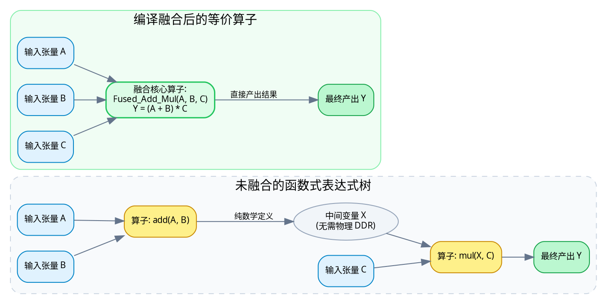
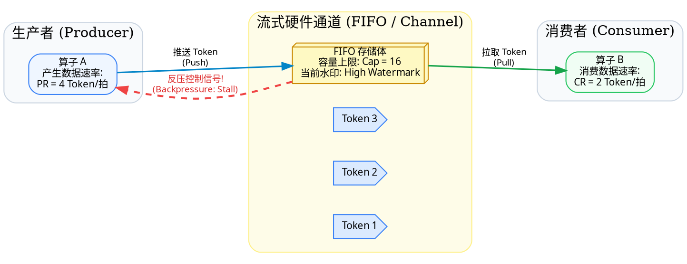
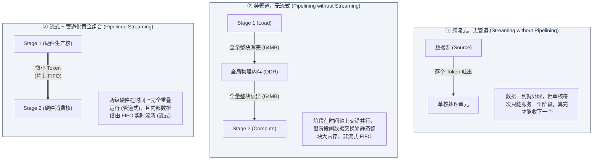
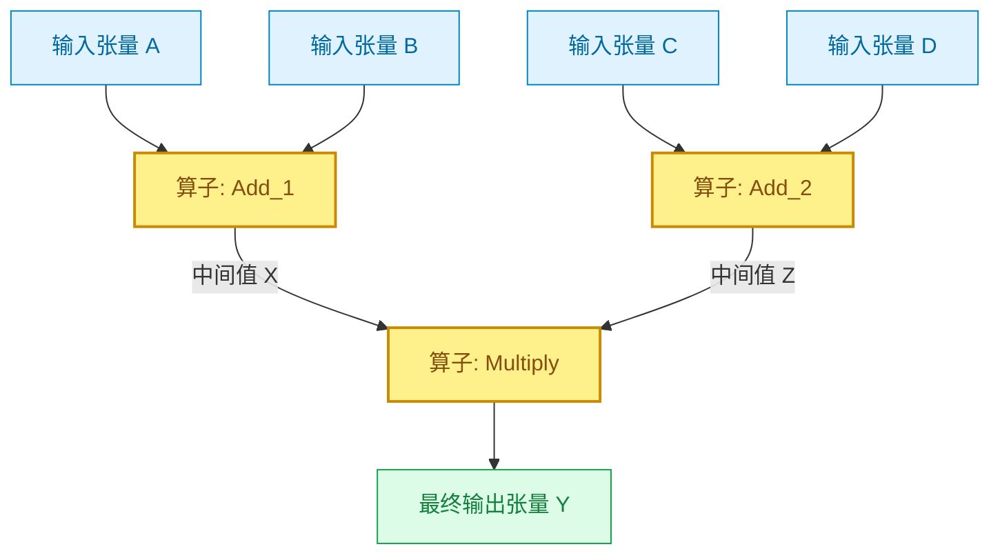
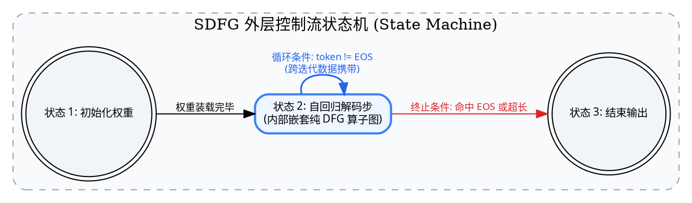
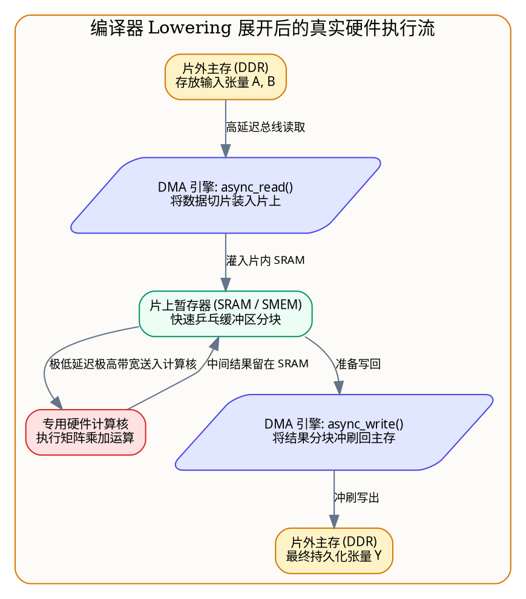
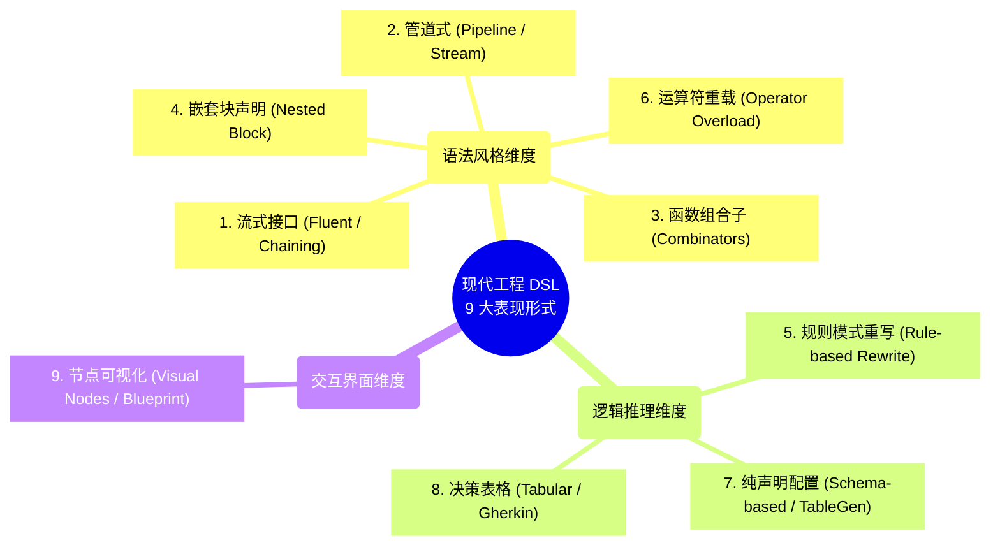
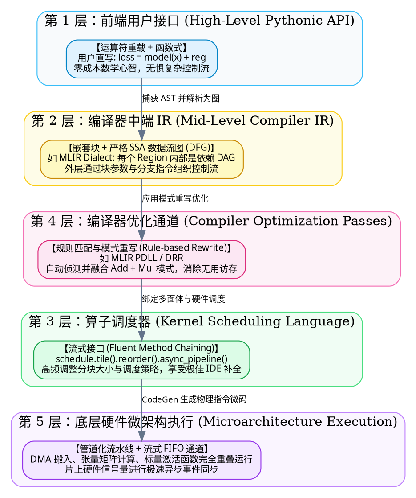

> **导读**：在领域特定语言（DSL, Domain-Specific Language）、AI 编译器（如 MLIR、TVM、Halide）以及专用加速处理器（如 NPU、TPU、GPU）的架构设计与编程体系中，开发者经常会被一堆纷繁复杂的术语狂轰滥炸：
>
> **流式（Streaming）、管道式（Pipeline）、函数式（Functional）、数据流式（Dataflow）、命令式（Imperative）、声明式（Declarative）、图式（Graph-based）……**
>
> 许多初学者在第一次接触这些概念时，往往会产生极大的困惑：
> 1. “流式”到底是像 Java Stream、C++ 链式调用 `a.b().c()` 那样的语法糖（Fluent Interface），还是指硬件通过 FIFO 队列像自来水一样按字节吞吐的物理传输？
> 2. “管道式”究竟是指 Unix Shell 里的管道符 `|`，还是指芯片微架构中按时钟节拍重叠运行的指令流水线？
> 3. 为什么在现代 AI 编译器与 NPU DSL 中，一门语言可以**同时**被称为：**“声明式 + 函数式 + 数据流图式 + 流式执行 + 管道化调度”**？这难道不自相矛盾吗？
>
> **答案是：完全不矛盾！因为它们根本不是同一个维度的分类，而是在回答五个完全正交的体系结构与语言设计问题。**
>
> 本文将从计算机体系结构与编译原理的**第一性原理**出发，彻底拆解 DSL 的五个正交设计维度。全篇遵循初学者友好原则，对涉及的专业术语在初次出现时均做通俗化拆解与直觉类比，并配备丰富的 **Graphviz** 与 **Mermaid** 高清架构图，帮助读者建立端到端贯穿“上层语法表达”与“底层芯片执行”的完整心智模型。

---

## 目录导览

- [零、初学者必读：核心概念与架构术语全景词典](#零初学者必读核心概念与架构术语全景词典)
- [一、第一性原理：DSL 设计的五个正交维度](#一第一性原理dsl-设计的五个正交维度)
- [二、函数式 DSL：关注计算结果，而非执行时序](#二函数式-dsl关注计算结果而非执行时序)
- [三、管道式 DSL：关注计算阶段如何跨时间重叠](#三管道式-dsl关注计算阶段如何跨时间重叠)
- [四、流式 DSL：关注数据在生产者与消费者之间的连续传输](#四流式-dsl关注数据在生产者与消费者之间的连续传输)
- [五、本质辩析：流式（Streaming）与管道式（Pipeline）的区别](#五本质辩析流式streaming与管道式pipeline的区别)
- [六、数据流式 DSL 与图式 DSL：拓扑依赖与状态控制](#六数据流式-dsl-与图式-dsl拓扑依赖与状态控制)
- [七、软件工程全景：现代 DSL 的 9 大表现形式与语法范式](#七软件工程全景现代-dsl-的-9-大表现形式与语法范式)
- [八、终局构想：现代 AI 编译器与硬件 DSL 的正交混合架构](#八终局构想现代-ai-编译器与硬件-dsl-的正交混合架构)
- [九、总结与架构师速查备忘](#九总结与架构师速查备忘)

---

## 零、初学者必读：核心概念与架构术语全景词典

为了让非体系结构或非编译器专业的读者能够顺畅阅读，我们先将贯穿本文的“专业黑话”转化为直观的生活类比与工程定义：

> [!NOTE] 核心术语扫盲速查卡片
>
> 1. **DSL（Domain-Specific Language，领域特定语言）**：
>    专门为解决某一个特定领域问题而裁剪定制的计算机语言（如写数据库查询的 SQL、写硬件样式的 Verilog、写张量调度的 Halide）。与之相对的是 **GPL（General-Purpose Language，通用编程语言）**，如 C++ 或 Python。DSL 放弃了通用性，换来了极高密度的领域表达力与极大的编译器自动优化空间。
> 2. **编程范式（Programming Paradigm）**：
>    你“在代码纸面上如何组织思维与表达计算”。比如是用命令步步交代（命令式），还是用纯数学函数组合映射（函数式），抑或是只声明目标条件（声明式）。
> 3. **执行模型（Execution Model）**：
>    物理硬件上的晶体管、计算核与总线“在时钟节拍推进下究竟如何运转”。是单核排队执行（串行），还是千核并发（并行），抑或是分工流水（管道化）。
> 4. **Fluent Interface（流式接口 / 链式调用）**：
>    一种纯**语法设计手法**。每个函数调用完毕后都返回自身（`return this`）或下一个上下文对象，使得调用可以连成一条长线：`data.filter().map().sort()`，读起来像连贯的英文句子。
> 5. **Token（数据令牌 / 传输粒度）**：
>    在流式系统或数据流系统中，流淌在通道中的**最小逻辑数据块**。它可以是一个标量浮点数、一个 128 维的向量、一个 $32\times 32$ 的矩阵分块（Tile），甚至是一个网络数据包。
> 6. **FIFO（First-In, First-Out，先进先出队列）与 Channel（通道）**：
>    连接两个独立硬件单元或软件任务的单向通信缓冲区。先塞进去的 Token 先被读出来，用于隔离生产者和消费者的瞬时速度差异。
> 7. **Backpressure（反压 / 背压机制）**：
>    当下游消费者干活太慢导致 FIFO 堆满时，下游硬件向上一级发出“暂停灌水”的物理握手信号。若无反压机制，缓冲区就会直接溢出（Overflow）引发数据丢失或硬件异常。
> 8. **Deadlock（死锁）**：
>    两个或多个计算单元互相等待对方释放资源或吐出数据，导致整个系统彻底僵死、谁也无法推进的灾难状态。
> 9. **Tile / Tiling（分块 / 瓦片化）**：
>    AI 算子中极其关键的访存优化手段。现代神经网络的特征图动辄几十兆字节，但芯片内部极速的 SRAM 只有几兆甚至几百 KB。因此必须把浩瀚的张量“切成一块块豆腐干（Tile）”，分批拉进芯片内部计算。
> 10. **Latency（延迟）与 Initiation Interval（II，启动间隔 / 发起间隔）**：
>     - **Latency**：单个数据（或单个 Tile）从踏入流水线第一级到彻底完成输出所耗费的**总时长**。
>     - **Initiation Interval (II)**：流水线**连续接纳两个相邻新数据**之间的时钟间隔。理想流水线的 $II = 1$，即每个时钟周期都能吐出一个结果。
> 11. **DMA（Direct Memory Access，直接内存访问引擎）**：
>     芯片内部负责当“专业搬运工”的独立硬件控制器。它可以在完全不惊动 CPU/计算核心的情况下，在片外大容量慢速内存（DDR/HBM）和片内高速暂存器之间高速吞吐数据。
> 12. **片上暂存器（On-Chip SRAM / Scratchpad Memory / SMEM）**：
>     紧挨着计算核心的高速静态随机存储器。在专用加速器中，它通常不是透明的硬件缓存（Cache），而是**软件显式管理**的内存空间，程序员或编译器必须精确规划哪块地放输入、哪块地放输出。
> 13. **张量计算单元（Tensor Core / Matrix Unit）与 通用标量/向量核（Scalar / Vector Core）**：
>     - **张量核**：由大规模乘加阵列（如脉动阵列 Systolic Array）组成的专用硬件，擅长单周期吞吐巨大的二维矩阵乘加（GEMM）。
>     - **标量/向量核**：带有丰富通用指令集（如 RISC-V RVV、ARM NEON 等）的计算核心，擅长处理复杂的控制逻辑、非线性激活函数（Softmax、GELU）与元素级加减运算。
> 14. **DAG（Directed Acyclic Graph，有向无环图）与 DFG（Data Flow Graph，数据流图）**：
>     节点代表算子或指令，有向边代表数据流动与依赖。只要图中没有环路（无环），就构成了 DAG。
> 15. **SDFG（Stateful Dataflow Graph，状态化数据流图）**：
>     为了弥补纯 DFG 难以优雅表达 `if-else` 分支与 `for/while` 循环的短板，将“外层控制流状态机”与“内层纯数据流图”进行分层嵌套的图表示模型。
> 16. **算子融合（Operator Fusion）与 公共子表达式消除（CSE）**：
>     - **算子融合**：把连续执行的两个算子（如 $X = A + B$ 与 $Y = \text{ReLU}(X)$）合成一个联合算子在片上一次性算完，避免将巨大的中间结果 $X$ 倒腾到外部慢速内存中。
>     - **CSE**：编译器识别出代码中重复计算的相同子表达式，只计算一次并把结果直接共享给下游。

---

## 一、第一性原理：DSL 设计的五个正交维度

为什么大家在讨论 DSL 时总是争论不休？
根本原因在于：**许多人把“语法怎么写”和“硬件怎么跑”混为一谈，把“数据结构”和“调度策略”混为一谈。**

从计算机科学的第一性原理出发，任何程序系统要想将算法映射到硬件芯片上，都必须独立回答以下**五个核心问题**：


这五个维度在逻辑上是**高度解耦且完全正交**的：

1. **语义层（What）**：定义数学与计算规范。你是表达矩阵乘、卷积、Softmax，还是粒子碰撞？
2. **编程范式（How - Syntax & Style）**：程序员面向的语法界面。你是用纯数学公式套嵌（函数式），是用链式方法点出来（Fluent），还是只声明最终输出约束（声明式）？
3. **数据组织（Data Flow & Channel）**：逻辑值在计算单元之间如何拓扑关联。是基于全局张量依赖边（DAG），还是基于点对点的单向 FIFO 管道（Streaming Token），抑或是显式的连续共享内存块（Buffer）？
4. **执行模型（When - Scheduling & Concurrency）**：操作在物理时间轴上的推进方式。不同 Tile 之间是老死不相往来地排队跑（Serial），还是同一时刻像工厂流水线一样交错前进（Pipelined）？
5. **硬件映射（Where - Microarchitecture Placement）**：具体由哪块硅片电路承载计算与搬运。由 DMA 负责拉入 SRAM，由张量计算核负责 GEMM 吞吐，由向量核负责激活函数。

### 核心术语横向全景对照矩阵

为了破除概念混淆，下表对工程中最常碰撞的概念进行了精准定性：

| 范式 / 概念名称 | 所属主要维度 | 核心设计哲学 | 最关注的核心问题 | 典型工业界代表 |
| :--- | :--- | :--- | :--- | :--- |
| **函数式 (Functional)** | 编程范式 / 语义层 | 用纯数学函数及表达式无副作用地组合计算 | “结果是什么？” | MLIR Linalg 算子、Haskell、JAX `jaxpr` |
| **命令式 (Imperative)** | 编程范式 / 控制流 | 步步明确给出硬件状态变迁与执行指令序列 | “下一步做什么？” | C/C++、Python、裸机汇编 |
| **声明式 (Declarative)** | 编程范式 / 抽象层 | 只描述输入约束与期望产出的最终目标，隐藏过程 | “要实现什么目标？” | SQL、HTML、Prolog、K8s YAML |
| **流式 (Streaming)** | 数据组织 / 通信机制 | 数据以逻辑令牌（Token）逐项或逐块连续流过算子通道 | “何时产生/消费数据？通道是否反压？” | StreamIt、Flink、SDF 硬件通道、网络流 |
| **管道式 (Pipeline)** | 执行模型 / 时间调度 | 将整体计算拆解为多阶段，让不同批次的数据在时间上重叠运行 | “不同阶段如何在时间轴上交叠推进？” | 现代 CPU/NPU 指令流水线、AMD Vitis HLS、TVM Pipeline |
| **数据流式 (Dataflow)** | 数据组织 / 语义模型 | 算子执行严格由“输入数据是否已全部就绪”来触发（依赖驱动） | “谁依赖谁的产出？” | LLVM SSA IR、TensorFlow 1.x 计算图、DaCe SDFG |
| **图式 (Graph-based)** | 数据组织 / 表现结构 | 显式使用节点（Node）与有向边（Edge）表达拓扑结构与资源依赖 | “全局计算与依赖拓扑图长什么样？” | ONNX 规范、PyTorch FX、MLIR Graph Region |
| **循环式 (Loop-based)** | 执行模型 / 空间遍历 | 用多层嵌套迭代空间与多面体（Polyhedral）描述数据遍历 | “如何遍历多维多面体空间？” | Polyhedral 编译器、Pluto、OpenMP `for` |
| **张量表达式 (Tensor Exp)** | 编程范式 / 语义层 | 用爱因斯坦求和约定或元素级仿射映射表达多维数组计算 | “张量元素之间满足什么数学变换？” | TVM Tensor Expression (TE)、Halide Algorithm |
| **流式接口 (Fluent)** | 编程范式 / 语法表现 | 通过对象方法连续链式调用，每个方法返回操作上下文 | “API 怎么调用更连贯且便于 IDE 补全？” | Halide / TVM Schedule 原语、Java Stream API |
| **规则式 (Rule-based)** | 编译转换 / 重写系统 | 通过“模式匹配（Pattern）$\Rightarrow$ 动作改写（Action）”进行等价变换 | “当代码符合某种拓扑时，如何改写？” | MLIR PDLL / DRR、TableGen、Tree-rewriter |

由此可见，当有人说 **“一个 NPU DSL 是声明式 + 函数式 + 数据流图式 + 流式执行 + 管道化调度”** 时：
- **声明式**：用户只需要定义输出张量的目标形态与维度，无需手工编写嵌套四重循环；
- **函数式**：算子内部无全局可变状态副作用，数学表达式极其干净；
- **数据流图式**：编译器中间表示（IR）将算子组织为严格的 SSA Def-Use 依赖 DAG；
- **流式执行**：相邻算子或分块处理单元之间采用小颗粒 Token 与 FIFO 通道直连传输；
- **管道化调度**：调度器把搬运阶段与计算阶段在物理时间上交错重叠起来运行。

**它们处在完全不同的抽象层次上，各司其职，相得益彰！**

---

## 二、函数式 DSL：关注计算结果，而非执行时序

### 2.1 纯函数的数学纯粹度

假设在 AI 编译器的上层，我们需要表达这样一个标准的矩阵运算：

$$Y = (A + B) \times C$$

如果用函数式风格编写 DSL，它可以抽象为：

```python
def compute(A, B, C):
    X = add(A, B)
    Y = mul(X, C)
    return Y
```

这段代码看似简单，但其蕴含的**形式化语义（Formal Semantics）**极为深刻：
它表达的是数学映射集合：

$$X = A + B, \qquad Y = X \times C$$

在**纯函数式语义**中，具有两大关键性质：
1. **引用透明性（Referential Transparency）**：相同的输入参数必然产生绝对唯一的计算结果。
2. **无外部副作用（No Side-Effects）**：计算过程绝对不会去偷偷修改外部全局内存、全局寄存器或硬件控制寄存器的状态。

### 2.2 为什么 AI 编译器极度推崇函数式语义？

在传统命令式语言（如 C 语言）中，如果你写了指针写内存：`*ptr = a + b;`，编译器在优化时必须极其小心，甚至不敢随意调换代码顺序，生怕破坏了指针别名（Pointer Alias）或引发时序竞态。

但在函数式 DSL 中，编译器拥有近乎无限的自由度：

1. **算子融合（Operator Fusion）的终极温床**：
   编译器可以轻而易举地把加法（Add）和乘法（Mul）合并为一个融合乘加算子（Fused MAdd）。
2. **公共子表达式消除（CSE）与代数化简**：
   如果代码中多次出现 `add(A, B)`，编译器完全确信它的结果永远不变，只需计算一次即可。
3. **彻底解耦计算与物理存储**：
   在函数式代码里，虽然表面上产生了一个名为 `X` 的中间变量，但**这绝对不意味着必须在片外慢速 DDR 里为 $X$ 开辟一段物理内存空间！**
   编译器完全可以自由决定：
   - 将 $X$ 暂存在物理通用计算核的向量寄存器中；
   - 将 $X$ 暂存在片上高速暂存 SRAM 中；
   - 甚至通过计算融合，让 $X$ 仅以临时电平信号的形式在算子内部流通，实现“零内存开销”。

我们用 Graphviz 直观展示函数式表达式树与编译器算子融合重写过程：



> [!WARNING] 初学者常见误区：函数式 $\neq$ 硬件并行，也 $\neq$ 流式
> 函数式只是表达了“数据之间的因果依赖”。**一个纯函数式的程序，完全可以被翻译成一个在单核 CPU 上以极慢速度一条条排队执行的普通指令循环！**
> 它本身既不承诺并发执行，也不承诺底层采用流式通道。

---

## 三、管道式 DSL：关注计算阶段如何跨时间重叠

### 3.1 什么是管道化（Pipelining）？

如果说函数式关注的是“算什么”，那么**管道式（Pipeline-oriented）**的核心则是**将复杂计算解构为多个有序的阶段（Stages），并在时间轴上让不同的任务阶段发生空间上的重叠（Overlap）。**

在现代专用的 AI 加速芯片或高能效处理器中，一个典型的张量分块（Tile）处理流水线通常包含三个经典物理阶段：

1. **Stage 1: DMA 读取（Load）**：通过片上 DMA 搬运引擎将分块数据从片外 DDR 搬运至片上高速暂存器（SRAM）；
2. **Stage 2: 核心计算（Compute）**：通用向量核心或专用张量矩阵阵列执行向量加、乘或卷积计算；
3. **Stage 3: DMA 写回（Store）**：通过 DMA 将计算完毕的中间分块从片上 SRAM 冲刷写回片外 DDR。

一个假想的抽象管道式 DSL 描述如下：

```python
# 管道调度定义示例
pipeline:
    stage("load",    dma.async_read)
    stage("compute", tensor_engine.matmul)
    stage("store",   dma.async_write)
```

### 3.2 串行执行 vs 管道化流水线：时空消耗对比

为了彻底搞清楚管道化的威力，我们建立一个极简模型：
假设每个阶段处理一个数据分块（Tile）都需要消耗 **1 个时间单位（Cycle）**，现在有连续的 3 个分块（Tile 0, Tile 1, Tile 2）需要处理。

#### 1. 串行执行模式（Serial Execution）
所有阶段严格排队，前一个 Tile 的三个阶段全部走完，才允许下一个 Tile 进入：

```
时间周期 (Cycle)  ->   T0   T1   T2   T3   T4   T5   T6   T7   T8
----------------------------------------------------------------------
Tile 0 处理阶段:     [Load][Comp][Stor]
Tile 1 处理阶段:                      [Load][Comp][Stor]
Tile 2 处理阶段:                                       [Load][Comp][Stor]
----------------------------------------------------------------------
总耗时：3 个 Tile × 3 个阶段 = 9 个时间单位
硬件单元利用率：任何时刻，只有 1 个硬件单元在干活，另外 2 个在围观！
```

#### 2. 理想管道化流水线执行模式（Pipelined Execution）
通过交错调度，让不同分块占据不同的物理处理单元：

```
时间周期 (Cycle)  ->   T0      T1      T2      T3      T4
----------------------------------------------------------------------
Stage 1 (DMA Load):   [Tile 0][Tile 1][Tile 2]  (空闲)  (空闲)
Stage 2 (Compute):     (空闲) [Tile 0][Tile 1][Tile 2]  (空闲)
Stage 3 (DMA Store):   (空闲)  (空闲) [Tile 0][Tile 1][Tile 2]
----------------------------------------------------------------------
总耗时：仅需 5 个时间单位！ (近乎减少了一半时间)
稳态时（T2 周期）：DMA 读、计算核心、DMA 写同时满负荷运作！
```

我们用精准的 Gantt 图表将这一时序重叠过程可视化：


### 3.3 架构指标：延迟（Latency）与 启动间隔（II）

在这个经典模型中，诞生了硬件体系结构中两个极度重要的黄金指标：

- **Latency（延迟）**：
  指**单个数据（如 Tile 0）**从进入流水线第一级到最终完成走完全程的绝对耗时。在上述例子中：
  $$\text{Latency} = 3 \text{ 个周期}$$
- **Initiation Interval（II，启动间隔 / 发起间隔）**：
  指流水线**连续接纳两个相邻新数据分块（Tile）的时间间隔**。在理想状态下，每个周期都能接纳一个新 Tile：
  $$\text{II} = 1 \text{ 个周期}$$
  流水线的吞吐量（Throughput）与 II 成反比：$\text{Throughput} = \frac{1}{\text{II}}$。II 越小，吞吐率越高！

### 3.4 现实硬件给管道化带来的真实挑战

在编写 DSL 时，敲下 `pipeline:` 语法非常容易；但在芯片硅片上，要想真正跑出 $II=1$ 的理想流水线，编译器和硬件必须共同解决三大物理难题：

1. **片上存储冲突与乒乓双缓冲（Ping-Pong / Double Buffering）**：
   在 $T1$ 周期，DMA 正在将 Tile 1 灌入片上 SRAM，而计算核心正在从 SRAM 中读取 Tile 0 进行计算。如果片上 SRAM 只有一份缓冲区，就会发生读写冲突！
   因此硬件或编译器必须在片上 SRAM 中开辟 **Ping 缓冲区** 和 **Pong 缓冲区**，交叉读写：
   - DMA 写 Ping，计算核心读 Pong；下一拍 DMA 写 Pong，计算核心读 Ping。
2. **总线资源与通道争用（Resource Contention）**：
   DMA 读与 DMA 写是否共用同一组外部内存总线接口（如 AXI 总线）？如果是，由于带宽冲突，Load 和 Store 根本无法在同周期满载运行，II 必然退化。
3. **跨阶段硬件异步事件通知（Event Synchronization）**：
   计算核心怎么确切知道 Tile 1 已经由 DMA 完整搬运完成了？这需要依赖底层的硬件信号量（Hardware Semaphore）、异步屏障（Async Barrier）或中断完成标记。

---

## 四、流式 DSL：关注数据在生产者与消费者之间的连续传输

### 4.1 流式（Streaming）的核心哲学

与管道式关注“计算分几个阶段”不同，**流式（Streaming）的核心关注点是“数据传输与消费的粒度与连续性”。**

传统批量计算（Batch Computing）模式下，算子之间的数据传递往往是“整块交付”：
例如一个张量乘法算子必须等待前序算子将整整一个 $64 \times 128$ 的浮点矩阵**全量存入内存**后，才慢悠悠地启动。

而**流式系统**主张：
> **生产者每产出一小块数据（哪怕只是一个数据包或一行分块），消费者就立刻饥渴地拿去处理，数据如水流般在算子之间不舍昼夜地涌动。**

示意流式 DSL 如下：

```python
# 示意性的流式处理 DSL
stream_a = source("A")
stream_b = source("B")

# 通过 zip 配对通道，并通过 map 逐个 Token 连续计算
stream_y = stream_a.zip(stream_b).map(lambda a, b: a + b)

sink(stream_y)
```

### 4.2 流式系统的六大关键物理机制

要构建一个高能效且不崩溃的流式 DSL 与执行引擎，必须在语义与底层实现上精准定义以下六个要素：



1. **数据令牌（Token）**：
   流式传输的最小逻辑物理单元。在粗粒度流系统中可以是一个 Tile；在细粒度脉动阵列（Systolic Array）中可以是一个 32-bit 的标量数值。
2. **通道与队列（FIFO / Channel）**：
   生产者与消费者之间的缓冲纽带。通道解耦了两个算子在瞬间时钟节拍上的频率微调。
3. **生产与消费速率（Produce / Consume Rate）**：
   算子每拍产出和吃掉多少 Token。例如算子 A 每周期产出 4 个 Token，而下游算子 B 每周期只能吃下 2 个 Token。
4. **反压机制（Backpressure）**：
   由于生产速率大于消费速率，FIFO 会在短时间内积水并触及“高水位线（High Watermark）”。此时 FIFO 必须立刻向前级发出**反压暂停信号（Stall Signal）**，强制生产者挂起，防止缓冲区溢出（Overflow）。
5. **缓冲区容量设计（Buffer Capacity）**：
   FIFO 深度设多大最合适？设得太小会导致前级频繁被反压打停，吞吐大跌；设得太大又会白白浪费芯片极其昂贵的 SRAM 硅片面积。
6. **死锁规避（Deadlock Prevention）**：
   如果两个算子互相向对方的 FIFO 推数据，且各自的输出 FIFO 均已被填满，双方都在苦苦等待对方先读走数据以释放空间，系统就会陷入永久死锁！

> [!TIP] 经典学术与工业标杆：同步数据流（SDF）与 StreamIt
> 麻省理工学院著名的 **StreamIt** 语言正是基于 **SDF（Synchronous Dataflow，同步数据流）** 理论构建的。在 SDF 模型中，每个节点每次触发时产出和消费的 Token 数量在**编译期是完全固定的常数**。
> 编译器可以通过解**拓扑平衡矩阵方程（Topology Balance Equation）**：
> $$\Gamma \cdot \vec{q} = 0$$
> 在编译期以纯数学方式精确算出所有通道所需的最小无死锁 FIFO 容量，并静态规划出最优调度序列！

---

## 五、本质辩析：流式（Streaming）与管道式（Pipeline）的区别

初学者最容易将“流式”与“管道式”当成一回事，甚至随意混称。我们必须给出一个一针见血的本质定性：

> **流式（Streaming）描述的是数据在物理或逻辑接口上“如何连续交接与消费”；**
> **管道式（Pipeline）描述的是不同任务在时间轴上“如何重叠共存”。**

我们通过三个维度的交叉对比来彻底厘清界限：



### 对比总结表

| 比较维度 | 流式（Streaming） | 管道式（Pipeline） |
| :--- | :--- | :--- |
| **关注核心** | 数据传递的颗粒度与交互通道（Token & FIFO） | 计算任务在时间维度的交叠排期（Overlap & Stages） |
| **空间占用** | 极其轻量，只需要容纳几个或几十个 Token 的微小队列 | 需要为各个阶段分配完整的输入输出缓冲区（如双缓冲） |
| **典型瓶颈** | 反压传播延迟、生产/消费速率失配、死锁 | 启动间隔（II）膨胀、木桶效应（最慢 Stage 拖慢整条管线） |
| **硬件载体** | 片上专用硬件 FIFO、流接口（如 AXI-Stream） | 状态机分阶段触发、环形双缓冲 SRAM 控制器 |

在现代高性能 AI 芯片的 DSL 编译中，这两者往往是**珠联璧合**的：各个功能单元在时间轴上构建起深度的流水线调度，而在相邻单元的数据交接面上则全面采用流式 FIFO 协议通信。

---

## 六、数据流式 DSL 与图式 DSL：拓扑依赖与状态控制

### 6.1 数据流式（Dataflow-oriented）：因果依赖驱动一切

“数据流式”的名字里虽然也有个“流”字，但它与“流式传输（Streaming）”是两码事。

数据流式的核心信条只有一条：
> **一个计算操作何时能够执行，完全且仅仅取决于它的所有输入操作数是否已经生产完毕并就绪。**

考虑如下经典代数方程组：

$$\begin{aligned}
X &= A + B \\
Z &= C + D \\
Y &= X \times Z
\end{aligned}$$

将其翻译为数据流依赖关系，我们可以得到一个非常直观的数据依赖图：



从数据流依赖图中，编译器可以一眼洞察出两项至关重要的架构红利：
1. **自动并发发现（Implicit Parallelism）**：
   `Add_1` 与 `Add_2` 之间没有任何连线依赖，这意味着**它们天生就可以在两个独立的物理计算核心上同时并行执行**，程序员甚至根本不需要写诸如 `pthread_create` 之类的多线程指令！
2. **执行时序解约**：
   图只表达了“因果依赖”，它绝不武断地规定到底先算左边的 `Add_1` 还是先算右边的 `Add_2`。

一个简化的图式数据流构建 DSL 可以写成：

```python
with graph() as g:
    x = op.add(A, B)
    z = op.add(C, D)
    y = op.mul(x, z)
    g.output(y)
```

### 6.2 认知澄清：数据流式 $\neq$ 流式，也 $\neq$ 纯无状态 DAG

#### 澄清一：数据流式不等于流式
- 如果图中的 `X` 和 `Z` 都是大小为 512MB 的全量张量，执行策略规定：“必须等整个张量 `X` 和整个张量 `Z` 全部落盘后，`Multiply` 才能开工”，这**依然是标准的数据流式**，但它**完全不是流式**！
- 反之，如果规定 `Add_1` 和 `Add_2` 每算出一块 $16\times 16$ 的分块，`Multiply` 就立刻吃下并推进，此时它便同时具备了“数据流式”与“流式”的双重特征。

#### 澄清二：真实程序不可能只有纯 DAG
初学者容易误以为世界上所有的计算都能画成一张没有环路的 DAG 图。但在真实的大模型推理（如 LLM 自回归解码）与复杂算法中，**控制流与动态循环是无处不在的**：

```python
# LLM 动态自回归解码逻辑：典型的控制流与循环状态
while not finished and current_len < max_seq_len:
    logits = model.forward(token, kv_cache)
    token, finished = sample_and_check_eos(logits)
```

这种包含状态循环与动态跳出的逻辑，无论如何都无法被塞进一张扁平静态的纯 DAG 中。

为了解决这个难题，业界前沿编译器（如 ETH Zurich 研发的高性能计算框架 **DaCe**）提出了 **SDFG（Stateful Dataflow Graph，状态化数据流图）** 理论体系：
- **外层**：采用状态机（State Machine）显式表达分支、条件跳转与循环（Control Flow）；
- **内层**：每个状态内部是一个纯粹的、无环的数据流依赖图（Pure Dataflow Graph）。



### 6.3 图式 DSL（Graph-based）：拓扑结构与物理内存下沉

图式（Graph-based）是一种**数据结构与表达骨架**，而数据流式则是一种**语义模型**。

图的节点不仅仅可以代表“数学加法”，还可以代表“物理行为”：
- **节点类型**：数学算子（Compute Op）、DMA 异步搬运（DMA Transfer）、片上内存申请（Buffer Allocation）、同步事件标记（Sync Event）；
- **边类型**：数值 Def-Use 依赖边、顺序执行控制依赖边、内存读写 Hazard 冲突防卫边。

一个完备的硬件图式 DSL 最终必须将高级的“逻辑数学图”逐步下沉（Lowering）为“符合物理内存层级架构的硬件任务图”：



---

## 七、软件工程全景：现代 DSL 的 9 大表现形式与语法范式

在实际的软件工程、AI 框架与编译器研发中，DSL 的**语法表现形式（Surface Syntax）**五花八门。根据开发者组合原子操作的方式，业界总结出了九大经典形态：



### 1. 流式接口（Fluent Interface / 方法链式）
- **核心机制**：通过连续的对象方法调用（Method Chaining），每个方法执行后返回 `this` 或者表示下一阶段的 Context 对象。
- **最大优势**：在 IDE 中输入一个句点 `.` 就能瞬间弹出自动补全列表，上下文连贯，非常适合参数配置。
- **工业代表**：Halide 与 TVM 的调度语言（Schedule Primitives）、SQL 查询构造器（如 Knex、JOOQ）。

```cpp
// 示例：Halide / TVM 风格的算子调度 DSL
schedule[C].split(x, x_outer, x_inner, 16)
           .reorder(x_outer, y, x_inner)
           .parallel(x_outer)
           .vectorize(x_inner);
```

### 2. 管道式（Pipeline / 单向数据流）
- **核心机制**：利用管道连接符（如 `|`、`>>`、`|>`）将前一个表达式的输出直接作为后一个表达式的隐式输入参数。
- **最大优势**：彻底去中心化，消除了中间临时变量命名，代码极其符合人类“流水线加工”的直觉直观。
- **工业代表**：Unix Shell、Elixir 管道操作符、C++20 Ranges 视图。

```cpp
// 示例：C++20 Ranges 管道式数据转换
auto result = dataset 
    | std::views::filter([](int n) { return n % 2 == 0; })
    | std::views::transform([](int n) { return n * n; })
    | std::views::take(10);
```

### 3. 函数式（Functional / 组合子式）
- **核心机制**：以高阶函数和无副作用纯函数为砖瓦，通过“组合子（Combinators）”将细粒度函数嵌套组合为宏大逻辑。
- **最大优势**：数学表达力极强，具备无懈可击的形式化证明与代数推导基础。
- **工业代表**：Parser Combinators（Haskell Parsec）、Lisp S 表达式、深度学习符号表达式。

```python
# 示例：函数式解析与表达式组合
parsed_expr = match_token("add", combine(arg_var("A"), arg_var("B")))
```

### 4. 嵌套块 / 树状声明式（Nested Block / Hierarchical）
- **核心机制**：利用缩进、大括号或闭包代码块的自然嵌套关系，直接映射现实领域具有层级归属的数据拓扑。
- **最大优势**：所见即所得，对于有树状层级关系的结构（如 UI 树、语法树、硬件模块包含关系）表现力极佳。
- **工业代表**：QML、SwiftUI、Terraform HCL、Kotlin Gradle DSL、MLIR Region 语法。

```qml
// 示例：QML 树状声明式界面与层级拓扑
Window {
    width: 800; height: 600
    Column {
        spacing: 10
        Label { text: "AI 加速器监控面板" }
        Button { text: "触发编译"; onClicked: startCompile() }
    }
}
```

### 5. 规则模式匹配与重写式（Rule-based / Pattern Rewrite）
- **核心机制**：声明“匹配某种模式（Pattern）$\Rightarrow$ 改写为另一种形态（Action）”。不要求写死先改谁后改谁，由底层的重写引擎驱动。
- **最大优势**：极佳的关注点分离与模块化，极其适合编译器 Passes、窥孔优化（Peephole Optimization）。
- **工业代表**：MLIR PDLL、TableGen DRR (Declarative Rewrite Rules)、Makefile。

```text
// 示例：MLIR PDLL 风格的窥孔优化规则 (x + 0 => x)
Pattern {
    let zero = op<arith.constant> { value = 0 };
    let root = op<arith.addi>(x: Value, zero);
    rewrite root with x;
}
```

### 6. 运算符重载 / 表达式模板式（Operator Overloading）
- **核心机制**：在通用宿主语言（如 C++、Python）中对内置运算符（`+`、`*`、`@`、`[]`）进行重载，利用 C++ 模板延迟求值。
- **最大优势**：让代码还原如同教科书般的数学公式，对算法工程师体验极其友好。
- **工业代表**：C++ Eigen 线性代数库、PyTorch/NumPy 张量计算、Boost.Spirit。

```cpp
// 示例：Eigen 表达式模板 (延迟求值，防止生成临时矩阵)
MatrixXd D = A * B + C; // 内部生成 MultiplyAddOp 表达式模板，不立即分配物理堆内存
```

### 7. 纯声明 / 配置表式（Declarative / Schema-based）
- **核心机制**：彻底剥离任何算法逻辑与控制流（没有 `if`，没有 `for`），仅用静态键值对、关系约束或类型模式定义实体。
- **最大优势**：零副作用，极易进行跨语言的静态语义验证、序列化与代码生成。
- **工业代表**：SQL、Kubernetes YAML、LLVM/MLIR TableGen（`.td` 定义指令与算子）。

```text
// 示例：LLVM/MLIR TableGen 定义一个硬件加速算子
def CustomMatMulOp : Op<"custom_engine.matmul"> {
    let summary = "硬件专用分块矩阵乘法指令";
    let arguments = (ins AnyTensor:$lhs, AnyTensor:$rhs);
    let results = (outs AnyTensor:$output);
}
```

### 8. 表格 / 决策表式（Tabular / Decision Table）
- **核心机制**：用二维矩阵表格来表达复杂的输入多条件组合与业务决策动作映射。
- **最大优势**：直观，非程序员（如芯片验证工程师、业务分析师）能直接看懂并修改。
- **工业代表**：Cucumber Gherkin 测试用例、数字电路真值表、专家系统决策表。

```gherkin
# 示例：Gherkin 表格驱动测试
Scenario Outline: 校验张量分块尺寸是否合法
  Given 芯片片上 SRAM 大小为 <sram_size> KB
  When 申请分块尺寸为 <tile_m> x <tile_k>
  Then 校验结果应为 <valid>

  Examples:
    | sram_size | tile_m | tile_k | valid |
    | 512       | 32     | 64     | pass  |
    | 512       | 128    | 256    | fail  |
```

### 9. 图形化 / 节点连线式（Visual / Node-based）
- **核心机制**：纯可视化界面，开发者通过拖拽带有输入输出插槽（Pins）的节点并拉出连线来表达逻辑。
- **最大优势**：零编码门槛，数据流向与参数绑定一目了然。
- **工业代表**：虚幻引擎蓝图（Unreal Engine Blueprints）、AI 生图管线 ComfyUI、Blender 着色器节点。

---

## 八、终局构想：现代 AI 编译器与硬件 DSL 的正交混合架构

在工业界最具生产力的高性能编译器与芯片软件栈中，**几乎没有任何一个成功的框架会盲目抱死单一形态。**

以工业级 AI 编译器（如基于 MLIR、TVM 或 IREE 的体系）为例，它在纵向贯穿多层软件栈时，实际上巧妙地采用了**范式混合嵌套设计**：



### 给 DSL 架构师的设计启示录

如果你正在为团队、新一代专用芯片或高性能领域设计一门全新的 DSL，请务必在白板前核验以下五条工程戒律：

1. **切勿把“语法链式（Fluent）”等同于“硬件流式（Streaming）”**：
   在类里写一个 `return *this` 只是为了写代码时省几个字符，绝不代表硬件会自动通过 FIFO 进行小颗粒数据传输！
2. **严防“过早固定硬件内存层次”**：
   高层 DSL 的计算语义应尽可能保持纯净的函数式或张量表达式，不要过早在前端写死“这是 DDR 还是 SRAM”。把存储层次分配留给中端调度器去探索最优解。
3. **显式区分“调度（Schedule）”与“计算定义（Algorithm）”**：
   继承 Halide 与 TVM 的核心智慧——“算什么”永远不要与“怎么跑”交织在一起。同一个矩阵乘法数学定义，在不同的芯片架构上应当可以通过挂接不同的调度 DSL 变出完全不同的流水线形态。
4. **必须显式对反压与死锁进行语义建模**：
   如果你的 DSL 涉足了流式硬件通道，必须在语义定义中对缓冲深度（Buffer Depth）和反压协议做出形式化界定，否则隐藏在通道间的死锁会成为后端的噩梦。
5. **敬畏控制流与动态性**：
   不要心存幻想把真实世界的一切算法强行压平到一张无状态的纯 DAG 里。尽早设计好状态机与数据流分层共存的机制（如借鉴 SDFG 的设计哲学）。

---

## 九、总结与架构师速查备忘

最后，让我们用一张极度浓缩的知识图谱，把这几个最容易混淆的概念彻底定格：

| 问句 | 关心的核心维度 | 正交回答者 |
| :--- | :--- | :--- |
| **计算什么？** | 语义层（Semantic） | **张量/代数算子（Functional Expressions）** |
| **代码怎么写？** | 编程范式（Paradigm） | **流式接口（Fluent）/ 管道符（Pipeline）/ 嵌套块（Block）** |
| **因果关系如何？** | 数据组织（Organization） | **数据流图（Dataflow DAG）/ 状态化图（SDFG）** |
| **数据如何交接？** | 传输机制（Communication） | **流式传输（Streaming Tokens & FIFO Channel）** |
| **时空何时重叠？** | 执行模型（Execution） | **管道化流水线（Pipelining，追求 II = 1）** |
| **硬件哪块干活？** | 物理映射（Mapping） | **张量计算阵列 / 向量标量核 / SRAM 双缓冲 / DMA 引擎** |

当你再次审视 AI 编译器中复杂的 DSL 架构时，只要握紧这五把正交维度的手术刀，一切看似矛盾的术语乱象都将迎刃而解！
