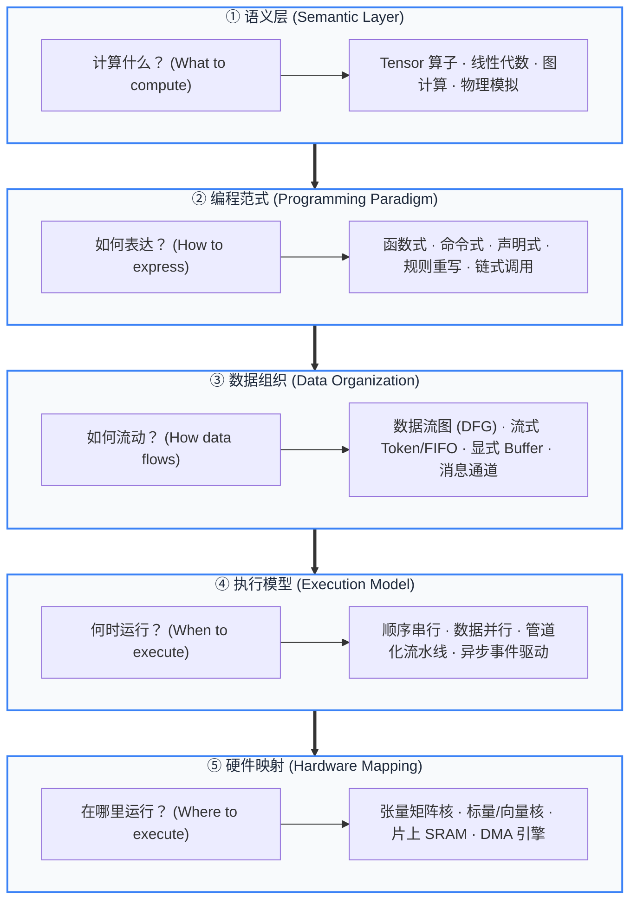
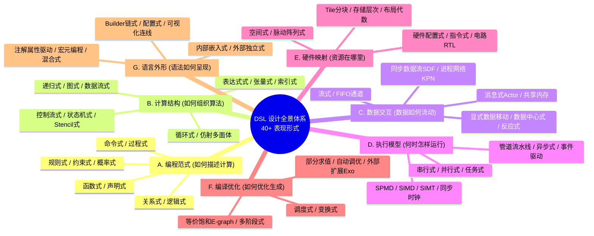
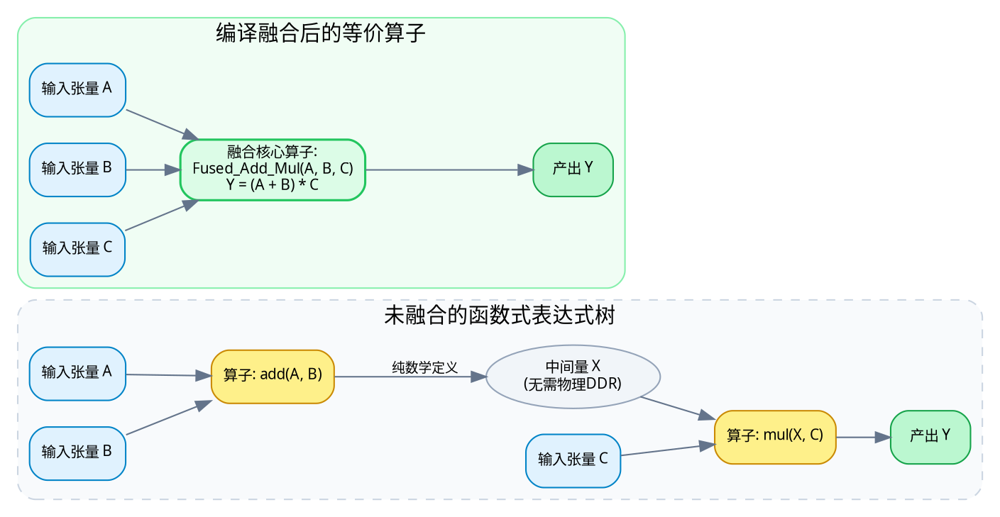
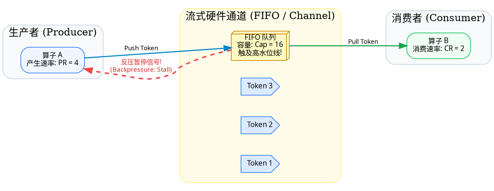
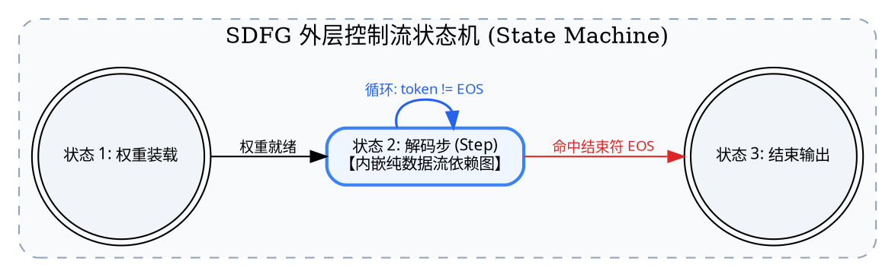
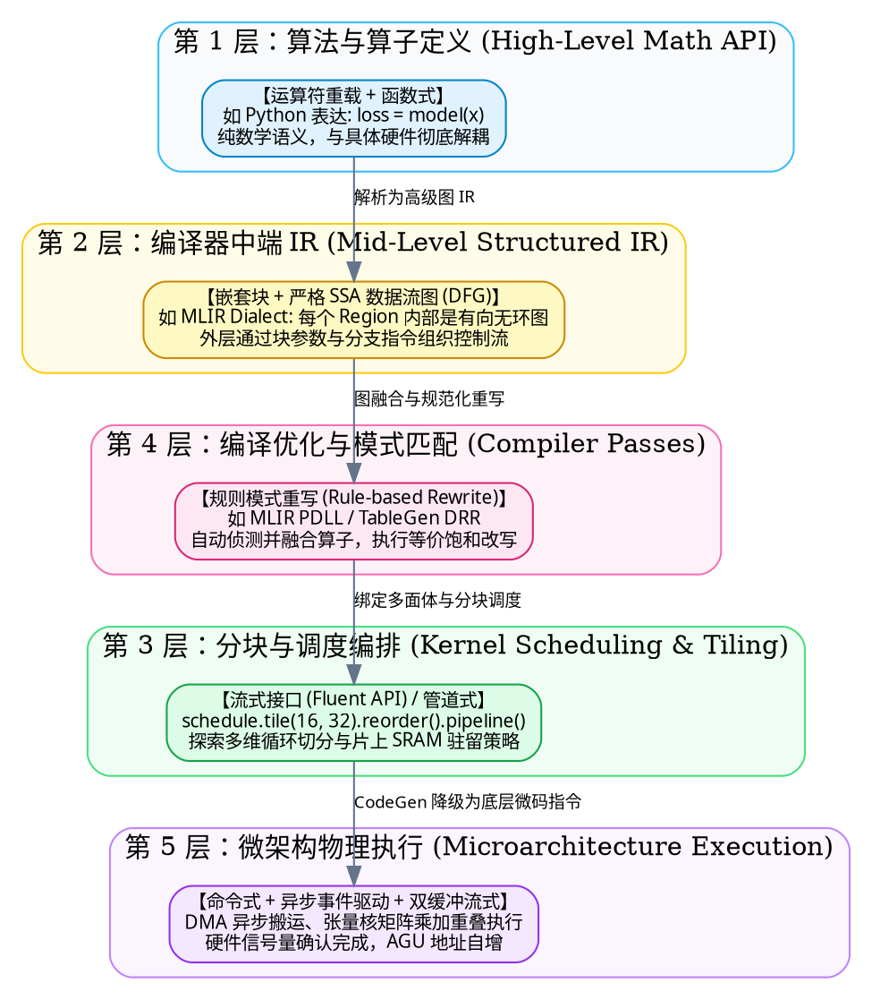
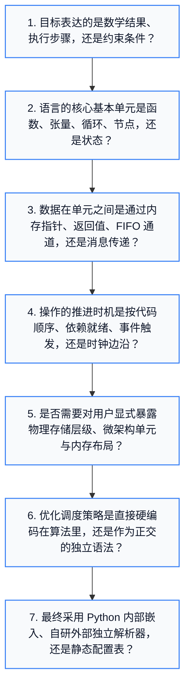

> **导读**：在领域特定语言（DSL, Domain-Specific Language）、AI 编译器（如 MLIR、TVM、Halide）以及专用加速处理器（如 NPU、TPU、GPU）的架构设计与编程体系中，开发者经常会被一堆纷繁复杂的术语狂轰滥炸：
>
> **流式（Streaming）、管道式（Pipeline）、函数式（Functional）、数据流式（Dataflow）、命令式（Imperative）、声明式（Declarative）、图式（Graph-based）、张量式、空间式、调度式……**
>
> 许多初学者在第一次接触这些概念时，往往会产生极大的认知混淆：
> 1. “流式”到底是像 Java Stream、C++ 链式调用 `a.b().c()` 那样的语法糖（Fluent Interface），还是指硬件通过 FIFO 队列像自来水一样按字节吞吐的物理传输？
> 2. “管道式”究竟是指 Unix Shell 里的单向管道符 `|`，还是指芯片微架构中按时钟节拍重叠运行的指令/任务流水线？
> 3. 为什么在现代 AI 编译器与加速芯片 DSL 中，一门语言可以**同时**被称为：**“声明式 + 函数式 + 数据流图式 + 流式执行 + 管道化调度”**？这难道不自相矛盾吗？
> 4. 面对专用加速芯片中**显式 SRAM 存储、异步 DMA 搬运、粗粒度张量核、硬件事件同步**的物理现实，究竟该如何选型设计 DSL，才能既拥有高级语言的优雅表达，又能压榨出极致的硬件性能？
>
> **答案是：完全不矛盾！因为这些术语根本不是同一个维度的分类，而是在回答各自正交的体系结构与语言设计问题。**
>
> 从编程语言理论、编译器中端到 GPU/NPU/FPGA 硬件抽象，我们可以梳理出 **40 余种 DSL 形式与组织模型**。本文将从计算机体系结构与编译原理的**第一性原理**出发，全景式解构 DSL 的分类地图与设计哲学。**全篇严格贯彻“每个概念必有代码示例与编译器洞察”的原则**，所有专业术语初次登场均配有通俗拆解，彻底剥离私有特定硬件代号与微码接口，并配备丰富的 **Graphviz** 与 **Mermaid** 高清架构图、16 对混淆概念对照表与统一算子对比，帮助读者建立端到端贯穿“上层高级语法”到“底层硅片执行”的完整心智模型。

---

## 目录导览

- [零、初学者必读：核心概念与架构术语全景词典](#零初学者必读核心概念与架构术语全景词典)
- [一、第一性原理：DSL 设计的五个正交维度](#一第一性原理dsl-设计的五个正交维度)
- [二、宏观体系地图：40 余种 DSL 形式与完整代码示例全景](#二宏观体系地图40-余种-dsl-形式与完整代码示例全景)
  - [A 类：编程范式（如何描述计算，9 种形式与代码）](#a-类编程范式如何描述计算)
  - [B 类：计算结构与算法表示（如何组织算法，11 种形式与代码）](#b-类计算结构与算法表示如何组织算法)
  - [C 类：数据交互与通信模型（数据如何流动，9 种形式与代码）](#c-类数据交互与通信模型数据如何流动)
  - [D 类：执行与并发模型（何时以及怎样运行，11 种形式与代码）](#d-类执行与并发模型何时以及怎样运行)
  - [E 类：硬件映射与存储模型（在哪里使用何种资源，8 种形式与代码）](#e-类硬件映射与存储模型在哪里使用何种资源)
  - [F 类：编译优化与调度策略（如何优化与生成代码，7 种形式与代码）](#f-类编译优化与调度策略如何优化与生成代码)
  - [G 类：语言外形与呈现界面（DSL 语法如何呈现，8 种形式与代码）](#g-类语言外形与呈现界面dsl-语法如何呈现)
- [三、核心范式深度剖析：函数式、管道式、流式与数据流式](#三核心范式深度剖析函数式管道式流式与数据流式)
  - [3.1 函数式 DSL：关注计算结果，而非执行时序](#31-函数式-dsl关注计算结果而非执行时序)
  - [3.2 管道式 DSL：关注计算阶段如何跨时间重叠](#32-管道式-dsl关注计算阶段如何跨时间重叠)
  - [3.3 流式 DSL：关注数据在通道中的连续传输与反压机制](#33-流式-dsl关注数据在通道中的连续传输与反压机制)
  - [3.4 数据流式 DSL 与状态化数据流图（SDFG）](#34-数据流式-dsl-与状态化数据流图sdfg)
- [四、概念手术刀：16 对最易混淆 DSL 概念深度辩析](#四概念手术刀16-对最易混淆-dsl-概念深度辩析)
- [五、罗塞塔石碑：同一个计算在 8 种 DSL 范式下的完整实现对比](#五罗塞塔石碑同一个计算在-8-种-dsl-范式下的完整实现对比)
- [六、异构加速硬件（NPU/TPU）的软硬件现实与分层编译栈](#六异构加速硬件nputpu的软硬件现实与分层编译栈)
  - [6.1 异构芯片的硬件物理现实](#61-异构芯片的硬件物理现实)
  - [6.2 编译栈的五层精准定位](#62-编译栈的五层精准定位)
  - [6.3 为什么单一 DSL 形式必然在异构芯片上折戟？](#63-为什么单一-dsl-形式必然在异构芯片上折戟)
- [七、架构师手记：兼顾优雅与性能的四大黄金设计戒律](#七架构师手记兼顾优雅与性能的四大黄金设计戒律)
- [八、工业界 11 大经典 DSL 项目全景研究矩阵](#八工业界-11-大经典-dsl-项目全景研究矩阵)
- [九、决策框架：审视新 DSL 的“灵魂七问”与标准落地配方](#九决策框架审视新-dsl-的灵魂七问与标准落地配方)
- [十、总结与结语](#十总结与结语)

---

## 零、初学者必读：核心概念与架构术语全景词典

为了让非体系结构或非编译器专业的初学者能够顺畅阅读，我们先将贯穿本文的“专业黑话”转化为直观的生活类比与工程定义：

> [!NOTE] 核心术语扫盲速查卡片
>
> 1. **DSL（Domain-Specific Language，领域特定语言）**：
>    专门为解决某一个特定领域问题而裁剪定制的计算机语言（如写数据库查询的 SQL、写硬件样式的 Verilog、写张量调度的 Halide）。与之相对的是 **GPL（General-Purpose Language，通用编程语言）**，如 C++ 或 Python。DSL 放弃了通用性，换来了极高密度的领域表达力与极大的编译器自动优化空间。
> 2. **编程范式（Programming Paradigm）**：
>    你“在代码纸面上如何组织思维与表达计算”。比如是用命令步步交代（命令式），还是用纯数学函数组合映射（函数式），抑或是只声明目标条件（声明式）。
> 3. **执行模型（Execution Model）**：
>    物理硬件上的晶体管、计算核与总线“在时钟节拍推进下究竟如何运转”。是单核排队执行（串行），还是千核并发（并行），抑或是分工流水（管道化）。
> 4. **Fluent Interface（流式接口 / 链式调用）**：
>    一种纯**语法设计手法**。每个函数调用完毕后都返回自身（`return this`）或下一个上下文对象，使得调用可以连成一条长线：`data.filter().map().sort()`，读起来像连贯的英文句子。
> 5. **Token（数据令牌 / 传输粒度）**：
>    在流式系统或数据流系统中，流淌在通道中的**最小逻辑数据块**。它可以是一个标量浮点数、一个 128 维的向量、一个 $32\times 32$ 的矩阵分块（Tile），甚至是一个网络数据包。
> 6. **FIFO（First-In, First-Out，先进先出队列）与 Channel（通道）**：
>    连接两个独立硬件单元或软件任务的单向通信缓冲区。先塞进去的 Token 先被读出来，用于隔离生产者和消费者的瞬时速度差异。
> 7. **Backpressure（反压 / 背压机制）**：
>    当下游消费者干活太慢导致 FIFO 堆满时，下游硬件向上一级发出“暂停灌水”的物理握手信号。若无反压机制，缓冲区就会直接溢出（Overflow）引发数据丢失或硬件异常。
> 8. **Deadlock（死锁）**：
>    两个或多个计算单元互相等待对方释放资源或吐出数据，导致整个系统彻底僵死、谁也无法推进的灾难状态。
> 9. **Tile / Tiling（分块 / 瓦片化）**：
>    AI 算子中极其关键的访存优化手段。现代神经网络的特征图动辄几十兆字节，但芯片内部极速的 SRAM 只有几兆甚至几百 KB。因此必须把浩瀚的张量“切成一块块豆腐干（Tile）”，分批拉进芯片内部计算。
> 10. **Latency（延迟）与 Initiation Interval（II，启动间隔 / 发起间隔）**：
>     - **Latency**：单个数据（或单个 Tile）从踏入流水线第一级到彻底完成输出所耗费的**总时长**。
>     - **Initiation Interval (II)**：流水线**连续接纳两个相邻新数据**之间的时钟间隔。理想流水线的 $II = 1$，即每个时钟周期都能吐出一个结果。
> 11. **DMA（Direct Memory Access，直接内存访问引擎）**：
>     芯片内部负责当“专业搬运工”的独立硬件控制器。它可以在完全不惊动 CPU/计算核心的情况下，在片外大容量慢速内存（DDR/HBM）和片内高速暂存器之间高速吞吐数据。
> 12. **片上暂存器（On-Chip SRAM / Scratchpad Memory / SMEM）**：
>     紧挨着计算核心的高速静态随机存储器。在专用加速芯片中，它通常不是透明的硬件缓存（Cache），而是**软件显式管理**的内存空间，程序员或编译器必须精确规划哪块地放输入、哪块地放输出。
> 13. **张量矩阵计算核（Tensor Core / Matrix Unit）与 通用标量/向量核（Scalar / Vector Core）**：
>     - **张量核**：由大规模乘加阵列（如脉动阵列 Systolic Array）组成的专用硬件，擅长单周期吞吐巨大的二维矩阵乘加（GEMM）。
>     - **标量/向量核**：带有丰富通用指令集（如通用向量扩展）的计算核心，擅长处理复杂的控制逻辑、非线性激活函数（Softmax、GELU）与元素级加减运算。
> 14. **AGU（Address Generation Unit，地址生成单元）**：
>     专用硬件中的寻址协处理器。它能够按照预设的步长（Stride）与偏移规则，自动生成连续或跨步的内存访问物理地址，解放主计算核。
> 15. **执行控制单元 / 序列发生器（Execution Controller / Sequencer）**：
>     专用加速芯片中的调度大脑。负责向 DMA、张量核、标量核下发启动信号，并监听硬件事件信号量以确认任务完成。
> 16. **DAG（Directed Acyclic Graph，有向无环图）与 DFG（Data Flow Graph，数据流图）**：
>     节点代表算子或指令，有向边代表数据流动与依赖。只要图中没有环路（无环），就构成了 DAG。
> 17. **SDFG（Stateful Dataflow Graph，状态化数据流图）**：
>     为了弥补纯 DFG 难以优雅表达 `if-else` 分支与 `for/while` 循环的短板，将“外层控制流状态机”与“内层纯数据流图”进行分层嵌套的图表示模型。
> 18. **算子融合（Operator Fusion）与 公共子表达式消除（CSE）**：
>     - **算子融合**：把连续执行的两个算子（如 $X = A + B$ 与 $Y = \text{ReLU}(X)$）合成一个联合算子在片上一次性算完，避免将巨大的中间结果 $X$ 倒腾到外部慢速内存中。
>     - **CSE**：编译器识别出代码中重复计算的相同子表达式，只计算一次并把结果直接共享给下游。
> 19. **SPMD（Single Program Multiple Data）与 SIMT（Single Instruction Multiple Threads）**：
>     - **SPMD**：一种宏观编程模型，多个并发执行实例（Program Instance）运行相同的代码逻辑，但依据各自的实例 ID 处理不同数据块。
>     - **SIMT**：硬件微架构层面的执行机制，硬件将多个逻辑线程组织成线程束（Warp），在锁步（Lockstep）时钟下共享同一条指令发射。
> 20. **等价饱和（Equality Saturation / E-Graph）**：
>     一种前沿的编译器重写技术。传统编译器每次应用规则都会破坏性地替换原代码；等价饱和把所有可能的数学等价形式同时塞进一张等价图（E-Graph）中，最后根据精确的代价模型全局挑出最优解。

---

## 一、第一性原理：DSL 设计的五个正交维度

为什么大家在讨论 DSL 时总是争论不休？
根本原因在于：**许多人把“语法怎么写”和“硬件怎么跑”混为一谈，把“数据组织”和“时间调度”混为一谈。**

从计算机科学的第一性原理出发，编写程序并将其映射到芯片硬件上，必须独立回答以下**五个核心问题**：



这五个维度在逻辑上是**高度解耦且完全正交**的：

1. **语义层（What）**：定义数学与计算规范。你是表达矩阵乘、卷积、Softmax，还是物理粒子碰撞？
2. **编程范式（How - Syntax & Style）**：程序员面向的语法界面。是用纯数学公式嵌套（函数式），是用链式方法点出来（Fluent），还是只声明最终输出约束（声明式）？
3. **数据组织（Data Flow & Channel）**：逻辑值在计算单元之间如何拓扑关联。是基于全局张量依赖边（DAG），还是基于点对点的单向 FIFO 管道（Streaming Token），抑或是显式的连续共享内存块（Buffer）？
4. **执行模型（When - Scheduling & Concurrency）**：操作在物理时间轴上的推进方式。不同 Tile 之间是老死不相往来地排队跑（Serial），还是同一时刻像工厂流水线一样交错前进（Pipelined）？
5. **硬件映射（Where - Microarchitecture Placement）**：具体由哪块硅片电路承载计算与搬运。由 DMA 负责拉入 SRAM，由张量计算核负责 GEMM 吞吐，由向量核负责激活函数。

由此可见，当有人说 **“一个专用加速芯片 DSL 是声明式 + 函数式 + 数据流图式 + 流式执行 + 管道化调度”** 时：
- **声明式**：用户定义期望的输出张量形状与约束，不手写多重循环；
- **函数式**：算子内部无全局可变状态副作用，数学表达式极其干净；
- **数据流图式**：编译器中间表示（IR）将算子组织为严格的 SSA Def-Use 依赖 DAG；
- **流式执行**：相邻算子或分块处理单元之间采用小颗粒 Token 与 FIFO 通道直连传输；
- **管道化调度**：调度器把搬运阶段与计算阶段在物理时间上交错重叠起来运行。

**它们处在完全不同的抽象层次上，各司其职，相辅相成！**

---

## 二、宏观体系地图：40 余种 DSL 形式与完整代码示例全景

为了彻底建立全局认知，我们将现代编译器、编程语言理论与体系结构中涉及的 40 多种 DSL 形式，归纳为**七大类别（A ~ G）**。每一小类均提供明确的定义、直观的代码示例以及编译器设计视角下的核心洞见。



---

### A 类：编程范式（如何描述计算）

这一层回答：**程序员究竟通过什么思维方式表达计算意图？**

#### A1. 命令式（Imperative DSL）
- **核心定义**：明确指出计算机每一步应当执行的具体状态修改动作。代码顺序决定了执行的时间因果。
- **代码示例**：
  ```python
  dma.load(src=DDR_A, dst=sram_buf0)
  dma.load(src=DDR_B, dst=sram_buf1)
  dma.wait_done()

  vector_engine.configure("add")
  vector_engine.run(in0=sram_buf0, in1=sram_buf1, out=sram_buf2)
  vector_engine.wait_done()

  dma.store(src=sram_buf2, dst=DDR_Y)
  ```
- **编译器洞察**：动作本身具备副作用（Side Effect）。若把 `wait_done` 调换顺序会导致读写冒险（Hazard）。适合驱动层，但限制了编译器的自动重排优化空间。

#### A2. 过程式（Procedural DSL）
- **核心定义**：命令式的结构化升级，将频繁使用的命令序列封装为具备参数的过程/函数，通过调用复用逻辑。
- **代码示例**：
  ```python
  def load_tile_and_add(src_a, src_b, sram_slot):
      dma.async_load(src_a, sram_slot.a)
      dma.async_load(src_b, sram_slot.b)
      dma.wait_all()
      compute_add(sram_slot.a, sram_slot.b, sram_slot.out)

  def main_pipeline():
      for i in range(num_tiles):
          load_tile_and_add(tiles_a[i], tiles_b[i], slot=0)
  ```
- **编译器洞察**：过程封装不代表自动拥有异步任务调度能力；它仍然遵循调用栈与顺序控制流。

#### A3. 函数式（Functional DSL）
- **核心定义**：以纯数学函数映射与表达式为核心，$f(x) = y$。无隐藏全局可变状态，相同输入必得相同结果（引用透明性）。
- **代码示例**：
  ```python
  def model(A, B, C):
      X = add(A, B)
      Y = mul(X, C)
      return Y
  ```
- **编译器洞察**：极其利于算子融合（Add + Mul $\rightarrow$ FMA）与公共子表达式消除（CSE）。中间量 `X` 无需在物理内存中真实分配空间。

#### A4. 声明式（Declarative DSL）
- **核心定义**：只声明“期望得到的结果是什么”以及“必须满足哪些约束”，彻底隐去具体实现步骤。
- **代码示例**：
  ```python
  compute:
      output = matmul(A, B) + C
  constraints:
      precision = fp16
      max_latency_us = 50
      max_sram_kb = 256
  ```
- **编译器洞察**：用户不指定多重循环如何切分。编译器内置的约束求解器或优化器负责寻找满足所有约束的最优执行路径。

#### A5. 关系式（Relational DSL）
- **核心定义**：将数据建模为元组关系（Relation），通过选择、投影、连接等代数运算生成新关系（典型如 SQL）。
- **代码示例**：
  ```sql
  SELECT op_name, tile_m, tile_n, latency_cycles
  FROM kernel_database
  WHERE dtype = 'fp16' AND sram_footprint <= 32768
  ORDER BY latency_cycles ASC
  LIMIT 1;
  ```
- **编译器洞察**：在现代编译器的调度器或自动调优系统中，用于高效检索和匹配硬件支持的算子模式库与最佳模板。

#### A6. 逻辑式（Logic / Datalog DSL）
- **核心定义**：用已知事实（Fact）与推理规则（Rule）进行逻辑闭包演算，由推导引擎自动求解事实集合。
- **代码示例**：
  ```prolog
  % 已知事实：数据依赖关系
  depends(node_b, node_a).
  depends(node_c, node_b).

  % 推导规则：可达性与潜在死锁检测
  reachable(X, Y) :- depends(X, Y).
  reachable(X, Z) :- depends(X, Y), reachable(Y, Z).
  has_deadlock(X) :- reachable(X, X).
  ```
- **编译器洞察**：真实项目（如 Soufflé）广泛用于编译期的高级静态分析，例如指针别名分析、死锁证明、资源冲突安全验证。

#### A7. 规则模式匹配与重写式（Rule-based / Rewrite DSL）
- **核心定义**：定义“当在计算图或 AST 中匹配到特定模式时，将其重写为等价优化形态”（模式驱动）。
- **代码示例**：
  ```python
  # 类似 MLIR PDLL 的模式重写规则
  Pattern {
      let root = op<arith.addi>(x: Value, op<arith.constant> {value = 0});
      rewrite root with x; // 代数恒等式优化：x + 0 => x
  }
  ```
- **编译器洞察**：规则之间高度解耦，新增编译优化只需追加规则条目。由底层的重写驱动器（如 Rete 算法）自动迭代直到收敛至不动点。

#### A8. 约束式（Constraint-based DSL）
- **核心定义**：将问题表示为一组数学约束与目标函数，直接调用 SMT 求解器（如 Z3）或整数线性规划（ILP）求解合法解。
- **代码示例**：
  ```python
  constraints = [
      tile_m * tile_n * 2 <= 65536,  # SRAM 容量限制
      tile_m % 16 == 0,              # 向量单元对齐要求
      tile_n % 32 == 0,
      tile_m >= 16, tile_n >= 32
  ]
  objective = minimize(latency_model(tile_m, tile_n))
  solve(constraints, objective)
  ```
- **编译器洞察**：无需硬编码经验启发式规则，由数学求解器自动规划出最优的硬件分块参数与 Bank 分配方案。

#### A9. 概率式（Probabilistic DSL）
- **核心定义**：变量以概率分布的形式表达，通过采样或变分推断得出未知参数的后验分布（典型如 Stan）。
- **代码示例**：
  ```python
  # 芯片硬件延时波动建模
  dma_latency ~ Normal(loc=120, scale=15)
  compute_cycles ~ Gamma(shape=2, scale=50)
  observe(measured_total_time, dma_latency + compute_cycles)
  ```
- **编译器洞察**：在编译器中主要用于带有非确定性时钟抖动、动态负载扰动时的软实时延迟边界推断。

---

### B 类：计算结构与算法表示（如何组织算法）

这一层回答：**计算任务本身具有何种内在的拓扑或空间几何结构？**

#### B1. 表达式式（Expression-oriented）
- **核心定义**：程序几乎完全由嵌套的数学表达式树构成，强调“求值返回结果”而非状态变迁。
- **代码示例**：
  ```python
  Y = (A + B) * C - exp(D)
  ```
- **编译器洞察**：能够直接无损地解析为一棵抽象语法树（AST），天然支持结合律、分配律等代数化简Pass。

#### B2. 张量式（Tensor-oriented）
- **核心定义**：高维多维数组（Tensor）作为语言的一等公民，算子粒度是粗粒度的矩阵或卷积整体。
- **代码示例**：
  ```python
  X = matmul(A, B)      # 隐式包含 M*N*K 次乘加
  Y = relu(X + Bias)    # 隐式包含广播与非线性激活
  ```
- **编译器洞察**：保留了全局的高层语义（如形状推导、内存布局对齐），便于在图优化阶段进行整体算子替换。

#### B3. 索引式（Index / Einstein Notation）
- **核心定义**：显式写出多维数组每个下标的映射关系与爱因斯坦求和约定，暴露并行轴与归约轴（典型如 TACO）。
- **代码示例**：
  ```python
  # 矩阵乘法的索引表达式：k 为归约轴，i 和 j 为并行轴
  C[i, j] = sum(A[i, k] * B[k, j], over=k)
  ```
- **编译器洞察**：编译器能直接根据下标形式推导出循环嵌套层级、数据复用机会（Data Reuse）并自动生成稀疏/稠密合并遍历循环。

#### B4. 循环式（Loop-oriented）
- **核心定义**：显式使用嵌套循环直接遍历多维迭代空间。
- **代码示例**：
  ```python
  for i in range(0, M):
      for j in range(0, N):
          for k in range(0, K):
              C[i, j] += A[i, k] * B[k, j]
  ```
- **编译器洞察**：底层细节暴露彻底，最适合直接施加循环分块（Tiling）、循环展开（Unrolling）、循环交换（Interchange）与向量化（Vectorization）。

#### B5. 仿射多面体式（Affine / Polyhedral-oriented）
- **核心定义**：将循环上下界和内存访问下标严格限制为外部参数与循环变量的线性仿射组合（如 MLIR `affine.for`）。
- **代码示例**：
  ```text
  affine.for %i = 0 to 64 {
      affine.for %j = 0 to 128 {
          // 下标访问为线性仿射表达式：2*%i + %j
          %val = affine.load %A[2 * %i + %j] : memref<256xf32>
          affine.store %val, %B[%i, %j] : memref<64x128xf32>
      }
  }
  ```
- **编译器洞察**：借助多面体模型（Polyhedral Model），编译器能够通过严格的整数规划数学证明迭代之间是否存在读写冲突，并自动生成无死锁的极致重排代码。

#### B6. 递归式（Recursive DSL）
- **核心定义**：以分治思维将宏大计算拆解为结构相同的子问题。
- **代码示例**：
  ```python
  def tree_reduce_add(tensor_slice):
      if len(tensor_slice) == 1:
          return tensor_slice[0]
      left, right = split_half(tensor_slice)
      return tree_reduce_add(left) + tree_reduce_add(right)
  ```
- **编译器洞察**：固定深度的递归在编译期可直接展开为平衡二叉归约树拓扑，完美映射到底层多级加法树硬件电路。

#### B7. 图式（Graph-based DSL）
- **核心定义**：显式创建节点（代表算子或任务）与有向边（代表依赖或数据传递），构建计算图。
- **代码示例**：
  ```python
  g = Graph()
  n_a = g.placeholder("A", shape=[64, 128])
  n_b = g.placeholder("B", shape=[64, 128])
  n_add = g.create_node("Add", inputs=[n_a, n_b])
  n_relu = g.create_node("ReLU", inputs=[n_add])
  g.mark_output(n_relu)
  ```
- **编译器洞察**：图拓扑独立于任何宿主语言语法，极其便于跨进程导出、跨设备切片以及死代码消除（DCE）。

#### B8. 数据流式（Dataflow DSL）
- **核心定义**：操作的启动不依赖全局指令指针（PC），只取决于其所需的输入数据是否已经计算完毕并就绪。
- **代码示例**：
  ```python
  # 算子 X 和 Z 无相互依赖，数据就绪后将自发并发启动
  X = op.add(A, B)
  Z = op.add(C, D)
  Y = op.mul(X, Z)  # 严格等待 X 和 Z 的就绪信号
  ```
- **编译器洞察**：天然蕴含隐式并行性（Implicit Parallelism）。编译器无需费力寻找并发，无依赖分支自动天然并发。

#### B9. 控制流式（Control-flow / CFG-oriented）
- **核心定义**：以显式的条件分支、跳转和基本块（Basic Block）构成执行流程网络。
- **代码示例**：
  ```python
  if precision_mode == "FP16":
      result = execute_half_precision(A, B)
  else:
      result = execute_full_precision(A, B)
  ```
- **编译器洞察**：表达动态分支与运行时错误处理的必备手段。在编译器中端通常表示为由条件跳转指令终结的控制流图（CFG）。

#### B10. 状态机式（State-machine / FSM DSL）
- **核心定义**：显式建模为离散的状态集合，并在特定事件与守卫条件（Guard）下跃迁并触发动作。
- **代码示例**：
  ```python
  state IDLE:
      on start_signal -> LOADING
  state LOADING:
      entry: dma.start_prefetch()
      on dma_interrupt -> COMPUTING
  state COMPUTING:
      entry: matrix_engine.start()
      on done_interrupt -> FINISHED
  ```
- **编译器洞察**：非常适合芯片调度微码与外部通信协议栈。将复杂的异步状态判断收敛为一张状态转移矩阵，杜绝状态混乱。

#### B11. 邻域计算式（Stencil DSL）
- **核心定义**：专门针对规则网格上“每个输出点依赖其几何邻域固定偏移输入点”的模式。
- **代码示例**：
  ```python
  # 图像 2D 拉普拉斯锐化邻域模板
  stencil laplace(in_img, out_img):
      out_img[x, y] = 4 * in_img[x, y] \
                    - in_img[x-1, y] - in_img[x+1, y] \
                    - in_img[x, y-1] - in_img[x, y+1]
  ```
- **编译器洞察**：编译器能一眼识别出点与点之间高度重叠的局部访存，自动分配极小容量的行缓冲（Line Buffer）消除重复访存。

---

### C 类：数据交互与通信模型（数据如何流动）

这一层回答：**两个物理计算核心或逻辑模块之间的数据究竟如何跨空间或跨时间传递？**

#### C1. 流式（Streaming DSL）
- **核心定义**：将数据抽象为随时间源源不断流淌的微小 Token 序列，消费者随到随算。
- **代码示例**：
  ```python
  source_stream = StreamSource(input_buffer, token_size=16)
  output_stream = source_stream \
      .map(lambda tok: tok + 1.0) \
      .filter(lambda tok: tok > 0.0)
  StreamSink(output_stream, target_buffer)
  ```
- **编译器洞察**：算子之间无需在中间主存持久化整块大张量，极大节省了高昂的物理外部内存带宽。

#### C2. 通道与队列式（Channel / FIFO DSL）
- **核心定义**：显式创建固定容量的单向通信通道，两端分别以阻塞或非阻塞的 `push`/`pop` 交互。
- **代码示例**：
  ```python
  fifo = Channel(capacity=4, token_type=Tile32x32)

  # 生产者任务
  def producer():
      for tile in tensor_tiles:
          fifo.push(tile) # 满了则硬件自动挂起

  # 消费者任务
  def consumer():
      while True:
          tile = fifo.pop() # 空了则硬件自动等待
          process(tile)
  ```
- **编译器洞察**：通道容量是核心参数。太小引发生产者频繁反压停顿，太大浪费昂贵的片上 SRAM 硅片面积。

#### C3. 同步数据流式（Synchronous Dataflow, SDF）
- **核心定义**：流式节点的进出速率在编译期完全固定为确定常数（典型如 StreamIt）。
- **代码示例**：
  ```python
  sdf_node OperatorA:
      pop_rate = 2    # 每次触发固定消费 2 个 Token
      push_rate = 3   # 每次触发固定产出 3 个 Token
      body:
          out = compute(in[0], in[1])
          emit(out[0], out[1], out[2])
  ```
- **编译器洞察**：编译器可以通过解拓扑平衡方程 $\Gamma \cdot \vec{q} = 0$，以纯静态方式算出无死锁的最优调度执行顺序，完全抛弃动态调度开销。

#### C4. 进程网络式（Process Network / KPN）
- **核心定义**：由多个自主并发推进的死循环进程组成，各进程通过理论上无界的 FIFO 互相传递数据。
- **代码示例**：
  ```python
  @process
  def worker_fetch(channel_out):
      while True:
          data = ddr.read_packet()
          channel_out.write(data)

  @process
  def worker_calc(channel_in, channel_out):
      while True:
          data = channel_in.read() # 阻塞读保障确定性
          channel_out.write(matrix_gemm(data))
  ```
- **编译器洞察**：Kahn 进程网络在数学上具备“执行结果绝对确定性”（Deterministic），无论各进程相对推进速度如何，输出结果唯一。

#### C5. 消息式 / Actor DSL
- **核心定义**：每个 Actor 是一个持有私有状态的独立并发实体，仅通过发送不可变消息互相通信。
- **代码示例**：
  ```python
  class MatrixCoreActor:
      def __init__(self):
          self.running_task = None

      def on_receive(self, msg):
          if isinstance(msg, LaunchTask):
              self.execute(msg.tile_desc)
              msg.sender.send(TaskCompleted(self.id, msg.task_id))
  ```
- **编译器洞察**：非常适合异构多核调度环境。各个核互不共享指针，通过消息协议进行指令分派与心跳同步。

#### C6. 共享内存式（Shared-memory DSL）
- **核心定义**：多个并发执行单元直接映射到同一个全局可寻址的物理内存空间。
- **代码示例**：
  ```python
  shared_sram = SharedMemory(size=65536)

  def thread_writer():
      shared_sram.write(offset=0, data=tile_data)
      hardware_memory_barrier() # 内存屏障保证可见性
      set_flag(READY)

  def thread_reader():
      wait_flag(READY)
      hardware_memory_barrier()
      local_data = shared_sram.read(offset=0, size=1024)
  ```
- **编译器洞察**：必须显式配套锁（Lock）、无锁原子操作（Atomic）或内存屏障，编译器需要进行极其严格的数据竞争（Data Race）静态排查。

#### C7. 显式数据移动式（Explicit Data Movement DSL）
- **核心定义**：将“数据在不同物理存储层次之间的迁移”提升为与“计算”同等地位的一等操作。
- **代码示例**：
  ```python
  evt_dma = dma.async_copy(
      src=MemorySpace.DDR(addr=0x8000),
      dst=MemorySpace.SRAM(bank=1, offset=0),
      bytes=4096
  )
  # 计算显式依赖搬运完成事件
  compute_engine.launch(using=MemorySpace.SRAM(bank=1), after=evt_dma)
  ```
- **编译器洞察**：让异构芯片中的存储层次暴露无遗，使编译器能精准调度搬运与计算的重叠流水。

#### C8. 数据中心式（Data-centric / DaCe DSL）
- **核心定义**：以数据容器（Container）为中心，程序是一张显式标注数据在各容器间读写移动的流图。
- **代码示例**：
  ```python
  # DaCe 风格：显式定义数据在全局 DDR 与片上 SRAM 之间的流入流出
  with dace.program:
      A_global -> A_sram[0:64, 0:128]
      B_global -> B_sram[0:128, 0:64]
      matmul_task(A_sram, B_sram) -> C_sram[0:64, 0:64]
      C_sram -> C_global
  ```
- **编译器洞察**：以最小化数据搬运量为目标函数，自动进行极其强大的多级内存跨度重组与存储生命周期压缩。

#### C9. 反应式（Reactive DSL）
- **核心定义**：以可变事件流或信号（Signal）为驱动，上游变化自发推送到下游注册的响应算子。
- **代码示例**：
  ```python
  chip_temperature = ObservableSignal()
  fan_speed = chip_temperature \
      .filter(lambda temp: temp > 75) \
      .map(lambda temp: (temp - 75) * 10 + 50)
  fan_speed.subscribe(lambda speed: hardware_pwm.set_duty(speed))
  ```
- **编译器洞察**：用于加速芯片运行时的温控保护、降频调度与异常中断回调处理链路。

---

### D 类：执行与并发模型（何时以及怎样运行）

这一层回答：**计算任务在物理时间轴上如何被调度并重叠执行？**

#### D1. 串行式（Sequential DSL）
- **核心定义**：所有操作按代码行号严格先后排队推进，前一个操作完结才启动下一个。
- **代码示例**：
  ```python
  dma_load_input()
  execute_matrix_multiply()
  dma_store_result()
  ```
- **编译器洞察**：时序因果最直观，完全无竞态风险，但硬件资源利用率极低（算时不能搬，搬时不能算）。

#### D2. 并行式（Parallel DSL）
- **核心定义**：显式声明代码块内部的各个独立任务可以同时派发到不同的物理核心上运转。
- **代码示例**：
  ```python
  parallel:
      core[0].run_submatrix(tile_0)
      core[1].run_submatrix(tile_1)
      core[2].run_submatrix(tile_2)
      core[3].run_submatrix(tile_3)
  ```
- **编译器洞察**：编译器需要评估物理核心数量，若硬件核心不足则自动退化为分批复用。

#### D3. 任务式（Task-based DSL）
- **核心定义**：将工作打包成独立的 Task，显式给出任务间的因果依赖图，由运行时动态或静态拓扑派发。
- **代码示例**：
  ```python
  t1 = Task(dma.load, args=[A_tile])
  t2 = Task(dma.load, args=[B_tile])
  t3 = Task(compute.gemm, args=[t1.out, t2.out], after=[t1, t2])
  t4 = Task(dma.store, args=[t3.out], after=[t3])
  schedule_tasks([t1, t2, t3, t4])
  ```
- **编译器洞察**：调度器可维护一个就绪任务队列（Ready Queue），任何一个 Task 的前置依赖计数归零即可立即调度。

#### D4. 管道化流水线式（Pipeline-oriented）
- **核心定义**：将任务划分成有序阶段，利用多缓冲让不同批次的数据在不同硬件阶段上重叠推进。
- **代码示例**：
  ```python
  pipeline(depth=3):
      stage("Load"):    dma.read_tile(input_stream)
      stage("Compute"): tensor_core.matmul()
      stage("Store"):   dma.write_tile(output_stream)
  ```
- **编译器洞察**：编译器核心追求启动间隔 $II = 1$，自动在阶段之间插入双缓冲并生成消除停顿（Stall）的稳态微码。

#### D5. 异步式（Asynchronous DSL）
- **核心定义**：操作的启动（Launch）与等待完成（Await）分离，非阻塞立即交还控制权。
- **代码示例**：
  ```python
  async def run_step():
      future_load = dma.async_read(A)
      # 主控核可以趁着 DMA 搬运时，去计算标量控制参数
      scalar_ctrl_param = compute_scalar_params()
      await future_load # 显式挂起等待
      tensor_core.run(scalar_ctrl_param)
  ```
- **编译器洞察**：在硬件底层通常生成“发射指令 $\rightarrow$ 做无关计算 $\rightarrow$ 轮询或中断等待”的时序代码。

#### D6. 事件驱动式（Event-driven DSL）
- **核心定义**：系统由外部中断、硬件事件信号或计数器阈值来驱动后续行为。
- **代码示例**：
  ```python
  on_event(DMA_TRANSFER_DONE):
      trigger_hardware_core(CORE_0)

  on_event(CORE_CALC_DONE):
      trigger_dma_writeback()
  ```
- **编译器洞察**：不需要轮询，完全由底层中断服务程序（ISR）或硬件执行控制单元直接拉高唤醒电平。

#### D7. SPMD 式（Single Program Multiple Data）
- **核心定义**：多个并发程序实例运行相同的源代码，但每个实例根据自己独一无二的 ID 切片数据（如 Triton）。
- **代码示例**：
  ```python
  pid = program_id(axis=0) # 获得当前网格块 ID
  block_start = pid * BLOCK_SIZE
  offsets = block_start + tl.arange(0, BLOCK_SIZE)
  mask = offsets < N
  val = tl.load(A_ptr + offsets, mask=mask)
  tl.store(B_ptr + offsets, val * 2, mask=mask)
  ```
- **编译器洞察**：极其成功的现代 GPU/NPU 编程抽象，消除了手动写线程同步的繁琐，以规整的 Tile 为粒度表达数据并行。

#### D8. SIMD / 向量式（Vector-oriented DSL）
- **核心定义**：直接操作固定长度或变长的向量寄存器，单条指令批处理一组标量数据（如 RISC-V RVV）。
- **代码示例**：
  ```python
  vl = set_vector_length(n_elements)
  v_a = v_load(ptr_a, vl=vl)
  v_b = v_load(ptr_b, vl=vl)
  v_res = v_add(v_a, v_b, vl=vl)
  v_store(ptr_c, v_res, vl=vl)
  ```
- **编译器洞察**：编译器需精确处理尾部未对齐的边界情况（Tail Handling）以及掩码（Mask）预测执行。

#### D9. SIMT 式（Single Instruction Multiple Threads）
- **核心定义**：以细粒度的单线程视角书写算法，底层硬件自动将若干线程聚合成线程束（Warp）锁步推进。
- **代码示例**：
  ```cpp
  int global_tid = blockIdx.x * blockDim.x + threadIdx.x;
  if (global_tid < total_size) {
      output[global_tid] = input[global_tid] * 2.0f;
  }
  ```
- **编译器洞察**：当线程束内部的分支走向不一致时，硬件会发生分支分歧（Branch Divergence），编译器需要全力进行分支合并消除优化。

#### D10. 时钟同步式（Synchronous / Clocked RTL DSL）
- **核心定义**：所有的状态变量与寄存器更新严格锁定在物理时钟脉冲的上升沿发生。
- **代码示例**：
  ```python
  on_rising_edge(clock_pin):
      if reset_signal:
          reg_accum <= 0
      elif enable_signal:
          reg_accum <= reg_accum + input_val
  ```
- **编译器洞察**：属于硬件电路描述范畴，由逻辑综合工具（Synthesis Tool）翻译为由与非门和触发器构成的物理芯片版图。

#### D11. 事务式（Transactional DSL）
- **核心定义**：一组对多处存储的操作打包为一个不可分割的事务，要么全部提交生效，要么冲突时原子回滚。
- **代码示例**：
  ```python
  atomic_transaction:
      sram_allocator.reserve(slot_a, 4096)
      sram_allocator.reserve(slot_b, 4096)
      link_dma_descriptor(slot_a, slot_b)
  ```
- **编译器洞察**：确保在多主设备共享修改片上寄存器或缓冲区描述符时，不会产生中间非法状态。

---

### E 类：硬件映射与存储模型（在哪里使用何种资源）

这一层回答：**如何把逻辑算法绑定到芯片的具体晶体管、存储体与总线上？**

#### E1. 空间式（Spatial DSL）
- **核心定义**：将不同的计算算子直接安放并绑定在芯片二维物理空间的不同处理单元（PE）上。
- **代码示例**：
  ```python
  spatial_map:
      operator_Add   -> PhysicalTile(row=0, col=0)
      operator_Mul   -> PhysicalTile(row=0, col=1)
      operator_ReLU  -> PhysicalTile(row=1, col=0)
  ```
- **编译器洞察**：适合可重构数据流处理器（CGRA）和 FPGA 空间计算。重点在于空间布线路由（Routing）与端口带宽匹配。

#### E2. 脉动阵列式（Systolic Array DSL）
- **核心定义**：数据按照固定的时钟节拍，在相邻紧耦合的处理单元网格之间横向与纵向节律性流动。
- **代码示例**：
  ```python
  systolic_engine(mesh_rows=16, mesh_cols=16):
      feed_horizontal(stream=matrix_A, dir=WEST_TO_EAST)
      feed_vertical(stream=matrix_B, dir=NORTH_TO_SOUTH)
      stationary_mode(OUTPUT_STATIONARY)
  ```
- **编译器洞察**：数据在相邻 PE 之间直接通过寄存器中继传递，无需每次都去读取片上 SRAM，将访存功耗压榨到物理极限。

#### E3. Tile / Block 分块式
- **核心定义**：把浩瀚的高维张量切解为与片上硬件容量匹配的几何分块。
- **代码示例**：
  ```python
  for m_idx in range(0, M_DIM, 64):
      for n_idx in range(0, N_DIM, 128):
          # 在固定 64x128 尺寸的分块上启动硬件加速核
          run_hardware_tile(m_offset=m_idx, n_offset=n_idx)
  ```
- **编译器洞察**：分块尺寸是决定模型运行吞吐与片上 SRAM 命中率的核心生命线。

#### E4. 存储层次感知式（Memory-hierarchy-aware DSL）
- **核心定义**：在数据结构与类型声明中，显式贴上其所属物理内存层级的标签。
- **代码示例**：
  ```text
  var A_ddr  : Tensor<[1024, 1024], f32, Space::GlobalDDR>
  var A_sram : Tensor<[64, 128],   f32, Space::OnChipSRAM_Bank0>
  var A_reg  : Tensor<[8, 8],       f32, Space::VectorRegister>
  ```
- **编译器洞察**：跨存储层级的隐式赋值将被编译器直接拦截报错，强迫显式插入 DMA 搬运指令，消灭隐藏的高延迟远程访存。

#### E5. 布局代数式（Layout-oriented / CuTe）
- **核心定义**：将多维逻辑坐标映射到物理一维内存地址的几何变换，抽象为代数元组 `(Shape, Stride)`。
- **代码示例**：
  ```cpp
  // 逻辑形状 8x8，采用列优先跨步 (1, 8)，并施加 4-bank Swizzle 错位防冲突
  auto layout = make_layout(
      make_shape(8, 8),
      make_stride(1, 8)
  );
  auto physical_offset = layout(logical_row, logical_col);
  ```
- **编译器洞察**：在编译期通过模板元编程将复杂的 Bank Conflict 消除逻辑折叠为极简的常数位运算。

#### E6. 硬件配置式（Configuration-oriented DSL）
- **核心定义**：直接以硬件寄存器位域和功能模式为对象，书写硬件初始态配置。
- **代码示例**：
  ```python
  hardware_config:
      matrix_unit.mode = GEMM_INT8
      matrix_unit.accumulation_bitwidth = 32
      agu.stride_x = 64
      agu.stride_y = 128
      agu.enable_auto_increment = True
  ```
- **编译器洞察**：其产物往往是打包好的寄存器写入指令序列，通常在任务启动前由控制核下发配置。

#### E7. 指令级 / Intrinsic 式
- **核心定义**：直接暴露芯片微架构的底层原生指令或 C/C++ 内建函数。
- **代码示例**：
  ```cpp
  // 直接调用硬件专用矩阵乘加机器指令
  __builtin_custom_matrix_load(REG_SRC0, sram_addr_a);
  __builtin_custom_matrix_load(REG_SRC1, sram_addr_b);
  __builtin_custom_matrix_mma(REG_DST, REG_SRC0, REG_SRC1);
  ```
- **编译器洞察**：后端指令发射 Pass 的直接输入，放弃了可移植性，但赋予性能调优专家绝对的硬件控制力。

#### E8. 电路网络式（Circuit / RTL DSL）
- **核心定义**：用代码表达晶体管门级网表、连线（Wire）与寄存器（Reg）。
- **代码示例**：
  ```verilog
  module MatrixPE (
      input wire clk, rst_n,
      input wire [15:0] in_a, in_b,
      output reg [31:0] accum_out
  );
      always @(posedge clk or negedge rst_n) begin
          if (!rst_n) accum_out <= 32'd0;
          else accum_out <= accum_out + (in_a * in_b);
      end
  endmodule
  ```
- **编译器洞察**：硬件设计师定义芯片本体的语言，是软件编译优化下沉的终极硅片物理载体。

---

### F 类：编译优化与调度策略（如何优化与生成代码）

这一层专门用于**控制编译器内部如何优化代码**，而非描述算法本身：

#### F1. 调度式（Schedule-oriented / Halide）
- **核心定义**：算法描述“算什么”，调度代码描述“怎么算”（计算与调度正交分离）。
- **代码示例**：
  ```python
  # 算法定义：纯数学公式
  C[x, y] = A[x, y] + B[x, y]

  # 调度定义：决定物理执行组织形式
  schedule(C)
      .split(x, x_outer, x_inner, factor=16)
      .reorder(x_outer, y, x_inner)
      .vectorize(x_inner)
      .parallel(x_outer)
  ```
- **编译器洞察**：同一套矩阵乘法数学逻辑，只需更改调度代码，就能瞬间切换为适应 CPU、GPU 或专用芯片的不同流水线代码。

#### F2. 变换式（Transformation-oriented / MLIR Transform）
- **核心定义**：以 IR 形式书写编译器 Pass 本身，直接对 Payload IR 施加模式变换。
- **代码示例**：
  ```text
  transform.sequence failures(propagate) {
  ^bb0(%arg0: !transform.any_op):
      // 匹配所有 linalg.matmul 算子并施加分块变换
      %matmul = transform.structured.match ops{["linalg.matmul"]} in %arg0
      %tiled, %loops:3 = transform.structured.tile_to_scf_for %matmul [64, 128, 32]
  }
  ```
- **编译器洞察**：将原本必须用 C++ 硬编码在编译器源码里的 Pass 逻辑，提升为可热插拔、可解释执行的高级变换脚本。

#### F3. 等价饱和式（Equality Saturation / E-graph / egg）
- **核心定义**：将多种数学等价形式同时保留在一张等价图（E-Graph）中，避免传统编译器贪心选择导致的死胡同。
- **代码示例**：
  ```python
  rewrite_rules = [
      rule("mul_assoc",   mul(mul(a, b), c)  <=> mul(a, mul(b, c))),
      rule("mul_distrib", mul(a, add(b, c))  <=> add(mul(a, b), mul(a, c))),
      rule("zero_add",    add(x, 0)          <=> x)
  ]
  egraph.saturate(rewrite_rules)
  best_ast = egraph.extract_best(cost_model=hardware_cycle_cost)
  ```
- **编译器洞察**：从全局解空间寻找最低时钟周期的实现，彻底告别“重写顺序不对导致优化失效”的顽疾。

#### F4. 多阶段式（Multi-stage / Staged Programming）
- **核心定义**：在语言层面显式区分哪些代码在编译期执行以生成特化代码，哪些代码在运行期执行。
- **代码示例**：
  ```python
  @compile_time
  def generate_specialized_kernel(dtype, tile_m, tile_n):
      # 编译期执行：生成硬编码寻址的代码
      if dtype == "fp16":
          return emit_fast_fp16_gemm(tile_m, tile_n)
      else:
          return emit_general_gemm(tile_m, tile_n)

  # 运行期只执行生成好的极致特化机器码
  kernel = generate_specialized_kernel("fp16", 64, 128)
  kernel(runtime_tensor)
  ```
- **编译器洞察**：消灭一切运行时动态参数判断与动态寻址计算，将控制流全部在编译期折叠摊平。

#### F5. 部分求值式（Partial Evaluation DSL）
- **核心定义**：当程序的部分输入参数在编译期已知时，编译器提前计算出确定子图并消除冗余分支。
- **代码示例**：
  ```python
  def conv2d_scaled(img, weight, stride=1, dilation=1):
      # 当 stride=1 且 dilation=1 静态已知时：
      # 编译器直接折叠消除内部所有的坐标缩放乘除法
      return raw_conv(img, weight, stride, dilation)
  ```
- **编译器洞察**：常数折叠（Constant Folding）与死代码消除（DCE）的高级通用理论基石。

#### F6. 自动调优式（Auto-tuning DSL）
- **核心定义**：定义参数搜索空间（Search Space），由框架结合硬件基准评测自动寻找最佳配置。
- **代码示例**：
  ```python
  @autotune(
      configs=[
          Config(tile_m=32,  tile_n=64,  num_stages=2),
          Config(tile_m=64,  tile_n=128, num_stages=3),
          Config(tile_m=128, tile_n=256, num_stages=4),
      ],
      key=['M', 'N', 'K']
  )
  def matmul_kernel(A, B, C, tile_m, tile_n, num_stages):
      ...
  ```
- **编译器洞察**：用算力换性能，彻底消除工程师手动猜测最佳分块大小和流水线深度的痛苦。

#### F7. 外部可扩展编译式（Exocompilation / Exo）
- **核心定义**：允许硬件供应商或算法调优专家在编译器本体之外，通过外部库定义芯片私有指令、存储与调度（典型如 MIT Exo）。
- **代码示例**：
  ```python
  @proc
  def custom_hardware_matmul(
      A: f32[64, 64] @ SRAM,
      B: f32[64, 64] @ SRAM,
      C: f32[64, 64] @ SRAM
  ):
      # 用户在外部库中直接将逻辑循环替换为专用硬件微码指令
      custom_hw_gemm_instr(A, B, C)
  ```
- **编译器洞察**：编译器核心不再需要为每款芯片频繁修改源码，将硬件指令扩展权完全开放给外部生态。

---

### G 类：语言外形与呈现界面（DSL 语法如何呈现）

这一层回答：**程序员在键盘上究竟以什么外形敲出这门语言？**

#### G1. 内部嵌入式（Internal / Embedded DSL）
- **核心定义**：寄宿在通用宿主语言（如 Python、C++）内部，复用宿主语言的解析器与生态环境。
- **代码示例**：
  ```python
  import accelerator_dsl as dsl

  with dsl.compute_scope() as ctx:
      x = ctx.tensor([64, 128], dtype=dsl.fp16)
      y = dsl.relu(dsl.matmul(x, x))
  ```
- **编译器洞察**：开发成本极低，天然享有宿主语言的代码提示与调试工具，但语法自由度受到宿主语言语法规则的束缚。

#### G2. 外部独立式（External DSL）
- **核心定义**：拥有自研的独立词法/语法解析器，使用专属的文件后缀与语法规则。
- **代码示例**：
  ```text
  // 自定义加速器语言 (.accel)
  kernel MatrixAddRelu(A: tensor<64x128xf16>, B: tensor<64x128xf16>) -> tensor<64x128xf16> {
      %0 = math.add A, B
      %1 = math.relu %0
      yield %1
  }
  ```
- **编译器洞察**：语法设计自由度无限，可为领域量身定制最凝练的语法，但需要全套自建 IDE 高亮插件与语法检查器。

#### G3. Builder / Fluent API 链式
- **核心定义**：利用对象方法级联调用（Method Chaining），每个方法返回 `this` 或下一个构建上下文。
- **代码示例**：
  ```cpp
  auto execution_graph = PipelineBuilder::create()
      .set_input_tensor("A", Shape{64, 128})
      .set_input_tensor("B", Shape{64, 128})
      .append_stage(Operator::Add)
      .append_stage(Operator::ReLU)
      .enable_double_buffering()
      .build();
  ```
- **编译器洞察**：IDE 自动补全极度友好，敲一个 `.` 就能引导开发者探索可用配置，非常适合流水线参数构建。

#### G4. 配置式（Configuration / Schema-based）
- **核心定义**：彻底剥离任何动态控制逻辑，仅用纯静态数据结构（YAML、JSON、TableGen）定义实体。
- **代码示例**：
  ```yaml
  kernel_profile:
    name: fused_gemm_relu
    precision: fp16
    memory_placement:
      tensor_A: ONCHIP_SRAM_BANK0
      tensor_B: ONCHIP_SRAM_BANK1
      tensor_C: OFFCHIP_DDR
    tile_strategy:
      tile_m: 64
      tile_n: 128
      pipeline_stages: 2
  ```
- **编译器洞察**：零副作用，极易进行跨平台序列化与自动化解析，适合模型部署拓扑与静态调度编排。

#### G5. 可视化连线与积木块式（Visual Node / Block-based）
- **核心定义**：用图形化节点和带颜色的数据管线连线替代键盘代码文本（如 ComfyUI、虚幻蓝图）。
- **代码示例（ASCII 连线拓扑）**：
  ```text
  [ Tensor A (64x128) ] ──┐
                          ├─► [ Add Node ] ──► [ ReLU Node ] ──► [ Output Y ]
  [ Tensor B (64x128) ] ──┘
  ```
- **编译器洞察**：学习门槛几乎为零，数据因果流向一目了然，但难以进行 Git 文本差分合并，节点规模庞大后容易变成“面条网”。

#### G6. 注解 / 编译指令驱动式（Annotation / Pragma-based）
- **核心定义**：在原生通用代码上方添加特殊元数据标签或预处理指令，指导编译器进行特定优化。
- **代码示例**：
  ```c
  #pragma accelerator tile(64, 128)
  #pragma accelerator pipeline(depth=3, double_buffer=true)
  for (int i = 0; i < M; i++) {
      for (int j = 0; j < N; j++) {
          Y[i][j] = A[i][j] + B[i][j];
      }
  }
  ```
- **编译器洞察**：对原有业务代码侵入性极低，非加速环境下可作为普通注释忽略，具备良好的向下兼容性。

#### G7. 宏 / 元编程扩展式（Macro / Metaprogramming）
- **核心定义**：在编译前置阶段直接拦截 Token 流或 AST 树，展开为复杂的底层模板代码（如 Rust 过程宏）。
- **代码示例**：
  ```rust
  // Rust 过程宏：在编译期展开生成底层硬件寄存器读写微码
  hardware_kernel! {
      fn fast_add(A: Input, B: Input) -> Output {
          Y = A + B;
      }
  }
  ```
- **编译器洞察**：为静态宿主语言凭空创造全新语法糖，同时完全保留宿主语言的强类型检查与优化通道。

#### G8. 混合式（Hybrid DSL）
- **核心定义**：纵向融合多种范式：顶层用 Python 嵌入式写算法，中层用链式 API 调分块，底层用配置文件定参数。
- **代码示例**：
  ```python
  # 1. 顶层：Python 运算符重载定义算法
  @dsl.kernel
  def custom_gemm(A, B):
      return dsl.relu(A @ B)

  # 2. 调度层：链式 Fluent API 探索硬件映射
  dsl.schedule(custom_gemm) \
      .tile(64, 128) \
      .bind_sram("double_buffer")

  # 3. 部署层：加载 YAML 硬件微架构约束
  dsl.compile(custom_gemm, target_config="chip_arch_v2.yaml")
  ```
- **编译器洞察**：**现代工业级成功框架的终极共同归宿**，分层解耦，让算法工程师、编译器开发者与硬件工程师各取所需。

---

## 三、核心范式深度剖析：函数式、管道式、流式与数据流式

在这几十种形式中，最常被放在一起比较、且最容易引起混淆的是：**函数式、管道式、流式与数据流式**。我们对其内在机理进行逐一解剖。

### 3.1 函数式 DSL：关注计算结果，而非执行时序

假设我们要计算：

$$Y = (A + B) \times C$$

函数式 DSL 的核心是表达纯粹的数学关系：

```python
def compute(A, B, C):
    X = add(A, B)
    Y = mul(X, C)
    return Y
```

它表达的是严格的等价代数式：$X = A + B, Y = X \times C$。

#### 核心优势
1. **天然的算子融合（Operator Fusion）**：编译器一眼就能发现 $X$ 只被消费了一次，可以直接把 Add 和 Mul 融合成一个单一的乘加算子（Fused MAdd）。
2. **零硬件偏见（Hardware Agnostic）**：函数式代码只表达因果，不预先钦定是在 CPU、GPU 还是专用加速核上跑。
3. **虚拟存储生命周期**：代码里声明了 $X$，但**编译器绝对不需要真正在物理片外内存（DDR）里为 $X$ 申请空间**。它可以留存在片上暂存器，甚至完全作为计算核内部的流水线电平信号流通。



> [!WARNING] 常见认知误区
> 函数式**不等于**硬件并行，也**不等于**流式传输。一个纯函数式代码完全可能被最朴素的编译器翻译成单核 CPU 上速度极慢的单线程串行机器指令。

---

### 3.2 管道式 DSL：关注计算阶段如何跨时间重叠

管道式（Pipeline-oriented）关注的核心不是计算公式，而是**如何将耗时任务拆分成连续阶段，并让不同分块（Tile）在时间轴上交错重叠运行**。

在典型加速芯片中，处理一个 Tile 包含三阶段：
1. **Stage 1: DMA 读取**（片外 DDR $\rightarrow$ 片上 SRAM）；
2. **Stage 2: 硬件核计算**（张量或标量计算）；
3. **Stage 3: DMA 写回**（片上 SRAM $\rightarrow$ 片外 DDR）。

#### 串行 vs 理想管道化流水线

假设每个阶段耗时 1 个时间单位，连续处理 3 个 Tile：
- **串行执行**：3 个 Tile $\times$ 3 阶段 = **9 个时间单位**；
- **管道化流水线执行**：仅需 **5 个时间单位**！在稳态时，三个物理硬件模块全部满负荷运作。

```mermaid
gantt
    title 管道化流水线 (Pipelined Execution) 阶段重叠时序图
    dateFormat  X
    axisFormat %s

    section Stage 1 (DMA 搬入)
    Tile 0 (Load)   :active, 0, 1
    Tile 1 (Load)   :active, 1, 2
    Tile 2 (Load)   :active, 2, 3

    section Stage 2 (硬件核心计算)
    Tile 0 (Compute):crit, 1, 2
    Tile 1 (Compute):crit, 2, 3
    Tile 2 (Compute):crit, 3, 4

    section Stage 3 (DMA 写回)
    Tile 0 (Store)  :done, 2, 3
    Tile 1 (Store)  :done, 3, 4
    Tile 2 (Store)  :done, 4, 5
```



两个核心物理标尺：
- **Latency（延迟）**：单个 Tile 从进管到出管的总时间（本例为 3）。
- **Initiation Interval（II，启动间隔）**：流水线连续吞入两个新 Tile 的时钟间隔（理想为 1）。系统吞吐率 $\text{Throughput} = \frac{1}{\text{II}}$。

> [!IMPORTANT] 硬件落地挑战
> 要想在硬件上实现理想流水线，编译器必须在片上 SRAM 规划**双缓冲（Ping-Pong Buffer）**：DMA 往 Ping 缓冲区搬入 Tile 1 的同时，计算核必须从 Pong 缓冲区读取 Tile 0 进行计算，绝不可抢占同一块物理 SRAM Bank。

---

### 3.3 流式 DSL：关注数据在通道中的连续传输与反压机制

流式（Streaming）的核心是**数据传递与消费的粒度**。它打破了“算子必须等全部完整大矩阵全部落盘后才开工”的批处理假设。

在流式 DSL 中，数据被视为微小的 **Token 序列**，通过物理或逻辑 **FIFO 通道** 连续流动。



流式 DSL 最关心的核心问题：
1. **Token 粒度**：是标量数字、一维向量，还是一个小分块 Tile？
2. **速率匹配（Production vs Consumption Rate）**：生产者每拍吐 4 个，消费者每拍只能吞 2 个。
3. **反压机制（Backpressure）**：FIFO 堆满时，必须向上级拉起 Stall 物理信号阻断灌水，否则缓冲区溢出导致数据踩踏。
4. **死锁风险（Deadlock）**：环形通道中若各自缓冲区占满且相互等待，系统彻底卡死。

---

### 3.4 数据流式 DSL 与状态化数据流图（SDFG）

数据流式（Dataflow-oriented）关注的是：**因果依赖驱动一切**。
只要某个算子所依赖的全部输入都已就绪，该算子便被触发执行。无依赖的算子（如 $X=A+B$ 与 $Z=C+D$）天然可以并行运行。

#### 为什么纯 DAG 无法满足真实世界的大模型计算？
纯有向无环图（DAG）无法优雅表达动态条件跳转与循环（例如大模型自回归解码循环 `while not finished:`）。

业界最先进的解法是 **DaCe 框架提出的 SDFG（Stateful Dataflow Graph，状态化数据流图）**：
- **外层**：是有状态的状态机（State Machine），负责管理 `for` 循环、`while` 条件与跨迭代状态传递；
- **内层**：每个状态内部是一个纯粹的、无环的数据流 DAG。



---

## 四、概念手术刀：16 对最易混淆 DSL 概念深度辩析

为了让读者在面对各种文献和技术方案时具备火眼金睛，下表整理了工程中最容易产生混淆的 **16 对概念**：

| 混淆概念对 | 前者核心侧重 | 后者核心侧重 | 关键本质区别 |
| :--- | :--- | :--- | :--- |
| **1. 函数式 vs 声明式** | 纯函数组合与无副作用映射 | 声明目标约束条件（What） | 函数式是具体的编程范式；声明式是涵盖更广的抽象风格（SQL 也是声明式但非纯函数式） |
| **2. 表达式式 vs 张量式** | 树状标量符号数学组合 | 高维数组作为一等公民算子 | 表达式式往往暴露细粒度标量；张量式封装底层多维迭代 |
| **3. 图式 vs 数据流式** | 节点与边的**静态数据结构** | 数据就绪驱动执行的**动态语义** | 图式只是一种数据结构呈现；数据流式是一种依赖触发模型 |
| **4. 数据流式 vs 流式** | 谁依赖谁的因果关系 | 数据以 Token 连续产生与消费 | 数据流式可以操作 500MB 的完整全量大张量；流式必须是微小数据流淌 |
| **5. 流式 vs 管道式** | 空间接口上的数据交接方式 | 任务在时间轴上的交错重叠调度 | 流式关心通道与反压；管道式关心流水线阶段与启动间隔（II） |
| **6. Pipeline 语法 vs 硬件 Pipeline** | 用 `\|` 或 `>>` 串接函数语法糖 | 芯片微架构中的时序流水线重叠 | 语法上的管道操作符完全可能在单核上串行跑；硬件流水线是物理重叠 |
| **7. 并行式 vs 异步式** | 多个物理单元在同一瞬间干活 | 操作发起后不阻塞控制端返回 | 异步操作不一定有物理并行（如单核事件循环轮询） |
| **8. 异步式 vs 事件驱动式** | 操作非阻塞的调用语义模型 | 由特定信号/中断触发回调行为 | 异步可以靠主动轮询完成；事件驱动必须由事件被动通知反推 |
| **9. Task 式 vs Actor 式** | 一段有前后依赖的工作单元 | 拥有持久状态的消息处理主体 | Task 侧重有向依赖图调度；Actor 侧重长生命周期的实体与邮箱 |
| **10. SPMD vs SIMD vs SIMT** | 逻辑实例运行同份代码（Grid） | 单条物理指令并发处理多数据 | SPMD 是宏观编程视角，SIMD 是指令集架构，SIMT 是线程束微架构 |
| **11. 空间式 vs 脉动阵列式** | 计算映射到物理空间不同 PE | 数据在相邻 PE 之间按拍规律传递 | 空间式 PE 之间连线任意；脉动阵列强调高度规则的局部数据流动复用 |
| **12. Tile 式 vs Layout 式** | 将计算与数据切为多大块 | 数据在内存中的物理排布与步长 | Tile 决定切分粒度；Layout 决定物理字节怎么排（如消除 Bank 冲突） |
| **13. Schedule 式 vs Transform 式** | 算法与执行策略解耦（Halide） | 直接对编译器 IR 树进行模式变换 | Schedule 面向算子性能调优；Transform 面向编译器 Pass 编写 |
| **14. 多阶段式 (Staged) vs 管道式** | 编译期生成代码与运行期执行 | 任务执行阶段在时间轴上的重叠 | Staged 是时间阶段划分（AOT/JIT）；Pipeline 是运行时物理流水线 |
| **15. 内部嵌入式 vs 声明式** | 语言如何借宿在宿主语言中 | 描述目标状态而非命令过程 | 嵌入式可以是命令式的（如 Python 调硬件寄存器 API） |
| **16. 配置式 vs 命令式** | 声明静态参数表与属性 | 产生可观察状态变迁的具体动作 | 配置只是状态描述（表格）；命令是推进时间执行的具体动作 |

---

## 五、罗塞塔石碑：同一个计算在 8 种 DSL 范式下的完整实现对比

为了直观体会不同 DSL 在抽象思维上的差异，我们使用同一个经典的张量运算任务作为“罗塞塔石碑”：

$$Y = \operatorname{ReLU}(A + B), \quad A, B, Y \in \mathbb{R}^{64 \times 128} \text{ (FP16)}$$

看它在 8 种不同的 DSL 表达体系下呈现出怎样的风貌：

### 1. 函数式 / 张量式（关注纯数学关系）
```python
# 纯净的数学映射，编译器保留最大优化自由度（如算子融合）
Y = relu(add(A, B))
```

### 2. 循环式 / 索引式（显式展开迭代空间）
```python
# 暴露每个元素的计算规则与访问坐标，适合多面体循环变换
for i in range(64):
    for j in range(128):
        Y[i, j] = max(A[i, j] + B[i, j], 0.0)
```

### 3. 数据流图式（明确依赖 DAG 节点）
```python
# 显式构建计算依赖图，便于进行依赖分析与图拓扑遍历
with Graph() as g:
    node_add = g.op("add", A, B)
    node_relu = g.op("relu", node_add)
    g.set_output(node_relu)
```

### 4. 流式 / Channel 式（Token 序列与通道流动）
```python
# 数据按行或按分块转化为流，经由 FIFO 通道流经算子
stream_a = Stream(A, token_shape=(16,))
stream_b = Stream(B, token_shape=(16,))
stream_y = stream_a.zip(stream_b).map(add).map(relu)
sink(stream_y, dst=Y)
```

### 5. 管道流水线式（划分阶段并指令重叠）
```python
# 显式划分时间阶段，由底层驱动多缓冲交替流水
pipeline:
    stage("load_tiles",  dma.async_read)
    stage("compute_fused", compute_engine.add_relu)
    stage("store_tiles", dma.async_write)
    schedule(overlap=True, double_buffer=True)
```

### 6. 任务与异步事件式（操作身份与显式同步）
```python
# 解耦启动与完成，显式管理事件依赖与内存可见性
evt_load  = dma.load_async(src=[A, B], dst=[sram_a, sram_b])
evt_calc  = compute.run_async(inputs=[sram_a, sram_b], output=sram_y, after=[evt_load])
evt_store = dma.store_async(src=sram_y, dst=Y, after=[evt_calc])
await evt_store
```

### 7. 调度式（Halide / TVM 风格：算法与调度解耦）
```python
# 算法不变，通过流式方法链探索不同的分块与并行策略
schedule(Y)
    .tile(m=16, n=32)
    .vectorize(lane=8)
    .bind_memory("onchip_sram")
    .pipeline(depth=2)
```

### 8. 底层硬件配置与命令式（精确操纵芯片微架构）
```python
# 接近裸机微码：配置片上暂存器、寻址单元、启动执行控制器
sram.set_buffer(slot=0, base=0x1000, size=4096)
agu.configure_2d(step_x=2, step_y=128)
compute_core.set_mode(OP_ADD_RELU, dtype=FP16)
sequencer.trigger(task_id=1)
sequencer.wait_event(task_id=1)
```

---

## 六、异构加速硬件（NPU/TPU）的软硬件现实与分层编译栈

### 6.1 异构芯片的硬件物理现实

专用加速芯片（如专用 NPU、TPU 或可重构数据流阵列）与传统通用 CPU/GPU 存在根本性的微架构鸿沟：

1. **没有透明的硬件自动缓存（Cache）**：
   芯片内部极速的 SRAM 不是靠硬件 LRU 自动缓存的，而是**软件必须显式分配管理（Scratchpad Memory）**。一旦越界或 Bank 冲突，硬件直接瘫痪。
2. **计算与搬运完全解耦（Explicit Async DMA）**：
   主计算核严禁直接通过高延迟总线读取外部大容量慢速内存（DDR/HBM），必须由独立的 DMA 引擎在后台异步“预取（Prefetch）”进片上 SRAM。
3. **粗粒度张量/矩阵引擎**：
   芯片拥有巨大的脉动乘加阵列，单拍必须吃下固定尺寸的矩阵块，且对内存对齐（Alignment）有严苛要求。
4. **显式硬件同步机制**：
   核间协作没有多核缓存一致性协议（No Hardware Cache Coherence），全靠硬件信号量（Semaphore）、事件计数器与屏障（Barrier）。

### 6.2 编译栈的五层精准定位

针对上述严酷的物理现实，工业界成熟的加速芯片编译器均采用**多层混合 DSL 架构（Layered Hybrid DSL）**：



### 6.3 为什么单一 DSL 形式必然在异构芯片上折戟？

- **纯顶层命令式**：如果让算法工程师手写 DMA 搬运、手动管理内存地址、手插 Event Sync，一旦业务逻辑变动或换一块芯片，海量代码全部报废，陷入“状态机意大利面”地狱。
- **纯顶层声明式/函数式**：如果企图让编译器“全自动把纯数学公式映射到最佳微码”，编译器很难在多项式时间内完美推导出如 FlashAttention 那种算法逻辑与片上 Tiling 高度绑定的极致内核。

**因此，现代成功的加速器开发框架普遍收敛于：块级嵌入式混合 DSL（Tile-Level Hybrid DSL）！**

---

## 七、架构师手记：兼顾优雅与性能的四大黄金设计戒律

如果你正在为一款全新一代 AI 芯片设计配套的 DSL 与编译器工具链，以下四大戒律是平衡“用户开发优雅度”与“芯片极致吞吐性能”的定海神针：

### 戒律一：显式 Tile，隐式微观调度（Explicit Tiling, Implicit Micro-scheduling）
- **显式暴露宏观分块**：把数据切分成多大 Tile、在片上 SRAM 驻留多久显式交给程序员决定（这往往需要算法领域先验知识，人类最擅长）；
- **隐式隐藏微观细节**：把具体的物理寄存器分配、消除 Bank Conflict 的交错重排、硬件异步 Barrier 插入完全下沉给编译器自动做。

### 戒律二：将硬件物理约束编码进“类型系统”与“布局代数”
优雅不等于“自欺欺人地隐藏硬件”，而是“用极度优雅的数学抽象描述硬件”。
- **典范：CUTLASS CuTe 布局代数**：
  它把极为头疼的内存排布、Swizzle 错位寻址、线程到数据的映射，统一抽象为紧凑的代数元组 `(Shape, Stride)`。
- **编译期静态安全拦截**：
  在编译器的内存引用类型（如 `MemRef`）上显式挂载存储空间属性（`AddressSpace: DDR vs SRAM`）。跨存储空间的直接赋值在**编译期就会抛出静态类型错误**，强迫插入 DMA 异步搬运，既优雅又零运行时开销。

### 戒律三：渐进式降级（Progressive Lowering）+ 逃生舱（Escape Hatch）
- 严禁试图“一步登天”把高级 Python 代码直接翻译成芯片机器码，必须遵循逐层降级阶梯；
- **提供逃生舱机制**：允许性能调优专家通过注解或内嵌微内核（Micro-kernel），用内联汇编接管 5% 的关键性能热区（如定制尺寸的 GEMM），其余 95% 的控制流与参数打包仍由编译器自动生成。

### 戒律四：彻底剥离前端运行时代价（Zero-Overhead Abstraction）
- **C++ 宿主路线**：重度依靠 `constexpr`、模板元编程与表达式模板，确保所有复杂的 Layout 坐标计算在**编译期全部折叠为常量字面量**；
- **Python 宿主路线（如 Triton）**：绝不让 Python 解释器在运行时去执行计算循环。Python 仅仅充当“生成 IR 的外壳”，通过 AST 语法树解析或 Tracing 一次性吐出静态计算图 IR，随后全面交由底层 C++/LLVM 后端执行机器优化。

---

## 八、工业界 11 大经典 DSL 项目全景研究矩阵

下表汇总了工业界与学术界最具代表性的 11 个经典项目，深入研读它们的设计取舍将大有裨益：

| 项目名称 | 核心采用的 DSL 形式 | 最核心的设计哲学与工业借鉴价值 | 官方资源与文献 |
| :--- | :--- | :--- | :--- |
| **Halide** | 函数式算法 + 调度式（Schedule） | 划时代的**“计算定义与调度策略彻底分离”**，图像与张量分块的先驱 | [halide-lang.org](https://halide-lang.org/) |
| **Apache TVM** | 张量表达式 + TensorIR + 调度式 | 完整的开源 AI 编译器栈，将调度原语发扬光大并支持跨硬件代码生成 | [tvm.apache.org](https://tvm.apache.org/) |
| **Triton** | 块级（Block-level）SPMD + Python EDSL | 颠覆 CUDA 开发，隐藏线程束级指令并发，以规整 Block 为单位暴露编程模型 | [github.com/triton-lang](https://github.com/triton-lang/triton) |
| **MLIR** | 多层级 IR + 规则重写 (PDLL) + 变换式 | 现代编译器的通用基石，支持多 Dialect 共存与渐进式 Lowering | [mlir.llvm.org](https://mlir.llvm.org/) |
| **CUTLASS (CuTe)** | 表达式模板 + 声明式布局代数 (Layout) | 用极简的 `(Shape, Stride)` 数学抽象终结复杂的芯片内存寻址与 Swizzle | [github.com/NVIDIA/cutlass](https://github.com/NVIDIA/cutlass) |
| **StreamIt** | 流式 + 管道化 + 同步数据流 (SDF) | 利用静态已知的数据生产消费速率方程，实现无死锁的绝对静态缓冲区规划 | MIT CSAIL |
| **DaCe** | 数据中心式 (Data-centric) + SDFG 图式 | 将程序解构为状态机与内嵌数据流，显式优化数据移动路径与片上驻留 | [spcldace.readthedocs.io](https://spcldace.readthedocs.io/) |
| **Exo** | 外部可扩展编译 (Exocompilation) | 允许在编译器外部通过库定义私有硬件指令、存储层级与调度规程 | [github.com/exo-lang/exo](https://github.com/exo-lang/exo) |
| **TACO** | 索引记法 (Einstein Notation) + 稀疏格式 | 自动分析稠密与稀疏张量索引交集，生成高效的多维合并遍历循环 | [tensor-compiler.org](http://tensor-compiler.org/) |
| **Spatial** | 空间式 (Spatial) + 硬件管道流水线 | 专为 FPGA/CGRA 加速器设计的硬件架构级高级综合 DSL | Stanford DAWN |
| **Soufflé** | 逻辑式 (Datalog) + 关系推导 | 极速的 Datalog 求解引擎，广泛用于编译器静态分析与死锁验证 | [souffle-lang.github.io](https://souffle-lang.github.io/) |

---

## 九、决策框架：审视新 DSL 的“灵魂七问”与标准落地配方

当未来面对一个新的业务领域或一款新芯片，准备评估或设计一门 DSL 时，请在白板前依次回答以下**七个本质问题**：



### 推荐的现代标准 AI 加速器 DSL 落地配方

1. **用户前端层**：
   - 采用 **Python 嵌入式 Tile 级 DSL**（借鉴 Triton / JAX Pallas 模式）；
   - 使用运算符重载书写块内核心运算，使用嵌套块声明片上 SRAM 作用域，使用属性注解标明流水线深度。
2. **编译器中端层**：
   - 全面接入 **MLIR 生态**；
   - 使用规则重写式 DSL（PDLL / DRR）做窥孔图融合；使用结构化变换语言（Transform Dialect）微调硬件分块策略。
3. **硬件架构抽象层**：
   - 引入 **CuTe 风格的声明式布局代数（Layout Algebra）**，将地址生成单元（AGU）的步长计算与片上 SRAM 的 Bank 冲突规避转化为编译期常量代数折叠。

---

## 十、总结与结语

最后，让我们用一张极度浓缩的知识图谱，把这几个最容易混淆的维度彻底定格：

| 提问方向 | 关心的核心维度 | 正交回答者 |
| :--- | :--- | :--- |
| **计算什么？** | 语义层（Semantic Layer） | **张量/代数算子（Functional Expressions）** |
| **代码怎么写？** | 编程范式（Paradigm） | **流式接口（Fluent）/ 管道符（Pipeline）/ 嵌套块（Block）** |
| **因果关系如何？** | 数据组织（Organization） | **数据流图（Dataflow DAG）/ 状态化图（SDFG）** |
| **数据如何交接？** | 传输机制（Communication） | **流式传输（Streaming Tokens & FIFO Channel）** |
| **时空何时重叠？** | 执行模型（Execution） | **管道化流水线（Pipelining，追求 II = 1）** |
| **硬件哪块干活？** | 物理映射（Mapping） | **张量计算阵列 / 标量核 / SRAM 双缓冲 / DMA 引擎** |

在领域特定语言与 AI 编译器的浩瀚世界里，没有放之四海而皆准的单一范式。**真正卓越的设计，永远来自于在正确的抽象层面上，为正确的问题选择最适配的正交维度。** 只要掌握了这套分类与解耦的思维工具，无论是面对当下的主流芯片，还是面向未来的异构计算架构，你都能从容构建起兼具优雅表达与极致性能的现代化 DSL 体系！
