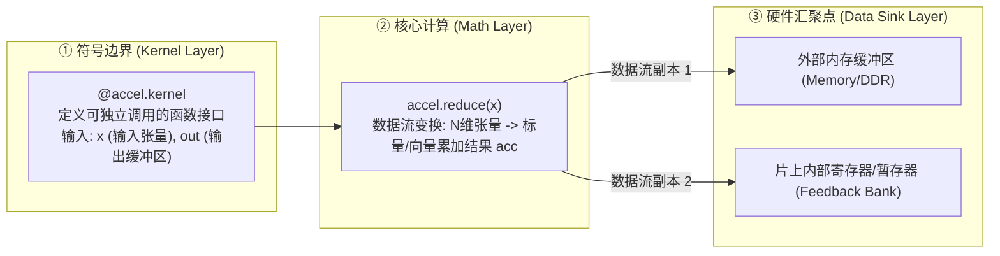
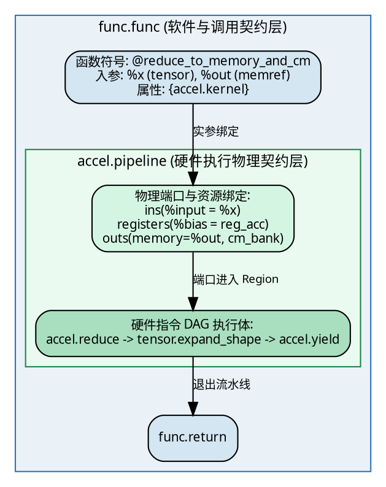
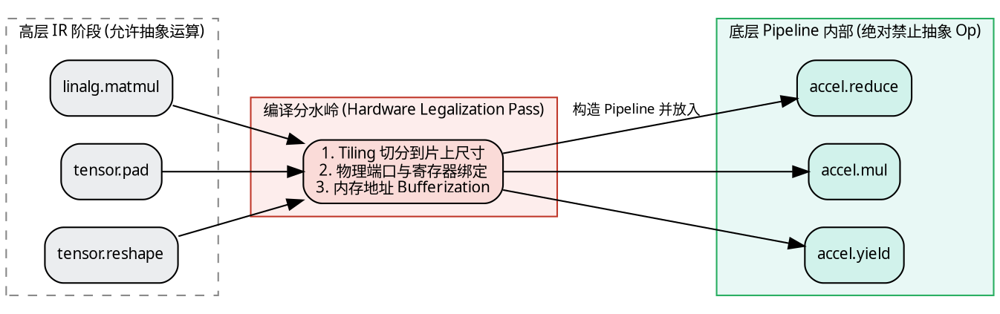
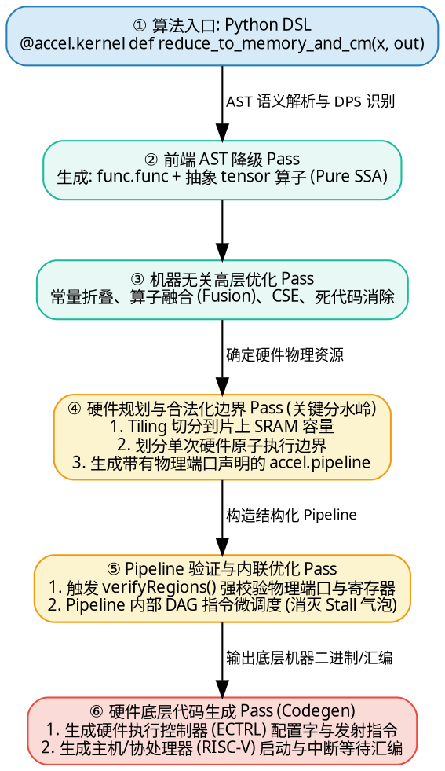
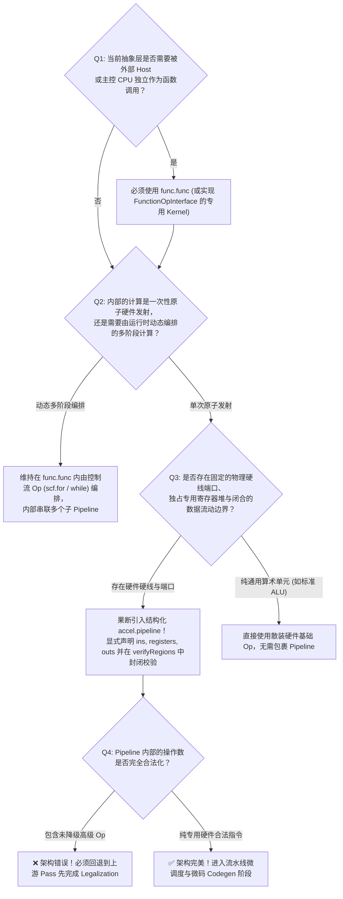

> **导读**：在为专用 AI 加速芯片（如 NPU、张量处理器、矢量协处理器）设计现代编译体系时，编译器架构师几乎都会面临一个极其关键的顶层分水岭决策：
>
> 当上层算法开发者使用 Python 领域特定语言（DSL）编写了一个带有专用硬件装饰器的计算函数时，**编译器前端在将其降级（Lowering）为 MLIR 中间表示时，究竟应该生成官方通用的标准函数容器 `func.func`，还是直接构造一个高度封装硬件物理特性的专用流水线算子（如 `accel.pipeline`）？**
>
> 团队内部常常为此爆发激烈争论：
> - 一方认为：“**必须直接转成 `accel.pipeline`！** 这样可以在 MLIR 的 `Verifier`（验证器）中直接做强类型与硬件端口校验；如果走 `func.func` + 零散算子，就必须额外写 Pass 遍历整张图去分析硬件连接，费时费力还容易遗漏隐患。”
> - 另一方反驳：“**绝对不能过早生成 `pipeline`！** 函数是软件调用的符号边界，流水线是芯片微架构的执行方式。过早绑定硬件资源会导致编译前端与底层硅片强行耦合，导致跨流水线优化、算子融合与代码复用全部瘫痪！”
>
> 究竟哪种设计才是最优解？“`pipeline` 能做 Verify 而零散 Op 必须写 Pass”的断言到底隐藏着怎样的认知陷阱？当硬件施加了**“一次 Pipeline 严格对应一次硬件发射”、“物理端口绑定”、“禁止拆分融合但允许内部重调度”**等极其严苛的物理铁律时，编译器各层 IR 该如何划分？
>
> 本文将从编译原理与体系结构的第一性原理出发，彻底剥离私有硬件代号与专有接口，以通用的**虚拟张量加速器（Virtual Tensor Accelerator，简称 Accel）**为蓝本，全景拆解从 Python DSL 到 MLIR 结构化硬件表示的端到端设计方案。全篇贯彻初学者友好原则，配备核心术语速查词典、丰富的 **Mermaid** 与 **Graphviz** 高清架构图、ODS TableGen 规范与 C++ Verifier 参考源码，帮助读者建立端到端贯穿“高级语法契约”到“芯片物理流水线”的扎实心智模型。

---

## 目录导览

- [零、初学者核心名词形象速查词典 (Primer)](#零初学者核心名词形象速查词典-primer)
- [一、第一性原理：Python DSL 的语义解构与隐形陷阱](#一第一性原理python-dsl-的语义解构与隐形陷阱)
  - [1.1 经典 Python DSL 代码切片与三大正交语义](#11-经典-python-dsl-代码切片与三大正交语义)
  - [1.2 初学者必踩的 Python 变量重绑定“语义陷阱”](#12-初学者必踩的-python-变量重绑定语义陷阱)
- [二、方案论剑：三种 MLIR IR 组织形式的工程代价与权衡](#二方案论剑三种-mlir-ir-组织形式的工程代价与权衡)
  - [2.1 方案 A：扁平化 `func.func` + 零散硬件 Op](#21-方案-a扁平化-funcfunc--零散硬件-op)
  - [2.2 方案 B：纯硬件 `accel.pipeline` 作为顶级容器](#22-方案-b纯硬件-accelpipeline-作为顶级容器)
  - [2.3 方案 C：分层架构 —— `func.func` 嵌套 `accel.pipeline`（黄金标准）](#23-方案-c分层架构--funcfunc-嵌套-accelpipeline黄金标准)
  - [2.4 三大方案多维度全景工程代价对比矩阵](#24-三大方案多维度全景工程代价对比矩阵)
- [三、架构深水区：Verifier 局部不变量 vs Analysis Pass 的本质边界](#三架构深水区verifier-局部不变量-vs-analysis-pass-的本质边界)
  - [3.1 辩析：“Pipeline 能够做 Verify，而散装 Op 必须写 Pass 遍历”？](#31-辩析pipeline-能够做-verify而散装-op-必须写-pass-遍历)
  - [3.2 MLIR 官方设计戒律：Verifier 的局部性原则（Locality Principle）](#32-mlir-官方设计戒律verifier-的局部性原则locality-principle)
  - [3.3 结构化 Pipeline 如何将“全局图分析”坍缩为“$O(1)$ 局部契约验证”](#33-结构化-pipeline-如何将全局图分析坍缩为o1-局部契约验证)
- [四、硬件现实落地：四大铁律约束下的编译器行为推演](#四硬件现实落地四大铁律约束下的编译器行为推演)
  - [4.1 铁律一：一个 Pipeline 严格对应一次硬件原子执行（Atomic Launch）](#41-铁律一一个-pipeline-严格对应一次硬件原子执行atomic-launch)
  - [4.2 铁律二：`ins`、`registers`、`outs` 严格映射物理硬件资源](#42-铁律二insregistersouts-严格映射物理硬件资源)
  - [4.3 铁律三：Pipeline 内部绝对不允许尚未完成 Lowering 的抽象 Op](#43-铁律三pipeline-内部绝对不允许尚未完成-lowering-的抽象-op)
  - [4.4 铁律四：Pipeline 禁止拆分与融合，但允许内部指令重调度（Re-scheduling）](#44-铁律四pipeline-禁止拆分与融合但允许内部指令重调度re-scheduling)
- [五、端到端全景：从 Python DSL 到机器代码的分层 Pass 流水线](#五端到端全景从-python-dsl-到机器代码的分层-pass-流水线)
  - [5.1 六阶段分层转换全景架构图](#51-六阶段分层转换全景架构图)
  - [5.2 各阶段 IR 形态演进实例对照](#52-各阶段-ir-形态演进实例对照)
- [六、实战硬核指南：ODS TableGen 与 C++ Verifier 黄金参考实现](#六实战硬核指南ods-tablegen-与-c-verifier-黄金参考实现)
  - [6.1 TableGen (`.td`) 声明式建模：`IsolatedFromAbove` 与端口约束](#61-tablegen-td-声明式建模isolatedfromabove-与端口约束)
  - [6.2 C++ `verify()` 与 `verifyRegions()` 分工实现源码](#62-c-verify-与-verifyregions-分工实现源码)
  - [6.3 内存副作用接口（`MemoryEffectsOpInterface`）防止错误调度](#63-内存副作用接口memoryeffectsopinterface防止错误调度)
- [七、架构避坑指南与设计决策树](#七架构避坑指南与设计决策树)
  - [7.1 必须警惕的四大编译器架构致命陷阱](#71-必须警惕的四大编译器架构致命陷阱)
  - [7.2 专用加速器 DSL 落地选型决策树](#72-专用加速器-dsl-落地选型决策树)
- [八、总结与结语](#八总结与结语)

---

## 零、初学者核心名词形象速查词典 (Primer)

为了确保零基础、刚从通用软件开发转入 AI 编译器、或初次接触 MLIR 的读者能够无障碍通读全文，下表对文中首次登场的关键专业术语做出一对一的通俗定义与生活化比喻：

| 专业术语 | 英文全称 / 原型 | 核心本质与通俗直观比喻 |
| :--- | :--- | :--- |
| **DSL** | Domain-Specific Language (领域特定语言) | **专为特定问题定制的小语言**。比如用于写网页样式的 CSS、写数据库查询的 SQL。在本文中，特指用 Python 语法编写、运行在 AI 加速器上的计算核函数。 |
| **MLIR** | Multi-Level Intermediate Representation | **下一代模块化多级编译器基础设施**。LLVM 基金会孵化的核心项目，像积木一样允许开发者自由组合、定义多层抽象的中间代码表示。 |
| **Dialect** | 方言 | **MLIR 的模块化词汇表与命名空间**。比如 `arith` 方言负责标量加减法，`tensor` 方言负责高维矩阵，`accel` 方言负责我们自定义的加速器硬件。 |
| **Op** | Operation (操作 / 算子) | **MLIR 中的最小语义单元**。类似于高级语言中的一条语句或一条机器指令，如一个加法、一次规约、或一个包含代码块的控制流容器。 |
| **Region & Block** | 区域与基本块 | **MLIR 的代码嵌套层次结构**。一个 Op 可以拥有一个或多个 `Region`（区域）；每个 Region 包含一组 `Block`（代码块）；Block 内部存放一串有序的 Op。 |
| **Terminator** | 终结操作符 | **基本块（Block）的最后一条指令**。负责跳出当前块或向父级 Op 返回数据，例如函数的 `return`，或流水线的 `yield`。 |
| **SSA** | Static Single Assignment (静态单赋值) | **变量不可变铁律**。每个变量（Value）在代码中只能被赋值一次。就像数学公式中的符号，定义之后不能被修改，只能生成全新的变量。 |
| **Def-Use Chain** | 定义-使用链 | **编译器内部的有向依赖网**。清晰记录了“每一个数据是在哪里被计算出来的（Def）”以及“它在哪些地方被读取使用（Use）”。 |
| **Kernel** | 算子核心 / 计算核 | **软件视角下的可独立调用单元**。代表一个具有函数名、输入输出参数、调用契约的程序模块，通常由 Host（主控 CPU）发起调用。 |
| **Pipeline** | 流水线 / 硬件执行区域 | **硬件微架构视角下的物理执行方式**。代表芯片上一组硬件计算单元、数据端口、专用寄存器在某段时间内协同工作的物理配置。 |
| **Verifier** | 验证器 | **MLIR 语法与语义的安检站**。当一个 Op 被创建或修改后，Verifier 会在编译期自动运行 C++ 校验逻辑，确保其结构和类型完全合法。 |
| **Pass** | 编译遍 / 转换通路 | **对中间代码进行遍历分析或优化的处理器**。比如“常量折叠 Pass”、“死代码消除 Pass”、“硬件寄存器分配 Pass”。 |
| **Lowering** | 降级 / 逐级降低 | **将抽象代码一步步翻译到底层物理代码的过程**。比如从 Python 降级为 Tensor IR，再降级为硬件 Pipeline，最后降级为汇编指令。 |
| **ODS** | Operation Definition Specification (TableGen) | **声明式定义 Op 的 DSL 配置文件（`.td` 文件）**。开发者只需写几十行声明，LLVM 就会自动生成上千行样板 C++ 代码。 |
| **Trait** | 特征 / 特性标记 | **贴在 Op 身上的能力标签**。例如贴上 `IsolatedFromAbove` 标签，就宣告当前区域是完全自封闭的，不允许偷偷读取外层的任何变量。 |
| **DPS** | Destination-Passing Style (目标传递风格) | **输出位置显式传入**。计算前就把用来存放结果的内存缓冲区作为参数传递给算子，避免隐式的内存动态分配。 |
| **SRAM / SPM** | Scratchpad Memory (片上暂存器) | **集成在加速芯片内部的高速静态存储器**。类似于 CPU Cache，但完全由软件通过显式地址精确控制，无 Cache 命中缺失的抖动。 |
| **DAG** | Directed Acyclic Graph (有向无环图) | **无循环的有向数据流图**。节点表示计算操作，边表示数据传递依赖，是编译器指令重排与调度的核心数据结构。 |
| **ECTRL** | Engine Control / Execution Controller | **硬件执行控制器**。专用加速芯片上的微控制器或硬件状态机，负责解析配置字、拉起硬件计算流水线并监听中断。 |

---

## 一、第一性原理：Python DSL 的语义解构与隐形陷阱

在动手写任何一行 MLIR 编译器代码之前，我们必须首先回归计算机科学的**第一性原理**：用户在 Python 脚本中敲下的这一段 DSL，其底层到底表达了哪些**本质需求**？

### 1.1 经典 Python DSL 代码切片与三大正交语义

考虑下面这段极具代表性的硬件 DSL 伪代码。算法开发者希望利用加速器硬件完成一次向量的累加规约（Reduce），并将结果分别送往两个目的地：

```python
# 一个典型的硬件加速专用 Python DSL 函数
@accel.kernel
def reduce_to_memory_and_cm(x, out):
    # 步骤 1：调用硬件累加单元完成规约计算
    acc = accel.reduce(x, kind="acc")
    
    # 步骤 2：试图将累加结果输出到外部内存 out
    out = acc
    
    # 步骤 3：将同一份累加结果写回到芯片内部的专用反馈寄存器堆/暂存器 cm_bank
    accel.feedback(acc, bank="cm_bank")
```

从**纯粹的计算图与数据流视角**审视，这段仅有 4 行的代码其实在完全正交的三个层面上提出了独立要求：



这三个维度的正交性决定了它们不应该由同一个抽象概念来承载：
1. **调用与函数边界（Kernel 维度）**：这是一个叫 `reduce_to_memory_and_cm` 的算子核，它有输入张量、输出指针，可以被 Host 端主控程序独立链接、加载和远程调用（RPC / Host Launch）。
2. **纯粹的数学数据变换（Math 维度）**：将输入数据沿着特定维度聚拢求和，计算结果为抽象的中间数学值 `%acc`。
3. **硬件资源与物理流向（Hardware 维度）**：结果 `%acc` 具有两个物理去向——一个是提供给外部调用方的普通内存缓冲区，另一个是芯片内部的专用反馈存储 Bank（用于下一次计算作为前向输入，避免搬出芯片）。

### 1.2 初学者必踩的 Python 变量重绑定“语义陷阱”

请特别注意上述代码中的这一行：
```python
out = acc
```

> [!CAUTION] 致命的 Python 语法语义陷阱
> 许多刚上手开发 DSL 的初学者容易想当然地认为：因为形参名叫 `out`，所以给 `out` 赋值就代表“把数据写入了外部输出”。
> 
> **在原生 Python 语义中，这完全是大错特错！**
> 在 Python 虚拟机中，`out = acc` 仅仅是把当前函数的**局部变量名（Local Variable Name）** `out` 重新绑定到了 `acc` 所指向的对象上。函数外部调用者传入的那个原本对象根本不会发生任何改变，内存写入也完全没有发生！

要想让这行代码生效，DSL 编译器前端必须在 Python AST（抽象语法树）解析阶段做“特异性劫持”，强行把这种赋值识别为一次物理写操作。但这会破坏 Python 既有的语言直觉，使后续代码分析极为脆弱。

在专业的工业级编译器设计中，我们强烈建议采用以下两种无歧义的标准设计之一：

#### 方案一：显式目标传递（Destination-Passing Style / Store Op）
```python
@accel.kernel
def reduce_to_memory_and_cm(x, out):
    acc = accel.reduce(x, kind="acc")
    accel.output(acc, into=out)          # 明确的内存写语义！
    accel.feedback(acc, bank="cm_bank")  # 明确的硬件状态更新语义！
```
这种风格将“计算求值”与“物理存储写出”彻底解耦，编译器不再需要猜测 AST 赋值语句的意图。

#### 方案二：纯函数式返回值（Pure Functional Return）
```python
@accel.kernel
def reduce_to_memory_and_cm(x):
    acc = accel.reduce(x, kind="acc")
    accel.feedback(acc, bank="cm_bank")
    return acc  # 由调用方或调度器在外部决定输出写到哪里
```
这种风格在编译器前端保持纯 SSA 数学张量语义，直到后端的 **Bufferization（缓冲化降级 Pass）** 阶段再确定物理输出内存。

---

## 二、方案论剑：三种 MLIR IR 组织形式的工程代价与权衡

现在进入核心议题：当 Python DSL 完成 AST 解析后，**MLIR 前端到底应该生成什么样的中间表示？**

业界和学术界探索过三种典型流派。我们逐一剖析其形态与利弊。

### 2.1 方案 A：扁平化 `func.func` + 零散硬件 Op

这一方案主张**“彻底复用 MLIR 现成生态”**。将 Python 函数直接翻译为 `func.func`，函数体内放置各种分散的自定义硬件 Op：

```mlir
// 方案 A：扁平化函数组织形式
func.func @reduce_to_memory_and_cm(
    %x: tensor<4x64xf32>,
    %out: memref<1x1x1x64xf32>
) attributes {accel.kernel} {

    // 1. 硬件累加操作
    %acc = accel.reduce %x {kind = #accel.reduce_kind<acc>} 
        : tensor<4x64xf32> -> tensor<64xf32>

    // 2. 形状对齐变换
    %expanded = tensor.expand_shape %acc [[0, 1, 2, 3]] 
        output_shape [1, 1, 1, 64]
        : tensor<64xf32> into tensor<1x1x1x64xf32>

    // 3. 显式写入外部内存
    accel.output %expanded into %out 
        : tensor<1x1x1x64xf32>, memref<1x1x1x64xf32>

    // 4. 写回芯片专用内部反馈 Bank
    accel.feedback %acc {bank = "cm_bank"} 
        : tensor<64xf32>

    return
}
```

- **优点**：
  1. 结构极度扁平自然，与标准 MLIR 生态（如 `func`、`tensor`、`memref`）无缝对接。
  2. 极利于通用的死代码消除（DCE）、公共子表达式消除（CSE）和内联优化（Inlining）。
- **致命缺点**：
  - **丢失了硬件微架构的执行边界**。在物理硅片上，累加计算、内存读写和反馈写入通常是由一个专用的硬件流水线控制器（ECTRL）在一次发射中原子完成的。方案 A 将这个整体打散成了 4 个互不相干的独立 Op。
  - **全局分析代价高昂**。任何一个 Pass 想要知道“这一次硬件发射到底占用了哪些端口、会不会发生硬件资源冲突”，都必须在整个函数体内沿着 Def-Use 链进行全图拓扑遍历，重新把这些 Op 拼凑成一个硬件配置整体。

### 2.2 方案 B：纯硬件 `accel.pipeline` 作为顶级容器

另一种激进的做法是：**“彻底抛弃通用的 `func.func`，直接让专用的流水线算子当第一等公民”**：

```mlir
// 方案 B：纯硬件 Pipeline 作为顶级可执行体
accel.pipeline @reduce_to_memory_and_cm
    ins(%input = %x : tensor<4x64xf32>)
    registers(%scale = reg_acc : tensor<64xf32>)
    outs(memory, %dst = %out : memref<1x1x1x64xf32>, cm_bank) {

    %acc = accel.reduce %input {kind = #accel.reduce_kind<acc>} 
        : tensor<4x64xf32> -> tensor<64xf32>
    %v = accel.mul %acc, %scale 
        : tensor<64xf32>, tensor<64xf32> -> tensor<64xf32>

    accel.yield %v : tensor<64xf32>
}
```

- **优点**：
  1. 硬件契约高度封闭明确，输入输出端口一目了然。
  2. 所有的硬件资源约束可以在该 Op 内部直接完成强类型验证。
- **致命缺点**：
  - **混淆了软件符号与硬件执行**。`pipeline` 强行承担了本属于函数的职责（函数名、动态调用参数、外部符号可见性）。
  - **严重阻碍高层编译优化**。标准的 MLIR Pass（如函数内联、多核并行切分、跨函数过程间优化）完全无法识别私有的 `pipeline` 作为可调用对象，迫使团队必须重复造轮子，为私有 Pipeline 重新编写一套基础优化设施。

### 2.3 方案 C：分层架构 —— `func.func` 嵌套 `accel.pipeline`（黄金标准）

架构的最高境界是**“各司其职，正交解耦”**。

> [!IMPORTANT] 核心架构铁律
> - **Kernel（`func.func`）是软件可执行单元的抽象**：它管理函数名、外部形参、返回协议、ABI 布局与主机调用生命周期。
> - **Pipeline（`accel.pipeline`）是芯片硬件执行方式的抽象**：它管理硬件执行单元的激活范围、物理输入端口、内部寄存器配置、物理输出目标与单次执行约束。

两者不是二选一的敌对关系，而是天生嵌套的共生关系：

```mlir
// 方案 C：分层黄金架构
func.func @reduce_to_memory_and_cm(
    %x: tensor<4x64xf32>,
    %out: memref<1x1x1x64xf32>
) attributes {accel.kernel} {

    // 软件与硬件的明确分界点：硬件专用流水线执行区域
    accel.pipeline
        ins(%input = %x : tensor<4x64xf32>)
        registers(%bias = reg_acc : tensor<64xf32>)
        outs(memory = %out : memref<1x1x1x64xf32>, cm_bank) {

        // 内部是受到硬件微架构约束的合法计算 DAG
        %acc = accel.reduce %input {kind = #accel.reduce_kind<acc>} 
            : tensor<4x64xf32> -> tensor<64xf32>

        %expanded = tensor.expand_shape %acc [[0, 1, 2, 3]]
            output_shape [1, 1, 1, 64]
            : tensor<64xf32> into tensor<1x1x1x64xf32>

        // 终结符：将计算结果通过管道输出端口发射出去
        accel.yield %expanded, %acc 
            : tensor<1x1x1x64xf32>, tensor<64xf32>
    }

    return
}
```



### 2.4 三大方案多维度全景工程代价对比矩阵

| 评估维度 | 方案 A：纯扁平 `func.func` | 方案 B：顶级 `accel.pipeline` | 方案 C：分层嵌套（推荐方案） |
| :--- | :--- | :--- | :--- |
| **标准 MLIR 生态兼容性** | **极高**（完全复用现有基础设施） | **极差**（标准 Pass 全部无法识别） | **极高**（外层完全符合标准 Function 规范） |
| **Python DSL 直观映射** | 自然，但需后端大量推导 | 强行将函数降级为流水线 | **高度自然**，外层映射函数，内层映射执行 |
| **硬件物理端口显式表达** | 困难（分散在各 Op 的属性中） | **极优**（端口集中声明） | **极优**（端口集中声明在 Pipeline 头部） |
| **验证器（Verifier）实现难度** | 极高（需跨 Op 做复杂图分析） | **极低**（局部结构即可验证） | **极低**（Pipeline 负责硬件验证，Func 负责符号验证） |
| **代码生成与调度（Codegen）** | 痛苦（每个 Pass 需反复拼装硬件信息） | 方便，但缺少外层上下文 | **极其优雅**（外层负责调度编排，内层直接生成微码） |
| **长期微架构迭代适应力** | 差（硬件变动引发全图 Pass 大修） | 较差（无法处理跨多流水线的大算子） | **极强**（支持单函数内容纳多个串并联流水线） |

---

## 三、架构深水区：Verifier 局部不变量 vs Analysis Pass 的本质边界

在方案 C 确立之后，我们必须深入解答文章开头提到的核心争论：**“Pipeline 究竟比零散 Op 强在哪里？是因为它能 Verify 吗？”**

### 3.1 辩析：“Pipeline 能够做 Verify，而散装 Op 必须写 Pass 遍历”？

许多开发者会形成一种模糊的直觉：“在 MLIR 里，写 Verifier 一定比写 Pass 轻松、高效。所以凡是能放进 Verifier 检查的东西，都应该拼命塞进 Verifier！”

**这种理解只说对了一半，甚至掩盖了真正的编译体系结构矛盾。**

无论是 Verifier 还是 Pass，其底层的 C++ 代码本质上都是在对 C++ 对象指针和数据结构做校验。散装 Op 方案并不是“不能做 Verify”，比如：
- `accel.reduce` 自身的 Verifier 完全可以检查输入数据类型是否为 `tensor<...xf32>`；
- `accel.feedback` 自身的 Verifier 完全可以检查 `bank = "cm_bank"` 字符串是否合法。

散装 Op 方案真正痛苦的根源在于：**“物理芯片的联合合法性（Simultaneous Validity）无法在单条指令上闭环”**。

例如，硬件有物理限制：“在同一次硬件发射周期内，累加单元的输出只能同时分发给最多 1 个外部内存接口和 1 个内部反馈寄存器；如果用户错误地调用了两次 `feedback`，或者试图分发给两个外部内存，硬件状态机就会锁死”。

在散装 Op 方案下：
1. `reduce` 不知道自己的结果被分发给了谁；
2. 两个独立的 `feedback` Op 彼此不知道对方的存在；
3. 没有任何一个单独的 Op 拥有“全景视角”。

这就迫使编译器**必须在整个 Function 范围内写一个 Pass**，把所有相关的 Op 从头到尾扫描一遍，构建出一张临时的数据流图，再数一数分发的目标数量。

### 3.2 MLIR 官方设计戒律：Verifier 的局部性原则（Locality Principle）

为什么不能直接在 `accel.feedback` 的 `verify()` 方法里去遍历整张图呢？

> [!WARNING] LLVM/MLIR 官方开发铁律：Verifier 局部性原则
> **Operation Verifier 应该且仅应该检查当前 Op 局部、静态可见的不变量（Local Invariants）。绝对禁止在 Verifier 内部顺着 Def-Use 链去任意追踪、跨越其父级或兄弟节点的深层指令！**

违反这一铁律会导致极其严重的工程灾难：
1. **编译耗时爆炸（$O(N^2)$ 复杂度）**：每次一个 Pass 构造、修改或替换一个 Op 时，MLIR 都会自动触发该 Op 及其相邻节点的 Verifier。如果你在 Verifier 里写图遍历，每次局部微调都会触发全局扫描，导致编译器耗时呈二次方乃至指数级暴增！
2. **IR 不稳定态崩溃**：在 Pass 执行的中间过程中，IR 图通常处于“半构建”的过渡态（某些旧边还没断开，新边还没连上）。如果 Verifier 跨节点去窥探其他 Op，极易引发空指针崩溃或断言失败。

因此，MLIR 官方明确规范了职责边界：


### 3.3 结构化 Pipeline 如何将“全局图分析”坍缩为“$O(1)$ 局部契约验证”

现在，答案水落石出！

`accel.pipeline` 之所以彻底战胜散装 Op，不是因为“它有 Verifier”，而是因为**它通过结构化的语法糖，将原本散落在整张函数图里的隐式硬件关系，显式地收敛到了自己的 Op 头部声明中！**

观察 `pipeline` 的头部：
```mlir
accel.pipeline
    ins(%input = %x : tensor<4x64xf32>)
    registers(%bias = reg_acc : tensor<64xf32>)
    outs(memory = %out : memref<1x1x1x64xf32>, cm_bank)
```

在这个封闭的容器上，原本复杂的全局图分析瞬间退化为了**极度廉价的局部属性检查**：
- **检查物理输入数量**：直接取 `getNumInputs()`，判断是否 $\le 2$（硬件上限）；
- **检查是否重复占用独占寄存器**：直接在 `registers` 属性列表中扫描是否有重复的 `reg_acc`；
- **检查物理输出多路复用**：直接检查 `outs` 列表中 `memory` 和 `cm_bank` 的组合是否符合芯片规范；
- **检查产出与终结符匹配**：在 `verifyRegions()` 中仅需比对当前块尾部的 `yield` 操作数是否与 `outs` 的类型声明一致！

**这才是编译器架构设计的精髓：用优雅的 IR 结构消除算法复杂度，用局部声明代替全局猜测。**

---

## 四、硬件现实落地：四大铁律约束下的编译器行为推演

当我们在工程落地中为特定硬件架构定制 `accel.pipeline` 时，硬件工程师通常会抛出**四大硬核物理约束**。这些物理约束将直接塑造编译器的全生命周期行为。

### 4.1 铁律一：一个 Pipeline 严格对应一次硬件原子执行（Atomic Launch）

> **物理现实**：芯片硬件上的计算流水线一旦被控制器拉起（Trigger / Kick-off），就会按照配置好的时序节拍一直冲刷到结束。硬件不支持在流水线冲刷到一半时“停下来换一套寄存器配置再继续”。

**对编译器的架构影响**：
1. **不可分割性（Atomicity）**：一个 `accel.pipeline` 在代码生成（Codegen）阶段必须能够一一对应地映射为一次硬件控制寄存器（ECTRL）的配置下发与触发中断。
2. **严禁包含长生命周期的异构计算**：如果一段计算在硬件上必须分成两个时间段分别执行（例如先算一步 GEMM，等待主机写入新参数，再算一步 Activation），它在 MLIR 中必须被表示为**两个先后串联的 `accel.pipeline`**，而绝不能被揉进同一个 Pipeline 内部。

### 4.2 铁律二：`ins`、`registers`、`outs` 严格映射物理硬件资源

> **物理现实**：加速芯片的片上连线极其昂贵。算力核心周边的物理输入引脚、寄存器接口是固定的物理硬线（Hardwired Routing），而不是动态总线。

**对编译器的架构影响**：
- 在 Pipeline 的语法定义中，必须将**“纯数据流 SSA 值”**与**“物理资源定位符（Hardware Specifier）”**清晰分离。
- 我们强烈建议将寄存器标识符设计为静态强类型的 **Enum Attribute**，而不是随意的字符串。例如：

```tablegen
// ODS 中定义物理寄存器资源的枚举类型
def Accel_RegisterEnum : I32EnumAttr<"RegisterKind", "Hardware Register Banks", [
    I32EnumAttrCase<"REG_ACC", 0, "reg_acc">,
    I32EnumAttrCase<"REG_WEIGHT", 1, "reg_weight">,
    I32EnumAttrCase<"REG_BIAS", 2, "reg_bias">
]> {
    let cppNamespace = "::mlir::accel";
}
```

这样，任何手写拼写错误（比如误写成 `"reg_ac"`）在 MLIR 解析器或 C++ 编译期就会被立刻捕获，绝不会流入后端烧毁芯片配置。

### 4.3 铁律三：Pipeline 内部绝对不允许尚未完成 Lowering 的抽象 Op

> **物理现实**：硬件流水线是执行硬逻辑的，它听不懂抽象的数学概念（如“任意高维张量切片”、“动态广播语义”、“通用 linalg.generic 循环”）。

许多编译器新手常犯的错误是：在编译器最前端直接生成 `pipeline` 结构，然后把各种高级算子（如 `linalg.matmul`、`tensor.pad`）一股脑扔进 `pipeline` 内部，期望后期的 Pass 慢慢在里面化解。

这是极其危险的架构污染！

> [!CAUTION] 架构红线：明确“硬件合法化分水岭（Hardware-Legal Boundary）”
> **`accel.pipeline` 的诞生时刻，必须是在高级算子已经完成了切分（Tiling）、形状展开（Shape Expansion）和硬件指令映射之后！**
> 
> 如果一个计算区域内的某些操作在当前芯片上根本找不到对应的物理执行单元，这个区域就**绝配不上 `pipeline` 的称号**。它应当继续维持在高级的 `func.func` + `tensor` 抽象层进行优化变换。



### 4.4 铁律四：Pipeline 禁止拆分与融合，但允许内部指令重调度（Re-scheduling）

这是最考验编译器微架构理解的一点。很多初学者看到“禁止拆分与融合”，就以为“Pipeline 内部的代码必须一动不动像磐石一样执行”。

**完全不是这样！**

- **宏观边界不可变**：Pipeline 的边界精确锚定了硬件发射的起点和终点。编译器不能擅自把两个独立的 Pipeline 融合成一个（会超出硬件暂存器容量），也不能擅自把一个 Pipeline 斩断成两半（会破坏原子硬件时序）。
- **微观顺序高度可变（DAG 重调度）**：Pipeline 内部的各个指令往往是一张局部的**有向无环图（DAG）**。如果硬件存在多条并行的运算单元（例如一个乘法流水线和一个加法流水线），那么指令的执行顺序完全可以根据硬件冲突进行重新排列！

#### 实战案例：隐藏延迟的指令重排（Latency Hiding）

考虑如下 Pipeline 内部计算：
```mlir
accel.pipeline ... {
    // 独立分支 1
    %a = accel.mul %x, %y : tensor<64xf32>
    
    // 独立分支 2 (与分支 1 毫无数据依赖)
    %b = accel.add %u, %v : tensor<64xf32>
    
    // 汇聚计算：依赖 %a 和 %b
    %c = accel.add %a, %b : tensor<64xf32>
    
    accel.yield %c : tensor<64xf32>
}
```

在芯片硬件物理微架构中，乘法操作 `%a` 通常需要较长的时钟节拍（例如 4 个 Cycles）才能完全吐出有效数据；而加法操作 `%b` 仅需 1 个 Cycle：

```mermaid
gantt
    title 硬件时钟节拍调度：无优化 vs 调度重排
    dateFormat X
    axisFormat %s

    section 顺序执行 (出现硬件停顿气泡)
    乘法 %a = mul %x, %y           :active, a1, 0, 4
    硬件停顿等待数据 (Stall Bubble)  :crit, s1, 4, 5
    加法 %b = add %u, %v           :a2, 5, 6
    最终求和 %c = add %a, %b        :a3, 6, 7

    section DAG 重调度 (完美隐藏延迟)
    乘法 %a = mul %x, %y           :active, b1, 0, 4
    加法 %b = add %u, %v (重叠执行)  :b2, 1, 2
    硬件利用流水线闲置周期           :b3, 2, 4
    最终求和 %c = add %a, %b        :crit, b4, 4, 5
```



调度器可以自由调换 `%a` 和 `%b` 的发射时机，甚至在 `%a` 运行的漫长延迟周期内提前拉起无关的 `%b`，从而彻底消灭硬件停顿气泡（Bubble）。

> [!IMPORTANT] 调度器铁律：必须显式建模状态副作用！
> MLIR 中的指令重排不能只看纯 SSA 数据依赖。如果 Pipeline 内包含了对硬件寄存器的写操作（如 `accel.feedback`），它在物理上产生了**状态副作用（Side Effects）**。
> 编译器必须为这类 Op 实现 MLIR 的 `MemoryEffectsOpInterface`，声明其对专用 Bank 具有写权限，否则通用的调度 Pass 会误以为它是一个无副作用的死代码而将其错误挪动或删除！

---

## 五、端到端全景：从 Python DSL 到机器代码的分层 Pass 流水线

通过前面的推演，我们终于可以建立起一套科学、严谨、分工明确的**六阶段工业级编译器 Pass 流水线**。

### 5.1 六阶段分层转换全景架构图



### 5.2 各阶段 IR 形态演进实例对照

为了让初学者直观感受代码在编译器内部是怎样一步步“从高级抽象蜕变为低级微码”的，我们对比关键阶段的代码形态：

#### 阶段 ②：刚出前端的纯函数式高层 IR
```mlir
// 纯函数、无物理端口概念、纯张量 SSA
func.func @kernel_frontend(%x: tensor<4x64xf32>) -> tensor<64xf32> {
    %0 = accel.reduce %x {kind = #accel.reduce_kind<acc>} : tensor<4x64xf32> -> tensor<64xf32>
    return %0 : tensor<64xf32>
}
```

#### 阶段 ④：完成硬件合法化降级后的结构化 IR
```mlir
// 诞生了硬件物理边界，明确了硬件端口与目标内存
func.func @kernel_legalized(%x: tensor<4x64xf32>, %out: memref<64xf32>) {
    accel.pipeline 
        ins(%in = %x : tensor<4x64xf32>)
        registers(%ca = reg_acc : tensor<64xf32>)
        outs(memory = %out : memref<64xf32>, cm_bank) {

        %acc = accel.reduce %in {kind = #accel.reduce_kind<acc>} : tensor<4x64xf32> -> tensor<64xf32>
        accel.yield %acc : tensor<64xf32>
    }
    return
}
```

#### 阶段 ⑥：最终生成的控制器指令（伪汇编示意）
```asm
# Host CPU / RISC-V 协处理器发射序列
li      t0, 0x40001000          # 加载硬件控制器 ECTRL 基地址
la      t1, MEM_BUF_OUT         # 加载物理内存输出地址
sw      t1, 0x08(t0)            # 配置输出端口 DMA 目标寄存器
li      t2, CFG_REG_ACC_EN      # 配置累加寄存器使能标志
sw      t2, 0x10(t0)            # 写入寄存器控制字
li      t3, OP_REDUCE_ACC       # 配置 Pipeline 内部计算模式为累加规约
sw      t3, 0x14(t0)
li      t4, 0x01                # 发射执行 (Trigger Pipeline Execution!)
sw      t4, 0x00(t0)
wfi                             # 等待硬件流水线执行完成中断
```

---

## 六、实战硬核指南：ODS TableGen 与 C++ Verifier 黄金参考实现

纸上得来终觉浅。在 MLIR 工业实践中，我们究竟该如何用代码把上述思想构建出来？下面提供一套工业级的标准模板。

### 6.1 TableGen (`.td`) 声明式建模：`IsolatedFromAbove` 与端口约束

在 MLIR 中，定义一个自定义 Op 必须使用 ODS（Operation Definition Specification）语法。我们为 `PipelineOp` 声明核心特征：

```tablegen
// 文件路径: include/accel/IR/AccelOps.td

#ifndef ACCEL_OPS_TD
#define ACCEL_OPS_TD

include "mlir/IR/OpBase.td"
include "mlir/IR/SymbolInterfaces.td"
include "mlir/Interfaces/SideEffectInterfaces.td"
include "mlir/Interfaces/ControlFlowInterfaces.td"

def Accel_Dialect : Dialect {
    let name = "accel";
    let cppNamespace = "::mlir::accel";
    let summary = "专用张量加速器硬件方言";
}

// 定义基类
class Accel_Op<string mnemonic, list<Trait> traits = []> :
    Op<Accel_Dialect, mnemonic, traits>;

// 核心：流水线容器 Op
def Accel_PipelineOp : Accel_Op<"pipeline", [
    SingleBlock,            // 约束：内部只能包含恰好 1 个基本块 (Block)
    IsolatedFromAbove,      // 约束：完全自封闭，禁止隐式捕获外部外层 SSA 值！
    AttrSizedOperandSegments // 允许编译器高效解包不同段的操作数
]> {
    let summary = "表示加速器硬件的一次原子流水线执行配置";

    let arguments = (ins
        Variadic<AnyTensor>:$in_tensors,        // 物理输入端口绑定的张量
        StrArrayAttr:$register_sources,         // 使用的片上物理寄存器列表
        StrArrayAttr:$output_destinations       // 物理输出目的地 (如 "memory", "cm_bank")
    );

    let results = (outs
        Variadic<AnyType>:$results              // 流水线可能在逻辑上产出的结果
    );

    let regions = (region SizedRegion<1>:$body);// 恰好包含一个 Region

    // 启用自定义验证器钩子
    let hasVerifier = 1;
    let hasRegionVerifier = 1;

    let extraClassDeclaration = [{
        // 获取当前 Pipeline 内部唯一的代码块
        mlir::Block &getBlock() { return getBody().front(); }
    }];
}

// 流水线终结符 Op
def Accel_YieldOp : Accel_Op<"yield", [
    Terminator,
    Pure // 无内存副作用的纯终结符
]> {
    let summary = "将计算结果送入硬件输出端口并终结流水线基本块";
    let arguments = (ins Variadic<AnyType>:$operands);
    let assemblyFormat = "attr-dict ($operands^ `:` type($operands))?";
}

#endif // ACCEL_OPS_TD
```

> [!TIP] 为什么必须加上 `IsolatedFromAbove`？
> 这是一个价值千金的 Trait！它强迫 Pipeline 内部的所有计算**只能使用自己 Block Arguments 传入的操作数**，绝不允许直接引用外部包裹层 `func.func` 里的 `%x`。
> 这直接在编译器语法树层面上**封死了代码“私自偷渡外部变量”的可能性**，确保 Pipeline 拥有 100% 封闭的硬件端口物理契约！

### 6.2 C++ `verify()` 与 `verifyRegions()` 分工实现源码

接下来是在 C++ 中实现两个维度的校验：
1. `verify()`：只校验自身参数、属性枚举合法性；
2. `verifyRegions()`：校验 Region 内部 Block 的终结符与硬件端口匹配度。

```cpp
// 文件路径: lib/accel/IR/AccelOps.cpp

#include "accel/IR/AccelOps.h"
#include "mlir/IR/Builders.h"
#include "mlir/IR/OpImplementation.h"

using namespace mlir;
using namespace mlir::accel;

// 1. 本地属性验证：只看自身，不看 Region 内部
LogicalResult PipelineOp::verify() {
    // 硬件物理约束：单次发射最多支持 2 路物理输入端口
    if (getInTensors().size() > 2) {
        return emitOpError("硬件物理输入端口超限：最多允许 2 路输入，但实际传入了 ")
               << getInTensors().size() << " 路";
    }

    // 校验物理输出目的地是否包含合法枚举
    for (Attribute destAttr : getOutputDestinations()) {
        auto strAttr = llvm::dyn_cast<StringAttr>(destAttr);
        if (!strAttr) {
            return emitOpError("输出目的地属性必须为字符串");
        }
        StringRef dest = strAttr.getValue();
        if (dest != "memory" && dest != "cm_bank") {
            return emitOpError("未知的硬件物理输出目标: ") << dest
                   << " (仅支持 'memory' 或 'cm_bank')";
        }
    }

    return success();
}

// 2. 区域内部验证：校验 Block 结构与终结符匹配性
LogicalResult PipelineOp::verifyRegions() {
    Block &block = getBlock();

    // 检查终结符是否存在
    Operation *terminator = block.getTerminator();
    auto yieldOp = llvm::dyn_cast_or_null<YieldOp>(terminator);
    if (!yieldOp) {
        return emitOpError("Pipeline 内部基本块必须以 'accel.yield' 终结");
    }

    // 校验 yield 吐出的操作数数量与物理声明输出目的地数量是否一一匹配
    if (yieldOp.getNumOperands() != getOutputDestinations().size()) {
        return emitOpError("硬件输出契约不一致：'outs' 声明了 ")
               << getOutputDestinations().size() << " 个目标，但 'yield' 提供了 "
               << yieldOp.getNumOperands() << " 个操作数";
    }

    // 遍历内部指令：确保没有未 Lowering 的非法高级算子潜伏在内部
    for (Operation &innerOp : block.without_terminator()) {
        StringRef dialectName = innerOp.getName().getDialectNamespace();
        // 铁律：只允许我们合法的加速器方言和基础张量形状操作，严禁高级 linalg 混入！
        if (dialectName != "accel" && dialectName != "tensor") {
            return innerOp.emitOpError("非法指令潜伏在硬件流水线中：")
                   << innerOp.getName() << " 必须在进入 Pipeline 之前完成降级合法化！";
        }
    }

    return success();
}
```

### 6.3 内存副作用接口（`MemoryEffectsOpInterface`）防止错误调度

为了防止通用的死代码消除（DCE）和指令重排 Pass 破坏内部反馈寄存器写操作，我们需要为 `FeedbackOp` 严谨标注内存读写副作用：

```tablegen
// 带有硬件状态副作用的反馈写入操作
def Accel_FeedbackOp : Accel_Op<"feedback", [
    DeclareOpInterfaceMethods<MemoryEffectsOpInterface>
]> {
    let summary = "将张量写入芯片内部专用反馈寄存器堆";
    let arguments = (ins
        AnyTensor:$value,
        StrAttr:$bank_name
    );
    let assemblyFormat = "$value attr-dict `:` type($value)";
}
```

并在 C++ 中实现其接口方法：

```cpp
void FeedbackOp::getEffects(
    SmallVectorImpl<SideEffects::EffectInstance<MemoryEffects::Effect>> &effects) {
    // 明确向 MLIR 声明：该操作对硬件内部资源产生了 Write (写) 副作用！
    // 任何优化 Pass 绝对不允许擅自将其消除，也不能跨越读写冒险自由调换顺序！
    effects.emplace_back(MemoryEffects::Write::get(), 
                         &getOperation()->getOpOperand(0), // 关联的操作数
                         HardwareResource::get());          // 作用在芯片硬件资源上
}
```

---

## 七、架构避坑指南与设计决策树

基于上文的推演与大量前人的试错教训，我们提炼出一份针对编译器架构师与开发者的核心防坑宝典与落地决策树。

### 7.1 必须警惕的四大编译器架构致命陷阱

1. **陷阱一：过早在前端 AST 解析期就创建 `accel.pipeline`**
   - *危害*：前端一旦过早生成 `pipeline`，后续的很多高层抽象变换（例如算子融合 Fusion、张量维度推导、宏观分块 Tiling）就会被 `pipeline` 的物理边界死死卡住，导致编译器无法做跨区域的宏观计算图重组。
   - *解法*：前端一律先生成干净、扁平的 `func.func` + 抽象 `tensor` 算子；在后端硬件规划 Pass 确定了硬件映射后，再一气呵成构建 `pipeline`。

2. **陷阱二：试图在 `verifyRegions()` 里运行贪心调度算法**
   - *危害*：有些工程师在写 Verifier 时越陷越深，甚至试图在 Verifier 里跑一套图着色算法去判定“这组指令到底能不能被完全无冲突地调度出来”。这直接摧毁了编译器的编译性能，且导致报错信息极度晦涩。
   - *解法*：Verifier 只负责静态不变量的快速安检；复杂的调度和合法资源分配必须放在专有的 `SchedulingPass` 中执行。

3. **陷阱三：漠视硬件寄存器的“状态写后读（WAR/RAW）冒险”**
   - *危害*：如果多个 Pipeline 之间共用了片上反馈寄存器 `cm_bank`，而没有通过 Token 或 Memory Effects 建模依赖，通用的并发 Pass 可能会把前后两个 Pipeline 并行拉起，造成硬件存储踩踏。
   - *解法*：将片上物理存储视作具有状态的物理实体，使用副作用接口（Side Effect Interface）或显式的数据流 Token 锁住发射顺序。

4. **陷阱四：将物理端口标识当成普通的动态字符串传递**
   - *危害*：在 IR 中到处充斥着 `bank = "cm"`、`bank = "ca"` 这种裸字符串，不仅浪费字符串比对开销，而且一旦开发成员手滑敲错，错误只能延宕到生成微码甚至板卡上机时才能暴露。
   - *解法*：在 ODS TableGen 中全面使用 `I32EnumAttr` 建立严格类型化的硬件属性枚举。

---

### 7.2 专用加速器 DSL 落地选型决策树

未来当你面对一款全新的专用芯片或定制算子，站在白板前思考“该选哪个 IR 方案”时，请依次回答下面四个本质问题：



---

## 八、总结与结语

在现代编译器开发的世界里，没有绝对的“好语法”与“坏语法”，只有**与硬件执行模型是否匹配的“合适抽象”**。

回到本文最初的辩论：
- 提出“选用 `pipeline`”的工程师，敏锐地洞察到了**硬件执行契约需要结构化闭环表达**的刚需；
- 坚持“保留 `func.func`”的工程师，则牢牢守住了**软件调用符号体系与模块化生态解耦**的底线。

**真正的架构大师，绝不做非黑即白的单选，而是深刻洞察它们背后的正交维度：**
- 用 `func.func` 为软件世界的宿主调用、链接、传参筑起坚实的城墙；
- 用 `accel.pipeline` 为硅片世界的端口硬线、时钟周期、原子发射立下清晰的契约；
- 在两者之间，用一条层次分明的编译流水线，让数学逻辑在最合适的时刻完成向物理现实的惊艳一跃！

希望本文能为正在硬件加速器、AI 编译器和专用 DSL 领域跋涉探索的工程师们，提供一份清晰、经得起工业实践推敲的架构指南。
