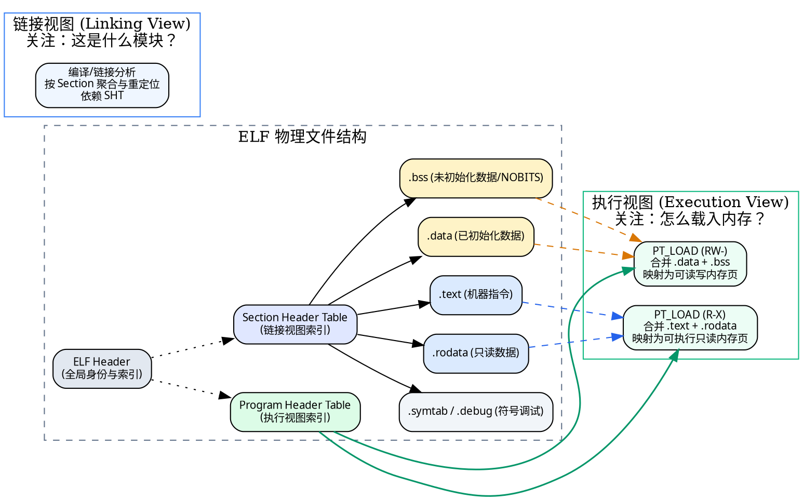
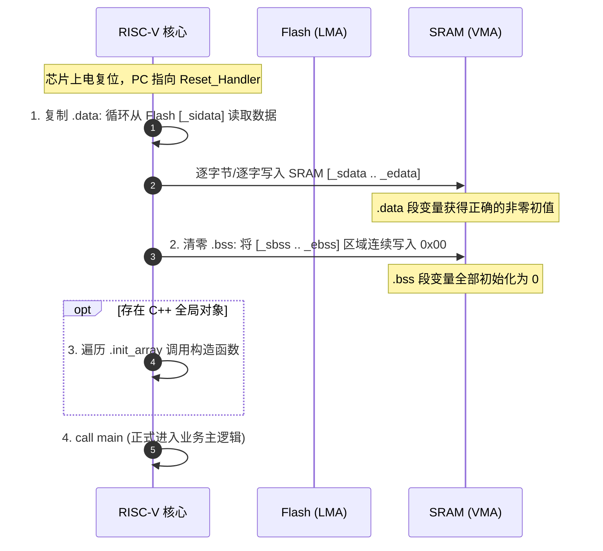
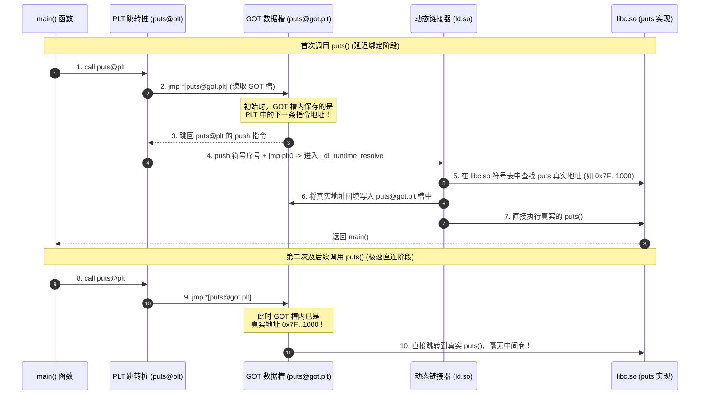
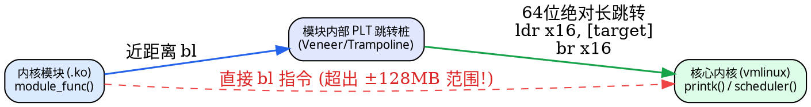
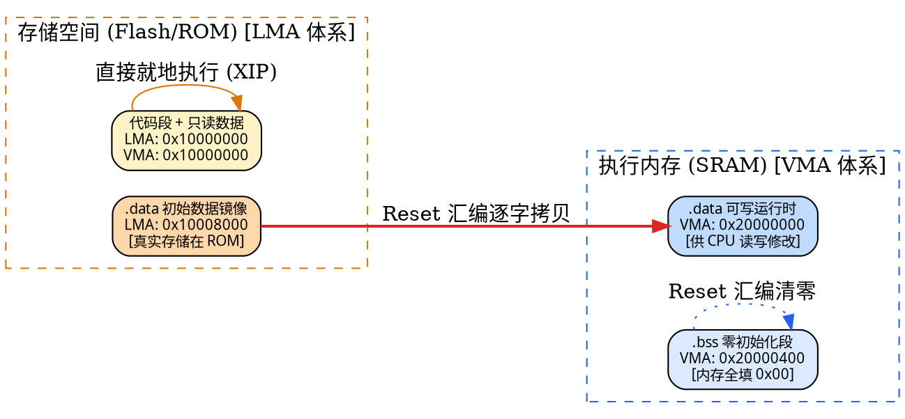
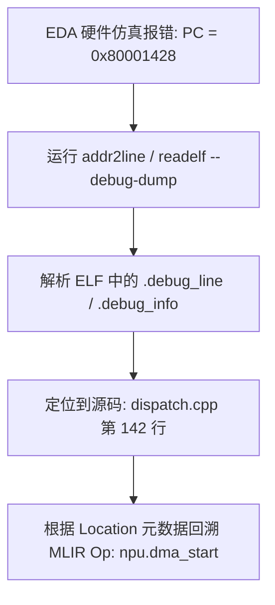
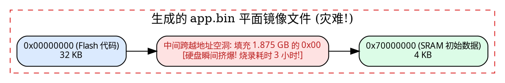
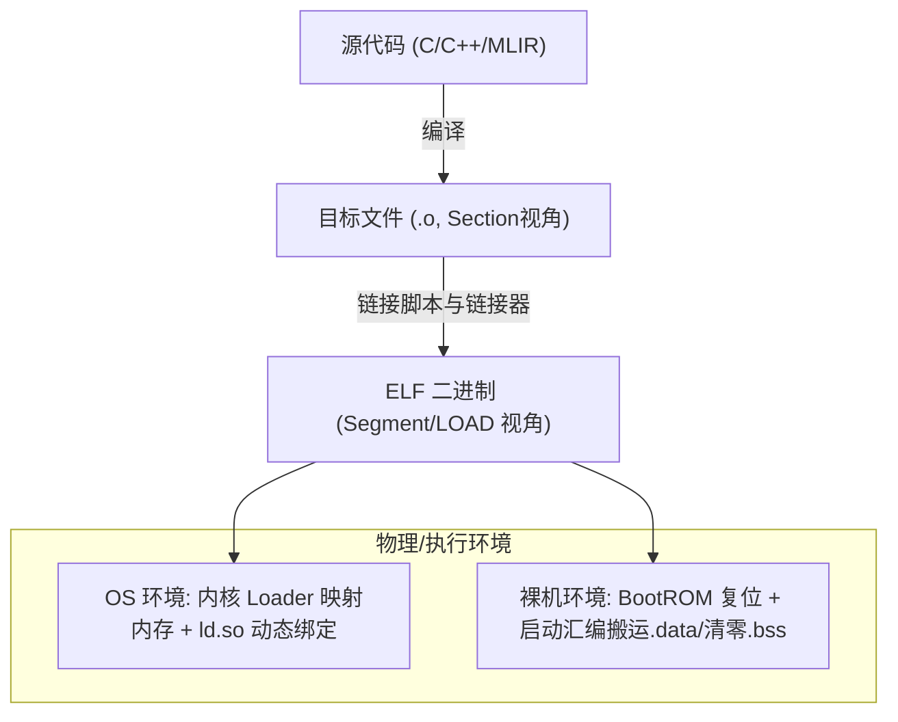

> **前言**：在计算机系统工程、嵌入式系统与 AI 芯片编译器（如 MLIR/LLVM 到 RISC-V NPU 控制核）的开发中，我们常常与二进制文件打交道。很多工程师能熟练编写 C/C++ 代码，却常常在面对硬件仿真崩溃、指针异常、链接器报错或固件加载失败时陷入茫然：
> - 为什么 `.bss` 段在磁盘文件中不占空间，而在内存中却需要分配并清零？
> - 为什么明明做了静态链接，ELF 里却依然能看到 `.plt` 和 `.got`？
> - 为什么在链接脚本里把数据段放到了 RAM，上电运行后变量的值却全是一堆乱码？
> - 为什么修改了编译参数后，EDA 仿真器里的 PC 寄存器指到了非法地址？
>
> 这一切的背后，都指向了同一个底层基础设施——**ELF（Executable and Linkable Format，可执行与可链接格式）**以及围绕它的**编译、链接、重定位与加载机制**。
>
> 本文系统梳理 ELF 的完整知识版图，从最基础的概念心智模型出发，结合直观的 **Mermaid 交互图** 与 **Graphviz 内存拓扑图**，深入拆解 `.bss`、PLT/GOT、静态与动态链接、Linux 内核与裸机启动差异、RISC-V 独有特性（Linker Relaxation / `gp` 寄存器）以及实际工程中的避坑实践。

---

## 目录导览

- [新手前置：核心术语生动心智模型速查](#新手前置核心术语生动心智模型速查)
- [一、宏观全景：ELF 文件的双重视角与核心模型](#一宏观全景elf-文件的双重视角与核心模型)
  - [1.1 什么是 ELF？它服务于谁？](#11-什么是-elf它服务于谁)
  - [1.2 链接视图 vs 执行视图：Section 与 Segment 的本质解耦](#12-链接视图-vs-执行视图section-与-segment-的本质解耦)
  - [1.3 ELF Header：文件身份与结构全局总览](#13-elf-header文件身份与结构全局总览)
- [二、深入内存与存储：.bss、.data 与静态变量初始化真相](#二深入内存与存储bssdata-与静态变量初始化真相)
  - [2.1 .bss 是用来清零的还是用来设初值的？](#21-bss-是用来清零的还是用来设初值的)
  - [2.2 真实的变量值到底存放在哪？全局/静态/局部数据全景对比](#22-真实的变量值到底存放在哪全局静态局部数据全景对比)
  - [2.3 操作系统环境下：静态变量如何在 main 之前完成初始化？](#23-操作系统环境下静态变量如何在-main-之前完成初始化)
  - [2.4 裸机（Bare-metal）环境下：Flash 到 SRAM 的搬运与清零手记](#24-裸机bare-metal环境下flash-到-sram-的搬运与清零手记)
  - [2.5 启动代码（Startup Code）是编译器自动插入还是手动编写？](#25-启动代码startup-code是编译器自动插入还是手动编写)
- [三、解密 PLT 与 GOT：从动态延迟绑定到静态消除之争](#三解密-plt-与-got从动态延迟绑定到静态消除之争)
  - [3.1 第一性原理：为什么需要 GOT（全局偏移表）？](#31-第一性原理为什么需要-got全局偏移表)
  - [3.2 为什么有了 GOT 还需要 PLT（过程链接表）？](#32-为什么有了-got-还需要-plt过程链接表)
  - [3.3 经典 ELF 延迟绑定（Lazy Binding）机器指令级全过程](#33-经典-elf-延迟绑定lazy-binding机器指令级全过程)
  - [3.4 静态编译会彻底消除 PLT 和 GOT 吗？](#34-静态编译会彻底消除-plt-和-got-吗)
  - [3.5 glibc 的特殊设计：GNU IFUNC 与运行时 CPU 特性分派](#35-glibc-的特殊设计gnu-ifunc-与运行时-cpu-特性分派)
  - [3.6 musl libc 与 newlib/picolibc：嵌入式静态编译是否涉及 PLT/GOT？](#36-musl-libc-与-newlibpicolibc嵌入式静态编译是否涉及-pltgot)
  - [3.7 操作系统内核算裸机程序吗？内核自身是否需要 PLT/GOT？](#37-操作系统内核算裸机程序吗内核自身是否需要-pltgot)
  - [3.8 总结：静态链接为什么仍可能保留 PLT/GOT？两个本质根因](#38-总结静态链接为什么仍可能保留-pltgot两个本质根因)
- [四、ELF 核心组成深度剖析与嵌入式实战避坑](#四elf-核心组成深度剖析与嵌入式实战避坑)
  - [4.1 ELF Header 避坑：Entry Point 不等于硬件复位地址](#41-elf-header-避坑entry-point-不等于硬件复位地址)
  - [4.2 Program Header（PT_LOAD）与核心内存坑：File Offset、VMA 与 LMA](#42-program-headerpt_load与核心内存坑file-offsetvma-与-lma)
  - [4.3 Section 关键节深度解析：.text、.rodata、.sdata、.sbss 与 .init_array](#43-section-关键节深度解析textrodatasdatasbss-与-init_array)
  - [4.4 符号表与重定位：.symtab、.strtab 与 .rela.* 的底层协作](#44-符号表与重定位symtabstrtab-与-rela-的底层协作)
  - [4.5 RISC-V 独有高危坑点：Linker Relaxation 与 gp 全局指针寻址](#45-risc-v-独有高危坑点linker-relaxation-与-gp-全局指针寻址)
  - [4.6 DWARF 调试信息：从 EDA 仿真 PC 逆向还原源码与 MLIR 算子](#46-dwarf-调试信息从-eda-仿真-pc-逆向还原源码与-mlir-算子)
  - [4.7 ELF vs Flat BIN：裸机烧录与固件格式转换的惊魂陷阱](#47-elf-vs-flat-bin裸机烧录与固件格式转换的惊魂陷阱)
- [五、嵌入式与芯片固件部署实战：工具链命令与故障排查矩阵](#五嵌入式与芯片固件部署实战工具链命令与故障排查矩阵)
  - [5.1 常用二进制分析与反编译工具链速查](#51-常用二进制分析与反编译工具链速查)
  - [5.2 固件构建与部署自检清单（Checklist）](#52-固件构建与部署自检清单checklist)
  - [5.3 运行时故障排错工程矩阵](#53-运行时故障排错工程矩阵)
- [六、终极总结：构筑完整的程序执行与二进制工程世界观](#六终极总结构筑完整的程序执行与二进制工程世界观)

---

## 新手前置：核心术语生动心智模型速查

在进入细节之前，我们先为后续高频出现、极易混淆的核心概念建立直观的“生活心智模型”：

| 术语名称 | 英文全称 | 核心概念解释 | 生活形象比喻 |
| :--- | :--- | :--- | :--- |
| **ELF** | Executable and Linkable Format | Linux、Unix 及主流嵌入式系统通用的标准二进制文件格式，封装了代码、数据、加载说明与调试元数据。 | 一套标准集装箱。里面既装了货物本身，箱门上还贴着货物报关单、吊装指导书与质检标签。 |
| **Section（节）** | Section | ELF 中按照逻辑功能划分的细粒度单元（如代码节 `.text`、只读数据节 `.rodata`），服务于**链接器与调试器**。 | 生产车间里的各种零部件分类筐（螺栓箱、外壳箱、电路板箱），方便装配工归类组装。 |
| **Segment（段）** | Segment | 加载器将 ELF 映射到内存的基本单元，通常将多个访问权限相同的 Section 合并为一个段，服务于**操作系统加载器与硬件 MMU**。 | 物流运输打包大木箱。把所有“耐高温部件”（代码/只读）打一个包，把所有“需通风部件”（读写数据）打另一个包，统一装车。 |
| **VMA** | Virtual Memory Address | 程序在内存中实际运行、取指或读写时的**虚拟运行地址**。 | 员工正式入职后的工位号（如工位 A-302），上班打卡做事认准这个位置。 |
| **LMA** | Load Memory Address | 固件镜像或数据在系统启动前**最初烧录或存放在存储介质（如 ROM/Flash）中的地址**。 | 员工在公司员工宿舍的床位号（如宿舍 101）。上班前必须从宿舍起床走到工位。 |
| **File Offset** | File Offset | 数据在 ELF 磁盘文件内部从第 0 个字节开始计算的**物理字节偏移量**。 | 厚厚一本书中的第几页。翻书看第几页，不等于书里讲的故事发生在公元几年。 |
| **`.bss`** | Block Started by Symbol | 专门用来预留“初始值为 0 或未显式初始化”的全局/静态变量内存区域，磁盘中不存真实零字节。 | 房产预售合同里的公摊绿地。合同上写着“此处预留 500 平方米绿地”，但在盖好前开发商不需要真的搬 500 平米草皮塞进合同文件袋里。 |
| **Linker Script** | Linker Script（`.ld`） | 链接器控制脚本，精确规定各个输入 Section 如何合并、映射到哪些目标物理内存（ROM、RAM）以及符号导出的法则。 | 城市规划蓝图与施工指导书，规定哪个街区建居民区、哪个街区建工业园、自来水管从哪接到哪。 |
| **GOT** | Global Offset Table | 全局偏移表。数据表结构，存放在可写内存中，专门记录外部符号（函数/变量）在运行时的真实绝对地址。 | 公司的外部联系人电话黄页。打外部业务电话时不把号码刻死在脑子里，而是翻黄页找到最新号码再拨打。 |
| **PLT** | Procedure Linkage Table | 过程链接表。可执行机器代码桩，负责通过查 GOT 表将普通函数调用转发到最终的目标动态库地址。 | 前台转接总机。你想找财务张三，你拨打“总机”，总机查内线表后帮你转接过去。 |
| **Lazy Binding** | Lazy Binding（延迟绑定） | 动态链接优化策略：外部函数在程序启动时不解析真实地址，直到该函数**第一次被实际调用**时才由动态链接器查找并回填地址。 | 餐厅点单“现吃现做”。顾客坐下时不把菜单所有菜炒一遍，等顾客真点了某道菜，后厨才开火出锅。 |
| **Relocation** | Relocation（重定位） | 编译器在单文件编译时无法确定跨文件符号的真实地址，链接器或加载器在后续阶段将这些符号地址进行修正填补的过程。 | 快递面单上的“地址补全”。包裹寄出时写着“转运中心待定”，到了分拨中心才贴上最终的详细街道门牌号。 |
| **Linker Relaxation** | Linker Relaxation（链接松弛） | 链接器针对特定架构（如 RISC-V）的优化技术：发现目标地址距离很近时，将冗长宽指令替换为短指令并缩短代码体积。 | 拼车路线截弯取直。导航原本规划了“主路走 2 公里再调头”，发现隔壁小弄堂直接通向目的地，果断改走近道并节省路程。 |
| **IFUNC** | GNU Indirect Function | glibc 提供的间接函数机制：让同一个函数在运行时根据 CPU 硬件特性（如是否支持 AVX-512）动态选择最高效的实现分支。 | 智能充电桩。把插头插上电动车时，充电桩先检测电池协议，再决定输出 400V 还是 800V 高压快充。 |
| **Trampoline / Veneer** | Trampoline / Veneer（跳转桩） | 当 CPU 跳转指令的目标地址超出了指令编码能表示的最大范围时，链接器插入的一小段中转胶水汇编代码。 | 渡口跳板。河面太宽一步跨不过去，在河中间架一块浮桥木板，先踩木板再跳到对岸。 |
| **Flat BIN** | Raw Binary Image（纯二进制） | 剥离了所有 ELF 文件头、Section 节信息与符号表的纯机器码镜像，直接从第 0 字节开始镜像烧录进物理内存。 | 压缩包解压后的“生肉”裸数据。没有任何说明书和标签，烧录进 Flash 哪个地址，CPU 就从哪里硬啃。 |

---

## 一、宏观全景：ELF 文件的双重视角与核心模型

### 1.1 什么是 ELF？它服务于谁？

**ELF（Executable and Linkable Format）** 是现代类 Unix 操作系统（包括 Linux）以及绝大多数嵌入式固件中事实上的二进制标准。一个 ELF 文件不仅包含 CPU 能够直接执行的机器指令与静态数据，还包含了大量的**元数据（Metadata）**。

一个 ELF 文件通常需要同时服务于三个不同的角色：
1. **链接器（Linker，如 `ld`、`lld`）**：负责将多个编译生成的 `.o` 目标文件与库文件缝合在一起，解析跨模块符号引用，计算相对偏移。
2. **加载器（Loader / Operating System Kernel / Bootloader）**：负责读取 ELF 文件，在物理或虚拟内存中划定区域，把文件中的数据搬运到内存，配置好页表权限，最后将 PC 指针跳向入口。
3. **调试与分析工具（GDB、`readelf`、`objdump`、EDA 仿真器）**：根据调试符号将冰冷的十六进制内存地址逆向还原为人类可读的函数名、C++ 类名、源码文件名与代码行号。

### 1.2 链接视图 vs 执行视图：Section 与 Segment 的本质解耦

理解 ELF 的第一道分水岭，在于明白它**在不同阶段长着两副完全不同的面孔**：

- **链接视图（Linking View）——由 Section Header Table（节头表）组织**：
  链接器关心的是逻辑分类。比如这是可执行代码（`.text`），那是只读常量（`.rodata`），这是已初始化的全局变量（`.data`），那是未初始化的全局变量（`.bss`），还有符号表（`.symtab`）与重定位记录（`.rela.text`）。这种粒度非常细。
- **执行视图（Execution View）——由 Program Header Table（程序头表）组织**：
  操作系统内核或裸机加载器**完全不关心**某个数据到底是字符串常量还是浮点常数，它只关心**内存保护权限与加载方式**。现代 CPU 的 MMU（内存管理单元）通常以页（如 4KB、2MB）为单位进行权限管理。加载器只需要知道：
  - 这是一块**只读可执行（R-X）**的数据，请把它映射到虚拟地址 `0x80000000`；
  - 那是一块**可读写不可执行（RW-）**的数据，请把它映射到虚拟地址 `0x80002000`。



> [!IMPORTANT]
> **关键结论**：
> 1. 一个 Segment 可以包含多个 Section。例如一个可读写的 `PT_LOAD` Segment 往往同时打包了 `.data` 和 `.bss`。
> 2. 可执行文件执行时，**完全可以把 Section Header Table 剥离（`strip`）**，程序依然能被内核正常加载运行；但 **Program Header Table 是不可或缺的**。

### 1.3 ELF Header：文件身份与结构全局总览

使用 `readelf -h <filename>` 命令可以查看 ELF 文件的“身份证”：

| 关键字段 | 作用解析 | 常见认知误区与排查方向 |
| :--- | :--- | :--- |
| **`e_ident`** | 包含 16 字节 Magic Number（`0x7f 'E' 'L' 'F'`）、32/64 位标识、大小端序。 | 64 位 ELF 不等于它一定能在 Linux 跑，也可能是 64 位裸机固件。 |
| **`e_type`** | 文件类型：`ET_REL`（可重定位 `.o`）、`ET_EXEC`（静态可执行）、`ET_DYN`（共享库 `.so` 或动态 PIE 可执行）。 | Linux 上的现代主程序通常是 `ET_DYN`（PIE 地址随机化），而非 `ET_EXEC`。 |
| **`e_machine`** | 目标 CPU 架构：如 `EM_X86_64`、`EM_AARCH64`、`EM_RISCV`。 | 必须与目标硬件芯片核严格一致。 |
| **`e_entry`** | 程序执行入口虚拟地址。 | **裸机开发大坑**：硬件上电复位地址往往由 Reset 向量硬件绑死，不一定会跳向 `e_entry`。 |
| **`e_phoff` / `e_shoff`** | Program Header Table 与 Section Header Table 在文件中的起始字节偏移量。 | 这是文件内部的物理偏移（File Offset），绝不是运行时内存地址。 |

---

## 二、深入内存与存储：.bss、.data 与静态变量初始化真相

### 2.1 .bss 是用来清零的还是用来设初值的？

在许多初学者的印象里，`.bss` 段充满了神秘感。有人认为它是一段负责清零的代码，也有人认为它存放了初始值为 0 的变量。

我们给出严格的第一性原理回答：

> **`.bss` 既不是“用来清零的机制/代码”，也不是“用来存储初始值的段”；它是用来存放“语义上初始值为 0 或未显式初始化”的静态/全局变量所预留的内存区域元数据。**

我们可以从三个维度彻底理清：
1. **语义层（语言视角）**：C/C++ 标准规定，未初始化的全局变量和静态变量，其默认初始值必须是 0。
2. **存储层（磁盘文件视角）**：既然它们的值全都是 0，如果程序定义了一个 `static int buffer[1024 * 1024];`（4MB），完全没有必要在 ELF 磁盘文件中硬生生写入 4MB 个 `0x00`。因此，`.bss` 在 ELF 文件中的节类型被标记为 **`SHT_NOBITS`**。它在文件中**不占实际空间**，只在元数据里记录一行字：“运行时请给我预留 4MB 内存”。
3. **运行时（执行机制视角）**：清零动作**绝不是 `.bss` 自己完成的**，它只是躺在那里的内存描述符。实际将这块内存刷写为 0 的，是操作系统的内核/加载器，或者嵌入式启动汇编（Startup Code）。

### 2.2 真实的变量值到底存放在哪？全局/静态/局部数据全景对比

程序中的各种变量到底存放在哪里？下表给出了从“磁盘文件”到“运行时内存”的完整映射：

| 变量或数据类型 | 举例代码 | ELF 磁盘文件里在哪？ | 运行时内存里在哪？ | 谁负责赋予初值？ |
| :--- | :--- | :--- | :--- | :--- |
| **非零初值全局/静态变量** | `int g_val = 42;` | **`.data` 段**（存真实 `0x2A` 字节） | RAM 数据区（VMA） | 操作系统映射，或裸机启动代码从 Flash 复制到 RAM |
| **零初值全局/静态变量** | `int g_zero = 0;`<br>`int g_uninit;` | **`.bss` 段**（只存大小，**不占文件字节**） | RAM 数据区（VMA） | 操作系统加载器分配并清零，或裸机启动代码汇编循环写 0 |
| **只读常量、字符串字面量** | `const char *s = "Hello";` | **`.rodata` 段**（存真实 ASCII 字节） | 只读内存区（ROM/Flash 或 R-- 页） | 直接常驻只读存储或加载器映射 |
| **函数机器指令、立即数** | `int add(int a) { return a+1; }` | **`.text` 段**（存 CPU 指令码） | 代码段（ROM/Flash 或 R-X 页） | 编译器生成并直接映射执行 |
| **函数内部局部变量** | `void foo() { int local_var; }` | **文件中完全没有对应空间** | 运行时 **栈（Stack）** 空间 | 运行时由 CPU 指令移动栈指针 `sp` 动态分配，初值为栈上残留垃圾数据 |
| **动态申请对象** | `void *p = malloc(1024);` | **文件中完全没有对应空间** | 运行时 **堆（Heap）** 空间 | 运行库向系统申请（`brk`/`sbrk`），由 `malloc` 分配器管理 |

```mermaid
flowchart TD
    subgraph Storage [ELF 磁盘存储 (Flash / ROM)]
        T[".text (代码指令)"]
        RO[".rodata (只读常量)"]
        D[".data (非零初值数据镜像)"]
        B["(仅元数据记录: .bss 需要 4KB)"]
    end

    subgraph Runtime [运行时物理/虚拟内存 (SRAM / RAM)]
        direction TB
        M_Code["代码段 (R-X)"]
        M_RO["只读数据段 (R--)"]
        M_Data["已初始化数据段 (RW-)"]
        M_BSS[".bss 清零段 (RW-) 全部填充 0x00"]
        M_Heap["堆 (Heap) -> 向上生长"]
        M_Stack["栈 (Stack) <- 向下生长"]
    end

    T -->|只读映射或就地执行 XIP| M_Code
    RO -->|只读映射或就地执行| M_RO
    D -->|系统映射或启动汇编搬运复制| M_Data
    B -.->|加载器内核分配 / 启动汇编循环清零| M_BSS
```

### 2.3 操作系统环境下：静态变量如何在 main 之前完成初始化？

在 Linux 这样的现代操作系统上，静态变量的初始化由**内核加载器**与 **C 运行时启动代码（CRT, C Runtime）** 协同接力完成：

1. **第一阶段：内核加载时的静态初始化**
   - **零初始化**：内核读取 ELF 的 Program Header，发现 `PT_LOAD` 的内存大小（`p_memsz`）大于文件大小（`p_filesz`），系统会把多出来的区域映射为匿名页，并利用操作系统底层清零机制自动填充 0。
   - **常量初始化**：对于静态编译期常量，内核直接将文件中的 `.data` 映射到进程的虚拟地址空间。
2. **第二阶段：动态初始化（`main` 执行之前）**
   - 在 C++ 程序中，全局对象往往拥有非平凡构造函数（如 `std::string g_str = "hello " + get_name();`）。
   - 编译器会将这些对象的构造函数指针打包进 **`.init_array`** 节。
   - 内核把控制权移交给 C 运行时入口（`_start`）后，`__libc_start_main` 会在调用 `main()` 之前遍历 `.init_array`，依次执行所有全局构造函数。

### 2.4 裸机（Bare-metal）环境下：Flash 到 SRAM 的搬运与清零手记

在没有操作系统的裸机（MCU、DSP、RISC-V NPU 控制核）环境下，**没有任何内核加载器为你兜底**。所有的内存布局和初值准备，都必须由**链接脚本（Linker Script）**和**启动汇编代码（Startup Code）**手动完成！

#### 1. 链接脚本的精髓：LMA（加载地址）与 VMA（运行地址）
在微控制器中，非易失的 Flash（ROM）断电数据不丢失，但运行速度慢且不可写；SRAM 速度快且可读写，但上电时内容完全是随机乱码。
因此：
- `.data` 段的**真实初始值必须保存在 Flash 中（LMA）**；
- 运行时变量必须位于 **SRAM 中（VMA）**，以便 CPU 读写修改。

链接脚本通过关键符号划定两个世界：
```ld
/* 典型 RISC-V / Cortex-M 链接脚本片段 */
MEMORY
{
    FLASH (rx) : ORIGIN = 0x10000000, LENGTH = 512K
    RAM  (rwx) : ORIGIN = 0x20000000, LENGTH = 128K
}

SECTIONS
{
    .text : {
        *(.text*)
        *(.rodata*)
    } > FLASH

    /* .data 运行时位于 RAM，初始镜像存放在 FLASH */
    .data : {
        _sdata = .;         /* SRAM 中 .data 起始地址 (VMA) */
        *(.data*)
        _edata = .;         /* SRAM 中 .data 结束地址 (VMA) */
    } > RAM AT> FLASH

    _sidata = LOADADDR(.data); /* Flash 中 .data 初始数据的物理源地址 (LMA) */

    /* .bss 仅在 RAM 中占位，Flash 中无实际数据 */
    .bss : {
        _sbss = .;          /* SRAM 中 .bss 起始地址 */
        *(.bss*)
        *(COMMON)
        _ebss = .;          /* SRAM 中 .bss 结束地址 */
    } > RAM
}
```

#### 2. 启动汇编实战：搬运与清零的两组循环
芯片复位（Reset）后，执行流程会首先进入汇编编写的 `Reset_Handler`。在跳转到 C 语言的 `main` 之前，必须执行两段循环：



```asm
/* RISC-V 裸机 Reset_Handler 汇编核心实现片段 */
reset_handler:
    /* 1. 复制 .data 从 Flash 到 SRAM */
    la   t0, _sidata       /* 源地址 (Flash LMA) */
    la   t1, _sdata        /* 目的起始地址 (SRAM VMA) */
    la   t2, _edata        /* 目的结束地址 (SRAM VMA) */
copy_data_loop:
    bge  t1, t2, clear_bss_init
    lw   t3, 0(t0)
    sw   t3, 0(t1)
    addi t0, t0, 4
    addi t1, t1, 4
    j    copy_data_loop

clear_bss_init:
    /* 2. 清零 SRAM 中的 .bss 段 */
    la   t1, _sbss         /* BSS 起始地址 */
    la   t2, _ebss         /* BSS 结束地址 */
clear_bss_loop:
    bge  t1, t2, run_init_array
    sw   zero, 0(t1)
    addi t1, t1, 4
    j    clear_bss_loop

run_init_array:
    /* 3. 调用 C++ 全局构造函数 (可选) */
    la   ra, __libc_init_array
    jalr ra

    /* 4. 正式迈入 main 函数 */
    la   ra, main
    jalr ra
```

### 2.5 启动代码（Startup Code）是编译器自动插入还是手动编写？

很多从事嵌入式开发的工程师会问：“我在写 STM32 代码时，从来没手写过这两组汇编循环，代码是怎么跑起来的？”

答案取决于**开发生态的层级与定制化程度**：
1. **编译器 / IDE 自动引入（最常见业务开发）**：
   - 在 Keil MDK、IAR 或官方固件库工程中，厂商早已提供了写好的 `startup_stm32f4xx.s`。
   - ARM 体系有统一的 **CMSIS（Cortex Microcontroller Software Interface Standard）** 标准模板，厂商只需在此基础上微调。
   - 使用 GCC 时，默认工具链会自动链接 `crt0.o`（C Runtime 0），其中已经封装着标准启动流程。
2. **需要手动编写或深度定制的场景（芯片 Bring-up 与高精度控制）**：
   - **全新流片或 EDA 仿真的 RISC-V 核心**：硬件体系可能包含专有指令扩展、特殊的私有外设地址，没有现成的启动库可用。
   - **解除标准库依赖**：编译参数加上了 `-nostartfiles` 或 `-nodefaultlibs`，以获得对二进制体积与启动时序的绝对掌控。
   - **特殊内存架构**：需要在上电第一秒关闭看门狗、配置 TCM（Tightly-Coupled Memory，紧耦合内存）或重设栈指针。

---

## 三、解密 PLT 与 GOT：从动态延迟绑定到静态消除之争

如果说 `.bss` 是内存存储的基础，那么 **PLT（Procedure Linkage Table，过程链接表）** 与 **GOT（Global Offset Table，全局偏移表）** 则是系统软件动态链接与位置无关代码（PIC）领域最耀眼的精妙设计。

### 3.1 第一性原理：为什么需要 GOT（全局偏移表）？

假设我们写了一个简单的 C 程序：
```c
#include <stdio.h>
int main() {
    puts("Hello World");
    return 0;
}
```
`puts()` 的实现位于系统的共享库（`libc.so`）中。这带来了一个根本性的工程矛盾：
1. **编译期不可知**：编译器在编译 `main.c` 时，根本不知道最终运行环境中 `libc.so` 会被动态加载到虚拟内存的哪个基地址；
2. **多进程共享与 ASLR（地址空间布局随机化）**：为了节约物理内存，`libc.so` 的代码段在所有进程间共享；为了系统安全，ASLR 机制会在每次程序启动时随机分配加载基地址。

我们**绝对不能**在代码段中硬编码一个绝对地址：
```asm
call 0x7FFF1000 ; 灾难：下次启动地址变了就直接崩溃！
```
也不能在加载时直接修改代码段里的跳转指令，因为一旦修改，代码段就不再是只读的，无法在多进程之间共享。

**GOT 的解法：增加一层间接寻址**
把所有外部符号（函数、全局变量）的地址抽取出来，集中放在一个**可读写的数据表**中，这就是 **GOT（Global Offset Table）**。
- 代码段保持绝对的“只读且位置无关”；
- 机器指令统一通过相对于当前 PC 指针的固定偏移，去访问 GOT 表中的某一个槽位（Slot）：
```asm
mov rax, [rip + GOT_ENTRY_FOR_PUTS] ; 从数据表中读取真实地址
call rax
```

### 3.2 为什么有了 GOT 还需要 PLT（过程链接表）？

既然通过 GOT 已经能实现间接调用，为什么还需要 PLT 呢？

**核心诉求：性能！支持延迟绑定（Lazy Binding）。**

一个大型 Linux 应用程序（如 Chromium 或大型游戏）可能会链接几十个动态库，引用上万个外部函数符号。然而，用户在一次运行中可能只用到了其中 5% 的功能（许多异常处理、复杂菜单分支根本没执行）。
如果在程序启动时，动态链接器（`ld.so`）就把这一万多个符号全部在磁盘与符号表中查一遍并填好 GOT，**程序的冷启动耗时将长达数秒**！

因此，设计者发明了 **PLT（Procedure Linkage Table）**：
- **PLT 是一段位于代码段的可执行跳转桩（Trampoline）**；
- 它是固定的调用入口，让外部函数调用看起来就像普通函数调用一样：`call puts@plt`；
- 它与 GOT 配合，实现“**谁被调用，才解析谁；后续调用，直接快跑**”的延迟绑定机制。

### 3.3 经典 ELF 延迟绑定（Lazy Binding）机器指令级全过程

我们以 x86-64 Linux 环境下调用 `puts()` 为例，深入机器指令级骨髓：



#### 反汇编细节验证：
在尚未解析前，`puts@plt` 的反汇编大致如下：
```asm
puts@plt:
    jmp    QWORD PTR [rip + puts@got.plt] ; 第一次跳，由于 GOT 存着下一行地址，直接落入下方
    push   relocation_index              ; 将该符号在重定位表中的索引入栈
    jmp    plt0                          ; 跳到 PLT 公共引导桩，调用 ld.so 的解析函数
```
当 `_dl_runtime_resolve` 执行完毕，`puts@got.plt` 表项里的值就被永久覆盖为 `0x7FFF...puts`。第二次执行第一条 `jmp` 指令时，CPU 就会直接飞奔至 libc，中间的 `push` 和 `plt0` 彻底成为历史。

> [!NOTE]
> 如果编译时启用了 `-Wl,-z,now`（Full RELRO 安全增强）或设置了环境变量 `LD_BIND_NOW=1`，动态链接器会在启动阶段一次性把所有 GOT 填满，并将 GOT 所在内存页设为只读，以杜绝利用 GOT 覆写漏洞的攻击行为。

### 3.4 静态编译会彻底消除 PLT 和 GOT 吗？

这是一个著名的技术面试“试金石”。很多工程师凭直觉脱口而出：“既然所有代码都打包进同一个文件了，地址都确定了，静态编译肯定彻底不需要 PLT 和 GOT 了！”

**事实真相：通常不再需要普通动态库的 PLT，但 PLT 和 GOT 往往不会完全消失！**

我们通过 GCC 实际编译一个纯静态程序：
```bash
gcc -static -no-pie -fno-pie -O0 main.c -o app
readelf -SW app | grep -E '\.(plt|got)'
readelf -rW app
```
你会惊讶地发现，ELF 中依然存在：
- `.plt`
- `.got`
- `.got.plt`
- `.rela.plt`（并且出现了多条重定位记录！）

为什么会这样？

### 3.5 glibc 的特殊设计：GNU IFUNC 与运行时 CPU 特性分派

静态编译后依然存在 `.plt` 和 `.got` 的最主要原因之一，是 glibc 大量使用了 **GNU IFUNC（Indirect Function）** 机制。

以最常用的内存复制函数 `memcpy()` 为例：
- 老旧 CPU 只能用纯标量指令或者 SSE2 指令；
- 现代 Intel CPU 支持 AVX2，甚至支持 AVX-512。
- 如果编译时一刀切，要么无法发挥新 CPU 的极致吞吐，要么在老 CPU 上直接报非法指令崩溃。

glibc 的解决方案是：**在可执行文件里把所有版本的实现都打包进来**：
```
memcpy()
  ├── memcpy_orig()
  ├── memcpy_sse2()
  ├── memcpy_avx2()
  └── memcpy_avx512()
```
**矛盾在于：静态链接器在编译这台机器时，根本不知道用户最终会把这个程序扔到哪台服务器上跑！**

因此必须将决定的时机推迟到**程序启动的一瞬间**：
1. 启动代码调用 `memcpy` 的 Resolver 解析函数；
2. 解析函数通过 CPUID 指令探查当前处理器特性；
3. 解析函数选定最优秀的实现（如 `memcpy_avx2`），并将地址填入 GOT 槽；
4. 后续的所有 `memcpy` 调用，通过 **IPLT（IFUNC PLT）** 间接跳转执行！

这里的重定位类型是特殊的 **`R_X86_64_IRELATIVE`**。**尽管没有使用动态链接器 `ld.so`，静态程序自己的 C 运行时启动代码（`apply_irel`）依然借助了 PLT/GOT 的数据结构完成了自决！**

### 3.6 musl libc 与 newlib/picolibc：嵌入式静态编译是否涉及 PLT/GOT？

既然 glibc 离不开 IFUNC，其他 C 标准库呢？

#### 1. musl libc（常用于 Alpine Linux 与轻量容器）
musl 作者 Rich Felker 坚决拒绝在 musl 中引入复杂的 GNU IFUNC 机制。
- 因此在 musl 下做常规静态链接（`-static -no-pie`），通常**不会产生** IFUNC 相关的 `.rela.plt`；
- 但是，**musl 静态链接不等于完全没有 `.got`**！当编译器生成 `call *foo@GOTPCREL(%rip)` 时，链接器依然可能保留 GOT 并在静态链接时直接填死地址。

#### 2. 嵌入式 newlib 与 Picolibc（面向 MCU、DSP、RISC-V 裸机）
在 RISC-V 或 ARM 裸机固件开发中，常用的嵌入式 C 库是 newlib 或专为小内存微控制器优化的 **Picolibc**：
- **Picolibc 官方链接脚本明确包含 `.got` 段**，并直接将其规划在只读 Flash 中：
  ```ld
  .rodata : {
      *(.rodata*)
      *(.got*)  /* GOT 表项在链接期确定后直接作为常量烧录在 Flash */
  } > FLASH
  ```
- 对于固定地址执行的裸机程序，普通的函数调用经过链接松弛（Relaxation）都被优化为直接 PC 相对跳转（`jal`），因此**不需要 PLT，也没有任何动态重定位**。
- 但是，如果在 RISC-V 编译中间目标文件时看到 `R_RISCV_CALL_PLT` 重定位符号，**不要惊慌**！RISC-V psABI 规定，`R_RISCV_CALL_PLT` 只是标准函数调用的通用占位符，静态链接器看到目标在本镜像内时，会自动将其降级替换为普通的直接跳转。

### 3.7 操作系统内核算裸机程序吗？内核自身是否需要 PLT/GOT？

**操作系统内核可以看作一种极其特殊的“超级裸机程序”**。它直接与底层硬件打交道，没有上层 OS 为它提供系统调用，也不依赖 `ld.so`。

那么内核镜像（`vmlinux`）本身需要 PLT/GOT 吗？不同架构给出了截然相反的权衡：

| 架构体系 | 内核主镜像是否允许 PLT / GOT？ | 可加载内核模块（`.ko`）是否使用 PLT？ |
| :--- | :--- | :--- |
| **x86-64 Linux** | **严厉禁止**！链接脚本 `vmlinux.lds.S` 中显式断言：<br>`ASSERT(SIZEOF(.got) == 0)`<br>`ASSERT(SIZEOF(.plt) == 0)` | 通常不需要，x86 指令寻址范围大。 |
| **ARM64 Linux** | 允许存在 GOT。 | **极其依赖 PLT！** 内核模块动态插入时，如果与核心内核距离超过 ±128MB，内核内置加载器（`module-plts.c`）必须生成 PLT 跳转桩。 |
| **RISC-V Linux** | 允许存在 GOT 与运行时重定位。 | **极其依赖 PLT/GOT！** 内核模块加载器（`arch/riscv/kernel/module.c`）内建了 `module_emit_plt_entry()`。 |



### 3.8 总结：静态链接为什么仍可能保留 PLT/GOT？两个本质根因

我们将“静态编译下为什么还会有 PLT/GOT”抽象为两个最高原则：
1. **地址虽定，但实现未决（如 IFUNC）**：链接期无法预测未来的硬件指令集支持，必须保留间接表供启动期做多态选择；
2. **地址已知，但指令跳不到（物理寻址限制）**：CPU 的直接跳转指令（如 ARM 的 `B`/`BL` 只有 26 位立即数偏移即 ±128MB，RISC-V 的 `JAL` 只有 20 位立即数即 ±1MB）无法跨越巨大地址鸿沟，链接器必须插入中间跳转桩（PLT/Veneer）。

---

## 四、ELF 核心组成深度剖析与嵌入式实战避坑

在编译器开发与芯片固件 Bring-up 过程中，如果对 ELF 的微观组成理解不够透彻，往往会在硬件调试中被“幽灵 Bug”折磨数周。以下梳理最关键的核心组成与工程暗坑。

### 4.1 ELF Header 避坑：Entry Point 不等于硬件复位地址

在 ELF Header 中有一个字段叫 `e_entry`，打印出来通常是类似 `0x80001000` 的地址。

> [!CAUTION]
> **排坑预警**：
> 在 Linux 用户态，内核确实会根据 `e_entry` 设置子进程的首条执行指令。
> 但在**嵌入式与 EDA 仿真环境**中，CPU 上电复位的第一条 PC 指针，是由**硬件电路或 BootROM 逻辑强行指定的（Reset Vector，如固定的 `0x80000000`）**！
> 如果你的链接脚本把 `_start` 放在了 `0x80000000`，而 ELF 头上的 `e_entry` 标成了 `0x80001000`，固件加载工具若以 `e_entry` 为准，CPU 一上电就会跑到野地址引发 Instruction Fault！
>
> **黄金排查四件套**：
> 1. ELF Header 的 `e_entry`；
> 2. 链接脚本中的 `ENTRY(_start)` 指令；
> 3. `_start` 符号在 `.symtab` 中的真实物理地址；
> 4. 固件 Loader 或硬件复位寄存器注入的真实初始 PC。

### 4.2 Program Header（PT_LOAD）与核心内存坑：File Offset、VMA 与 LMA

运行 `readelf -lW <elf>` 可以打印 Program Header：
```text
Program Headers:
  Type   Offset   VirtAddr   PhysAddr   FileSiz  MemSiz   Flg Align
  LOAD   0x001000 0x80000000 0x80000000 0x002000 0x002000 R E 0x1000
  LOAD   0x003000 0x80002000 0x80002000 0x000100 0x000500 RW  0x1000
```

#### 坑点 1：File Offset 绝对不是内存 PC
当芯片仿真日志报错：`Fault PC = 0x80000020` 时，切记**不能**直接拿十六进制编辑器去打开 ELF 文件看 `0x80000020` 处的字节！
必须换算文件物理偏移：
$$\text{FileOffset} = p_{\text{offset}} + (\text{PC} - p_{\text{vaddr}})$$
在本例中：$\text{FileOffset} = 0x1000 + (0x80000020 - 0x80000000) = 0x1020$。

#### 坑点 2：VMA 与 LMA 分离导致的“空城计”
观察第二个 `LOAD` 段：
`FileSiz = 0x100`，而 `MemSiz = 0x500`。
这意味着：
- 文件中只记录了 `0x100` 字节（这是 `.data` 的非零初值）；
- 但在内存里必须预留 `0x500` 字节（多出来的 `0x400` 字节正是 `.bss`！）；
- **如果自己写的裸机固件烧录工具只做了 `memcpy(VMA, FileOffset, FileSiz)`，那剩下的 `0x400` 字节内存就是未初始化的物理随机乱码，程序访问全局变量必然暴毙！**



### 4.3 Section 关键节深度解析：.text、.rodata、.sdata、.sbss 与 .init_array

| 节名称 | 典型作用 | 实战避坑秘籍 |
| :--- | :--- | :--- |
| **`.text`** | CPU 执行的机器码。 | **`--gc-sections` 杀手**：链接脚本如果没有对中断向量表或入口写 `KEEP(*(.text.startup))`，链接器垃圾回收可能会把入口函数误当做“无引用垃圾代码”直接删光！ |
| **`.rodata`** | 字符串字面量、浮点常量、`switch-case` 跳转表。 | 某些低端 MCU 访问只读常量需要总线发特定的时序，若把 `.rodata` 错放进只读不可字节寻址的存储区，访问字符串直接 Bus Error。 |
| **`.sdata` / `.sbss`** | **小数据节（Small Data）**。RISC-V/MIPS 为优化全局变量访问速度，将小于设定阈值（如 8 字节）的变量集中存放。 | **必须配合全局指针寄存器（`gp`）！若启动代码未初始化 `gp`，程序必定读写乱码。** |
| **`.init_array`** | 存放 C++ 全局对象构造函数、C 语言 `__attribute__((constructor))` 的函数指针数组。 | 裸机使用 C++ 时，必须手动在 `main` 之前遍历该数组逐一调用，否则对象内部的指针与成员变量全未初始化！ |

### 4.4 符号表与重定位：.symtab、.strtab 与 .rela.* 的底层协作

- **`.symtab`（Symbol Table）**：包含所有函数与变量的名称偏移、绑定属性（`GLOBAL`、`LOCAL`、`WEAK`）、虚拟地址与字节大小；
- **`.strtab`（String Table）**：保存所有符号名字的原生 ASCII 字符串数组；
- **`.rela.text`（Relocation Table）**：在目标文件（`.o`）中，记录了哪些位置的机器码目前填的是假的占位符，需要在最终链接时加上目标符号的真实基址。

> [!WARNING]
> **弱符号（Weak Symbol）暗坑**：
> 嵌入式库中常有如下设计：
> ```c
> __attribute__((weak)) void bsp_uart_init() { /* 空实现 */ }
> ```
> 期望业务板级支持包提供强定义去覆盖它。如果编译时你的驱动文件漏加进了 Makefile，链接器**绝不会报错**，而是悄悄使用这个空实现。硬件没有任何报错，但串口就是没有任何输出！此时必须运行 `nm -n -C <elf> | grep bsp_uart_init` 查看符号解析的最终归属。

### 4.5 RISC-V 独有高危坑点：Linker Relaxation 与 gp 全局指针寻址

在 RISC-V 芯片固件与 AI 编译器开发中，有两个架构特有的高危机制：

#### 1. Linker Relaxation（链接松弛）陷阱
RISC-V 调用远端函数原本需要两条指令（8 字节）：
```asm
auipc ra, 0x12345
jalr  ra, 0x678(ra)
```
链接器在最终链接时，发现目标函数其实就在当前指令附近 1MB 范围内，它会大发慈悲地把这 8 字节替换为单条指令（4 字节）：
```asm
jal ra, target_func
```
**连锁灾难：**
- 这一处的指令缩水了 4 字节，**导致后续所有函数和基本块的物理地址全部往前移动了 4 字节**！
- 如果你的编译器前端（如从 MLIR 导出时）提前固化了“某个算子对应指令的 PC = 0x80000040”，经过链接松弛后，这个映射关系**彻底失效**！
- **对策**：在精细调试与验证期间，可通过编译器参数 `-mno-relax` 或链接参数 `-Wl,--no-relax` 关闭链接松弛；正式构建时，必须以**最终链接出来的 ELF 符号表**为唯一权威真理。

#### 2. 全局指针寄存器（`gp`）的未初始化灾难
为了减少访问全局变量所需的指令数，RISC-V 链接器引入了基于 `gp` 寄存器的相对寻址。只要变量在 `gp ± 2KB` 范围内，就可以用一条单指令完成读写：
```asm
lw a0, 12(gp) ; 代替了复杂的 auipc + lw
```
链接脚本会导出一个特殊符号：`PROVIDE(__global_pointer$ = . + 0x800);`。
**致命坑点：** 如果裸机 `_start` 第一行汇编**忘记初始化 `gp`**（或者写入时被错误松弛）：
```asm
.option push
.option norelax
    la gp, __global_pointer$
.option pop
```
`gp` 寄存器将保持上电随机垃圾值。后续任何通过 `gp` 访问全局变量的操作，全都会命中野指针，在硬件总线上报精密总线故障！

### 4.6 DWARF 调试信息：从 EDA 仿真 PC 逆向还原源码与 MLIR 算子

在 AI 芯片 NPU 控制核开发中，全流程往往经历：
`MLIR 高层算子` $\rightarrow$ `LLVM IR` $\rightarrow$ `RISC-V 汇编` $\rightarrow$ `最终 ELF 机器码` $\rightarrow$ `EDA 仿真器运行`。

当芯片仿真波形抛出一个错误 PC 地址（如 `0x80001428`）时，如何顺藤摸瓜？



利用工具链的 `addr2line` 工具：
```bash
riscv64-unknown-elf-addr2line -e ctrl_app.elf -f -C -i 0x80001428
```
输出：
```text
NpuController::dispatch_dma()
/workspace/compiler/runtime/dispatch.cpp:142
```

> [!TIP]
> **MLIR 算子追踪建议**：
> 1. 在 MLIR Lowering 期间，务必完整透传 `mlir::Location`（携带源文件名、逻辑算子 ID）；
> 2. 让 LLVM 后端生成带有标准 DWARF 的 `.debug_line`；
> 3. 最终链接完成时，从 ELF 反汇编自动生成一份 `pc_to_mlir_op.map` 快速索引表，仿真报错时即可秒级定位到是哪个矩阵乘法或 DMA 算子出的问题。

### 4.7 ELF vs Flat BIN：裸机烧录与固件格式转换的惊魂陷阱

将 ELF 转换为用于烧录的 Flat BIN 文件通常使用如下命令：
```bash
objcopy -O binary app.elf app.bin
```
这一步会将所有具备 `LOAD` 属性的节，按照其物理/加载地址平铺成连续字节。

#### 惊魂大坑：超大地址空洞引发磁盘与内存撑爆！
假设你的链接脚本定义了两个段：
- 代码段放 Flash：LMA = `0x10000000`
- 数据段放 SRAM：LMA = `0x80000000`
如果你在链接脚本里把数据段的 LMA 错写成了它的 VMA（`0x80000000`），那么两个段在物理地址上整整相差了：
$$0x80000000 - 0x10000000 = 1.875 \text{ GB}!$$
`objcopy` 会兢兢业业地在中间**填充 1.875GB 的纯零字节**！一个原本只有 30KB 的嵌入式小程序，瞬间膨胀成一个 **接近 2GB 的巨无霸 BIN 文件**，甚至直接在持续集成 CI 服务器上把磁盘撑爆！



**正解做法**：
对于具有多块不连续存储介质的系统，**永远使用 `AT> FLASH` 确保所有初始数据全部连续紧凑排布在 Flash 内**；或者为不同的存储区分别生成独立的 BIN 文件（`objcopy -j .text -O binary flash.bin`）。

---

## 五、嵌入式与芯片固件部署实战：工具链命令与故障排查矩阵

### 5.1 常用二进制分析与反编译工具链速查

掌握以下命令，足以应对 99% 的底层二进制分析场景：

```bash
# 1. 检查 ELF 基本格式、架构位数、ABI 与 Entry 入口
readelf -h app.elf

# 2. 打印程序头表，核对 PT_LOAD 的 VMA、LMA、文件与内存大小
readelf -lW app.elf

# 3. 打印节头表，检查 .text/.data/.bss 是否漏加或属性错误
readelf -SW app.elf

# 4. 查看所有符号，并按内存虚拟地址升序排列 (排查内存覆盖神器)
nm -n -C app.elf

# 5. 查看重定位表，排查是否有未决的动态重定位或 IFUNC 记录
readelf -rW app.elf

# 6. RISC-V 专用：检查架构属性与扩展兼容性 (rv64gc / abi 等)
readelf -A app.elf

# 7. 混合 C 源码、行号与汇编指令全量反编译
riscv64-unknown-elf-objdump -d -S -l app.elf > app.disasm

# 8. 带厂商自定义指令扩展的反汇编 (如 Andes ACE 架构)
riscv64-unknown-elf-objdump -Mace=/path/to/custom.eca -d app.elf > app_ace.disasm

# 9. 链接阶段输出详细内存映射表 (Linker Map)
# 编译参数加入: -Wl,-Map=app.map
```

### 5.2 固件构建与部署自检清单（Checklist）

在每次将新生成的固件交付上板或送进 EDA 仿真前，严格对照以下清单检查：

- [ ] **架构与 ABI 契约**：`-march`（如 `rv64imafdc`）和 `-mabi`（如 `lp64d`）是否与硬件 CPU 核心配置 100% 匹配？
- [ ] **复位入口一致性**：硬件 Reset 向量地址是否与链接脚本的 `_start` 完全对齐？
- [ ] **LMA 与 VMA 隔离**：`.data` 段是否配置了 `AT> FLASH`？Flash 占用大小是否超标？
- [ ] **寄存器基石就位**：启动汇编前 10 行内是否正确初始化了栈指针 `sp` 和全局指针 `gp`？
- [ ] **`.bss` 彻底清零**：启动汇编中是否对 `_sbss` 到 `_ebss` 进行了完整清零？
- [ ] **C++ 全局初始化**：如果工程含有 C++，是否在进入 `main` 之前正确遍历了 `.init_array`？
- [ ] **防止死代码剔除（GC）**：中断向量表与硬件回调函数是否添加了 `KEEP()` 修饰？
- [ ] **BIN 镜像体积自检**：转换出来的 `.bin` 文件体积是否与有效代码量相符，是否存在非预期的巨型零填充？

### 5.3 运行时故障排错工程矩阵

| 故障表面现象 | 真实底层根因 | 推荐排查利器与诊断命令 | 根治解决方案 |
| :--- | :--- | :--- | :--- |
| **CPU 上电瞬间死锁或抛非法地址** | 1. 硬件 Reset 地址与 `_start` 不一致<br>2. 栈指针 `sp` 未初始化，第一条 `push` 就挂 | `readelf -h`<br>`objdump -d -j .text.startup` | 调整链接脚本将入口置于基地址，检查汇编前两行是否 `la sp, _stack_top`。 |
| **全局变量在 main 里全是一堆 0** | 启动汇编中漏掉了从 Flash 到 SRAM 搬运 `.data` 的循环 | 查看启动汇编与 `readelf -lW` | 添加 `copy_data_loop` 循环，核对 `_sidata`、`_sdata` 符号。 |
| **变量读取得到随机乱码** | 1. `.bss` 段忘记清零<br>2. 全局指针 `gp` 未初始化，小数据寻址跑飞 | `nm -n -C \| grep __global_pointer$` | 在 `Reset_Handler` 中加入 `clear_bss_loop` 与 `.option norelax; la gp, __global_pointer$`。 |
| **C++ 对象的成员变量全是空指针** | 启动代码跳过了 `.init_array` 遍历 | 反汇编排查 `__libc_init_array` | 在 `call main` 之前执行 `__libc_init_array` 调用。 |
| **原本写好的中断函数根本不触发** | 开启了 `--gc-sections`，链接器以为中断函数没人调用，将其当垃圾删除了 | 查看 `app.map` 搜索函数名 | 在链接脚本对应的 Section 加上 `KEEP(*(.vectors*))`。 |
| **生成的 BIN 镜像异常庞大（几百 MB）** | 数据段在链接脚本中的 LMA 跨越了不同内存空间且未设 `AT>` | 查看 `readelf -lW` 中的 PhysAddr | 修正链接脚本：`.data : { ... } > RAM AT> FLASH`。 |
| **EDA 仿真波形 PC 提示非法指令** | 编译器生成了压缩指令（RVC）或浮点指令，但仿真器里的硬件核未开启对应扩展 | `readelf -A app.elf`<br>`objdump -d` | 调整编译器选项（如 `-march=rv64im_zicsr` 关闭 C/F/D 扩展）。 |

---

## 六、终极总结：构筑完整的程序执行与二进制工程世界观

理解 ELF、链接与加载，是软件工程师从“写业务代码”迈向“掌控计算机底层体系”的必经之路。



总结全文的核心底层哲学：
1. **区分形式与本质**：Section 是装配零件（链接视角），Segment 是物流包装（执行视角）。
2. **把握内存三位一体**：**File Offset**（文件哪页）、**LMA**（存放在哪）、**VMA**（在哪运行），三者对齐，程序方能安生。
3. **透视动态间接之美**：GOT 提供了地址的间接解耦，PLT 提供了调用的延迟快照。静态链接并非彻底废除它们，而是为了多态（IFUNC）与物理寻址极限（Trampoline）留存的优雅火种。
4. **敬畏裸机的质朴真实**：在没有操作系统的大地上，每一行变量初值、每一个全局指针，都需要我们亲手用汇编指令将其安放在真实的世界之中。
